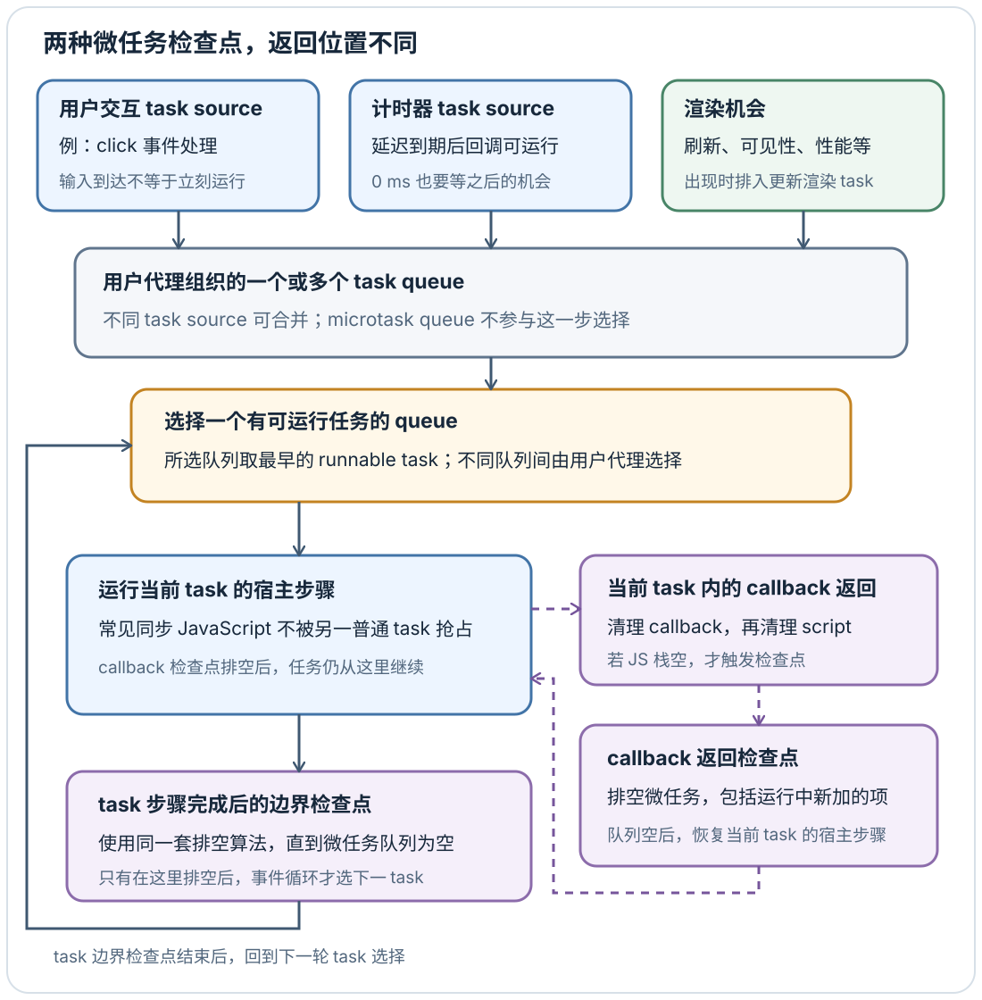
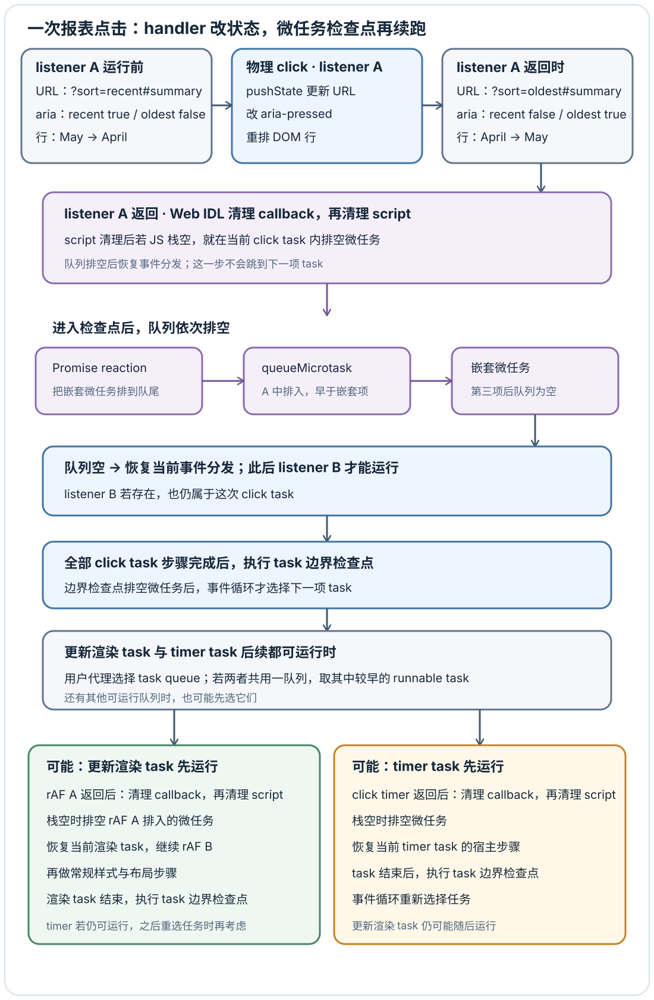

# 事件循环怎样安排任务、微任务和渲染？

本章沿用主线一的报表页（见[打开一个 URL 后，页面怎样变得可见又可交互？](from-url-to-interactive-page.md)）。页面已显示 `/reports/42?sort=recent#summary`，`/reports.js` 已在两个排序按钮的容器 `#sort-controls` 上注册了点击处理器。这里假设它已是完整版本，写地址的那一步在[地址变了，浏览器什么时候加载新文档？](navigation-history-and-url-state.md)补上。用户点“最早优先”后，处理器同步做三件事：用 `history.pushState()` 把地址改成 `sort=oldest`，把两个按钮的 `aria-pressed` 从 `true`/`false` 换成 `false`/`true`，把列表从 May → April 重排为 April → May。

本章回答两个问题：点击到达时如果主线程正在运行别的 JavaScript，处理器什么时候开始？处理器同步改完的 DOM，什么时候才有机会变成屏幕上的新画面？答案来自 HTML 规范定义的窗口事件循环，它协调事件、脚本、网络回调和渲染。这是宿主的调度模型，不对应某个浏览器固定的线程安排。

## 一次点击要跨过哪些调度边界

先给出全景，后面各节逐段展开：

1. 用户的点击变成一个排进队列的 task（任务）。
2. 事件循环从有可运行任务的队列里选中它。若当前还有别的任务在运行，它只能等。
3. 点击任务分发 `click` 事件，处理器同步运行到返回，期间不会被别的任务打断。
4. 处理器返回、JavaScript 调用栈变空时，事件循环排空 microtask（微任务）队列，例如 Promise 的后续回调。
5. 渲染机会出现时，浏览器排入一个更新渲染任务。它被选中后先运行 `requestAnimationFrame` 回调，再重算样式和布局，之后进入绘制与合成，新画面才出现。

## task 与 task source：下一项工作从哪里选

task 封装宿主安排的一段工作，例如分发一次点击、运行一个到期的计时器回调。task source（任务源）按工作类别给任务分组，例如用户交互、计时器、网络、更新渲染。

事件循环的 task queue（任务队列）不是所有回调共用的一条先进先出队列。规范允许用户代理把不同任务源合并进一个或多个队列；每一轮，事件循环选一个有可运行任务的队列，从中取最早的可运行任务。同一任务源内部保持顺序；不同队列之间选哪个，由用户代理决定。规范没有规定跨队列的固定优先级。它举过一个例子：用户代理可以把鼠标和键盘工作放进一个队列，四次选择中三次优先选它，同时保证其他队列也能推进。这只是说明实现有这种自由，不是浏览器必须采用的策略。

被选中的普通任务运行到它的步骤结束，期间同步 JavaScript 不会被另一个普通任务抢占。这就是第一个问题的答案：点击到达时如果当前同步脚本很长，或者它不断追加新的微任务，点击处理器只能等待。

**图：任务怎样被选中，两种微任务检查点各回到哪里**



## 渲染机会：画面更新也要排队

rendering opportunity（渲染机会）由用户代理根据显示器刷新、页面是否可见、性能等条件判断。规范把“判断有没有渲染机会、有就排入更新渲染任务”定义为与事件循环主步骤**并行**的步骤。所以同步 JavaScript 运行时，渲染机会照样可能出现，更新渲染任务照样会入队；被推迟的是事件循环之后选中并执行这个任务的时刻。

更新渲染任务和其他任务一样要参与队列选择。若计时器任务和渲染任务都已可运行、又在同一个队列里，先取较早入队的那个；若在不同队列，选哪个由用户代理决定。因此规范不保证每次点击之后立刻更新画面。

文档也可能不参与某一轮更新：页面隐藏、当前没有渲染机会时不更新；用户代理认为更新没有可见效果、又没有待运行的 `requestAnimationFrame` 回调时，也可以跳过，此外还有其他允许跳过的情形。

## 微任务检查点

本节是全领域关于微任务时机的权威说明。

### 微任务按什么顺序运行

microtask 是当前 JavaScript 工作结束后、下一个普通任务开始前处理的短小延续。最常见的是已兑现 Promise 上注册的 reaction（处理函数）：ECMAScript 把它定义为 Promise job，HTML 宿主把它接进事件循环的微任务队列；`queueMicrotask()` 直接往同一个队列里放回调。

下面的例子里，一个微任务在运行时又排入另一个微任务：

```javascript
console.log("start");
setTimeout(() => console.log("timer task"), 0);
Promise.resolve().then(() => {
  console.log("Promise reaction");
  queueMicrotask(() => console.log("queued by reaction"));
});
queueMicrotask(() => console.log("queued microtask"));
console.log("end");
```

输出顺序是 `start`、`end`、`Promise reaction`、`queued microtask`、`queued by reaction`，之后才是 `timer task`。推演如下：

1. 同步代码依次输出 `start`、`end`，期间登记了一个计时器、入队了 Promise reaction，又入队了 `queued microtask`。此时微任务队列是 `[reaction, queued microtask]`。
2. 脚本结束、调用栈变空，进入微任务检查点。先运行 reaction，它输出后把 `queued by reaction` 排到队尾，队列变成 `[queued microtask, queued by reaction]`。
3. 检查点不会因为某个微任务返回就结束，而是一直取到队列为空，所以接着运行剩下两项。
4. 计时器回调是一个独立的任务，要等延迟到期、并被事件循环选中后才运行。

### 两个入口：任务结束时，以及调用栈变空时

微任务检查点有两个入口，用的是同一套排空算法，区别在排空之后回到哪里：

- **任务边界检查点。** 一个任务的步骤结束后执行。排空后，事件循环才去选下一个任务。
- **回调返回后的检查点。** 浏览器调用一个 JavaScript 回调（事件监听器、`requestAnimationFrame` 回调等）后，会先做 Web IDL 的回调清理，再做 HTML 的脚本清理。前一步不运行微任务；后一步把脚本移出 JavaScript 执行上下文栈，若此时栈为空，就触发检查点。排空后回到调用这个回调的宿主步骤，当前任务继续执行，并不会跳到下一个任务。

HTML 还有一个防重入标志，阻止嵌套的检查点重复排空同一个队列。无论任务中途是否已经触发过检查点，任务结束时仍有一次边界检查点。

### 报表点击中的检查点

把这两个入口放到报表页的点击上。假设这次点击会依次经过两个监听器：A 是排序处理器，B 是之后运行、也监听 `click` 的另一个处理器（例如埋点）。

**图：一次物理点击中的状态转换、监听器之间的检查点和后续任务选择**



1. 监听器 A 运行前：地址是 `?sort=recent#summary`，`aria-pressed` 为 `true`/`false`，列表 May → April。
2. A 同步调用 `pushState()`，脚本立即就能从 `location` 读到 `sort=oldest`；它不会重新请求文档，也不会替页面排序。A 接着改 `aria-pressed`、重排 DOM 行。A 返回时 DOM 已经是新状态，屏幕上仍可能是旧画面。
3. A 返回后调用栈为空，于是在这次点击任务**内部**排空微任务：A 里排入的 Promise reaction、`queueMicrotask` 回调，以及它们运行时新排入的微任务，都在这里跑完。
4. 排空后恢复事件分发，B 才开始运行。B 仍属于同一个点击任务。
5. 点击任务的全部步骤结束后，执行任务边界检查点，然后事件循环选下一个任务。此时更新渲染任务和 A 里登记的计时器任务可能都已可运行，谁先由队列选择决定。

### 脚本调用 `.click()` 时为什么不同

上面的步骤 3 依赖“A 返回时栈为空”。如果点击是由脚本调用 `element.click()` 同步触发的，外层脚本还在栈上，A 返回时栈不为空，不会触发检查点。A、B 都先运行完，`.click()` 返回，外层脚本结束，栈空了才排空微任务。

所以同一组监听器，真实用户点击时“A 的微任务在 B 之前”，脚本 `.click()` 时“A、B 都在微任务之前”。测试里用 `.click()` 模拟点击、又依赖微任务时序的代码，可能观察到与真实点击不同的顺序。

> [!example] 实例：两次本机 trace（headless Chrome 157.0.8103.50，CDP）
> 测试页的监听器 A 依次排入 Promise reaction（其中再排入一个微任务）、`queueMicrotask`、两个 `requestAnimationFrame` 回调（A 里再排入一个微任务）和一个 `setTimeout`；监听器 B 只记录自己。
>
> - 用 CDP `Input.dispatchMouseEvent` 模拟鼠标输入（产生可信的 click）：`click A → promise microtask → queueMicrotask → microtask queued by promise → click B → rAF A → microtask from rAF A → rAF B → timer task`。
> - 在同步脚本里调用 `button.click()`：`click A → click B → outer end → promise microtask → queueMicrotask → microtask queued by promise → timer task → rAF A → microtask from rAF A → rAF B`。
>
> 两次运行中渲染任务和计时器任务的先后相反。这只是两次运行记录，不能推出触发方式决定顺序，也不说明哪个任务源有固定优先级。上面的控制台例子在同一浏览器中重放，顺序与推演一致。

## 计时器：`setTimeout(0)` 不是“立刻”，`await` 也不是让出

本节是全领域计时器语义的权威说明。

**延迟是下限，不是准点。** `setTimeout(fn, ms)` 登记一个计时器，延迟到期后才把回调作为任务排入计时器任务源。到期之后，任务还要等当前任务结束、等事件循环选中它。所以 `ms` 是最早可运行的时间，实际运行只会更晚。规范还在两处允许更晚：

- 嵌套层级超过 5 层的计时器（计时器回调里再登记计时器，层层嵌套），延迟小于 4 ms 时按 4 ms 处理。
- 用户代理可以再额外等待一段由实现决定的时间。浏览器借此对后台标签页、省电模式下的计时器节流。

**`setTimeout(fn, 0)` 只是安排一个之后的任务。** 它不会在当前同步代码中途切走，也不保证排在下一次渲染更新之前或之后。

**`await` 不让出给浏览器。** `await Promise.resolve()` 把后续代码安排为微任务；微任务检查点会把它和其后新增的微任务一起排空，期间浏览器不会处理输入或绘制。长同步循环和不断追加的微任务，都会让更新渲染任务一直等着被选中，页面因此卡住。

**真正的让出。** 一段有界计算要给输入和渲染让路，可以拆成多个后续任务（例如每批处理一部分后用 `setTimeout` 安排下一批），交给 Web Worker，或使用框架提供、目标环境支持的调度机制。React 等框架的调度器也建立在这些宿主机制之上，不是 HTML 规范的任务源。50,000 行排序这类计算怎样分块或移进 Worker，见[用户觉得慢时，怎样从指标走到证据？](../delivery/performance-metrics-and-diagnosis.md)。

**按回调次数计时会漂移。** `setInterval(fn, 1000)` 的 1000 ms 只是期望间隔，每次回调都可能晚到；若每次回调把剩余秒数减一，延迟会累积，实际结束时刻越来越晚。需要按真实截止时刻倒数时，每次回调都用当前时间重算剩余量：

```javascript
const deadline = performance.now() + 5000;
const timer = setInterval(() => {
  const remaining = Math.max(0, Math.ceil((deadline - performance.now()) / 1000));
  render(remaining); // render 是应用自己的显示函数
  if (remaining === 0) clearInterval(timer);
}, 250);
```

`clearTimeout()`/`clearInterval()` 只能阻止尚未开始运行的回调；回调一旦开始，清除计时器撤销不了它已经做的事。异步回调用 `setInterval` 轮询时，上一次请求还没结束下一次就可能开始，这类重叠和取消问题见[取消、超时和并发上限各自停得住什么？](../javascript/cancellation-timeouts-and-concurrency.md)。

## `requestAnimationFrame`：把写入对齐到渲染更新

`requestAnimationFrame(callback)`（rAF）把回调登记到文档的动画帧回调列表。它既不是独立任务，也不是微任务：用户代理选中更新渲染任务后，HTML 在这一轮常规样式和布局更新**之前**依次运行这些回调。页面有渲染机会、用户代理又没有跳过更新时，动画相关的写入就和这次更新对齐。普通 DOM 修改不需要 rAF，也会在后续更新渲染中反映出来。

rAF 回调同样经过回调清理和脚本清理：回调返回、栈变空时，在同一个渲染任务里排空微任务，然后回到更新渲染算法，继续运行下一个 rAF 回调，最后才做样式和布局。所以 rAF 回调里排入的 Promise reaction 会在本轮样式与布局之前执行，但不会多得一次输入处理或绘制机会。

rAF 的调用频率跟随渲染机会，不是固定的 60 Hz 计时器；页面隐藏或被节流时，回调可能推迟。回调收到的时间戳适合计算动画经过的时间。回调里的大量计算仍会拖慢本轮渲染；在里面读几何值还可能触发同步布局，把读写放进 rAF 并不保证只做合成。为什么读几何值会强制布局，见[DOM 改动后浏览器重做了什么，读几何值为什么会卡住脚本？](rendering-pipeline-and-forced-layout.md)。

## `requestIdleCallback`：只放可推迟的小块工作

`requestIdleCallback(callback, { timeout })` 让用户代理在它认为空闲时运行低优先级工作。浏览器窗口的事件循环只在没有可运行任务时才开始空闲期；空闲期何时开始、有多长都由用户代理决定，页面忙或隐藏时，回调可能很久都不运行。

- `deadline.timeRemaining()` 是剩余空闲时间的估计，不是执行预算，也不是抢占点：回调超时运行不会被打断。
- 传了正数 `timeout` 后，若回调没能在空闲期内运行，到期后用户代理会安排一个超时任务。规范允许它再等一段实现决定的时间才入队，入队后仍要等被选中。`deadline.didTimeout` 只说明这次是因为超时才执行。

```javascript
function runIdleSlice(deadline) {
  if (!workQueue.length) return;
  if (deadline.didTimeout || deadline.timeRemaining() > 0) {
    processNext(workQueue.shift()); // processNext 只处理一个有界项目
  }
  if (workQueue.length) requestIdleCallback(runIdleSlice, { timeout: 2000 });
}

requestIdleCallback(runIdleSlice, { timeout: 2000 });
```

`workQueue` 和 `processNext` 是应用自己的队列和工作函数。使用前要做能力检测；不支持时可以退回普通任务分片，但 `setTimeout()` 不能保证回调运行时浏览器正空闲。

## Node.js 的事件循环不是这一套

Node.js 的宿主边界不同：它按 libuv 的阶段处理计时器、I/O 和 `setImmediate()`，另有 `process.nextTick()` 队列；在 CommonJS 顶层和 ES 模块顶层，`nextTick` 与 Promise 微任务的相对顺序也可能不同。本章的渲染机会和 rAF 只属于浏览器窗口，不能套到 Node 的阶段图上。Node 的模型见[Node.js 事件循环阶段与微任务队列如何交互？](../../engineering-foundations/backend/node-event-loop-and-microtasks.md)。

## 处理器返回之后，下一步是什么

回到开头的两个问题。处理器要等当前任务结束、点击任务被选中才运行；它同步改完的 DOM，要等后续某个更新渲染任务被选中，经过 rAF、样式、布局、绘制和合成后才变成像素。微任务在每次栈变空和每个任务结束时排空，所以 Promise 回调总在下一个任务之前运行，却不会给浏览器让出绘制机会。

处理器能改 DOM 的前提是先找对节点、改对属性。下一章[怎样查询和修改 DOM，才拿到并改到预期的节点？](dom-queries-and-updates.md)从这里接手。Promise 本身怎样传递值和失败，见[Promise 和 async 函数怎样传递值和失败？](../javascript/promises-and-async-functions.md)。

> [!info]- 来源
> - **任务源、任务队列、任务选择与渲染机会（“task 与 task source”“渲染机会”）。** [WHATWG HTML §8.1.7 Event loops](https://html.spec.whatwg.org/multipage/webappapis.html#event-loops)，Living Standard，核对日期：2026-11-11；对照 §8.1.7.1 Definitions（任务源怎样映射到任务队列、不同来源可合并）、§8.1.7.2 Queuing tasks 与 [§8.1.7.3 Processing model](https://html.spec.whatwg.org/multipage/webappapis.html#event-loop-processing-model)（从所选队列取最早的可运行任务、任务结束后的微任务检查点、渲染机会在并行步骤中排入 rendering task source、跳过更新的条件）。用户交互优先的例子只是实现自由度示意。
> - **监听器调用、回调清理与空栈检查点（“两个入口”“报表点击中的检查点”“.click()”）。** [WHATWG DOM inner invoke](https://dom.spec.whatwg.org/#concept-event-listener-inner-invoke) 用 Web IDL [§3.11 call a user object's operation](https://webidl.spec.whatwg.org/#call-a-user-objects-operation) 调用事件监听器；rAF 回调走 [§3.12 invoke a callback function](https://webidl.spec.whatwg.org/#invoke-a-callback-function)。两条返回路径依次运行 `clean up after running a callback` 与 [WHATWG HTML §8.1.4.4 clean up after running script](https://html.spec.whatwg.org/multipage/webappapis.html#clean-up-after-running-script)，后者在执行上下文栈为空时调用 [§8.1.7.3 perform a microtask checkpoint](https://html.spec.whatwg.org/multipage/webappapis.html#perform-a-microtask-checkpoint)（含防重入标志）。Living Standard，核对日期：2026-11-11。
> - **History API 不重取文档（“报表点击中的检查点”）。** [WHATWG HTML §7.2.5 The History interface](https://html.spec.whatwg.org/multipage/nav-history-apis.html#the-history-interface)，Living Standard，核对日期：2026-11-11。
> - **Promise reaction 与微任务队列（“微任务按什么顺序运行”）。** [ECMAScript 2026 §27.2.1.8 TriggerPromiseReactions](https://tc39.es/ecma262/2026/#sec-triggerpromisereactions) 与 [§9.5.5 HostEnqueuePromiseJob](https://tc39.es/ecma262/2026/#sec-hostenqueuepromisejob)：按调用顺序运行 Promise job；[WHATWG HTML §8.1.6.6.4 HostEnqueuePromiseJob](https://html.spec.whatwg.org/multipage/webappapis.html#hostenqueuepromisejob) 接入宿主队列；[§8.8 Microtask queuing](https://html.spec.whatwg.org/multipage/timers-and-user-prompts.html#microtask-queuing)：`queueMicrotask()` 使用同一微任务队列。Living Standard，核对日期：2026-11-11。
> - **计时器语义（“计时器”）。** [WHATWG HTML §8.6 Timers，timer initialization steps](https://html.spec.whatwg.org/multipage/timers-and-user-prompts.html#timers)，Living Standard：超时表示最早可运行时间，嵌套层级大于 5 且超时小于 4 ms 时取 4 ms，用户代理可额外等待实现定义的时间；回调作为 timer task source 上的任务排入。核对日期：2026-11-12。
> - **rAF 与更新渲染（“requestAnimationFrame”）。** [WHATWG HTML §8.12 run the animation frame callbacks](https://html.spec.whatwg.org/multipage/imagebitmap-and-animations.html#run-the-animation-frame-callbacks) 与 [§8.1.7 update the rendering](https://html.spec.whatwg.org/multipage/webappapis.html#update-the-rendering)：动画帧回调在样式与布局更新之前运行。Living Standard，核对日期：2026-11-11。
> - **空闲回调（“requestIdleCallback”）。** [W3C requestIdleCallback() Working Draft，2025-05-21，§§2、4.1、4.3、5](https://www.w3.org/TR/requestidlecallback/)：用户代理决定的空闲期、deadline 与超时回调；[WHATWG HTML §8.1.7.3 Processing model](https://html.spec.whatwg.org/multipage/webappapis.html#event-loop-processing-model)：窗口事件循环在没有可运行任务时才启动空闲期。核对日期：2026-11-11。
> - **Node 边界（“Node.js 的事件循环不是这一套”）。** [Node.js v26.13.0 Event Loop](https://nodejs.org/learn/asynchronous-work/event-loop-timers-and-nexttick)：libuv 阶段；[Node.js v26.13.0 process.nextTick() 与 queueMicrotask()](https://nodejs.org/api/process.html#when-to-use-queuemicrotask-vs-processnexttick)：nextTick 队列与 CommonJS/ES 模块的排序差异。核对日期：2026-11-11。
> - **本机 trace（实例 callout）。** headless Chrome 157.0.8103.50，经 CDP `Input.dispatchMouseEvent` 模拟一次鼠标输入，另一次在同步脚本中调用 `button.click()`，记录见 callout；控制台例子以同一语句块重放（只给 `console.log` 包了一层记录器）。改写时另在 Node.js v26.13.1 复跑控制台例子，顺序一致。
