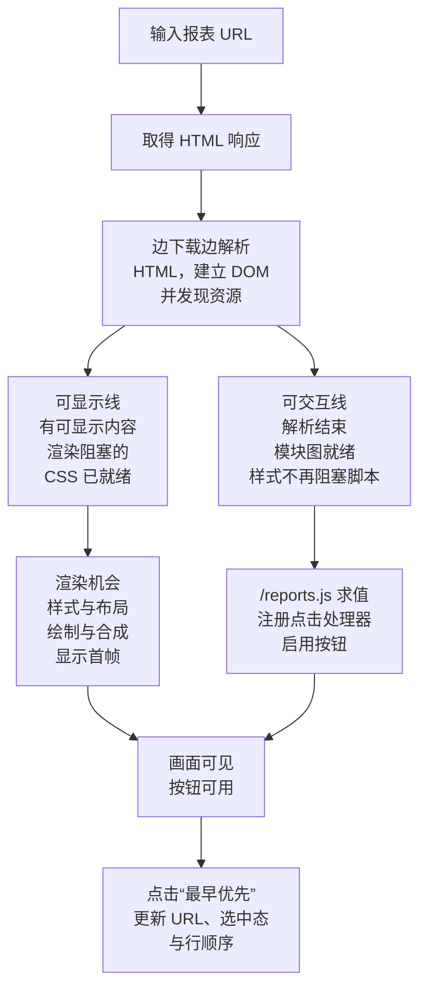
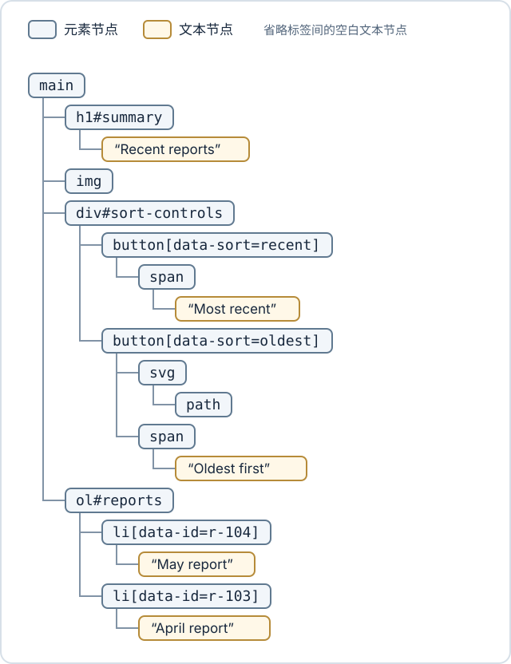
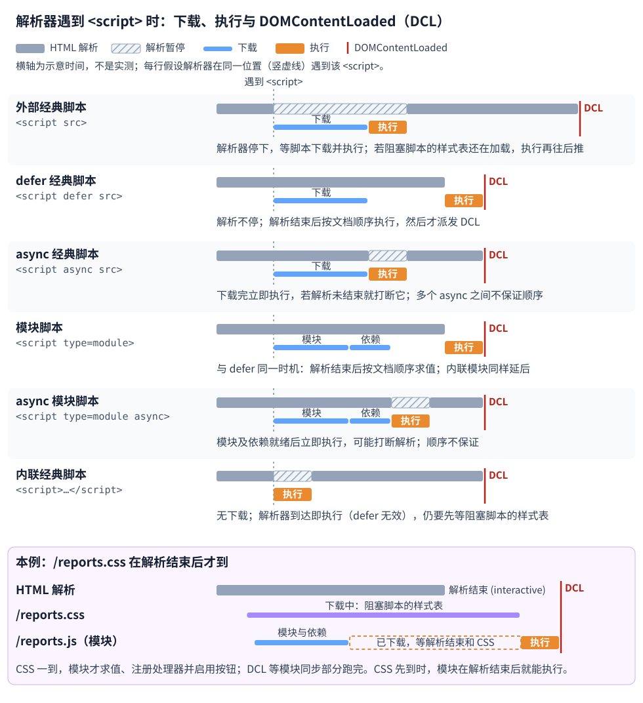

# 打开一个 URL 后，页面怎样变得可见又可交互？

本章从地址栏里的一个 URL 出发，走到页面第一次显示、再走到按钮第一次能响应点击。读者手上只有这个 URL 和服务器返回的一份 HTML；读完应能说清：HTML 从哪里来，解析时哪些资源会挡住首帧、哪些会挡住脚本，脚本按什么顺序执行，`DOMContentLoaded` 和 `load` 各保证了什么。

## 案例：一张能排序的报表页

本章建立的报表页是整个前端领域共用的案例，后面各章都沿用它，只补充各自新增的标识符。

用户在地址栏输入：

```text
https://reports.example/reports/42?sort=recent#summary
```

他想看报表 42 的列表，最近的月份排在前面，打开后直接定位到摘要标题。看完后，他会点“最早优先”按钮（按钮文字 `Oldest first`），期望列表改成按时间正序。服务器返回的 HTML 如下：

```html
<!doctype html>
<html lang="en">
<head>
  <meta charset="utf-8">
  <title>Report 42</title>
  <link rel="stylesheet" href="/reports.css">
  <script type="module" src="/reports.js"></script>
</head>
<body>
<main>
  <h1 id="summary">Recent reports</h1>
  
  <div id="sort-controls">
    <button type="button" data-sort="recent" aria-pressed="true" disabled>
      <span>Most recent</span>
    </button>
    <button type="button" data-sort="oldest" aria-pressed="false" disabled>
      <svg width="16" height="16" viewBox="0 0 16 16" aria-hidden="true">
        <path d="M8 13V3m-4 4 4-4 4 4" fill="none" stroke="currentColor"
              stroke-width="1.5" stroke-linecap="round" stroke-linejoin="round" />
      </svg>
      <span>Oldest first</span>
    </button>
  </div>
  <ol id="reports">
    <li data-id="r-104">May report</li>
    <li data-id="r-103">April report</li>
  </ol>
</main>
</body>
</html>
```

后文反复用到的标识符：

| 标识符 | 含义 |
|---|---|
| `/reports/42` | 报表 42 的页面路径 |
| `sort=recent` / `sort=oldest` | 两种排序；服务器按 `recent` 输出初始行序 |
| `#summary` | 摘要标题 `h1#summary` 的位置 |
| `button[data-sort]` | “最近优先”（`Most recent`）和“最早优先”（`Oldest first`）两个按钮，用 `aria-pressed` 表示当前选中哪一个 |
| `ol#reports` | 报表行列表；初始顺序 May → April |
| `r-104` / `r-103` | May 行和 April 行的业务 ID；`r-104` 的完整数据里还有负责人 `owner`（Ada，用户 ID `u-17`） |
| `/reports.css`、`/reports.js`、`/report-summary.png` | 样式表、客户端模块、摘要图 |

服务器已经把标题和两行数据写进 HTML，所以客户端代码运行前，页面就能显示内容。两个按钮先带着 `disabled` 输出，原因在[报表页怎样从看得见走到点得动](#报表页怎样从看得见走到点得动)一节说明。

这次打开要满足两条互相独立的就绪条件：



**可显示线**决定画面何时出现：浏览器拿到足够的 HTML，以及当前内容所需的、会阻塞渲染的 CSS 后，就可以给出一帧。**可交互线**决定点击何时有效：模块及其依赖下载完、HTML 解析结束、没有样式表阻塞脚本，模块才会执行并注册处理器。两条线交叠推进，谁先完成取决于网络和资源顺序。首帧已经出现、处理器还没注册时，页面看得见却点不动；模块获取失败或初始化报错，页面会一直停在这个状态。

这张图只描述本例的依赖关系，不代表浏览器内部有一条固定的线程流水线。

## 浏览器先从 URL 里读出什么

浏览器先判断地址栏里的文本是搜索词还是 URL。这里是完整 URL，于是开始一次跨文档导航，也就是加载一个新的 `Document`。

```text
https://reports.example/reports/42?sort=recent#summary
└─┬─┘   └──────┬──────┘└────┬────┘└─────┬────┘└───┬──┘
scheme       host         path        query   fragment
└──────────┬──────────┘
   origin（scheme + host + 默认端口 443）
```

对这次加载来说，path 和 query 会随请求发给服务器，服务器据此返回报表 42、按最近优先排好的行；fragment `#summary` 不发给服务器，留在浏览器里，用来在文档加载后滚动到 `id="summary"` 的元素。各分量的完整定义、path/query/fragment 怎样分工、什么界面状态该写进 URL，统一在[地址变了，浏览器什么时候加载新文档？](navigation-history-and-url-state.md)里讲。

## HTML 从哪里来

确定目标后，浏览器要拿到 `/reports/42?sort=recent` 的响应。它依次经过几个可能的来源，越靠前越可能省掉网络往返：

1. **Service Worker (服务工作线程)。** 如果这个 URL 的作用域内有处于活动状态的 Service Worker，它的 `fetch` 事件处理器可以直接返回自己构造或缓存的响应，也可以自己去请求网络。所以页面不一定向源站重新取 HTML。
2. **HTTP 缓存。** 缓存里若有新鲜且匹配的响应，直接复用；若响应需要验证，浏览器发条件请求，问服务器它是否仍然有效。新鲜度和验证的规则见[一份 HTTP 响应什么时候可以直接复用，什么时候必须回源确认？](../../engineering-foundations/services/http-caching-and-conditional-requests.md)；前端静态资源怎样借用它，见[发布新版本时，怎样让缓存和还开着的旧页面都不出错？](../delivery/hashed-release-and-caching.md)。
3. **复用已有连接。** 需要走网络时，浏览器可以复用一条适用于这次请求的活动连接，例如同一源上已经建立的 HTTP/2 连接。
4. **DNS 与 TLS。** 只有需要新建连接、而且主机地址也没有缓存时，才查询 Domain Name System (DNS，域名系统)。HTTPS 新连接还要完成 Transport Layer Security (TLS，传输层安全协议)握手：验证服务器证书，建立加密通道，然后才发送请求。
5. **重定向。** 若响应是重定向，浏览器按 `Location` 头继续导航；目标换了主机或协议时，连接也要按新目标重新确定。最终请求的地址和拿到的资源由整条重定向链决定。

逐个协议的细节见[一次 HTTP 请求怎样从浏览器到达服务，又带回什么？](../../engineering-foundations/services/http-semantics-and-transport.md)。

并非每次 URL 变化都要走这条路：`#summary` 这样的片段导航只在当前文档内定位；脚本用 History API 改地址时也不取新文档；用户后退时，浏览器还可能从 back/forward cache (前进/后退缓存)直接恢复整个旧页面，这和复用 HTTP 缓存里的响应是两回事。这些情况都在[地址变了，浏览器什么时候加载新文档？](navigation-history-and-url-state.md)里展开。

## 边下载边解析：DOM 和资源发现

浏览器不必等整个响应体下载完才开始工作。HTML 字节持续交给 HTML parser (HTML 解析器)，解析器按到达的内容逐步建出新文档的 Document Object Model (DOM，文档对象模型)，同时发现外部样式表、模块脚本和图片，让它们与解析并行下载。

解析器有时要停下来等脚本（下文说明原因）。停着的时候，浏览器还可以用预扫描器（preload scanner）往后读标记，提前发现并请求后面的资源。规范把这叫作推测式解析，是否做、怎样做由实现决定。

**本例 `<main>` 解析出的 DOM 子树**



DOM 只记录节点怎样嵌套。浏览器还要把 CSS 规则匹配到这些节点上，算出样式，生成盒子并布局，再绘制、合成，才能显示像素。这条从 DOM 到像素的流程见[DOM 改动后浏览器重做了什么？](rendering-pipeline-and-forced-layout.md)；本章只关心哪些资源会推迟它的第一次运行。

> [!info] 实例：三家浏览器的引擎组合
> 页面里有两类引擎协作：JavaScript 引擎执行 `/reports.js`，渲染引擎把 DOM 和 CSS 变成可显示的内容。Chromium 用 V8 与 Blink，Firefox 用 SpiderMonkey 与 Gecko，Safari 用 JavaScriptCore 与 WebKit。这些名字说明组件职责，不规定它们必须运行在哪个进程或线程。

## 哪些 CSS 会挡住首帧，为什么 CSS 还会挡住脚本

样式表能挡住两件不同的事：渲染和脚本执行。两者各有判定条件。

**挡住渲染。** 本例的 `<link rel="stylesheet">` 由解析器在 `<head>` 里创建、处于启用状态、`media` 条件匹配当前环境，所以它是渲染阻塞的：它加载完之前，浏览器可能推迟首帧，以免先画出没有样式的内容再跳变。这不等于“所有 CSS 下载完才能绘制”：`media` 不匹配的样式表（例如 `media="print"`）不阻塞渲染；按规范，`<body>` 出现之后才加入的元素也不再成为渲染阻塞元素。

**挡住脚本。** 脚本可能读取样式，例如调用 `getComputedStyle()`。浏览器不会先分析脚本里是否真的读了样式，而是按统一规则处理：HTML 规范维护一个“阻塞脚本的样式表”集合，解析器创建、处于启用状态、`media` 匹配且仍在加载的 `<style>` 或 stylesheet `<link>` 都在其中。只要这个集合非空，接下来要执行的同步脚本、延后脚本和模块都要等。所以 `/reports.js` 即使只是给按钮注册事件，也可能要先等 `/reports.css` 加载完。`async` 脚本不受这条限制。

**解析器为什么会为脚本停下。** 解析器按顺序读取标记、逐个建立节点；经典脚本却能在文档还没解析完时查询和修改它，甚至用 `document.write()` 往解析器里插入新的标记，改变后面的解析结果。浏览器无法事先断定某个脚本不会这样做，只好先执行它，再继续解析。所以脚本的**下载**可以和其他资源并行，脚本的**执行**却可能成为解析必须等待的点。

## 脚本的六种调度方式

这里只讨论 HTML 解析器在解析过程中遇到的 `<script>` 元素。用 JavaScript 创建并插入的脚本是另一套规则：外部经典脚本默认按 `async` 方式就绪即执行，把 `script.async` 设为 `false` 才按插入顺序执行。

下图回答每种写法的下载会不会让解析停下、执行落在解析结束和 `DOMContentLoaded` 的哪一侧；最下方一行换成本例的 `/reports.css` 与 `/reports.js`，并假设样式表在解析结束后才到；两种到达顺序的完整对照见下文[两种资源到达顺序下的时间线](#两种资源到达顺序下的时间线)。



图里没有画出的条件：外部经典脚本可能被预扫描器提前请求，但执行仍在解析器到达它之后；多个经典脚本、`defer` 脚本或普通模块之间都按文档顺序执行，只有 `async` 两种不保证顺序。

据此选择：需要完整 DOM、几个脚本之间又要保持顺序的代码，用 `defer` 或模块脚本；不依赖 DOM 解析结果、也不依赖其他脚本的独立工作（例如统计脚本），用 `async`。本例的 `/reports.js` 是图中“模块脚本”一行，所以“模块下载完”和“处理器注册完”是两个不同的时点。模块怎样解析地址、链接依赖，见[import 写下后，谁负责找到、链接和执行文件？](../javascript/modules-and-host-boundaries.md)。

## readyState、DOMContentLoaded 和 load 各保证什么

文档加载有三个检查点，都可以从 `document.readyState` 读到：

| `readyState` 与事件 | 何时发生 | 此时可以依赖什么 | 不能依赖什么 |
|---|---|---|---|
| `loading` | 解析器仍在解析 | 已解析出的那部分 DOM | 后面的节点还不存在 |
| `interactive`，`Document` 上派发 `readystatechange` | 解析器停止 | HTML 已全部解析成 DOM | 延后脚本和模块可能还在等文件、依赖或样式表 |
| `DOMContentLoaded`（仍是 `interactive`），派发到 `Document` | 延后脚本和普通模块的同步部分执行完之后 | 解析器遇到的 `defer` 和模块脚本都已执行 | 图片、`async` 脚本、模块的异步延续、应用自己的请求 |
| `complete`，`Window` 上的 `load` | 所有会延迟 load 的资源都已完成 | 普通图片、样式表、脚本、iframe 通常都已加载 | 懒加载资源一般不在其中；应用的 API 请求、hydration 或其他 Promise 可能还没完成 |

几点细节：

- **“执行完”只指同步部分。** 模块及其依赖都同步求值时，模块代码会在 `DOMContentLoaded` 前跑完。模块里若有顶层 `await`，`await` 之后的代码可能在事件之后才继续；依赖了这种模块的代码也可能被推迟。初始化如果把工作放进 Promise 回调或网络请求，同样可能晚于事件。所以 `DOMContentLoaded` 不代表应用初始化完成。
- **样式表能间接推迟 `DOMContentLoaded`。** 延后脚本要等阻塞脚本的样式表，事件又要等延后脚本。
- **`load` 的 target 是文档。** 监听器挂在 `window` 上，但出于历史兼容，`event.currentTarget` 是 `window`，`event.target` 却是 `document`。
- **这些事件都不报告首帧。** 首帧可以早于 `load`，也可以早于 `DOMContentLoaded`。

判断主要内容何时出现要看绘制，判断按钮能否使用要看初始化状态，两者不能用同一个事件代替。用户侧怎样测这两件事，见[用户觉得慢时，怎样从指标走到证据？](../delivery/performance-metrics-and-diagnosis.md)。

## 报表页怎样从看得见走到点得动

### 处理器就绪前先禁用按钮

服务器输出的按钮带着原生 `disabled`。模块还没装好处理器时，点击不会有任何效果；与其让点击被静默丢掉，不如明确显示为不可用。代价是模块加载失败时按钮会一直不可用。如果排序必须在没有 JavaScript 时也能用，可以改用指向 `?sort=oldest` 的链接或 GET 表单，让服务器按查询参数输出排好序的页面；表单怎样把控件序列化成查询串，见[表单控件怎样命名、提交和校验？](../html-css/accessible-forms-and-submission.md)。

### 报表模块

下面是 `/reports.js` 的最小版本。它只负责在合适的时机装上处理器、按排序重建行并同步按钮状态；把排序写进地址、支持后退的部分在[地址变了，浏览器什么时候加载新文档？](navigation-history-and-url-state.md)里补上。

```javascript
const records = [
  { id: "r-104", date: "2026-05-01", label: "May report" },
  { id: "r-103", date: "2026-04-01", label: "April report" },
];

function renderReports(list, controls, sort) {
  const rows = [...records].sort((a, b) =>
    sort === "oldest" ? a.date.localeCompare(b.date) : b.date.localeCompare(a.date)
  );
  for (const button of controls.querySelectorAll("button[data-sort]")) {
    button.setAttribute("aria-pressed", String(button.dataset.sort === sort));
  }
  list.replaceChildren(...rows.map(({ id, label }) => {
    const item = document.createElement("li");
    item.dataset.id = id;
    item.textContent = label;
    return item;
  }));
}

function initializeReportControls() {
  const controls = document.querySelector("#sort-controls");
  const list = document.querySelector("#reports");
  if (!controls || !list) return;

  controls.addEventListener("click", (event) => {
    const target = event.target instanceof Element ? event.target : null;
    const button = target?.closest("button[data-sort]");
    if (!button || !controls.contains(button)) return;
    const sort = button.dataset.sort;
    if (sort !== "recent" && sort !== "oldest") return;
    renderReports(list, controls, sort);
  });

  for (const button of controls.querySelectorAll("button[data-sort]")) {
    button.disabled = false;
  }
}

if (document.readyState === "loading") {
  document.addEventListener("DOMContentLoaded", initializeReportControls, { once: true });
} else {
  initializeReportControls();
}
```

初始化不重建列表：服务器输出的 May → April 已经对应 `sort=recent`。点击监听器挂在两个按钮的父元素上，用 `closest()` 找到被点的按钮，所以点到按钮里的文字或 SVG 图标都能命中；这种写法叫事件委托，见[一次点击怎样传播到处理器？](dom-events.md)。

### 晚到的脚本怎样不错过 DOMContentLoaded

模块末尾的 `if` 是一道就绪检查。`DOMContentLoaded` 只派发一次，不是之后还能订阅的状态：代码若在事件之后才注册监听器（例如通过动态 `import()` 晚加载），处理器永远不会被调用。所以先读 `document.readyState`：仍是 `loading`，就注册一次性监听器等事件；否则说明解析已经结束，直接初始化。同步执行的 JavaScript 不会被浏览器事件打断，检查状态和注册监听器之间不会恰好插进一次 `DOMContentLoaded`。

本例的模块默认延后到解析结束才执行，那时 `readyState` 已是 `interactive`，所以总是走直接初始化的分支；`loading` 分支是为解析期间就运行的其他入口准备的。

这道检查只保证 DOM 已可查询。初始化若依赖另一个尚未执行的延后脚本或模块的副作用，要等那个脚本自己的就绪信号；若依赖报表 API 请求或框架 hydration，也要单独表示并等待。

### 两种资源到达顺序下的时间线

下表沿时间列出页面状态。前两行对照两种到达顺序：CSS 先到、模块后到；或模块先到、CSS 还在加载。两条路径都汇入第三行。

| 资源状态 | 解析、DOM 与首帧 | 处理器与就绪事件 |
|---|---|---|
| 正文已解析（`interactive`），CSS 已就绪，模块或其依赖还在下载，图片未到 | 浏览器可以先画出标题和 May → April；图片按 320×180 留出位置；按钮显示为不可用 | 监听器未注册；`DOMContentLoaded` 仍在等模块 |
| 模块先到，CSS 仍在阻塞脚本 | 解析器可以继续补全正文，解析结束后变为 `interactive`；首帧也在等这份渲染阻塞的 CSS | 模块不执行；按钮不可用；`DOMContentLoaded` 未触发 |
| 解析结束，模块及依赖就绪，CSS 不再阻塞 | 模块同步运行初始化，保留 May → April，启用两个按钮 | 监听器就绪，`aria-pressed` 为 `true`/`false`；模块同步部分结束后才派发 `DOMContentLoaded` |
| 用户点已启用的“最早优先” | 不再解析 HTML；处理器重建列表 | `aria-pressed` 变为 `false`/`true`，顺序变为 April → May |

这张表把三件事分开：DOM 已建好、可以绘制、处理器已绑定。

### 图片先留位

`` 写了 `width="320" height="180"`。图片字节还没到或还没解码时，布局已经能按这个尺寸给它留出位置；图片到达后只填进这块区域，不会把下面的按钮和列表挤下去。没写尺寸的图片要等知道真实大小才能确定高度，加载完会让后续内容跳动。晚到的 Web 字体也可能改变文字宽度，引起重排。图片懒加载和优先级见[图片和音视频该怎样写语义、定地址、选文件和定加载时机？](images-and-media-loading.md)。

## 页面慢或点不动时，先查哪一段

| 现象 | 先查的阶段 |
|---|---|
| 首个 HTML 字节迟迟不到 | 重定向链、Service Worker 与缓存命中、连接建立、服务端响应 |
| HTML 已到，主要内容仍迟迟不出现 | 渲染阻塞的 CSS 和脚本、主要内容资源（例如主图）被发现和请求的时机 |
| 页面可见，点“最早优先”没反应 | 先确认 `/reports.js` 已求值、处理器已注册、按钮已启用；再查主线程上的其他工作是否拖住了事件处理 |
| 内容出现后位置跳动 | 图片和字体的尺寸与到达时机、后插入的内容 |

同一个“首屏慢”可能来自服务器响应、资源发现或渲染，先沿依赖关系定位是哪一段，再决定改请求、脚本、布局还是绘制。指标和工具见[用户觉得慢时，怎样从指标走到证据？](../delivery/performance-metrics-and-diagnosis.md)。如果页面由框架在服务端渲染，客户端还要做 hydration (水合)才能接上交互，那是可交互线上额外的一段，见[Next.js App Router 怎样把服务端渲染、缓存和客户端交互分开？](../ui-state/next-js-app-router.md)。

## 点击之后：处理器何时运行，画面何时更新

到这里，页面已经可见，`/reports.js` 已注册处理器并启用了按钮。用户点“最早优先”时，处理器同步重建列表、切换 `aria-pressed`；它返回时 DOM 已是 April → May，但屏幕上仍可能是上一帧，要等浏览器的下一次渲染机会才更新。

接下来的问题有三个：

- 点击到达时主线程若正忙，处理器什么时候开始？它改完的 DOM 何时变成像素？这由事件循环决定，见下一章[事件循环怎样安排任务、微任务和渲染？](event-loop-tasks-and-rendering.md)。
- 改 DOM 后浏览器重做了哪些样式、布局和绘制工作，见[DOM 改动后浏览器重做了什么？](rendering-pipeline-and-forced-layout.md)。
- 怎样把 `sort=oldest` 写进地址，让复制链接和后退都显示对的顺序，见[地址变了，浏览器什么时候加载新文档？](navigation-history-and-url-state.md)。

> [!info]- 来源
> - **URL 分量、片段与 origin（“浏览器先从 URL 里读出什么”）。** [RFC 3986 §3.5 Fragment](https://www.rfc-editor.org/rfc/rfc3986.html#section-3.5)：片段标识主资源中的次级内容；[WHATWG URL Standard，origin](https://url.spec.whatwg.org/#origin)，Living Standard，核对日期：2026-11-11。
> - **HTML 来源链（“HTML 从哪里来”）。** 活动 Service Worker 的 fetch 处理：[Service Workers Editor’s Draft（2026-10-29），Handle Fetch 算法](https://w3c.github.io/ServiceWorker/#handle-fetch)；[WHATWG Fetch Standard，HTTP-network-or-cache fetch](https://fetch.spec.whatwg.org/#http-network-or-cache-fetch)；新鲜缓存复用与验证：[RFC 9111 §4.2](https://www.rfc-editor.org/rfc/rfc9111.html#section-4.2) 与 [§4.3](https://www.rfc-editor.org/rfc/rfc9111.html#section-4.3)；重定向：[RFC 9110 §15.4](https://www.rfc-editor.org/rfc/rfc9110.html#section-15.4)；域名解析：[RFC 1034 §§3.1–3.2](https://www.rfc-editor.org/rfc/rfc1034.html#section-3.1) 与 [RFC 1035](https://www.rfc-editor.org/rfc/rfc1035.html)；HTTP/2 连接复用：[RFC 9113 §9.1.1](https://www.rfc-editor.org/rfc/rfc9113.html#section-9.1.1)；TLS 1.3 握手与证书认证：[RFC 8446 §§2、4.4.2–4.4.3](https://www.rfc-editor.org/rfc/rfc8446.html#section-4.4.3)。核对日期：2026-11-11。
> - **渐进解析与预扫描（“边下载边解析”）。** [WHATWG HTML，Parsing HTML documents](https://html.spec.whatwg.org/multipage/parsing.html) 与 [Speculative HTML parsing](https://html.spec.whatwg.org/multipage/parsing.html#speculative-html-parsing)，Living Standard（2026-11-11 更新）；推测获取的具体时机依实现而异。核对日期：2026-11-12。
> - **样式表阻塞渲染与阻塞脚本（“哪些 CSS 会挡住首帧”）。** [WHATWG HTML，link type stylesheet](https://html.spec.whatwg.org/multipage/links.html#link-type-stylesheet) 与 [render-blocking mechanism](https://html.spec.whatwg.org/multipage/dom.html#render-blocking-mechanism)：解析器创建的 stylesheet link 可能渲染阻塞，处理时检查 `media` 匹配；[interactions of styling and scripting](https://html.spec.whatwg.org/multipage/semantics.html#interactions-of-styling-and-scripting)：阻塞脚本的样式表集合及其条件。Living Standard（2026-11-11 更新），核对日期：2026-11-12。
> - **六种脚本调度（“脚本的六种调度方式”）。** [WHATWG HTML，script processing model](https://html.spec.whatwg.org/multipage/scripting.html#script-processing-model)，Living Standard（2026-11-11 更新）：外部/内联脚本、解析器阻塞脚本、defer 与模块列表、async 集合、非解析器插入脚本的 force-async 行为。核对日期：2026-11-12。
> - **readyState、DOMContentLoaded 与 load（“readyState、DOMContentLoaded 和 load 各保证什么”“晚到的脚本”）。** [WHATWG HTML，The end](https://html.spec.whatwg.org/multipage/parsing.html#the-end)：解析结束、延后脚本队列、DOMContentLoaded 与窗口 load 事件；[Reporting document loading status](https://html.spec.whatwg.org/multipage/dom.html#reporting-document-loading-status)：`loading`/`interactive`/`complete` 与 `readystatechange`。Living Standard（2026-11-11 更新），核对日期：2026-11-12。顶层 `await` 与模块异步求值：[ECMAScript 2027，Module evaluation](https://tc39.es/ecma262/#sec-moduleevaluation)，核对日期：2026-11-12。
> - **引擎组件实例。** [V8](https://v8.dev/)、[JavaScriptCore](https://docs.webkit.org/Deep%20Dive/JSC/JavaScriptCore.html)、[SpiderMonkey](https://firefox-source-docs.mozilla.org/js/)；[Blink](https://www.chromium.org/blink/)、[WebKit](https://webkit.org/)、[Gecko](https://firefox-source-docs.mozilla.org/overview/gecko.html)。核对日期：2026-11-11。
