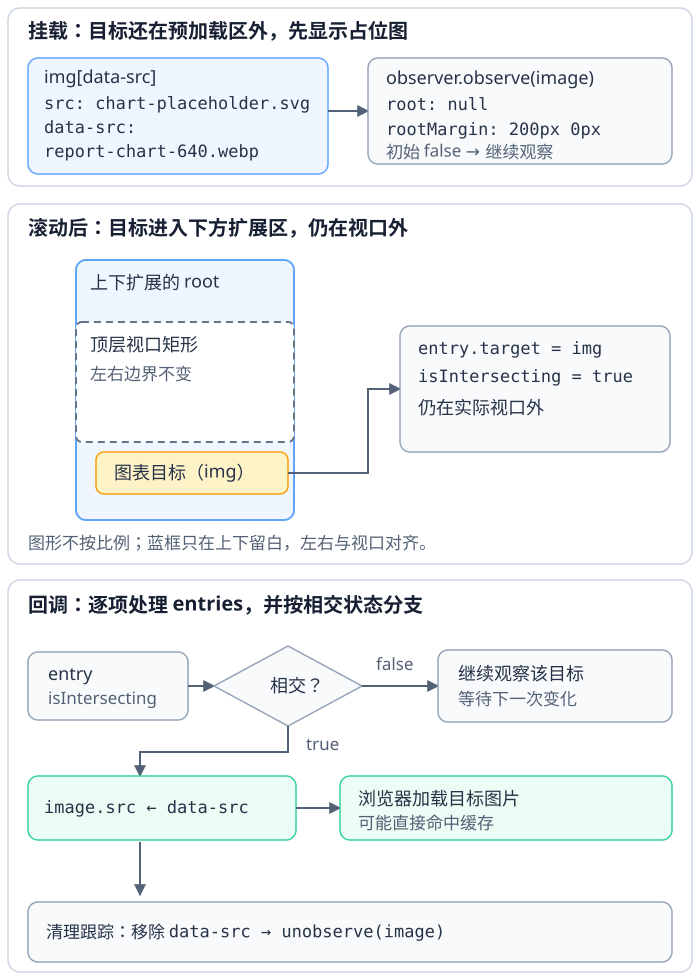

# 图片和音视频该怎样写语义、定地址、选文件和定加载时机？

一张图片或一段视频进入页面，要依次回答四个问题：它对读者意味着什么，文件地址相对谁解析，在多个候选文件里下载哪一个，什么时候开始请求。本章沿用主线一的报表页 `/reports/42?sort=recent#summary`，在首屏摘要图 `/report-summary.png` 之外，再给它加一张首屏以下的趋势图，对比四月与五月的合计（640×360；懒加载和观察器两节用 `report-chart-640.webp`，选文件一节改用 `report-640.webp`、`report-1280.webp` 两个分辨率版本），按这四个问题走完，并检查图片到达前后布局是否跳动。文件名、尺寸和 URL 都是教学用合成值。

## 图片在页面里承担什么角色？

先按内容选元素：图像内容用 ``，可播放的音频和视频用 `<audio>`、`<video>`。元素定了，再写 alternative text（替代文本），也就是 `alt` 属性。`alt` 写什么由图片的用途决定，不由图片长什么样决定：

| 图片用途 | `alt` 怎样写 | 报表页里的例子 |
|---|---|---|
| 纯装饰，不增加信息 | `alt=""`，让辅助技术跳过它 | 标题旁的花纹 |
| 传达信息 | 用一句话说出页面需要的信息 | 趋势图：`四月与五月的报表合计对比，五月更高` |
| 是链接或按钮的唯一内容 | 写控件的用途，而不是图案 | 只有放大镜图标的按钮：`搜索报表` |
| 复杂图表 | 简短 `alt` 说内容和主要结论，完整数据交给旁边的正文或数据表 | 多月趋势图配一张数据表 |

如果趋势图旁边已有一张数据表给出全部数值，图像不再增加信息，才可以当作装饰写 `alt=""`。`title` 不能代替 `alt`；同理，表单控件的名称应来自关联的 `<label>`，`title` 只是不可靠的备选。

图片常被包在可点击的元素里，这时还要分清链接和按钮：`<a href>` 用于导航到另一个地址，`<button>` 用于在当前页面执行动作。`href="#"` 不是“什么都不做”的占位写法：它会改变 fragment（片段）位置，还可能新增一条历史记录。链接文字要说明去向。

确需在新浏览上下文打开链接时写 `target="_blank"`。按当前 HTML 标准，只要没写 `rel="opener"`，它默认具有 `noopener` 效果，新页面拿不到指向原页面的 `opener` 引用。显式写 `rel="noopener"` 可以把意图留在标记上，也照顾较旧的浏览器。

## 资源地址相对哪个基准解析？

`` 指向要载入的资源，`<a href>` 指向导航目标，两者按同一套规则解析。URL 各分量的含义和分工见[地址变了，浏览器什么时候加载新文档，界面状态何时该写进 URL？](navigation-history-and-url-state.md)，这里只看相对地址怎样补全：

| 写法 | 示例 | 解析方式 |
|---|---|---|
| 绝对 URL（带 `https:` 这类 scheme 前缀） | `https://example.com/a.png` | 直接使用自身的 scheme 和地址；`mailto:team@example.com` 也是绝对 URL，只是没有主机 |
| 根相对路径 | `/assets/chart.png` | 从文档基准 URL 的 origin（源）根目录解析 |
| 文档相对路径 | `../assets/chart.png` | 相对文档基准 URL 的路径解析 |

文档基准 URL 默认就是当前文档的 URL。以报表页地址 `https://reports.example/reports/42?sort=recent#summary` 为例：

- `assets/chart.png` 相对目录 `/reports/` 解析为 `https://reports.example/reports/assets/chart.png`。查询串 `?sort=recent` 和片段 `#summary` 都不参与。
- `../assets/chart.png` 从 `/reports/` 上退一级，得到 `https://reports.example/assets/chart.png`。
- `/assets/chart.png` 直接从 origin 根开始，同样得到 `https://reports.example/assets/chart.png`。

`<base href>` 会改写文档基准 URL，连 origin 一起改。若页面写了 `<base href="https://cdn.example.net/reports/42/">`，`/assets/chart.png` 解析为 `https://cdn.example.net/assets/chart.png`，`../assets/chart.png` 解析为 `https://cdn.example.net/reports/assets/chart.png`。所以“根相对路径一定指向页面所在的站点”并不成立。

本机文件路径也会被当成 URL。把 `/project/site/image.png` 写进通过 HTTP 访问的页面，浏览器不会去读本机文件，而是把它当作根相对路径，向服务器请求 `https://reports.example/project/site/image.png`。服务器必须真的在这个路径上提供资源。

## 什么时候开始请求？

地址定了，下一步是请求时机。HTML 里图片默认立即获取；首屏之外的普通内容图片可以写 `loading="lazy"`，让浏览器推迟请求，直到图片接近视口。

~~~html

~~~

几条规则决定这个属性能不能按预期工作：

- **真实地址要写在 `src` 或 `srcset` 里。** 浏览器只认标准属性；只写 `data-src` 时根本不会发起请求。
- **“接近视口”的距离由浏览器决定。** 它不是可依赖的固定值。
- **脚本被禁用时不延迟。** HTML 标准规定此时 `loading="lazy"` 按立即加载处理，否则网站可以在不运行脚本的情况下，从图片请求的时间推测用户滚动到了哪里。因为真实地址留在 HTML 里，脚本被禁用的用户照样能看到图片；这一点与后文用 JavaScript 改写 `src` 的自定义做法不同。

### 宽高属性怎样防止布局跳动？

延迟请求意味着图片文件到达之前，页面已经排好了版。`width` 和 `height` 让浏览器在文件到达前就知道宽高比，从而预留空间。

> [!example] 预留高度的演算
> 上例 `width="640" height="360"`，宽高比是 `640 : 360 = 16 : 9`。CSS 让图片宽 `320px`、`height: auto` 时，文件到达前预留高度为 `320 × 9 ÷ 16 = 180px`。
>
> 如果实际文件是 `800 × 600`，比例是 `4 : 3`。浏览器拿到自然尺寸后把高度改成 `320 × 3 ÷ 4 = 240px`，下方内容被推下 `240 − 180 = 60px`。

所以宽高属性必须对应实际文件的比例；不同裁切的图片尤其要检查。也可以用容器的 `aspect-ratio` 配合 `object-fit` 控制展示盒，让文件比例不同也不改变布局。检查方法：在 DevTools 模拟慢网，分别在图片自然尺寸可用前后读 `getBoundingClientRect().height`，两次读数应相同。这个接口读的是哪一种盒，见[DOM 改动后浏览器重做了什么，读几何值为什么会卡住脚本？](rendering-pipeline-and-forced-layout.md)。

### 首屏主图为什么不能延迟？

延迟加载只适合首屏之外的图片。首屏的主图很可能是 Largest Contentful Paint（最大内容绘制，LCP）元素，而浏览器发现和请求它越晚，LCP 就越晚。因此：

- 已确认是 LCP 元素的图片不写 `loading="lazy"`；首屏可见、很可能成为 LCP 的主图（例如报表页的摘要图 `/report-summary.png`）也不写。
- 这张图写在初始 HTML 里，让浏览器边解析边发现并请求它，而不是等脚本插入。
- 测量显示它的请求优先级不够、且目标浏览器支持时，再加 `fetchpriority="high"`。这只是优先级提示，不保证生效；给大量资源都标高等于没标。

LCP 怎样测、慢在哪一段，见[用户觉得慢时，怎样从指标走到证据？](../delivery/performance-metrics-and-diagnosis.md)。

## 从多个候选里下载哪个文件？

时机决定何时下载，`srcset` 和 `sizes` 决定下载哪个文件：

- `srcset` 列出候选文件。`640w`、`1280w` 是各文件本身的像素宽度。
- `sizes` 告诉浏览器布局会给图片留多宽（CSS 像素）。浏览器在下载前还没排版，只能靠这个声明估算展示宽度。

下例让图片在视口不宽于 `640px` 时占满视口宽度，更宽时固定 `640px`。CSS 与 `sizes` 的写法必须一致。它可以和 `loading="lazy"`、宽高属性同时写在一个 `` 上：

~~~html

~~~

~~~css
.report-responsive {
  display: block;
  width: min(100vw, 640px);
  height: auto;
}
~~~

> [!example] 理想文件宽度
> device pixel ratio（设备像素比，DPR）是一个 CSS 像素对应几个设备像素。理想文件宽度 = 展示宽度 × DPR。
>
> - 视口宽 `320px`，按 `sizes` 展示宽度是 `320px`；DPR 为 `2` 时目标是 `320 × 2 = 640` 像素，通常选 `640w`。
> - 视口宽 `1024px`，展示宽度是 `640px`；DPR 为 `2` 时目标是 `640 × 2 = 1280` 像素，通常选 `1280w`。
>
> 这个乘法只说明目标。浏览器还会综合可用候选、缩放、缓存和自身策略来选，不保证一定选中某个候选。

两个常见错误：

- **宽度描述符没写 `sizes`。** 浏览器按 `100vw` 估算。图片实际只占半屏时，它会下载过大的文件。
- **以为 `sizes` 能自动跟随布局。** 普通 `sizes` 只是作者的声明。对 `loading="lazy"` 的图片，HTML 标准允许写 `sizes="auto, (max-width: 640px) 100vw, 640px"`：支持的浏览器在布局后用图片的实际宽度选文件，不支持的浏览器忽略 `auto`，使用后面的列表。各浏览器支持情况要按目标环境核验。

`srcset` 只在同一画面的不同分辨率之间选。窄屏如果需要不同裁切，用 `<picture>` 里带 `media` 条件的 `<source>`；没有 `<source>` 匹配时，浏览器使用 `` 自己的候选。下例窄屏图是 `800 × 600`（4:3），宽屏图是 `640 × 360`（16:9）。`<source>` 上的宽高属性让浏览器按选中裁切的比例预留空间，前一节的 60px 跳动就不会发生：

~~~html
<picture>
  <source media="(max-width: 640px)"
          srcset="/assets/report-narrow-crop.webp"
          width="800" height="600">
  
</picture>
~~~

## CSS 隐藏的图片会被请求吗？

会。CSS 只决定元素显示与否，不推迟普通 `` 的请求。按 HTML 标准，图片默认立即获取；只要 `` 带着 URL 进入文档，即使它处在 `display: none` 的祖先里，浏览器也可以去取。

横幅切换是常见的误区。下面是一张旧电商页面的归档截图，可见中秋活动文案、商品分类和左右切换箭头：

接下来的代码是另一个独立的合成示例，不是截图页面的源码。它用 `.current` 只显示一项：

~~~html
<ul class="report-banner">
  <li class="current">
    
  </li>
  <li>
    
  </li>
</ul>
~~~

~~~css
.report-banner {
  position: relative;
  overflow: hidden;
  aspect-ratio: 16 / 5;
  margin: 0;
  padding: 0;
  list-style: none;
}
.report-banner li { position: absolute; inset: 0; display: none; }
.report-banner li.current { display: block; }
.report-banner img { display: block; width: 100%; height: 100%; object-fit: cover; }
~~~

两个 URL 在 HTML 创建时就已给出，季度项虽然 `display: none`，浏览器仍可以请求它。若要由应用决定请求时机，初始状态不写真实 `src`，选中该项时再设置。

> [!info] 实测：隐藏图片被请求并解码
> Chromium `157.0.8103.51` 的本地小复现中，上例隐藏的季度图片被请求并解码。

这段代码只决定哪项显示，没有自动轮换、前后按钮、键盘操作或暂停控制，因此不是完整的轮播。真正的自动轮播要提供这些操作并照顾焦点、悬停和减少动态效果的偏好；暂停义务见[过渡和关键帧动画怎样选，怎样不伤性能和可访问性？](../html-css/transitions-and-animations.md)。

## 需要自己控制时机时，怎样用 IntersectionObserver？

`loading="lazy"` 把触发时机完全交给浏览器。下面几种情况需要自己控制，这时用 `IntersectionObserver`（相交观察器）：

- 观察范围是某个滚动容器，而不是视口；
- 要指定提前多远开始加载，或可见到什么比例才触发；
- 目标进入范围时，除了加载图片还要做别的事。

如果唯一需求是“首屏外图片晚点加载”，优先用原生 `loading="lazy"`。

下例由一个组件管理一批图片：查询限定在组件容器内，观察器只管这批图片。图片初始 `src` 是本地占位图；`data-src` 只是应用暂存的真实地址，浏览器不会去取它。

~~~html

  

~~~

~~~javascript
const observer = new IntersectionObserver((entries) => {
  for (const entry of entries) {
    if (!entry.isIntersecting) continue;

    const image = entry.target;
    image.src = image.dataset.src;
    image.removeAttribute("data-src");
    observer.unobserve(image);
  }
}, { root: null, rootMargin: "200px 0px", threshold: 0 });

const imageBatch = document.querySelector("#report-images");
for (const image of imageBatch.querySelectorAll("img[data-src]")) {
  observer.observe(image);
}
// 组件卸载时，由拥有该观察器的组件调用 observer.disconnect()。
~~~

三个配置项（假设图片在顶层页面里，且没有中间容器裁剪它）：

- `root: null` 使用隐式根，即顶层浏览上下文的文档，相交边界是顶层视口。页面嵌在 iframe 里时，这不是 iframe 自己的视口。把某个元素设为 `root` 时，目标必须是它的后代。
- `rootMargin: "200px 0px"` 把根矩形的上、下边各向外扩 `200px`，左右不变，于是图片在进入视口前 200px 就触发。它只扩大根自身的矩形，不改变其他祖先容器的裁剪。
- `threshold: 0` 表示一开始相交就通知。开始观察后，浏览器还会先发一次初始状态通知。

一次回调可能带来多个条目，所以要逐个处理：

1. `isIntersecting` 为 `false` 的条目跳过，继续观察。
2. 为 `true` 时，把真实地址赋给标准的 `src`。这一步才让浏览器开始加载。
3. 之后移除 `data-src`、调用 `unobserve`，只是清理属性和观察关系，不会触发加载。

**图：目标进入上下预加载区后，`src` 赋值触发加载；随后清理属性并停止观察**

这套做法还有几处边界：

- **`isIntersecting` 不等于“至少一像素可见”。** 目标与（扩展后的）根矩形边缘刚好接触时，它也可能为 `true`，此时交集面积为零。它也不能证明图片没被其他元素遮挡。
- **回调仍在主线程上运行。** 通知是异步发送的，但回调在页面的事件循环中执行，里面做重活照样占用主线程。
- **失败要自己处理。** 图片加载失败时，应用要监听 `load` / `error`，并做有次数上限的重试。
- **不运行脚本的用户什么也看不到。** 唯一的地址放在 `data-src` 里，脚本不运行就永远不会加载。需要时另给非脚本后备，例如 `<noscript>` 里的 ``。
- **卸载时断开。** 加载成功后宽高属性继续保持布局；组件卸载时，由拥有观察器的组件调用 `disconnect()` 停止观察全部目标。

只有必须兼容不支持 IntersectionObserver 的浏览器时，才用 `scroll` / `resize` 事件加几何检查作回退：挂载时先检查一次，之后的检查要节流（见[怎样包装一个函数而不弄丢参数、this 和结果？](../javascript/wrapping-functions.md)）；卸载时移除监听器，并取消尚未执行的定时检查，避免回调继续引用已移除的 DOM 节点。

## 音频和视频还要写什么？

`<audio>` 和 `<video>` 同样有语义和加载时机两方面的问题。

语义上：

- 写 `controls`，用户才能用浏览器自带的控件开始、暂停和调节播放。不要用视觉样式冒充媒体控件。
- 各浏览器和平台支持的格式与编解码器不同，可以按目标环境提供多个 `<source>`，浏览器选第一个能播的。
- 字幕用 `<track>` 提供。
- 给视频写宽高或比例，降低播放器加入布局时的跳动。

加载时机上：

- `preload` 只表达对媒体数据的加载偏好，浏览器可以不照做。单写 `preload="none"` 也不保证 `poster` 封面图不被请求。
- 在支持媒体懒加载的浏览器里，首屏外的播放器可以写 `loading="lazy"`。它推迟媒体数据请求，连 `poster` 也一起推迟，并且优先于 `preload` 生效。首屏的主要媒体不应延迟。
- `autoplay` 只是自动播放请求，可能被浏览器的自动播放策略拒绝。

~~~html
<audio controls loading="lazy" preload="metadata">
  <source src="/media/summary.ogg" type="audio/ogg">
  <source src="/media/summary.mp3" type="audio/mpeg">
</audio>

<video controls loading="lazy" preload="metadata"
       width="640" height="360" poster="/media/preview.jpg">
  <source src="/media/demo.webm" type="video/webm">
  <source src="/media/demo.mp4" type="video/mp4">
  <track kind="captions" src="/media/demo.zh.vtt" srclang="zh" label="中文字幕">
</video>
~~~

> [!info] 媒体元素 `loading` 的支持情况（核对于 2026-11-12）
> HTML 标准已为 `<audio>`、`<video>` 定义 `loading`。Chrome 148（2026-05 发布）起支持；其他浏览器需按目标环境核验。不支持的浏览器忽略这个属性，按 `preload` 行事。

## 这些选择交给谁检验？

到这里，报表页的趋势图有了按用途写的 `alt`，地址按文档基准 URL 解析，`srcset`/`sizes` 或 `<picture>` 决定下载哪个文件，`loading`、`fetchpriority` 或 IntersectionObserver 决定何时请求，宽高属性保证到达前后布局不变。

还有两件事不在本章：这些选择是否真的让 LCP 变快，要在[用户觉得慢时，怎样从指标走到证据？](../delivery/performance-metrics-and-diagnosis.md)里测；同一张图下次访问能否直接用缓存、发布新版本时怎样换文件，见[发布新版本时，怎样让缓存和还开着的旧页面都不出错？](../delivery/hashed-release-and-caching.md)。按钮上的小图标该用哪种载体，见[图标该用行内 SVG、外部图片、雪碧图还是图标字体？](../delivery/icon-delivery.md)。

> [!info]- 来源
> - 替代文本按用途写（信息图、装饰图、功能图、复杂图）：W3C WAI [Images Tutorial](https://www.w3.org/WAI/tutorials/images/)；表单控件标签优先于 `title`：W3C WAI [Labeling Controls](https://www.w3.org/WAI/tutorials/forms/labels/)，核验于 2026-11-12。支持“图片在页面里承担什么角色？”。
> - `target="_blank"` 默认 `noopener`：WHATWG HTML Living Standard，[Links / `noopener`](https://html.spec.whatwg.org/multipage/links.html#link-type-noopener)，最后更新于 2026-11-11，核验于 2026-11-12。
> - 文档基准 URL、`<base>` 与相对 URL 解析：WHATWG HTML Living Standard，[Document base URLs](https://html.spec.whatwg.org/multipage/urls-and-fetching.html#document-base-urls)，最后更新于 2026-11-11；URL Standard，[Basic URL parser](https://url.spec.whatwg.org/#concept-basic-url-parser)，最后更新于 2026-10-19，核验于 2026-11-12。支持“资源地址相对哪个基准解析？”。
> - 图片与媒体 `loading` 的延迟条件（含脚本禁用时不延迟）、`preload` 优先级与 poster 延迟：WHATWG HTML Living Standard，[Lazy loading attributes](https://html.spec.whatwg.org/multipage/urls-and-fetching.html#lazy-loading-attributes)（最后更新于 2026-11-11）与 [Media elements](https://html.spec.whatwg.org/multipage/media.html#attr-media-loading)（最后更新于 2026-11-12）；`fetchpriority`：[Fetch priority attributes](https://html.spec.whatwg.org/multipage/urls-and-fetching.html#fetch-priority-attributes)，最后更新于 2026-11-11，核验于 2026-11-12。
> - `picture`、`source`、`img`、宽高属性、`srcset`、`sizes`（含仅用于懒加载图片的 `sizes="auto"`）、图片默认立即获取与媒体元素：WHATWG HTML Living Standard，[Embedded content](https://html.spec.whatwg.org/multipage/embedded-content.html)、[Images / parsing a sizes attribute](https://html.spec.whatwg.org/multipage/images.html#parsing-a-sizes-attribute)、[Media elements](https://html.spec.whatwg.org/multipage/media.html)，均最后更新于 2026-11-12，核验于 2026-11-12。
> - LCP 图片不宜延迟加载，高优先级提示只给少数关键资源：web.dev，[Optimize Largest Contentful Paint](https://web.dev/articles/optimize-lcp)，最后更新于 2025-03-31，访问于 2026-11-12。
> - Chrome 媒体懒加载的版本与使用条件：[New in Chrome 148](https://developer.chrome.com/blog/new-in-chrome-148#lazy_loading_for_video_and_audio_elements)（发布于 2026-05-05）与 [Lazy-load video and audio](https://developer.chrome.com/docs/modern-web-guidance/guides/performance/lazy-load-video-and-audio)，访问于 2026-11-12。
> - `root`、`rootMargin`、初始通知、阈值、异步通知与边缘相接时的 `isIntersecting`：W3C [Intersection Observer](https://www.w3.org/TR/intersection-observer/)，Working Draft 2023-10-18，§2.2–2.4、§3.2.2–3.2.5、§3.2.7–3.2.8；W3C 页面列为最新发布稿，核验于 2026-11-12。
> - `aspect-ratio`：[CSS Box Sizing Module Level 4](https://www.w3.org/TR/css-sizing-4/#aspect-ratio)，Working Draft 2026-09-04；`object-fit`：[CSS Images Module Level 3](https://www.w3.org/TR/css-images-3/#the-object-fit)，Candidate Recommendation Draft 2023-12-18；`getBoundingClientRect`：[CSSOM View Module](https://www.w3.org/TR/cssom-view-1/)，Working Draft 2025-09-16。
> - 轮播需要的操作控制：W3C [WAI-ARIA APG Carousel Pattern](https://www.w3.org/WAI/ARIA/apg/patterns/carousel/)，核验于 2026-11-12。隐藏横幅图片被请求并解码：Chromium `157.0.8103.51` 本地复现（原稿记录），仅说明该版本行为与标准一致。
