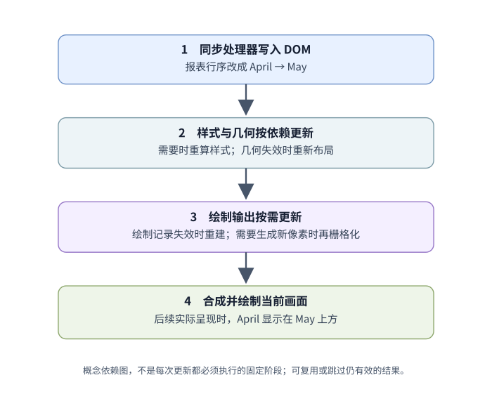
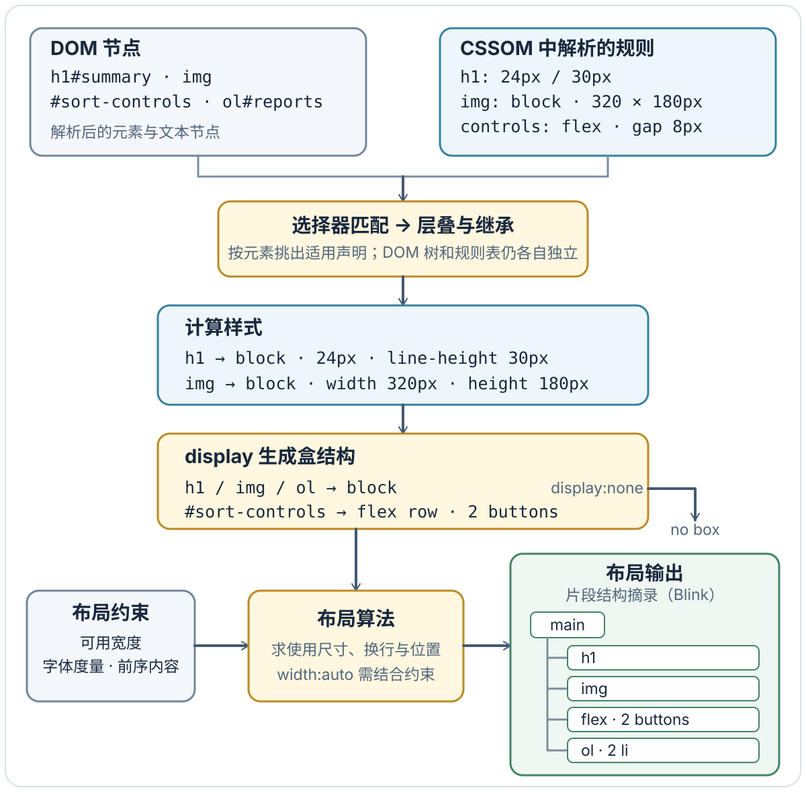
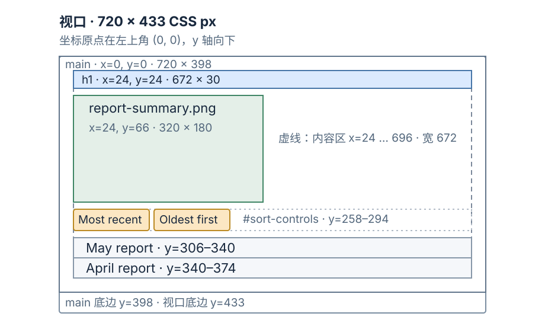
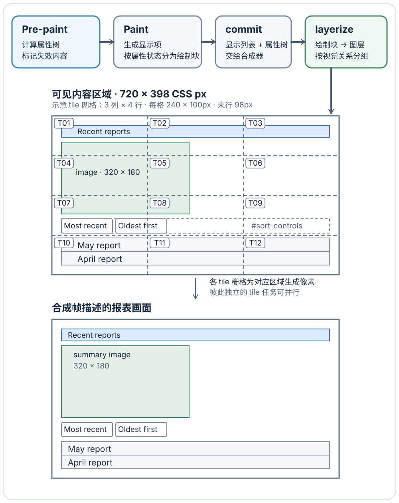
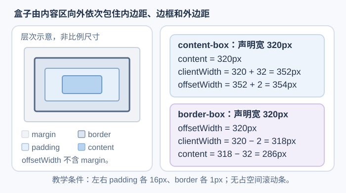
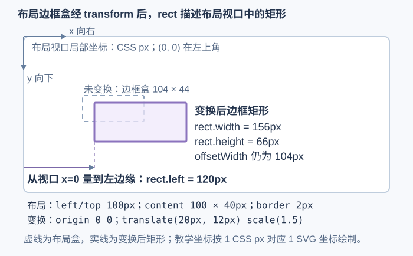
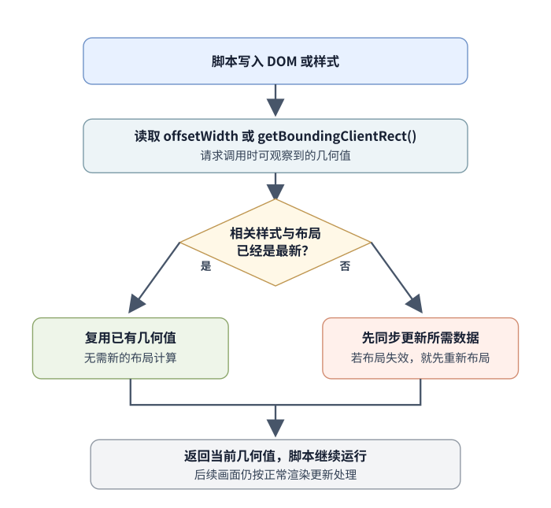

# DOM 改动后浏览器重做了什么，读几何值为什么会卡住脚本？

点击处理器把报表行改成 April、May 之后，屏幕不会自己变。本章回答两件事：浏览器怎样从 DOM 和 CSS 一路算出像素，一次改动会让其中哪些结果失效；以及脚本读取元素尺寸、位置时，各个几何 API 到底量的是什么，为什么有时要先等浏览器把布局算完。沿用主线一的报表页，读者手上有上一章[一次点击怎样传播到处理器？](./dom-events.md)的结果：同步处理器已经改好 DOM，正等待下一次渲染机会（渲染机会怎样排进事件循环，见[事件循环怎样安排任务、微任务和渲染？](./event-loop-tasks-and-rendering.md)）。

## 从 DOM 到像素要更新哪几层？

DOM 只记录节点怎样嵌套。要变成画面，还要依次派生出几层数据：

1. **style（样式）**：CSS 规则匹配当前 DOM，为每个元素算出 computed style（计算样式）。
2. **layout（布局）**：为盒子求出尺寸与位置。
3. **paint（绘制）**：把几何、颜色、文字和图片变成有顺序的绘制操作。
4. **raster（栅格化）与 composite（合成）**：需要新像素时把绘制操作转成像素，再把各绘制表面组合成一帧交给显示。



这是说明依赖关系的概念模型。HTML 标准规定了浏览器何时有机会更新渲染，以及其中包括样式和布局等步骤，但没有规定各浏览器使用同样的内部阶段、线程或绘图技术。浏览器可以推迟和合并工作，复用仍然有效的结果，跳过没有失效的层。

## DOM 节点和 CSS 规则怎样变成布局用的盒？

### 计算样式不是最终几何

`/reports.css` 到达后，CSS 解析器把文本解析成样式表和规则；脚本可见的 CSS Object Model（CSSOM，CSS 对象模型）用 `CSSStyleSheet`、`CSSRule` 等对象表示它们。规则不是 DOM 节点：渲染时浏览器让选择器匹配 DOM，按层叠与继承为每个元素挑出适用声明（冲突怎样裁决见[多条 CSS 声明冲突时谁赢，没有声明时值又从哪来？](../html-css/css-cascade-and-inheritance.md)），得到 computed value（计算值），例如标题的字号和行高。

计算值还不是位置和尺寸。`width: auto` 这样的值要结合可用宽度、字体度量和前面内容，由布局算法求出 used value（使用值）。

### DOM 和盒不是一一对应

`display` 等属性决定一个元素生成什么盒，但 DOM 节点和盒不是一一对应的：

- `display: none` 的元素不生成盒（各种隐藏方式的差异见[隐藏内容时，布局、指针、焦点和读屏各受什么影响？](../html-css/hiding-content-and-focus.md)）。
- `display: contents` 的元素自己不生成盒，子元素照常生成。
- 一个文本节点换行后，会对应多个行内片段。

布局再按父容器约束和前面内容的尺寸，确定每个盒或片段的宽高、坐标和顺序。Blink 把一种布局结果组织为 fragment tree（片段树），Gecko 用 frame tree（帧树），一个节点也可能对应多个 frame。共同点是：这些结构携带布局结果，不是 DOM 的原样复制。



## 报表页的纵向布局可以手算

为了看清布局算了什么，给报表页的 `<main>` 子树（标题、摘要图、排序工具栏、两行报表）配一份教学用 CSS。它不是真实站点样式：为消除默认样式对坐标的影响，规则清掉了标题上外边距、按钮内边距和列表缩进，把图片设为块级以去掉行内基线间隙，并全局使用 `border-box`（盒尺寸的算法见[盒子的尺寸怎样计算，块和浮动怎样在流里排开？](../html-css/box-model-and-normal-flow.md)）。

```css
*, *::before, *::after { box-sizing: border-box; }
html, body { display: block; margin: 0; padding: 0; }
body { font: 16px Arial, sans-serif; }
main { display: block; width: 100%; padding: 24px; }
h1 { display: block; margin: 0 0 12px; font-size: 24px; line-height: 30px; font-weight: 700; }
img { display: block; width: 320px; height: 180px; margin: 0 0 12px; }
#sort-controls { display: flex; gap: 8px; margin: 0 0 12px; }
button { display: inline-flex; width: 128px; height: 36px; margin: 0; padding: 0; border: 1px solid; font: inherit; }
button svg { display: block; width: 16px; height: 16px; flex: none; }
#reports { display: block; margin: 0; padding: 0; list-style: none; }
#reports li { display: block; height: 34px; margin: 0; padding: 0; line-height: 34px; }
```

视口宽 720 CSS px 时，从这些声明可以直接推出每个盒的位置：

- `main` 宽 720，四边 padding 24，所以内容区从 `(24, 24)` 开始，宽 `720 − 2×24 = 672`。
- 标题、图片、工具栏、列表是纵向排列的块，第一行报表的上边是 `24 + 30 + 12 + 180 + 12 + 36 + 12 = 306`。
- 两个按钮在 flex 行内横排：第一个覆盖 `x = 24…152`，加 8px 间隙后第二个覆盖 `160…288`。
- 两行各高 34，边界是 `306–340` 和 `340–374`；`main` 底边再加 24 的 padding，高 `374 + 24 = 398`。

> [!example] 实测核对：headless Chrome 157.0.8103.50
> 把 `<main>` 子树放进测量页并应用上面的 CSS，图片用本地 `data:` 占位替代。测得 `innerWidth = 720`、`innerHeight = 433`、`devicePixelRatio = 1`。`getBoundingClientRect()`（后文几何 API 一节详解）读数以视口左上为原点、单位 CSS px，与手算一致：
>
> | 元素 | x, y | width × height | 边缘 |
> |---|---:|---:|---:|
> | `main` | `0, 0` | `720 × 398` | 内容区起点 `(24, 24)`，宽 `672` |
> | `h1#summary` | `24, 24` | `672 × 30` | 下边 `54` |
> | `img` | `24, 66` | `320 × 180` | 下边 `246` |
> | `#sort-controls` | `24, 258` | `672 × 36` | 下边 `294` |
> | `ol#reports` | `24, 306` | `672 × 68` | 下边 `374` |
> | May 行 / April 行 | `24, 306` / `24, 340` | 各 `672 × 34` | `306–340`、`340–374` |
>
> 

这条链说明了流式布局的依赖：后面的块位置取决于前面内容的尺寸。所以图片写明 `width` 和 `height` 才能让布局在字节到达前就按 `320×180` 留位（见[打开一个 URL 后，页面怎样变得可见又可交互？](./from-url-to-interactive-page.md)）；没写尺寸的图片、晚到的字体会在到达后改变前面盒子的尺寸，后面的内容跟着移动。排序后 April 行和 May 行交换了 DOM 顺序，于是 April 的盒落到 `306–340`，May 落到 `340–374`。

## 布局结果怎样变成屏幕上的像素？

布局只给出盒子和文字片段的几何，没有画出字形或背景。绘制阶段按 CSS 绘制顺序把几何、颜色、图片等转成有顺序的绘制项；一个元素可能产生多个绘制项，例如背景和文字。图片未解码时，它的框已参与布局，图像内容要等资源可用。

之后的步骤因引擎而异，下面以一个公开实现为例。

### Chromium RenderingNG 实例

按 Chromium RenderingNG 架构文档（核对于 2026-11-11）：

1. **Pre-paint** 计算 transform、clip、effect、scroll 四类 property trees（属性树），并标记失效的显示项或图块。
2. **Paint** 按绘制顺序生成 display items（显示项），把共享同一属性状态的显示项分组为 paint chunks（绘制块）。
3. **Commit** 把显示列表和属性树交给合成器；**layerize** 按可独立合成的视觉关系把绘制块组织成一层或多层。
4. **Raster** 把可见空间切成相邻的 tile（图块），每个栅格任务处理覆盖到某个矩形图块的绘制项；互不依赖的图块可以并行。一个绘制项可以跨多个图块，各图块只得到自己那部分像素。长页面可以复用已栅格的图块，滚动时补画新进入视口的区域。
5. **Activate** 产生描述图块摆放和视觉效果的 compositor frame（合成帧）；**Viz** 汇总各可见表面的合成帧，由 GPU 执行 Draw 画出屏幕像素。



图中的 `3×4` 网格是教学假设：每格 `240×100 CSS px`，最下排高 98px，正好铺满 `main` 的 `720×398`（`3×240 = 720`，`3×100 + 98 = 398`）；`main` 完整位于 `720×433` 的视口内，下方还有 35px 空白。它不代表 Chromium 实际的图块尺寸或图层数量，真实引擎按视口、失效范围、图层属性和设备条件决定更新哪些图块。网格线和虚线只是定位参考，合成帧描述的画面里没有它们。

Firefox 的公开说明也从 DOM/CSS 得到布局 frame，再生成 WebRender 显示列表、场景和帧，具体表示和进程安排不同。所以这些阶段名只描述 Chromium，不是网页标准规定的固定流水线。

## 一次改动会让哪些结果失效？

报表页的点击让 DOM 顺序变了，浏览器要在后续渲染机会更新受影响的部分。改什么决定了哪些数据失效：

| 对报表页做什么 | 可能要更新什么 | 仅凭操作名称推不出什么 |
|---|---|---|
| 把两行从 May、April 调成 April、May | 受影响的样式、几何和绘制结果 | 失效范围取决于选择器依赖、布局关系与引擎优化 |
| 只把按钮文字颜色改成强调色 | 重算适用样式，更新相应绘制 | 尺寸和换行不变时，几何通常可复用 |
| 改宽度、字体或会占空间的内容 | 受影响盒子的尺寸和后续位置，再更新绘制 | 重新布局的范围不一定只限于被改的节点 |
| 改 `transform` 或 `opacity` | 某些实现路径可跳过布局，甚至复用绘制结果 | 不能凭属性名保证只走合成或使用 GPU |
| DOM 或样式写入后读取几何 | 若所需样式或布局已失效，读取前同步更新 | 同一个几何 API 并非每次调用都触发布局 |

reflow（重排）和 repaint（重绘）是常见的工程说法，指“重新布局”和“重新绘制”，不是可以跨浏览器比较的指标。一个节点尺寸变化后，排在后面的内容可能都要移动；属性变了但几何没失效时，也可能不必重做布局。`transform` 和 `opacity` 常被选作动画属性，是因为它们在某些渲染路径中能绕过布局或复用绘制内容；目标页面是否真走这条路，要看目标浏览器的性能录制（动画层面的取舍见[过渡和关键帧动画怎样选，怎样不伤性能和可访问性？](../html-css/transitions-and-animations.md)）。

处理器返回时 DOM 已是新顺序，但浏览器不保证每个任务结束就画一帧，读取几何也不会让屏幕立即多画一帧。上表最后一行是脚本能直接撞上的成本，下面先看几何 API 各量什么，再看读取为什么会卡住。

## 哪个几何 API 回答哪个测量问题？

几组几何 API 回答的是不同问题。选错时读到的数值看起来正常，回答的却是另一个问题：

| API | 返回什么 | 不含什么 / 要留意 |
|---|---|---|
| `offsetWidth` / `offsetHeight` | 边框盒的整数宽高（多片段时取轴对齐包围范围）；占布局空间的滚动条计入 | 不含 margin；忽略元素和祖先上的 transform |
| `clientWidth` / `clientHeight` | padding 区的整数尺寸 | 不含 border 和占空间的滚动条；普通 inline 元素或无盒元素返回 `0`；标准模式下根元素表示视口尺寸 |
| `scrollWidth` / `scrollHeight` | 滚动区域的整数尺寸，可大于客户区 | 不含 border；大于客户区不保证用户能滚动 |
| `scrollLeft` / `scrollTop` | 当前滚动位置，可写 | 规范类型允许小数，浏览器可能取整；零点和正负方向取决于书写方向 |
| `offsetLeft` / `offsetTop` | 第一个边框盒片段相对 `offsetParent` 的偏移 | 参照系分三种情况（见下文）；忽略 transform |
| `getBoundingClientRect()` | 变换后边框片段相对布局视口的包围矩形，可为小数 | 不含 margin；结果是读取时的快照，不随后续滚动或布局更新 |

单位都是 CSS 像素，不是设备物理像素。占空间的滚动条会减少 `clientWidth` / `clientHeight`；覆盖在内容上的滚动条通常不占这部分空间。普通 inline 元素即使有文字，`clientWidth` 也是 0：本地测试页里一个普通 `span` 读到 `clientWidth = 0`、`offsetWidth = 101`。

### 用一组固定数字对照 offsetWidth 与 clientWidth

两个元素都声明 `width: 320px`、左右 padding 16px、border 1px，只有 `box-sizing` 不同；假设横排书写、没有占空间的滚动条：

~~~css
.content-box { box-sizing: content-box; width: 320px; padding-inline: 16px; border: 1px solid; }
.border-box  { box-sizing: border-box;  width: 320px; padding-inline: 16px; border: 1px solid; }
~~~

| `box-sizing` | content 宽度 | `clientWidth` | `offsetWidth` | 计算 |
|---|---:|---:|---:|---|
| `content-box` | 320px | 352px | 354px | content `320` + padding `16×2` = 352；再 + border `1×2` = 354 |
| `border-box` | 286px | 318px | 320px | 总宽 `320` − border `1×2` = 318；再 − padding `16×2` = 286 |



margin 不在这两个值里，所以它们都不能直接当作元素与相邻元素的间距。

### 滚动区域与 scrollTop

`scrollHeight > clientHeight` 只说明滚动区域比客户区高，不证明用户能滚动：

~~~javascript
const hasVerticalOverflow = element.scrollHeight > element.clientHeight;
const currentY = element.scrollTop;
element.scrollTop = 0; // 在普通向下溢出的例子中，回到滚动起点
~~~

`overflow: hidden` 裁剪内容、不让用户直接滚动，但脚本仍能写 `scrollTop` 滚动它；`overflow: visible` 把溢出画在盒外，不形成滚动区域，写入 `scrollTop` 不起作用。

书写方向会改变零点。`direction: rtl` 的横向溢出容器从右端开始，初始 `scrollLeft = 0`，向左滚动时读数为负。设 `scrollWidth = 240`、`clientWidth = 100`，可滚动距离是 `240 − 100 = 140`，合法范围就是 `−140…0`；写入正数会被限制回 0。带弹性回弹的浏览器还可能在用户拖过边界时暴露范围外的偏移，这是实现差异。所以判断“已到顶 / 已到底”时，要结合方向和范围，不能假设偏移总是非负整数。

> [!info] Chrome 157 本地测试页的读数
> 两个盒子 `scrollHeight` 都是 200、`clientHeight` 都是 80；写入 `scrollTop = 30.5` 后，`hidden` 盒读回 `31`，`visible` 盒仍为 `0`。上面的 RTL 容器写入 `-20.5` 读回 `-20`，写入 `25` 被限制为 `0`。规范允许小数，这一版 Chrome 做了取整。

根元素是例外。标准模式下，`document.documentElement.scrollHeight` 返回视口滚动区域高度与视口高度的较大值，`clientHeight` 是扣除占空间滚动条后的视口高度。

### offsetLeft 相对谁：offsetParent 的三种情况

`offsetLeft` / `offsetTop` 按以下三种情况取值：

1. **元素是 `body`，或没有布局盒**：返回 0。
2. **其他元素的 `offsetParent` 为 `null`**：返回第一个盒片段的边框边缘相对初始包含块原点的位置。例如没有祖先为固定定位建立包含块时，`position: fixed; left: 55px; top: 30px` 的元素得到 `offsetParent === null`，`(offsetLeft, offsetTop) = (55, 30)`；此时初始包含块原点与布局视口左上角重合。
3. **`offsetParent` 存在**：子元素第一个边框盒片段的边框边缘，减去父元素第一个盒片段的 padding edge。padding edge 指 padding 区靠边框的外缘，不是 content 与 padding 的分界。

`offsetParent` 的选取还要考虑定位方式、表格结构、包含块、缩放和 Shadow DOM 边界，它不总是最近的定位祖先（包含块规则见[定位元素参照谁，为什么大 z-index 还会被盖住？](../html-css/positioning-and-stacking.md)）。上一章拖动卡片时，卡片绝对定位在 `position: relative` 的容器里，容器就是它的 `offsetParent`，所以 `offsetLeft` 和 CSS `left` 量的是同一个起点。

### getBoundingClientRect 与 transform

前面的属性都忽略 transform。要知道元素在视口里实际占据的范围，用 `getBoundingClientRect()`：它先取元素的 client rect 列表（每个盒片段一个矩形，已计入元素自身和祖先的 transform），对普通非零片段求最小的轴对齐包围矩形。元素没有布局盒时返回全 0 的矩形。坐标以 layout viewport（布局视口）左上角为原点。

一个可以手算的例子：文档没有滚动或缩放，祖先没有 transform。

~~~css
#target {
  position: absolute; left: 100px; top: 100px;
  box-sizing: content-box; width: 100px; height: 40px; border: 2px solid;
  transform-origin: 0 0;
  transform: translate(20px, 12px) scale(1.5);
}
~~~

1. 布局边框盒宽 `100 + 2×2 = 104`、高 `40 + 2×2 = 44`。`offsetWidth` / `offsetHeight` 忽略变换，仍是 `104 × 44`。
2. `transform` 列表从左到右相乘成一个矩阵，作用到点上时右侧的函数先生效：先以左上角为原点 `scale(1.5)`，再 `translate(20px, 12px)`。左上角在缩放中不动，平移后从 `(100, 100)` 移到 `(120, 112)`。
3. 宽高变为 `104 × 1.5 = 156`、`44 × 1.5 = 66`。所以 `rect.left = 120`，是视口原点到左边缘的坐标，不是宽度。



> [!info]- 零宽或零高片段：规范算法与实现不一致
> CSSOM View 草案规定：若每个片段都至少有一边为 0，返回第一个片段；否则对宽或高至少一项非 0 的片段求包围范围，零宽非零高的片段也算在内。Chrome 157.0.8103.51 的合成页里，三个零宽非零高的片段实际返回了最后一个片段；混有普通片段和零宽尾片时，也没有把尾片纳入。依赖这类退化片段时，要按目标浏览器验证。本章的数值例子都用普通非退化盒子。

### 判断元素是否与视口重叠

有了视口矩形，就能判断元素是否与布局视口有面积大于 0 的重叠。标准模式下根元素的 `clientWidth` / `clientHeight` 是扣除滚动条后的布局视口尺寸；只在边缘相接不算重叠：

~~~javascript
function overlapsLayoutViewport(element) {
  const rect = element.getBoundingClientRect();
  const root = document.documentElement;
  return root.clientWidth > 0 && root.clientHeight > 0 &&
    rect.width > 0 && rect.height > 0 &&
    rect.bottom > 0 && rect.top < root.clientHeight &&
    rect.right > 0 && rect.left < root.clientWidth;
}
~~~

函数名不叫“已可见”，因为它不检查祖先滚动容器的裁剪、遮挡、透明度或旋转后形状内的空白。移动端 pinch-zoom（双指缩放）放大或平移时，布局视口也不等于用户眼前的 visual viewport（视觉视口）。要和视觉视口比较，把 `window.visualViewport` 的 `offsetLeft`、`offsetTop` 当作视觉视口在布局视口中的左上角，四边界取 `(offsetLeft, offsetTop, offsetLeft + width, offsetTop + height)`，再按同样的条件比较。

只想异步知道元素何时与视口或某个根相交时，`IntersectionObserver` 通常比反复读矩形更合适，用法见[图片和音视频该怎样写语义、定地址、选文件和定加载时机？](./images-and-media-loading.md)。

## 为什么读几何值会让脚本停下来？

### 读取必须返回当前值

DOM 或样式写入后，浏览器通常只把样式或布局标记为“待更新”，继续运行 JavaScript，把计算留到下一次渲染更新。但几何 API 必须返回调用这一刻的值。如果此前的写入让返回值依赖的数据失效，浏览器就要在返回前同步重算样式或布局；数据仍有效时，读取直接复用结果。



这种同步布局，Chrome 文档称为 forced reflow（强制重排），也常叫强制布局。脚本要等它算完才继续，等待多久取决于此前哪些数据失效、影响范围多大、实现能复用多少，不是 API 本身的固定成本。同样的契约也适用于 `getComputedStyle()`：它要返回当前样式，所以在样式已失效时也可能先同步重算样式。

### 把读和写分批

为了单独观察读写顺序，换一个与报表无关的小例子：两个普通块元素，没有最小 / 最大宽度约束和变换，边框盒宽分别是 100px 和 160px，任务是各加宽 10px。`border-box` 让声明的 `width` 就是边框盒宽度，目标值是 110px 和 170px。

~~~html
<div id="width-demo">
  <div class="item" style="width: 100px"></div>
  <div class="item" style="width: 160px"></div>
</div>
~~~

~~~css
#width-demo .item { box-sizing: border-box; padding: 4px; border: 1px solid; }
~~~

下面两种写法各自从相同的初始宽度运行，不是先后执行。第一种每写一个宽度就立刻读回；写入让布局失效，紧接着读取就逼浏览器当场算布局，每一项都付一次：

~~~javascript
const items = Array.from(document.querySelectorAll("#width-demo .item"));

const widthsAfterEachWrite = [];
for (const item of items) {
  item.style.width = (item.offsetWidth + 10) + "px";
  widthsAfterEachWrite.push(item.offsetWidth);
}
~~~

如果每个新值只依赖自己的原宽度，不需要观察前一项写入后的中间几何，就先读完所有原值，再统一写入；要验证结果时，在最后集中读：

~~~javascript
const nextWidths = items.map((item) => item.offsetWidth + 10);
items.forEach((item, index) => {
  item.style.width = nextWidths[index] + "px";
});
const widthsAfterBatch = items.map((item) => item.offsetWidth);
~~~

批量版本先读到 `[100, 160]`，再写入两个新值；末尾第一次读取一次处理两项变更，第二次读取复用刚更新的结果。两种写法的最终宽度都是 `[110, 170]`。

> [!example] 实测：headless Chrome 157.0.8103.51 的布局次数
> 探针在开始记录前先读一次两个元素的 `offsetWidth`，保证初始布局已算好；然后用 Chrome DevTools Protocol（CDP）记录脚本段内的 `Layout` 完成事件。逐项写后读观察到 2 次布局，批量读写并在末尾读回观察到 1 次。若开始时布局本已失效，批量代码开头的读取也会先触发一次更新。这只说明这个小例子里读写次序的影响，不证明任何批量写法在所有页面都更快。

排查时的顺序是：先在性能录制里确认出现了同步布局，再找出让数据失效的写入和紧跟其后的读取，把读集中到写之前。性能录制怎样区分处理时长、布局与绘制成本，见[用户觉得慢时，怎样从指标走到证据？](../delivery/performance-metrics-and-diagnosis.md)。

## 跨浏览器的结论停在哪一层？

Web 平台规定的是可观察结果：DOM 状态、CSS 计算出的几何、几何 API 的返回值，以及渲染机会何时出现。它不要求各浏览器共享同一条内部管线。所以能跨浏览器成立的解释停在“输入状态、哪些数据失效、画面结果”这一层；pre-paint、tile、Viz、GPU 纹理这些名称只描述 Chromium 的实现，实际设备还可能用不同的栅格后端或回退路径。具体的性能判断要看目标引擎的录制。

报表增长到成千上万行时，要先分清网络传输、服务端查询、客户端计算和已挂载节点的样式与布局成本。虚拟滚动主要减少同时挂载的 DOM 节点，不会减少已下载的数据，也不消除对全量数据的计算，见[长列表的成本在哪里，分页和虚拟化各省掉什么？](../delivery/long-lists-pagination-and-virtualization.md)。

## 画面跟上了，地址还没有

到这里，点击产生的 DOM 变化已经走完样式、布局、绘制和合成：下一帧里 April 在 `306–340`，May 在 `340–374`，“最早优先”按钮的 `aria-pressed` 已是 `"true"`。脚本也知道该用哪个几何 API 量哪种盒子，以及怎样避免逐项写后读造成的强制布局。还没跟上的是地址栏：它仍然是 `/reports/42?sort=recent#summary`，刷新或分享链接会回到最近优先。点击后该用哪种方式改写 URL、前进和后退怎样恢复排序，由[地址变了，浏览器什么时候加载新文档，界面状态何时该写进 URL？](./navigation-history-and-url-state.md)接手。

> [!info]- 来源
> - **渲染机会与更新渲染（概览、失效表、跨浏览器结论）。** [WHATWG HTML §8.1.7 Event loops, update the rendering](https://html.spec.whatwg.org/multipage/webappapis.html#update-the-rendering)，Living Standard，更新于 2026-11-11，核对于 2026-11-12。规范定义渲染机会和更新渲染中的样式、布局等步骤；绘制、栅格化和合成的分层是概念说明。
> - **样式表、规则与计算值 / 使用值。** [CSS Syntax Level 3 §8.1](https://www.w3.org/TR/css-syntax-3/#style-rules)，W3C Candidate Recommendation Draft（2026-10-01）；[CSSOM §6.1、§6.4](https://www.w3.org/TR/cssom-1/#css-rules)，W3C Working Draft（2021-08-26），`CSSStyleSheet` 与规则对象；[CSS Cascading and Inheritance Level 5 §§4.4–4.5](https://www.w3.org/TR/css-cascade-5/#computed-values)，W3C Candidate Recommendation Snapshot（2022-01-13）。核对于 2026-11-11。
> - **DOM 与盒不一一对应（`display:none`、`display:contents`、盒生成）。** [CSS Display Level 3 §2.5](https://www.w3.org/TR/css-display-3/#box-generation)，W3C Candidate Recommendation Draft（2026-06-05），核对于 2026-11-11。
> - **Chromium RenderingNG 实例与 Firefox 对照。** [RenderingNG architecture, Rendering pipeline structure, stages 2–12](https://developer.chrome.com/docs/chromium/renderingng-architecture#rendering-pipeline-structure)；[Key data structures in RenderingNG](https://developer.chrome.com/docs/chromium/renderingng-data-structures)，§§The immutable fragment tree、Property trees、Display lists and paint chunks、Compositor frames（Tiles、Quads and surfaces）；[Firefox Rendering Overview](https://firefox-source-docs.mozilla.org/gfx/RenderingOverview.html)、[Gecko Layout Overview](https://firefox-source-docs.mozilla.org/layout/LayoutOverview.html)。公开引擎实现说明，核对于 2026-11-11。
> - **报表页布局实测。** 本地 headless Chrome `157.0.8103.50`，720×433 视口、DPR 1，`getBoundingClientRect()` 读数；只核对教学 CSS 下的几何。
> - **几何 API 对照表。** `offsetWidth` / `offsetHeight` 忽略变换、量边框盒片段：[W3C CSSOM View §7, HTMLElement 扩展](https://www.w3.org/TR/cssom-view-1/#extensions-to-the-htmlelement-interface)；`clientWidth` / `clientHeight` 的 inline / 无盒返回 0、边框与滚动条、根元素例外，`scrollHeight` 根元素取较大值：[§6 Element 扩展](https://www.w3.org/TR/cssom-view-1/#extensions-to-the-element-interface)；CSS 像素：[§2.1](https://www.w3.org/TR/cssom-view-1/#css-pixels)。W3C Working Draft，2025-09-16，核对于 2026-11-12。
> - **`box-sizing` 计算。** [CSS Sizing Level 3 §3.3, Box Edges for Sizing](https://www.w3.org/TR/css-sizing-3/#box-sizing)，W3C Working Draft，2026-09-04，核对于 2026-11-12。
> - **`scrollTop` / `scrollLeft` 可写、范围与负向坐标。** [CSSOM View Editor’s Draft §6](https://drafts.csswg.org/cssom-view/#extensions-to-the-element-interface)，2026-11-05，IDL 为 `unrestricted double`；`overflow: hidden` 仍可程序滚动、`visible` 不形成滚动区域、滚动原点与 RTL：[CSS Overflow Level 3 §2.3、§3.1](https://drafts.csswg.org/css-overflow-3/)，Editor’s Draft，2026-08-13。取整读数来自本地 Chrome 157 合成页。
> - **弹性回弹暴露范围外偏移是实现差异。** [CSSWG issue 4011](https://github.com/w3c/csswg-drafts/issues/4011)、[WebKit bug 198597](https://bugs.webkit.org/show_bug.cgi?id=198597)，2026-11-12 核对时仍无统一约定；未实测 Safari。
> - **`offsetParent` 三分支与 `getBoundingClientRect()` 片段联合、快照、零尺寸片段规则；布局视口、视觉视口及其偏移。** [W3C CSSOM View §2、§6–7、§12](https://www.w3.org/TR/cssom-view-1/)，W3C Working Draft，2025-09-16，核对于 2026-11-12。零尺寸片段的 Chrome 行为来自本地 Chrome 157.0.8103.51 合成页。
> - **transform 函数的合成顺序。** [CSS Transforms Level 1 §2, Transform Rendering Model](https://drafts.csswg.org/css-transforms/#transform-rendering)，Editor’s Draft，2025-11-30。
> - **IntersectionObserver 异步报告位置关系、不以像素级显示结果为目标。** [W3C Intersection Observer §1](https://www.w3.org/TR/intersection-observer/#introduction)，Working Draft，2023-10-18，核对于 2026-11-12。
> - **强制重排的条件与读写分批建议。** [Chrome Performance Insights: Forced reflow](https://developer.chrome.com/docs/performance/insights/forced-reflow)，更新于 2025-10-08；描述针对 Chrome 实现。
> - **读写分批的本地探针。** headless Chrome `157.0.8103.51`，CDP 记录 `Layout` 完成事件：记录前先读 `offsetWidth`；逐项写后读 2 次、批量写入末尾读回 1 次；结果均为 `[110, 170]`。不作跨版本性能承诺。
