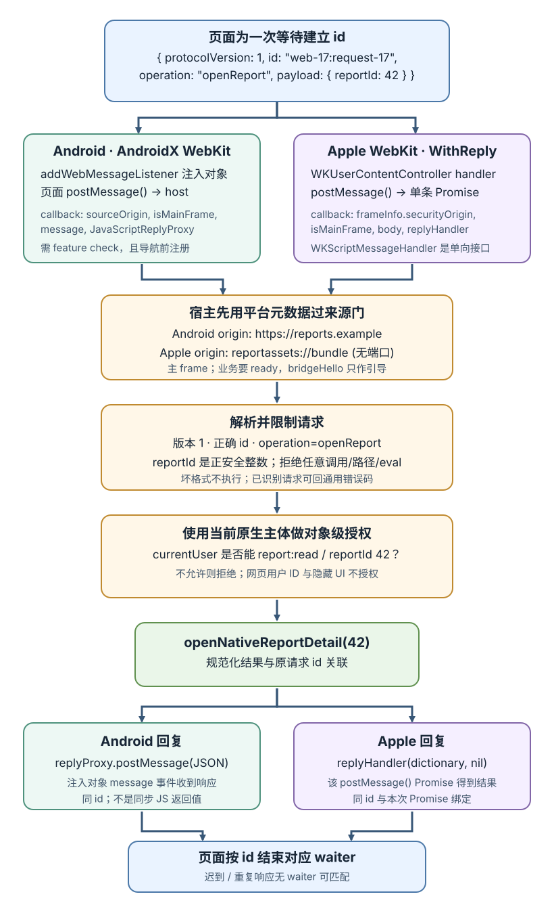
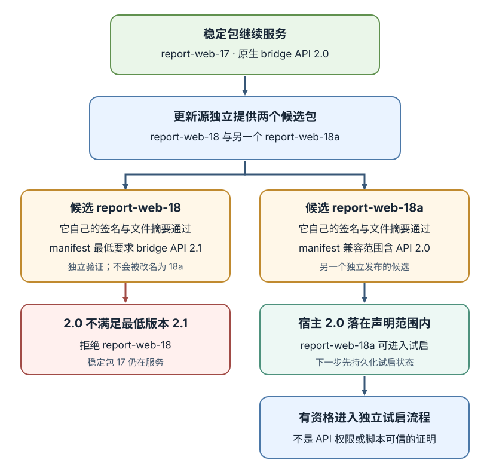
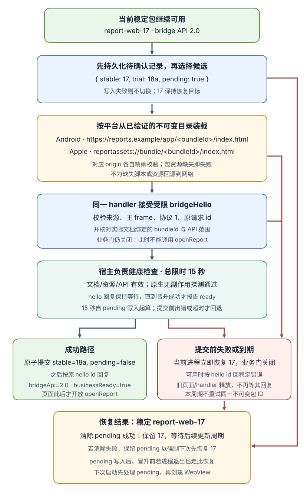

# 嵌入原生应用的页面，怎样安全地调用原生能力并更新页面包？

WebView 只给网页一个运行环境；网页能用哪些原生能力，要由原生 App（下称宿主）显式开放。本章回答两件事：页面发来的一条请求怎样经过检查变成原生操作并把结果传回；下载的新页面包怎样经过验证、试启，最后上线或被拒绝。读者需要知道同源（origin）和 Promise 的基本用法；平台接口在专门一节集中对照。

**合成案例。** 沿用主线一的报表页，这次它被打包成页面包 **report-web-17**，放在 Android 或 Apple 的 WebView 里运行。用户在报表 42 上点“打开详情”，页面请宿主显示原生详情界面。稍后服务器发布了 **report-web-18**，它要求 bridge（桥接）API **2.1**，而当前宿主只实现 **2.0**；更新源另外还提供了一个独立包 **report-web-18a**。包名、版本、来源和返回值都是教学用合成数据。

## 先分清两个版本号

案例里有两个互不相干的版本号：

- **bridge API 版本**（2.0、2.1）：宿主向页面开放哪些能力的约定。
- **`protocolVersion`**（本例为 `1`）：消息 envelope（信封）的字段格式，即 `{protocolVersion, id, operation, payload}` 怎样写。

API 兼容不代表消息格式兼容，反过来也一样。后文的兼容检查只比 bridge API 版本，消息解析只认 `protocolVersion`。

## 一条请求要过哪三道检查？

页面请求的是一个很窄的能力：打开报表详情。它不传类名、方法名或任意 JavaScript：

~~~json
{
  "protocolVersion": 1,
  "id": "web-17:request-17",
  "operation": "openReport",
  "payload": { "reportId": 42 }
}
~~~

宿主收到它，要依次回答三个问题。三道检查各管一件事，不能互相替代：

| 检查 | 回答的问题 | 依据 |
|---|---|---|
| 来源 | 哪个网页上下文发来的？ | WebView 回调给出的 origin 与 frame 信息 |
| 参数 | 请求的是什么，格式对不对？ | 消息正文，按协议严格解析 |
| 授权 | 当前用户此刻能不能做这件事？ | 原生登录态与业务数据 |

两条原则贯穿全部检查：

- **`id` 只做关联。** 它把回复对应到页面上正在等待的那次请求，不是身份凭证，也不表示调用已获准。
- **来源信息只取自平台回调。** 即使正文里写了 `origin`、`isMainFrame` 或 `userId`，也不能拿来证明这些事实。

### 来源检查能证明什么，不能证明什么？

来源检查确认的是“消息来自允许来源的文档主 frame”。宿主把回调里的 origin 与当前 WebView 配置的页面包 origin 精确比较，并要求消息来自主 frame。

它分辨不出是该文档里哪段脚本发的消息：文档里执行的任何脚本都拥有同样的来源和 frame。因此页面内容由谁提供、导航策略、第三方脚本和 XSS 漏洞，都落在桥接的可信边界之内。XSS 的成因与防法见[浏览器安全控制分别保护什么信任边界？](../../engineering-foundations/services/sessions-and-browser-boundaries.md)。若同一 WebView 还要装载不受宿主控制的同源内容，就把它隔离到另一来源或另一 WebView，或者不给它原生能力。

### 宿主按什么顺序处理？

宿主先把平台回调拆成两部分：平台给的可信元数据，以及仍不可信的请求正文。然后：

1. **来源门。** 来源等于当前 WebView 配置的页面包 origin，且消息来自主 frame；不符合就不执行。
2. **解析信封。** 限制消息大小和字段，解析 `protocolVersion`、`id`、`operation`、`payload`；拒绝未知协议版本和错误类型。
3. **业务门。** 宿主内存里有一个 `businessReady` 标志。它打开前，只接受受限的引导操作 `bridgeHello`（见[新包怎样试启并晋升为稳定包？](#新包怎样试启并晋升为稳定包？)）。
4. **操作白名单与参数。** `openReport` 只在 `businessReady=true` 时接受，且 `reportId` 必须是正的安全整数。拒绝任意类名、方法名、URL、文件路径、JavaScript 字符串或通用 evaluate 请求。
5. **授权。** 从原生登录态取当前主体，检查它此刻能否执行 `report:read` 并访问报表 42。正文里的用户 ID、隐藏的按钮、难猜的报表编号都不能授权。资源级授权怎样做，见[如何逐次授权租户内的报表资源？](../../engineering-foundations/services/per-request-authorization.md)。
6. **执行并回复。** 通过后调用一个固定的原生方法，把规范化结果或稳定错误码回给同一个请求 `id`。本例成功时回 `{ opened: true, reportId: 42 }`。

> [!example]- 宿主入口的业务分支（中立伪代码）
> ~~~text
> handle(platformContext, isMainFrame, untrustedBody):
>   reject without executing unless platformContext.origin == platformContext.packageOrigin
>   reject without executing unless isMainFrame
>   reject without executing unless platformContext.callbackBelongsToBoundDocument
>     # 宿主由实际装载与导航建立的绑定，不是正文字段
>   request = parseAndValidateEnvelope(untrustedBody)
>   if request.operation == "bridgeHello":
>     return handleHello(request)          # 见试启一节
>   reject unless request.operation == "openReport" and businessReady
>   reject unless request.payload.reportId is a positive safe integer
>   reject unless currentNativeUser may perform report:read on request.payload.reportId
>   result = openNativeReportDetail(request.payload.reportId)
>   return { protocolVersion: 1, id: request.id, ok: true, payload: normalize(result) }
> ~~~
>
> `callbackBelongsToBoundDocument` 表示宿主的装载器和导航策略已把这个回调绑定到当前实际加载的已验证包；它不假设平台提供了可直接比较的文档 ID，具体怎样建立见[更新包要过哪三道信任检查？](#更新包要过哪三道信任检查？)。

### 被拒绝时回什么？

- **来源或 frame 不可信：不执行。** 是否回复取决于平台，见下一节；无论哪种，页面看到的都是一次失败，而不是“操作已取消”。
- **正文格式错误：不执行。** 对已通过来源门、且 `id` 可用的请求，可以回不泄露资源细节的稳定错误：`{ protocolVersion: 1, id, ok: false, error: { code: "FORBIDDEN" } }`。其他错误码用同一形状。

## Android 与 Apple 的桥接接口有什么不同？

两个平台的接口差异很大，不存在统一的桥接 API。下表先给全貌，再逐个说明：

| 平台入口 | 桥接形状 | 来源信息 | 回复方式 |
|---|---|---|---|
| Android `addWebMessageListener`（现代） | 异步消息对象 | 回调给 `sourceOrigin`、`isMainFrame` | `JavaScriptReplyProxy`，按 frame 回消息 |
| Android `addJavascriptInterface`（旧） | 注入的 Java 对象 | 没有逐消息来源；所有 frame 可见 | 页面同步等待 Java 方法返回 |
| Apple `WKScriptMessageHandler` | 单向通知 | `WKScriptMessage.frameInfo` | 不返回值 |
| Apple `WKScriptMessageHandlerWithReply` | 逐调用回复 | `WKScriptMessage.frameInfo` | 该次 `postMessage()` 返回的 Promise |

### Android：addWebMessageListener

这是 AndroidX WebKit 的 `WebViewCompat.addWebMessageListener()`，1.3.0 起提供。

- **要先探测能力。** 运行时用 `WebViewFeature.WEB_MESSAGE_LISTENER` 确认当前 WebView 支持，并在 `loadUrl()` 等导航之前注册。不支持时禁用原生功能或走不含桥接的网页路径，不能静默降级成没有来源检查的旧接口。
- **来源规则不看路径。** `allowedOriginRules` 用精确规则，例如 `https://reports.example`，不要用 `*`。规则只匹配 scheme、host、port；同一来源下 `/app/report-web-17/` 与其他路径是同一个 origin。
- **子 frame 也会拿到对象。** 对象注入所有匹配来源的 frame，所以每条消息仍要检查 `isMainFrame` 为真。
- **回复走代理。** 回调提供 `sourceOrigin`、`isMainFrame`、消息和 `JavaScriptReplyProxy`。宿主把序列化后的响应字符串交给 `replyProxy.postMessage()`；页面从注入对象的 `message` 事件收到结果，再按信封 `id` 找到等待项。这个代理对应发消息的 frame，可以保留并多次发送；frame 导航或销毁后再发会被静默忽略。
- **拒绝时可以不回。** 来源或 frame 不可信时，宿主可以不发回任何事件，让页面在本地超时后结束等待。

### Android：addJavascriptInterface（旧入口）

它把带 `@JavascriptInterface` 的方法放到网页可见的对象上。

- Android 4.2（API 17）起、且应用 target API 17 或更高时，只有带此注解的方法可从 JavaScript 调用；面向更旧 target 的应用可能暴露更多 Java 方法。
- 无论哪种 target，对象都对 WebView 里所有 frame 可见，平台不给逐消息的来源身份。
- Java 方法在 WebView 的后台线程执行，发起调用的 JavaScript 同步等待它返回。

因此它只适合内容与导航都由宿主严格控制的遗留 WebView。

### Apple：WKScriptMessageHandler 与 WithReply

在创建 `WKWebView` 之前，把 `WKUserContentController` 放进 configuration，再注册具名 handler。

- **两种 handler。** 普通 `WKScriptMessageHandler` 只通知宿主，不返回值。`WKScriptMessageHandlerWithReply` 的 `postMessage(body)` 返回一个只属于本次调用的 Promise；宿主调用 `replyHandler(responseDictionary, nil)` 让它兑现。reply handler 最多调用一次。
- **版本要求。** WithReply 以及按 `WKContentWorld` 指定 handler 的注册方式要求 iOS 14 / macOS 11 或更新。较旧系统应关闭这条回复式能力，或另行定义并审查平台专属通道。
- **注册时不能限定来源。** Apple 的 handler 注册接口不接受 origin 白名单，所以宿主要在每次回调里读 `frameInfo.securityOrigin` 的 scheme、host、port，并检查 `frameInfo.isMainFrame`。`WKFrameInfo` 是这次回调的瞬时资料，不能存起来当作该 frame 永远不变的身份。
- **端口要规范化。** 本例页面入口是 `reportassets://bundle/<bundleId>/index.html`，只接受 `(reportassets, bundle, 无端口)`。`WKSecurityOrigin.port` 为 0 表示没有显式端口，本例把它规范成“无端口”。如果比较的是 HTTPS origin，要先换算成有效端口 443，不能拿 0 与 443 字面比较。
- **拒绝会让 Promise 失败。** 来源不可信时可以调用 `replyHandler(nil, "BRIDGE_REJECTED")`，页面的 Promise 随之 reject。在调用 reply handler 之前就释放它，Promise 也会 reject。所以 Apple 上“没有业务回复”不只表现为超时。
- **WKContentWorld 只隔离变量。** 它隔开宿主脚本与网页脚本的 JavaScript 变量，不隔开 DOM，也不能代替 frame/origin 判断。页面要主动调用的 handler 必须装在网页可调用的 content world 里。

两个平台的来源规则或内容世界，解决的都是“接口暴露给谁”，不表示该网页能执行任意操作；授权仍逐次进行。

### 线程、旧式 URL 拦截与已有 Web API

**回调要尽快返回。** Android WebMessageListener 和 Apple 消息回调都运行在应用 UI 线程 / main actor 上，不能在里面等网络或做长耗时数据库工作。异步查询，再把 UI 更新或回复送回平台要求的线程。旧 `addJavascriptInterface()` 是另一套线程模型，不能照搬。

**隐藏 iframe 加自定义 URL scheme 不是现代桥接的等价物。** 早年用 `myapp://api/location` 这类地址触发宿主拦截，参数长度、回复通道、回调 ID 和错误处理都要自行实现。更关键的是来源：Android `WebResourceRequest.isForMainFrame()` 只说明这次请求是否在取主 frame 文档，URL 只是目标地址，隐藏 iframe 的请求通常得到 `false`，两者都证明不了调用来自哪段脚本。Apple 导航回调可以检查 `WKNavigationAction.sourceFrame`，但 Android 拦截器没有对应元数据。旧系统若必须保留这种通道，只在平台能建立等价来源约束时承载能力；拦截器只有目标 URL 时，就限于内容和导航全程由宿主控制的页面，并继续校验消息格式、当前权限和超时。

**已有 Web API 不必再桥一次。** 例如 Android WebView 里的 `navigator.geolocation` 不会绕过宿主：在安全 origin 上调用、且 WebView 尚无该 origin 的权限决定时，会进入 `WebChromeClient.onGeolocationPermissionsShowPrompt(origin, callback)`，由宿主通过 callback 决定网页能否用这个 Web API；原生应用自己能否读设备位置，还要走 Android 的运行时位置权限流程。不要只为转发一个已有 Web API 就开放泛化的桥接方法。

## 页面端怎样等待回复、处理超时和离页？

页面可能先发 request-17 再发 request-18，宿主处理耗时不同，response-18 可能先到。所以页面按 `id` 找等待项，而不是按“最早发出的请求”接收：

- 未知 `id`、已超时的 `id`、重复回复，一律忽略。
- `id` 只做关联，不防重放。会改变状态的操作，宿主还要按调用 ID 或业务幂等键限制重复执行。

> [!example]- 页面端请求管理：按 ID 匹配、超时与清理
> `transport.send()` 是每个平台各自的适配器：
>
> - Android：调用注入对象的 `postMessage(JSON.stringify(envelope))`，并把该对象的 `message` 事件交给 `bridge.receive(event.data)`。
> - Apple：只调用 `window.webkit.messageHandlers.reportBridge.postMessage(envelope)`，把返回的原生 Promise 直接交给 `request()`。`request()` 会用本次 `id` 检查 Promise 结果，所以 Apple 适配器不要再调用一次 `receive()`。
>
> 这段通用代码只负责页面侧的请求 ID、乱序、超时和离页清理，不实现原生授权。`generation` 是当前文档新建的页面实例代号；安全上下文中可用 `crypto.randomUUID()` 生成，否则由宿主或 `crypto.getRandomValues()` 提供。它只减少复用通道时的 ID 碰撞，不是身份凭证。前文的 `web-17:request-17` 是一次便于追踪的合成 ID；代码实际拼出 `generation:递增序号`，协议只要求每个未完成请求能被唯一关联。
>
> ~~~javascript
> function createPageBridge(transport, generation, timeoutMs = 8000) {
>   if (typeof generation !== "string" || generation.length === 0) {
>     throw new TypeError("A page-instance generation is required");
>   }
>   const pending = new Map();
>   let nextId = 0;
>   let disposed = false;
>
>   function fail(id, code) {
>     const waiter = pending.get(id);
>     if (!waiter) return false;
>     pending.delete(id);
>     clearTimeout(waiter.timer);
>     waiter.reject(new Error(code));
>     return true;
>   }
>
>   function receive(value, expectedId) {
>     let reply;
>     try {
>       reply = typeof value === "string" ? JSON.parse(value) : value;
>     } catch {
>       return false;
>     }
>     if (!reply || reply.protocolVersion !== 1 || typeof reply.id !== "string") return false;
>     if (expectedId !== undefined && reply.id !== expectedId) return false;
>     const waiter = pending.get(reply.id);
>     if (!waiter) return false; // 超时、重复或旧页面代号的迟到响应
>     pending.delete(reply.id);
>     clearTimeout(waiter.timer);
>     if (reply.ok === true) {
>       waiter.resolve(reply.payload);
>     } else if (reply.ok === false && typeof reply.error?.code === "string") {
>       waiter.reject(new Error(reply.error.code));
>     } else {
>       waiter.reject(new Error("INVALID_BRIDGE_REPLY"));
>     }
>     return true;
>   }
>
>   function request(operation, payload, requestTimeoutMs = timeoutMs) {
>     if (disposed) return Promise.reject(new Error("BRIDGE_CONTEXT_GONE"));
>     const id = generation + ":" + (++nextId);
>     const envelope = { protocolVersion: 1, id, operation, payload };
>     return new Promise((resolve, reject) => {
>       const timer = setTimeout(() => fail(id, "BRIDGE_TIMEOUT"), requestTimeoutMs);
>       pending.set(id, { resolve, reject, timer });
>       try {
>         const response = transport.send(envelope);
>         if (response && typeof response.then === "function") {
>           response.then(
>             value => {
>               if (!receive(value, id)) fail(id, "INVALID_BRIDGE_REPLY");
>             },
>             () => fail(id, "BRIDGE_TRANSPORT_ERROR"),
>           );
>         }
>       } catch {
>         fail(id, "BRIDGE_SEND_FAILED");
>       }
>     });
>   }
>
>   function dispose() {
>     if (disposed) return;
>     disposed = true;
>     for (const id of pending.keys()) fail(id, "BRIDGE_CONTEXT_GONE");
>   }
>
>   return { request, receive, dispose };
> }
> ~~~
>
> Apple 的 Promise 成功回调会传入本次的 `expectedId`。若 A 的 Promise 意外收到声称属于 B 的信封，`receive` 在查找 B 之前就判为错配，A 以 `INVALID_BRIDGE_REPLY` 结束，B 继续等自己的 Promise。Apple 宿主的 `BRIDGE_REJECTED` 让 Promise reject，在这里映射为 `BRIDGE_TRANSPORT_ERROR`。Android 的 `message` 事件没有逐调用 Promise，只能按信封 `id` 匹配。

超时和离页只结束页面这一侧的等待：

- **离页时调用 `dispose()`。** 它清掉计时器，以本地错误结束所有等待；之后才到的 Android 回复或 Apple Promise 结果，因为 `id` 已不在 `pending` 里而被丢弃。使用 BFCache 时，页面恢复后重建代号和通道，不沿用旧的等待项。
- **没收到回复不等于没发生。** 宿主可能已经打开了详情。有业务副作用的操作要另定取消、查状态或幂等策略，不能自动盲目重放。
- **宿主也要清理。** 更换或销毁 WebView 时撤销 handler，取消对旧页面的回调，释放等待对象。

取消是另一条协议消息，不是页面清掉计时器。只有宿主操作本身可取消、原生侧保存了取消句柄，并校验取消消息的请求 ID 与权限时，取消才停得住工作；已经发生的副作用，超时或取消都不保证回滚。操作不可取消时，宿主照常完成，旧页面的迟到结果被丢弃。超时与取消各停得住什么，通用规则见[取消、超时和并发上限各自停得住什么？](../javascript/cancellation-timeouts-and-concurrency.md)。

## 更新包要过哪三道信任检查？

前面默认 report-web-17 可信。但页面包里的 HTML、JavaScript、CSS 不只是静态资源：WebView 执行其中的脚本后，就能调用已开放的原生能力。所以新包也要过信任检查，而且是三道独立的检查：

| 检查 | 证明什么 | 不证明什么 |
|---|---|---|
| 完整性（签名与摘要） | 包确实是发布者签发、文件未被篡改 | 包需要的 API 宿主有没有 |
| 兼容性（API 范围） | 宿主实现的 API 落在包声明的范围内 | 包可信，或某次调用获准 |
| 逐次授权 | 当前用户此刻能做这个操作 | 包来源可信 |

### 选中的目录，怎样保证就是 WebView 执行的文件？

更新清单（manifest）写明不可变的包 ID、所需 bridge API 范围、入口文件与资源列表，以及每个文件的大小和摘要。宿主用一个活动指针记录选中了哪个包目录。但指针只说明“选中了哪个目录”，不能证明 WebView 实际执行的就是那里的文件，所以装载本身也要受控：

- **包内资源未命中就失败。** 宿主装载器从选中的不可变目录读入口 HTML、JavaScript 和其他可执行资源；找不到就加载失败，不回源到同域网络。
- **不载入包外可执行脚本。** 产品若确实需要远程脚本，它的供应方也进入可信边界，不能算作已被本地包摘要验证。
- **限制主 frame 导航。** 带原生能力的 WebView 只装载宿主认可的包入口。
- **一个包，一个 WebView 实例。** 本例每次换包或重新载入都新建 WebView 和 handler，handler 捕获包 ID 与该实例的代号；宿主只接受仍有效、且等于当前绑定的回调。切换或销毁前先关闭旧业务门、使旧绑定失效，旧实例迟到的消息拿不到新实例的权限。
- **包 ID 以装载记录为准。** 页面在握手里自报的包 ID 只用来发现不匹配，不单独证明脚本来源。

两个平台把已验证目录映射成页面 origin 的方式不同：

- **Android `WebViewAssetLoader`** 把本例目录映射到 `https://reports.example/app/<bundleId>/index.html`。它本身不验证包签名；默认 path handler 未命中时可以回退到网络，所以持有原生能力的装载器必须对包内资源未命中 fail closed（失败即拒绝）。
- **Apple `WKURLSchemeHandler`** 只服务 WebKit 不原生处理的自定义 scheme，不能注册 `https`。本例用 `reportassets://bundle/<bundleId>/index.html`，在 handler 里从对应不可变目录读入口与资源。

> [!info] 自定义 scheme 页面的 origin 是否 opaque（WebKit 固定提交，核对于 2026-11-13）
> WebKit 的 Cocoa 实现（`SecurityOriginData.cpp`）按 App 链接的 SDK 分两种行为：按旧 SDK 链接时，URL 有效且通过 no-access 检查就得到非 opaque origin；按新 SDK 链接时，还要求该自定义 scheme 已注册 handler。本例 `reportassets` 已注册，两种情况都得到非 opaque origin，`WKSecurityOrigin` 对应 `(reportassets, bundle, 无端口)`。回调里的 origin 不符或为 opaque/null，仍须拒绝；宿主应在目标 SDK 与系统版本组合上实测。若改用 `loadFileURL`，回调 origin 不能沿用这个元组，也不能假设是 Android 的 HTTPS origin。

更新包从 `https://updates.example/packages/<bundleId>.zip` 下载，但这个下载地址不会成为 WebView 里文档的 origin。下载源负责“从哪取”，来源门比较的是上面映射出的页面 origin；两者分开配置。

### 怎样得到一个可信且兼容的候选包？

1. **先启动稳定版本。** 应用启动时读持久化的稳定包记录。若上次进程退出时还有待确认的试启记录，先恢复上一个稳定包，再创建有桥接能力的 WebView；否则启动当前稳定包。更新检查在后台进行，不阻挡首屏。
2. **从允许的更新源取候选。** 通过 `https://updates.example/packages/<bundleId>.zip` 下载，按策略限制重定向。用原生应用内置的信任锚验证发布者签名，覆盖 CDN 或源站被攻陷的威胁；同一份未认证响应里附带的 hash 只能比对字节，不能独立证明发布者身份。
3. **临时下载、逐文件验证。** 清单和资源写入候选目录，核对签名、不可变包 ID、文件大小和摘要。全部通过之前不动正在运行的稳定目录；任何一项不符就删除候选，继续用 report-web-17。
4. **逐个检查 API 范围。** report-web-18 的最低要求是 2.1，宿主只有 2.0，拒绝。report-web-18a 是更新源提供的另一个独立包，有自己的清单、签名和资源摘要，兼容范围包含 2.0，才有资格试启。18a 不是把被拒的 18 改了个名字。

## 新包怎样试启并晋升为稳定包？

验证通过只说明文件可信、版本兼容，还不说明这个包在本机真的能跑起来。试启要回答这个问题，并保证任何时刻崩溃都能回到 report-web-17。

### 先写恢复记录，再切换

5. **持久化试启状态。** 启动 18a 之前，先可靠写入 `{ stable: "report-web-17", trial: "report-web-18a", pending: true }`，确认写入后再原子地选择 18a。写入失败就不切换。
6. **装载并握手。** 按平台入口装载 18a，建立前述宿主绑定。页面载入后通过同一消息入口发出 `bridgeHello`：

~~~json
{ "protocolVersion": 1, "id": "web-18a:hello-1",
  "operation": "bridgeHello", "payload": { "bundleId": "report-web-18a" } }
~~~

`bridgeHello` 走的是同一个入口，不另开绕过安全门的处理器：平台 origin、主 frame、实际文档绑定、信封解析、协议与 ID 校验都先执行。它是 `businessReady` 为 `false` 时唯一可接受的操作；此时 `openReport` 不能执行。

### 15 秒内完成健康检查和晋升

宿主不在握手开始时就回复。它让这次 hello 等待，在一个 15 秒的 deadline 内完成：

- 自报 `bundleId` 等于实际绑定的包，选定的 API 版本 2.0 落在已验证清单的范围内；
- 文档、资源、API 有效，原生侧无副作用的健康探测通过；
- 原子提交 `stable=18a, pending=false`。

只有提交成功后，宿主才置 `businessReady=true`，并按原 `id` 回复：

~~~json
{ "protocolVersion": 1, "id": "web-18a:hello-1", "ok": true,
  "payload": { "bridgeApi": "2.0", "businessReady": true } }
~~~

页面的 `request()` 先匹配 `id`，再仅当 `payload.businessReady === true` 时开放“打开详情”入口。

> [!example]- 宿主入口的 bridgeHello 分支（中立伪代码）
> ~~~text
> handleHello(request):
>   require protocol 1, valid id, request.payload.bundleId == boundBundleId
>   require selectedBridgeApi in verifiedManifest.apiRange
>   run host-owned document/API checks and harmless health probe before startupDeadline
>   if trialPending:
>     atomically persist stable=candidate, pending=false before startupDeadline
>     # 这次持久提交就是恢复分界；之后回复迟到也不能撤销它
>   businessReady = true
>   return { protocolVersion: 1, id: request.id, ok: true,
>            payload: { bridgeApi: selectedBridgeApi, businessReady: true } }
>
> on any failure of the above before the commit, or startupDeadline expiry:
>   keep businessReady = false; destroy trial WebView; reload stable bundle
>   clear pending durably, or retain it so the next startup restores stable first
>   reply { protocolVersion: 1, id: request.id, ok: false, error: { code: "TRIAL_FAILED" } }
>     only when a valid id and live reply channel remain
> ~~~

两端的计时器各管各的：

| 计时器 | 时长 | 由谁负责 | 到期做什么 |
|---|---|---|---|
| 宿主试启 deadline | 15 秒，从 pending 记录写入成功起算 | 宿主 | 覆盖装载、有效 hello、健康检查和晋升提交；提交前到期就恢复 17 |
| 页面等待 hello | 20 秒 | 页面 `request()` | 只结束页面等待 |
| 页面等待普通业务请求 | 8 秒（默认） | 页面 `request()` | 只结束页面等待 |

页面等 hello 的 20 秒比宿主的 15 秒多出 5 秒，给宿主在恢复后按原 `id` 回传错误或销毁旧页面留出时间。宿主把 deadline 与 `pending` 的状态转换串行化，避免“提交成功”和“到期回退”同时发生。

### 恢复分界在哪里？

提交 `stable=18a, pending=false` 成功，就是唯一的恢复分界：

- **分界之前任何失败都走同一条恢复路径。** 资源缺失或导航失败、握手被拒、协议/ID/包不匹配、健康检查失败、提交前持久化失败、提交前 deadline 到期，都是：业务门保持关闭，当前进程销毁试启 WebView，重新装载 17；回复通道还在就按原 `id` 回稳定错误，通道已断就释放旧 handler 和等待项。清除 `pending` 成功后，本次更新周期不再试同一个不可变包 ID，后续更新按既定退避策略调度；清除失败就保留 `pending`，让下次启动仍先恢复 17。
- **分界之前进程退出。** 下次启动先读到 `pending`，恢复 17，再创建 WebView。不能因为 18a 的文件验签通过，就把它当作健康的稳定包。
- **分界之后。** 即使内存里的 `businessReady` 还没置上、hello 的成功回复还没送达，18a 也已是稳定包。下次启动直接装载 18a，并走同样的 origin/frame/协议/文档检查和稳定启动握手才打开业务门。

稳定包（无论 17 还是晋升后的 18a）的每次重载都走同样的检查和健康门，只有 `bridgeHello` 成功才返回业务就绪。稳定页自己加载或握手失败时，桥保持关闭，宿主显示错误与重试界面。

### 握手证明了什么？

握手只证明两件事：所选 WebView 文档与宿主用匹配的信封对话，宿主选定的 API 版本与候选清单兼容。可信的内容身份来自宿主对入口和可执行资源的实际装载控制，不来自页面自报的字段。通过试启之后，页面的每次请求仍逐次验证来源、frame、操作格式和当前权限。若更新包换了 origin，宿主要在导航和桥接配置里明确允许那个 origin，不能为了版本滚动放宽成任意来源。

## 工程信任之外还有哪些约束？

**应用商店政策。** 原子切换、签名和桥接白名单解决的是工程信任，不能替代对分发政策的判断：

- Apple 当前审核指南限制下载或执行会改变 App 功能的代码；若产品属于指南列出的 HTML5/JavaScript 小程序等软件类别，还有额外规则，包括未经 Apple 事先许可不得向这些软件开放原生平台 API。
- Google Play 把 WebView 里的 JavaScript 列为解释执行代码的例外之一，但解释代码仍不得造成违反 Play 政策的功能。这不是对任意热更新的批准。

具体应用是否合规，取决于实际产品与当时的规则。

**密钥与日志。** 页面包不持有长期密钥、原生登录凭证或最终权限。秘密留在原生安全存储或服务端，每次敏感调用仍从当前原生会话和业务数据做授权。按包版本记录签名/摘要验证和兼容结果，按调用记录操作、授权结果和关联 ID，有助于定位错误和决定回滚；日志里不写会话秘密或完整的敏感 payload。

## 本章交出了什么？

报表页在 WebView 里得到一条窄通道：每条请求先用平台元数据过来源门，再严格解析、逐次授权，结果按 `id` 回到对应的等待项；新页面包要先过完整性和 API 兼容检查，再在 15 秒试启内握手、健康检查和原子晋升，提交之前任何失败都回到 report-web-17。

页面与宿主之间的消息，与浏览器里窗口之间的 `postMessage` 是同一类问题：都要先验来源，再验消息，再向权威确认。浏览器内的跨窗口与跨源消息怎样做三道校验和握手，见[浏览器能把状态存在哪里，标签页和窗口之间怎样互相通知？](../ui-state/browser-storage-and-cross-context-messaging.md)。

> [!info]- 来源
> - **Android 现代桥接与旧入口概览。** Android Developers，[Access native APIs with JavaScript bridge](https://developer.android.com/develop/ui/views/layout/webapps/native-api-access-jsbridge)：Use addWebMessageListener、Initialization、Key features、addJavascriptInterface 及线程/frame 边界，2026-11-12 核对。支持“Android：addWebMessageListener”“Android：addJavascriptInterface（旧入口）”。
> - **AndroidX 接口细节。** [WebViewCompat.addWebMessageListener](https://developer.android.com/reference/androidx/webkit/WebViewCompat)（1.3.0 起、运行时 feature check、origin rule 格式、对象注入与回复代理）；[WebMessageListener](https://developer.android.com/reference/androidx/webkit/WebViewCompat.WebMessageListener)（`sourceOrigin`、`isMainFrame`、`replyProxy`、UI 线程、`file:`/`content:` 的 opaque origin），2026-11-12 核对。
> - **Android 旧桥接风险与导航拦截语义。** [WebView.addJavascriptInterface](https://developer.android.com/reference/android/webkit/WebView)（全 frame 暴露、旧 target 的注解边界、调用线程与返回行为）；[Insecure WebView native bridges](https://developer.android.com/privacy-and-security/risks/insecure-webview-native-bridges)；[WebResourceRequest](https://developer.android.com/reference/android/webkit/WebResourceRequest)（`isForMainFrame()` 与目标 URL），2026-11-12 核对。支持“线程、旧式 URL 拦截与已有 Web API”。
> - **Apple 消息、回复与 frame。** Apple Developer Documentation：[WKScriptMessageHandler](https://developer.apple.com/documentation/webkit/wkscriptmessagehandler)、[WKScriptMessageHandlerWithReply](https://developer.apple.com/documentation/webkit/wkscriptmessagehandlerwithreply)、[WKUserContentController](https://developer.apple.com/documentation/webkit/wkusercontentcontroller)、[WKFrameInfo](https://developer.apple.com/documentation/webkit/wkframeinfo)、[WKNavigationAction.sourceFrame](https://developer.apple.com/documentation/webkit/wknavigationaction/sourceframe)，2026-11-12 核对。支持“Apple：WKScriptMessageHandler 与 WithReply”。
> - **Apple WithReply 版本与 Promise 失败。** WebKit 头文件 [`WKScriptMessageHandlerWithReply.h`](https://github.com/WebKit/WebKit/blob/main/Source/WebKit/UIProcess/API/Cocoa/WKScriptMessageHandlerWithReply.h)：reply handler 最多调用一次、传入 error 字符串使 Promise reject、调用前释放也 reject；[`WKUserContentController.h`](https://github.com/WebKit/WebKit/blob/main/Source/WebKit/UIProcess/API/Cocoa/WKUserContentController.h)：WithReply 与 contentWorld 注册入口 iOS 14 / macOS 11 起可用。WWDC20 [Discover WKWebView enhancements](https://developer.apple.com/videos/play/wwdc2020/10188/) 09:03–09:55（content world 变量隔离）、13:47–14:45（WithReply Promise）；[WKContentWorld](https://developer.apple.com/documentation/webkit/wkcontentworld)（DOM 由不同 world 共用）。版本边界以公开头文件与文档为准，2026-11-12 核对。
> - **Apple origin 端口规范化。** [WKSecurityOrigin](https://developer.apple.com/documentation/webkit/wksecurityorigin) 的 scheme/host/port 与 [WebKit 实现](https://github.com/WebKit/WebKit/blob/e95d3cb282b586c54897b153b498c4fa46310d0a/Source/WebKit/UIProcess/API/Cocoa/WKSecurityOrigin.mm#L53-L66)，2026-11-12 核对；比较前按 origin 语义换算有效端口。
> - **WebView 中的 Web API 权限。** Android [WebChromeClient.onGeolocationPermissionsShowPrompt](https://developer.android.com/reference/android/webkit/WebChromeClient#onGeolocationPermissionsShowPrompt(java.lang.String,android.webkit.GeolocationPermissions.Callback))；[Request location permissions](https://developer.android.com/develop/sensors-and-location/location/permissions)，2026-11-12 核对。
> - **本地资源的 origin 与回源。** Android [Load in-app content](https://developer.android.com/develop/ui/views/layout/webapps/load-local-content)（WebViewAssetLoader 与未命中回源）；Apple [WKURLSchemeHandler](https://developer.apple.com/documentation/webkit/wkurlschemehandler)、[setURLSchemeHandler](https://developer.apple.com/documentation/webkit/wkwebviewconfiguration/seturlschemehandler%28_%3Aforurlscheme%3A%29)（不能接管 `https`）；WebKit [`SecurityOriginData.cpp`](https://github.com/WebKit/WebKit/blob/e95d3cb282b586c54897b153b498c4fa46310d0a/Source/WebCore/page/SecurityOriginData.cpp#L211-L231) 的 Cocoa 条件分支，2026-11-13 核对。支持“选中的目录，怎样保证就是 WebView 执行的文件？”。
> - **页面代码的应用商店分发。** Apple [App Review Guidelines](https://developer.apple.com/app-store/review/guidelines/) §2.5.2（自包含、下载/执行改变功能的代码）、§4.7.2（该类小程序暴露原生 API 的限制）；Google Play [Developer Program Policy](https://support.google.com/googleplay/android-developer/answer/18265346) Device and Network Abuse（解释器代码例外，该版自 2026-10-29 生效），2026-11-12 核对。
> - 试启协议（pending 记录、15/20/8 秒计时、恢复分界）、`bridgeHello` 信封与包名均为本章合成设计，不出自平台文档。
