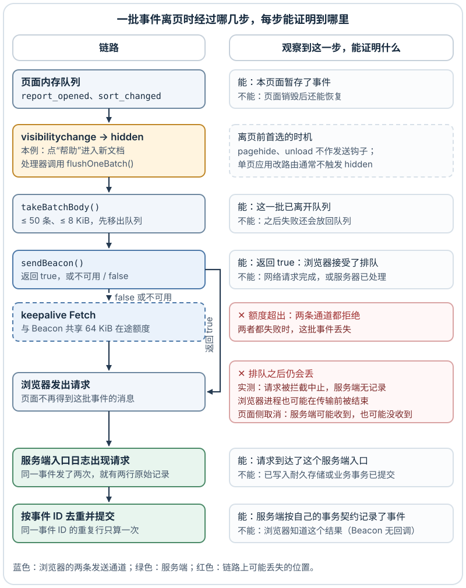

# 页面离开时，分析事件怎样尽力送出，又能确认什么？

analytics event (分析事件)记录页面的使用情况，例如打开报表、改变排序。它通常不影响报表本身是否正确，可以容忍少量丢失。难点在离页那一刻：事件还在页面内存里，页面却要被销毁。本章回答三件事：采集什么、积压多少；离页时用哪个时机和哪条通道发出去；每个阶段观察到的信号能证明什么、不能证明什么。

沿用主线一的报表页。合成运行如下：用户打开 `/reports/42?sort=recent#summary`，点一次“最早优先”把排序改成 oldest（地址随之变为 `?sort=oldest#summary`），然后在 10 秒定时器触发前点击普通链接 `<a href="/help">帮助</a>`，进入另一个完整文档。页面只采集两种事件 `report_opened` 和 `sort_changed`，加上预先登记的页面代号 `report_detail`。本章的数字上限（200、50、10 秒、8 KiB）是教学选择；浏览器实测来自 Chromium `157.0.8103.51` 的本地 HTTP 页面与 Node 服务器，只说明该环境下的行为，不是跨浏览器的送达保证。

## 先限定采集什么、积压多少

发送之前，先用允许列表卡住内容：

- **事件名与页面代号**只接受登记过的值：`report_opened`、`sort_changed`；`report_list`、`report_detail`。
- **每条事件只有四个字段**：事件 ID、名称、页面代号、时间戳。搜索框原文、完整 URL、用户令牌和身份字段都不进入载荷。
- **事件 ID 在入队时生成**，用 `crypto.randomUUID()` 得到 UUID (通用唯一标识符)v4，原样放进载荷供服务端去重。这个 API 只在安全上下文（HTTPS 或本机 loopback）中可用。
- **用户退出可选采集时**，停止新入队，并清空内存里尚未发送的事件。已经交给浏览器的请求无法由这个开关撤回。

再给积压量设上界：

| 规则 | 值 | 作用 |
|---|---|---|
| 队列上限 | 200 条 | 满了丢最旧的一条，内存有界 |
| 分批门槛 | 50 条 | 积累到这个数就安排一次分批发送 |
| 定时发送 | 每 10 秒 | 不满 50 条也定期送出一批 |
| 每批请求体上限 | 8 KiB（UTF-8 编码后） | 只限条数限不住字节数，单独限制 |

每条事件字段固定、长度有界，所以任何一条单独成批都远小于 8 KiB。以后若加入自由文本字段，要重新检查字节上限，并决定超大的单条怎样处理。

案例里的队列这样变化：

| 时点 | 页面内存队列 | 接下来 |
|---|---|---|
| 打开 `/reports/42?sort=recent#summary` | `report_opened` | 尚未离开页面 |
| 点“最早优先” | `report_opened`、`sort_changed` | 载荷只有事件名，不含排序值；两条仍在内存 |
| 10 秒定时器前点“帮助” | 同上 | 文档变为 `hidden`，取出一批尝试发送 |

## 离页时，哪个事件还靠得住？

`visibilitychange` 变为 `hidden` 是离页前最该用的时机，但要清楚它的含义：

- **`hidden` 不等于离开。** 它只表示页面变得不可见；切换标签页、应用进入后台时也会出现。在移动端，它往往是最后一个能可靠观察到的生命周期状态，进程之后可能被系统直接结束。
- **单页应用的路由切换通常不触发它。** 同一文档内改路由，文档仍然可见。产品若要在路由边界提交队列，应由路由层显式调用队列模块的分批函数，不能指望生命周期事件代劳。
- **`pagehide` 表示当前历史条目不再显示。** 它的 `persisted` 为 `true` 时，页面可能进入 back-forward cache (往返缓存，BFCache)，之后还会恢复。它也不是所有后台或关闭场景都能观察到的信号。页面生命周期与 BFCache 的完整说明见[浏览器能把状态存在哪里，标签页和窗口之间怎样互相通知？](../ui-state/browser-storage-and-cross-context-messaging.md)。
- **不要用 `unload` 作最后的发送钩子。** 移动端进程被系统结束时，脚本可能根本没有机会运行。

本例的 `hidden` 处理器每次只尝试发送一批。队列里剩下的事件可能来不及发：达到 50 条门槛后安排的后续任务，在页面离开后未必还有机会运行。

## 用哪条通道发出去？

普通 Fetch 请求不带 `keepalive`；文档销毁时，尚未完成的普通请求可以被终止。离页发送要用能越过页面销毁的通道，有两条：

**Beacon API (信标接口)的 `navigator.sendBeacon()`** 是非阻塞的尽力传输：

- 自动使用 `keepalive`；
- 返回 `true` 只表示浏览器接受了排队；
- 没有响应回调，也不允许调用者自定义请求头；
- 规范要求浏览器在文档 `visibilityState` 变为 `hidden` 时安排已排队的信标请求立即传输，但浏览器进程之后仍可能被终止。

**Fetch API 加 `keepalive: true`**，让请求在发起页面的环境销毁后继续处理。它的 Promise 可能拿到服务器响应，但页面已经离开，不能靠这个回调确认记录结果；`keepalive` 也不保证请求到达服务器。

本例先用 Beacon；接口不存在或返回 `false` 时，再改用 keepalive Fetch。

### 两条通道共享 64 KiB 在途额度

Beacon 与 keepalive Fetch 的请求共享同一个 fetch group（Fetch 组）的在途请求体额度。Fetch 标准在 `contentLength + inflightKeepaliveBytes` 超过 64 KiB（65,536 字节）时拒绝请求；`inflightKeepaliveBytes` 计入所有尚未完成的 keepalive 请求，不只是当前这一批。

> [!example] 8 KiB 为什么只是余量
> 一批 8 KiB 是 8,192 字节，约占额度的 `8,192 ÷ 65,536 = 1/8`。如果页面同时还有其他 keepalive 请求在途，例如已占用 60,000 字节，那么 `8,192 + 60,000 = 68,192 > 65,536`，这一批照样被拒。
>
> 此时从 Beacon 回退到 Fetch 也没用：两者共享同一份额度。

### 取消了的请求，服务端可能已经读到正文

本地延迟响应测试中，导航发生后：普通 Fetch 的正文已经到达服务端，但响应连接随后被关闭；keepalive Fetch 则一直等到了延迟的 `204` 响应。所以“页面这边请求被取消”既不代表服务端没收到，也不代表它收到了。

## 把规则写成代码

`takeBatchBody()` 按顺序取事件，直到再加一条就会超过 50 条或 8 KiB。它在调用发送 API 之前就把取出的事件移出内存队列；发送被拒绝或网络失败后，这些事件也不会放回。下面的合成运行假设用户已允许可选采集；生产页面应按实际同意状态调用 `setCollectionEnabled`，不要固定开启。

> [!example]- 实现：同一事件 ID、大小限制与尽力发送
> 运行条件：安全上下文，`/analytics` 与页面同源。复现离页分支时，在 10 秒定时器触发前点击会加载新文档的普通链接；只在单页应用内改路由不会触发这里的 `hidden` 处理器。
>
> ~~~javascript
> const MAX_PENDING = 200;
> const BATCH_SIZE = 50;
> const MAX_BATCH_BYTES = 8 * 1024;
> const allowedNames = new Set([
>   "report_opened",
>   "sort_changed",
> ]);
> const allowedScreens = new Set([
>   "report_list",
>   "report_detail",
> ]);
> const queue = [];
> const encoder = new TextEncoder();
> let collectionEnabled = false;
> let flushScheduled = false;
>
> function setCollectionEnabled(enabled) {
>   collectionEnabled = enabled;
>   if (!enabled) queue.length = 0;
> }
>
> function takeBatchBody() {
>   const batch = [];
>   let body = "[]";
>   while (queue.length && batch.length < BATCH_SIZE) {
>     const candidate = [...batch, queue[0]];
>     const candidateBody = JSON.stringify(candidate);
>     if (encoder.encode(candidateBody).byteLength > MAX_BATCH_BYTES) break;
>     batch.push(queue.shift());
>     body = candidateBody;
>   }
>   return batch.length ? body : null;
> }
>
> function flushOneBatch() {
>   const body = takeBatchBody();
>   if (body === null) return;
>   const payload = new Blob([body], { type: "application/json" });
>   // 同源端点。true 只表示浏览器接受了排队，不是服务器确认。
>   if (navigator.sendBeacon?.("/analytics", payload)) return;
>   // Beacon 不可用或拒绝时尝试 Fetch；两者共用 keepalive 在途字节额度。
>   void fetch("/analytics", {
>     method: "POST",
>     body: payload,
>     keepalive: true,
>     credentials: "same-origin",
>   }).catch(() => {});
> }
>
> function scheduleFlush() {
>   if (flushScheduled) return;
>   flushScheduled = true;
>   setTimeout(() => {
>     flushScheduled = false;
>     flushOneBatch();
>     if (queue.length >= BATCH_SIZE) scheduleFlush();
>   }, 0);
> }
>
> function trackEvent(name, screen) {
>   if (
>     !collectionEnabled ||
>     !allowedNames.has(name) ||
>     !allowedScreens.has(screen)
>   ) return;
>   if (queue.length === MAX_PENDING) queue.shift();
>   queue.push({
>     id: crypto.randomUUID(),
>     name,
>     screen,
>     ts: Date.now(),
>   });
>   if (queue.length >= BATCH_SIZE) scheduleFlush();
> }
>
> setInterval(flushOneBatch, 10_000);
> document.addEventListener("visibilitychange", () => {
>   if (document.visibilityState === "hidden") flushOneBatch();
> });
>
> setCollectionEnabled(true);
> trackEvent("report_opened", "report_detail");
> trackEvent("sort_changed", "report_detail");
> ~~~

案例走完：点“帮助”后文档变为 `hidden`，`flushOneBatch()` 取出两条事件（远低于 50 条和 8 KiB），队列清空，`sendBeacon()` 返回 `true`，函数返回。从这一刻起，页面再也得不到关于这批事件的任何消息。

## 请求里还带了哪些载荷之外的信息？

载荷里没有身份和完整 URL，不等于请求里没有。

**凭证。** 端点放在同源 `/analytics`，认证边界才清楚：

- Beacon 规范的凭证模式是 `include`，同源请求会带上适用的 Cookie。实测的同源请求携带了合成 Cookie `report_session=synthetic`。
- Fetch 样例显式写 `credentials: "same-origin"`，这也是 Fetch 的默认值。
- 不要把身份令牌放进事件正文。

**跨源端点。** 若把端点改成跨源地址，JSON Blob 带来的 `Content-Type: application/json` 不在 CORS 安全列表里。预检缓存没有匹配项时，浏览器先发一个不带凭证的 `OPTIONS` 预检，成功后才发实际的 Beacon POST。实际 Beacon 的凭证模式固定为 `include`，服务端要按规范回应允许的来源、凭证与请求头。Fetch 跨源要带凭证，需显式设 `credentials: "include"`，并满足 CORS 与 Cookie 的站点策略。

**`Referer`。** 浏览器可能自动带上来源页地址。没有设置 `Referrer-Policy` 时，同源请求的 `Referer` 可以含完整路径和查询串，本例点“帮助”时文档地址已是 `sort=oldest`，`Referer` 就是 `https://reports.example/reports/42?sort=oldest` 这类值（片段不发送）；实测的同源合成请求确实带上了来源页的路径与查询参数。若路径或查询串可能含敏感值：

- 在文档响应头设置 `Referrer-Policy: strict-origin`（只发 origin）或 `no-referrer`（不发）；
- `sendBeacon()` 不能单独改请求头，只能靠文档或站点策略控制；
- Fetch 可以逐次设置 `referrerPolicy`，但两条发送路径应遵守同一策略。

## 每个阶段能证明什么？

把事件交给浏览器不等于服务器已记录。下图沿案例的这一批事件走完从入队到落库的链路，右列是每一步观察到的信号能证明什么，以及链路上会丢在哪里：

图中两处来自实测：红框“排队之后仍会丢”里的拦截实验，以及最后两步的重复提交——应用主动调用两次 Beacon，浏览器接受两次，服务端看到两行原始事件，按事件 ID 去重后唯一事件数才是 1。浏览器不会按正文里的 ID 替应用去重；这个实验说明重复提交要由服务端处理，不表示一次调用会被浏览器自动重发。

当前样例不重试：它可能丢失事件，但不会自己制造无限重试流。`setCollectionEnabled(false)` 只能清空本地队列，撤不回已经交给浏览器的批次。

## 什么时候这套尽力发送不够用？

本章交出的是一条“尽力送出”的通道：内容和积压量有界，离页时在 `hidden` 上用 Beacon 或 keepalive Fetch 发一批，并清楚每个信号只证明到哪一步。它适合可丢失的分析遥测。

数据丢失不可接受时，问题就变成可靠投递：需要持久化的发件箱、重试和服务器确认。重试必须沿用入队时生成的同一个事件 ID；服务端为事件 ID 预先建立唯一约束，在写入事务中按这个键去重或幂等写入。幂等键怎样定义、重试怎样受控，见[写请求超时后，怎样查清结果并安全重试？](../../engineering-foundations/services/deadlines-retries-and-unknown-outcomes.md)。不能丢的业务消息与这种可丢弃的遥测不同，断线后怎样恢复见[服务端持续推送时，界面怎样合并更新并从断线恢复？](../ui-state/streaming-updates-and-resume.md)。

> [!info]- 来源
> - `sendBeacon()` 返回值只表示成功排队、无响应回调、自动 `keepalive`，并在 `visibilityState` 变为 `hidden` 时安排传输：[W3C Beacon API](https://www.w3.org/TR/beacon/)，§3.1、§3.2，2026-11-12 核对。支持“用哪条通道发出去？”。
> - Beacon 凭证模式 `include`、`Blob` 的 `Content-Type` 与 CORS 模式选择：[W3C Beacon API](https://www.w3.org/TR/beacon/)，§3.2；跨源预检 `OPTIONS` 与预检缓存：[WHATWG Fetch Standard](https://fetch.spec.whatwg.org/)，§§3.3.2、4.8–4.10，2026-11-12 核对。支持“请求里还带了哪些载荷之外的信息？”。
> - keepalive 在途字节累计规则与 64 KiB 上限：[WHATWG Fetch Standard](https://fetch.spec.whatwg.org/)，“HTTP-network-or-cache fetch”中对 `inflightKeepaliveBytes` 的检查，2026-11-12 核对。
> - 文档 Fetch 组销毁时终止未完成且未设 `keepalive` 的请求，keepalive 请求可在环境销毁后继续：[WHATWG Fetch Standard](https://fetch.spec.whatwg.org/)，§2.2.5、§2.4；文档销毁步骤：[WHATWG HTML Standard](https://html.spec.whatwg.org/multipage/document-lifecycle.html)，§7.5.10，2026-11-12 核对。
> - `visibilityState` 与页面可见性：[WHATWG HTML Standard，Page visibility](https://html.spec.whatwg.org/multipage/interaction.html#page-visibility)；`pagehide` 与文档生命周期顺序：[WHATWG HTML Standard，Document lifecycle](https://html.spec.whatwg.org/multipage/document-lifecycle.html)，2026-11-12 核对。
> - `hidden` 往往是移动端最后可靠观察到的状态、`pagehide` 可能伴随进入 BFCache、`unload` 不可靠：[Chrome for Developers，Page Lifecycle API](https://developer.chrome.com/docs/web-platform/page-lifecycle-api)，Developer recommendations for each state 与 Events，2026-11-12 核对。支持“离页时，哪个事件还靠得住？”。
> - `crypto.randomUUID()` 生成 v4 UUID 且仅在安全上下文可用：[MDN，Crypto.randomUUID()](https://developer.mozilla.org/en-US/docs/Web/API/Crypto/randomUUID)，2026-11-12 核对。
> - Fetch credentials 默认值与跨源凭证的 CORS 要求：[MDN，Using the Fetch API](https://developer.mozilla.org/en-US/docs/Web/API/Fetch_API/Using_Fetch)，“Including credentials”，2026-11-12 核对。
> - 同源请求的 `Referer` 可含路径与查询串，`strict-origin` 只发 origin，`no-referrer` 不发：[W3C Referrer Policy](https://www.w3.org/TR/referrer-policy/)，§§3.4–3.5、8.3，2026-11-12 核对。
> - 实测（代码分支、导航期间生命周期顺序、Beacon 回退、在途额度、主动重复提交、网络拦截、普通与 keepalive Fetch 的延迟响应、凭证与 `Referer` 在默认策略和 `strict-origin` 下的请求头）：Chromium `157.0.8103.51`，本地 HTTP 页面与 Node 服务器，合成两事件在离页时成批 POST（实测时第二个事件名为 `filter_applied`，本章为对齐案例改称 `sort_changed`，字段形状不变）。观察仅限该本地环境。
