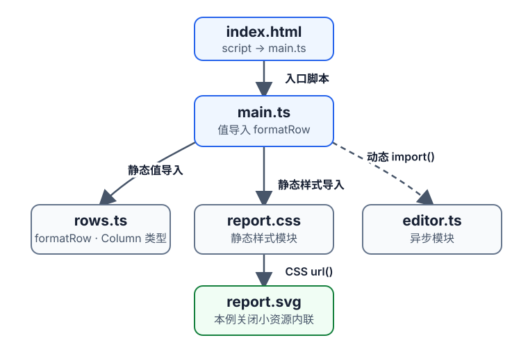

# 构建器怎样把源码变成可部署的文件？

浏览器只按 URL 请求 HTML、JavaScript、CSS 和图片，不认识 `.ts`、Sass，也不会去 `node_modules` 里找包。构建器负责从入口出发找齐依赖、删掉没用的代码、分块、写出带哈希的文件，并把源码里的导入改写成浏览器能请求的 URL。本章跟着报表页的一份小源码走完这条路；读者需要知道 ESM 的 `import`、`export` 和动态 `import()` 在语言层的含义，见[import 写下后，谁负责找到、链接和执行文件？](../javascript/modules-and-host-boundaries.md)。

## 报表页的源码要经过哪五个阶段？

沿用主线一的报表页，这里只看它的前端源码。它是一个合成的小项目，部署在 `/reports/` 路径下。文中出现的生成文件名和请求结果，来自 Node.js 26.13.0、Vite 8.3.5、Webpack 5.109.0 与固定配置的实测 fixture；它们是这些版本和配置的输出，不是工具的默认文件名，也不是稳定 API。

- `index.html` 用 `
<link rel="stylesheet" href="/reports/assets/index-QsJV6IX7.css">
~~~

~~~css
background: url(/reports/assets/report-D2wE4vR2.svg);
~~~

入口脚本里的动态导入改写成 `await import("./editor-x2UHusWa.js")`。脚本从 `/reports/assets/` 加载，浏览器因此请求 `/reports/assets/editor-x2UHusWa.js`，而不是源码 `editor.ts`。用无界面 Chromium 首次打开页面时没有请求编辑器；点击后该 URL 返回 200。本例把这次构建记为 v41。

Vite 默认不生成 manifest。本例打开它来核对映射：`"index.html"` 一项记录了 `dynamicImports: ["src/editor.ts"]`，`"src/editor.ts"` 一项的 `file` 是 `"assets/editor-x2UHusWa.js"`。`file` 值相对输出目录，不带 `/reports/` 前缀。浏览器只按 HTML、CSS 和 JS 里的引用请求文件，不读 manifest；需要它的是服务端渲染或后端集成工具。

另外几点也不能靠“构建成功”证明：

- 恢复默认内联阈值后，本例的小 SVG 会变成 CSS 里的 data URL，不再单独请求。
- `base` 必须与静态站点的挂载路径一致。`vite preview` 只用于本地预览生产构建，不是生产服务器；上线前要在实际部署 URL 下检查 HTML、初始脚本和样式、异步 chunk、图像、缓存头、压缩和路由回退。
- Vite 用 Oxc 转译 TypeScript，只删类型，不做类型检查。
- Vite 8.3.5 的 `build.target` 默认面向固定日期（2026-01-01）的 Baseline Widely Available 浏览器范围：Chrome/Edge 111、Firefox 114、Safari 16.4。它只决定语法转换到什么程度，不补运行时 API，`tsconfig.json` 的 `target` 也不能代替它。支持更早的浏览器要另配 polyfill（兼容补丁）并在目标环境验证，见[用一个新 API 之前，怎样确认运行时真的支持？](../javascript/feature-availability.md)。

## source map 怎样把报错映回源码，又会暴露什么？

生产代码经过转换和压缩，报错的行列号对应生成文件，很难读懂。source map（源映射）记录生成代码位置与原始源码位置的对应关系，调试器或错误收集工具据此把位置映回源码；映射本身不能还原出原始文件，除非它附带了源码文本。几个选择各影响一件事：精确到行还是列影响定位精度；是否使用 loader 提供的映射影响能映回多早的源码；映射内嵌还是外置、是否附带源码文本，影响构建成本和对外暴露的信息。

| Webpack `devtool` 例子 | 主要含义 | 适用边界 |
|---|---|---|
| `eval-source-map` | 逐模块用 `eval` 关联完整映射 | 开发定位精度高；官方把初次构建速度列为 slowest |
| `cheap-source-map` | 行级映射，忽略 loader 提供的映射 | 不支持列级断点；可能停在转换后的行 |
| `cheap-module-source-map` | 使用 loader 映射后简化到行级 | 能映回更早的源码，但没有列位置 |
| `source-map` | 外置完整映射，bundle 写引用 | 可恢复行列；要检查 `.map` 是否可公开请求 |
| `hidden-source-map` | 外置映射，bundle 不写 `sourceMappingURL` | 可把 `.map` 单独上传到私有错误工具；隐藏引用不等于访问控制 |
| `nosources-source-map` | 不内嵌 `sourcesContent` | 仍可能泄露文件名和映射关系 |

`cheap-` 只保留行级位置。`module-` 只在 cheap 组合里表示使用 loader 映射；完整的 `source-map` 本身就会使用可用的 loader 映射。Webpack 5.105 起 `devtool` 也可以写成数组，每项用 `type` 指定作用对象：`"javascript"`、`"css"` 或 `"all"`；`all` 只指 JavaScript 与 CSS，不含图像、字体等资源。当前完整语法还有 `-debugids`，5.112.0 加入 `-scopes`；组合顺序与可用性按锁定版本核对。旧预设的详细映射见[Webpack source map 预设对照](../../archive/front-end/Deprecated_Interview_Notes/webpack-source-map-presets.md)。

source map 不是权限边界。`.map` URL 只要仍由服务器公开提供，去掉 bundle 里的引用也挡不住知道路径的人；`nosources` 只去掉源码文本，目录和文件名仍可能暴露。发布时要分别检查输出文件、服务器静态资源规则和错误收集工具的访问权限。

## 这套文件上线后，旧页面还会请求什么？

构建器交出的是一组互相引用的文件：一份入口 HTML、带哈希文件名的初始 JS 和 CSS、只在首次打开编辑抽屉时才请求的编辑器 chunk，以及可选的 manifest。入口脚本里写死了编辑器 chunk 的文件名。下一章接着问：发布 v42 后，已经开着的 v41 页面第一次打开编辑抽屉，请求的仍是 v41 的 chunk；缓存头和发布顺序要怎样安排，它才拿得到 200 而不是 404？见[发布新版本时，怎样让缓存和还开着的旧页面都不出错？](hashed-release-and-caching.md)。

> [!info]- 来源
> - **五个阶段、依赖发现与异步边（Webpack）：** [NormalModule.js](https://github.com/webpack/webpack/blob/v5.109.0/lib/NormalModule.js#L1576-L1650)、[Compilation.js](https://github.com/webpack/webpack/blob/v5.109.0/lib/Compilation.js#L1766-L1810)、[ImportParserPlugin.js](https://github.com/webpack/webpack/blob/v5.109.0/lib/dependencies/ImportParserPlugin.js#L580-L620)：转换后解析依赖、`import()` 形成异步边；[JsonpChunkLoadingRuntimeModule.js](https://github.com/webpack/webpack/blob/v5.109.0/lib/web/JsonpChunkLoadingRuntimeModule.js#L135-L196)：运行时组合 public path 与文件名。均为 Webpack v5.109.0 源码。
> - **tree shaking、`usedExports` 与 `sideEffects`、barrel 跳过子树、`*.css` 模式与 CSS 误删：** [Webpack Guides: Tree Shaking](https://webpack.js.org/guides/tree-shaking)，“Mark the file as side-effect-free”与“Clarifying tree shaking and sideEffects”节，核对于 2026-11-26。barrel 的转发语义与 `export *` 歧义：[ECMAScript 2026 §16 Scripts and Modules](https://tc39.es/ecma262/2026/multipage/ecmascript-language-scripts-and-modules.html)，§16.2.1.7 导出解析。
> - **可复现构建：** [Node.js 25.0.0 发布说明](https://nodejs.org/en/blog/release/v25.0.0) 与 [Corepack 文档](https://nodejs.org/download/release/v25.8.0/docs/api/corepack.html)：Corepack 从 Node 25 起不随发行包提供；[Corepack `packageManager` 字段](https://github.com/nodejs/corepack#when-authoring-packages)。核对于 2026-11-12。
> - **HTML 相对引用与发布路径（Webpack 实例）：** [原生 HTML](https://webpack.js.org/guides/native-html/)、[输出管理](https://webpack.js.org/guides/output-management/)。fixture 中的 HTML 路径与 chunk 文件名为 Node.js 26.13.0 + Webpack 5.109.0 实测。
> - **loader 顺序与 pitch、Asset Modules、ts-loader：** [Loaders](https://webpack.js.org/concepts/loaders/)（pitch/normal 次序）；[Asset Modules](https://webpack.js.org/guides/asset-modules/)；[ts-loader `transpileOnly`](https://github.com/TypeStrong/ts-loader#transpileonly)。
> - **Webpack 5.109 原生 CSS/HTML/TypeScript 的 `auto`：** [defaults.js](https://github.com/webpack/webpack/blob/v5.109.0/lib/config/defaults.js#L649-L686)（合成路径探测与 TypeScript 默认）；[RuleSetCompiler.js](https://github.com/webpack/webpack/blob/v5.109.0/lib/rules/RuleSetCompiler.js#L473-L578)（宽松规则探测与扩展名正则）；[implicitTypeLoaderFallback.js](https://github.com/webpack/webpack/blob/v5.109.0/lib/util/implicitTypeLoaderFallback.js#L13-L51)（逐模块退让条件）；[TypeScriptPlugin.js](https://github.com/webpack/webpack/blob/v5.109.0/lib/typescript/TypeScriptPlugin.js#L119-L134)（Node API 探测）；[experiments.typescript](https://webpack.js.org/configuration/experiments/#experimentstypescript)、[HTML 作为默认入口](https://webpack.js.org/configuration/experiments/#html-as-the-default-entry)（扩展名顺序）。Node API 版本边界：[Node.js 22.6.0 发布说明](https://nodejs.org/en/blog/release/v22.6.0)、[`module.stripTypeScriptTypes()`](https://nodejs.org/download/release/v22.13.0/docs/api/module.html#modulestriptypescripttypescode-options)、[22.13.0](https://nodejs.org/en/blog/release/v22.13.0)、[23.2.0](https://nodejs.org/en/blog/release/v23.2.0) 发布说明。
> - **plugin、processAssets、emit 与压缩插件迁移：** [processAssets 与 additionalAssets](https://webpack.js.org/api/compilation-hooks/#processassets)；[minimizer-webpack-plugin v5.6.1 源码](https://github.com/webpack/minimizer-webpack-plugin/blob/v5.6.1/src/index.js)（`OPTIMIZE_SIZE` 订阅 `additionalAssets: true`）；[Compiler.js](https://github.com/webpack/webpack/blob/v5.109.0/lib/Compiler.js#L1081-L1106)、[Compilation.js](https://github.com/webpack/webpack/blob/v5.109.0/lib/Compilation.js#L3806-L3834)、[defaults.js backCompat](https://github.com/webpack/webpack/blob/v5.109.0/lib/config/defaults.js#L622-L623)（emit、资源封存与兼容模式）；[HtmlWebpackPlugin README](https://github.com/jantimon/html-webpack-plugin#readme)、[CompressionWebpackPlugin README 与迁移](https://github.com/webpack/compression-webpack-plugin#migrating)（弃用标记、`minimizer-webpack-plugin@5.11.0`）；[Terser minimizer 5.6.0 发布](https://github.com/webpack/minimizer-webpack-plugin/releases/tag/v5.6.0)（包名变更）。
> - **Vite 开发与构建、base、manifest、内联、target：** Vite 8.3.5 固定版本文档 [build](https://github.com/vitejs/vite/blob/v8.3.5/docs/guide/build.md)、[assets](https://github.com/vitejs/vite/blob/v8.3.5/docs/guide/assets.md)、[features](https://github.com/vitejs/vite/blob/v8.3.5/docs/guide/features.md)（Oxc 只转译）、[HMR API](https://github.com/vitejs/vite/blob/v8.3.5/docs/guide/api-hmr.md)、[build options](https://github.com/vitejs/vite/blob/v8.3.5/docs/config/build-options.md)、[backend integration（manifest）](https://github.com/vitejs/vite/blob/v8.3.5/docs/guide/backend-integration.md)、[生产动态导入辅助逻辑](https://github.com/vitejs/vite/blob/v8.3.5/packages/vite/src/node/plugins/importAnalysisBuild.ts#L314-L344)。v41 文件名与请求为 Node.js 26.13.0 + Vite 8.3.5 fixture 实测。
> - **source map：** [Webpack devtool](https://webpack.js.org/configuration/devtool/)（预设表）；[Webpack 5.105 数组配置](https://webpack.js.org/blog/2026-02-03-webpack-5-105/)；[Webpack 5.112 `-scopes`](https://webpack.js.org/blog/2026-10-13-webpack-5-112/)。
