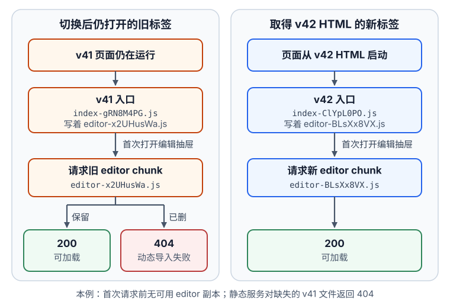

# 发布新版本时，怎样让缓存和还开着的旧页面都不出错？

上一章的构建器交出了一组互相引用的文件：入口 HTML、带哈希的初始 JS 和 CSS、首次打开编辑抽屉才请求的编辑器 chunk。本章回答这组文件上线时的两个问题：浏览器和 CDN 怎样缓存它们，才能既少下载又不拿到旧内容；发布新版本时，按什么顺序上传、切换和删除，才能让还开着的旧页面继续工作。读者手上有[构建器怎样把源码变成可部署的文件？](build-pipeline-and-bundling.md)里的 v41 产物。

## 发布 v42 时，谁还在用 v41？

沿用上一章的报表页 fixture（Node.js 26.13.0、Vite 8.3.5，部署在 `/reports/` 下）。v41 和 v42 是两次独立构建，源码唯一的差别是编辑器里的一段文字。

切换到 v42 的那一刻，至少有三类客户端还可能引用 v41 的文件：

- **已打开的 v41 标签页。** 它的入口脚本早已加载，里面写死了 v41 编辑器 chunk 的文件名；用户第一次打开编辑抽屉时，才会去请求这个文件。
- **CDN 边缘节点。** 源站切换后，边缘节点可能在短时间内仍返回旧 HTML。
- **旧的 Service Worker。** 它可能继续控制旧页面，并从自己的缓存里提供 v41 的文件。

所以发布要同时解决两件事：每个 URL 的缓存规则，以及新旧文件在服务器上共存多久。先看缓存规则。

## HTTP 缓存怎样决定能不能复用一份响应？

浏览器或 CDN 收到请求时，按三个问题决定能否用存储的响应代替网络：

1. **能不能存。** `Cache-Control: no-store` 要求缓存不存储这次响应；其他响应按状态码和指令判断。
2. **缓存键是否匹配。** 缓存通常按请求方法和目标 URL 区分响应，响应里的 `Vary` 再列出影响表示的请求字段，例如语言或编码偏好。
3. **是否仍新鲜。** `max-age=N` 表示响应的年龄（自源站生成以来的时间）小于 N 秒时新鲜。新鲜的响应可以直接复用，不联系服务器。

响应不再新鲜时，缓存可以发条件请求验证：响应带过 `ETag`（实体标签）时，缓存发 `If-None-Match`；服务器回 `304 Not Modified` 表示内容没变，缓存复用已存的正文；内容变了就回 `200 OK` 和新正文。验证器和新鲜时间管不同的事：`ETag` 只在需要验证时使用，不会让仍新鲜的响应提前去验证。

几个常被混淆的指令：

| 指令 | 含义 | 常见误解 |
|---|---|---|
| `max-age=31536000` | 一年（365 × 24 × 3600 秒）内新鲜，可直接复用 | 以为过期就绝不能用；有些指令或配置允许使用特定的过期响应 |
| `immutable` | 响应在新鲜期内不会变化，浏览器无需重新验证，用户普通刷新时也不必发条件请求 | 以为它能让内容永不过期；它只在新鲜期内生效 |
| `no-cache` | 可以存，但每次复用前都要先向服务器验证 | 以为是“不要缓存” |
| `no-store` | 不要存储这次响应 | 以为能单独保证隐私 |

由此得到前端静态资源的两种做法：

- **内容不同就用不同 URL。** 构建器把内容摘要放进文件名，例如 `/reports/assets/editor-x2UHusWa.js`。同一个 URL 永远对应同一份内容，于是可以给很长的新鲜时间并加 `immutable`：

  ~~~http
  HTTP/1.1 200 OK
  Content-Type: text/javascript
  Cache-Control: public, max-age=31536000, immutable
  ~~~

- **同一个 URL 的内容会变**，例如入口 HTML。用 `no-cache` 加 `ETag`，让缓存保留正文，但每次复用前都问服务器；或给较短的 `max-age`，限制旧内容最多被直接复用多久，到期后再用 `ETag` 验证。

报表 API 这类带用户数据的响应，还涉及 `private`、授权撤销与缓存的关系，见[浏览器请求如何到达 HTTP 响应？](../../engineering-foundations/services/http-semantics-and-transport.md)的缓存一节。本章只处理公开的静态资源。

## 编辑器改了一行字，为什么入口脚本的文件名也变了？

编辑器内容变了，它的文件名哈希随之改变。入口脚本里写着编辑器的生成文件名，所以即使 `main.ts` 源码一字未改，生成的入口 JS 内容也变了，入口文件名同样改变。这就是哈希级联：一个文件的新名字，会沿“被谁引用”一路传到入口。没有变化、也不引用变化文件的 CSS 和 SVG 保持原名。

| 浏览器请求（`base` 为 `/reports/`） | v41 | v42 |
|---|---|---|
| 新页面从 HTML 取得的入口 JS | `/reports/assets/index-gRN8M4PG.js` | `/reports/assets/index-ClYpL0PO.js` |
| 首次打开编辑抽屉时的编辑器 chunk | `/reports/assets/editor-x2UHusWa.js` | `/reports/assets/editor-BLsXx8VX.js` |
| 初始 CSS | `/reports/assets/index-QsJV6IX7.css` | 相同 |
| CSS 图标 | `/reports/assets/report-D2wE4vR2.svg` | 相同 |

哈希还受图中引用关系和其他构建输入影响，不能只凭某个源文件或最终 JS 的字节自行推算。级联的好处是：用户升级到 v42 时，只需重新下载入口和编辑器两个文件，CSS 和图标继续命中缓存。代价是：v41 和 v42 的入口引用不同的编辑器文件，两者在服务器上必须同时存在一段时间。

## 发布时先上传什么、后切换什么，旧文件留多久？

发布 v42 的顺序：

1. 把整套入口 JS、样式、图像和异步 chunk 写入目标存储，确认它们都能从对应 URL 读取。
2. 最后才切换源站上的 HTML 或 release 指针。
3. 旧版本文件继续保留。

切换只保证指针本身原子更新。CDN 边缘可能还在返回旧 HTML，已打开的旧页面也还在运行。因此有两条硬规则：不要改写同一个哈希 URL 下的内容；只要还可能有旧 HTML、旧标签页或旧 Service Worker 引用某个文件，就不要删除它。

图中的 200 和 404 来自实际浏览器测试。v41 标签页已加载入口、还没打开编辑抽屉时发布 v42：保留旧 chunk，首次点击请求旧 URL，返回 200；提前删掉旧 chunk，这次请求返回 404，动态导入失败。若该页面已经加载过编辑器，再次调用会复用已加载的模块，不再请求；浏览器缓存或 Service Worker 里有可用副本时，也可能不走网络。但这些只是可能，不能代替保留旧文件。

## 缺失的 chunk 为什么会“返回 200 却加载失败”？

单页应用的服务器常把找不到的路径回退成 `index.html`，好让 `/reports/42` 这类前端路由直接打开。若这条回退规则也覆盖了 `/reports/assets/`，旧页面请求一个已删除的 chunk 时，网络面板显示 200，拿到的却是 HTML；动态导入仍会失败，因为响应不是 JavaScript。排查时看到 200 不要就此放过，要看响应类型和正文。让资源目录下缺失的文件返回 404，错误才会直接暴露出来。

动态 chunk 加载失败时，应用要先判断是不是可恢复的新旧版本错配，再决定怎样处理：

- 不要把所有导入错误都当成版本错配；网络中断、脚本本身抛错是别的问题。
- 若判断为版本错配，先保留用户未保存的草稿（编辑抽屉里的内容见[编辑表单怎样在别人同时修改时安全保存？](../ui-state/editing-sessions-and-conditional-writes.md)），再提示用户保存后自己选择刷新。
- 不要自动无限重载。若新 HTML 仍因缓存拿不到，重载只会重复失败。

> [!info] 实例：Vite 的 `vite:preloadError`（核对 Vite 8.3 文档，2026-11-26）
> Vite 在动态导入加载失败时派发 `vite:preloadError` 事件，`event.payload` 是原始导入错误；调用 `event.preventDefault()` 后，这个错误不再抛出。文档的例子是在监听器里刷新页面，并特别提醒：入口 HTML 要设 `Cache-Control: no-cache`，否则刷新后仍会引用旧文件。支持可重试模块加载的浏览器允许应用在暂时的网络或 HTTP 错误后重新尝试原来的动态导入；较旧的浏览器会把失败结果记在模块映射里，只能整页重载。把上面的判断规则放进这个监听器：先确认是版本错配、保住草稿，再交给用户决定。

## 每类文件该设什么缓存，Service Worker 为什么要另算？

HTTP 缓存和 Service Worker 的 Cache Storage 是两套机制，要分开设置：

| 资源 | 缓存边界 |
|---|---|
| 可变 HTML 或当前 release 指针 | `Cache-Control: no-cache`，复用前重新验证；或较短的新鲜时间 |
| 带哈希的脚本、CSS 与图片 | 只有同一路径永不改写内容时，才适合长 `max-age` 加 `immutable` |
| 构建 manifest | 浏览器通常不请求；服务端读取时按版本保存，或与入口一同重新验证 |
| Service Worker Cache Storage | 独立于 HTTP 缓存，不读 `Cache-Control`；按版本保留旧页面仍需要的文件 |

## 回滚为什么也要成套进行？

回滚是把指针指回 v41，同样要成套：入口 HTML 和服务端会读取的 manifest 一起指回去。已经打开的 v42 页面仍可能需要 v42 的文件，所以回滚后也不能立即删除 v42。

旧版本文件的保留时长，要覆盖三样东西：仍可能被提供的 HTML（包括 CDN 边缘上的副本）、用户仍开着的页面、可能继续控制旧页面的 Service Worker。后端 API 能否同时兼容新旧页面，是另一项要单独检查的发布条件。本章止于静态资源；构建一次、逐环境验证、渐进放量和服务端回滚见[如何晋级并回滚已验证的报表服务产物？](../../engineering-foundations/practice/build-once-promote-by-digest.md)。

## 例子：图集和独立图标，缓存粒度差在哪里？

哈希 URL 让缓存以“文件”为单位失效，所以把几个资源合进一个文件，就把它们的失效绑在了一起。CSS sprite（雪碧图）是现成的例子：多个小图标排进一张图集，用 `background-position` 露出其中一格。图集怎样裁切、图标形式怎样选，见[图标该用行内 SVG、外部图片、雪碧图还是图标字体？](icon-delivery.md)；这里只看缓存。

设报表详情页 `/reports/42` 为 A，用整组 8 个状态图标；报表列表页为 B，只用第 1 个。这次发布只改了第 7 个图标。

- **图集按内容摘要命名。** 改一格就生成新的整张图集 URL，A、B 都指向它。同一浏览器缓存上下文里，先打开的页面下载完整新图集，后打开的页面复用这份新鲜响应。B 只露出一格，也要下载整张图集。
- **每个图标是独立的哈希文件。** B 引用的第 1 个图标 URL 没变，继续命中缓存；A 只需取得改名后的第 7 个，其余 7 个沿用原 URL。

是否命中还取决于缓存分区、响应新鲜度和缓存是否仍保留该对象。图集减少的是“多个图标一起用”时的请求数；它不能把一张图拆成可单独缓存的格子。

下面的本地对照只回答“请求哪些文件、缓存能否复用”，不是任何站点的速度结论。条件：Chromium 157.0.8103.51、本机 Node HTTP/1.1 服务、8 个极小的合成 SVG、`Cache-Control: public, max-age=86400, immutable`；冷缓存每次新建干净的浏览器上下文，热重载在原上下文进行。

| 报表页加载的图标资源 | 冷缓存请求数 | `encodedBodySize` 合计 | `transferSize` 合计 | 同一上下文热重载 |
|---|---:|---:|---:|---|
| 8 个独立 `16 × 16` SVG | 8 | 1,780 | 4,180 | 0 个新请求，`transferSize` 为 0 |
| 含 8 个图形的单张 SVG 图集 | 1 | 1,383 | 1,683 | 0 个新请求，`transferSize` 为 0 |
| 只取 1 个独立 SVG | 1 | 210 | 510 | 0 个新请求，`transferSize` 为 0 |
| 只用图集中的 1 格 | 1 | 1,383 | 1,683 | 0 个新请求，`transferSize` 为 0 |

字节来自 PerformanceResourceTiming（资源计时 API）。`encodedBodySize` 是响应正文的编码大小；网络响应的 `transferSize` 按规范等于编码正文大小加一个 300 字节的响应头估值，所以 8 个独立文件是 `1,780 + 8 × 300 = 4,180`，图集是 `1,383 + 300 = 1,683`。本地缓存命中且无需网络验证时为 0；经网络验证后复用则记 300。这个值不是实际 HTTP 头、TLS 或链路字节的精确账单，表里也不含 HTML、CSS、连接、压缩和 CDN。

结论只有资源粒度：页面用全组时，图集少 7 个请求；只用一格时，单个独立 SVG 比图集少传 `1,683 − 510 = 1,173` 个 `transferSize` 字节。

## HTTP/2 与 HTTP/3 下，“少一个请求”还值多少？

HTTP/1.1 时代，合并文件的主要理由是减少连接和排队。HTTP/2 让多个资源流在同一条 TCP 连接上交错传输，请求数不再等于新建连接数；但 TCP 丢失字节时，仍可能暂时挡住同一连接上所有流的后续数据。HTTP/3 用 QUIC 流承载请求，单个流受阻时其他流可以继续推进，但这些流仍共享连接级的拥塞控制和流量控制。协议细节见[浏览器请求如何到达 HTTP 响应？](../../engineering-foundations/services/http-semantics-and-transport.md)。

所以不能只凭“文件更少”断言合并更快。独立资源仍有各自的请求处理和响应头；合并则把未用部分的字节、变更频率和缓存失效绑在一起。若一组资源在多数页面一起出现、且一起更新，可以测合并；若路由只取其中少数、或它们经常独立更新，独立资源只请求当前需要的 URL，未变部分继续命中缓存。

## 发布之前，怎样证明这些文件真的能用？

到这里，发布规则已经确定：哈希资源长缓存加 `immutable`，入口 HTML 每次验证；先传全套、后切指针，旧文件保留到没有 HTML、页面和 Service Worker 再引用它；缺失文件返回 404 而不是 HTML，chunk 失败时保住草稿、让用户选择刷新。这些规则是否真的落实，要靠测试在实际部署 URL 下证明，例如旧页面首次打开编辑抽屉时请求是否成功。下一章讨论这类证明该放在哪一层：[前端测试该在哪一层证明什么？](frontend-testing-strategy.md)。

> [!info]- 来源
> - **缓存三问、新鲜度与 `max-age`、`ETag` 验证、`no-cache` 与 `no-store`：** [IETF RFC 9111, HTTP Caching](https://www.rfc-editor.org/rfc/rfc9111.html)，§§2、4.2（缓存键与新鲜度）、4.3（验证）、5.2（`Cache-Control` 指令），2022-06，核对于 2026-11-12。
> - **`immutable`（新鲜期内包括刷新时不发条件请求）：** [IETF RFC 8246](https://www.rfc-editor.org/rfc/rfc8246.html)，§§2–3，2017-09。哈希 URL 更新策略：[MDN HTTP Caching，Cache busting](https://developer.mozilla.org/en-US/docs/Web/HTTP/Guides/Caching#cache_busting)，访问于 2026-11-12。
> - **Service Worker Cache Storage 独立于 HTTP 缓存：** [W3C Service Workers](https://www.w3.org/TR/service-workers/)，Cache 对象节。
> - **哈希级联、v41/v42 文件名、200/404 与缺失 chunk 回退 HTML：** Node.js 26.13.0 + Vite 8.3.5 合成 fixture 的本地静态服务与无界面 Chromium 实测；文件名是版本与配置结果，不是稳定 API。生产动态导入改写：[Vite 8.3.5 importAnalysisBuild.ts](https://github.com/vitejs/vite/blob/v8.3.5/packages/vite/src/node/plugins/importAnalysisBuild.ts#L314-L344)。
> - **`vite:preloadError`、HTML 需 `no-cache`、可重试模块加载与旧浏览器缓存失败：** [Vite Building for Production，Load Error Handling](https://vite.dev/guide/build#load-error-handling)，文档版本 v8.3.7，核对于 2026-11-26。
> - **图集与独立图的缓存粒度对照：** Chromium 157.0.8103.51 本地实测，条件见正文。`transferSize`、`encodedBodySize`、300 字节估值与无网络缓存命中为 0：[W3C Resource Timing，2026-11-02 CRD，§3.3](https://www.w3.org/TR/2026/CRD-resource-timing-20261102/#dom-performanceresourcetiming-transfersize)。
> - **HTTP/2 多路复用与 TCP 队头阻塞：** [IETF RFC 9113](https://www.rfc-editor.org/rfc/rfc9113.html)，§§1.2、5，2022-06；**HTTP/3 的 QUIC 流与连接级拥塞控制：** [IETF RFC 9114](https://www.rfc-editor.org/rfc/rfc9114.html)，§§1.2、2，2022-06；**QUIC 流级与连接级流量控制：** [IETF RFC 9000](https://www.rfc-editor.org/rfc/rfc9000.html)，§4，2021-05。核对于 2026-11-12。
