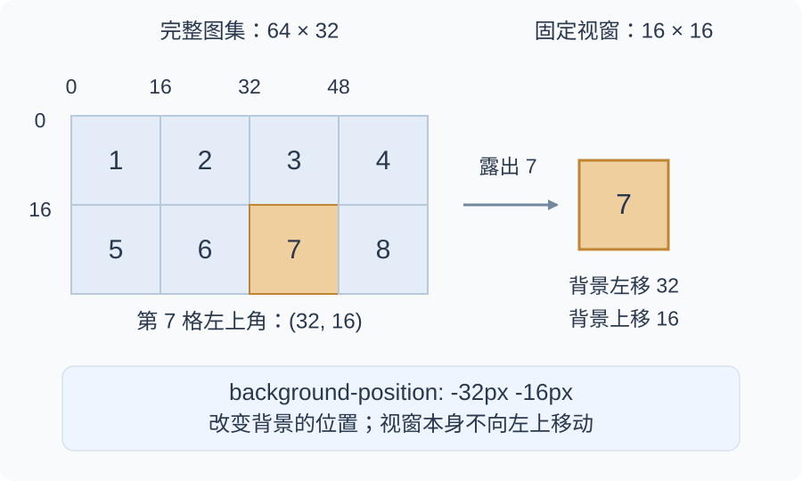

# 图标该用行内 SVG、外部图片、雪碧图还是图标字体？

图标的四种常见载体是 inline SVG (行内 SVG)、作为 `` 的独立 SVG 文件、CSS Sprite (CSS 雪碧图)和 icon font (图标字体)。没有哪一种单凭“文件更少”或“矢量更清晰”胜出。本章按三个问题比较它们：图标在控件里是否承担名称，图形是否要随页面样式变色，一组图标按什么单位缓存和更新。读者需要会写基本的 HTML 按钮和 CSS 选择器。

沿用主线一的报表页 `/reports/42`。本章给它加三类图标：

- 工具栏“添加筛选条件”按钮的加号图标，要随主题、焦点和禁用状态换色；
- “编辑报表”按钮的铅笔图标，外形和颜色固定，多个页面复用；
- 一组 8 个小型状态图标（例如“等待处理”），多个报表页共用，不同页面取用的数量不同。

## 图标在控件里承担名称吗？

先决定图标对辅助技术意味着什么，再选载体，因为四种载体提供名称的方式不同。

控件的可访问名称来自控件内的可见文字、图片的替代文本，或显式关联的名称（如 `aria-label`）。紧挨着控件、但不在控件里的孤立文字，不会自动成为它的名称。

- **按钮里已有可见文字。** 图标只是装饰，应从辅助技术的呈现中隐藏：SVG 和字体字形写 `aria-hidden="true"`，`` 写 `alt=""`。
- **没有文字的图标按钮。** 名称要放在按钮上，例如 `<button aria-label="编辑报表">`，不能让图案本身成为唯一的说明。
- **图标自己承载信息。** 例如一个只靠图形表示“失败”的状态标记，就需要 `` 和有意义的 `alt`，或旁边的状态文字。

`alt` 按用途写的完整规则见[图片和音视频该怎样写语义、定地址、选文件和定加载时机？](../browser/images-and-media-loading.md)。

## 要跟随按钮状态变色：行内 SVG

“添加筛选条件”的加号要随按钮状态换色。行内 SVG 的路径就在宿主文档里，能直接被页面 CSS 选中；让形状的 `fill` 使用 `currentColor` (当前文字颜色)，它就沿用按钮的 `color`：

~~~html
<button type="button" class="report-action">
  <svg class="report-action__icon" viewBox="0 0 16 16" aria-hidden="true">
    <path d="M7 2h2v5h5v2H9v5H7V9H2V7h5z" fill="currentColor" />
  </svg>
  添加筛选条件
</button>
~~~

~~~css
.report-action { color: #24547d; }
.report-action:disabled { color: #8a8a8a; }
.report-action__icon { width: 1em; height: 1em; }
~~~

按钮禁用时 `color` 变灰，加号跟着变灰，不用再写一份图标样式。`1em` 让图标随按钮字号缩放。主线一报表页里 `Oldest first` 按钮的箭头也是这种写法：`stroke="currentColor"` 跟随按钮颜色，`aria-hidden="true"` 让名称只来自按钮文字。

代价是传输方式：行内 SVG 的标记和所在 HTML 一起下载，没有一个可供其他页面单独请求和缓存的 URL。每个用到它的页面都要再带一份标记。

## 外形固定、多页复用：外部 SVG 图片

“编辑报表”的铅笔外形固定，多个页面重复使用。把它存成独立 SVG，用 `` 引用同一个 URL，浏览器就能按 URL 缓存、跨页面复用：

~~~html
<button type="button">
  
  编辑报表
</button>
~~~

按钮已有可见文字，所以 `alt=""`。

代价是样式隔离：作为图片载入的外部 SVG 是一份独立文档，宿主页面的 CSS 选不到它里面的路径，它内部的 `currentColor` 也不会继承按钮的颜色。要换色，只能换一个文件。

## 一组小图总是一起出现：CSS Sprite

当多个小图总在同一组页面里一起出现，可以把它们排进一张 sprite sheet (精灵图集)，让一个固定尺寸的盒子只露出目标区域。

本章的合成图集是 `64 × 32px`，每格 `16 × 16px`，4 列 2 行，共 8 格。坐标 `x`、`y` 是每格左上角的位置，以图集左上角为原点，单位 CSS px。右侧的小盒子大小固定，移动的是它背后的整张背景图：

> [!example] 第 7 格的偏移
> 第 7 格是第二行第三列。列从 0 起数，第三列的左边是 `2 × 16 = 32`；第二行的上边是 `1 × 16 = 16`，所以左上角在 `(32, 16)`。
>
> 把背景向左移 32、向上移 16，这一格就落进 `16 × 16px` 的视窗。`background-position` 的正值表示向右下移，所以写成 `-32px -16px`。

~~~css
.report-status__pending-icon {
  display: inline-block;
  width: 16px;
  height: 16px;
  background-image: url("/assets/report-icons.4f2a.svg");
  background-repeat: no-repeat;
  background-position: -32px -16px;
}
~~~

~~~html

等待处理
~~~

这是“等待处理”状态旁的装饰图标。背景图不提供替代文本，名称由状态文字承担；如果图标本身承载信息，就要改用 ``。

雪碧图带来两种耦合：

- **坐标耦合。** 每个引用都写死了偏移。图集布局一变，所有引用这些坐标的页面都可能要改。图标多时，应在构建阶段从源图和布局配置同时生成图集与坐标，不要手写偏移。
- **缓存耦合。** 图集是一个文件、一个 URL。只改第 7 格，整张图集也会换新 URL，所有页面都要重新下载整张图；一个只露出 1 格的页面，没有可复用的缓存时也要下载全部 8 格的字节。

后一点决定了雪碧图是否值得用。它减少的是“多个图标被同一页面一起使用”时的请求数，不会把图集拆成可单独缓存的格子。哈希 URL 怎样缓存、一次只改一格时详情页和列表页各要重新下载什么，以及 HTTP/2、HTTP/3 下“少一个请求”还值多少，在[发布新版本时，怎样让缓存和还开着的旧页面都不出错？](hashed-release-and-caching.md)里用这组 8 个图标做了对照实测。

## 已有一套图标字体：保住名称和后备

若站点已经维护一套图标字体，字形同样能用 CSS 控制颜色和尺寸。图标通常放在 Unicode 私用区码点上，例如 `U+E900`。这些码点只对配套字体有意义：字体载入失败时，字形可能缺失，或显示成替代符号。所以字形只当装饰，名称交给按钮文字：

~~~css
@font-face {
  font-family: "report-icons";
  src: url("/assets/report-icons.woff2") format("woff2");
}

.icon {
  font-family: "report-icons";
  font-size: 1.25rem;
  line-height: 1;
}
~~~

~~~html
<button type="button">
  &#xe900;
  编辑报表
</button>
~~~

`aria-hidden="true"` 把私用区字符从辅助技术的呈现中隐藏，否则读屏可能读出无意义的字符。按钮文字仍提供名称。用字体并不会自动解决无文字按钮的名称问题，那种按钮照样需要 `aria-label`。

新系统若只为几个小图标引入一整套字体，就多了一个字体资源和一份字形映射要维护，字体文件还可能带入当前页面用不到的字形。已有字体是否继续用，取决于它是否已被页面加载、是否跨页面共享，以及能否按实际用到的字形子集构建。

## 怎样选？

| 需求 | 优先选择 | 代价 | 选错的信号 |
|---|---|---|---|
| 颜色或描边随控件状态、主题变化 | 行内 SVG + `currentColor` | 每个页面都内嵌一份标记，没有独立 URL 可缓存 | 同一图标在很多页面重复内嵌，HTML 明显变大 |
| 外形固定，多页面复用，各图标独立更新 | 外部 SVG `` | 每个图标一个请求；页面 CSS 不能改它的颜色 | 为了换色复制出多份几乎相同的文件 |
| 一组图标总在大多数页面一起出现，更新节奏相同 | CSS Sprite（先测再用） | 坐标与缓存都按整张图集耦合 | 多数页面只用一两格，或经常只改一格 |
| 已有并已加载的图标字体 | 继续用，字形 `aria-hidden`，名称给文字 | 字体加载失败时字形缺失；字体可能含未用字形 | 只为几个图标新引入整套字体 |

无论选哪种，名称规则不变：有可见文字时图标隐藏，无文字时名称放在控件上。

## 下一步接手什么？

本章为报表页的三类图标各定了载体：加号用行内 SVG 跟随按钮颜色，铅笔用可缓存的外部 SVG，状态图标是否合成图集取决于页面怎样取用和更新它们。

剩下的问题是缓存：这些文件发布后怎样命名才能长期缓存，又在更新时让旧页面不出错？这由[发布新版本时，怎样让缓存和还开着的旧页面都不出错？](hashed-release-and-caching.md)回答。

> [!info]- 来源
> - 外部 SVG 作为图片是独立文档，不继承宿主属性：W3C [SVG 2，Embedded content](https://www.w3.org/TR/SVG/embedded.html)；`` 替代文本：[WHATWG HTML Living Standard，Images](https://html.spec.whatwg.org/multipage/images.html#the-img-element)，核对于 2026-11-12。支持“外形固定、多页复用：外部 SVG 图片”。
> - `currentColor` 的计算与使用：[W3C CSS Color Module Level 4，2026-10-07 CRD，§4.4](https://www.w3.org/TR/2026/CRD-css-color-4-20261007/#valdef-color-currentcolor)；SVG 的 `color` 为 `fill` 提供 `currentColor`、行内 SVG 接受 HTML 文档的继承值：[W3C SVG 2，§§13.2–13.3](https://www.w3.org/TR/SVG/single-page.html#ColorProperty)，核对于 2026-11-12。支持“要跟随按钮状态变色：行内 SVG”。
> - `background-position` 的定位语法：[W3C CSS Backgrounds and Borders Module Level 3](https://www.w3.org/TR/css-backgrounds-3/#the-background-position)，核对于 2026-11-12。图集为 4 列 × 2 行、每格 16px 的合成数据，偏移按该几何直接计算。
> - 隐藏装饰内容与控件名称：[W3C WAI-ARIA 1.2，`aria-hidden`](https://www.w3.org/TR/wai-aria-1.2/#aria-hidden)；背景图不提供替代文本、功能图片的名称：[WAI Images Tutorial](https://www.w3.org/WAI/tutorials/images/)，核对于 2026-11-12。支持“图标在控件里承担名称吗？”与图标字体一节。
