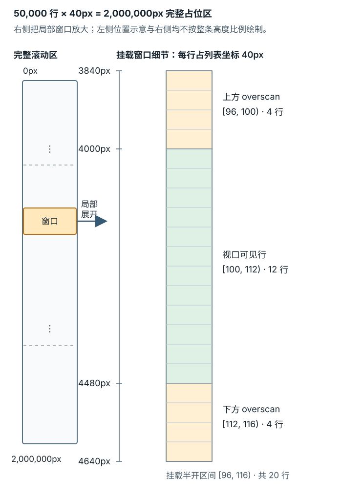

# 长列表的成本在哪里，分页和虚拟化各省掉什么？

一份长列表慢，可能慢在下载、慢在客户端计算，也可能慢在同时挂载的节点太多；分页和虚拟化各只处理其中一部分。本章先拆开这三类成本，再讲跨请求分页怎样保持顺序、固定行高的虚拟窗口怎样从滚动位置算出来、变高行怎样跟上实际尺寸，最后讲虚拟化给键盘和读屏用户带来的代价。读者手上有上一章的测量方法：[用户觉得慢时，怎样从指标走到证据？](performance-metrics-and-diagnosis.md)，以及 React 的 key 与状态身份：[React 怎样把一次用户操作变成界面更新？](../ui-state/react-update-model.md)。

## 50,000 行都要能浏览时，成本落在哪里？

沿用报表页，以及性能诊断时用过的 50,000 条合成记录。那次排序实验只把前 50 行写进列表，所以那次慢交互与 DOM 规模无关。现在需求变了：用户要能翻看全部历史报表。50,000 只是演算规模，不是启用虚拟滚动的门槛；能否承受全量处理，取决于设备、行的复杂度、数据形状和交互，要分别测量。

把全部记录交给页面，至少带来三类成本：

1. **传输。** 从服务端拿来多少字节。
2. **客户端计算与内存。** 为筛选、排序和转换跑多少 JavaScript，保留多少数据对象。客户端筛选 50,000 条就要检查 50,000 条：每条的判定成本近似固定时，一次扫描随记录数 `n` 线性增长，记作 `O(n)`。
3. **挂载。** React 和浏览器同时要处理多少组件、DOM 节点、样式和布局。

先问用户到底要看什么。只看总数或月度趋势时，服务端聚合直接返回结果；要搜索、排序、翻页时，服务端按条件处理后只发当前页；只有用户确实要连续浏览已加载的数据时，才轮到虚拟滚动处理挂载窗口。

每种手段只省掉一类成本：

| 同一任务录制确认的主要成本 | 优先处理方向 | 要计入的代价或边界 |
|---|---|---|
| 传输了用户尚不需要的记录 | 服务端过滤、排序、分页或按需请求；只需统计时返回聚合 | 加载、错误、重试、结束状态和排序一致性 |
| 客户端全量变换或查询占主线程 | 改算法、缩小输入、分块，或把纯计算交给 Web Worker | Worker 不减少计算量；对象消息通常要结构化复制，传递也要计时（见上一章最后一节） |
| React 组件函数反复执行 | 先按[React 渲染慢时，先改什么？](react-rendering-optimization.md)检查状态位置和 `memo` 边界；成本主要随挂载行数增长时，再评估虚拟化 | 缓存跳过重复计算，虚拟化减少参与工作的行，两者作用不同 |
| 大量已挂载节点让样式、布局或呈现变慢 | 虚拟化当前可视窗口 | 测量、滚动、焦点、键盘、读屏、打印和页内查找都更复杂 |

把行从 DOM 移走，不会减少那次 `O(n)` 扫描，也不会撤销已下载的数据或释放它们占的 JavaScript 内存。

## 跨请求分页怎样保证不重不漏？

分页先要有确定的顺序：报表页的 `sort=recent` 交给服务端时，定义为按 `createdAt` 降序，时间相同时再按唯一的 `report.id` 升序打破并列。顺序确定之后，`OFFSET` 翻页仍会在数据变化时重复或漏行（头部插入一行，上一页的末行会在下一页再出现；删除一行，就有一行被跳过）。keyset pagination (键集分页) 改为从上一页末行的完整排序键 `(createdAt, id)` 之后接着取，插入和删除不再移动页边界。为什么排序键必须唯一、游标里该放什么、集合 API 的分页契约怎样写，以[怎样无重复、无遗漏地分页读取一个还在变化的集合？](../../engineering-foundations/data/keyset-pagination-and-snapshots.md)为准；前端只需按契约原样回传游标，并让排序参数与游标同属一个查询键。

键集分页解决的是页边界漂移，不会冻结整个数据集：两次请求之间新增到后面的行仍会出现。需要一致的历史浏览时，还要由服务端定义快照或版本边界。分页减少的是单次传输；客户端已经收到全量数据后再虚拟化，不会追溯减少之前的流量。

## 固定行高时，怎样从滚动位置算出挂载窗口？

virtualization (虚拟化)只把视口附近的行放进 DOM，用一个占位元素保持整条列表的滚动高度。先看行高固定的模型，约定如下：行号从 0 开始；区间写成半开区间 `[start, end)`，右端不包含；每行的重复步长为 40px（有行间距时也计入步长）；滚动窗口高 480px；上下各多渲染 4 行的 overscan (预渲染缓冲)。

在 `scrollTop = 4000px` 时：

- 第一个可见行是 `4000 / 40 = 100`；视口底部在 `4000 + 480 = 4480px`，即第 112 行的起点。可见区间 `[100, 112)`，共 12 行。
- 加上前后各 4 行缓冲，挂载区间 `[96, 116)`，共 20 行。
- 挂载窗口的顶端偏移 `offsetY = 96 × 40 = 3840px`。
- 整条列表的占位高度 `50,000 × 40 = 2,000,000px`，让滚动条仍代表完整列表。

图右侧展开 `scrollTop = 4000px` 时的 20 行挂载窗口，左侧只标出它在完整列表里的位置，两侧都不按 2,000,000px 的比例绘制。

下面的函数只计算窗口。输入约定：`totalRows` 是非负整数，`rowHeight` 和视口高度是有限正数，`scrollTop` 是有限数，`overscan` 是非负整数；滚动容器还没测到正高度时先不计算。

~~~javascript
const items = Array.from({ length: 50_000 }, (_, id) => ({ id }));

function getWindow(totalRows, scrollTop, viewportHeight, rowHeight, overscan = 4) {
  const totalHeight = totalRows * rowHeight;
  const maxScrollTop = Math.max(0, totalHeight - viewportHeight);
  const offset = Math.min(Math.max(scrollTop, 0), maxScrollTop);
  const firstVisible = Math.floor(offset / rowHeight);
  const start = Math.max(0, firstVisible - overscan);
  const end = Math.min(
    totalRows,
    Math.ceil((offset + viewportHeight) / rowHeight) + overscan
  );
  return { start, end, offsetY: start * rowHeight, totalHeight };
}

const range = getWindow(items.length, 4_000, 480, 40);
// { start: 96, end: 116, offsetY: 3840, totalHeight: 2000000 }
const mountedItems = items.slice(range.start, range.end);
~~~

组件把 `mountedItems` 放进一个从 `range.offsetY` 开始定位的容器，外层占位区高度设为 `range.totalHeight`。边界都由夹取处理：靠近开头时 `start` 不小于 0，靠近结尾时 `end` 不超过 `totalRows`，列表比视口短时最大滚动位置为 0。实际的视口高度和容器位置要从浏览器测量，不能把示例常数写死。

滚动容器的 `scroll` 事件更新 `scrollTop` 后，组件重新计算窗口并重绘，挂载和卸载在这时发生：

| `scrollTop` | 可见区间 | 挂载区间 | `offsetY` | 与上次相比 |
|---:|---|---|---:|---|
| 4000px | `[100, 112)` | `[96, 116)` | 3840px | 初始窗口，挂载 20 行 |
| 4040px | `[101, 113)` | `[97, 117)` | 3880px | 卸载第 96 行，挂载第 116 行；第 97–115 行留着 |

窗口滚动只改变“挂载哪些下标”，不改变 `items` 本身。虚拟化也可以与分页或增量请求组合，但请求下一页、维护 API 游标和处理失败，是另一条独立的数据加载流程。

## 行被卸载后，它的状态和身份怎样保住？

上表里第 96 行滚出窗口就被卸载，它的组件局部 state 随之结束。这带来三条要求：

- **key 用业务 ID。** `report.id` 跨排序和翻页都稳定且唯一。窗口内的索引不是报表身份：排序或滚动后用 index 作 key，可能把旧行的状态交给另一份报表。key 怎样决定状态归属，见[React 怎样把一次用户操作变成界面更新？](../ui-state/react-update-model.md)。
- **要跨出窗口保留的状态放到列表外。** “已选中”、编辑草稿这类状态按报表 ID 存在列表组件之外，行重新挂载时再按 ID 取回。
- **恢复阅读位置按 ID，不按像素。** 离开页面后要回到原处时，保存可见的第一行 ID 和该行内的滚动偏移，回来后定位到那一行。

## 行高不固定时，窗口怎样跟上实际尺寸？

报表标题可能换行，说明行可能展开，字体或图片也可能在挂载后改变高度。这时只能先按估计高度累加出各行的起点；行挂载后，虚拟器测得实际高度，再更新它之后各行的起点和总高度。

沿用 `scrollTop = 4000px` 的算例：视口上方的第 96 行原估 40px，实测 52px，多出 12px。第 100 行的内容坐标从 4000px 移到 4012px。若滚动位置仍是 4000px，第 100 行在屏幕上会下移 12px，用户看到内容跳了一下；若实现以第 100 行为锚点、把 `scrollTop` 补偿到 4012px，它就留在视口原位。

所以动态尺寸的虚拟器要有三样东西：初始估计、实际测量和滚动锚定策略。要在目标浏览器里检查展开行、异步内容和视口尺寸变化。

> [!info] 实例：TanStack Virtual v3（核对官方 latest 文档，2026-11-12）
> `estimateSize` 提供初始估计，`measureElement` 取得挂载行的实际尺寸，`getTotalSize` 给出占位总高度，`overscan` 设缓冲行数，`getItemKey` 指定行身份。视口上方的行实测尺寸与估计不同时，实例属性 `shouldAdjustScrollPositionOnItemSizeChange` 控制是否校正滚动位置；默认只在没有反向滚动时校正。文档地址是 `/latest`，具体行为按项目安装的版本核对。

> [!info] 实例：ahooks `useVirtualList`（v3.11.0）
> v3.11.0 返回 `[visibleRows, scrollTo]`，每项带 `data` 和源数组里的 `index`；用 `containerTarget`、`wrapperTarget` 指定滚动容器和内层包装；`itemHeight` 可以是固定数值，或按行计算的函数，必须与实际布局相符。源数组每次 render 都换引用时，计算可见范围的 Effect 会再运行一次并写入新的可见列表 state，带来额外 render；内容没变时保持引用稳定，或用 `useMemo` 记住它。
>
> 归档的 ahooks v2.6 返回对象 `{ list, containerProps, wrapperProps, scrollTo }`；它的 `itemHeight` 函数按源索引给出高度，没有单独的 `estimateSize` 参数。不要混用两个版本的写法。

## 虚拟化让键盘和读屏用户付出什么代价？

窗口外的行不在 DOM 里，依赖 DOM 的焦点、键盘导航和辅助技术都会受影响。

**焦点会丢。** 键盘焦点落在某行的按钮上，下一次滚动把该行卸载，焦点就没了。交互列表要按报表 ID 跟踪活动项，保证它一直挂载，或在卸载前按控件模式转移、稍后恢复焦点。对用方向键导航的虚拟 `grid` (网格)，目标单元格在窗口外时，先算出目标行的 ID 或索引、滚动到包含它的窗口，等目标行挂载后再把焦点移过去。

**角色不能随手加。** 数据看起来像列表，不等于该用 `role="listbox"`。listbox 是用来选择选项的复合控件，不适合在每个选项里放按钮、复选框这类独立控件；listbox、grid 这些复合控件还各自要求一套方向键和焦点行为。

**先考虑不虚拟化。** 只需展示和浏览报表时，带正确表头的原生 `<table>` 加服务端分页通常更容易用；表格结构见[页面结构怎样让所有人都能读懂和操作？](../html-css/semantic-structure-and-accessibility.md)。单页表格只呈现当前页，要搜索或打印全量结果，还需要应用级的搜索或导出。只有当测量确认挂载行数带来主要成本、且用户需求能接受只挂载部分节点时，才承担虚拟表格的复杂度。

**用 ARIA 报告完整位置。** 只渲染集合的一部分时，WAI-ARIA 让当前挂载的每一项声明自己在完整集合里的位置：

- `table`、`grid`、`treegrid` 用 `aria-rowcount` 和 `aria-rowindex`。行位置相对完整表格从 1 开始，`aria-rowcount` 包含表头行；总行数未知时写 `aria-rowcount="-1"`。
- 适用的 `listitem`、`treeitem` 用 `aria-setsize` 和 `aria-posinset`，位置也从 1 开始；总数未知时 `aria-setsize="-1"`。

> [!example] 50,000 行表格的 ARIA 位置
> 假设虚拟化的是一张带一行表头的表格。50,000 条数据加表头，完整表格有 50,001 行，表格写 `aria-rowcount="50001"`。表头行是 `aria-rowindex="1"`，数组下标为 `i` 的数据行是第 `i + 2` 行。挂载窗口 `[96, 116)` 的首条数据（下标 96）写 `aria-rowindex="98"`，末条（下标 115）写 `aria-rowindex="117"`。每一条当前挂载的行都要标出它在完整表格中的位置，表头行也不例外。

这些属性只描述位置和总数，不会把未挂载的行放回 DOM，也补不上错误的角色、缺失的表头或不完整的键盘模型。最终要在目标浏览器和屏幕阅读器里验证读序、焦点、滚动、加载、空结果和总数未知时的表达。

## 决定虚拟化之后，怎样证明它值得？

本章交出一张成本对照：分页和聚合省传输，改算法和 Worker 处理计算，虚拟化只省挂载；以及固定行高的窗口公式、变高行的锚定要求，和虚拟化对焦点、角色、ARIA 位置的代价。

是否保留虚拟化，回到[用户觉得慢时，怎样从指标走到证据？](performance-metrics-and-diagnosis.md)的复测协议：同一 URL、设备、数据和滚动交互，比较挂载节点、布局和呈现成本，分别记录 React 计算与浏览器呈现，再看端到端交互。即使布局耗时不变，减少原本占主导的 React 工作也可能有收益；若 React 计算仍是瓶颈，回到[React 渲染慢时，先改什么？](react-rendering-optimization.md)继续定位。

至此，主线五的问题“前端代码怎样构建、测试、发布，并测出慢在哪里”走完了一轮：构建器把源码变成带哈希的文件，发布规则让缓存和旧页面都不出错，测试在合适的层证明报表页行为正确，性能诊断从现场指标走到可复测的证据，再按证据决定是改 React 的状态与缓存，还是减少传输、计算或挂载。

> [!info]- 来源（核对于 2026-11-12）
> - **三类成本、固定行高公式与窗口数值：** 本章基于合成状态的推演，数值已按公式复算；50,000 行不是库或浏览器规定的阈值。render 与 commit 边界：[React Render and Commit](https://react.dev/learn/render-and-commit)，React 19.3。
> - **分页需唯一排序、`OFFSET` 先跳过前序行：** [PostgreSQL 18, Sorting Rows (`ORDER BY`)](https://www.postgresql.org/docs/18/queries-order.html)（后续排序项在前项相等时决定顺序）；[`LIMIT` and `OFFSET`](https://www.postgresql.org/docs/18/queries-limit.html)（分页查询要用能约束到唯一顺序的 `ORDER BY`）。插入或删除导致页边界移动是基于该规则的跨请求推演，不是 PostgreSQL 特有的承诺。
> - **Worker 结构化复制与 transfer：** [WHATWG HTML, Web Workers](https://html.spec.whatwg.org/multipage/workers.html)、[Safe passing of structured data](https://html.spec.whatwg.org/multipage/structured-data.html#structured-cloning)。
> - **TanStack Virtual 实例：** [Virtualizer API](https://tanstack.com/virtual/latest/docs/api/virtualizer)，v3 latest 文档：`count`、`estimateSize`、`overscan`、`getItemKey`、`measureElement`、`getTotalSize`、`shouldAdjustScrollPositionOnItemSizeChange`（实例属性，默认未反向滚动时校正）。
> - **ahooks `useVirtualList` 实例：** [useVirtualList 文档](https://ahooks.js.org/hooks/use-virtual-list/)、[v3.11.0 实现](https://github.com/alibaba/hooks/blob/v3.11.0/packages/hooks/src/useVirtualList/index.ts)；v2.6.0 结果形状：[v2.6.0 源码](https://github.com/alibaba/hooks/blob/v2.6.0/packages/hooks/src/useVirtualList/index.ts)。
> - **`aria-rowcount` 含表头、每个挂载行（含表头）用 `aria-rowindex` 标 1 起位置、未知为 -1：** [WAI-ARIA 1.2, `aria-rowindex`/`aria-rowcount`](https://www.w3.org/TR/wai-aria-1.2/#aria-rowindex)，W3C Recommendation，2023-06-06；[APG Grid and Table Properties](https://www.w3.org/WAI/ARIA/apg/practices/grid-and-table-properties/#using-aria-rowcount-and-aria-rowindex)。
> - **`aria-setsize`/`aria-posinset`：** [WAI-ARIA 1.2, `aria-setsize`](https://www.w3.org/TR/wai-aria-1.2/#aria-setsize)、[`aria-posinset`](https://www.w3.org/TR/wai-aria-1.2/#aria-posinset)。
> - **grid 需作者管理内部焦点：** [APG Grid Pattern](https://www.w3.org/WAI/ARIA/apg/patterns/grid/)；**listbox 用于选择、不支持选项内的链接、按钮或复选框：** [APG Listbox Pattern](https://www.w3.org/WAI/ARIA/apg/patterns/listbox/)。
