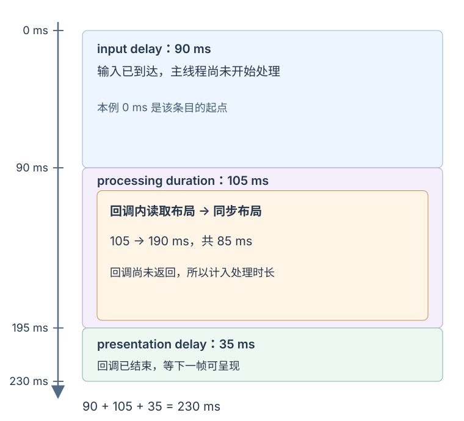

# 用户觉得慢时，怎样从指标走到证据？

“页面开得慢”和“点了没反应”是两种不同的慢，要用不同的指标和不同的录制去查。本章先讲三项核心指标各量什么、按什么口径统计，再讲怎样用现场数据选出要复现的动作、用实验室录制把一次慢交互拆成三段，最后用一个 50,000 行排序实验走完“定位、修复、复测”。读者需要知道事件循环怎样安排任务和渲染，见[事件循环怎样安排任务、微任务和渲染？](../browser/event-loop-tasks-and-rendering.md)。

## 报表页上的两句抱怨，各指向哪条路径？

沿用主线一的报表页 `/reports/42?sort=recent#summary`。用户打开它，等报表首屏出现，再点“最早优先”，把 May → April 排成 April → May。有人说“页面开得慢”，这是加载路径；有人说“点击没反应”，这是交互路径。

排查分三步：先用现场数据确定用户在哪条路径、哪组设备上遇到问题；再在受控环境里录制，拆出浏览器把时间花在哪一段；最后用相同输入和动作验证修复。

为了复现排序问题，本章后半把两行示意报表扩成 **50,000 条合成记录**，仍执行同一次“最早优先”。这个规模只为暴露重复的日期解析，不是浏览器门槛，也不是任何站点的实际数据；后文的报表数字都来自这组合成数据或合成仪表板。

## 三项核心指标各量用户的哪种感受？

Core Web Vitals (核心网页指标)是三项衡量真实用户体验的稳定指标：

| 指标 | 量什么 | 良好 | 需改进 | 差 |
|---|---|---:|---:|---:|
| Largest Contentful Paint (最大内容绘制，LCP) | 视口里最大的合格图片、文字块或视频何时绘制，近似主要内容何时可见 | ≤ 2.5 秒 | ≤ 4 秒 | > 4 秒 |
| Interaction to Next Paint (交互到下一次绘制，INP) | 点击、触屏或按键开始后，浏览器多久才能呈现下一帧 | ≤ 200 毫秒 | ≤ 500 毫秒 | > 500 毫秒 |
| Cumulative Layout Shift (累积布局偏移，CLS) | 页面内容意外移动有多严重 | ≤ 0.1 | ≤ 0.25 | > 0.25 |

三项指标各答一个问题，互不替代。LCP 良好不说明排序点击也快。INP 截止于浏览器能呈现下一帧，不等待网络请求或业务工作完成，所以 INP 良好也不说明异步数据返回得快。也因为 INP 量到下一帧为止，想让“正在排序”的提示先出现在屏幕上，只在同一个回调里先改文字、再做同步排序并不够：浏览器要等回调结束才有机会绘制。要在同步工作前让出主线程，或把排序改成异步工作。

## 阈值按什么口径统计？

阈值评价的是现场访问的分布，不是单次访问的保证，也不能单独指出根因。口径有四点：

- **p75，并分设备。** 看现场样本的第 75 百分位，移动端和桌面端分开检查。p75 达标表示至少四分之三的该组样本不高于目标，其余访问仍可能更慢。
- **INP 只统计有交互的访问。** 纯阅读或只滚动的访问可能没有 INP 值，不能把缺失当成 0 毫秒。
- **INP 取一次访问中最慢的交互。** 点击、触屏和按键都算；交互很多时，每 50 次忽略其中最慢的一次，避免个别异常值决定整次访问。
- **CLS 取分数最大的会话窗口，不是全程累加。** session window (会话窗口)内连续偏移的间隔小于 1 秒，整个窗口最长 5 秒。离散的点击、触屏或按键之后 500 毫秒内的偏移按“近期输入”排除；连续滚动不适用这条规则，较晚的异步位移仍可能计入。

## 现场数据和实验室数据各回答什么？

field data (现场数据)来自真实访问，包含用户设备、网络、缓存和操作路径的差异，回答“多少用户、在哪里遇到问题”。lab data (实验室数据)在指定环境里运行，适合重复动作、检查主线程和比较改动，回答“这项改动在这个环境里有没有效”。一次实验室录制的数字不是用户分布。

现场数据有两个常见来源：

- **RUM (Real User Monitoring，真实用户监测)。** 自己采集，可以保留页面路径、查询参数、版本、设备组、操作类型，并把 INP 归因到具体按钮。它还能按版本分组，在同一时间比较灰度版和对照版。
- **CrUX (Chrome User Experience Report，Chrome 用户体验报告)。** 适合看公开页面或整个来源的总体分布，但维度少：它去掉查询参数和片段，`/reports/42?sort=recent#summary` 归到 `/reports/42`；CrUX API 可按页面或来源、设备类型查询，日常结果是 28 天滚动汇总，没有应用部署版本这一维度。相邻窗口互相重叠，不能当作精确的发布前后对照。

> [!example] 合成仪表板：从分布选出要复现的动作
> 假设一个纯教学用的 RUM 仪表板显示：`/reports/42?sort=recent` 的移动端 INP p75 为 430 毫秒，桌面端为 170 毫秒；LCP 和 CLS 的 p75 都在良好范围内。430 毫秒落在“需改进”区间（高于 200、至多 500），170 毫秒良好。它只说明移动端的交互响应值得调查，不能证明排序就是根因。若 RUM 已把慢 INP 归因到“最早优先”这次点击，复现路径就选定了：移动端设备组、这个页面、这个按钮。

比较版本效果时，优先用同一时间的灰度/对照分组；只能前后比较时，至少选时长和星期分布相近的窗口，并检查设备、操作和加载状态的组成有没有变。

实验室里，Chrome DevTools (Chrome 开发者工具)的 Performance 面板可以单独录制导航或一次运行时点击：Interactions 轨道标出这次交互的三段延迟，Main 轨道显示对应的 JavaScript 调用、框架工作和浏览器任务。只跑一次 Lighthouse 页面加载、没有执行点击，就没有观察到这次排序交互。

Lighthouse 报告的 TBT (Total Blocking Time，总阻塞时间)只是线索。它把 FCP (First Contentful Paint，首次内容绘制)之后一段窗口内、每个超过 50 毫秒的主线程长任务中超出 50 毫秒的部分相加；默认页面加载窗口通常到 TTI (Time to Interactive，可交互时间)为止。例如窗口内有 120 毫秒和 70 毫秒两个长任务，TBT 是 `70 + 20 = 90` 毫秒。它提示“用户此时点击可能要等”，但不知道真实用户何时点击，所以不能替代现场 INP。

## 一次慢交互怎样拆成三段？

INP 不是某个事件处理器的耗时。一次触屏点击会产生 `pointerdown`、`pointerup`、`click` 等多个 Event Timing (事件计时)条目，浏览器用同一个 `interactionId` 把它们关联起来，交互延迟取这些条目里最长的 `duration`。

不要把最早条目的起点到最晚条目的终点当成交互时长。例如一次长按：`pointerdown` 用了 80 毫秒；按下后约 288 毫秒手指抬起，`pointerup` 和 `click` 各用 40 毫秒。交互延迟是 80 毫秒；跨条目的包络 `288 + 40 = 328` 毫秒把手指按住的时间也算进去了。

最长条目再分成三段，每段指向不同的排查方向：

| 阶段 | 起止点 | 排查方向 |
|---|---|---|
| input delay (输入延迟) | 输入发生，到事件处理开始 | 此前的长任务、脚本执行或其他主线程占用 |
| processing duration (处理时长) | 事件处理开始，到处理结束 | 排序、筛选、组件计算、同步布局读取或监听器工作 |
| presentation delay (呈现延迟) | 处理结束，到下一帧可呈现 | 后续主线程任务、样式计算、布局、绘制和帧提交 |

> [!example] 合成时间线：同步布局算在哪一段
> 输入在 0 ms 发生，回调到 90 ms 才开始；回调在 105 ms 读取布局信息，触发 85 ms 的同步布局（105 → 190 ms）；回调在 195 ms 返回，下一帧在 230 ms 可呈现。三段分别是 `90 / 105 / 35 ms`，合计 230 ms。那 85 ms 布局发生在回调内部，所以属于处理时长；若布局在回调返回之后才发生，它才落入呈现延迟。这是阶段分类的示例，不是测量结果。
>
> 

回调、微任务和下一次渲染机会的先后，见[事件循环怎样安排任务、微任务和渲染？](../browser/event-loop-tasks-and-rendering.md)。处理器里读几何值为什么会触发同步布局、怎样把读写分批，见[DOM 改动后浏览器重做了什么，读几何值为什么会卡住脚本？](../browser/rendering-pipeline-and-forced-layout.md)。

> [!info] 实例：web-vitals 库怎样把三段对到同一帧（读取主分支实现，核对于 2026-11-13）
> 多个条目可能落在不同的帧。web-vitals 按估算呈现时点 `startTime + duration` 分组，相差不超过 8 毫秒的条目视为同一帧的候选；输入延迟和处理时长取这个帧组的处理边界，再按最长条目的起点和时长夹取。最长时长并列且起点相同时，库会保留这些并列条目参与归因，但不会把不同帧之间的等待并入处理时间。事件时长按约 8 毫秒的粒度量化，所以三段是定位主导阶段的估计值，不要按小数位理解成精确帧时间。

## 从症状到证据，先看哪一段？

| 用户反馈 | 先看哪段证据 | 证据支持时，再检查什么 |
|---|---|---|
| 主要内容迟迟不出现 | 本次实际的 LCP 元素；首字节、资源发现、下载、绘制四段 | LCP 图片是否发现太晚或被延迟加载；服务器响应或关键资源是否迟到（见下一节） |
| 点击后很久才开始处理 | 输入延迟，以及点击之前的 Main 轨道 | 阻塞任务来自应用脚本、第三方脚本还是先前的交互；若是路由脚本的解析和执行，检查[构建分块](build-pipeline-and-bundling.md) |
| 回调开始后列表迟迟不变 | 处理时长、事件调用栈、React render/commit | 排序、筛选、重复解析或框架计算是否占主导；React 占主导时见[React 渲染慢时，先改什么？](react-rendering-optimization.md) |
| 回调已结束，下一帧仍迟 | 呈现延迟，以及其后的样式、布局、绘制轨迹 | 是否有实际可避免的 DOM、样式或同步布局工作 |
| 图片或异步内容出现时页面跳动 | Layout shifts 轨道和偏移发生的时刻 | 内容空间是否预留；偏移是否由用户操作触发、是否真属意外 |
| 按钮已看见但点不动 | 主线程是否阻塞、按钮处理器何时注册 | 可见时点与脚本就绪是否错开，见[打开一个 URL 后，页面怎样变得可见又可交互？](../browser/from-url-to-interactive-page.md) |

用这张表时有三条纪律：

- **录对动作。** 对“开得慢”录制导航，看 LCP 候选和资源瀑布；对“点击没反应”在相同页面状态下真的去点按钮。不要用导航总耗时推断点击成本，也不要因为按钮已绘制就假定处理器已可用。
- **看到 Layout 或 Paint 不等于找到缺陷。** 沿调用关系找出真正占时的那段工作。
- **一次轨迹只解释当前条件。** 它对应当前浏览器、设备模拟、缓存和数据；要说明多少用户受影响，回到相同设备组的现场分布。

报表行数变多时，网络传输、客户端筛选和排序、同时挂载的行与 DOM 布局是三类成本，要分开测；它们各由什么手段处理，见[长列表的成本在哪里，分页和虚拟化各省掉什么？](long-lists-pagination-and-virtualization.md)。

## 主要内容迟到时，怎样沿 LCP 分段处理？

先确认本次视口里被选为 LCP 的元素，再把时间拆成四段：首字节、资源发现等待、资源下载、元素绘制延迟。视口和内容不同，最大候选也可能不同；候选是文字时，资源发现和下载两段可以为零。

按占时的那段处置：

- **图片是 LCP 时，不要对它延迟加载。** 给图片声明宽高主要是预留布局空间、降低位移，不会普遍缩短 LCP。图片的加载时机与优先级见[图片和音视频该怎样写语义、定地址、选文件和定加载时机？](../browser/images-and-media-loading.md)。
- **非关键资源争抢关键路径时，才推迟它们。** 要以轨迹为证据，不要预先推迟一切。
- **资源发现晚源于 CSS 阻塞时，** 内联首屏必需的少量 CSS 可能减少等待，代价是 HTML 变大，内联样式也不能像独立 CSS 文件那样单独缓存。
- **服务端渲染或静态输出** 能让内容更早进入 HTML，但不自动保证 LCP 或交互良好。

首字节和资源下载两段受缓存影响，静态资源的缓存规则见[发布新版本时，怎样让缓存和还开着的旧页面都不出错？](hashed-release-and-caching.md)。

## 加载过程中的里程碑各自不能证明什么？

这些时间点可以补充导航诊断，但没有一个单独代表“页面已可用”：

| 时间点 | 可用于观察 | 不能单独证明 |
|---|---|---|
| TTFB (Time to First Byte，首字节时间) | 导航开始到收到第一个响应字节，含重定向、连接、服务器处理 | HTML 已接收完、应用已执行或内容已绘制 |
| FCP | 第一次有文本、图片等内容绘制 | 主要内容已出现，或按钮已能响应 |
| `DOMContentLoaded`（DCL） | HTML 解析结束、defer 脚本执行完 | 图片等资源已加载，或应用的异步初始化、请求已完成 |
| `load` | 会延迟该事件的文档资源已加载完 | 用户何时看到有用内容，或交互何时有反馈 |

DCL 和 `load` 各自等待什么、模块脚本的顶层 `await` 和后续请求为什么可以在 DCL 之后继续，见[打开一个 URL 后，页面怎样变得可见又可交互？](../browser/from-url-to-interactive-page.md)。First Input Delay (首次输入延迟，FID)曾是核心指标，已由 INP 取代；FCP、TTFB、TBT 仍可在各自范围内作诊断信号。用这些里程碑回答导航阶段的问题，再回到真实 LCP 元素和资源时序，不要把 DCL 或 `load` 当成体验终点。

## 50,000 行排序实验：慢在哪里，怎样修？

回到交互路径。受控复现从同一组 50,000 条合成记录开始，每条的 `createdAt` 是带 `Z` 的 UTC ISO 8601 字符串。首屏显示按日期从新到旧的 50 行；点“最早优先”后，处理器复制数组、按日期升序排序，再生成前 50 行的 HTML 字符串并用 `innerHTML` 同步写入。只写 50 行，是为了不把大量 DOM 的成本混进排序计算。

Performance 的主线程轨迹把时间集中在排序处理器里。原来的比较器每次比较都对两边各调用一次 `Date.parse`，这一次点击内共调用 1,293,094 次。

修法是把解析移出比较器：数据准备时把每条记录复制一份并加上毫秒字段，只解析一次；点击时只比较数值。

~~~javascript
const normalized = source.map(report => ({
  ...report,
  createdAtMs: Date.parse(report.createdAt)
}));

const oldestFirst = normalized
  .slice()
  .sort((a, b) => a.createdAtMs - b.createdAtMs);
~~~

`Date.parse` 对这些 UTC 时间返回自 Unix 纪元起的毫秒数，2026 年 4 月 1 日的值小于 5 月 1 日，升序比较器 `a.createdAtMs - b.createdAtMs` 因此返回负数，把 4 月排在前面。`slice()` 让排序作用在副本上，避免 `sort()` 改写原数组。预处理不是免费的：它多存一个数值字段，并把解析成本移到初始化阶段。若日期本来就是数值、只排序一次，或初始化变成了新瓶颈，它未必划算；按真实访问顺序决定由哪个阶段承担成本。

在这个浏览器和节流条件下（条件见下一节），结果如下：

| 同一排序交互 | 优化前 | 优化后 |
|---|---:|---:|
| 交互延迟 p75（同一 `interactionId` 最长 `duration`） | 832 毫秒 | 128 毫秒 |
| 监听器入口到结果记录的同步工作 p75 | 766.2 毫秒 | 70.6 毫秒 |
| 其中：数组复制与排序 p75 | 764.8 毫秒 | 69.2 毫秒 |
| 其中：生成 50 行标记并同步写入 DOM p75 | 1.7 毫秒 | 1.4 毫秒 |
| 点击内的 `Date.parse` 次数 | 1,293,094 次 | 0 次 |
| 数据准备（复制记录并解析日期）p75 | 无此阶段 | 34.9 毫秒 |

九次测量的 p75 按最近秩法取第 `⌈0.75 × 9⌉ = ⌈6.75⌉ = 7` 个排序结果。这是重复单击同一操作的实验室摘要，不是真实访问的 INP。各行分别取 p75，不能相加成交互 p75。“生成 50 行”一项在 `innerHTML` 赋值返回时结束计时，不含之后的样式计算、布局和绘制；DevTools 里那些 Layout、PrePaint、Paint 出现在回调之后，属于呈现延迟。

三段拆分取恰好落在交互 p75 的那次原始样本：优化前是 `1 / 762.3 / 68.7 ms`，合计 832 ms；优化后是 `1.5 / 76 / 50.5 ms`，合计 128 ms。下降几乎都在处理时长，与 `Date.parse` 调用次数和主线程轨迹相互印证。

修复还要证明顺序没变。独立复算比较了修复前后全部 50,000 个 ID 的排序位置，结果完全一致，排序后前三个 ID 是 `18771, 37492, 6263`。这只覆盖这组固定输入；其他日期格式、无效值和同一时刻的并列，生产代码要按产品规则另行处理。

## 怎样复测，才能分别回答“修好了吗”和“用户受益了吗”？

受控比较固定了浏览器、视口、4 倍 CPU 节流、50,000 条输入和同一点击动作；每个版本先预热 2 次，再交替测量 9 次。Event Timing 原始条目全部保留，可以从每次记录重算最长条目和帧组三段；计时器分别记录数组复制与排序、标记生成与 DOM 写入、数据准备。这样的结果回答：“在这个 Chromium 和节流条件下，这项修复是否缩短了这个动作？”4 倍节流不是任何一种真实手机的性能画像，这组实验也没有测网络、导航、完整报表渲染、LCP 或 CLS。

部署后用前面的版本对照规则，查看相同页面、相同移动/桌面分组的现场 INP，确认慢交互确实减少，同时检查排序正确性和回退路径。实验室结果和现场结果分别报告：前者证明可复现环境里的变化，后者判断用户分布是否改善。若处理时长已经降下来、端到端 INP 仍高，就按新的轨迹转查输入延迟或呈现延迟，不要继续优化已不占主导的排序。

## 算法已合理、计算仍占主线程时，还能做什么？

若输入规模和算法都已合理，纯计算仍是主线程上的长任务，有两类手段：

- **分块并让出主线程。** 把工作切成小段，段与段之间让出，让输入和渲染有机会插进来。总工作量不变，只是不再一次占满。让出的方式与时机见[事件循环怎样安排任务、微任务和渲染？](../browser/event-loop-tasks-and-rendering.md)。
- **移到 Web Worker (网页工作线程)。** 把不依赖 DOM 的计算放到另一个线程，主线程空出来处理界面。Worker 不减少计算量；`postMessage()` 传对象通常要结构化复制，消息传递和结果提交的时间也要计入。结构化复制复制什么、`ArrayBuffer` 怎样转移，见[复制一个对象到底复制了什么？](../javascript/copying-and-object-graphs.md)。

排序例子已经用预处理消除了重复解析，应先复测这个更简单的改动，再决定是否值得引入额外线程。

## 处理时长降下来之后，下一步查哪里？

本章交出一条从抱怨到证据的路线：按指标口径确认哪组用户、哪条路径慢；在实验室把慢交互拆成输入延迟、处理时长和呈现延迟；按症状表找到占主导的那段，修复后用同口径复测，再回现场分布确认。

处理时长里若是 React 的 render 和 commit 占主导，下一章接着问：怎样确认是哪些组件在重复工作，先改状态位置还是先加缓存？见[React 渲染慢时，先改什么？](react-rendering-optimization.md)。若成本随同时挂载的行数增长，见[长列表的成本在哪里，分页和虚拟化各省掉什么？](long-lists-pagination-and-virtualization.md)。

> [!info]- 来源（核对于 2026-11-13）
> - **三项核心指标、阈值、移动/桌面分组 p75：** [web.dev: Web Vitals](https://web.dev/articles/vitals)，2024-10-31 更新；阈值方法：[Defining the Core Web Vitals metrics thresholds](https://web.dev/articles/defining-core-web-vitals-thresholds)。
> - **LCP 候选与 2.5 秒目标：** [web.dev: LCP](https://web.dev/articles/lcp)，2025-09-04 更新；**CLS 会话窗口、1 秒间隔、5 秒上限、近期输入排除：** [web.dev: CLS](https://web.dev/articles/cls)。
> - **INP 的交互汇总、每 50 次忽略最慢一次、交互条目与三阶段：** [web.dev: INP](https://web.dev/articles/inp)，2025-09-02 更新，“What is INP?”与“What's in an interaction?”节；实验室应跟随现场数据选动作：[web.dev: Optimize INP](https://web.dev/articles/optimize-inp)，2025-09-02 更新。
> - **现场与实验室数据差异、TBT 观察不到用户何时交互：** [web.dev: Why lab and field data can be different](https://web.dev/articles/lab-and-field-data-differences)，INP 与 TBT 节；**TBT 计算：** [web.dev: TBT](https://web.dev/articles/tbt)，2025-10-15 更新。
> - **CrUX 去掉查询参数和片段：** [CrUX methodology](https://developer.chrome.com/docs/crux/methodology#page)；**CrUX API 的页面/来源、设备类型与 28 天滚动采集期：** [CrUX API](https://developer.chrome.com/docs/crux/api#collection-period)。
> - **DevTools 的 Main、Interactions、Layout shifts 轨道：** [Performance features reference](https://developer.chrome.com/docs/devtools/performance/reference)。
> - **`interactionId` 与 Event Timing 条目：** [W3C Event Timing API](https://www.w3.org/TR/2026/WD-event-timing-20261013/)，Working Draft，2026-10-13（工作草案，不是 Recommendation）。
> - **最长条目、8 毫秒帧组与并列处理（web-vitals 实例）：** [InteractionManager.ts](https://github.com/GoogleChrome/web-vitals/blob/main/src/lib/InteractionManager.ts)、[attribution/onINP.ts](https://github.com/GoogleChrome/web-vitals/blob/main/src/attribution/onINP.ts)，主分支。本章的实验脚本只复现“最长条目 + 同帧分组”这段测量，不是该库的完整 INP 实现。
> - **LCP 四段拆分、图片不延迟加载、尺寸与优先级：** [web.dev: Optimize LCP](https://web.dev/articles/optimize-lcp)，2025-03-31 更新，LCP breakdown 与图片优先级节。
> - **FCP、TTFB 与导航时间戳：** [web.dev: FCP](https://web.dev/articles/fcp)；[web.dev: TTFB](https://web.dev/articles/ttfb)，2025-11-18 更新；[W3C Navigation Timing Level 2](https://www.w3.org/TR/navigation-timing-2/)，Working Draft，2026-11-02。**DCL 与 `load`：** [WHATWG HTML，The end](https://html.spec.whatwg.org/multipage/parsing.html#the-end)，2026-11-12。**FID 由 INP 接替：** [web.dev: FID](https://web.dev/articles/fid)。
> - **让出主线程与 Web Worker：** [web.dev: Use web workers to run JavaScript off the browser's main thread](https://web.dev/articles/off-main-thread)。
> - **50,000 行排序实验：** 本地 Chromium、4 倍 CPU 节流、合成数据实测，协议见正文；合成仪表板数字为教学假设。
