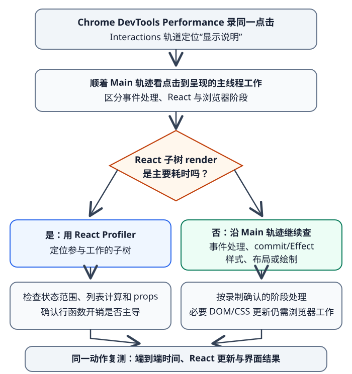

# React 渲染慢时，先改什么？

上一章的症状表把一次慢交互定位到了“处理时长”；若轨迹显示其中主要是 React 的工作，本章回答接下来先查什么、先改什么。顺序是：用浏览器 Performance 确认 React 工作占主导，再用 React Profiler 找到重复工作的组件；优先把状态挪到用它的组件，其次才是 `useMemo`、`useCallback`、`memo` 这类缓存；每一项改动都由复测决定留不留。读者需要知道 React 怎样把状态变化变成 render、commit 和浏览器绘制，见[React 怎样把一次用户操作变成界面更新？](../ui-state/react-update-model.md)。

## 打开说明面板时，React 做了哪些工作？

沿用主线一的报表页：服务端给 May、April 两行，点“最早优先”后 `sort=oldest`，可见顺序变成 April、May；排序状态怎样写进 URL、怎样随前进后退恢复，见[地址变了，浏览器什么时候加载新文档，界面状态何时该写进 URL？](../browser/navigation-history-and-url-state.md)。本章新增两样东西：一个“显示说明”按钮，打开的说明面板只改变面板自己；以及每行一个“标为已读”按钮，切换该行的 `reviewed`。

问题是：打开说明面板这个动作和报表数据无关，为什么录制里看到整张列表的行组件都重新执行了？

先回顾一句 React 的更新模型：render (渲染)是 React 调用组件函数，算出下一份界面描述；commit (提交)才把必要的变化写进 DOM。组件运行了，DOM 不一定变；DOM 变了，浏览器还要做样式、布局和绘制。所以“行组件重新执行”是成本，但未必是用户等待的主要部分，要先测。

## 先用浏览器 Performance 定位，什么时候再开 React Profiler？

1. **在浏览器里录基线。** 用同一 URL、同一组报表、同一交互和目标设备，在 Chrome DevTools 的 Performance 面板录一次。Interactions 轨道定位“显示说明”这次点击及其三段延迟；Main 轨道显示时间花在事件处理、React 工作、commit 与 Effect，还是样式、布局和绘制。
2. **React 子树的 render 占主导时，再开 Profiler。** React Developer Tools (React 开发者工具)的 Profiler (性能分析器)面板能看出这次提交里哪些组件参与了 render。代码里的 `<Profiler>` API 可以给指定子树记录 `phase`、`actualDuration` 和 `baseDuration`：
   - `actualDuration`：这次已提交的更新中，该子树实际花在 render 上的时间。
   - `baseDuration`：按各组件最近一次耗时估算、完全不跳过时整棵子树的成本。两者差距大，说明跳过已经生效。
3. **注意测量本身的条件。** Profiler 有额外开销；普通生产构建不记录 `<Profiler>` 计时，要测接近线上的代码，需改用 React 提供的 profiling 构建。开发构建的耗时也不能当成生产时延。

render 次数或控制台日志只能提示“谁可能运行过”，不能单独证明交互变快。

## render 不占主导时，时间去了哪里？

不要从“React render 很短”直接推断瓶颈只在布局或绘制。还要依次看：

- **点击处理器本身。** 处理器里的同步计算可能比 render 更重。
- **commit 与 layout Effect。** `useLayoutEffect` 及其中触发的状态更新，在浏览器重绘前处理；其中测量 DOM 的操作可能把同步布局带进这次交互。
- **其余 Effect。** 普通 `useEffect` 通常在绘制后运行；但由点击这类交互引起时，React 也可能在绘制前运行它。
- **浏览器的样式、布局和绘制。** 阶段边界见[用户觉得慢时，怎样从指标走到证据？](performance-metrics-and-diagnosis.md)，读写几何值引起的同步布局见[DOM 改动后浏览器重做了什么，读几何值为什么会卡住脚本？](../browser/rendering-pipeline-and-forced-layout.md)。

React Performance tracks (React 性能轨道)把 React 的工作直接画在浏览器 Performance 时间线上，分出 render、commit（含 layout Effect）和其余 Effect，便于和 Main 轨道对齐。这些轨道只在开发构建和 profiling 构建中出现，也有额外开销。

## 第一选择：把状态移进用它的组件

假设录制显示：说明面板的开关状态 `helpOpen` 放在列表的父组件 `ReportBoard` 里，打开面板让 `ReportBoard` 重新 render，进而让每一行重新执行。

最直接的修法通常不是加缓存，而是把这份状态挪到唯一用它的组件里：

~~~jsx
import { useState } from "react";

function HelpPanel() {
  const [open, setOpen] = useState(false);
  return (
    <section>
      <button type="button" onClick={() => setOpen(value => !value)}>
        {open ? "隐藏说明" : "显示说明"}
      </button>
      {open && 
说明面板
}
    </section>
  );
}
~~~

`ReportBoard` 同时渲染 `<HelpPanel />` 和报表列表，`open` 由 `HelpPanel` 自己持有。点击时只有 `HelpPanel` 这棵子树更新，兄弟列表不受影响，不需要任何缓存。一份状态该由谁持有、何时上提或下移，见[一份界面状态该由谁持有？](../ui-state/state-ownership-and-composition.md)。

## useMemo、useCallback 和 memo 各管哪一段？

状态下移做不到时（例如父组件确实要用这份状态），才考虑手工缓存。下面故意把 `helpOpen` 留在 `ReportBoard`，并加入搜索框 `query`，用来看三种缓存各自作用在哪一段。这是分析依赖身份的教学代码，不是“先给每个组件加缓存”的建议；它也没有实现排序和 URL，只隔离说明面板、搜索词和 `reviewed` 三种更新。

起点状态：`reports` 是下面两个对象，`query` 为空，`helpOpen=false`。

| `id` | `title` | `reviewed` |
|---|---|---|
| `r-104` | `May report` | `false` |
| `r-103` | `April report` | `false` |

> [!example]- 带手工缓存的 ReportBoard
> ~~~jsx
> import { memo, useCallback, useMemo, useState } from "react";
>
> function filterReports(reports, query) {
>   const normalizedQuery = query.toLowerCase();
>   return reports.filter(report =>
>     report.title.toLowerCase().includes(normalizedQuery)
>   );
> }
>
> function replaceReviewed(reports, id) {
>   return reports.map(report =>
>     report.id === id
>       ? { ...report, reviewed: !report.reviewed }
>       : report
>   );
> }
>
> function ReportBoard({ initialReports }) {
>   const [reports, setReports] = useState(initialReports);
>   const [query, setQuery] = useState("");
>   const [helpOpen, setHelpOpen] = useState(false);
>
>   const visible = useMemo(
>     () => filterReports(reports, query),
>     [reports, query]
>   );
>   const toggleReviewed = useCallback((id) => {
>     setReports(current => replaceReviewed(current, id));
>   }, []);
>
>   return (
>     <>
>       <input
>         aria-label="筛选报表"
>         value={query}
>         onChange={event => setQuery(event.target.value)}
>       />
>       <button type="button" onClick={() => setHelpOpen(open => !open)}>
>         {helpOpen ? "隐藏说明" : "显示说明"}
>       </button>
>       {helpOpen && 
说明面板
}
>       <ol id="reports">
>         {visible.map(report => (
>           <ReportRow
>             key={report.id}
>             report={report}
>             onToggle={toggleReviewed}
>           />
>         ))}
>       </ol>
>     </>
>   );
> }
>
> const ReportRow = memo(function ReportRow({ report, onToggle }) {
>   return (
>     <li>
>       {report.title}
>       <button type="button" onClick={() => onToggle(report.id)}>
>         {report.reviewed ? "已读" : "标为已读"}
>       </button>
>     </li>
>   );
> });
> ~~~

三种 API 各管一段：

- **`useMemo` 管计算。** 首次 render 照常筛选；之后只有 `reports` 或 `query` 按 `Object.is` 比较发生变化，才重跑 `filterReports`，否则返回上次的 `visible`。
- **`useCallback` 管函数身份。** 依赖不变时返回同一个函数引用，不会替你执行函数。这里依赖可以为空，是因为回调只调用 updater 形式的 `setReports`，不读取某一轮的 `reports` 快照。
- **`memo` 管跳过子组件。** `memo(ReportRow)` 默认对每个 prop (属性)用 `Object.is` 比较；`report` 和 `onToggle` 都与上次相同，就跳过这一行的组件函数。

下表每一行都从同一起点独立重放（两行都挂载），不是连续操作：

| 操作 | 状态与引用怎样变化 | 行组件会怎样 |
|---|---|---|
| 初次显示 | 执行筛选，创建 `visible`；第一次创建 `toggleReviewed` | 两行首次 render |
| 打开说明面板 | 只改 `helpOpen`；缓存仍在时，`useMemo` 返回原 `visible`，`useCallback` 返回原函数 | `ReportBoard` 和 `visible.map` 仍执行；两行 props 不变，被 `memo` 跳过 |
| 输入 `apr` | `query` 变了，筛选重新扫描全部 `reports`，`visible` 只剩 April | May 行离开树；April 的对象和回调没变，被跳过 |
| 把 May 标为已读 | 不可变更新生成新 `reports` 数组和新 May 对象；April 对象保持原引用 | 筛选重算；May 行 props 变了，重新 render；April 仍被跳过 |

作为对照，不加任何缓存时打开说明面板，`ReportBoard`、筛选和两行函数都会重新执行，但行的 DOM 不必改变。

几条容易误判的边界：

- **少了 `memo`，稳定的值不会自己阻止子组件 render。** `useMemo`、`useCallback` 只让 props 稳定，跳过与否由 `memo` 决定。
- **`memo` 只看父组件传入的 props。** 行自己的 state 或它读取的 Context 变化，仍会让它 render。
- **行接收的是单个 `report` 对象，不是 `visible` 数组。** 即使 `useMemo` 的缓存被丢弃、重新生成了数组，只要数组里的行对象引用没变，行的 props 仍然相同。
- **`useMemo` 不能让一次新的全量筛选变成常数时间。** 筛选词变了，每条记录仍要检查一遍。
- **`key` 不是跳过 render 的工具。** 稳定的 `key` 让 React 在排序、插入、删除中认出同一行，保留它的状态；排序后 props 不变的 memo 行可以跳过函数，但 React 仍要协调并移动 DOM 节点。key 与状态身份见[React 怎样把一次用户操作变成界面更新？](../ui-state/react-update-model.md)。

## 为什么这些比较都依赖不可变更新？

`memo`、`useMemo` 都用 `Object.is` 判断“变没变”，比的是引用，不是内容。要让 React 看见 May 的变化，必须生成新数组和新 May 对象，同时保留未变的 April 对象，如上例的 `replaceReviewed`。若原地改写 `report.reviewed`，引用不变，`memo` 会跳过本该更新的行；若每次都新建所有行对象，引用全变，`memo` 又一行也跳不过。哪些复制操作原地修改对象、哪些生成新引用，见[复制一个对象到底复制了什么？](../javascript/copying-and-object-graphs.md)。

`reviewed` 在这里只是本地状态。真实写入服务端还要处理请求身份、确认和失败，见[服务端数据怎样缓存、刷新和乐观更新，迟到的响应又归谁？](../ui-state/server-state-and-optimistic-updates.md)。

两个相邻的选择也会改变工作量：

- **隐藏还是卸载说明面板。** 用 CSS 隐藏，组件留在 React 树中，state 和 Effect 都还在；条件移除会卸载组件并运行 cleanup (清理)，再次显示时创建新实例。按交互和生命周期需求选，不只看性能。
- **Fragment (片段)** 能省掉纯包装用的 DOM 节点，但有没有性能收益仍要测。

## 实例：React Compiler 怎样改变手工 memo 的默认做法？

> [!info] 版本
> React Compiler v1.0（2025-10-07 稳定）；React 官方文档版本 19.3（npm `v19.3.0`，2026-09-09）。核对于 2026-11-12。

React Compiler (React 编译器)是可选的构建期优化。项目要在构建链里配置它，具体文件和组件还要被编译器识别。启用后，它在组件和 Hook 内自动记忆化可复用的子树和计算；上例“打开说明面板”那一行，Compiler 生效时也可能自动建立等价的缓存。新代码通常不必先手写 `memo`、`useMemo`、`useCallback`。

它有几条边界：

- **装了不等于生效。** 先确认项目已接入、构建覆盖了这个文件，再用 Profiler 看结果；只看到插件或版本号不够。
- **只优化组件和 Hook。** 它不会把任意工具函数变成跨组件共享的缓存。同一个昂贵纯函数在多个独立组件里分别调用，不会自然共用一次结果；需要共享缓存时，按实际调用和数据所有权另行设计。
- **手工 API 留给剩下的情况。** 未启用 Compiler、某模块未被覆盖，或 Profiler 显示一个稳定边界仍反复做昂贵工作时，才手写。确有意图的手工 memo 可以保留，但不要只为“更安全”再叠一层。

手工缓存还有两条语义约束。React 在特定情况下会丢弃 `useMemo`、`useCallback` 的缓存，例如初次挂载期间发生 Suspense；需要语义上持久的值时，用 state 或 ref。自定义 `memo` 比较函数必须保证函数行为和可见输出等价，否则可能保留旧闭包。

## 优化留不留，由什么决定？

按同一交互复测，从点击到界面呈现，并沿 Performance 轨迹比较原先占时的阶段：

- 拆分状态或加入 `memo` 后，确认可见界面仍正确，且目标 render 成本或点击到呈现的时间稳定、可重复地改善。
- 启用 Compiler 后，比较编译前后的同一操作。Compiler 是否覆盖只解释优化从哪来，不单独决定缓存去留。
- 没有可重复的收益，或维护成本超过收益，就移除手工缓存再复测。已有的手工缓存可能影响 Compiler 的编译结果，移除后要重新验证界面行为和性能，不能仅凭启用了 Compiler 就批量删除。

Profiler 有开销，最终判断要回到目标构建和目标设备上的浏览器 Performance 轨迹。

## 成本随挂载行数增长时，下一步是什么？

本章的结论是：先用浏览器轨迹确认 React 工作占主导，再用 Profiler 找到组件；先下移状态，再按需缓存，靠不可变更新让引用比较可信；每项改动由复测决定去留。

若测量显示成本随同时挂载的行数增长，无论来自 React 创建和更新行，还是 DOM、样式和布局，下一章接着问：要不要让视口外的行不进入 DOM，代价是什么？见[长列表的成本在哪里，分页和虚拟化各省掉什么？](long-lists-pagination-and-virtualization.md)。若主要耗时在挑选窗口之前的全量筛选，虚拟化不一定能缩短那段计算。

> [!info]- 来源（React 19.3；React Compiler v1.0；核对于 2026-11-12）
> - **版本：** [React Versions](https://react.dev/versions)、[React 19.3 发布](https://react.dev/blog/2026/09/09/react-19-3)（npm `v19.3.0`，2026-09-09）。
> - **render 与 commit、render 不必导致 DOM 变化：** [Render and Commit](https://react.dev/learn/render-and-commit)。
> - **Interactions 与 Main 轨道：** [Chrome DevTools Performance features reference](https://developer.chrome.com/docs/devtools/performance/reference#view-interactions)。
> - **React Performance tracks 的 Update、Render、Commit（含 layout Effects）与剩余 Effects；仅开发/profiling 构建：** [React Performance tracks](https://react.dev/reference/dev-tools/react-performance-tracks#renders)。**`useLayoutEffect` 在重绘前执行：** [useLayoutEffect](https://react.dev/reference/react/useLayoutEffect)。**交互引起的 Effect 可能在绘制前运行：** [useEffect](https://react.dev/reference/react/useEffect)。
> - **Profiler 面板：** [React Developer Tools](https://react.dev/learn/react-developer-tools)；**`<Profiler>` 回调、`actualDuration`、`baseDuration` 与生产 profiling 开销：** [Profiler](https://react.dev/reference/react/Profiler)。
> - **`memo` 用 `Object.is` 比较 props、自身 state 或 Context 变化仍会 render：** [memo](https://react.dev/reference/react/memo)；**`useMemo` 依赖比较与缓存可被丢弃（如初次挂载时 Suspense）：** [useMemo](https://react.dev/reference/react/useMemo)；**`useCallback` 只返回稳定引用：** [useCallback](https://react.dev/reference/react/useCallback)。
> - **条件移除重置 state、卸载时 cleanup、Fragment 不加包装 DOM：** [Preserving and Resetting State](https://react.dev/learn/preserving-and-resetting-state)、[useEffect](https://react.dev/reference/react/useEffect)、[Fragment](https://react.dev/reference/react/Fragment)。
> - **React Compiler 可选、稳定、作用于组件与 Hook，不共享任意函数缓存，先 profile 后加复杂度：** [React Compiler Introduction](https://react.dev/learn/react-compiler/introduction)，v1.0，2025-10-07。
