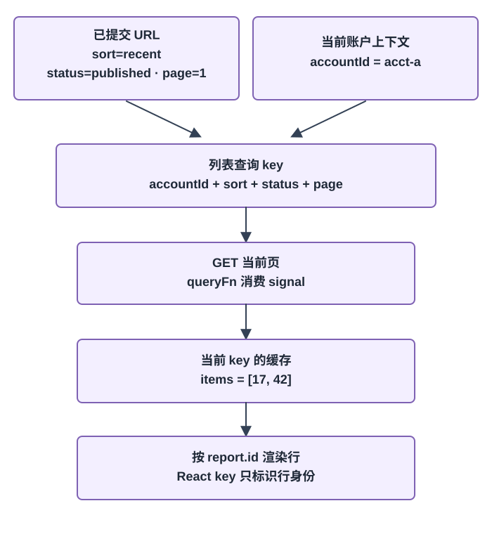
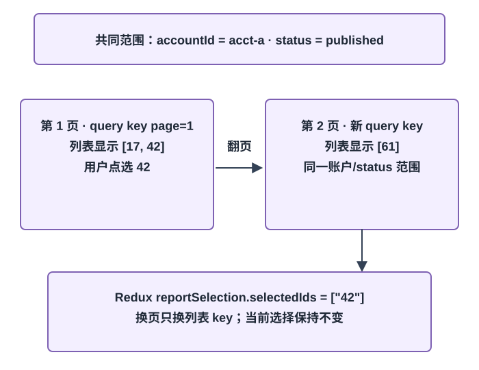
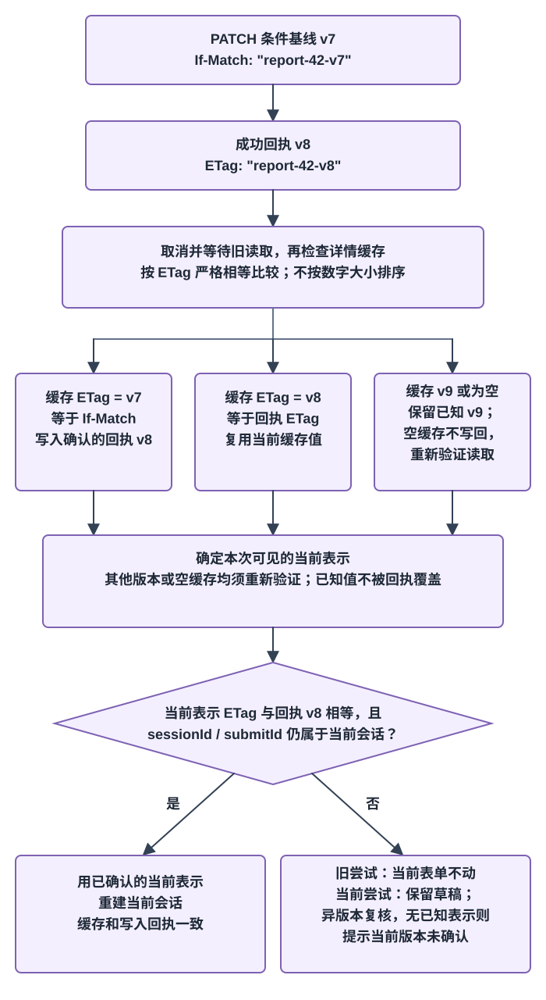

# 管理表格打开多步骤编辑后，怎样在查询变化与提交冲突中保住用户意图？

**合成案例。** 管理员在合成账户 `acct-a` 打开 `/reports?sort=recent&status=published&page=1#summary`。每页两行；已发布第 1 页含报表标识符（ID）`17`、`42`，第 2 页含 `61`。用户选择 `42`，翻到第 2 页后仍从“已选 1 项”打开编辑抽屉。教学报表 API（应用程序编程接口）返回详情和强 ETag（实体标签）`"report-42-v7"`。用户编辑通知方式、收件人和备注；与此同时，表格查询可能变化，异步校验也可能乱序返回，另一位管理员还可能先保存同一份报表。本例的账户、地址、字段和响应都是合成数据。

**本篇采用的组合。** 示例的本地验证组合为 React 19.3.1、React Router 8.5.1 **Declarative Mode（声明式模式）**、TanStack Query 5.107.1；列表用组件中的 `useQuery` 读取，路由以 `useSearchParams` 解析查询参数，并用 `useNavigate` 提交保留片段的完整新地址。新 URL 提交后，组件收到新的排序、筛选和页码，再切换查询键；这里不使用 Data Mode `loader`，也不借用 `useNavigation` 的 loader 等待语义。跨组件的已选报表 ID 沿用[Redux 主线](./redux-state-and-async-workflows.md)的 `reportSelection` slice（状态切片）；编辑会话的基线与草稿留在编辑器中。

报表 42 的详情表示为：

~~~json
{"id":42,"title":"Monthly summary","delivery":{"channel":"email","recipients":["reader@example.test"]},"note":"Draft"}
~~~

`delivery.channel` 与 `delivery.recipients` 是本教学变体新增的字段。报表行的摘要不是完整详情；打开抽屉时按 ID 读取详情及 ETag。保存使用本仓库 [HTTP API 条件更新契约](../../engineering-foundations/backend/http-api-contracts.md)中的 JSON Merge Patch、`If-Match`、强 ETag 和 `412` 约定。客户端选中、URL 和缓存都不授予访问权，每次读取和写入仍由服务端按当前身份授权。

## 先确定每份状态由谁维护

| 状态 | 所有者 | 变化与边界 |
|---|---|---|
| `sort`、`status`、`page` | URL 与 React Router | 可复制、刷新并由浏览器历史恢复。筛选变化重置页码；查询字符串解析后再校验允许值。片段 `#summary` 用于客户端定位，不进 API 查询键。 |
| 当前页的报表行 | 服务器；TanStack Query 缓存客户端副本 | 查询键包含账户、筛选、排序和页码。每页读取只更新对应键；列表摘要不是编辑基线。 |
| 已选报表 ID | Redux `reportSelection.selectedIds`；表格路由同时记住选择所属的账户与筛选范围 | 用稳定 ID 跨页和排序保留；只有当前账户与筛选仍匹配该范围时才可操作。筛选或账户在按钮操作、Back/Forward 中变化时都清空；翻页和排序不改变范围。 |
| 一次编辑会话 | 编辑器本地状态 | 持有唯一 `sessionId`、原始详情基线、匹配 ETag、当前草稿、字段校验状态与提交状态。列表响应不会重置草稿。 |
| 详情缓存与服务器版本 | TanStack Query 保存已确认详情副本；服务器持有权威表示和版本 | GET 成功给出详情与 ETag；PATCH 成功返回规范化详情与新 ETag；`412` 时服务器不应用该补丁。 |

表格投影、共享选择、表单草稿和服务端资源不是同一份状态。这样，排序或后台刷新可以改变列表行而不改写输入；编辑器也不会把尚未提交的草稿伪装成服务器已确认的数据。

## URL 查询怎样变成当前页行？

本例把已提交的 URL 作为列表查询输入。`useSearchParams()` 返回当前地址中的 `URLSearchParams`；参数对象先复制再修改，避免直接改动路由提供的可变对象。因为本例要保留 `#summary`，更新时用 `useNavigate()` 一次提交 path、search、hash 三部分；只导航到新查询字符串不会自动带回旧片段。组件解析并验证 `sort ∈ {recent, oldest}`、`status ∈ {published, open}`、正整数 `page`，无效值回退到安全默认值或替换为规范地址。筛选变更还会将页码重置为 1，并在同一事件中派发 `selectionCleared()`。但清空不能只依赖按钮事件：浏览器历史也会改变筛选。本例把当前选择范围记为账户与 status；点选时报表 ID 集合属于该范围。已提交地址的范围变化时，表格用 `useLayoutEffect` 清空 Redux ID 集合并更新范围；新范围的首次渲染先按范围是否匹配来派生计数和可操作 ID，避免旧 ID 在 layout effect 前短暂可用。初次挂载也建立范围并清理无法证明归属的旧 ID：

~~~tsx
const currentScope = { accountId, status };
const selectionIsCurrent =
  selectionScope?.accountId === accountId && selectionScope?.status === status;
const activeIds = selectionIsCurrent ? selectedIds : [];

useLayoutEffect(() => {
  if (!selectionIsCurrent) {
    dispatch(selectionCleared());
    setSelectionScope(currentScope);
  }
}, [accountId, status, selectionIsCurrent, dispatch]);
~~~

~~~tsx
const next = new URLSearchParams(searchParams);
next.set("status", nextStatus);
next.set("page", "1");
dispatch(selectionCleared());
setSelectionScope({ accountId, status: nextStatus });
navigate({ pathname: location.pathname, search: `?${next}`, hash: location.hash });
~~~

这次导航默认新增历史项；按 Back/Forward 会恢复地址和查询键，但不会复原 URL 未编码的选择。若用户在 open 筛选下重新选择 ID 81，再 Back 到 published，新地址提交后范围守卫会先把这些 ID 标成不可操作并清空；Forward 回 open 也不会复原旧选择。

query key（查询键）用完整结果身份：

~~~ts
const listKey = ["reports", accountId, "list", { sort, status, page }] as const;
~~~

查询函数读取同一组参数构造 `GET /api/reports?sort=…&status=…&page=…`，并消费 TanStack Query 提供的 `AbortSignal`。筛选、排序或页码只要改变，就切换到新的查询键。合成列表响应带 `items`、`page`、`pageSize` 和 `hasNextPage`；第 1 页的 `hasNextPage` 为 `true` 才启用下一页，第 2 页只有 ID `61` 且 `hasNextPage` 为 `false`。片段 `#summary` 不改变结果，所以不进 key；如果某个片段被应用明确转成 API 参数，转换后的值才属于查询身份。

**列表从地址到查询缓存的路径**

TanStack Query 的数据状态与网络读取状态分开：`status` 表示查询处于 pending、success 或 error；`fetchStatus` 表示 query function 正在运行、等待网络还是空闲。`status` 单独不能判断是否有可展示数据：刷新失败时它可以是 error，而同一查询键仍保留上次成功的 data；应同时检查 data。没有缓存且首次读取时可以显示页面级等待；当前键失败且没有数据时显示错误与重试；已有该键数据、后台重新读取失败时保留行并显示刷新失败。新页没有缓存时，本例不把旧页当作当前结果，因此显示第 2 页等待提示而不是把第 1 页行标成第 2 页；缓存命中时可以立即显示该页，再按新鲜度策略重读。我们没有设置 `placeholderData`。

| 查询结果 | 数据和读取状态 | 表格显示 |
|---|---|---|
| 新的当前页尚无缓存 | `status: pending`，通常 `fetchStatus: fetching`；断网时也可能是 `paused` | 页面级“正在读取第 2 页…”，不允许对上一页行操作。 |
| 当前键已有缓存且后台刷新 | `status: success`，`fetchStatus: fetching` | 保留该页行，同时显示轻量刷新状态。 |
| 查询成功但 `items` 为空 | `status: success`，`data.items: []` | 显示此筛选没有匹配项；这是空结果，不是读取错误。 |
| 首次读取失败，没有数据 | `status: error`，`data` 为空 | 错误提示和重试入口；不显示旧筛选或旧账户的行。 |
| 后台刷新失败，已有已确认数据 | `status: error` 可与已有 `data` 同时出现 | 保留该查询键最近一次成功的行，并说明刷新失败。 |
| 路由切到别的查询键后旧请求完成 | 旧响应属于旧 key；新 key 的状态独立 | 旧结果可留在自己的缓存中，不会因为“较晚返回”冒充当前筛选页。 |

切换 key 时 TanStack Query 默认不会因为组件不再观察该请求就立刻取消它；结果仍可能进入旧 key 的缓存。若 query function 消费 `signal`，取消会传播到请求并使查询状态回退。取消 GET 是节省客户端工作，不是服务端授权或写入回滚。这里讲的是组件查询在路由 location 改变后的查询缓存路径；React Router Data Mode 则会先匹配目标路由并协调 loader、导航等待和已提交 loader data，不能把那套时间线套到本例。URL 与浏览器历史的底层关系见[浏览器导航与历史](../browser/browser-navigation-and-history.md)。相关路由模式与查询键见[React 路由章节](./react-routing-and-navigation.md)和[服务端状态章节](./react-server-state-and-optimistic-updates.md#排序值构成查询身份)。

## 分页与筛选怎样影响选择？

假设 API 每页两行，`status=published` 的第 1 页为 ID `17`、`42`，第 2 页为 ID `61`。用户点选 `42` 时，行把 API 的数值 `report.id` 转成稳定字符串后派发 `reportToggled(String(report.id))`，并把当前 account/status 记为选择范围；Redux 将 `"42"` 放入 `state.reportSelection.selectedIds`。翻到第 2 页只改 URL 的 `page=2` 并切换列表查询键，选中集合仍为 `["42"]`；表格行以 `report.id` 为 React key，不使用页内下标，因此分页、排序不会把选择挪到另一条记录。

| 用户操作 | 地址与列表 key | 已选 ID |
|---|---|---|
| 首次打开已发布报表 | `/reports?sort=recent&status=published&page=1#summary`；key 包含 `acct-a / recent / published / 1` | `[]` |
| 点选第 1 页的 42 | 地址不变 | `["42"]` |
| 翻到第 2 页 | `page=2`；读取该页 key，结果为 `[61]` | `["42"]`，工具栏仍显示已选 1 项 |
| 按最近优先/最早优先排序 | `sort` 改变、页码回到 1；读取新 key | `["42"]`，仍指向同一报表 |
| 筛选从 `published` 改为 `open` | `status=open&page=1`；清空与旧筛选结果相关的选择，并提示已清除 | `[]` |
| 在 `open` 重新选择 81，再 Back 回 `published` | URL 与查询 key 回到历史项所指的筛选页 | 范围守卫立即隐藏并清空 `["81"]`；Forward 回 `open` 仍为 `[]` |

清空筛选选择是本例的产品政策：旧筛选集合里隐藏的 ID 不会悄悄跟着新筛选执行操作。这里 Redux 仍只存共享 ID 集合；表格路由用账户/status 范围守卫确定当前集合是否可用，不把范围藏在行 ID 里。若产品要求跨筛选保留，就要把它定义为独立的已选对象集合，并在批量操作前再次展示范围、重新验证；不能假设当前页可见性、客户端选择或 ID 本身等同服务端授权。

筛选事件立即清空选择并更新路由；Back/Forward 和账户切换也由已提交范围守卫处理，而不是等列表请求返回才清。新过滤结果即使失败，旧选择也不会被误认为当前集合。对应 Redux action 与预览失效规则沿用[共享选择工作流](./redux-state-and-async-workflows.md#异步结果怎样避免覆盖较新的选择)。

## 打开编辑器后怎样隔离基线和草稿？

工具栏只从当前账户/status 范围内的已选集合取稳定字符串 ID。用户切换记录前先处理未保存草稿：留下、保存或明确丢弃。随后在发 GET 之前创建打开意图 {sessionId, accountId, reportId}，立即把抽屉置为 loading；同一意图还绑定详情查询键。A 与 B 依次打开时，即使 A 的 GET 晚于 B 返回，只有仍匹配当前意图的响应能把抽屉从 loading 变成可编辑状态；关闭、切账户或改开另一 ID 会同步使旧意图失效。旧响应最多写入自己的 account/ID 缓存，不能初始化新抽屉。

加载、重试和错误是独立抽屉状态。首次 GET 失败、详情 JSON 结构错误、ID 不匹配或 ETag 无效时，不建立可编辑基线；仍匹配的错误抽屉显示固定提示与重试/关闭入口。重试沿用当前打开意图并重新核验响应；如果用户期间关闭或改开另一条，重试结果同样因意图不匹配而不能生效。详情读取消费 AbortSignal；开始一轮确认为当前版本的读取前先取消并等待同一详情键旧请求，再发使用 HTTP 缓存重新验证的 GET，避免把开始更早的在途读当作冲突后的当前值。

同一详情键的读写还需要一个跨编辑器挂载周期的协调边界：若该账户/报表仍有旧 PATCH 未结算，包括它的缓存回调，新的打开意图先显示等待，不启动详情 GET。调用方等旧 mutation 完全结算，再核对打开意图仍有效，才调用下面的 `loadOpenIntent`。这样旧成功回调取消同键 GET 时，不会取消新抽屉刚启动的读取；这份协调状态不能随旧组件卸载而消失。不同详情键可以独立读取。

下面的伪代码展示获得读取时机后的意图核对；读取失败时只更新仍匹配的错误抽屉：

~~~tsx
type OpenIntent = { sessionId: string; accountId: string; reportId: string };

async function loadOpenIntent(intent: OpenIntent) {
  setDrawer({ kind: "loading", intent });
  try {
    await queryClient.cancelQueries({ queryKey: detailKey(intent), exact: true });
    const saved = await queryClient.fetchQuery({
      queryKey: detailKey(intent),
      queryFn: async ({ signal }) => validateDetailAndStrongETag(
        await getReport(intent.reportId, { accountId: intent.accountId, signal, cache: "no-cache" }),
        intent.reportId,
      ),
      staleTime: 0,
    });
    if (!sameIntent(activeOpen.current, intent)) return;
    const session = makeSession(intent, saved);
    activeEditor.current = session;
    setDrawer({ kind: "editing", session });
  } catch {
    if (sameIntent(activeOpen.current, intent)) {
      setDrawer({ kind: "error", intent, message: "详情无法读取或验证；可重试或关闭" });
    }
  }
}

function openReport(accountId: string, reportId: string) {
  if (submitPhase.current === "saving") return;
  closeDrawer(); // The caller has already handled any unsaved-draft confirmation.
  const intent = { sessionId: newSessionId(), accountId, reportId };
  activeOpen.current = intent;
  return loadOpenIntent(intent);
}

function retryOpen() {
  const intent = activeOpen.current;
  if (intent) return loadOpenIntent(intent);
}

function closeDrawer() {
  // 被外部路由/账户变化强制关闭时，也作废 validating attempt 与其校验 ticket。
  if (submitPhase.current === "validating") {
    saveCoordinator.cancelValidation();
    submitPhase.current = "idle";
  }
  if (activeEditor.current) {
    formAttemptGate.cancelStep(activeEditor.current.sessionId);
    invalidateSessionTickets(activeEditor.current.sessionId);
  }
  activeEditor.current = null;
  activeOpen.current = null;
  setDrawer({ kind: "closed" });
}
~~~

fetchQuery 使用 account/ID 独立键；Fetch 的 `cache: "no-cache"` 在 HTTP 缓存有对应响应时发条件请求、没有时发普通请求，然后更新缓存；它不等同于跳过缓存的 `no-store`。本例假定该 GET 不被 service worker 替换成旧本地响应，服务端也按当前授权状态返回可重新验证的资源表示。TanStack 的 `staleTime` 只控制客户端 Query 新鲜度，不替代 HTTP 缓存与服务端版本校验。实际冲突读还必须先等取消旧同键 Query 完成，再启动这次读取；`staleTime: 0` 本身不会绕过同键在途请求的合并。因此本例让编辑器独占该详情键的读取与冲突核对：先取消并等待旧 Query，再启动核对，不在两步间触发另一份同键读。

编辑器以经校验的详情创建新会话：

- **基线**是 GET 返回的规范表示，保存用于比较的副本。
- **ETag** 是与该基线同一响应返回的强版本，例如 `"report-42-v7"`；提交时它们一起作为条件。
- **草稿**是从基线复制出的用户输入。键入只改本地草稿；列表查询更新不会覆盖它。
- **字段状态**包含同步错误、异步校验 ticket/结果、dirty 标记和服务器字段错误。
- **会话身份**是每次打开时新建的 `sessionId`。React 子树可用该 ID 作为 `key`，切换到另一条或重新开启时重建表单状态；不能用“当前页第 0 行”作会话身份。

多步骤表单共用这一份会话、基线和草稿，不在步骤切换时重置。

**步骤 1：通知方式与收件人**编辑 channel 和动态收件人；按“继续”时先复制包含 sessionId 与校验依赖的当前步骤快照，并同步取得会话级 attempt 闩锁，再做同步检查与该快照的异步校验。

步骤校验与最终保存共享同一闩锁：Continue 持有 `kind="step"` 时，保存和异步校验重试入口都返回 busy；保存持有 `kind="save"` 时，Continue 同样返回 busy。校验期间，UI 禁用并且事件处理器同步拒绝编辑、第二次 Continue、保存和 Retry；attempt owner 一直持有到结果已经提交到界面状态才释放。因此步骤 gen 1 与保存 gen 2 不会并行争同一行 ticket，也不会由保存抢占步骤校验。await 后再次核对 owner、session 与快照，只有仍归属的结果能推进步骤或显示错误；过期或取消的结果不会前进。关闭、离开抽屉或切账户会使当前步骤 attempt 和相关 ticket 失效；网络校验失败显示可重试状态，不把它当作通过。错误时留在步骤 1、关联错误并聚焦首个错误控件。

**步骤 2：备注与确认**编辑可选 note，并摘要展示通知方式、收件人和备注；“返回”回步骤 1 但保留同一草稿和基线。“保存”从任一步都执行整份草稿最终校验；如果收件人错误则回步骤 1，如果 note 等其它字段错误则回步骤 2。title 在本合成表单中只读，用于展示服务端同时更新字段时的冲突比较。

如果草稿有改动，离开前让用户保存、继续编辑或明确丢弃。步骤校验、提交验证或 PATCH 待处理期间锁定两步内的输入、前进/返回、切换记录和关闭入口；保存验证阶段可点“取消本次保存”，它同步作废 submitId/ticket 并恢复编辑，不承诺取消网络请求。浏览器历史变化、账户切换或父级卸载若绕过关闭按钮，关闭处理器仍必须按 owner 类型作废当前 attempt：取消 step attempt，或在 save 仍处 validating 时取消它并使其校验 ticket 失效；随后再使打开意图和当前 sessionId 失效。saving 时不能释放写入 owner 来启动另一尝试，只断开旧会话的 UI 归属，不伪装成回滚。这样迟到的步骤或保存校验都不能推进旧步骤、写入新会话或继续生成 PATCH；mutation 回执仍按它捕获的 accountId/reportId 更新对应缓存，只有仍匹配的 sessionId 与 submitId 能更新当前表单，不能把旧草稿或错误写入后来打开的抽屉。

## 联动字段、动态行和异步校验怎样保住当前输入？

`email` 模式显示收件人并至少需要一个有效地址；`download` 模式隐藏收件人。草稿在未保存的会话中可以暂存隐藏输入，但序列化器只提交当前模式允许的字段。本例 API 还约定服务器规范化 `download` 表示时删除 `recipients`。客户端按下文“提交怎样变成 pending、失败或成功？”中的缓存与会话规则确认回执，再从规范表示重建草稿；不能让本地暂存的隐藏输入重新出现在服务端已经移除的字段中。

`note` 是可选成员。JSON Merge Patch 中省略成员表示不改；`null` 表示删除；空字符串则是一个值。下载模式的补丁 `{"delivery":{"channel":"download"}}` 不触及 recipients；服务端领域规则会从规范化成功表示中移除 recipients。显式删除 note 则发 `{"note":null}`。邮件模式改变地址时，补丁发送完整的新数组，因为 Merge Patch 替换整个数组，不做数组元素级合并。

API 使用字符串数组，动态输入行另有只存在于客户端的 `clientId`。添加时生成一次，行移动、删除或显示错误时继续用于 React `key` 和焦点关联；它不是邮箱或服务器 ID，不序列化到请求。

校验分同步与异步两层：提交前先检查字段是否适合当前模式，例如 email 至少一条地址；客户端快速格式检查改善反馈，但服务端验证仍是最终裁决。可用性接口的异步结果绑定 `sessionId + clientId + generation + snapshot`，快照包含 trim 后的地址和 `organizationId` 等依赖。本例在输入值或校验依赖变化的同一事件中，以新快照立即调用 `validateRecipient` 来替换旧 ticket，不等 blur 或提交才发现变化；切换到 download、删除行或关闭会话时调用 `invalidate` 作废 ticket。只有仍为当前会话、最新代次且快照匹配的响应能改写字段错误。网络失败显示“暂时无法验证”，保留草稿并允许重试，不能当作字段有效。

| 事件 | `recipient-1` 当前归属 | 可接受的响应 |
|---|---|---|
| 输入旧地址并请求校验 | `edit-A / recipient-1 / gen=1 / old@example.test / org-a` | 仅匹配 gen 1 与该快照的结果有效。 |
| 改成新地址，第二次请求先返回 | `edit-A / recipient-1 / gen=2 / reader@example.test / org-a` | gen 2 更新当前错误；gen 1 即使更晚返回也被忽略。 |
| 切到 download | 收件人隐藏；会话同步递增代次并删除 ticket | 请求 1、2 都不能再改写隐藏字段的错误。 |
| 切回 email | 以当前草稿值创建新的 gen 4 校验 | 只接受这次快照；此前响应仍然过期。 |
| 关闭并重开 | `edit-B / recipient-1`，即使复用相同 clientId | `edit-A` 的 Promise 不能写入新会话。 |

校验失败若 `ok:false` 却没有有效消息，显示固定字段提示“该地址未通过校验”；网络错误显示“暂时无法验证”。空字符串不能被误用为清除错误的指令。

## 提交怎样变成 pending、失败或成功？

点击保存时先同步取得与 Continue 共用的会话级闩锁，避免 React 重渲染前双击开启两个尝试。若已有 step 或 save owner，保存 handler 立即返回 busy，不运行校验或 mutation；否则立即冻结一份包含 sessionId、submitId、accountId、reportId、基线、ETag、organizationId 和草稿的不可变快照，把提交阶段设为 validating，并锁住两个步骤内的输入、继续/返回、保存、字段校验重试、切换记录和关闭。页面可显示“正在校验…”；此时尚未创建 mutation，TanStack 的 isPending 仍为 false，表单自己的 validating 状态负责显示和锁定。即使 UI 禁用，输入、Continue、Save 和 Retry 的同步 handler 仍须检查同一 owner，不能只依赖按钮 disabled。

异步验证只读取这份快照，不再从可编辑表单读取值。每个校验返回明确的 valid、invalid（含字段和步骤）、unavailable 或 stale 结果，不以 undefined 同时代表成功、错误与过期。所有校验通过后，调用方再次核对共享 owner、sessionId 和 submitId；仅当它们仍属于当前会话时，才从同一快照、同一基线生成补丁并以同一 ETag 发 PATCH。owner 从开始验证一直持有到结果提交、失败结束或 PATCH 结算；同一行在 Continue 与 Save 中不会同时启动两个 ticket。字段锁保证验证期间草稿不能变化；“取消本次保存”会先清除 save owner、使 ticket 作废，再解锁输入，因此之后返回的校验只能成为 stale，不能继续触发 PATCH。invalid 时跳到第一个错误所属步骤并聚焦控件；unavailable 时不发 PATCH，保留输入并提示重试。通过后阶段切成 saving，mutation pending 驱动保存状态，继续步骤、双击保存和校验重试仍被同一闩锁挡住。

验证到 PATCH 都属于一次 attempt；组件卸载或打开意图改变会让它不再能改当前 UI。验证尚未发写请求时，失效 attempt 后不会发 PATCH；PATCH 一旦开始则不把 Abort 当作服务器回滚。只有有效 attempt 才从**同一份不可变草稿快照**与基线生成最小补丁，并使用基线的 ETag：

~~~http
PATCH /api/accounts/acct-a/reports/42 HTTP/1.1
Content-Type: application/merge-patch+json
If-Match: "report-42-v7"

{"delivery":{"recipients":["reader@example.test","analyst@example.test"]},"note":"Send after review"}
~~~

若服务端当前版本仍是 v7 且字段通过验证，它返回规范表示和新强标签：

~~~http
HTTP/1.1 200 OK
Content-Type: application/json
ETag: "report-42-v8"

{"id":42,"title":"Monthly summary","delivery":{"channel":"email","recipients":["reader@example.test","analyst@example.test"]},"note":"Send after review"}
~~~

本例把 PATCH 封装为 TanStack Query v5 的 `useMutation({ mutationFn: ({ accountId, reportId, etag, patch }) => patchReport({ accountId, reportId, etag, patch }), retry: false })`；`patchReport` 用这份冻结的账户上下文构造账户作用域 URL（本例为 `/api/accounts/acct-a/reports/42`），不从可能已切换的当前账户读取目标。它表示一次写请求，而不是报表列表查询。事件先固定草稿快照，再调用 `mutateAsync({ sessionId, submitId, accountId, reportId, etag, patch })`。本端点关闭 mutation 自动重试，避免把不确定写入悄悄重放。`isPending` 驱动“正在保存…”并禁用重复保存、字段编辑和关闭；`isError` 根据明确的 HTTP 错误类型进入下面相应分支。`sessionId` 和 `submitId` 仅在客户端会话与 mutation 变量里标识这次提交，用于判断迟到回执是否仍属于当前 UI；它们不放进 HTTP 正文，也不替代 ETag、授权或服务端幂等键。PATCH 已发出后关闭客户端请求不能保证服务器没有完成写入，所以此例不把 Abort 当作写回滚。

| 返回 | 会话与界面 | 下一步 |
|---|---|---|
| `200`，正文和新强 ETag 可验证 | 按下文的缓存版本规则接受回执、复用已确认的同版本表示，或重新读取；当前版本不同或无法确认时保留草稿 | 失效该账户的报表列表查询；当前会话归属仍匹配且当前表示与回执一致，才重建草稿。 |
| `422` + 可识别 Problem Details | 保留基线、ETag 和输入；把稳定字段错误放回对应控件 | 修正失败字段后，重新校验并提交。不要把响应中的任意原文或解析异常栈直接显示给用户。 |
| `412 Precondition Failed` | 不更新基线或 ETag；保留完整草稿、字段校验与输入 | mutation promise 结算后，取消并等待精确详情键旧 GET，再以 no-cache 发新 GET 读表示与 ETag；按字段及联动字段组比较，用户确认新基线并重新校验后才生成新补丁。 |
| 网络中断、`5xx` 或成功响应正文无法验证 | 保留草稿与原基线，说明写入结果未确认 | 客户端请求结算后，发重新验证的 GET 核对当前资源；不能由客户端断定写入没发生，也不能盲目重复 PATCH。若服务端仍可能处理断开的写请求，读取顺序需由 API 回执/一致性契约进一步确认；值相等也不能证明写入归属。 |

mutation 的 `onMutate` 在 PATCH 发出前先取消同一详情键的 GET。成功回调更新缓存前，再取消并等待该精确键的旧读取，然后按 ETag 比较处理：

1. 缓存仍等于本次 `If-Match` 基线：用可验证的成功回执更新缓存。
2. 缓存已经等于成功回执的 ETag：已经确认同一版本，可复用这个表示，不必重复读取。
3. 缓存是另一个 ETag，或缓存缺失：先重新验证；保留已知的不同版本，不让迟到回执直接覆盖它。

只有仍属于当前会话与提交尝试、且确认的当前 ETag 与成功回执一致，才重建草稿。如果当前版本不同，保留草稿进入复核；如果没有已知当前表示且重读失败，提示“写入已确认，当前版本无法重读”。图中用 v7、v8、v9 简写三个互不相同的 ETag；这些后缀只帮助追踪案例，客户端不比较它们的大小。

下面的代码同时展示如何启动一次新的详情验证读取：

~~~ts
type PatchVars = {
  sessionId: string; submitId: string; accountId: string;
  reportId: string; etag: string; patch: Patch;
};

function detailKey(vars: Pick<PatchVars, "accountId" | "reportId">) {
  return ["reports", vars.accountId, "detail", vars.reportId] as const;
}

async function readCurrentDetail(vars: Pick<PatchVars, "accountId" | "reportId">) {
  const key = detailKey(vars);
  await queryClient.cancelQueries({ queryKey: key, exact: true });
  return queryClient.fetchQuery({
    queryKey: key,
    queryFn: async ({ signal }) => validateDetailAndStrongETag(
      await getReport(vars.reportId, { accountId: vars.accountId, signal, cache: "no-cache" }),
      vars.reportId,
    ),
    staleTime: 0,
  });
}

async function onPatchStart(vars: PatchVars) {
  await queryClient.cancelQueries({ queryKey: detailKey(vars), exact: true });
}

async function onPatchSuccess(saved: Detail, vars: PatchVars) {
  const key = detailKey(vars);
  await queryClient.cancelQueries({ queryKey: key, exact: true });
  const cached = queryClient.getQueryData<Detail>(key);
  let latest = cached;
  let revalidationFailed = false;
  if (cached?.etag === vars.etag) {
    queryClient.setQueryData(key, saved);
    latest = saved;
  } else if (cached?.etag !== saved.etag) {
    try {
      latest = await readCurrentDetail(vars);
    } catch {
      revalidationFailed = true;
    }
  }
  void queryClient.invalidateQueries({ queryKey: ["reports", vars.accountId, "list"] });
  if (isCurrentAttempt(vars)) {
    if (latest && latest.etag !== saved.etag) showSavedButChangedReview(saved, latest, { revalidationFailed });
    else if (latest) rebaseEditor(saved);
    else showSavedButCurrentUnconfirmed(saved);
  }
}
~~~

详情 query function 消费 `signal`，所以取消会阻止可取消的旧 GET 写回；但已完成并写入 v9 的读不能靠取消回退。ETag 是不透明标签，不能按 v7/v8 字符串顺序推版本。mutation 的 `onSuccess(saved, vars)` 使用 mutation variables 里的账户、报表和提交身份，不取可能已经切换的组件 props。取消 in-flight 详情读后，只有缓存 ETag 仍等于本次 `If-Match` 基线时才用 v8 回执替换；若缓存已等于回执 ETag，复用已确认表示；若既不同于基线也不同于回执，或缓存缺失，就保留已知值并重新验证当前详情，避免晚到的 v8 覆盖已知 v9。若重新验证失败而缓存已知不同版本，当前编辑器保留旧草稿并显示该已知版本是最后观测值、尚未重新确认；不会把编辑器静默重置到较旧的 v8。

处理成功回执而缓存需要重新验证时，`onPatchSuccess` 会调用 `readCurrentDetail`；处理 412 或不确定写入时，则等 mutation promise 结算后再调用它。它先 `await cancelQueries({queryKey, exact:true})`，再启动 queryFn 消费 signal、以 Fetch `cache: "no-cache"` 请求的 `fetchQuery`。这样在本例“编辑器是该详情键唯一读取者”的边界内，当前值来自这次重新验证的 GET，而非旧缓存或 mutation 前已开始的同键读取；若应用另有焦点重取、轮询或组件级详情 Query，就必须让它们共享同一协调器，或使用独立核对请求并显式决定缓存写入，不能假定 `staleTime: 0` 会阻止合并。列表前缀失效后，TanStack Query 按配置重取活跃列表查询，非活跃查询留待之后使用。若服务端把 published 改成 open 或更新时间改变排序，校准后的列表应按当前服务端集合移动或移除该行。

编辑器不会对 PATCH 做乐观替换：它展示本地草稿和明确的 pending 状态，直到服务器确认。若成功返回后客户端校验响应失败，写入可能已完成；应保留草稿并重新 GET 核对，避免把 parser 错误当成服务端拒绝。

## 412 时如何比较三份值并让用户确认？

编辑器最初读取 v7。用户在 delivery.email 下新增地址 analyst 并把 note 改成 “Send after review”；另一位管理员先把 title 改为 “Monthly summary — May”、note 改为 “Reviewed”，当前 ETag 成为 v8。第一次 PATCH 的 If-Match v7 收到 412 后，写请求已经在客户端结算。客户端先调用 readCurrentDetail：取消并等待同一详情键旧 GET，再发 HTTP cache no-cache 的新 GET，读取这次响应的表示与 ETag。它不把缓存中的 v7 或更早启动但尚未结束的读当成冲突基线。

下表用 R 表示 reader@example.test，A 表示 analyst@example.test，逐项比较三份值：

| 字段 | v7 基线 / 本地草稿 / v8 当前值 | 用户确认 |
|---|---|---|
| title | 基线 Monthly summary；草稿未改；当前 Monthly summary — May | 采用服务端标题。 |
| delivery 组 | 基线 email + [R]；草稿 email + [R,A]；当前 email + [R] | 保留当前 email 模式和本地新增 A；该组仍需重新校验收件人。 |
| note | 基线 Draft；草稿 Send after review；当前 Reviewed | 用户选择服务端的 Reviewed。 |

delivery.channel 与 recipients 是联动字段组，不能无条件逐字段拼接。如果 v8 已改成 download 且移除了 recipients，而本地仍新增 A，逐字段套用可能把地址隐藏或丢弃。此时把整个 delivery 组标为冲突，展示当前下载模式和本地邮件草稿；让用户明确保留 download 并丢弃收件人，或切回 email 并保留/编辑收件人。确认后按最终模式重新跑同步与异步校验，再生成条件补丁。

对上表选定的值，以 v8 作新基线，构造新草稿：title 使用服务端值，delivery 保留 email 与 R/A，note 采用服务端 Reviewed。重新比较后，唯一变化是收件人数组；因此请求正文不含 title 或 note：

~~~http
PATCH /api/accounts/acct-a/reports/42 HTTP/1.1
Content-Type: application/merge-patch+json
If-Match: "report-42-v8"

{"delivery":{"recipients":["reader@example.test","analyst@example.test"]}}
~~~

若 v8 期间没有再次变化，服务端返回 v9 规范表示与强 ETag：

~~~http
HTTP/1.1 200 OK
Content-Type: application/json
ETag: "report-42-v9"

{"id":42,"title":"Monthly summary — May","delivery":{"channel":"email","recipients":["reader@example.test","analyst@example.test"]},"note":"Reviewed"}
~~~

这次成功仍按前述三种情况处理：缓存等于 v8 基线时写入 v9，缓存已等于回执 v9 时复用，否则重新读取。只有确认的当前表示与回执相同、会话归属也仍匹配，才重建草稿；当前表示不同则保留草稿进入复核。若读取或用户确认之后资源再次变化，新的 412 重新核对当前表示并重复确认；不静默换 ETag。If-Match 采用强比较，未满足时服务器不应用该次方法。若更早一次尝试的回执丢失，后续 412 不能证明那次写一定没发生；重新 GET 能核对当前资源，却不能单凭值相等认定哪次写入造成它。

## 输入、请求和响应各自由谁归属？

| 阶段 | 主要输入 | 状态写入者 | 哪些返回可生效 |
|---|---|---|---|
| 列表读取 | 已提交 URL 的规范化参数和账户 ID | TanStack Query 对应的 `listKey` | 只能更新该查询键；过期筛选或页码结果不能冒充当前行。 |
| 点选/清除 | `report.id` 或筛选变更事件 | Redux `reportSelection` reducer | 同步更新共享 ID 集合；筛选改动时清空选择和依赖它的预览。 |
| 编辑会话创建 | 选中的稳定 ID；详情 GET 的表示与 ETag | 编辑器新 `sessionId` 与详情查询缓存 | 初始化这个会话的基线/草稿；列表摘要和旧会话响应不能替代。 |
| 动态校验 | 当前值、依赖快照、会话 ID、行 ID、代次 | 当前编辑会话的字段状态 | 只有 ticket、代次、快照仍一致的响应能改写字段状态。 |
| PATCH 提交 | 固定草稿快照、捕获的账户/报表 ID、原始强 ETag、会话内 `submitId` | 服务端原子条件写入；客户端 pending 状态 | 按前述三种情况更新缓存、复用同回执版本或重新读取。表单只在 sessionId/submitId 仍匹配且当前表示与回执一致时重置。 |
| `412` 或不确定回执 | 原基线、草稿、重新读取的当前表示 | 用户确认后的编辑会话 | 不自动合并、不盲目重放；只在用户确认新基线后发新条件请求。 |

完整生命周期也适用于独立详情路由：它不依赖表格入口，只要创建新的编辑 session、加载当前详情与 ETag，并使用同一草稿/校验/条件提交规则即可。这里选择普通受控 React 表单状态；如果换用表单库，库里的 dirty、error、reset 状态仍需按同一会话和响应归属规则处理。

表单错误应关联到具体 `<label>` 和控件，并通过 `aria-describedby` 连接说明；异步校验和保存 pending 用可访问的状态区域，字段失败可用错误摘要/焦点转移帮助键盘与辅助技术用户。见[语义化 HTML 表单章节](../html-css/accessible-html-forms.md)。

> [!example]- 可选：补丁生成、响应重建与校验 ticket 的最小代码
>
> ~~~typescript
> type Report = {
>   id: number;
>   title: string;
>   delivery: { channel: "email" | "download"; recipients?: string[] };
>   note?: string;
> };
> type Recipient = { clientId: string; value: string };
> type Draft = { channel: "email" | "download"; recipients: Recipient[]; note?: string };
> type Patch = { delivery?: { channel?: "email" | "download"; recipients?: string[] }; note?: string | null };
>
> function makePatch(baseline: Report, draft: Draft): Patch {
>   const patch: Patch = {};
>   const delivery: NonNullable<Patch["delivery"]> = {};
>   if (draft.channel !== baseline.delivery.channel) delivery.channel = draft.channel;
>   if (draft.channel === "email") {
>     const recipients = draft.recipients.map(row => row.value.trim());
>     if (JSON.stringify(recipients) !== JSON.stringify(baseline.delivery.recipients ?? [])) {
>       delivery.recipients = recipients;
>     }
>   }
>   if (Object.keys(delivery).length) patch.delivery = delivery;
>   if (draft.note !== baseline.note) patch.note = draft.note ?? null;
>   return patch;
> }
>
> function draftFromServer(saved: Report, newClientId: () => string): Draft {
>   return {
>     channel: saved.delivery.channel,
>     recipients: (saved.delivery.recipients ?? []).map(value => ({ clientId: newClientId(), value })),
>     ...(saved.note === undefined ? {} : { note: saved.note }),
>   };
> }
>
> type Ticket = { sessionId: string; clientId: string; generation: number; snapshot: string };
> type ValidationOutcome =
>   | { kind: "valid"; ticket: Ticket }
>   | { kind: "invalid"; ticket: Ticket; message: string }
>   | { kind: "unavailable"; ticket: Ticket; message: string }
>   | { kind: "stale"; ticket: Ticket };
> const latest = new Map<string, Ticket>();
> const currentSnapshot = new Map<string, string>();
> const generation = new Map<string, number>();
> const keyOf = (sessionId: string, clientId: string) => `${sessionId}:${clientId}`;
>
> async function validateRecipient(
>   sessionId: string,
>   row: Recipient,
>   organizationId: string,
>   check: (input: { value: string; organizationId: string }) => Promise<{ ok: boolean; message?: string }>,
>   showIssue: (message: string | undefined) => void,
> ): Promise<ValidationOutcome> {
>   const key = keyOf(sessionId, row.clientId);
>   const snapshot = JSON.stringify({ value: row.value.trim(), organizationId });
>   currentSnapshot.set(key, snapshot);
>   const next = (generation.get(key) ?? 0) + 1;
>   generation.set(key, next);
>   const ticket = { sessionId, clientId: row.clientId, generation: next, snapshot };
>   latest.set(key, ticket);
>   try {
>     const result = await check({ value: row.value.trim(), organizationId });
>     const active = latest.get(key);
>     if (active?.generation !== ticket.generation || active.snapshot !== snapshot || currentSnapshot.get(key) !== snapshot) {
>       return { kind: "stale", ticket };
>     }
>     if (result.ok) {
>       showIssue(undefined);
>       return { kind: "valid", ticket };
>     }
>     const message = result.message?.trim() || "该地址未通过校验";
>     showIssue(message);
>     return { kind: "invalid", ticket, message };
>   } catch {
>     const active = latest.get(key);
>     if (active?.generation !== ticket.generation || active.snapshot !== snapshot || currentSnapshot.get(key) !== snapshot) {
>       return { kind: "stale", ticket };
>     }
>     const message = "暂时无法验证；保留当前草稿";
>     showIssue(message);
>     return { kind: "unavailable", ticket, message };
>   }
> }
>
> function invalidate(sessionId: string, clientId: string, showIssue: (message: string | undefined) => void) {
>   const key = keyOf(sessionId, clientId);
>   generation.set(key, (generation.get(key) ?? 0) + 1);
>   latest.delete(key);
>   currentSnapshot.delete(key);
>   showIssue(undefined);
> }
>
> type SaveInput = {
>   sessionId: string; submitId: string; accountId: string; reportId: string;
>   baseline: Report; etag: string; draft: Draft; organizationId: string;
> };
>
> function reportResourceUrl(accountId: string, reportId: string) {
>   return `/api/accounts/${encodeURIComponent(accountId)}/reports/${encodeURIComponent(reportId)}`;
> }
> type SubmitValidation =
>   | { kind: "valid" }
>   | { kind: "invalid"; field: string; step: 1 | 2; message: string }
>   | { kind: "unavailable"; field: string; step: 1 | 2; message: string }
>   | { kind: "stale" };
>
> type FormAttempt = { token: object; sessionId: string; kind: "step" | "save" };
> function createFormAttemptGate() {
>   let active: FormAttempt | null = null;
>   return {
>     begin(attempt: FormAttempt) {
>       if (active) return false;
>       active = attempt;
>       return true;
>     },
>     owns(attempt: FormAttempt) { return active === attempt; },
>     release(attempt: FormAttempt) { if (active === attempt) active = null; },
>     cancelStep(sessionId: string) {
>       if (active?.kind !== "step" || active.sessionId !== sessionId) return null;
>       const cancelled = active;
>       active = null;
>       return cancelled;
>     },
>     busy() { return active !== null; },
>   };
> }
>
> type StepSnapshot = { channel: "email" | "download"; recipients: Recipient[]; organizationId: string };
> function cloneStepSnapshot(input: StepSnapshot): StepSnapshot {
>   return { ...input, recipients: input.recipients.map(row => ({ ...row })) };
> }
>
> async function runStepAttempt(
>   gate: ReturnType<typeof createFormAttemptGate>,
>   sessionId: string,
>   snapshot: StepSnapshot,
>   currentSessionId: () => string | null,
>   isCurrentSnapshot: (snapshot: StepSnapshot) => boolean,
>   validate: (snapshot: StepSnapshot) => Promise<SubmitValidation>,
>   commit: (outcome: SubmitValidation) => void,
> ) {
>   const captured = cloneStepSnapshot(snapshot);
>   const attempt: FormAttempt = { token: {}, sessionId, kind: "step" };
>   if (!gate.begin(attempt)) return { kind: "busy" as const };
>   try {
>     const outcome = await validate(captured);
>     if (!gate.owns(attempt) || currentSessionId() !== sessionId || !isCurrentSnapshot(captured) || outcome.kind === "stale") {
>       return { kind: "stale" as const };
>     }
>     commit(outcome); // Advance or display this result before releasing the shared owner.
>     return { kind: "checked" as const, outcome };
>   } finally {
>     gate.release(attempt);
>   }
> }
>
> function cloneSaveInput(input: SaveInput): SaveInput {
>   return {
>     ...input,
>     baseline: {
>       ...input.baseline,
>       delivery: {
>         ...input.baseline.delivery,
>         ...(input.baseline.delivery.recipients === undefined
>           ? {}
>           : { recipients: [...input.baseline.delivery.recipients] }),
>       },
>     },
>     draft: {
>       ...input.draft,
>       recipients: input.draft.recipients.map(row => ({ ...row })),
>     },
>   };
> }
>
> function createSaveCoordinator(
>   formAttemptGate: ReturnType<typeof createFormAttemptGate>,
>   currentSessionId: () => string | null,
>   validateSnapshot: (input: SaveInput) => Promise<SubmitValidation>,
>   mutate: (input: SaveInput & { patch: Patch }) => Promise<unknown>,
>   invalidateSnapshot: (input: SaveInput) => void,
> ) {
>   let active: { token: object; phase: "validating" | "saving"; owner: FormAttempt; snapshot: SaveInput } | null = null;
>   return {
>     async submit(input: SaveInput) {
>       if (active) return { kind: "busy" as const };
>       const token = {};
>       const snapshot = cloneSaveInput(input);
>       const owner: FormAttempt = { token, sessionId: snapshot.sessionId, kind: "save" };
>       if (!formAttemptGate.begin(owner)) return { kind: "busy" as const };
>       active = { token, phase: "validating", owner, snapshot };
>       try {
>         const validation = await validateSnapshot(snapshot);
>         if (active?.token !== token || !formAttemptGate.owns(owner) || currentSessionId() !== snapshot.sessionId) return { kind: "stale" as const };
>         if (validation.kind !== "valid") return validation;
>         const patch = makePatch(snapshot.baseline, snapshot.draft);
>         active.phase = "saving";
>         const saved = await mutate({ ...snapshot, patch });
>         if (active?.token !== token || !formAttemptGate.owns(owner) || currentSessionId() !== snapshot.sessionId) return { kind: "stale" as const };
>         return { kind: "saved" as const, saved };
>       } finally {
>         if (active?.token === token) active = null;
>         formAttemptGate.release(owner);
>       }
>     },
>     cancelValidation() {
>       if (active?.phase !== "validating") return false;
>       const { snapshot, owner } = active;
>       active = null;
>       formAttemptGate.release(owner);
>       invalidateSnapshot(snapshot);
>       return true;
>     },
>   };
> }
> ~~~
>
> `createFormAttemptGate` 是 Continue、Save 和 Retry 共享的会话锁。Continue 用 `runStepAttempt` 在检查前同步占有 `kind="step"`，保存协调器用同一实例取得 `kind="save"` 并持有到 mutation 结算；任一方占有时另一入口立即返回 busy，不会触发同一行的新 ticket。`commit` 在 step owner 释放前提交推进或错误状态。输入/重试事件也检查 `gate.busy()`，组件锁定期间不会另起校验。`cancelStep(sessionId)` 只作废该会话的步骤 owner；saving owner 只能等已发出的 mutation 结算。
>
> `makePatch` 在基线与当前草稿之间只取变化字段；`draftFromServer` 以服务器规范表示重建字段，不会复活已删除的 recipients 或 note，但只可在成功回调确认当前表示与回执相同、且会话与提交归属仍有效后调用。缓存写入、复用与重读沿用上文三种情况；不能无条件用成功回执重建草稿。输入值或依赖变化时立即用新快照调用 `validateRecipient` 替换旧 ticket；切模式、删除行或关闭会话时调用 `invalidate`，它删除当前 ticket 并递增代次。`validateRecipient` 对当前票据返回显式 valid/invalid/unavailable；过期票据返回 stale，而不是用 `undefined` 混淆“通过、失败、已过期”。`createSaveCoordinator` 在开始 await 前同步占用 save owner，深拷贝这次输入，防止重复提交；取消只在 validating 阶段作废 attempt，迟到结果随后返回 stale，不会生成补丁。只有完整快照校验通过、会话仍相同的 attempt 才基于那一快照生成 PATCH。该片段展示关键纯逻辑；HTTP 授权、原子 If-Match 检查、错误契约和并发版本仍由服务器实现。

**延伸阅读：**[Redux 如何组织共享选择和异步工作](./redux-state-and-async-workflows.md)定义本例复用的 `reportSelection` state；[React 路由](./react-routing-and-navigation.md)解释 Data Mode 与 Declarative Mode 的路由数据边界；[服务端状态](./react-server-state-and-optimistic-updates.md)说明查询键、缓存与过期结果；[HTTP API 条件更新契约](../../engineering-foundations/backend/http-api-contracts.md)定义 ETag、Merge Patch、Problem Details 和授权；[语义化 HTML 表单](../html-css/accessible-html-forms.md)说明字段错误和焦点。

> [!info]- 来源与版本
> - **路由模式、查询参数与导航：** [React Router: Picking a Mode](https://reactrouter.com/start/modes)、[`useSearchParams`](https://reactrouter.com/api/hooks/useSearchParams)、[`useNavigate`](https://reactrouter.com/api/hooks/useNavigate)。截至 2026-11-13，当前官方文档显示 v8.5.1；示例选择 Declarative Mode，只用组件查询。
> - **查询键、pending/error/fetching、取消、Mutation 缓存更新与失效：** [Query Keys](https://tanstack.com/query/latest/docs/framework/react/guides/query-keys)、[Queries](https://tanstack.com/query/latest/docs/framework/react/guides/queries)、[Query Cancellation](https://tanstack.com/query/latest/docs/framework/react/guides/query-cancellation)、[`useMutation`](https://tanstack.com/query/latest/docs/framework/react/reference/functions/useMutation)、[Updates from Mutation Responses](https://tanstack.com/query/latest/docs/framework/react/guides/updates-from-mutation-responses)、[Query Invalidation](https://tanstack.com/query/latest/docs/framework/react/guides/query-invalidation)。截至 2026-11-13，官方文档为 v5 Latest；本篇本地复现版本为 `@tanstack/react-query` 5.107.1。
> - **浏览器 HTTP 缓存的读取模式：** [Fetch Standard §2.2.5 Requests](https://fetch.spec.whatwg.org/#concept-request-cache-mode)，Living Standard 截至 2026-10-19；`no-cache` 在有缓存响应时使用条件请求、否则正常请求，并更新缓存。
> - **React 会话状态与 key：** [Preserving and Resetting State](https://react.dev/learn/preserving-and-resetting-state)，React 官方文档。
> - **强 `If-Match` 比较和 `412`：** [RFC 9110 §13.1.1](https://www.rfc-editor.org/rfc/rfc9110.html#section-13.1.1)；**`null` 删除和数组整体替换：** [RFC 7396](https://www.rfc-editor.org/rfc/rfc7396.html)。字段形状、下载模式规范化和错误映射是本合成 API 的额外约定。
> - **共享选择版本：** 本文引用的 Redux 选择 slice 按最终[Redux 主线](./redux-state-and-async-workflows.md)所核对的 Redux Toolkit 2.14.0 与 React Redux 9.3.1。
