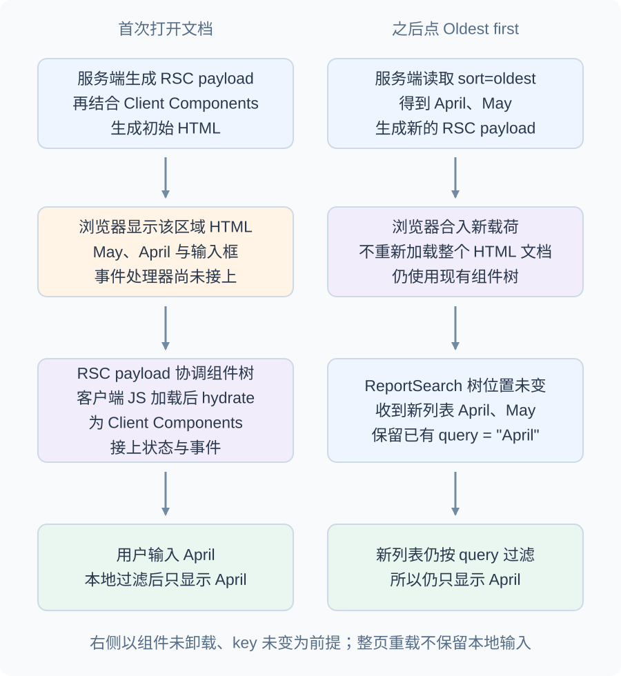
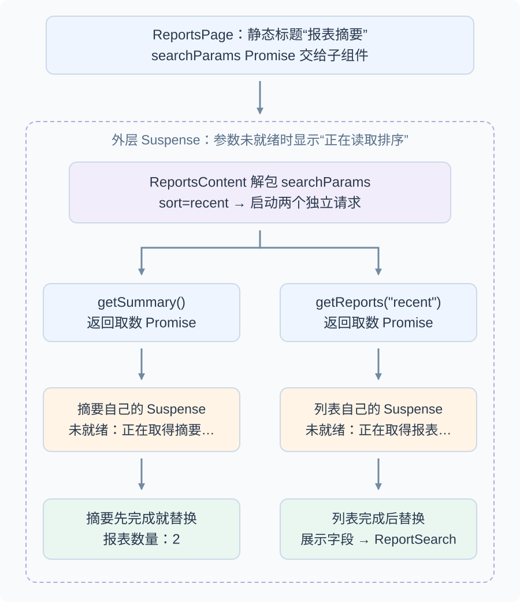

# Next.js 如何把文件路由、服务端数据与客户端交互连接起来？

**案例背景。** 用户通过 URL (统一资源定位符) 打开合成报表页 `/reports?sort=recent#summary`，要先看到摘要和最近的报表，再按 **Oldest first** 改为最早顺序，并在搜索框中筛选标题。上游提供 May、April 两行和总数 2。本页跟随这份数据，从文件路由、服务端读取、浏览器首屏，一直走到排序、Back 和失败后重试。

主例采用 Next.js 16.4.6 App Router (应用路由)，以 Server Component (服务端组件) 读取数据、Client Component (客户端组件) 接收用户输入，启用当前新项目推荐配置的 Cache Components (组件缓存) 与 Partial Prefetching (部分预取)。页面把可先显示的标题留在静态外壳，将本次 URL 查询参数与需要新鲜数据的部分放进 Suspense 边界。完整实现折叠在机制旁边；不用展开代码也可以跟完输入怎样成为页面。

## 文件路由把路径落到页面与布局

App Router 用 `app` 下的特殊文件组成路径：`app/reports/page.tsx` 对应 `/reports`，`app/reports/[reportId]/page.tsx` 对应 `/reports/:reportId`。括号动态段把路径片段交给页面的 `params`；`layout.tsx` 为一组子路由提供共享外壳，共享段在客户端导航时可以保留。`app/api/reports/route.ts` 对应独立的 `/api/reports` HTTP 端点；Route Handler（路由处理器）按 HTTP 方法导出 `GET`、`POST` 等函数并返回 Web `Response`，它不会像 `page.tsx` 那样生成页面。`app/reports/error.tsx` 是报表路由段的错误边界文件，不是 HTTP 端点。从零搭建至少要有根 `app/layout.tsx`；本例另假设上游提供表中三个 `GET` 请求。本例的 Cache Components 要求 Node.js runtime (运行时)，不支持 Edge 或路由段里的 `runtime` 导出。托管平台可以把 Node.js 服务打包为 serverless function (无服务器函数)；运行时与托管形态是两个不同选择。

Next.js 16 中页面收到的动态 `params` 和查询 `searchParams` 都是 Promise，读取时要 `await` 或用 React `use` 解包。`searchParams` 解包后是普通对象：`?sort=recent` 得到字符串，重复的 `?sort=recent&sort=oldest` 得到字符串数组，不是 `URLSearchParams`。它代表这次请求的查询串，因此读取它的组件必须等待本次请求；共享 layout 不接收 `searchParams`，因为它可能跨查询变化而保持复用。需要在客户端观察查询时可用 `useSearchParams`，但静态页面中读取该 hook 需要最近的 `Suspense` 边界；本例让 Suspense 下的服务端子组件解析并只向客户端传列表展示字段。

URL 的 path (路径) `/reports` 决定匹配的页面，query string (查询串) `sort=recent` 决定服务端排序；fragment (片段标识符) `#summary` 留给浏览器定位到本例标题的 `id="summary"`，不随 HTTP 请求发送。三者共同出现在地址栏，但跨越不同边界。

## 服务端与客户端组件在哪条线交接

layout 和 page 默认是 Server Component：它们可以在服务端读数据库、非公开环境变量或后端 API (应用程序编程接口)，而这些模块不会因此进入浏览器 JavaScript。组件需要本地 state (状态)、事件处理器、Effect (副作用) 或浏览器 API 时，才在最小交互子树的文件顶部加 `"use client"`。这条指令划分的是 module graph（模块图）：该文件直接和间接导入的运行时模块也进入客户端模块图，不需要在每个子组件重复标记。

首屏从服务端到浏览器经过三种表示。先把 Server Component 渲染成 React Server Component Payload (React 服务端组件载荷，RSC payload)：其中有服务端组件的渲染结果、Client Component 的位置占位与 JavaScript 文件引用，以及传给客户端组件的 props (组件属性)。Next.js 再用这个载荷和 Client Component 生成初始 HTML (超文本标记语言)；这次 server-side rendering（服务端渲染，SSR）负责给首次文档可显示的标记，不会因此把 Server Component 的代码发给浏览器。浏览器先显示不交互的 HTML，接着用载荷对齐两侧组件树，最后运行客户端 JavaScript 进行 hydration (水合)，接上事件处理器。图中画的是一个交互区域从可见到可操作的条件；流式页面可以逐区完成，数据交付和水合会交错进行。服务器渲染与浏览器第一次渲染若用了不同的时间、随机数、地区设置或浏览器专属值，就可能产生水合不匹配；需要浏览器值时先渲染稳定占位，再在首次提交后的 Effect 中读取。

图里的用户先在搜索框输入 `April`，再点 Oldest first，所以右栏保留的是已有输入。

排序后客户端导航不用重新下载完整 HTML，而由新的 RSC payload 更新页面；Client Component 在客户端渲染。若组件保留在同一个树位置，它可以继续保留本地输入 query；如果被卸载、key 改变或整页重新加载，未写入 URL 的 query 不会自动恢复。服务端可把一个已渲染的 Server Component 作为 `children` 交给 Client Component，但不能从 Client Component 的模块图导入并执行需要服务端能力的组件。props 必须满足 React 的可序列化规则，且会进入 RSC payload：可序列化不代表保密，所以只传标题、期间和 ID 等展示字段，不传凭证或内部记录；普通回调和数据库连接也不应作为 props 传递。`NEXT_PUBLIC_` 前缀变量会编入客户端 bundle（客户端包）；服务端密钥不能用它命名。

## 用 URL 选排序，并并行加载可独立等待的数据

先看服务端怎样把等待分开。外层 `ReportsPage` 立即返回标题和“正在读取排序”的 fallback (等待占位)。它把仍未解包的 `searchParams` Promise 传给 Suspense 内的 `ReportsContent`。只有这个子组件 `await` 本次请求参数，决定 `recent` 或 `oldest`，再同时启动 `getReports(sort)` 和 `getSummary()`。

两个请求各自把 Promise 交给列表与摘要的局部 Suspense。摘要先完成就先显示“报表数量：2”，不必等列表；列表准备好后，把 May、April 的展示字段作为 props 交给客户端搜索组件；这些值就是前图随 RSC payload 交付、用于生成初始列表的内容。Suspense 处理的是等待，数据读取失败则向错误边界传播。实际哪份 fallback 先被用户看到，取决于完成顺序和传输是否被缓冲；边界存在不意味着每次都能看见它。

这个嵌套顺序有实质作用：如果 Page 在返回 JSX **之前**就 `await searchParams`，Page 自己创建的 Suspense 还不存在，不能保护这次等待。必须有外部祖先边界，例如同段 `loading.tsx`；本例则显式把读取放到子组件中，让标题先形成静态外壳。

这条数据链路不同于 React Router 浏览器 loader：Next 服务端访问外部上游 `https://reports.example.test`，不是浏览器访问本应用同源 `/api/reports`；两种路由器的数据加载位置和导航协议分别由[React Router Data Mode 示例](./react-routing-and-navigation.md#数据模式先匹配路由，再加载匹配页面的数据)与本篇解释。该 `.test` 域名仅作示意，运行时必须替换成可达的合成或真实 API 服务。本篇合成数据只有两行；上游按 `sort` 返回它们的相应顺序，摘要返回 2：

~~~json
[
  { "id": "may", "period": "2026-05", "title": "May report" },
  { "id": "april", "period": "2026-04", "title": "April report" }
]
~~~

| 上游请求 | 上游响应 | 页面呈现 |
| --- | --- | --- |
| `GET /api/reports?sort=recent` | May → April | May、April |
| `GET /api/reports?sort=oldest` | April → May | April、May |
| `GET /api/reports/summary` | `{ "totalReports": 2 }` | `报表数量：2` |

> [!example]- 实现：静态标题、请求参数与两个独立等待区
>
> ~~~tsx
> // app/reports/page.tsx
> import { Suspense } from "react";
> import Link from "next/link";
> import { ReportSearch } from "./report-search";
>
> type SortOrder = "recent" | "oldest";
> type Report = {
>   id: string;
>   period: string;
>   title: string;
> };
> type Summary = { totalReports: number };
> type PageProps = {
>   searchParams: Promise<{ sort?: string | string[] }>;
> };
>
> function isReport(value: unknown): value is Report {
>   if (typeof value !== "object" || value === null) return false;
>   const row = value as Record<string, unknown>;
>   return typeof row.id === "string" &&
>     typeof row.period === "string" &&
>     typeof row.title === "string";
> }
>
> function parseReports(value: unknown): Report[] {
>   if (!Array.isArray(value)) throw new Error("Invalid report response");
>   return (value as unknown[]).map(row => {
>     if (!isReport(row)) throw new Error("Invalid report row");
>     return { id: row.id, period: row.period, title: row.title };
>   });
> }
>
> function parseSummary(value: unknown): Summary {
>   if (typeof value !== "object" || value === null) {
>     throw new Error("Invalid summary response");
>   }
>   const summary = value as Record<string, unknown>;
>   if (typeof summary.totalReports !== "number" ||
>       !Number.isSafeInteger(summary.totalReports) || summary.totalReports < 0) {
>     throw new Error("Invalid report count");
>   }
>   return { totalReports: summary.totalReports };
> }
>
> async function getReports(sort: SortOrder): Promise<Report[]> {
>   const response = await fetch(
>     "https://reports.example.test/api/reports?sort=" + encodeURIComponent(sort),
>     { cache: "no-store" }
>   );
>   if (!response.ok) throw new Error("Could not load reports");
>   const payload: unknown = await response.json();
>   return parseReports(payload);
> }
>
> async function getSummary(): Promise
 {
>   const response = await fetch(
>     "https://reports.example.test/api/reports/summary",
>     { cache: "no-store" }
>   );
>   if (!response.ok) throw new Error("Could not load report summary");
>   const payload: unknown = await response.json();
>   return parseSummary(payload);
> }
>
> export default function ReportsPage({ searchParams }: PageProps) {
>   return (
>     <main>
>       <h1 id="summary">报表摘要</h1>
>       <Suspense fallback={
正在读取排序…
}>
>         <ReportsContent searchParams={searchParams} />
>       </Suspense>
>     </main>
>   );
> }
>
> async function ReportsContent({ searchParams }: PageProps) {
>   const { sort: rawSort } = await searchParams;
>   const sort: SortOrder = rawSort === "oldest" ? "oldest" : "recent";
>   const reportsPromise = getReports(sort);
>   const summaryPromise = getSummary();
>
>   return (
>     <>
>       <nav aria-label="报表排序">
>         <Link
>           href="/reports?sort=recent#summary"
>           aria-current={sort === "recent" ? "page" : undefined}
>         >
>           Recent
>         </Link>
>         {" · "}
>         <Link
>           href="/reports?sort=oldest#summary"
>           aria-current={sort === "oldest" ? "page" : undefined}
>         >
>           Oldest first
>         </Link>
>       </nav>
>       <Suspense fallback={
正在取得摘要…
}>
>         <ReportSummary promise={summaryPromise} />
>       </Suspense>
>       <Suspense fallback={
正在取得报表…
}>
>         <ReportList promise={reportsPromise} />
>       </Suspense>
>     </>
>   );
> }
>
> async function ReportSummary({ promise }: { promise: Promise
 }) {
>   const summary = await promise;
>   return 
报表数量：{summary.totalReports}
;
> }
>
> async function ReportList({ promise }: { promise: Promise<Report[]> }) {
>   const reports = await promise;
>   return <ReportSearch reports={reports} />;
> }
> ~~~

`ReportSearch` 放在独立文件 `app/reports/report-search.tsx`，因为它需要输入 state 和 `onChange`。数据先在服务端取得，再以普通可序列化数组传入：

> [!example]- 客户端搜索只过滤收到的展示字段
>
> ~~~tsx
> "use client";
>
> import { useState } from "react";
>
> type Report = {
>   id: string;
>   period: string;
>   title: string;
> };
>
> export function ReportSearch({ reports }: { reports: Report[] }) {
>   const [query, setQuery] = useState("");
>   const visible = reports.filter(report =>
>     report.title.toLowerCase().includes(query.toLowerCase())
>   );
>
>   return (
>     <section>
>       <label>
>         搜索报表
>         <input value={query} onChange={event => setQuery(event.target.value)} />
>       </label>
>       <ol aria-label="报表">
>         {visible.map(report => (
>           <li key={report.id}>{report.period} — {report.title}</li>
>         ))}
>       </ol>
>     </section>
>   );
> }
> ~~~

输入和本地过滤属于客户端交互；读取权限、访问私有服务和决定服务端排序应在服务端完成。本例没有身份提供者，因此省略鉴权接线；真实读取要先验证会话，再确认用户有权看这份报表。只把三个展示字段传到浏览器；如果数据量大、分页或过滤受权限影响，就把条件写入 URL 并让服务端按条件查询。若之后加入“标记已读”，可用 Server Action (服务端动作) 处理表单变更；它是一个用 `"use server"` 标记的 Server Function（服务端函数），通过 POST 从客户端调用。不能因按钮隐藏或 action ID 不易猜到就当作私有接口；每次调用都要重新认证、授权并验证输入。需要独立 HTTP API 的消费者则用 Route Handler。`response.json()` 的静态类型不能验证运行时形状；示例在服务边界先把它视为 `unknown`，逐行检查并投影成 Data Transfer Object (数据传输对象，DTO)，避免把上游行中可能存在的内部字段传入 RSC payload。摘要中的 `totalReports` 也必须是非负安全整数。

参数策略是：只有值为单个字符串 `oldest` 时采用最早顺序；缺失、`recent`、其它非法值和重复值（`string[]`）都回退到 `recent`。这是本例的输入契约，不是框架替我们验证参数；相邻 React Router 例子选择了另一种契约，对非法值回 400。

### 缓存保存哪一层，决定导航会做多少工作

Cache Components 允许静态外壳先返回，把本次请求才能知道的数据留在等待边界内。它没有把所有数据都自动变成可跨请求复用的值：本例两次 `fetch` 使用 `cache: "no-store"`，实际执行时不读写 Next 的持久 Data Cache (数据缓存)。若某项数据允许过时一段时间，可以对取数函数或组件使用 `use cache`，并通过 `cacheLife` 明确生命周期；输入与捕获的可序列化值参与缓存键。与身份有关的数据还需把权限范围纳入设计，不能把一个用户的结果共享给另一个用户。

这里至少有两个不同的复用对象：服务端数据或组件返回值，以及浏览器保存的 RSC 页面载荷。`no-store` 约束的是该 fetch，不能迫使每次 Link 或 Back 都重跑服务端。Back 可能恢复客户端已经保存的路由结果，也可能请求新的载荷；URL 记住排序条件，却没有冻结上游数据版本。

`fetch(..., { cache: "force-cache" })` 是显式保存 fetch 响应的另一机制，键依据请求信息；启用 Cache Components 后它仍可工作，不等于 `use cache` 的函数/组件结果缓存。选择时要说清缓存的是哪一层、能陈旧多久、变更后如何失效，不能仅因为页面变快就推断数据仍然正确。

> [!example]- 本例的配置与旧项目识别
>
> ~~~ts
> // next.config.ts
> import type { NextConfig } from "next";
>
> const nextConfig: NextConfig = {
>   cacheComponents: true,
>   partialPrefetching: true,
> };
>
> export default nextConfig;
> ~~~
>
> 16.4.6 的推荐新建配置已经启用二者；手动创建的项目应明确配置。维护未开启 Cache Components 的旧项目时，按上一缓存模型解释行为：动态页面的默认 fetch 可在请求时执行，静态页面则可能在构建时读取；`dynamic`、`revalidate` 等路由段选项也不能原样套到新模型。开发模式的 Hot Module Replacement (热模块替换，HMR) 可能复用部分 `no-store` 结果，应以生产运行检验实际缓存合同。

## 加载、失败和重试各有自己的边界

`app/reports/loading.tsx` 自动在该路由段的 Page 和后代外建立一个 Suspense 边界；它可以在该子树尚未准备好时提供整段等待壳。本例 Page 已经能立即返回静态标题，并把请求参数、摘要与列表的等待放入更小的边界，所以每块完成后可独立替换。段级 loading 是否实际可见仍取决于导航和完成时序；它不包住同目录 `layout.tsx`，也不会捕获读取失败。若 layout 自己要等未缓存数据，需要在对应位置安排等待边界。

> [!example]- 段级等待外壳
>
> ~~~tsx
> // app/reports/loading.tsx
> export default function Loading() {
>   return 
正在打开报表…
;
> }
> ~~~

在同一段创建 `app/reports/error.tsx`，用 Client Component 显示可恢复的错误状态。本例故意让请求失败或不合约的响应抛出异常，以展示路由错误边界；因一个摘要请求失败，整个 `/reports` 页面段都会换成 fallback，而不只替换摘要的小 Suspense 区域。产品若把上游 503 视作可预期状态，也可以在数据组件内捕获并呈现局部失败结果，不必把整段都判为异常。`error.tsx` 会捕获当前段的 Page 和子段，但不会捕获同段 `layout.tsx` 自己抛出的错误，错误会到更高一级边界。Next.js 16.3 起，`retry` 稳定；调用它会重新读取并渲染边界内子树。根 `layout.tsx` 失败时由 `app/global-error.tsx` 接手，它需自己包含 `html` 与 `body`。

> [!example]- 当前页面失败后的重新读取
>
> ~~~tsx
> // app/reports/error.tsx
> "use client";
>
> import { useEffect } from "react";
>
> export default function ReportsError({
>   error,
>   retry
> }: {
>   error: unknown;
>   retry: () => void;
> }) {
>   useEffect(() => {
>     console.error(error);
>   }, [error]);
>
>   return (
>     <section>
>       
报表暂时无法显示。

>       <button type="button" onClick={() => retry()}>
>         重新读取
>       </button>
>     </section>
>   );
> }
> ~~~

此页的 `<Link>` 使用客户端过渡。Partial Prefetching 可以预取可复用的外壳与等待状态；需要当前请求数据的部分仍由导航时的新载荷补全。点 Oldest first 后，服务器按 `oldest` 获取 April、May，浏览器将新载荷合入现有组件树。可用预取内容和完成时序决定期间看到旧内容还是等待界面，不能从一次点击推出固定的 URL 更新时点。若搜索组件仍处于相同树位置，它保留本地 query，并对新列表继续过滤。

Back 把地址恢复到 `sort=recent`，但可能恢复客户端已有路由状态，也可能再取服务器载荷；不能断言一定发生上游网络读取，也不保证恢复某个旧数据快照。若数据没变，顺序仍是 May、April；若数据变了，URL 只固定排序值。页面 Server Component 没有 React Router Data Mode loader 所提供的 `request.signal`；切换路由不等于 Next 已取消服务器端 fetch 或数据库操作。只有客户端自己创建的 fetch 可由客户端 `AbortController` 在组件清理时取消等待；服务端工作要靠请求超时、幂等性和一致性约束。浏览器 History API 与片段定位见[浏览器导航与历史如何恢复筛选状态？](../browser/browser-navigation-and-history.md)，服务端状态缓存与 mutation 见[React界面如何维护服务端数据与乐观更新的正确性？](./react-server-state-and-optimistic-updates.md)。

`app/reports/error.tsx` 的 `retry()` 会重新读取并渲染边界内的页面内容。例如 URL 仍是 `sort=oldest` 时，重试会沿同一个查询值重新渲染当前边界；成功后列表随页面段一起恢复为 April、May，不会悄悄改回 recent。服务端组件错误传给客户端时不应把原始私密错误消息展示给用户；生产环境可用 `error.digest` 关联服务端日志，用户看到通用提示。

## 旧版 Pages Router（页面路由器）代码怎样与 App Router 区分

当前例子使用 App Router；旧 Pages Router 应按它自己的运行模型维护，不要把两套 API 拼进一个文件。

> [!info]- 维护 Pages Router 时查阅的入口与再生规则
>
> | 需求 | Pages Router 旧入口 | 当前 App Router |
> |---|---|---|
> | 动态路径参数 | `next/router` 的 `router.query` | 页面收到 Promise `params`，`await` 后读取 |
> | 查询参数 | `router.query`；自动静态优化期间首屏可能暂时为空，客户端代码应在 Effect（副作用）中等 `router.isReady` | 页面收到 Promise `searchParams`；读取会使用请求时 URL |
> | 服务端数据 | `getServerSideProps` 按请求读取；`getStaticProps` 读取静态数据；动态路径再用 `getStaticPaths` 列出构建路径 | 默认 Server Component 读取服务端数据；本篇等待边界内的 `no-store` fetch 在实际执行时取新数据 |
> | 刷新静态结果 | `getStaticProps` 的 `revalidate` 支持 Incremental Static Regeneration（增量静态再生，ISR） | 按当前 App Router 缓存配置选择重新读取或缓存 |
> | API 端点 | `pages/api` 的默认处理器 | `app/**/route.ts` 按 HTTP 方法导出处理器 |
>
> Pages Router 的 `revalidate: 60` 不是后台每分钟定时重建：构建页先被缓存，60 秒后遇到的第一个请求仍拿到旧页，并触发后台生成；成功后后续请求才拿新页。对构建时未列出的动态路径，`getStaticPaths` 的 `fallback: false` 直接 404；`true` 在普通浏览器首次直达时可先给 fallback 并后台生成，但爬虫以及经 `next/link` 或 `next/router` 的客户端导航按 blocking 行为等待；`"blocking"` 则对首次访问也等生成完成后再返回页面。这里的 Pages Router ISR 规则用于识别旧 `getStaticProps`/`getStaticPaths` 项目，不与本篇 App Router 主例的 `no-store` 请求混用。

App Router 的客户端导航优先用 `next/link`；需要在客户端代码中编程导航时，使用 `next/navigation` 的 `useRouter`。旧 `next/router`、`router.query` 和 Pages Router 数据函数不适用于 `app/` 页面。当前客户端组件和服务端组件的边界不因保留 Pages Router 而消失：同一项目可以逐段迁移，但每段代码都必须明确属于哪种路由器。

本例的当前配置已在隔离生产运行中检查：Next.js 16.4.6、React 19.3.1、Node 26.13.0 与 Chrome 157，采用本地合成上游。排序、Back 与输入保留通过；列表延迟 700 ms 时，摘要先出现而列表仍显示等待；摘要第一次失败后，重试仍按当前 `oldest` 读取。它验证的是这份主例，真实身份授权和不同托管链路仍由应用接线决定。

> [!info]- 来源与版本核验（Next.js 16.4.6；2026-11-12）
> - 当前稳定版本为官方 [v16.4.6 release](https://github.com/vercel/next.js/releases/tag/v16.4.6)，发布于 2026-11-09；本页 App Router 事实按 Next.js 16.4.6 官方文档核验于 2026-11-12。
> - App Router 文件约定、动态段、layout/page 共享与 Route Handler 的 HTTP 方法导出：[Project Structure](https://nextjs.org/docs/app/getting-started/project-structure)、[Dynamic Segments](https://nextjs.org/docs/app/api-reference/file-conventions/dynamic-routes)、[Route Handler](https://nextjs.org/docs/app/api-reference/file-conventions/route)。
> - `params` 与 `searchParams` 的 Promise 形状、重复查询参数变成数组、读取 `searchParams` 使上一模型按请求渲染，以及共享 layout 不接收它：[page.js — Props](https://nextjs.org/docs/app/api-reference/file-conventions/page#props)。
> - Server Component 到 RSC payload、初始 HTML 与客户端 hydrate 的顺序；`"use client"` 模块边界、children 插槽和序列化 props：[Server and Client Components — How they work](https://nextjs.org/docs/app/getting-started/server-and-client-components#how-do-server-and-client-components-work-in-nextjs)。水合一致性与 Effect 只在客户端运行：[React hydrateRoot](https://react.dev/reference/react-dom/client/hydrateRoot)、[React useEffect](https://react.dev/reference/react/useEffect)。
> - `<Link>` 客户端导航，动态路由的跳过或部分预取、loading fallback 和后续 RSC 载荷：[Linking and Navigating — Prefetching/Streaming/Client-side transitions](https://nextjs.org/docs/app/getting-started/linking-and-navigating#prefetching)。
> - `cacheComponents` 要求 Node.js runtime、不支持路由段 `runtime` 导出；在 Next.js 16.0 稳定；Cache Components 与 Partial Prefetching 配置、新建项目推荐默认值和 `use cache`：[cacheComponents](https://nextjs.org/docs/app/api-reference/config/next-config-js/cacheComponents)、[Caching — Enabling Cache Components](https://nextjs.org/docs/app/getting-started/caching#enabling-cache-components)、[`use cache` directive](https://nextjs.org/docs/app/api-reference/directives/use-cache)。`searchParams` 等运行时 API 置于 Suspense 下的 build/dev 提示与参数 Promise 下传方式：[Uncached data was accessed outside of Suspense](https://nextjs.org/docs/messages/blocking-route#params-and-searchparams)。
> - 上一缓存模型与 Cache Components 分别使用 `fetch` 响应缓存和 `use cache` 的函数/组件结果缓存；启用新模型后，显式的 `fetch` 缓存仍然工作：[Caching and Revalidating (Previous Model)](https://nextjs.org/docs/app/guides/caching-without-cache-components)、[Migrating to Cache Components](https://nextjs.org/docs/app/guides/migrating-to-cache-components)、[Cache Components — `use cache`](https://nextjs.org/docs/app/api-reference/directives/use-cache)、[fetch — options.cache/Memoization/Troubleshooting](https://nextjs.org/docs/app/api-reference/functions/fetch#optionscache)。
> - `loading.tsx` 包围 Page/后代但不包同目录 layout；`error.tsx` 捕获范围、`retry` 重取和全局边界文档结构：[loading.js — Behavior](https://nextjs.org/docs/app/api-reference/file-conventions/loading#behavior)、[error.js — retry/Global Error](https://nextjs.org/docs/app/api-reference/file-conventions/error#retry)。`retry` 从 16.3.0 稳定。
> - Server Actions/Server Functions 使用 POST、可被直接请求；每次调用都应验证客户端输入、认证调用者并授权该操作：[Mutating Data — What are Server Functions](https://nextjs.org/docs/app/getting-started/mutating-data#what-are-server-functions)、[Data Security — Validating Client Input](https://nextjs.org/docs/app/guides/data-security#validating-client-input)、[Authentication and Authorization](https://nextjs.org/docs/app/guides/data-security#authentication-and-authorization)。
> - Pages Router 的请求期 `getServerSideProps`、构建期 `getStaticProps`、未列路径 fallback（含直达与客户端导航差别）和按需再生时序：[getServerSideProps](https://nextjs.org/docs/pages/building-your-application/data-fetching/get-server-side-props)、[getStaticProps](https://nextjs.org/docs/pages/api-reference/functions/get-static-props)、[getStaticPaths](https://nextjs.org/docs/pages/api-reference/functions/get-static-paths#fallback-true)、[Incremental Static Regeneration](https://nextjs.org/docs/pages/guides/incremental-static-regeneration)。`router.isReady`：[Pages Router useRouter](https://nextjs.org/docs/pages/api-reference/functions/use-router)。
