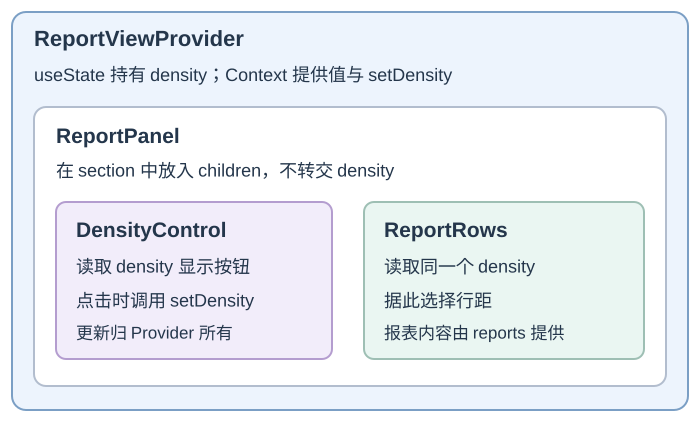

# 如何在 React 中组合组件与复用行为？

**案例背景。** 报表页地址为 `/reports?sort=recent#summary`：查询参数决定排序，片段 `#summary` 只负责浏览器定位。路由把服务端给出的 May、April 两行与 `initialSort="recent"` 传入；初次提交选中 **Most recent**，显示 May 在 April 前。用户点 **Oldest first** 后，工具栏要选中旧序，列表要排成 April、May。因为同一份 `sort`（排序状态）同时决定两个界面，包含工具栏和列表的最近共同父组件负责持有它。父组件把状态和派生结果传给子组件，工具栏把用户意图通过回调交还状态所有者。远距离组件要共享行距偏好时，可选 Context；多个组件要复用同种外部监听行为时，可选自定义 Hook；父组件确实需要子组件的窄范围命令式动作时，才暴露 ref。

本章代码按 React 19.3 与 React DOM 19.3 核验。状态所有权示例省略 URL 与历史栈；若要让排序选择进入浏览器历史，可用 `pushState` 写入排序，并在 `popstate` 时把 Back/Forward 恢复的排序同步给同一状态所有者，见[浏览器主线](../browser/browser-navigation-and-history.md#让排序状态跟随地址栏与前进后退)。

> [!info]- 读旧版示例时需要识别的 API 差异
>
> React 19 的 Context 可直接用 `<Context value={...}>` 作为 Provider（提供者）；React 18 及更早版本需用 `<Context.Provider>`。React 19 函数组件也能把 `ref` 当作 prop，旧版本需 `forwardRef`。本章使用自动 JSX 转换，TSX 使用对应的 React 19 类型声明。下面使用当前写法；`use` 和 `useEffectEvent` 的调用规则在对应小节解释。

## 把状态放在共同使用者之上的最近一层

本例由调用方传入 `<ReportsPage reports={reports} initialSort="recent" />`。`reports` 只有 May、April 两行：May 的 `periodStart` 是 `2026-05-01`，April 的是 `2026-04-01`；本例日期固定为 `YYYY-MM-DD`。显示标签 `period` 不参与排序。`ReportsPage` 是工具栏和列表的最近共同祖先；它持有 `sort` 并在 render（渲染）中派生行顺序。

这一次数据流从父组件向下、用户意图再向上：

~~~mermaid
flowchart TD
    P["ReportsPage 持有 sort 派生有序 rows"] -->|"sort 与回调"| T["ReportToolbar 显示选中按钮"]
    P -->|"有序 reports"| L["ReportList 按顺序显示行"]
    T -->|"点击调用 onSortChange"| P
~~~

首次 render 中 `sort="recent"`，提交后 **Most recent** 被选中，列表为 May、April。排序按钮不直接改列表：工具栏接收 `sort` 和 `onSortChange`，其中回调就是父组件的 `setSort`；点击时调用它，安排下一轮 render。状态所有者从 `oldest` 派生新 `rows`，commit（提交）后工具栏与列表一起显示 Oldest first、April/May。`sortReports` 复制数组再排，不原地修改路由给的报表；`ReportList` 只显示派生结果，并用稳定的报表 ID 做 `key`（列表项标识）。当多个组件需要协调同一份状态时，通常由一处更新、其他组件读取，把 state 提到它们的最近共同祖先；提得更高会让职责和更新路径变宽，不会自动改善性能。

`initialSort` 只用于首次挂载时初始化 `useState`。完整路由若在 `popstate` 后拿到新排序，不能只换这个 prop 就期待组件状态自动重置；应让路由直接拥有排序状态并把它作为受控 prop 传入，或显式更新/重新挂载状态所有者。例如，只把同一实例的 `initialSort` prop 改成 `oldest`，按钮和列表仍保持 recent、May/April；调用 `setSort("oldest")` 才会安排状态更新，提交后显示 oldest、April/May。当前片段只展示组件通信，不实现 URL/history。

props（属性）适合父子层级清楚的数据向下传和 callback prop（回调属性）向上交互。若两个组件没有共享状态，贸然把 state 上移只会扩大维护范围。跨较深子树读取主题、地区或行距偏好时，可考虑 Context（上下文）；多处功能需共享并统一更新策略的客户端状态，可再考虑 store（共享状态容器），如 Redux；服务端拥有的报表记录仍归查询层，不因放进 Context 就获得缓存、请求身份或取消语义。Redux 的 action（动作）、reducer（归约器）、selector（选择器）和异步工作流见[Redux 如何组织共享界面状态与异步工作？](./redux-state-and-async-workflows.md)。

> [!example]- 完整示例：排序状态、按钮与报表列表
>
> ~~~tsx
> import { useState } from "react";
>
> type SortOrder = "recent" | "oldest";
> type Report = {
>   id: string;
>   period: string;
>   periodStart: string;
>   title: string;
> };
>
> function sortReports(reports: Report[], sort: SortOrder): Report[] {
>   return [...reports].sort((a, b) => {
>     const order = a.periodStart.localeCompare(b.periodStart);
>     return sort === "recent" ? -order : order;
>   });
> }
>
> export function ReportsPage({
>   reports,
>   initialSort
> }: {
>   reports: Report[];
>   initialSort: SortOrder;
> }) {
>   const [sort, setSort] = useState(initialSort);
>   const rows = sortReports(reports, sort);
>
>   return (
>     <main>
>       <ReportToolbar sort={sort} onSortChange={setSort} />
>       <ReportList reports={rows} />
>     </main>
>   );
> }
>
> function ReportToolbar({
>   sort,
>   onSortChange
> }: {
>   sort: SortOrder;
>   onSortChange: (sort: SortOrder) => void;
> }) {
>   return (
>     

>       <button
>         type="button"
>         aria-pressed={sort === "recent"}
>         onClick={() => onSortChange("recent")}
>       >
>         Most recent
>       </button>
>       <button
>         type="button"
>         aria-pressed={sort === "oldest"}
>         onClick={() => onSortChange("oldest")}
>       >
>         Oldest first
>       </button>
>     

>   );
> }
>
> function ReportList({ reports }: { reports: Report[] }) {
>   return (
>     <ul>
>       {reports.map(report => (
>         <li key={report.id}>
>           {report.period} — {report.title}
>         </li>
>       ))}
>     </ul>
>   );
> }
>
> const reports: Report[] = [
>   {
>     id: "may",
>     period: "May",
>     periodStart: "2026-05-01",
>     title: "May report"
>   },
>   {
>     id: "april",
>     period: "April",
>     periodStart: "2026-04-01",
>     title: "April report"
>   }
> ];
>
> export function ReportsDemo() {
>   return <ReportsPage reports={reports} initialSort="recent" />;
> }
> ~~~

## 用Context传递远距离视图偏好

`ReportsView` 把视图内容作为 `children`（子节点）交给 `ReportViewProvider`；Provider 决定把这些内容放进 Context 子树。中间的 `ReportPanel` 只负责把收到的 children 放在 `<section>` 中，不用接收或转发 `density`。因此行距消费者即使隔着普通布局组件，仍能读到最近的 Provider。

下面的框表示组件包含关系。蓝色外框内的两个消费者读取同一份 `density`，中间布局组件只转交 `children`，不必转交行距值：

`ReportsView` 调用 Provider 时，把 `<ReportPanel>` 作为 `children` 交给它；`ReportPanel` 再把控制按钮和列表放入自己的 `<section>`。调用方提供内容，组件决定插入位置，这就是 children 组合。`useContext` 向上查找这个 Context 最近的 Provider；子树里若再嵌一个同类型 Provider，只有它下面的消费者改读内层值。Context 对象本身不保存状态；这里真正持有 `density` 的是 Provider 中的 `useState`。初始 `density="comfortable"`：按钮写“切换紧凑行距”，列表 `lineHeight=1.8`。点击调用 `setDensity("compact")` 后，Provider 提供的新 value 让两个消费者更新：按钮变为“恢复舒适行距”，列表 `lineHeight=1.2`。若消费者上方没有该 Context 的 Provider，`useReportView` 会读到默认 `null` 并报错，明确要求调用方补齐 Provider。

此例每次 Provider render 都新建 `{ density, setDensity }` 对象，因此 value 引用也改变。React 用 `Object.is` 比较新旧 `value`；即使两个对象字段完全相同，只要引用不同，Context 消费者就会更新。点击行距按钮时 `density` 确实变化，两个消费者需要新值。若父组件因其他状态或 `reports` 更新而重新 render，即使 `density` 没变，Provider 仍会创建新对象并使 Context 消费者更新；即使消费者包在 `memo`（按 props 浅比较跳过子组件渲染的优化）中，也挡不住 Context 值变化。确认这造成可见成本后，再考虑稳定 value 或拆分 Context。TypeScript 中为 Context 值和消费者建立类型边界的旧例仍见[归档中的旧 TypeScript Context 与自定义 Hook 示例](../../archive/front-end/0-1_Learning_Notes/react_typescript/typed-hooks-and-context.md)。Context 不会改变报表记录的服务端所有权，查询身份、新鲜度、取消与变更协调仍由[服务端状态章节](./react-server-state-and-optimistic-updates.md)负责。

> [!example]- 完整示例：Provider、children 与两个消费者
>
> ~~~jsx
> import { createContext, useContext, useState } from "react";
>
> const ReportViewContext = createContext(null);
>
> function ReportViewProvider({ children }) {
>   const [density, setDensity] = useState("comfortable");
>
>   return (
>     <ReportViewContext value={{ density, setDensity }}>
>       {children}
>     </ReportViewContext>
>   );
> }
>
> function ReportPanel({ children }) {
>   return <section>{children}</section>;
> }
>
> function useReportView() {
>   const value = useContext(ReportViewContext);
>   if (value === null) {
>     throw new Error("useReportView 必须在 ReportViewProvider 内调用");
>   }
>   return value;
> }
>
> function DensityControl() {
>   const { density, setDensity } = useReportView();
>   const nextDensity = density === "compact" ? "comfortable" : "compact";
>
>   return (
>     <button type="button" onClick={() => setDensity(nextDensity)}>
>       {density === "compact" ? "恢复舒适行距" : "切换紧凑行距"}
>     </button>
>   );
> }
>
> function ReportRows({ reports }) {
>   const { density } = useReportView();
>   return (
>     <ul style={{ lineHeight: density === "compact" ? 1.2 : 1.8 }}>
>       {reports.map(report => (
>         <li key={report.id}>{report.title}</li>
>       ))}
>     </ul>
>   );
> }
>
> export function ReportsView({ reports }) {
>   return (
>     <ReportViewProvider>
>       <ReportPanel>
>         <DensityControl />
>         <ReportRows reports={reports} />
>       </ReportPanel>
>     </ReportViewProvider>
>   );
> }
> ~~~

## 用自定义Hook复用状态行为

自定义 Hook 复用的是一段 Hook 行为，不会让不同调用自动共用 state。下面每个 `useWindowSize()` 调用都创建自己的 size 状态和 `resize` 监听器；多个组件可以用同样方式订阅窗口尺寸，各自独立更新。

~~~jsx
import { useEffect, useState } from "react";

export function useWindowSize() {
  const [size, setSize] = useState({ width: 0, height: 0 });

  useEffect(() => {
    function update() {
      setSize({ width: window.innerWidth, height: window.innerHeight });
    }

    window.addEventListener("resize", update);
    update();
    return () => window.removeEventListener("resize", update);
  }, []);

  return size;
}
~~~

`useEffect`（用于提交后同步外部系统的 Hook）在首次 commit（提交）后才运行，所以首次 render（渲染）暂时返回 `0 × 0`；随后 Effect 读取浏览器尺寸并更新。服务端也不会运行这个 Effect，服务端渲染与客户端首轮 hydration（水合）都会看到相同占位值。若两个组件都调用这个 Hook，在 `700×900` 窗口下它们会各自从占位值更新到 `700×900`；窗口变为 `720×900` 后，各自的监听器再把自己的 state 更新到新尺寸。相同输出是因为两次都读取同一个 `window`，不表示它们共用一份 state。卸载时每次调用都移除自己建立的监听器。若有很多消费者需要共享同一个外部窗口 store，应明确订阅同一 store（可用 React 的 [`useSyncExternalStore`](https://react.dev/reference/react/useSyncExternalStore)），而不是误以为每次调用同一自定义 Hook 就共享状态。

大多数 Hook 必须在组件或其他 Hook 顶层按固定顺序调用。React 19 的 `use` API 是特殊例外：它可以在条件和循环里读 Promise 或 Context，但仍须处于组件或 Hook 中，而且不能放进 `try/catch`；`useContext` 等普通 Hook 仍遵守固定顺序。

React 19.2 的 `useEffectEvent` 用于 Effect 里的 Effect Event（效果事件）逻辑：它在调用时读取最新提交的 props/state，但不因此让连接等 Effect 重新建立。它是一个 Hook，可在组件或自定义 Hook 顶层创建；自定义 Hook 可接收普通 callback 并用 `useEffectEvent(callback)` 包装，再由该 Hook 自己的 Effect 调用。Effect Event 要留在定义它的组件或 Hook 内，只能由本地 Effect 或另一个 Effect Event 调用；不能传给子组件、拿来当普通点击回调，也不能用它隐藏本来应该声明的 Effect 依赖。Effect Event 的函数身份每次 render 都会变化，不放进依赖数组。Effect 生命周期见[React 更新轮次](./react-basics.md#effect在提交后同步外部系统)。

## ref用于窄范围的命令式能力

界面需要随值变化时用 state；ref 可持有不驱动界面的可变值，也可引用已提交的 DOM。下面父工具栏只调用子组件公开的 `focus()`，输入节点始终由 `ReportSearchInput` 自己持有。

~~~tsx
import { useImperativeHandle, useRef, type Ref } from "react";

type SearchHandle = {
  focus(): void;
};

function ReportSearchInput({ ref }: { ref: Ref<SearchHandle> }) {
  const inputRef = useRef<HTMLInputElement>(null);
  useImperativeHandle(
    ref,
    () => ({
      focus() {
        inputRef.current?.focus();
      }
    }),
    []
  );
  return <input ref={inputRef} aria-label="搜索报表" />;
}

export function ReportFocusControl() {
  const searchRef = useRef<SearchHandle>(null);
  return (
    <>
      <ReportSearchInput ref={searchRef} />
      <button type="button" onClick={() => searchRef.current?.focus()}>
        聚焦搜索
      </button>
    </>
  );
}
~~~

React 19 的函数组件可把 `ref`（引用）当作 prop 接收；React 18 及更早版本要用 `forwardRef` 转发。若父组件只需要 `focus()`，`useImperativeHandle` 暴露这个有限动作即可，不把内部节点和实现一起交出去。通过这种 API，调用者只依赖子组件承诺的行为。

## 组合组件与旧式逻辑复用接口

`children`（子节点）组合让调用方提供内容，由接收组件决定把它插在哪里；前面的 `ReportPanel` 接收按钮和列表的 JSX，再把它们放进 `<section>`。render prop（渲染属性）是可由列表提供的扩展接口：如果 `ReportList` 接收 `renderRow` prop，调用方可传 `renderRow={report => <strong>{report.title}</strong>}`，列表对每条报表调用这个函数，并把返回的 JSX 放进对应行；当前 `ReportList` 只接收 `reports`，没有实现这个扩展 prop。higher-order component（高阶组件，HOC）包装组件并返回新组件。自定义 Hook 通常更适合复用 Hook 状态逻辑，但旧库的 render prop 或 HOC 也可能是稳定且清楚的 API，不必只为“改成 Hook”而重写。

条件分支也是组合的一部分：二选一用三元表达式，只在条件为真时渲染用逻辑 AND，能早退时用 `if`。在 `ReportsPage` 里，`ReportList` 必须收到 `reports`；错误写法 `{rows.length && <ReportList reports={rows} />}` 在 `rows` 为空时得到数字 `0`，React 会把它渲染出来。改成 `{rows.length > 0 && <ReportList reports={rows} />}` 时，空数组得到布尔值 `false`，不会多出数字。

这些模式解决状态归属和行为复用。若一次交互的 React render 成本已测出，再看[如何测量并减少不必要的 React 工作？](../performance/react-rendering-optimization.md)；本章不把 memoization（记忆化）当作组件组合规则。

> [!info]- 来源与版本核验（React 19.3；核验日期 2026-11-12）
>
> - props 传递、调用方提供 JSX children、共同使用者的 state 归属、Context 数据下传：[Passing Props to a Component](https://react.dev/learn/passing-props-to-a-component)、[Passing JSX as children](https://react.dev/learn/passing-props-to-a-component#passing-jsx-as-children)、[Sharing State Between Components](https://react.dev/learn/sharing-state-between-components)、[useState](https://react.dev/reference/react/useState#returns)、[Passing Data Deeply with Context](https://react.dev/learn/passing-data-deeply-with-context)，React 19.3 文档。
> - Context 的默认值、最近 Provider、value 变化触发消费者更新、React 19 新 Provider 语法与旧 `.Provider`：[createContext](https://react.dev/reference/react/createContext)、[useContext](https://react.dev/reference/react/useContext)，React 19.3 文档。
> - 自定义 Hook 复用行为与调用限制：[Reusing Logic with Custom Hooks](https://react.dev/learn/reusing-logic-with-custom-hooks)、[Rules of Hooks](https://react.dev/reference/rules/rules-of-hooks)；React 19 的 `use` 可在条件/循环中读资源，但不能在 `try/catch` 中：[use](https://react.dev/reference/react/use)。
> - React 19.2 的 `useEffectEvent` 最新提交值、组件与自定义 Hook 中的定义/调用范围、依赖与身份限制：[useEffectEvent](https://react.dev/reference/react/useEffectEvent)、[Caveats](https://react.dev/reference/react/useEffectEvent#caveats)、[Using Effect Events in custom Hooks](https://react.dev/reference/react/useEffectEvent#using-effect-events-in-custom-hooks)、[React 19.2](https://react.dev/blog/2025/10/01/react-19-2)，React 官方文档。
> - React 19 的自动 JSX 转换要求及对应类型声明：[React 19 Upgrade Guide — New JSX Transform is now required](https://react.dev/blog/2024/04/25/react-19-upgrade-guide#new-jsx-transform-is-now-required)。
> - ref 与命令式 handle；React 19 可直接收 ref prop，旧版需 `forwardRef`：[useRef](https://react.dev/reference/react/useRef)、[useImperativeHandle](https://react.dev/reference/react/useImperativeHandle)、[forwardRef](https://react.dev/reference/react/forwardRef)，React 19.3 文档。
> - 多处读取同一外部 store 的订阅 API：[useSyncExternalStore](https://react.dev/reference/react/useSyncExternalStore)，React 19.3 文档。
> - 逻辑 AND 条件渲染：[Conditional Rendering](https://react.dev/learn/conditional-rendering#logical-and-operator)，React 19.3 文档。
> - render prop 与 higher-order component 的旧式复用接口：[Render Props](https://legacy.reactjs.org/docs/render-props.html)、[Higher-Order Components](https://legacy.reactjs.org/docs/higher-order-components.html)，React 官方旧版文档；用于解释仍存在于库 API 中的接口。
> - toggle button 的 `aria-pressed`：[WAI-ARIA APG — Button Pattern](https://www.w3.org/WAI/ARIA/apg/patterns/button/)，W3C WAI 官方模式，核验日期 2026-11-12。
> - 当前 React 文档版本：[Versions](https://react.dev/versions)，React 19.3，核验日期 2026-11-12。
