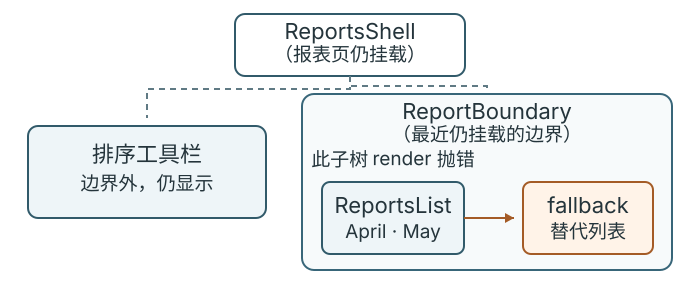

# React错误边界能恢复哪些失败？

**案例背景。** 延续报表页：服务端给出 May、April，用户选 **Oldest first** 后，路由状态变为 `sort=oldest`，父组件把排好序的 April、May 传给列表；排序状态随浏览器前进/后退恢复，见[浏览器导航路径](../browser/browser-navigation-and-history.md#让排序状态跟随地址栏与前进后退)。若列表组件在 `render`（渲染）时抛错，错误边界可以把这块列表换成备用界面，让边界外的排序区域继续留在页面。它能捕获 React 渲染路径中的子树错误、React 提交阶段同步执行时的异常，以及 React 明确追踪的部分异步失败。普通点击、定时器和 Effect 启动后自行运行的 Promise 拒绝，仍须各自处理。

## 先按失败发生的位置选择处理方式

Error Boundary（错误边界）是包住子树、在子树出错时改显示 fallback（备用界面）的组件。React 内置的边界由类组件实现：`static getDerivedStateFromError`（从错误派生状态）让下一次 render 进入 fallback，`componentDidCatch`（捕获错误）在提交阶段记录错误与组件栈。React 19.3 的捕获边界如下：

| 失败发生的位置 | 最近错误边界会怎样处理 |
| --- | --- |
| 子组件构造、render 或 React 生命周期中的同步错误 | 显示最近边界的 fallback（备用界面）。错误若发生在边界自身的 render/生命周期，则交给更外层边界。 |
| React 管理的 Effect setup/cleanup 同步抛错 | React 19.3.0 浏览器回放中由最近仍挂载的边界接住；若内层边界随子树卸载，仍挂载的外层边界可以接住。没有仍挂载的祖先边界时，就无边界可显示 fallback。 |
| `useTransition()` 返回的 `startTransition` 中，动作函数（Action）同步抛错或返回的 Promise 拒绝 | 交给包住调用 `useTransition()` 组件的边界。若 Action 另行启动 Promise 却不 return/await，拒绝不会自动归入此 Action。 |
| 从 React 导入的独立 `startTransition` 回调抛错或返回拒绝的 Promise | 这个 API 用于标记更新；此回调中的错误会进入全局错误报告，不会因此交给错误边界。不要把它和 `useTransition()` 返回的同名函数混为一谈。 |
| `use(promise)` 在 render 中读取已复用的 Promise | Promise pending 时由最近 `Suspense`（挂起边界）管理等待；首次挂载等情形会显示 fallback，Transition 等更新也可能保留已显示内容。Promise 拒绝时进入最近错误边界。Promise 应跨重渲染复用，不能每次 render 都创建新的 Promise。 |
| 普通点击处理器、定时器或 Effect 启动的 Promise 后续拒绝 | 错误边界不会自动接住。处理器里用 `try/catch`，异步任务显式处理 Promise 拒绝，或把错误写入界面状态。 |
| `useEffect` 启动的普通请求失败 | 把失败和重试放在请求状态中；它不会自动变成 render 错误或 Suspense 挂起。 |
| 服务端渲染期间抛错 | 类错误边界不捕获服务端错误，由服务端渲染管线处理。流式 SSR 可用 `Suspense` 输出 fallback；若客户端随后重试渲染仍报错，才可能由客户端错误边界处理。 |

React 19 文档把 Error Boundary 的内置用途描述为捕获子树 rendering errors，并明确排除普通事件、一般异步任务、服务端渲染和边界自身错误。React 调用 Effect setup/cleanup 时，可捕获其中的同步抛错；普通 `useEffect` 也可能在浏览器绘制后运行，这不要求它与 DOM 提交同步。本章实测了 19.3.0 中仍挂载边界的捕获范围。由 Effect 启动、之后才拒绝的 Promise 已离开 React 当次调用，必须自行处理。Hook 返回的 `startTransition` 是文档列出的例外；独立导入的同名 API 不提供这条错误边界路径。

## 边界放在用户能理解的恢复位置

本例把报表列表和排序区拆开。当前示例已处于 `oldest` 状态，父组件把 April、May 两行传入；列表 render 出错时，最近仍挂载的 `ReportBoundary` 用 fallback 替换列表，排序区仍留在外层页面。图中虚线表示组件树的父子关系，橙色箭头表示发生错误后列表内容被 fallback 替换。

下面给出边界、报表区域和一个最小调用。工具栏固定显示 `Oldest first`，只代表边界外仍在页面的区域；此例省略 URL 和实际排序逻辑，由父组件传入已按 April、May 排序的数据。`key={accountId}` 让切换账户时重新建立边界和列表树，边界本地的失败状态不会带到新账户；它只重置 React 子树身份，不负责隔离查询缓存或验证报表数据，共享查询缓存且账户会改变结果时，查询身份也必须区分账户。查询键如何区分结果集，见[报表查询章节](./react-server-state-and-optimistic-updates.md)。目前 React 内置边界仍由类组件实现；即使用函数组件组装页面，也能在子树周围嵌入类边界或使用现有边界库。

> [!example]- 完整的类边界与报表区域
>
> ~~~jsx
> import { Component } from "react";
>
> class ReportBoundary extends Component {
>   state = { hasError: false };
>
>   static getDerivedStateFromError() {
>     return { hasError: true };
>   }
>
>   componentDidCatch(error, info) {
>     console.error(
>       "报表区域渲染失败",
>       error,
>       info.componentStack
>     );
>   }
>
>   render() {
>     if (this.state.hasError) {
>       return (
>         <section>
>           
报表列表暂时无法显示。

>           <button
>             type="button"
>             onClick={() => this.setState({ hasError: false })}
>           >
>             重新渲染列表
>           </button>
>         </section>
>       );
>     }
>     return this.props.children;
>   }
> }
>
> function ReportsShell({ accountId, reports }) {
>   return (
>     <main>
>       
当前排序：Oldest first

>       <ReportBoundary key={accountId}>
>         <ReportsList reports={reports} />
>       </ReportBoundary>
>     </main>
>   );
> }
>
> function ReportsList({ reports }) {
>   return (
>     <ul>
>       {reports.map(report => (
>         <li key={report.id}>{report.title}</li>
>       ))}
>     </ul>
>   );
> }
>
> const initialReports = [
>   { id: "april", title: "April" },
>   { id: "may", title: "May" }
> ];
>
> function App() {
>   return (
>     <ReportsShell
>       accountId="a"
>       reports={initialReports}
>     />
>   );
> }
> ~~~

起始调用用账户 `a` 和已排序的 `initialReports` 显示 April、May。若父组件为同一账户传入 `reports = [null]`，列表在渲染这条空记录并读取其属性时会触发 `TypeError`，fallback 替代列表而工具栏继续留在页面。坏输入不变时点击“重新渲染列表”会再失败；先传回有效行，边界仍会保留 fallback，直到再次点击重试才恢复。若换成新的账户 ID 且传入有效行，`key` 会重建边界。真实 API JSON 应先做运行时校验；这里注入的 render TypeError 只验证错误边界，不能替代请求或数据校验失败的处理。

“重新渲染列表”按钮只把边界状态重置为可尝试渲染；它不会修复错误数据，也不会重新发送查询。若 `reports` 仍含 `null`，子树一重试就再次报错。真正的恢复动作应先由数据所有者修复输入、重新读取或离开故障路由，然后再重置/重新挂载边界。查询状态、重试和缓存由[报表服务端状态章节](./react-server-state-and-optimistic-updates.md)负责。

边界粒度按用户能理解和恢复的区域决定：把整页包起来会连工具栏一起隐藏；每一行都放边界则可能留下许多局部错误框，读者也难以知道列表是否完整。JSX 中写 `try { return <ReportsList /> } catch { ... }` 捕获不到之后的子组件 render，因为那一行只创建元素描述，React 会在后续工作中调用子组件。

## 错误边界与其他失败处理方式

普通 TanStack Query v5 `useQuery` 默认把请求失败作为结果状态交给组件；组件读取 `isError`、`error`、`data` 决定报错和重试。配置 `throwOnError` 或改用 `useSuspenseQuery` 时，查询 Hook 会按当前规则把错误抛入边界；应用也可以在 render 中自行抛出查询错误。`useSuspenseQuery` 的默认规则不是“所有失败都丢弃数据”：无缓存数据时错误交给边界；已有缓存但后台刷新失败时，默认继续显示缓存数据。若用边界承接查询错误并在 fallback 提供重试，需要用 TanStack 的 Query Error Reset Boundary 协调查询错误重置和边界重置；只清空 React 边界的 `hasError` 不会重置查询状态。

客户端资源暂未就绪时，`Suspense` 可用 fallback 显示等待界面；首次挂载或不保留旧内容的更新通常会切到它。若已显示的内容在 Transition 等更新中再次挂起，React 也可能保留旧界面。错误边界的 fallback 则表示子树已经失败。`use(promise)` 只在 render 中读取并跨重渲染复用的 Promise：pending 属于挂起，拒绝属于错误。普通 `fetch` 写在 `useEffect` 或点击处理器中不会自动进入 Suspense；常规查询若选择 `isError` 状态路径，也无须额外套一层错误边界。

状态更新包在 Transition（过渡）中时，如果新内容暂时挂起，React 可以继续显示已经提交的旧内容，而不马上换成 Suspense fallback。是否保留旧界面由更新方式与边界位置决定；Transition 不会把已提交的旧数据变成新请求结果。

> [!info]- 来源与版本核验（React 19.3；TanStack Query v5 Latest；核验日期 2026-11-12）
> - React 类边界的 `getDerivedStateFromError`、`componentDidCatch`、错误粒度建议，以及事件、普通异步任务、服务端渲染和边界自身的排除范围：[Component — Catching Rendering Errors with an Error Boundary](https://react.dev/reference/react/Component#catching-rendering-errors-with-an-error-boundary)，React 19.3。
> - `useTransition()` 返回的 `startTransition` 把其 Action 的同步抛错或返回的 Promise rejection 交给最近边界：[useTransition — Displaying an error to users](https://react.dev/reference/react/useTransition#displaying-an-error-to-users-with-an-error-boundary)，React 19.3。独立导入的 `startTransition` 走全局错误报告，按 [React 19.3.0 实现](https://github.com/react/react/blob/v19.3.0/packages/react/src/ReactStartTransition.js)核验。
> - `use(promise)` 在 render 时读取 Promise；pending 进入 Suspense，rejection 进入 Error Boundary，Promise 应缓存以便重渲染复用：[use](https://react.dev/reference/react/use)，React 19.3。
> - Effect setup 在提交后由 React 调用、清理在依赖改变/卸载时执行；普通 `useEffect` 可能在绘制后运行：[useEffect](https://react.dev/reference/react/useEffect)，React 19.3。同步错误是否由仍挂载的最近边界接住按本章 React 19.3.0 浏览器回放核验；Promise 后续拒绝由异步路径处理。
> - 流式 SSR 中组件错误可由最近 `Suspense` 在服务端输出 fallback；客户端后续 render 再发生错误时才可能由客户端边界接住：[Suspense — Providing a fallback for server errors and client-only content](https://react.dev/reference/react/Suspense#providing-a-fallback-for-server-errors-and-client-only-content)，React 19.3。
> - TanStack Query `useQuery` 的 `throwOnError` 与 error-as-state 选项：[useQuery](https://tanstack.com/query/latest/docs/framework/react/reference/useQuery)，TanStack Query v5 Latest，核验日期 2026-11-12。
> - `useSuspenseQuery` 无可显示数据时的错误边界路径、缓存存在时的后台刷新错误规则和 `QueryErrorResetBoundary`：[Suspense guide](https://tanstack.com/query/latest/docs/framework/react/guides/suspense)、[QueryErrorResetBoundary](https://tanstack.com/query/latest/docs/framework/react/reference/QueryErrorResetBoundary)，TanStack Query v5 Latest，核验日期 2026-11-12。
> - Suspense 不侦测 Effect/事件处理器内的普通请求；更新中再次挂起时，Transition/`useDeferredValue` 可避免已显示内容立即切到 fallback：[Suspense](https://react.dev/reference/react/Suspense#what-activates-a-suspense-boundary)，React 19.3。
