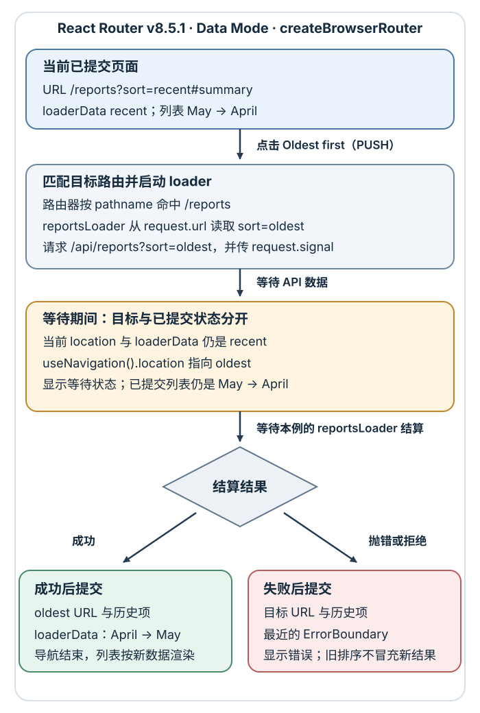

# React 路由怎样把地址映射到界面并加载数据？

**合成案例。** 用户先打开Uniform Resource Locator（统一资源定位符，URL）`/reports?sort=recent#summary`；报表 API（应用程序编程接口）返回 May、April 两行。用户点 **Oldest first** 后，`sort=oldest` 的 API 返回 April、May；地址应新增对应历史项并显示这两行；按浏览器 Back（后退）后，地址和数据应回到 recent 与 May、April。浏览器导航章已经说明 path（路径）、query（查询）和 fragment（片段）怎样影响文档、网络请求与历史；这里接着解释 React Router 如何把这些输入变成路由、loader（加载器）请求和已提交的界面。

本篇以 **React Router v8.5.1 Data Mode（数据模式）**、`createBrowserRouter` 和 `RouterProvider` 为准。案例是浏览器端数据路由：它匹配页面、运行 loader 并显示等待状态；不把 React Router Framework Mode（框架模式）与 Next.js App Router 的路由约定当成同一套 API。

## 路径、查询和片段各自表达什么

同一个地址的三个部分负责不同工作：

| 地址部分 | 本例 | 谁使用它 |
|---|---|---|
| 路径 | `/reports` | 路由器按路径匹配报表页面。`/reports/:reportId` 这样的动态段可匹配单份报表，`useParams()` 读取它。 |
| 查询 | `?sort=recent` 或 `?sort=oldest` | 报表 loader 读取排序条件，再请求对应结果。它也让筛选可复制、刷新和通过历史恢复。 |
| 片段 | `#summary` | 浏览器或客户端用于页面内定位；它不会随 Hypertext Transfer Protocol（超文本传输协议，HTTP）请求发送给服务器。 |

排序只保存在 URL 中。loader 从当前请求 URL 读取 `sort`，组件用已提交的 loader 数据渲染行；若再单独用 React state 保存一份排序值，两份状态就可能在 Back、刷新或直接打开链接时分叉。需要理解 `pushState()`、`popstate` 和片段导航的浏览器层行为，可读[浏览器导航与历史如何恢复筛选状态？](../browser/browser-navigation-and-history.md)。

详情路径 `/reports/:reportId` 用 `useParams()` 读出该份报表的 ID；更深的页面也可以用 `/teams/:teamId/reports/:reportId` 同时匹配团队和报表。下方代码中的详情组件只展示这个参数；真实详情页还应有自己的 loader，按 ID 读取记录，并在记录不存在时抛出 404。列表路由的错误提示不应把未知详情 ID 误报成“列表加载失败”。

## 数据模式先匹配路由，再加载匹配页面的数据

React Router 有三种使用模式。Declarative Mode（声明式模式）负责路径匹配、`Link` 和程序化导航；Data Mode 在路径匹配之外提供 `loader`、`action`（动作处理器）、导航等待状态和路由错误边界；Framework Mode（框架模式）再提供 Route Module API（路由模块 API）、类型生成、代码拆分，以及 single-page application（单页应用，SPA）、server-side rendering（服务端渲染，SSR）和静态渲染策略。它们是同一 React Router 产品的不同接口层；Next.js App Router 有自己的文件路由、Server Components（服务端组件）和服务端数据约定，不能把这里的 loader 代码直接套过去。Framework Mode 的路由模块可提供服务端 loader；本篇的独立 Data Mode 示例让 loader 在浏览器中运行。

路径 `/reports` 命中 route object（路由对象）；`reportsLoader` 从 `request.url` 读取 `sort`，将值带到同源 API，并把 `request.signal` 传给 `fetch`。成功返回的 `{ sort, reports }` 成为匹配路由的 loader data（加载数据），组件用 `useLoaderData()` 读取。`useNavigation()` 则描述当前等待中的导航，适合显示“正在切换到最早顺序…”。这些对象回答不同问题：`useNavigation().location` 是目标地址；`useLoaderData()` 仍是当前已提交页面的数据。

首次直接打开页面时还没有已提交的 loader data，`useNavigation()` 不表示这次初始化读取。本例在 `/reports` route object 上配置 `HydrateFallback`，让首次等待显示“正在首次读取报表…”。Fallback 仍渲染与最终页面相同的 `<main>` 和 `h1#summary`，因此首次 URL 的片段定位在 loader 等待期间已有目标；后续导航才由 `useNavigation()` 显示新目标，同时保留旧列表。

下表中的 recent / oldest 表示完整地址中的 `sort` 值，路径仍为 `/reports`、片段仍为 `#summary`。

| 时点 | 浏览器地址与历史 | 屏幕上的内容 |
|---|---|---|
| 首次打开，等待 recent loader | recent；已有初始文档历史项 | 还没有列表；`HydrateFallback` 显示首次读取状态。 |
| 首次加载完成 | recent | May → April，没有等待提示。 |
| 点击 **Oldest first**（PUSH），等待 loader | 仍为 recent；目标历史项尚未提交 | 仍为 May → April，提示正在切换到 oldest。 |
| oldest loader 成功 | 提交 oldest 地址，新增历史项 | April → May，结束等待。 |
| oldest loader 失败 | 仍提交 oldest 地址和历史项 | `ErrorBoundary` 显示错误，替换旧列表。 |
| 等 oldest 成功后按 Back（POP），等待 loader | 浏览器先回到 recent 历史项 | 暂留 April → May，显示正在加载的提示。 |

这张表假设第一次 recent 加载成功，而且用户等到 oldest 导航结束后才按 Back。PUSH 的加载阶段不会先把新地址写入已提交的路由状态；POP 则由浏览器先移动现有历史指针，因此地址栏会先变。两种导航在 loader 结算前都能通过 `useNavigation().location` 读到目标地址，但当前路由组件仍依据旧的已提交 loader data 渲染。POP 的 loader 结算后，才换为 recent 列表或它对应的错误界面。这里会重读旧 URL，不保证恢复首次访问时的数据快照。

本例的排序链接保留 `#summary`。若根组件挂载 Data Mode 提供的 `<ScrollRestoration />`，对于本例普通 GET 导航，它会管理窗口滚动：有保存位置时恢复该位置；没有保存位置时先尝试滚到目标 fragment 的元素，否则回到页面顶部。默认位置键是本次 location 的 `key`，位置存于 `sessionStorage`。因此最近一次按 Back 可恢复之前保存的 recent 滚动位置；若尚无保存位置，则 `#summary` 提供定位目标。该组件只管理窗口滚动；自定义滚动容器仍由应用负责。`<Link preventScrollReset />` 可阻止新位置在无法恢复位置时回到顶部，但不关闭 Back/Forward 的位置恢复。

在 v8.5.1 中，如果 pathname 和查询不变，且导航只是从无片段变为有片段，或把一个非空片段换成另一个非空片段，在没有显式重验证时，路由器会直接提交新位置而不运行 loader。移除已有片段（例如 `#other` 变为空）不走这个快速路径，而继续按默认规则重验证；本例会再次读取同一个排序。查询变化也默认让相关 loader 重验证；链接上的 `defaultShouldRevalidate` 可改变默认重验证值；若路由定义了 `shouldRevalidate`，它会收到这个值并作最终决定。调整时必须确认不会跳过实际影响结果的 `sort`。

一个 loader 的核心工作可归纳为：

1. 从本次导航的 `request.url` 解析并校验 `sort`；不要把 URL 输入直接当作任意服务端查询值。
2. 按该值构造 `/api/reports?sort=…`，传递 `request.signal`，等待响应。
3. 检查 HTTP 状态并验证返回行；成功时返回与这个排序对应的 `{ sort, reports }`。
4. 组件只从 `useLoaderData()` 取已提交结果；等待中的目标由 `useNavigation()` 提供。

完整实现放在下方折叠示例中。运行它时，应用需挂载一次 `App`，同源 `GET /api/reports?sort=…` 需返回 `{ id, period, title }` 组成的 JSON 数组；React Router v8.5.1 的 peer 约束要求 `react` 与 `react-dom` 均为 19.2.7 或更高。部署时，直接打开或刷新 `/reports` 必须由站点入口返回应用文档；`/api/reports` 仍由 API 应答，不能被同一个 HTML fallback 吞掉。

> [!example]- 完整 Data Mode 路由实现（loader、等待状态、失败重试与滚动恢复）
>
> ~~~tsx
> import {
>   createBrowserRouter,
>   data,
>   isRouteErrorResponse,
>   Link,
>   Outlet,
>   ScrollRestoration,
>   useLoaderData,
>   useNavigation,
>   useParams,
>   useRevalidator,
>   useRouteError,
>   type LoaderFunctionArgs
> } from "react-router";
> import { RouterProvider } from "react-router/dom";
>
> type SortOrder = "recent" | "oldest";
> type Report = { id: string; period: string; title: string };
>
> function isReport(value: unknown): value is Report {
>   if (typeof value !== "object" || value === null) return false;
>   const row = value as Record<string, unknown>;
>   return typeof row.id === "string" &&
>     typeof row.period === "string" &&
>     typeof row.title === "string";
> }
>
> function parseReports(value: unknown): Report[] {
>   if (!Array.isArray(value)) {
>     throw data("报表服务返回的不是列表", { status: 502 });
>   }
>   return (value as unknown[]).map(row => {
>     if (!isReport(row)) {
>       throw data("报表服务返回了无效行", { status: 502 });
>     }
>     return row;
>   });
> }
>
> async function reportsLoader({ request }: LoaderFunctionArgs) {
>   const pageUrl = new URL(request.url);
>   const rawSort = pageUrl.searchParams.get("sort") ?? "recent";
>   if (rawSort !== "recent" && rawSort !== "oldest") {
>     throw data({ kind: "unsupported-sort" }, { status: 400 });
>   }
>   const sort: SortOrder = rawSort;
>
>   const apiUrl = new URL("/api/reports", pageUrl.origin);
>   apiUrl.searchParams.set("sort", sort);
>   const response = await fetch(apiUrl, { signal: request.signal });
>   if (!response.ok) {
>     throw data("报表读取失败", { status: response.status });
>   }
>
>   const payload: unknown = await response.json();
>   return { sort, reports: parseReports(payload) };
> }
>
> function Root() {
>   return (
>     <>
>       <Outlet />
>       <ScrollRestoration />
>     </>
>   );
> }
>
> function ReportsPage() {
>   const { sort, reports } = useLoaderData<typeof reportsLoader>();
>   const navigation = useNavigation();
>   const loading = navigation.state !== "idle";
>   const pendingSort = navigation.location
>     ? new URLSearchParams(navigation.location.search).get("sort")
>     : null;
>
>   return (
>     <main>
>       <h1 id="summary">报表</h1>
>       <nav aria-label="报表排序">
>         <Link
>           to="/reports?sort=recent#summary"
>           aria-current={sort === "recent" ? "page" : undefined}
>         >
>           Recent
>         </Link>
>         {" · "}
>         <Link
>           to="/reports?sort=oldest#summary"
>           aria-current={sort === "oldest" ? "page" : undefined}
>         >
>           Oldest first
>         </Link>
>       </nav>
>       {loading && (
>         

>           {pendingSort === "oldest" ? "正在切换到最早顺序…" : "正在加载所选排序…"}
>         

>       )}
>       <ol aria-label="报表" aria-busy={loading}>
>         {reports.map(report => (
>           <li key={report.id}>
>             <Link to={"/reports/" + encodeURIComponent(report.id)}>
>               {report.period} — {report.title}
>             </Link>
>           </li>
>         ))}
>       </ol>
>     </main>
>   );
> }
>
> function ReportDetail() {
>   const { reportId } = useParams();
>   return <h1>报表 ID：{reportId}</h1>;
> }
>
> function ReportsHydrateFallback() {
>   return (
>     <main>
>       <h1 id="summary">报表</h1>
>       
正在首次读取报表…

>     </main>
>   );
> }
>
> function ReportsErrorBoundary() {
>   const error = useRouteError();
>   const revalidator = useRevalidator();
>   const status = isRouteErrorResponse(error) ? error.status : undefined;
>   const errorData = isRouteErrorResponse(error) ? error.data : undefined;
>   const unsupportedSort = status === 400 &&
>     typeof errorData === "object" && errorData !== null &&
>     "kind" in errorData && errorData.kind === "unsupported-sort";
>
>   return (
>     <section>
>       

>         {unsupportedSort ? "不支持这个排序方式。" : "报表列表暂时无法显示。"}
>       

>       {(!isRouteErrorResponse(error) || (status !== undefined && status >= 500)) && (
>         <button
>           type="button"
>           onClick={() => { void revalidator.revalidate(); }}
>           disabled={revalidator.state !== "idle"}
>         >
>           重新加载
>         </button>
>       )}
>     </section>
>   );
> }
>
> const router = createBrowserRouter([
>   {
>     path: "/",
>     Component: Root,
>     children: [
>       {
>         path: "reports",
>         loader: reportsLoader,
>         Component: ReportsPage,
>         HydrateFallback: ReportsHydrateFallback,
>         ErrorBoundary: ReportsErrorBoundary
>       },
>       { path: "reports/:reportId", Component: ReportDetail },
>       { path: "*", Component: () => <h1>页面不存在</h1> }
>     ]
>   }
> ]);
>
> export function App() {
>   return <RouterProvider router={router} />;
> }
> ~~~
>
> 报表数组的结构检查只说明客户端接收到的 JSON 符合本例需要的字段；它不是身份、授权或数据完整性的服务端边界。

## 请求取消、过期响应与错误边界

若用户在 oldest loader 尚未完成时又发起另一条导航，React Router 会中断前一轮导航并处理新目标。传入底层 `fetch` 的 `request.signal` 会在导航被打断时发出 abort（中止）信号；原生 `fetch` 会据此停止该客户端请求，路由器也会丢弃过期导航结果，避免它覆盖更新的界面。该信号能否停止更深层的工作，取决于对应 API 是否遵守取消约定；请求已抵达服务器后，服务器仍可能继续处理。取消客户端读取不能替代服务端写操作的幂等、权限或事务约束。

loader 抛出的状态数据或运行异常交给最近匹配的路由 `ErrorBoundary`；它也能处理匹配路由组件树中由 React 边界捕获的渲染错误，以及子组件 Effect setup 同步抛出的异常。按钮事件处理器或 timer（定时器）中随后产生的 Promise 拒绝仍须在触发处处理，详见[React 错误边界能恢复哪些失败？](./react-error-boundaries.md)。因此本例 `sort=other` 的本地标记 400 显示参数错误；API 返回的非成功状态（包括 400）或网络失败显示列表错误，只有 5xx 与非路由异常提供重试按钮。`useRevalidator()` 用于这类页面外部原因的重读，例如聚焦窗口或轮询；这里把它用作明确的“重新加载”按钮。表单 action、`Form`、`useFetcher` 和 `useSubmit` 的正常写入会自动触发页面数据重验证，不应为普通增删改重复手动刷新。若还要理解组件事件处理器、timer（定时器）与 Promise 拒绝分别在哪一层恢复，见[JavaScript 错误应在哪一层恢复、传播或上报？](../javascript/error-handling.md)。

传给 loader 的 `request.url` 不含 fragment，但它仍是包含来源、路径和查询的完整 URL；片段留在客户端位置。按 v8.5.1 的上述规则，添加或替换非空片段通常不重读同一报表，移除片段会回到默认重验证判定。本例的排序改变了 loader 输入，所以必须按目标查询读取结果。若把 loader 改为多个嵌套路由，还要检查每个匹配路由的默认重验证条件，不能从“只改排序”推断所有其他 loader 都不会运行。

## 客户端导航与整页导航怎么选

同一应用内的 `Link` 用客户端路由切换，保留浏览器 `<a href>` 的链接语义；外部 URL、下载或明确要浏览器请求另一份完整文档时，使用普通 `<a>`，或对路由链接设置 `reloadDocument`。普通链接通常把当前项留在历史里并新增目标项；要替换当前项可用 `replace`。`useNavigate()` 适合提交成功后的程序化跳转，`useLocation()` 读取已经提交的当前位置。不要在 Link 处理之外手动再调用 `history.pushState()`，否则路由器和应用会争夺历史状态。

客户端导航保留文档，不会让服务器重新发送整个 HTML；所以服务器仍需把直接打开的应用路径（如 `/reports`）交给应用入口，并让 `/api/reports` 继续交给 API。SPA 与 multi-page application（多页应用，MPA）描述页面间导航的常见方式；服务端渲染（SSR）或静态预渲染说明初始文档怎样产生，这是不同维度，可以组合。若需要爬虫或不执行 JavaScript 的读者直接看到内容，首先要让初始 HTML 包含这些内容；后续点击仍可采用客户端导航。需要共享布局和路由内数据交互时，客户端导航更容易保留上下文。React Router Framework Mode 提供这些渲染策略；本篇示例仍是独立的 Data Mode 浏览器路由。Next.js App Router 的文件段、`page` / `layout`、服务端组件与缓存按[Next.js 如何把文件路由、服务端数据与客户端交互连接起来？](./next-js.md)解释，不能将两者的 loader、服务端执行边界或导航 API 互换。

若部署环境不能提供路径回退，可用 Data Mode 的 `createHashRouter` 并继续传给 `RouterProvider`，保留本例的 loader 和错误边界；它把应用路径放进 URL 片段，因此地址形式会变，`#summary` 也不能再单独占用片段作为普通页面锚点。测试或非浏览器环境可用 `createMemoryRouter`，它以内存历史运行并保留数据路由能力。`HashRouter` 和 `MemoryRouter` 属于 Declarative Mode，直接替换会失去本例使用的 loader。

### 旧版路由代码怎样对应这里的概念

旧课程固定使用 `react-router-dom@6.3.0`：`BrowserRouter` 提供浏览器历史上下文，`Routes` 选择匹配分支，`Route` 的 `element` 指定要显示的元素。下面只展示旧版声明方式，`ReportsLayout` 和 `ReportDetail` 代表应用组件：

~~~jsx
import { BrowserRouter, Routes, Route } from "react-router-dom";

<BrowserRouter>
  <Routes>
    <Route path="reports" element={<ReportsLayout />}>
      <Route path=":reportId" element={<ReportDetail />} />
    </Route>
  </Routes>
</BrowserRouter>
~~~

访问 `/reports/42` 时，布局中的 `Outlet` 显示详情；详情调用 `useParams()` 得到字符串 `reportId="42"`。`Link`、`useNavigate()`、`useLocation()` 分别承担链接导航、程序化导航和读取位置，多个 `:参数` 各自进入参数对象。6.3.0 的这套声明不提供本篇 Data Mode 的 loader；读取数据还要由应用负责。这里保留旧版识别入口，当前主例仍按前文的版本和模式运行。

旧 React Router v5 代码中的 `component={Post}`、`withRouter` 与 `match.params` 属于旧路由上下文；旧版 `StaticRouter` 的固定 location 服务端匹配也不能直接当作当前 Framework Mode 的服务端入口。维护旧项目时先查看它实际安装的主版本，按对应版本文档处理，不要把 v5 API 混入这里的 v8 route object。

React 本身的状态提交与一次用户操作如何变成画面，见[React 如何把一次用户操作变成界面更新？](./react-basics.md)；若同一报表还需要查询缓存、乐观更新和账户隔离，见[React 界面如何维护服务端数据与乐观更新的正确性？](./react-server-state-and-optimistic-updates.md)。

> [!info]- 来源与版本核验（截至 2026-11-13）
> - 旧课程锁定版本的包名、声明式路由、Outlet、参数和导航接口：[React Router v6.3.0 API](https://raw.githubusercontent.com/remix-run/react-router/v6.3.0/docs/api.md)。
> - React Router 当前稳定文档选择器显示 v8.5.1；Changelog 将 v8.5.1 标为 2026-10-27 发布：[React Router Changelog](https://reactrouter.com/changelog)。
> - 三种模式及其能力范围：[Picking a Mode（v8.5.1）](https://raw.githubusercontent.com/remix-run/react-router/refs/tags/react-router@8.5.1/docs/start/modes.md)；Framework 服务端 loader 与 clientLoader 的区别见 [Framework Data Loading（v8.5.1）](https://raw.githubusercontent.com/remix-run/react-router/refs/tags/react-router@8.5.1/docs/start/framework/data-loading.md)。
> - Data Mode 路由对象、loader、查询参数变化时的默认重验证：[Route Object（v8.5.1）](https://raw.githubusercontent.com/remix-run/react-router/refs/tags/react-router@8.5.1/docs/start/data/route-object.md)、[Data Loading（v8.5.1）](https://raw.githubusercontent.com/remix-run/react-router/refs/tags/react-router@8.5.1/docs/start/data/data-loading.md)。
> - 浏览器数据路由与路由器的创建边界：[createBrowserRouter（v8.5.1）](https://raw.githubusercontent.com/remix-run/react-router/refs/tags/react-router@8.5.1/docs/api/data-routers/createBrowserRouter.md)、[useLoaderData（v8.5.1）](https://raw.githubusercontent.com/remix-run/react-router/refs/tags/react-router@8.5.1/docs/api/hooks/useLoaderData.md)、[useNavigation（v8.5.1）](https://raw.githubusercontent.com/remix-run/react-router/refs/tags/react-router@8.5.1/docs/api/hooks/useNavigation.md)。
> - 外部原因的显式重读、action 成功后的自动重验证，以及默认规则的覆盖方式：[useRevalidator（v8.5.1）](https://raw.githubusercontent.com/remix-run/react-router/refs/tags/react-router@8.5.1/docs/api/hooks/useRevalidator.md)、[Actions（v8.5.1）](https://raw.githubusercontent.com/remix-run/react-router/refs/tags/react-router@8.5.1/docs/start/data/actions.md)、[Revalidation Optimization（v8.5.1）](https://raw.githubusercontent.com/remix-run/react-router/refs/tags/react-router@8.5.1/docs/how-to/optimize-revalidation.md)。
> - Data Mode 的路由错误处理与错误边界：[Error Boundaries（v8.5.1）](https://raw.githubusercontent.com/remix-run/react-router/refs/tags/react-router@8.5.1/docs/how-to/error-boundary.md)。
> - 首次数据读取期间的 `HydrateFallback` 与路由属性：[createBrowserRouter（v8.5.1）](https://reactrouter.com/api/data-routers/createBrowserRouter)、[Route（v8.5.1）](https://reactrouter.com/api/components/Route)。
> - 保留 Data Mode 能力的哈希和内存路由器：[createHashRouter（v8.5.1）](https://reactrouter.com/api/data-routers/createHashRouter)、[createMemoryRouter（v8.5.1）](https://reactrouter.com/api/data-routers/createMemoryRouter)。
> - 片段变化时的 loader 快速路径与默认重验证判定：[v8.5.1 路由器实现](https://github.com/remix-run/react-router/blob/react-router%408.5.1/packages/react-router/lib/router/router.ts#L7126)。
> - loader / fetcher 请求取消、过期重验证与服务端可能继续处理：[Race Conditions（v8.5.1）](https://raw.githubusercontent.com/remix-run/react-router/refs/tags/react-router@8.5.1/docs/explanation/race-conditions.md)。
> - 页面内链接、fragment 和滚动恢复 API：[Link（v8.5.1）](https://raw.githubusercontent.com/remix-run/react-router/refs/tags/react-router@8.5.1/docs/api/components/Link.md)、[ScrollRestoration（v8.5.1）](https://raw.githubusercontent.com/remix-run/react-router/refs/tags/react-router@8.5.1/docs/api/components/ScrollRestoration.md)；hash 定位、位置保存与恢复流程另核对了[同版本实现](https://github.com/remix-run/react-router/blob/react-router%408.5.1/packages/react-router/lib/dom/lib.tsx)。
