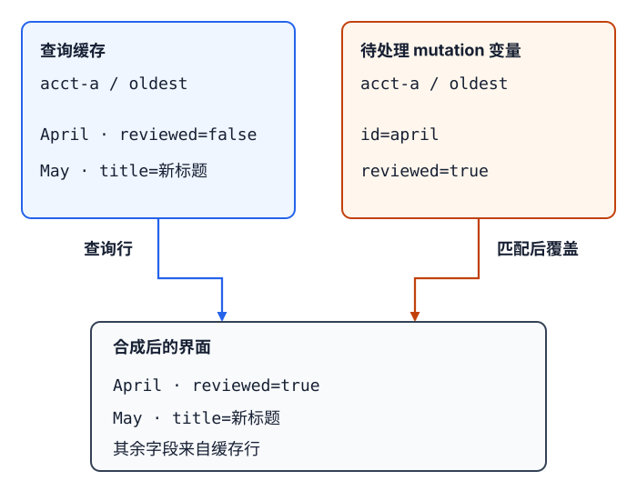

# React界面如何维护服务端数据与乐观更新的正确性？

**案例背景。** 报表路由当前账户为 `acct-a`，地址是 `/reports?sort=recent#summary`，服务端给出 May、April 两行。点击 **Oldest first** 后，路由把 `sort` 推入浏览器历史，当前排序变为 April、May；此时 UI（界面）可以先在完整的同账户记录上本地排序，再等待对应查询确认。服务端拥有报表，TanStack Query 的查询缓存只是客户端副本。账户 ID 和会改变结果的筛选条件都属于查询身份：切到 `acct-b` 时，查询键随账户改变；若没有匹配的 B 账户路由行或缓存，就先显示等待/空状态，绝不能把 A 账户的行当作 B 的结果。

浏览器请求会带路径和 `?sort=recent`，不会带 `#summary`；片段只供客户端定位。地址栏、前进/后退与查询状态如何连接由[浏览器导航路径](../browser/browser-navigation-and-history.md#让排序状态跟随地址栏与前进后退)负责。本例只接收路由解析出的 `accountId`、当前 `sort`、匹配的初始数据和排序回调；`pushState`、`popstate` 订阅及路由库由调用方实现。使用 `useQuery` 的组件还须位于 `<QueryClientProvider>` 下，查询/保存函数由应用提供网络适配器；示例不创建这些接线。

## 排序值构成查询身份

`queryKey`（查询键）描述 `queryFn`（查询函数）将取回的结果。这里响应取决于 `accountId` 和 `sort`，所以两者都在 key 中；同一账户的排序列表放在共同前缀下，失效时可只刷新该账户的列表。若再加改变记录集合的过滤条件或页码，也要把它加入 key。

| 阶段 | 当前身份 | 列表与提示 |
| --- | --- | --- |
| 初始路由 | `['reports', 'acct-a', 'list', 'recent']` | 路由给出的 May、April 只种入匹配的账户与排序；`initialData` 可直接显示。 |
| 点击 Oldest first | URL/路由状态先变为 `sort='oldest'`；key 变为 `['reports', 'acct-a', 'list', 'oldest']` | 若这个 key 没有缓存，当前请求等待时只在同账户、同一完整记录集合上把路由行排成 April、May；这批本地行不是该 key 的服务端确认结果，行操作保持禁用。 |
| Oldest 响应到达 | 只更新 `acct-a/oldest` | 列表换成该 key 的服务端数据。先前 `recent` 的请求即使完成，也只能写入 `recent` key；若 query function 消费了取消信号，它也可能在离开 key 时被取消。 |
| 切换到账户 B | `['reports', 'acct-b', 'list', sort]` | key 与页面身份都含账户。若没有匹配的 B 路由行/缓存，先等待或显示空状态，不能把 A 账户的 May、April 当作 B 数据。 |

路由把当前 URL 的排序解析为 `sort`，调用方提供的 `onSortChange` 负责用 `pushState` 新增历史项；浏览器 Back 产生 `popstate` 后，调用方把旧 `sort` 传回，查询 key 随之切回。本例只消费这些路由输入和回调，不实现上述 History API 逻辑。这里保留 `#summary` 只是说明它不参与服务器请求或 query key；只有客户端明确把片段映射为请求参数时，映射后的值才成为查询输入。

路由提供的完整报表行只作为 `initialSort`、`initialAccountId` 对应查询的 `initialData`（初始数据）；其他排序/账户不接收这份缓存种子。TanStack Query v5 会把 `initialData` 写入查询缓存，并按新鲜度策略处理；若路由还给出这批数据的生成时间，就用 JavaScript 毫秒时间戳传入 `initialDataUpdatedAt`，否则客户端会把初始化时刻当成数据时间。30 秒 `staleTime`（新鲜期）只是客户端在该窗口内避免按过期策略自动重取，不承诺服务器数据没有变化；失效仍可强制校准。

`placeholderData`（占位数据）用途不同：它不写入 cache，结果带 `isPlaceholderData` 标记。若为了平滑排序而复用上一 key 的行，应先确认上一 key 的账户仍是当前账户，并在界面标明它还不是新排序的服务端确认；绝不能用上一账户的数据作占位。本文主示例不用这个选项，而是在数据成员完全相同的同账户列表上做本地排序。

本文使用普通 TanStack Query v5 `useQuery` 的状态返回路径，没有设置 `throwOnError`：请求失败保存在 `isError`、`error`、`data` 中。若应用改为抛错配置或 Suspense 查询，失败会走不同界面路径，见[错误边界章节](./react-error-boundaries.md)。没有当前 key 数据时会先处于 `isPending`；失败则检查 `isError` 与 `data`：无 query data 时保留同账户路由行（若有）并允许重试，有上次成功结果时保留结果并提示刷新失败。切换排序后若该 key 已有缓存，可以先显示缓存，再按 `staleTime` 等策略后台校准。

## 变更先乐观显示，再与服务端协调

在 `acct-a/oldest` 已显示服务端确认数据时，点击 April 行的 **Mark reviewed**。事件把 `{ accountId: "acct-a", sort: "oldest", id: "april", reviewed: true }` 交给 mutation（服务端变更）。等待保存时，TanStack Query 暴露这份待处理变量；组件按账户、排序和行 ID 把 April 的 `reviewed` 暂时显示为 `true`，查询缓存仍保存上次服务端确认的行。

**保存期间：缓存行与匹配的待处理变量合成界面**

图中展示已回放失败分支在保存仍 pending 时的合成结果：焦点重取先把新 April、May 写入缓存。下表再展开后续时序；保存请求和 `onSettled` 发起的重取都失败，因此 cache 保留那次焦点重取的结果。

| 时点 | `acct-a/oldest` 的 query cache；匹配的 mutation variable | 界面 |
| --- | --- | --- |
| 焦点重取到达，保存仍 pending | April `reviewed=false`；May 是新标题。变量为 April `reviewed=true`。 | April 显示 `true`；May 保留新标题。 |
| 保存请求失败，`onSettled` 重取中 | cache 不变；变量仍 pending。 | April 仍显示 `true`；May 仍保留新标题。 |
| `onSettled` 重取结束 | 该重取失败，cache 保留上次成功值；pending 变量解除。 | overlay 消失，April 回到 `false`；May 新标题仍在。旧整表快照没有把列表恢复成旧值。 |

1. `submit` 先用共享 QueryClient 检查是否已有这类保存，再启动 mutation；所有行按钮在待处理期间禁用。这个示例主动限制为一次报表标记操作，不让其它调用入口绕过 `submit`。
2. 保存期间发生后台重取时，查询缓存可以照常接收服务器结果；界面层的待处理变量仍盖住 April 的标记。保存请求失败后，mutation 仍等待 `onSettled` 的失效重取收尾；在它退出 pending 前，overlay 继续盖住标记。pending 结束时覆盖消失，列表保留当时可用的查询结果或同账户路由备用数据；不会以旧整表快照覆盖新结果。
3. 保存成功时，`onSuccess` 根据这次提交的 `accountId` 和 `sort` 找到原查询 key，并用服务器返回的 April 行更新缓存。`onSettled` 失效该账户的列表前缀：在本例联网且活跃查询可运行时，匹配的活跃查询会立即重取；非活跃排序只会标为失效、等下次使用再读取。回调返回的 Promise 完成前 mutation 仍处于 pending。

这条成功路径假设保存后发起的列表读取能看到刚才的提交。等待失效重取完成，本身不提供 read-your-writes（读己之写）保证：若它读的是落后副本，仍可能把已确认的新行换回旧值。这种接口需让校准读取到达权威数据源，或按服务端提供的修订号拒绝低于已确认版本的结果；仅延长 overlay 不能修复读取契约。

完整组件只消费路由 props、路由排序回调、provider 和网络适配器；不实现 `pushState`、`popstate` 或客户端创建：

> [!example]- 报表查询与乐观更新组件（TanStack Query v5）
>
> ~~~tsx
> import {
>   useIsMutating,
>   useMutation,
>   useMutationState,
>   useQuery,
>   useQueryClient
> } from "@tanstack/react-query";
>
> type SortOrder = "recent" | "oldest";
> type Report = {
>   id: string;
>   period: string;
>   periodStart: string; // 规范化的 YYYY-MM-DD，可按字典序排序
>   title: string;
>   reviewed: boolean;
> };
>
> const reportKeys = {
>   lists: (accountId: string) =>
>     ["reports", accountId, "list"] as const,
>   list: (accountId: string, sort: SortOrder) => [
>     ...reportKeys.lists(accountId),
>     sort
>   ] as const,
>   markReviewed: () => ["reports", "mark-reviewed"] as const
> };
>
> type MarkReviewed = {
>   accountId: string;
>   sort: SortOrder;
>   id: string;
>   reviewed: boolean;
> };
>
> declare function fetchReports(
>   accountId: string,
>   sort: SortOrder,
>   signal: AbortSignal
> ): Promise<Report[]>;
> declare function saveReviewed(
>   accountId: string,
>   id: string,
>   reviewed: boolean
> ): Promise<Report>;
>
> function sortReports(reports: Report[], sort: SortOrder) {
>   return [...reports].sort((a, b) => {
>     const order = a.periodStart.localeCompare(b.periodStart);
>     return sort === "recent" ? -order : order;
>   });
> }
>
> type ReportsRouteProps = {
>   accountId: string; // 当前已登录/选中的账户
>   sort: SortOrder; // 路由从 URL 解析
>   onSortChange: (sort: SortOrder) => void; // 路由写入 pushState
>   initialAccountId: string;
>   initialSort: SortOrder;
>   initialReports: Report[];
>   initialReportsUpdatedAt: number | undefined;
> };
>
> function useReports({
>   accountId,
>   sort,
>   initialAccountId,
>   initialSort,
>   initialReports,
>   initialReportsUpdatedAt
> }: Pick<ReportsRouteProps,
>   | "accountId"
>   | "sort"
>   | "initialAccountId"
>   | "initialSort"
>   | "initialReports"
>   | "initialReportsUpdatedAt"
> >) {
>   const routeDataMatchesQuery =
>     accountId === initialAccountId && sort === initialSort;
>
>   return useQuery({
>     queryKey: reportKeys.list(accountId, sort),
>     queryFn: ({ signal }) =>
>       fetchReports(accountId, sort, signal),
>     initialData: routeDataMatchesQuery
>       ? initialReports
>       : undefined,
>     initialDataUpdatedAt: routeDataMatchesQuery
>       ? initialReportsUpdatedAt
>       : undefined,
>     staleTime: 30_000
>   });
> }
>
> function useMarkReviewed() {
>   const client = useQueryClient();
>   const mutation = useMutation({
>     mutationKey: reportKeys.markReviewed(),
>     mutationFn: (change: MarkReviewed) =>
>       saveReviewed(
>         change.accountId,
>         change.id,
>         change.reviewed
>       ),
>     onSuccess: (saved, change, _result, context) => {
>       const key = reportKeys.list(
>         change.accountId,
>         change.sort
>       );
>       context.client.setQueryData<Report[]>(
>         key,
>         rows => rows?.map(row =>
>           row.id === saved.id ? saved : row
>         )
>       );
>     },
>     onSettled: (_data, _error, change, _result, context) =>
>       context.client.invalidateQueries({
>         queryKey: reportKeys.lists(change.accountId)
>       })
>   });
>
>   function submit(change: MarkReviewed) {
>     // 其它入口也必须经过这道提交级门闩。
>     const hasPending = client.isMutating({
>       mutationKey: reportKeys.markReviewed()
>     }) > 0;
>     if (hasPending) return;
>     mutation.mutate(change);
>   }
>
>   return {
>     isError: mutation.isError,
>     isPending: mutation.isPending,
>     submit
>   };
> }
>
> function ReportsRoute(props: ReportsRouteProps) {
>   return <ReportsPage key={props.accountId} {...props} />;
> }
>
> function ReportsPage({
>   accountId,
>   sort,
>   onSortChange,
>   initialAccountId,
>   initialReports,
>   ...route
> }: ReportsRouteProps) {
>   const query = useReports({
>     accountId,
>     sort,
>     initialAccountId,
>     initialSort: route.initialSort,
>     initialReports,
>     initialReportsUpdatedAt: route.initialReportsUpdatedAt
>   });
>   const update = useMarkReviewed();
>   const isSavingReviewed = useIsMutating({
>     mutationKey: reportKeys.markReviewed()
>   }) > 0;
>   const hasRouteRowsForAccount =
>     accountId === initialAccountId;
>   const confirmedReports = query.data ?? (
>     hasRouteRowsForAccount
>       ? sortReports(initialReports, sort)
>       : []
>   );
>   const pendingChanges = useMutationState<MarkReviewed>({
>     filters: {
>       mutationKey: reportKeys.markReviewed(),
>       status: "pending"
>     },
>     select: mutation =>
>       mutation.state.variables as MarkReviewed
>   });
>   const visibleReports = confirmedReports.map(report => {
>     const pending = pendingChanges.find(change =>
>       change.accountId === accountId &&
>       change.sort === sort &&
>       change.id === report.id
>     );
>     return pending
>       ? { ...report, reviewed: pending.reviewed }
>       : report;
>   });
>
>   return (
>     <section>
>       

>         <button
>           type="button"
>           onClick={() => onSortChange("recent")}
>         >
>           Most recent first
>         </button>
>         <button
>           type="button"
>           onClick={() => onSortChange("oldest")}
>         >
>           Oldest first
>         </button>
>       

>
>       {query.isPending && (
>         

>           {hasRouteRowsForAccount
>             ? "正在等待服务端确认当前排序…"
>             : "正在读取当前账户的报表…"}
>         

>       )}
>       {query.isFetching && !query.isPending && (
>         
正在更新当前账户的报表…

>       )}
>       {query.isError && (
>         

>           

>             {query.data === undefined
>               ? hasRouteRowsForAccount
>                 ? "确认失败；仍显示同账户的路由报表。"
>                 : "读取失败；尚无当前账户的报表数据。"
>               : "刷新失败；仍显示上次成功的结果。"}
>           

>           <button
>             type="button"
>             onClick={() => query.refetch()}
>           >
>             重试读取
>           </button>
>         

>       )}
>       {update.isError && (
>         

>           保存失败；已撤去这次待处理显示，
>           列表保留当前可用结果，可再次提交。
>         

>       )}
>       {update.isPending && (
>         
正在保存报表更改…

>       )}
>
>       

>         <ul>
>           {visibleReports.map(report => (
>             <li key={report.id}>
>               {report.period} — {report.title}
>               
>                 {report.reviewed
>                   ? "Reviewed"
>                   : "Not reviewed"}
>               
>               <button
>                 type="button"
>                 disabled={
>                   !query.data ||
>                   query.isPlaceholderData ||
>                   report.reviewed ||
>                   isSavingReviewed
>                 }
>                 onClick={() => update.submit({
>                   accountId,
>                   sort,
>                   id: report.id,
>                   reviewed: true
>                 })}
>               >
>                 Mark reviewed
>               </button>
>             </li>
>           ))}
>         </ul>
>       

>     </section>
>   );
> }
> ~~~

`<QueryClientProvider>` 应在 `ReportsRoute` 的祖先位置提供同一个 QueryClient；`fetchReports` 与 `saveReviewed` 是应用适配器，需要检查 HTTP 响应并将 JSON 作为 `unknown`（尚未验证的数据）运行时校验，TypeScript 声明不会验证网络值。结构合法还不够：保存响应必须对应本次账户和行。本例由已授权的请求资源范围绑定账户，适配器再确认返回的 `saved.id` 等于提交的 `id`；不匹配就按错误处理，不能交给 `onSuccess` 更新另一行。

代码中的 query function 读取 `signal`（取消信号）并交给 `fetchReports`：适配器把它继续传给 `fetch` 才能中止底层请求；适配器忽略时网络仍可能完成，但已取消的查询状态不会接收该结果。若 query function 连 signal 都不读取，离开页面的请求通常可完成并写入自己的旧 key。客户端取消不能承诺服务器停止执行。

排序例子只在记录成员完全相同的 May/April 全列表上本地重排。若账户、筛选、搜索词或页码改变了集合，就不能把旧集合重排后称为当前结果；切换期间应显示当前查询缓存或等待状态。若有上一排序/账户的占位值，必须确认账户身份相同并标出 `isPlaceholderData`，且不允许在占位行上操作。

`staleTime: 30_000` 与“服务端 30 秒内不变”不是一回事。TanStack Query v5 的过期查询可按挂载、窗口重新聚焦或网络恢复等策略后台读取；手动失效也能要求刷新。若用户改了 URL 中的 `sort` 并点击 Back，路由状态应回到原值，query key 也切回对应缓存；`replaceState` 不会像 `pushState` 那样为每次用户选择新增可回退历史项。

## 整表快照回滚的前提与竞态

另一种乐观更新会在 `onMutate` 中先改查询缓存并保存整表快照，失败时用快照回滚，成功时把服务器行写回该 key。下面保留这组回调，作为列表 key 在变更期间确实独占时可用的方案：

~~~tsx
onMutate: async (change: MarkReviewed, context) => {
  const key = reportKeys.list(change.accountId, change.sort);
  await context.client.cancelQueries({
    queryKey: key,
    exact: true
  });
  const previous = context.client.getQueryData<Report[]>(key);
  context.client.setQueryData<Report[]>(key, rows =>
    rows?.map(row => row.id === change.id
      ? { ...row, reviewed: change.reviewed }
      : row)
  );
  return { key, previous };
},
onError: (_error, _change, snapshot, context) => {
  if (snapshot?.previous !== undefined) {
    context.client.setQueryData(snapshot.key, snapshot.previous);
  }
},
onSuccess: (saved, _change, snapshot, context) => {
  if (snapshot) {
    context.client.setQueryData<Report[]>(snapshot.key, rows =>
      rows?.map(row => row.id === saved.id ? saved : row)
    );
  }
}
~~~

这组快照回调只有在同一列表 key 没有并行写入，也没有后续重取覆盖乐观值时才可靠。`cancelQueries` 只取消调用时已匹配的读取，不是锁；`staleTime` 到期后的窗口聚焦、轮询或手动 `refetch` 仍能在保存期间更新缓存。实际回放把时钟推进 31 秒后触发聚焦读取：读取先把服务端 April 的 `false` 和 May 的新标题写入缓存，覆盖此前 April 的乐观 `true`；保存失败后，旧整表快照再把 April、May 整体恢复为旧表，May 新标题随之丢失。主示例因此使用界面层 overlay，让 pending 变量覆盖读取结果，不把一次旧快照当成共享缓存的权威值。

主例以同一个 mutation key（变更键）和共享 QueryClient 做一次全局标记门闩：`useIsMutating` 禁用所有报表行按钮，`submit` 再检查是否有同类保存正在处理，并且只暴露 `submit`、状态，不把可绕过门闩的原生 `mutate` 返回给调用方。若允许多行并发提交，`useMutationState` 会返回多份 pending variables，必须按账户、排序、行 ID 过滤，并用 `submittedAt` 或明确的冲突策略决定同一行显示哪次变更；当前门闩刻意不开放这种并发。

查询缓存和页面中任何已确认数据仍是服务端状态的副本，不是授权来源。若同一报表另有详情 key，也要按 `accountId` 更新/失效详情项，不能只修当前列表。切换账号时 query key 会隔离组件读取的缓存项；退出登录或权限范围更换时，若旧账户数据不该留在客户端，再显式移除对应缓存。对不上账户身份的界面 fallback 不应暂时显示旧账户行。

最后，React 手写 `useEffect` 请求要在 cleanup 中忽略过期结果或取消请求；该请求模式与 TanStack Query 的 key/cache 管理由[React 更新轮次中的数据请求](./react-basics.md#effect在提交后同步外部系统)对照学习。有关错误如何从查询状态进入错误边界，见[React 错误边界](./react-error-boundaries.md)。网络 JSON 仍需在运行时校验，见[如何处理不可信 JSON？](../typescript/advanced-typescript.md)。

> [!info]- 来源与版本核验（React 19.3；TanStack Query v5 Latest；核验日期 2026-11-12）
> - Query key 应包含会改变 `queryFn` 结果的变量；此处账户和排序都影响数据：[Query Keys](https://tanstack.com/query/latest/docs/framework/react/guides/query-keys)，TanStack Query v5 Latest。
> - Query function 获取 `AbortSignal`。访问它可让 TanStack Query 取消查询状态；继续传给 transport 才会取消底层请求。手动取消会回滚 query state，但不代表服务器停止处理：[Query Functions](https://tanstack.com/query/latest/docs/framework/react/guides/query-functions)、[Query Cancellation](https://tanstack.com/query/latest/docs/framework/react/guides/query-cancellation)，TanStack Query v5 Latest。
> - `initialData` 写入 cache；`initialDataUpdatedAt` 可提供原数据时间。`placeholderData` 不进 cache，结果带 `isPlaceholderData`：[Initial Query Data](https://tanstack.com/query/latest/docs/framework/react/guides/initial-query-data)、[Placeholder Query Data](https://tanstack.com/query/latest/docs/framework/react/guides/placeholder-query-data)，TanStack Query v5 Latest。
> - 普通 `useQuery` 的 `throwOnError` 与错误状态返回：[useQuery](https://tanstack.com/query/latest/docs/framework/react/reference/functions/useQuery)，TanStack Query v5 Latest。
> - `staleTime` 控制客户端 freshness；stale query 的自动重取入口及按 key 前缀失效：[Important Defaults](https://tanstack.com/query/latest/docs/framework/react/guides/important-defaults)、[Query Invalidation](https://tanstack.com/query/latest/docs/framework/react/guides/query-invalidation)，TanStack Query v5 Latest。
> - mutation 回调收到提交变量，`onSettled` 返回的 Promise 会在 mutation 完成前等待；`useMutationState` 可以读取同 key 的多笔 pending variables，并可选择 `submittedAt`：[useMutation](https://tanstack.com/query/latest/docs/framework/react/reference/functions/useMutation)、[Optimistic Updates](https://tanstack.com/query/latest/docs/framework/react/guides/optimistic-updates)，TanStack Query v5 Latest。
> - Cache optimistic update 和 UI variables overlay 是两种受支持路径；pending variables 可能同时有多笔：[Optimistic Updates](https://tanstack.com/query/latest/docs/framework/react/guides/optimistic-updates)，TanStack Query v5 Latest。
> - `invalidateQueries` 将匹配查询标为 invalidated，默认立即重取活跃查询；非活跃查询留在缓存并等待下次使用：[QueryClient.invalidateQueries](https://tanstack.com/query/latest/docs/framework/react/reference/classes/QueryClient#invalidatequeries)，TanStack Query v5 Latest。
> - `QueryClientProvider` 把一个 QueryClient 提供给子树中的查询组件：[QueryClientProvider](https://tanstack.com/query/latest/docs/framework/react/reference/functions/QueryClientProvider)，TanStack Query v5 Latest。
> - query cache 可以按 query key 前缀移除：[QueryClient](https://tanstack.com/query/latest/docs/framework/react/reference/classes/QueryClient)，TanStack Query v5 Latest。
> - HTTP URI 的 fragment 不作为请求目标发送：[RFC 3986 §3.5](https://www.rfc-editor.org/rfc/rfc3986#section-3.5)。浏览器历史恢复 `sort` 的完整路由流程见[浏览器导航路径](../browser/browser-navigation-and-history.md#让排序状态跟随地址栏与前进后退)。
> - Effect cleanup 防止过期读取写回界面：[Synchronizing with Effects](https://react.dev/learn/synchronizing-with-effects)，React 19.3。
