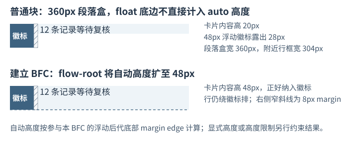
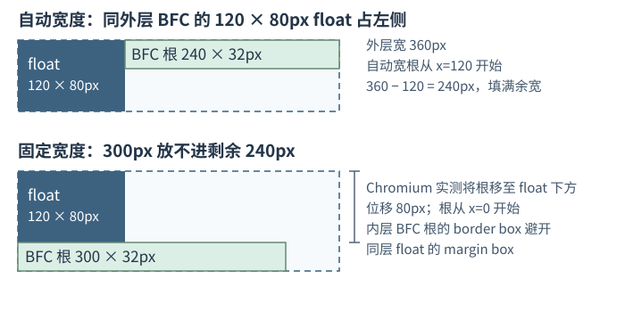
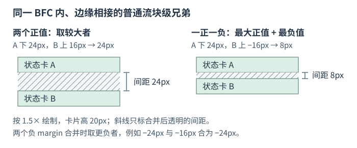
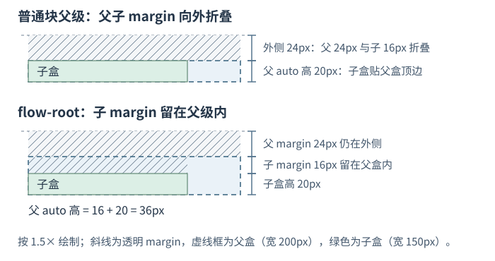

# 块格式化上下文如何约束浮动和外边距？

block formatting context（BFC，块格式化上下文）是一块独立的块级排版区域。建立 BFC 的盒子称为 BFC 根：它的内容在新的格式化上下文里排版，它自己仍按外层的格式化上下文参与布局。

BFC 主要影响两类现象。第一是浮动：float（浮动盒）脱离普通流，但仍会缩窄旁边的 line box（行框）。普通块计算自动高度时不直接算上内部 float 的底边；只有当 float 把行框挤窄、文字因此多出几行时，普通块才会间接变高。BFC 根则不同：高度为 `auto` 时，它会一直延伸到本 BFC 内浮动后代的底部外边距边缘（bottom margin edge）；若设了固定高度或最大高度，仍以这些限制为准。第二是垂直外边距（margin）折叠：BFC 的边界会阻止盒内外的 margin 跨边界折叠。注意，BFC 根本身并不会因此建立堆叠上下文或定位包含块。

下面以一个报表页面为例，依次看摘要卡怎样把内部浮动纳入自动高度、外部浮动怎样影响一个新的 BFC 根，以及相邻 margin 何时折叠。例子都用 <code>display: flow-root</code> 建立 BFC，这是专门为此设计、副作用最少的写法。content、padding、border 与 margin 各层尺寸的算法见[CSS 如何计算元素盒子的尺寸](./box-model-and-bfc.md)。

## 为什么报表卡片里浮动徽标会撑不开父级？

假设摘要卡宽 <code>360px</code>，根字号 <code>16px</code>；徽标宽高各 <code>3rem</code>，右 margin 为 <code>8px</code>；文字行高 <code>20px</code>：

~~~html

  异常
  
共12条记录需要复核。

~~~

~~~css
html { font-size: 16px; }
.summary { width: 360px; background: #f3f6fa; }
.summary.flow-root { display: flow-root; }
.badge {
  float: left;
  inline-size: 3rem;
  block-size: 3rem;
  margin-right: 8px;
}
.summary p { margin: 0; line-height: 20px; }
~~~

徽标是 <code>48 × 48px</code>，加上右侧 <code>8px</code> margin 共占 <code>56px</code>，所以文字旁边的行框宽 <code>360 − 48 − 8 = 304px</code>。文字实测约 <code>162px</code> 宽，一行就能放下；段落的块盒本身仍是 <code>360px</code> 宽，只是行框被浮动挤窄。卡片是普通块时，它的自动高度只算到这一行文字，即 <code>20px</code>，于是徽标在卡片背景下方露出 <code>48 − 20 = 28px</code>。把卡片改成 <code>display: flow-root</code> 后，卡片成为 BFC 根，徽标属于这个 BFC，自动高度因此增至 <code>48px</code>，把徽标完整包住。

## 外部 float 怎样影响一个 BFC 盒？

上一节是浮动在 BFC 根内部的情况；反过来，浮动也可能在 BFC 根的外面、与它并排。BFC 根的内容在自己的格式化上下文里排版，根盒本身仍在外层按普通流参与布局。若它和某个 float 属于同一个外层 BFC，根的 **边框盒（border box）** 不能与该 float 的 **外边距盒（margin box）** 重叠。空间不足时，根可以变窄，或移到前方 float 的下面。下面的外层容器同样宽 <code>360px</code>，里面先放一个 <code>120px × 80px</code> 的左浮动，再放一个自身建立 BFC 的提示卡：

~~~css
.outer { display: flow-root; inline-size: 360px; }
.external-float { float: left; inline-size: 120px; block-size: 80px; }
.note { display: flow-root; block-size: 32px; } /* 自动宽度 */
.note.fixed { inline-size: 300px; }             /* 固定宽度 */
~~~

在 Chromium <code>149.0.7827.55</code> 中实测：自动宽度的提示卡从 <code>x=120px</code> 开始，占满剩余的 <code>240px</code>；把它固定为 <code>220px</code> 宽时仍能并排，右边余 <code>20px</code>；固定为 <code>300px</code> 宽时放不下，提示卡移到 float 下方，即 <code>y=80px</code> 处。这些宽度和落点是该浏览器在这组数值下的结果；规范只要求两者不重叠，并没有为所有空间条件规定唯一的处理方式。例中的 float 和提示卡都没有 margin、padding 或 border；若加上，避让判断比较的仍是 float 的 margin box 与 BFC 根的 border box。

## 相邻 margin 为什么不是简单相加？

BFC 的另一项作用是划定 margin 折叠的范围。先看同一 BFC 内部的情况：前一个普通流块的下 margin 与紧随其后的兄弟块的上 margin 可以折叠成一段。两条 margin 之间若隔着 line box、padding、border 或 clearance（`clear` 为避开 float 而插入的间隔），就不会折叠。注意，每个兄弟自己的 border 和 padding 都在自己的 margin 以内，不会把这两条朝外的 margin 隔开。

两个正 margin 取较大值：状态卡 A 的下 margin <code>24px</code> 与卡 B 的上 margin <code>16px</code> 折叠为 <code>24px</code>，不是 <code>40px</code>。一正一负时，用最大正值加上最负值：<code>24px + (−16px) = 8px</code>。若两个 margin 都为负，则取更负者，例如 <code>−24px</code> 与 <code>−16px</code> 折叠为 <code>−24px</code>。

~~~css
.report-card { block-size: 20px; margin-block-end: 24px; }
.report-card + .report-card { margin-block-start: 16px; }
~~~

父子之间也会折叠。下例中 <code>.panel</code> 是父级，<code>.first-row</code> 是它的第一个普通流子块。当父级上边没有 border 或 padding、两条 margin 之间没有 line box、子块也没有 clearance 时，父 margin <code>24px</code> 与子 margin <code>16px</code> 折叠成父级外侧的一段 <code>24px</code>，子盒紧贴父盒顶部。若父级改成 <code>display: flow-root</code>，父级外侧仍是 <code>24px</code>，子块的 <code>16px</code> margin 则留在父盒内部；父级的自动高度因此从子盒的 <code>20px</code> 增为 <code>36px</code>。

~~~css
.sheet { display: flow-root; inline-size: 200px; }
.panel { margin-block-start: 24px; }
.panel > .first-row {
  inline-size: 150px;
  block-size: 20px;
  margin-block-start: 16px;
}
.panel.flow-root { display: flow-root; }
~~~

也就是说，BFC 阻止的是盒内外跨边界的折叠；BFC 根自己的 margin 仍按外层规则与兄弟折叠。

## 如何创建 BFC，什么副作用值得注意？

前面的例子都用 `flow-root`。实际代码中还有不少声明会顺带建立 BFC 或类似的独立格式化上下文，选用时要看清它们附带的其他效果：

- <code>display: flow-root</code> 直接建立 BFC，不裁切内容，也不创建滚动容器。
- 浮动、绝对定位、inline-block、table cell 和 table caption 等也会为内容建立格式化上下文；它们自身还有浮动、定位、行内排版或表格布局行为。Flex/Grid 容器建立各自的格式化上下文，不是 BFC；相邻项目的 margin 不折叠，float 不会使项目按浮动盒参与布局。
- 对块盒，计算后的 <code>overflow</code> 值为 <code>hidden</code>、<code>auto</code> 或 <code>scroll</code> 时也会建立独立格式化上下文。这三个值都会让盒子成为滚动容器：<code>hidden</code> 不显示滚动条等滚动界面，但脚本仍能滚动它；<code>auto</code> 只在内容溢出时才显示滚动界面（在使用可见滚动条的平台上）；<code>scroll</code> 在这类平台上即使没有溢出也显示滚动条。因此只想建立 BFC 时应选 <code>flow-root</code>，不要把 <code>overflow: hidden</code> 当作没有副作用的替代写法。
- <code>overflow: clip</code> 可裁切溢出，但本身不建立格式化上下文或滚动容器。若另一轴设成非 <code>visible</code> / <code>clip</code> 的值，两个轴的计算值可能让原来的 <code>clip</code> 变为 <code>hidden</code>；这时要按计算后的值判断是否建立 BFC。

旧代码里还常见用伪元素清除浮动的 clearfix 写法：

~~~css
.legacy-parent::after {
  content: "";
  display: table;
  clear: both;
}
~~~

<code>clear: both</code> 会把这个生成的清除盒放到前方 float 下方；它作为普通流子盒参与父级自动高度，因此可让父背景延伸到 float 底部。但它没有让父盒成为同样的 BFC 根，所以不能取代 <code>flow-root</code> 来建立外部浮动避让或父子 margin 的边界。

> [!info]- 来源
> - **BFC 与独立格式化边界。** CSS Display Module Level 3，§2.2、附录 A，W3C Candidate Recommendation Draft（2026-06-05）：[CSS Display Level 3](https://www.w3.org/TR/css-display-3/)。flow-root 为内容建立 BFC；独立格式化上下文隔开 float 影响与 margin collapse；Flex/Grid 建立各自格式化上下文。草案状态截至 2026-11-12。
> - **块级 float 布局与清除。** CSS 2.2，§9.4.1、§9.5、§9.5.2，W3C First Public Working Draft（2016-04-12）：[BFC](https://www.w3.org/TR/CSS22/visuren.html#block-formatting)、[float 避让](https://www.w3.org/TR/CSS22/visuren.html#floats)、[clear 与 clearance](https://www.w3.org/TR/CSS22/visuren.html#flow-control)。§9.5 的避让对象限定为同外层 BFC 中 float 的 margin box；普通流 BFC 根的 border box 可能下移，clearance 不检查 float 自身或其他 BFC 中的 float。该文档是历史草案。
> - **BFC 根的自动高度。** CSS 2.2，§10.6.7，W3C First Public Working Draft（2016-04-12）：[Auto heights for BFC roots](https://www.w3.org/TR/CSS22/visudet.html#root-height)。自动高度纳入参与该 BFC 的浮动后代底部 margin edge；其他 BFC、绝对定位后代与嵌套在其他 float 中的浮动不计入。
> - **相邻与父子 margin 折叠。** CSS 2.2，§8.3.1，W3C First Public Working Draft（2016-04-12）：[Collapsing margins](https://www.w3.org/TR/CSS22/box.html#collapsing-margins)。它定义边缘相邻条件、父子折叠条件及多条正负 margin 的合并算法。
> - **overflow、滚动容器与格式化上下文。** CSS Overflow Module Level 3，§3.1，W3C Working Draft（2025-10-07）：[Managing Overflow](https://www.w3.org/TR/css-overflow-3/#overflow-properties)。该草案定义可滚动值、clip 例外、滚动界面条件、计算值和独立格式化上下文；访问于 2026-11-12。
> - **Flex/Grid 项目的边距与 float。** [CSS Flexbox Level 1 §4.2](https://www.w3.org/TR/css-flexbox-1/#item-margins)、[CSS Grid Level 2 §6.4](https://www.w3.org/TR/css-grid-2/#item-margins)：相邻项目的 margin 不折叠；项目按各自格式化上下文排布，float 不会使它们按浮动盒参与布局。
