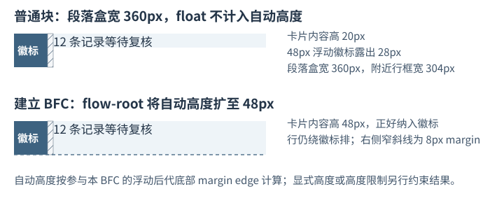
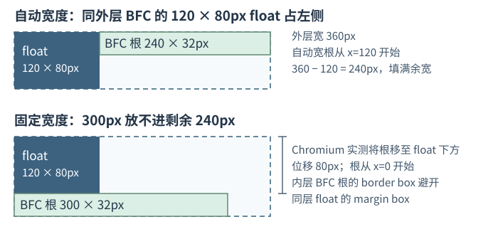
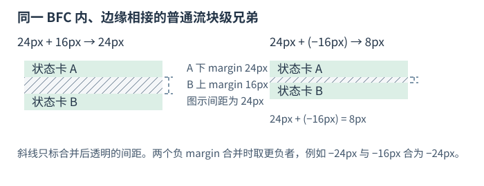
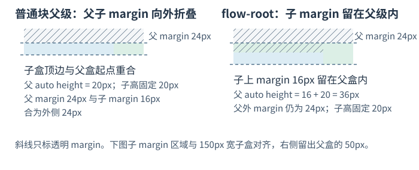

# 块格式化上下文如何约束浮动和外边距？

块格式化上下文（block formatting context, BFC）是一套独立的块级排版环境。建立 BFC 的盒子（BFC 根）会为自己的内容开启新的格式化上下文，根盒自身仍参加外层格式化上下文。浮动盒（float）脱离普通流，却仍会缩窄旁边的行框（line box）。普通块的自动高度不直接计入内部 float 的边缘；float 缩窄行框、增加文字行数时，仍会间接增加普通块的高度。BFC 根在高度为 auto 时，会把参与该 BFC 的浮动后代计入到底部外边距边缘（bottom margin edge）。固定高度或高度限制会约束最终结果。BFC 根本身也不会自动创建堆叠上下文或定位包含块。

在报表页面里，<code>display: flow-root</code> 是直接建立 BFC 的写法。下面沿同一报表页面说明摘要卡内部浮动如何被自动高度纳入、外部浮动怎样影响新 BFC 根，以及垂直外边距（margin）何时折叠。盒子的 content、border 与 margin 尺寸见[CSS 如何计算元素盒子的尺寸](./box-model-and-bfc.md)。

## 为什么报表卡片里浮动徽标会撑不开父级？

假设摘要卡宽 <code>360px</code>，根字号 <code>16px</code>；徽标宽高各 <code>3rem</code>，右 margin 为 <code>8px</code>；文字行高 <code>20px</code>：

~~~html

  异常
  
共12条记录需要复核。

~~~

~~~css
html { font-size: 16px; }
.summary { width: 360px; background: #f3f6fa; }
.summary.flow-root { display: flow-root; }
.badge {
  float: left;
  inline-size: 3rem;
  block-size: 3rem;
  margin-right: 8px;
}
.summary p { margin: 0; line-height: 20px; }
~~~

徽标是 <code>48 × 48px</code>。它和右侧 <code>8px</code> margin 一起占 <code>56px</code>，所以文字旁边的行框宽 <code>360 − 48 − 8 = 304px</code>；文字实测约 <code>162px</code>，只占一行。段落块盒仍宽 <code>360px</code>。普通块卡片的内容高是 <code>20px</code>，徽标则向下露出背景 <code>48 − 20 = 28px</code>。把卡片改为 <code>display: flow-root</code> 后，BFC 根的自动高度增至 <code>48px</code>，将参与这个 BFC 的徽标纳入高度。

## 外部 float 怎样影响一个 BFC 盒？

BFC 根的内容使用内部格式化上下文排版；根盒仍在外层按普通流参与布局。若它和 float 属于同一个外层 BFC，根的 **边框盒（border box）** 不与该 float 的 **外边距盒（margin box）** 重叠。空间不足时，根可以变窄，或移到前方 float 下面。以下例子沿用 <code>360px</code> 外层、左 float <code>120px × 80px</code>，并让内部提示卡自身建立 BFC：

~~~css
.outer { display: flow-root; inline-size: 360px; }
.external-float { float: left; inline-size: 120px; block-size: 80px; }
.note { display: flow-root; block-size: 32px; } /* 自动宽度 */
.note.fixed { inline-size: 300px; }             /* 固定宽度 */
~~~

Chromium <code>149.0.7827.55</code> 实测：自动宽度的提示卡从 <code>x=120px</code> 开始，占剩余 <code>240px</code>；固定宽 <code>220px</code> 时可以并排，右边还余 <code>20px</code>；固定宽 <code>300px</code> 放不下，实测移至 float 下方 <code>80px</code>。这些具体宽度和落点是该浏览器与这组 CSS 数值下的结果，不是 CSS 对所有空间条件规定的唯一策略。例中未给 float 或提示卡加 margin、padding、border；若有这些尺寸，避让判断仍比较 float 的 margin box 与 BFC 根的 border box。

## 相邻 margin 为什么不是简单相加？

同一 BFC 中，前一个普通流块的下 margin 与紧随其后的普通流块兄弟的上 margin 可以折叠；后一个兄弟带有 clearance（clear 为避开 float 加入的间隔）时例外。两边之间若有 line box、这种 clearance、padding 或 border，就不会相邻折叠。每个兄弟自己的 border 和 padding 位于自己的 margin 内，不会自动隔开这两条外侧 margin。

两个正 margin 取较大值：状态卡 A 的下 margin <code>24px</code> 与卡 B 的上 margin <code>16px</code> 折叠为 <code>24px</code>，不是 <code>40px</code>。一正一负时，用最大正值加上最负值：<code>24px + (−16px) = 8px</code>。若两个 margin 都为负，则取更负者，例如 <code>−24px</code> 与 <code>−16px</code> 折叠为 <code>−24px</code>。

~~~css
.report-card { block-size: 20px; margin-block-end: 24px; }
.report-card + .report-card { margin-block-start: 16px; }
~~~

父级的上 margin 还可能与首个普通流块子级的上 margin 向外折叠：父级上边没有 border 或 padding，两条 margin 之间没有 line box，且首个子级没有 clearance 时，父 margin <code>24px</code> 与子 margin <code>16px</code> 折叠为父级外侧的 <code>24px</code>。此时子盒从父盒顶部开始。若父级改成 <code>display: flow-root</code>，父的外 margin 仍为 <code>24px</code>，子 margin <code>16px</code> 留在父盒内部；父自动高度因此从子盒的固定 <code>20px</code> 增为 <code>36px</code>。

~~~css
.sheet { display: flow-root; inline-size: 200px; }
.panel { margin-block-start: 24px; }
.panel > .first-row {
  inline-size: 150px;
  block-size: 20px;
  margin-block-start: 16px;
}
.panel.flow-root { display: flow-root; }
~~~

BFC 阻止的是盒内外跨边界折叠，不会自动取消 BFC 根自身与外层的 margin 规则。

## 如何创建 BFC，什么副作用值得注意？

- <code>display: flow-root</code> 直接建立 BFC，不裁切内容，也不创建滚动容器。
- 浮动、绝对定位、inline-block、table cell 和 table caption 等也会为内容建立格式化上下文；它们自身还有浮动、定位、行内排版或表格布局行为。Flex/Grid 容器建立各自的格式化上下文，不是 BFC；相邻项目的 margin 不折叠，float 不会使项目按浮动盒参与布局。
- 对块盒，计算后的 <code>overflow</code> 值为 <code>hidden</code>、<code>auto</code> 或 <code>scroll</code> 时也会建立独立格式化上下文。它们都是滚动容器；<code>hidden</code> 不显示滚动界面，但仍允许程序滚动。<code>auto</code> 即使没有溢出，也不保证界面上有滚动条；若用户代理用可见滚动机制，只有存在溢出时才显示。<code>scroll</code> 在用户代理采用可见滚动机制时，即使没有溢出也应显示。若只想建立 BFC，选 <code>flow-root</code>，不要把 <code>overflow: hidden</code> 当作没有其他效果的替代品。
- <code>overflow: clip</code> 可裁切溢出，但本身不建立格式化上下文或滚动容器。若另一轴设成非 <code>visible</code> / <code>clip</code> 的值，两个轴的计算值可能让原来的 <code>clip</code> 变为 <code>hidden</code>；这时要按计算后的值判断是否建立 BFC。

旧环境里也常见 clearfix 清除伪元素：

~~~css
.legacy-parent::after {
  content: "";
  display: table;
  clear: both;
}
~~~

<code>clear: both</code> 会把这个生成的清除盒放到前方 float 下方；它作为普通流子盒参与父级自动高度，因此可让父背景延伸到 float 底部。但它没有让父盒成为同样的 BFC 根，所以不能取代 <code>flow-root</code> 来建立外部浮动避让或父子 margin 的边界。

> [!info]- 来源
> - **BFC 与独立格式化边界。** CSS Display Module Level 3，§2.2、附录 A，W3C Candidate Recommendation Draft（2026-06-05）：[CSS Display Level 3](https://www.w3.org/TR/css-display-3/)。flow-root 为内容建立 BFC；独立格式化上下文隔开 float 影响与 margin collapse；Flex/Grid 建立各自格式化上下文。草案状态截至 2026-11-12。
> - **块级 float 布局与清除。** CSS 2.2，§9.4.1、§9.5、§9.5.2，W3C First Public Working Draft（2016-04-12）：[BFC](https://www.w3.org/TR/CSS22/visuren.html#block-formatting)、[float 避让](https://www.w3.org/TR/CSS22/visuren.html#floats)、[clear 与 clearance](https://www.w3.org/TR/CSS22/visuren.html#flow-control)。§9.5 的避让对象限定为同外层 BFC 中 float 的 margin box；普通流 BFC 根的 border box 可能下移，clearance 不检查 float 自身或其他 BFC 中的 float。该文档是历史草案。
> - **BFC 根的自动高度。** CSS 2.2，§10.6.7，W3C First Public Working Draft（2016-04-12）：[Auto heights for BFC roots](https://www.w3.org/TR/CSS22/visudet.html#root-height)。自动高度纳入参与该 BFC 的浮动后代底部 margin edge；其他 BFC、绝对定位后代与嵌套在其他 float 中的浮动不计入。
> - **相邻与父子 margin 折叠。** CSS 2.2，§8.3.1，W3C First Public Working Draft（2016-04-12）：[Collapsing margins](https://www.w3.org/TR/CSS22/box.html#collapsing-margins)。它定义边缘相邻条件、父子折叠条件及多条正负 margin 的合并算法。
> - **overflow、滚动容器与格式化上下文。** CSS Overflow Module Level 3，§3.1，W3C Working Draft（2025-10-07）：[Managing Overflow](https://www.w3.org/TR/css-overflow-3/#overflow-properties)。该草案定义可滚动值、clip 例外、滚动界面条件、计算值和独立格式化上下文；访问于 2026-11-12。
> - **Flex/Grid 项目的边距与 float。** [CSS Flexbox Level 1 §4.2](https://www.w3.org/TR/css-flexbox-1/#item-margins)、[CSS Grid Level 2 §6.4](https://www.w3.org/TR/css-grid-2/#item-margins)：相邻项目的 margin 不折叠；项目按各自格式化上下文排布，float 不会使它们按浮动盒参与布局。
