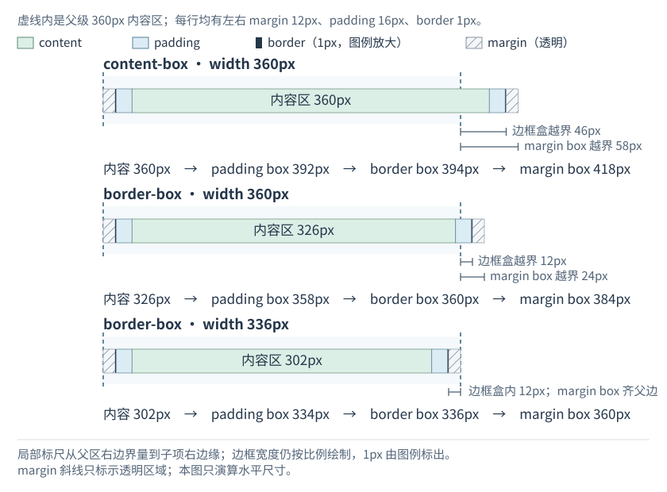
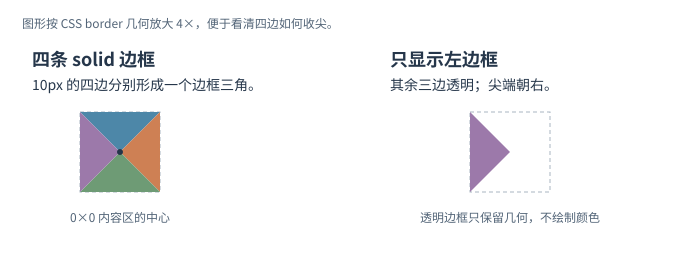

# CSS 如何计算元素盒子的尺寸？

固定的 `width` 和 `height` 要先看量到哪一条边。默认 `content-box` 把声明值给内容区；`border-box` 把它给边框盒，再从中扣除 padding 与 border。margin 始终在 border 外。本页用宽度演算四层；高度遵循同样的边缘规则，但 `min-height`、`max-height` 和布局约束可能改变浏览器最后采用的高度。

## 用报表筛选面板演算宽度

报表页面每个父级内容区宽 `360px`。每次只放一个筛选面板，并从父级内容区左边界 `x=0` 开始，所以面板左边框位于左 margin 之后的 `x=12px`。筛选面板左右各有 `16px` padding、`1px solid` border 和 `12px` margin。为单独观察固定宽度，让它以 `inline-block` 排在父级的一行中：它按块盒计算宽高，但像行内内容一样占据这一行。父级固定宽 `360px` 且不换行；不设 `min-width` 或 `max-width`，也不让 Flex/Grid 布局改写尺寸。图中的虚线是父级内容区边界；斜线表示透明的 margin 区域。

~~~css
.track { width: 360px; white-space: nowrap; }
.panel {
  display: inline-block;
  width: 360px;
  margin-inline: 12px;
  padding-inline: 16px;
  border: 1px solid;
}
.panel.border-box { box-sizing: border-box; }
.panel.border-box.fit { width: 336px; }
~~~

图表的三行分别使用类组合 `panel`、`panel border-box` 和 `panel border-box fit`；每种情况都在独立的 `360px` 父级中计算。

从里到外，padding box 是内容区加 padding；border box 再包住 border；margin box 最外面再加 margin。

默认 `content-box` 的 `width: 360px` 量的是内容区。加上两侧 padding 后，padding box 是 `360 + 16 × 2 = 392px`；再加两侧 border，border box 是 `394px`；最后加 `24px` margin，margin box 是 `418px`。由于左 margin 位于父区内，子项边框盒向右越出父区 `46px`，margin box 外缘总共越出 `58px`。

改成 `box-sizing: border-box`，声明的 `360px` 包含内容、padding 和 border：

> [!example] border-box，width 360px
> 内容区 `360 - 32 - 2 = 326px`；padding box `358px`；border box `360px`。margin box 是 `360 + 24 = 384px`，所以边框盒越出父区 `12px`、最外侧 margin box 越出 `24px`。

若父区宽 `360px`，并希望左右 margin 各 `12px` 后也完全放得下，可把 border-box 宽度设为 `336px`：内容区 `302px`，padding box `334px`，border box `336px`，margin box 恰为 `360px`。这把原来的边界计算闭合为一个可用宽度：父级宽度先扣掉两侧 margin，剩余值就是边框盒上限。

| 声明值实际控制的宽度 | 内容区 | padding box | border box | margin box |
|---|---:|---:|---:|---:|
| `content-box; width:360px` | `360px` | `392px` | `394px` | `418px` |
| `border-box; width:360px` | `326px` | `358px` | `360px` | `384px` |
| `border-box; width:336px` | `302px` | `334px` | `336px` | `360px` |

表只计算 `width` 对该盒生效、浏览器采用值未被其他规则改写的情形。像普通 `span` 这样的非替换行内盒不能直接用 `width` 定宽；`min-width`、`max-width` 或 Flex/Grid 的尺寸计算也会改变最后采用的宽度。`height` 同理：只有固定值实际采用时，`box-sizing` 才决定它量到内容盒还是边框盒；最小/最大高度和布局也可能改写最终尺寸。`box-sizing` 也影响 `flex-basis` 等 sizing properties 的固定值解释。

若 border-box 声明宽度只有 `20px`，而两侧 padding 与 border 合计 `34px`，内容区不会变成负数：内容宽度下限为 `0px`，边框盒仍会长到 `34px`。保留两侧 `12px` margin 时，margin box 是 `58px`。

常见重置让页面元素和伪元素采用 border-box，使组件声明宽度更接近可见边框宽度：

~~~css
*, *::before, *::after {
  box-sizing: border-box;
}
~~~

`padding` 和 `margin` 的一至四值简写按上、右、下、左分配：一值设四边；两值为上下、左右；三值为上、左右、下；四值按顺时针排列。

## 边框几何可以画小三角

内容宽高与 padding 都为零时，边框仍占据空间。下面的等宽实线边框在 Chromium 中汇到中心，形成四个三角；只给左边着色、其他三边保持透明，就会露出朝右的三角：

~~~css
.caret-right {
  display: inline-block;
  width: 0;
  height: 0;
  padding: 0;
  border: 10px solid transparent;
  border-left-color: currentColor;
  border-radius: 0;
}
~~~

把这组样式用于空 `span` 时，`inline-block` 使宽高声明生效；四条边框仍占宽度，其中未着色的三条透明边框也会占位，边框盒为 `20 × 20px`。`padding: 0` 与 `border-radius: 0` 保持图示的尖角。若希望形状独立于边框、随方盒一起缩放，可改用 `clip-path` 绘制向下的三角形。百分比坐标从盒子左上角开始，y 值向下增加：

~~~css
.caret-down {
  display: inline-block;
  width: 1rem;
  aspect-ratio: 1;
  background: currentColor;
  clip-path: polygon(0 0, 100% 0, 50% 100%);
}
~~~

装饰性箭头可以对辅助技术隐藏；若箭头表达开合状态或方向，还要通过控件文字或其他语义暴露该信息。

要看 margin 怎样在普通流中相遇，以及 float 怎样影响块的边界，请继续读[块格式化上下文如何约束浮动和外边距](./bfc-and-flow-containment.md)。居中和浮层位置分别见[Flex/Grid 对齐](./flex-and-grid-layout.md)与[定位和堆叠](./css-position-display-and-animations.md)。

CSS 声明的盒尺寸和脚本读取到的几何值是不同问题：对本例单一、未分片的面板，`offsetWidth` 返回边框盒的整数宽度，通常包括占位滚动条，但不含 margin，也不应用变换；各 API 的测量边界见[DOM 几何 API](./dom-properties.md)。

> [!info]- 来源
> - **盒子的四层边缘与间距简写。** CSS Box Model Module Level 3，§2.1、§3.2、§4.2，W3C Recommendation（2024-04-11）：[CSS Box Model Level 3](https://www.w3.org/TR/css-box-3/#boxes-edges)。其中 margin 在 border 外且背景透明，margin/padding 简写按一至四值分配边缘；访问于 2026-11-12。
> - **`box-sizing`、声明宽度与下限。** CSS Box Sizing Module Level 3，§3.3，W3C Working Draft（2026-09-04）：[CSS Sizing Level 3](https://www.w3.org/TR/css-sizing-3/#box-sizing)。`border-box` 不包含 margin，计算内容尺寸时将负数下限为零；访问于 2026-11-12。
> - **inline-block 与普通 inline 宽度。** CSS 2.2，§10.3.1、§10.3.9，W3C First Public Working Draft（2016-04-12）：[CSS 2.2 width calculation](https://www.w3.org/TR/CSS22/visudet.html#inlineblock-width)。普通非替换 inline 的 `width` 不生效；inline-block 按自身宽度规则处理。该文档是历史草案；访问于 2026-11-12。
> - **边框三角与 `clip-path`。** 本页边框三角已在 Chromium 149 实际渲染；[CSS Backgrounds Level 3 §4.4](https://www.w3.org/TR/css-backgrounds-3/#corner-transitions) 并未强制规定角部颜色切换的精确路径。透明边框属性见 CSS 2.2 §8.5：[CSS 2.2 box model](https://www.w3.org/TR/CSS22/box.html#border-properties)，W3C First Public Working Draft（2016-04-12）；形状裁切见 CSS Masking Module Level 1 §5.1：[CSS Masking](https://www.w3.org/TR/css-masking-1/#the-clip-path)，W3C Candidate Recommendation Draft（2021-08-05）。访问于 2026-11-12。
> - **`offsetWidth`。** CSSOM View Module，§7：[CSSOM View](https://www.w3.org/TR/cssom-view-1/#dom-htmlelement-offsetwidth)，W3C Working Draft（2025-09-16）。访问于 2026-11-12。
