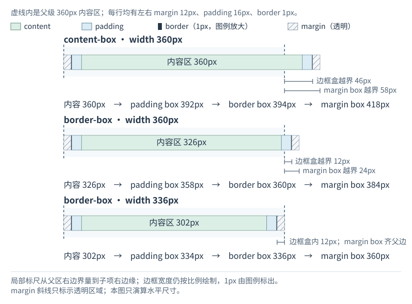
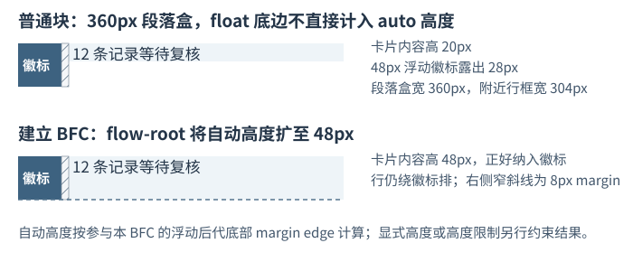
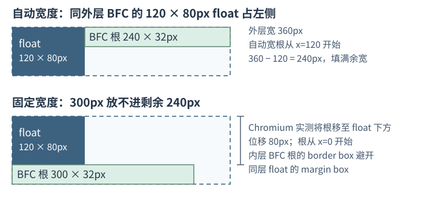
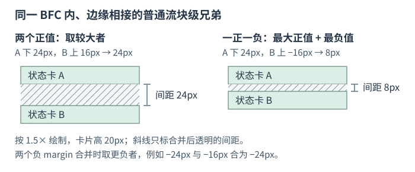
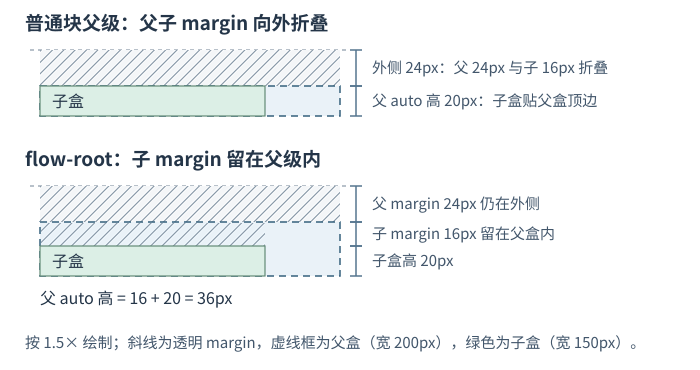

# 盒子的尺寸怎样计算，块和浮动怎样在流里排开？

层叠决定了每个元素最后拿到哪些声明（见[多条 CSS 声明冲突时谁赢](./css-cascade-and-inheritance.md)）。本章接着回答：尺寸声明怎样变成盒子的实际宽高，块、浮动和外边距又怎样在 normal flow (普通流) 里排开。例子沿用主线一的报表页 `/reports/42`，只看页面上的几个块：筛选面板、带“异常”徽标的摘要卡和上下排列的状态卡。数值都是为了便于手算而设定的，标明 Chromium 实测的除外。

## width 量的是哪一层盒

每个元素生成的盒子由内到外分四层：content box (内容盒)、padding box (内边距盒)、border box (边框盒) 和 margin box (外边距盒)。margin 在边框外，背景透明，只负责和别的盒子拉开距离。

给 `width` 或 `height` 写固定值时，`box-sizing` 决定这个值量的是哪一层：

- `content-box`（默认）：声明值就是内容盒，padding 和 border 再往外加。
- `border-box`：声明值是边框盒，内容盒等于声明值减去两侧 padding 和 border。

两种取值都不含 margin。`min-width`、`max-width` 和 `flex-basis` 这类尺寸属性的固定值，也按 `box-sizing` 量到同一层。

### 用筛选面板逐层演算

筛选面板放在内容区宽 `360px` 的父级里，左右各有 `16px` padding、`1px` border 和 `12px` margin。面板从父级内容区左边界 `x=0` 开始排，左边框因此落在 `x=12px`。

为了只看固定宽度的效果，例子排除了会改写尺寸的因素：面板用 `inline-block`，让 `width` 生效、又不触发下一节块盒的“过约束”调整；父级不换行；不设最小/最大宽度，也不放进 Flex 或 Grid。

~~~css
.track { width: 360px; white-space: nowrap; }
.panel {
  display: inline-block;
  width: 360px;
  margin-inline: 12px;
  padding-inline: 16px;
  border: 1px solid;
}
.panel.border-box { box-sizing: border-box; }
.panel.border-box.fit { width: 336px; }
~~~

下图三行分别对应 `panel`、`panel border-box` 和 `panel border-box fit`，每行各在一个独立的 `360px` 父级里。虚线是父级内容区边界，斜线是透明的 margin。



从里往外加：padding box = 内容 + 两侧 padding，border box 再加两侧 border，margin box 最后加两侧 margin。

| 声明 | 内容盒 | padding box | border box | margin box | 边框盒右缘 |
|---|---:|---:|---:|---:|---:|
| `content-box; width:360px` | `360px` | `392px` | `394px` | `418px` | `406px`，越界 `46px` |
| `border-box; width:360px` | `326px` | `358px` | `360px` | `384px` | `372px`，越界 `12px` |
| `border-box; width:336px` | `302px` | `334px` | `336px` | `360px` | `348px`，在界内 |

第一行：`360 + 16 × 2 = 392`，`392 + 2 = 394`，`394 + 24 = 418`；边框盒右缘在 `12 + 394 = 406px`，margin box 右缘在 `418px`，越界 `58px`。第二行：内容盒 `360 − 32 − 2 = 326px`，边框盒恰好是声明的 `360px`，但它从 `x=12` 开始，右缘仍越界 `12px`，margin box 越界 `24px`。第三行把 margin 也算进去：父级宽度减两侧 margin，`360 − 24 = 336px`，就是能放下的最大 border-box 宽度。

内容盒不会变成负数。border-box 声明宽 `20px`，而两侧 padding 与 border 合计 `34px` 时，内容宽度取下限 `0px`，边框盒仍长到 `34px`；加上两侧 `12px` margin，margin box 是 `58px`。

常见的重置让所有元素和伪元素都用 border-box，使组件声明的宽度就是可见边框的宽度：

~~~css
*, *::before, *::after {
  box-sizing: border-box;
}
~~~

`padding` 和 `margin` 的一至四值简写按上、右、下、左分配：一值设四边；两值为上下、左右；三值为上、左右、下；四值按顺时针。

## 不写 width 时，块盒怎样放满父级

普通流里的非替换块级盒满足一个等式：

```text
margin-left + border-left + padding-left + width
  + padding-right + border-right + margin-right = 包含块宽度
```

`width: auto` 时，浏览器取让等式成立的宽度。把筛选面板改成 `display: block` 并删掉 `width`，内容宽度就是 `360 − 12 × 2 − 1 × 2 − 16 × 2 = 302px`，边框盒 `336px`，margin box 恰好 `360px`，和上表第三行相同，却不需要手算。所以想让块“放满父级”，保持 `width: auto` 就够了。写 `width: 100%` 反而要小心：在 `content-box` 下它把内容盒设成 `360px`，再加 padding 和 border 就越界。

如果 `width` 和两侧 margin 都写了固定值，等式通常不成立，这叫 over-constrained (过约束)。包含块为从左到右书写时，浏览器忽略 `margin-right` 的声明值，改用让等式成立的值。块盒写 `width: 360px` 时，`margin-right` 的使用值变成 `360 − 12 − 394 = −46px`，边框盒右缘照样在 `406px`。上一节用 `inline-block`，就是为了不让这条规则掺进演算。

行内盒不认 `width`。普通 `span` 这样的 non-replaced inline box (非替换行内盒) 的宽度由内容决定，写 `width` 不生效；`img` 这类替换元素除外。`inline-block` 对外像一个字一样排在行里，对内按块盒规则计算宽高，所以 `width` 和 `height` 对它生效。

## 用边框画一个小三角

边框也占几何空间，这一点可以用来画三角。内容宽高和 padding 都为零时，四条等宽的实线边框在中心汇合，各自成为一个三角形（下图是 Chromium 的渲染结果，放大 4 倍）。只给左边框着色，其余三边透明，就露出一个朝右的三角：


~~~css
.caret-right {
  display: inline-block;
  width: 0;
  height: 0;
  padding: 0;
  border: 10px solid transparent;
  border-left-color: currentColor;
  border-radius: 0;
}
~~~

用在空 `span` 上时，`inline-block` 让宽高声明生效。透明的三条边框虽然不着色，仍然占位，所以边框盒是 `20 × 20px`。`padding: 0` 和 `border-radius: 0` 保证尖角。

需要三角随盒子尺寸缩放时，可以改用 `clip-path` 裁切背景。下面画一个朝下的三角：多边形的百分比坐标以盒子左上角为原点、y 向下增加，三个点依次是左上、右上和底边中点。

~~~css
.caret-down {
  display: inline-block;
  width: 1rem;
  aspect-ratio: 1;
  background: currentColor;
  clip-path: polygon(0 0, 100% 0, 50% 100%);
}
~~~

报表页的“最近优先”“最早优先”两个排序按钮如果在文字旁加这样的三角，三角只是装饰，可以对辅助技术隐藏。当前按哪种顺序排，仍由按钮文字和 `aria-pressed` 表达，不能只靠三角朝向。

## 父级为什么包不住浮动的徽标

float (浮动盒) 脱离普通流，但仍会把旁边的 line box (行框) 挤窄，让文字绕着它排。普通块计算自动高度时，不直接算上内部浮动的底边；只有浮动把行框挤窄、文字因此多出几行时，块才会间接变高。

摘要卡就是这样出问题的。卡片宽 `360px`，根字号 `16px`；“异常”徽标左浮动，宽高各 `3rem`，右 margin `8px`；文字行高 `20px`：

~~~html
<div class="summary">
  <span class="badge">异常</span>
  <p>12 条记录等待复核</p>
</div>
~~~

~~~css
html { font-size: 16px; }
.summary { width: 360px; background: #f3f6fa; }
.summary.flow-root { display: flow-root; }
.badge {
  float: left;
  inline-size: 3rem;
  block-size: 3rem;
  margin-right: 8px;
}
.summary p { margin: 0; line-height: 20px; }
~~~

徽标是 `48 × 48px`，加上右 margin 共占 `56px`，所以文字旁的行框宽 `360 − 48 − 8 = 304px`。段落的块盒本身仍是 `360px` 宽，只是行框被浮动挤窄。文字在 Chromium 中实测约 `162px` 宽，一行就放得下，于是普通块卡片的自动高度只有这一行的 `20px`，徽标在卡片背景下方露出 `48 − 20 = 28px`。

把卡片改成 `display: flow-root`，它就成为一个 block formatting context (BFC，块格式化上下文) 的根。BFC 是一块独立的块级排版区域：根盒的内容在新的上下文里排版，根盒自己仍按外层上下文参与布局。BFC 根的高度为 `auto` 时，会延伸到本 BFC 内浮动后代的 bottom margin edge (底部外边距边缘)，所以卡片高度增至 `48px`，把徽标完整包住。若设了固定高度或最大高度，仍以这些限制为准。



旧代码常用 clearfix 达到类似的视觉效果：

~~~css
.legacy-parent::after {
  content: "";
  display: table;
  clear: both;
}
~~~

`clear: both` 把这个生成的盒放到前面浮动的下方。它是普通流子盒，参与父级自动高度，所以父级背景能延伸到浮动底部。但父级并没有成为 BFC 根，下面两节讲的“避开外部浮动”和“阻止父子 margin 折叠”，clearfix 都不提供。新代码只想包住浮动时，用 `flow-root`。

## BFC 根怎样避开旁边的浮动

上一节的浮动在 BFC 根内部。反过来，浮动也可能在 BFC 根外面、与它并排。若两者属于同一个外层 BFC，BFC 根的边框盒不能与该浮动的 margin box 重叠。空间不够时，根可以变窄，也可以移到浮动下方。

外层容器宽 `360px`，先放一个 `120 × 80px` 的左浮动，再放一个自身建立 BFC 的提示卡。浮动和提示卡都没有 margin、padding 或 border；有的话，避让比较的仍是浮动的 margin box 和根的 border box。

~~~css
.outer { display: flow-root; inline-size: 360px; }
.external-float { float: left; inline-size: 120px; block-size: 80px; }
.note { display: flow-root; block-size: 32px; } /* 自动宽度 */
.note.fixed { inline-size: 300px; }             /* 固定宽度 */
~~~



> [!example] Chromium 149.0.7827.55 实测
> 自动宽度的提示卡从 `x=120px` 开始，占满剩余的 `360 − 120 = 240px`；固定为 `220px` 时仍能并排，右边余 `20px`；固定为 `300px` 时放不进 `240px`，提示卡移到浮动下方 `y=80px` 处。规范只要求两者不重叠，并没有为所有空间条件规定唯一的处理方式，所以这些落点是该浏览器在这组数值下的结果。

普通块没有这种避让：它的边框盒会伸到浮动下面，只有里面的行框被挤窄。

## 相邻 margin 什么时候折叠

BFC 的另一个作用是划定 margin collapsing (外边距折叠) 的范围。在同一个 BFC 里，上下相接的普通流块的垂直 margin 会合成一段，而不是相加。

### 兄弟块之间

前一个块的下 margin 和紧随其后的兄弟块的上 margin 会折叠。两者之间隔着行框、padding、border 或 clearance (`clear` 为避开浮动而插入的间隔) 时不折叠；每个兄弟自己的 padding 和 border 在自己的 margin 以内，隔不开这两条朝外的 margin。

合并规则：

- 两个正值取较大者：状态卡 A 的下 margin `24px` 与卡 B 的上 margin `16px` 合成 `24px`，不是 `40px`。
- 一正一负，用最大正值加上最负值：`24px + (−16px) = 8px`。
- 两个负值取更负者：`−24px` 与 `−16px` 合成 `−24px`。

~~~css
.report-card { block-size: 20px; margin-block-end: 24px; }
.report-card + .report-card { margin-block-start: 16px; }
~~~



### 父级和第一个子块之间

`.panel` 是父级，`.first-row` 是它的第一个普通流子块。父级上边没有 border 或 padding、两条 margin 之间没有行框、子块也没有 clearance 时，父 margin `24px` 与子 margin `16px` 折叠成父级外侧的一段 `24px`，子盒紧贴父盒顶部，父级自动高度只有子盒的 `20px`。

~~~css
.sheet { display: flow-root; inline-size: 200px; }
.panel { margin-block-start: 24px; }
.panel > .first-row {
  inline-size: 150px;
  block-size: 20px;
  margin-block-start: 16px;
}
.panel.flow-root { display: flow-root; }
~~~

把父级改成 `display: flow-root` 后，BFC 边界挡住了跨边界的折叠：父级外侧仍是 `24px`，子块的 `16px` 留在父盒内部，父级自动高度变成 `16 + 20 = 36px`。



BFC 阻止的只是盒内外跨边界的折叠。BFC 根自己的 margin 仍按外层规则与兄弟折叠。

## 哪些声明会建立 BFC，各带什么副作用

前面的例子都用 `flow-root`。不少声明会顺带建立 BFC 或别的独立格式化上下文，选用时要看清附带效果：

- `display: flow-root`：专门用来建立 BFC，不裁切内容，也不创建滚动容器。只想包住浮动或隔开 margin 时选它。
- 浮动、绝对定位、`inline-block`、表格单元格和表格标题：也为内容建立格式化上下文，但它们自身还带着浮动、定位、行内排版或表格布局的行为。
- Flex 和 Grid 容器：建立各自的格式化上下文，不是 BFC。相邻项目的 margin 不折叠，项目上写 `float` 也不会让它按浮动盒排布。
- 块盒的计算值 `overflow` 为 `hidden`、`auto` 或 `scroll`：建立独立格式化上下文，同时让盒子成为 scroll container (滚动容器)。`hidden` 不显示滚动条，但脚本仍能滚动它；`auto` 只在内容溢出时显示滚动界面（在使用可见滚动条的平台上）；`scroll` 在这类平台上即使不溢出也显示滚动条。所以 `overflow: hidden` 不是“无副作用的 BFC 开关”：它会裁掉溢出内容（包括焦点轮廓），会改变 sticky 定位找到的滚动容器，还会让 Flex/Grid 项目的自动最小尺寸变成零。
- `overflow: clip`：裁切溢出，但本身不建立格式化上下文，也不成为滚动容器。另一轴设成 `visible`、`clip` 以外的值时，计算值里的 `clip` 可能变成 `hidden`，这时要按计算值判断。

滚动容器对 sticky 的影响见[定位元素参照谁](./positioning-and-stacking.md#sticky%20为什么没有贴住)，对自动最小尺寸的影响见[Flex 和 Grid 怎样分空间](./flex-and-grid-layout.md#自动最小尺寸让项目拒绝收缩)。

## 下一步：一行里的空间怎样分给多个项目

到这里，给定一组声明，可以算出每个块的边框盒宽度、它在父级里占多少空间，以及浮动和 margin 让它落在哪里。脚本要读这些结果时，各几何 API 量哪一层见[读几何值为什么会卡住脚本](../browser/rendering-pipeline-and-forced-layout.md)：例如 `offsetWidth` 读的是边框盒宽度（含占布局空间的滚动条），不含 margin，也不计 transform。

普通流里的块只会从上到下堆叠。报表页的工具栏要在一行里分配剩余空间，摘要卡要对齐成列，这些交给下一章[Flex 和 Grid 怎样把空间分给每个项目](./flex-and-grid-layout.md)。

> [!info]- 来源
> - **四层盒与 margin/padding 简写**（“width 量的是哪一层盒”）：CSS Box Model Module Level 3，W3C Recommendation 2024-04-11，§2.1、§3.2、§4.2，<https://www.w3.org/TR/css-box-3/#boxes-edges>。margin 在 border 外且背景透明；简写按一至四值分配边缘。访问于 2026-11-12。
> - **`box-sizing` 与内容尺寸下限为零**（“width 量的是哪一层盒”）：CSS Box Sizing Module Level 3，W3C Working Draft 2026-09-04，§3.3，<https://www.w3.org/TR/css-sizing-3/#box-sizing>。`border-box` 不含 margin，内容尺寸的负值取零。访问于 2026-11-12。
> - **块盒宽度等式与过约束**（“不写 width 时，块盒怎样放满父级”）：CSS 2.2，W3C First Public Working Draft 2016-04-12，§10.3.3，<https://www.w3.org/TR/CSS22/visudet.html#blockwidth>。该文档是历史草案。
> - **非替换行内盒不认 width、inline-block 的宽度**（同上节）：CSS 2.2，§10.3.1、§10.3.9，<https://www.w3.org/TR/CSS22/visudet.html#inlineblock-width>。访问于 2026-11-12。
> - **边框三角与 `clip-path`**（“用边框画一个小三角”）：边框三角在 Chromium 149 实际渲染；CSS Backgrounds Level 3 §4.4 并未规定角部颜色切换的精确路径，<https://www.w3.org/TR/css-backgrounds-3/#corner-transitions>。透明边框见 CSS 2.2 §8.5，<https://www.w3.org/TR/CSS22/box.html#border-properties>；形状裁切见 CSS Masking Module Level 1，W3C Candidate Recommendation Draft 2021-08-05，§5.1，<https://www.w3.org/TR/css-masking-1/#the-clip-path>。访问于 2026-11-12。
> - **BFC 定义、flow-root、Flex/Grid 各自的格式化上下文**（“父级为什么包不住浮动的徽标”“哪些声明会建立 BFC”）：CSS Display Module Level 3，W3C Candidate Recommendation Draft 2026-06-05，§2.2、附录 A，<https://www.w3.org/TR/css-display-3/>。
> - **浮动、避让与 clearance**（“父级为什么包不住浮动的徽标”“BFC 根怎样避开旁边的浮动”）：CSS 2.2，§9.4.1、§9.5、§9.5.2，<https://www.w3.org/TR/CSS22/visuren.html#block-formatting>、<https://www.w3.org/TR/CSS22/visuren.html#floats>、<https://www.w3.org/TR/CSS22/visuren.html#flow-control>。§9.5 的避让对象限定为同一外层 BFC 中浮动的 margin box；clearance 不检查其他 BFC 中的浮动。外部浮动避让的落点数值是 Chromium 149.0.7827.55 实测。
> - **BFC 根的自动高度**（“父级为什么包不住浮动的徽标”）：CSS 2.2，§10.6.7，<https://www.w3.org/TR/CSS22/visudet.html#root-height>。只计入参与该 BFC 的浮动后代；其他 BFC、绝对定位后代与嵌套在其他浮动里的浮动不计入。
> - **margin 折叠**（“相邻 margin 什么时候折叠”）：CSS 2.2，§8.3.1，<https://www.w3.org/TR/CSS22/box.html#collapsing-margins>。边缘相邻条件、父子折叠条件和正负值合并算法。
> - **overflow、滚动容器与格式化上下文**（“哪些声明会建立 BFC”）：CSS Overflow Module Level 3，W3C Working Draft 2025-10-07，§3.1，<https://www.w3.org/TR/css-overflow-3/#overflow-properties>。可滚动值、`clip` 例外、滚动界面条件与计算值。访问于 2026-11-12。
> - **Flex/Grid 项目的 margin 与 float**（同上节）：CSS Flexbox Level 1 §4.2，<https://www.w3.org/TR/css-flexbox-1/#item-margins>；CSS Grid Level 2 §6.4，<https://www.w3.org/TR/css-grid-2/#item-margins>。
> - **`offsetWidth`**（结尾一节）：CSSOM View Module，W3C Working Draft 2025-09-16，§7，<https://www.w3.org/TR/cssom-view-1/#dom-htmlelement-offsetwidth>。访问于 2026-11-12。
