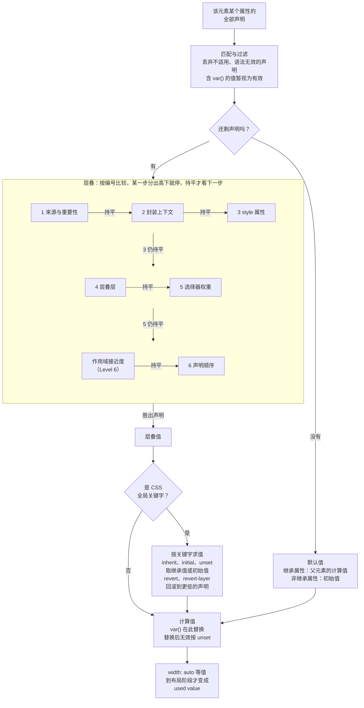
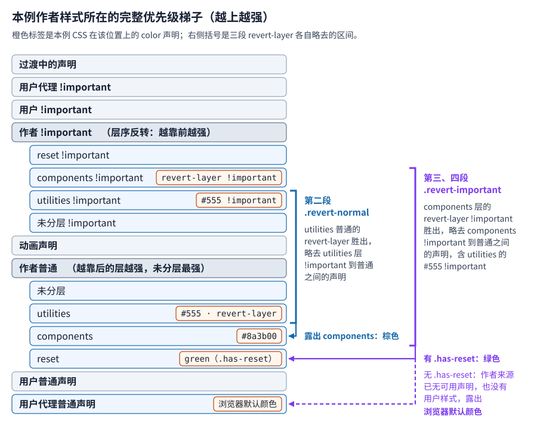

# 多条 CSS 声明冲突时谁赢，没有声明时值又从哪来？

同一个元素的同一个属性，常有好几条 CSS 声明同时适用：浏览器默认样式、组件库、业务样式、工具类，可能还有内联样式。另一些属性则一条声明都没有。本章回答浏览器怎样为每个元素的每个属性定出一个值：哪些声明有资格参与比较，cascade (层叠，也称级联) 按什么顺序选出胜者，没有胜者时值从哪里来。

本章沿用主线一的报表页，并接着前两章已经写好的骨架、表格和表单。下图是浏览器为一个元素的一个属性求值的全过程：先过滤出有资格的声明；层叠逐步比较，选出 cascaded value (层叠值)；没有声明时取默认值；胜出的值若是 `inherit`、`revert` 等 CSS-wide keyword (CSS 全局关键字)，再按关键字求值。

图末得到的 computed value (计算值) 还不是最终几何；`width: auto` 这类值要到布局阶段才变成 used value (使用值)，见[DOM 改动后浏览器重做了什么？](../browser/rendering-pipeline-and-forced-layout.md)。

## 选择器决定声明落到哪个元素上

层叠只在“已经匹配到该元素”的声明之间比较，所以先要弄清一条规则选中了谁。最容易算错的是结构伪类和伪元素。

### 结构伪类怎样计数

报表页的表格只有两行，看不出计数差别，这里换一个独立的小表：`tbody` 里有一行组标题，加上数据 A、B、C 三行。

~~~html
<table>
<tbody>
  <tr class="heading"><th>本月订单</th></tr>
  <tr class="data-row"><td>数据 A</td></tr>
  <tr class="data-row"><td>数据 B</td></tr>
  <tr class="data-row"><td>数据 C</td></tr>
</tbody>
</table>
~~~

~~~css
tbody > tr:nth-child(even) { background: #f4f7fb; }
tbody > tr:nth-child(even of .data-row) { font-weight: 600; }
~~~

结构伪类只数元素兄弟，源码里的空白文本节点不占位置，序号从 1 开始。`:nth-child(表达式 of S)` 先用选择器列表 `S` 筛出兄弟，再按筛选后的位置计数：

| 行 | 所有 `tr` 中的序号 | `.data-row` 中的序号 | `:nth-child(even)` | `:nth-child(even of .data-row)` |
| --- | ---: | ---: | --- | --- |
| 组标题 | 1 | — | — | — |
| 数据 A | 2 | 1 | 命中 | — |
| 数据 B | 3 | 2 | — | 命中 |
| 数据 C | 4 | 3 | 命中 | — |

第一条规则给 A、C 加背景，第二条给 B 加粗，两条规则并不争夺同一属性。想按数据行交替着色，就要用 `of .data-row`。写成 `tr.data-row:nth-child(even)` 不行：它只额外要求匹配的行带这个类，`:nth-child()` 仍按全部兄弟计数，结果还是 A、C。

同族的其他写法：

- `:first-child`、`:last-child` 按元素兄弟中的首尾位置匹配；`:nth-last-child()` 从末尾倒数。
- `:nth-child(2n+1)` 中 `n` 依次取 0、1、2……，所以选中第 1、3、5……个。
- `:nth-last-child(-n+2 of .data-row)` 在数据行中从末尾数：C 是 1、B 是 2、A 是 3；`-n+2` 取得 2 和 1，所以选中 B、C。
- `-of-type` 形式（如 `:nth-of-type()`）只在同一父元素下数相同类型的兄弟，即命名空间和标签名都相同的元素。

### 伪元素生成 DOM 之外的盒子

选择器还能选中伪元素。`::before`、`::after` 在元素实际内容的前、后各生成一个盒子，条件是 `content` 的计算值不是 `none`，而且盒子的生成没有被 `display: none` 等方式抑制。它们不是 DOM 节点，脚本查不到，也不会在 `` 等被替换元素上生成。

~~~html
Open
~~~

~~~css
.status::before { content: "［"; }
.status::after { content: "］"; }
~~~

这里的括号只是装饰，去掉样式后 `Open` 仍在文档里。有意义的状态、说明和功能不要只放在生成内容里：用户关闭或替换样式后，这些内容可能消失，也不一定能像正文一样被选中复制。WAI 曾把非装饰性生成文字列为失败技术 F87，这条现已标为过时，当前浏览器和辅助技术大多能读出生成文字；所以问题不在“读屏读不到”，而在它不属于文档内容。报表页的对账状态因此写成单元格里的实际文字。

clearfix 也是 `::after` 的常见用法：生成一个空的辅助盒，用 `clear: both` 让父容器的高度包住浮动。它和 `display: flow-root` 的取舍见[盒子的尺寸怎样计算，块和浮动怎样在流里排开？](./box-model-and-normal-flow.md)。

## 过滤：哪些声明有资格参与比较

一条声明要进入层叠比较，需同时满足：所在样式表适用于当前文档（例如 `media` 条件成立）；外层的 `@media`、`@supports` 等条件规则为真；选择器匹配目标元素；属性名和值在解析阶段语法有效。不满足的直接丢弃，就像从没写过。

含 `var()` 的值是例外。解析时浏览器还不知道替换结果，只能假定它有效，让它参与层叠；到计算值阶段替换完才可能发现不合法。两种无效的后果不同：

~~~css
.parse-invalid {
  background-color: red;
  background-color: 20px;
}

.var-invalid {
  background-color: red;
  --surface: 20px;
  background-color: var(--surface);
}
~~~

- `.parse-invalid`：`20px` 不是颜色，解析时就被丢弃，等于只写了 `red`，背景是红色。
- `.var-invalid`：`var(--surface)` 解析时合法，于是赢得层叠，压过了 `red`。计算值阶段替换成 `20px` 才发现无效，这时该属性按 `unset` 处理。`background-color` 不继承，所以结果是初始值 `transparent`，而不是退回已经落选的红色。若出问题的是继承属性，结果就是父元素的值。

所以对含 `var()` 的声明，“先写一条兜底值”不起作用。`var(--surface, white)` 的第二个参数也帮不上忙：它只在变量未定义时使用，挡不住“定义了但类型不对”的值。

## 层叠按六步比较

剩下的有效声明按开头流程图中层叠框里的顺序比较，每一步只比较同一元素的同一属性。各步的规则如下：

1. **来源与重要性。** 声明来自三个来源：user agent (用户代理，即浏览器默认样式)、用户（读者自己配置的样式）、作者（网页开发者）。加上 `!important` 和动画、过渡，优先级从高到低是：

   | 优先级 | 声明 |
   | ---: | --- |
   | 1 | 过渡中的声明 |
   | 2 | 用户代理 `!important` |
   | 3 | 用户 `!important` |
   | 4 | 作者 `!important` |
   | 5 | 动画声明 |
   | 6 | 作者普通声明 |
   | 7 | 用户普通声明 |
   | 8 | 用户代理普通声明 |

   注意 `!important` 把顺序倒了过来：普通声明里作者最强，重要声明里用户代理和用户最强，这保证了用户为可读性设置的重要样式不会被网页覆盖。HTML 的 `bgcolor` 这类非 CSS 表现提示会被翻译成 CSS 规则，进入用户代理来源，或进入一个介于用户普通声明和作者普通声明之间的专用来源。`!important` 能解燃眉之急，但之后要覆盖它只能再写 `!important`，维护会越来越难。
2. **封装上下文。** 比较 Shadow DOM (影子 DOM) 内外的规则时，普通声明外层胜，重要声明内层胜。组件内部的普通样式因此只是默认值，外部可以覆盖；组件用 `!important` 声明的要求，外部无法覆盖。
3. **元素附加样式。** 来源、上下文和重要性都相同时，写在元素 `style` 属性里的声明胜过选择器匹配到的规则。它不能越过第 1 步：作者样式表里的 `!important` 仍然胜过普通的内联样式。
4. **cascade layer (层叠层)。** 同一来源和上下文内，按层的顺序比较，见下文 [@layer](#用%20@layer%20让层序代替权重竞赛)。
5. **specificity (选择器权重)。** 见下一节。
6. **声明顺序。** 前面都持平时，后出现的胜出。同一文件中后写的胜；`@import` 引入的样式表按导入语句所在的位置参与排序；多个 `<link>` 样式表按链接顺序视为首尾相接。

CSS Cascading Level 6 在第 5、6 步之间又加了一步：作用域接近度，见下文 [@scope](#@scope%20让更近的作用域胜出)。

## 选择器权重怎样算

选择器权重写成三列 `(ID, 类/属性/伪类, 元素/伪元素)`，从左往右比：前一列分出高下，后一列再多也不能抵消。通配符 `*` 和组合符 `>`、`+`、`~`、空格不增加权重。

看报表页上一个显示对账状态的段落。两条作者普通声明设置同一个 `color`，前四步都持平：

~~~html

Pending

~~~

~~~css
#sync-status { color: #8a3b00; }
.report.status.pending { color: #b00020; }
~~~

`#sync-status` 是 `(1, 0, 0)`，三个类是 `(0, 3, 0)`。ID 列先比，1 大于 0，所以棕色胜出，即使类规则写在后面。

几种伪类的权重有特别规则：

- `:is()`、`:not()`、`:has()` 自己不计伪类，权重取参数列表中最具体的那个选择器。
- `:where()` 自己和参数的权重都是零，适合写容易被覆盖的默认样式。
- `:nth-child(… of S)`、`:nth-last-child(… of S)` 先计一个伪类，再加 `S` 中最具体选择器的权重。前面的 `tbody > tr:nth-child(even)` 是 `(0, 1, 2)`；`tbody > tr:nth-child(even of .data-row)` 多了 `.data-row` 的一个类，是 `(0, 2, 2)`。
- “最具体”按整个列表算，与实际匹配的是哪个分支无关。`:nth-child(even of .data-row, #not-in-report)` 即使页面里没有这个 ID，也按 ID 分支计权重；目标行本身仍须匹配其中某个分支才会被选中。

权重越高越难被覆盖。用属性选择器（如 `[data-state="warning"]`）表达显式状态、用扁平的单类选择器，比层层叠加的长选择器更容易维护。CSS-in-JS 生成的类名同样进入这套层叠，不会绕过它。

## 用 @layer 让层序代替权重竞赛

上一节的例子说明，靠提高权重来覆盖，会让后来的规则越写越重。cascade layer 把 reset、第三方组件、业务组件和工具类分到不同的层，由层顺序而不是权重决定胜负。层叠的第 4 步排在权重之前，所以在不同层之间，权重再高也没用。

层的比较规则：

- 层按首次声明的顺序排列。普通声明中，**越靠后的层越强**；未放进任何层的声明视为最后一层，比所有显式层都强。
- 重要声明中层序反转：**越靠前的层越强**，显式层的 `!important` 胜过未分层的 `!important`。
- 层只在同一来源、同一封装上下文内排序，不能越过第 1、2 步。

~~~css
@layer reset, components, utilities;

@layer reset {
  .revert-important.has-reset { color: green; }
}

@layer components {
  #layer-status { color: #8a3b00; }
  .revert-normal { color: #8a3b00; }
  .revert-important { color: revert-layer !important; }
}

@layer utilities {
  .text-muted { color: #555; }
  .revert-normal { color: revert-layer; }
  .revert-important { color: #555 !important; }
}
~~~

~~~html

状态由工具类设为灰色

普通声明回退到组件层

重要声明回退到 reset 层

没有更低的作者声明时退回前一来源

~~~

第一段同时匹配 `components` 层的 ID 选择器 `(1, 0, 0)` 和 `utilities` 层的单类选择器 `(0, 1, 0)`。两者都是普通声明，`utilities` 层靠后，所以灰色胜出，权重在这一步之前就不参与了。

### revert-layer 回滚到哪里

后三段演示 `revert-layer`。它不是“改用上一条规则”。它让浏览器重新计算这个属性，仿佛**当前层的声明，以及优先级排序中位于当前层“普通级位置”和“重要级位置”之间的所有声明**都不存在。

下图把第 1 步的来源与重要性和第 4 步的层序合成一条完整的梯子，标出本例每条 `color` 声明所在的位置，再用括号画出后三段的 `revert-layer` 各自略去哪一段区间、露出哪个值：

- **第二段**：区间从 `utilities` 普通一直延伸到 `utilities !important`，但能匹配这一段的只有 `utilities` 层自己的声明，所以结果就是下一层 `components` 的棕色。
- **第三段**：区间里包括压过别人的 `utilities` 重要灰色；`reset` 层的普通绿色在区间之外，于是绿色胜出。
- **第四段**：区间相同，但没有 `.has-reset`，作者来源里已经没有可用的声明，于是退回前一来源：先看用户样式，没有用户样式就露出浏览器默认颜色。

## @scope 让更近的作用域胜出

`@scope (根选择器) { … }` 把内部规则限定在根元素的子树里。CSS Cascading Level 6 为它在层叠里加了一步 scope proximity (作用域接近度)，位置在选择器权重之后、声明顺序之前：权重持平时，作用域根到目标元素之间隔的代数或兄弟数（跳数）少的规则胜出；没有作用域根的规则视为隔了无限跳。

`@scope` 括号里的根选择器不计入内部规则的权重。下面三条规则的权重都是 `(0, 1, 0)`：

~~~html
<section id="report-42">
  

Pending

</section>
~~~

~~~css
@scope (#report-42) { .status { color: #8a3b00; } }
@scope (.status-group) { .status { color: #555; } }
.status { color: purple; }
~~~

从 `p.status` 往上数：到 `div.status-group` 一跳，到 `section#report-42` 两跳，无作用域的规则是无限跳。所以 `.status-group` 作用域里的 `#555` 胜出，即使无作用域的紫色写在最后。

## 没有胜出声明时：继承与初始值

一个属性在层叠后没有任何胜出声明，就按属性定义取默认值：**继承属性取父元素的计算值，非继承属性取初始值。** 继承只传值，不传权重：父元素的选择器再强，也不会帮继承来的值压过子元素自己的任何声明。

~~~html
<article id="report">
  Open
</article>
~~~

~~~css
#report { color: #222; font-family: system-ui, sans-serif; margin: 2rem; }
.status { color: #8a3b00; }
~~~

`span` 自己的 `color` 声明胜出，显示棕色；它没有 `font-family` 声明，于是从父级继承 `system-ui, sans-serif`；父级的 `margin` 不继承，`span` 的外边距仍是初始值 0。`color`、`font-family`、`line-height` 默认继承；`width`、`padding`、`margin`、`display`、`position` 默认不继承。具体以每个属性定义表里的“Inherited”一栏为准。

### 五个全局关键字

任何属性都可以写下面五个关键字，显式选择值从哪来：

| 关键字 | 结果 |
| --- | --- |
| `inherit` | 取父元素的计算值，即使该属性通常不继承 |
| `initial` | 取属性定义的初始值 |
| `unset` | 继承属性等同 `inherit`，非继承属性等同 `initial` |
| `revert` | 在作者样式里使用时，去掉作者来源（含动画）对该属性的全部声明，露出用户样式；没有用户样式就露出浏览器默认样式 |
| `revert-layer` | 去掉当前层及其普通级与重要级之间的声明；同一来源没有更低的声明时退回前一来源（见上文 [revert-layer](#revert-layer%20回滚到哪里)） |

`initial` 与 `revert` 的差别最容易踩坑。浏览器给 `<em>` 的默认样式是斜体，但 `font-style` 的初始值是 `normal`。对 `em` 写 `font-style: initial` 得到正体；写 `font-style: revert` 则去掉作者声明，浏览器默认的斜体重新生效。两种回滚关键字也都不等同于 `unset`。

### line-height：继承的是数字还是长度

`line-height` 写成数字、长度或百分比，继承下去的东西不同。设父元素字号 `20px`，子元素字号 `12px`：

| 父元素写法 | 父元素计算值 | 子元素继承到 | 子元素行高 |
| --- | --- | --- | --- |
| `line-height: 1.5` | 数字 `1.5` | 数字 `1.5` | `12 × 1.5 = 18px` |
| `line-height: 30px` | 长度 `30px` | 长度 `30px` | `30px` |
| `line-height: 150%` | 长度 `20 × 150% = 30px` | 长度 `30px` | `30px` |

百分比在父元素上就按父字号算成了长度，子元素继承的是这个长度，字号再小也是 `30px`，行距显得过松。数字则让每个元素按自己的字号重新计算，所以正文行高一般写无单位数字。

### text-decoration 看起来像继承，其实是传播

链接的下划线会画到链接内部的所有文字上，看起来像继承，其实不是。`text-decoration` 本身不继承；祖先画的装饰线沿盒树延伸到后代的文字上。

~~~html
<a href="/reports/41">Report 41 <em>(archived)</em></a>
~~~

对 `em` 写 `text-decoration: none` 去不掉 `(archived)` 下方的线，因为那条线属于 `a`，`em` 自己本来就没有装饰。要改，就改给 `a` 设置下划线的那条规则，例如让 `a` 不画下划线，再给需要的部分单独加。

## 简写会重置没写出的子属性

shorthand property (简写属性) 展开成一组 longhand (长属性) 声明，每个长属性各自参与层叠。**简写里没写出的子属性会被设为初始值**，这经常悄悄覆盖掉前面的设置。

~~~css
.report-title {
  font-style: italic;
  font-kerning: none;
  font: 600 1.25rem/1.3 system-ui, sans-serif;
}
~~~

`font` 简写写在后面，展开后同时声明了 `font-style`、`font-kerning` 等所有字体子属性。它没写字体样式，于是 `font-style` 被重置为 `normal`；它根本不能写字距，`font-kerning` 也被重置为 `auto`。标题最终不是斜体，字距调整也恢复了。只想改字重或字号时，用 `font-weight`、`font-size` 这样的长属性。`font-family` 写一串字体时，浏览器按顺序尝试，末尾应给出 `sans-serif`、`serif` 等通用字体族兜底，上例的 `sans-serif` 就是这个作用。

`background` 简写同理。下面的规则用一张封面图铺满报表页的头图区，`/assets/report-cover.jpg` 只是示例路径：

~~~css
.report-cover {
  background: center / cover no-repeat url("/assets/report-cover.jpg");
}
~~~

位置和尺寸之间用斜线分隔：`center / cover`。`cover` 等比缩放并盖满整个背景区，可能裁掉图片边缘；`contain` 等比缩放并完整放进背景区，可能留下空白。这条简写同时把没写出的 `background-color` 重置为 `transparent`，图片加载前或透明处就没有底色了。只想改一个方面时用长属性：

~~~css
.report-status {
  color: #704000;
  background-color: #fff3d6;
  background-image: linear-gradient(180deg, rgb(255 255 255 / 35%), transparent);
}
~~~

背景图像（包括 `linear-gradient()` 生成的渐变）画在背景色上方，背景色从图像的透明处透出来，也在图片未加载时提供底色。报表状态仍要作为文字保留，不能只靠背景色或渐变表达。

## 内联关键 CSS 是加载取舍，不是层叠技巧

把首屏需要的关键 CSS 直接写进 HTML 的 `<style>`，有时能省掉等待外部样式表的时间；外部样式表为什么会阻塞首次渲染，见[打开一个 URL 后，页面怎样变得可见又可交互？](../browser/from-url-to-interactive-page.md)。代价是 HTML 响应变大；外部样式表里若仍有同样的规则，这部分会下载两次；内联部分也无法被单独缓存。

在层叠里，`<style>` 和 `<link>` 的规则都是作者样式表，按文档中的位置参与声明顺序比较，内联本身不提高优先级。是否内联要看缓存命中、加载路径和实测，见[用户觉得慢时，怎样从指标走到证据？](../delivery/performance-metrics-and-diagnosis.md)；它与选择器匹配速度无关。

## 计算值有了，下一步算盒子

到这里，报表页每个元素的每个属性都能追到来源：要么是某条在过滤和层叠中胜出的声明，要么是继承值或初始值，要么是全局关键字指向的结果。这些计算值是布局的输入。

下一章从这些计算值出发：`width`、`padding`、`border` 和 `box-sizing` 怎样变成盒子的实际尺寸，块和浮动怎样在流里排开？见[盒子的尺寸怎样计算，块和浮动怎样在流里排开？](./box-model-and-normal-flow.md)。

> [!info]- 来源
> - 声明过滤、来源与重要性的八级顺序、非 CSS 表现提示的来源（§6.5）、封装上下文、元素附加样式、层排序、声明顺序，以及 `revert` / `revert-layer` 的回滚范围（“current cascade layer—or between its normal and important levels”）：W3C CSS Cascading and Inheritance Level 5，§5–7.3.5，Candidate Recommendation Snapshot（2022-01-13），[CSS Cascade Level 5](https://www.w3.org/TR/css-cascade-5/)，检查于 2026-11-26。
> - `@scope` 接近度位于权重之后、声明顺序之前，跳数含代际与兄弟，无作用域根视为无限跳，根选择器不计入内部规则权重：W3C CSS Cascading and Inheritance Level 6，§2.1、§2.5.1，Working Draft（2024-09-06），[CSS Cascade Level 6](https://www.w3.org/TR/css-cascade-6/)，检查于 2026-11-26。
> - 结构伪类计数、`of S` 筛选、选择器权重与 `:is()`/`:not()`/`:has()`/`:where()` 的权重规则：W3C Selectors Level 4，§13.3–13.4、§15，Working Draft（2026-01-22），[Selectors Level 4](https://www.w3.org/TR/selectors-4/)，检查于 2026-11-11。
> - `::before`、`::after` 的生成位置与被替换元素限制：W3C CSS Pseudo-Elements Level 4 §4.1，Working Draft（2025-06-27），[CSS Pseudo-Elements](https://www.w3.org/TR/css-pseudo-4/#generated-content)；`content: normal` 在这两个伪元素上计算为 `none`：W3C CSS Generated Content Level 3 §1，Working Draft（2025-12-04），[CSS Generated Content](https://www.w3.org/TR/css-content-3/)；`display: none` 不生成盒子：W3C CSS Display Level 3 §2.5，Candidate Recommendation Draft（2026-06-05），[CSS Display](https://www.w3.org/TR/css-display-3/#box-generation)，检查于 2026-11-12。
> - 生成内容用于装饰的条件，以及旧失败技术 F87 已标为过时：W3C WAI WCAG 2.2 Technique C9（2026-01-12 更新）、[C9](https://www.w3.org/WAI/WCAG22/Techniques/css/C9)、[F87（Obsolete）](https://www.w3.org/WAI/WCAG22/Techniques/failures/F87)，检查于 2026-11-11。
> - clearfix 中 `clear: both` 把正常流块盒推到浮动下方、正常流子盒计入父级自动高度：W3C CSS 2.2 §9.5.2、§10.6.3，[floats](https://www.w3.org/TR/CSS22/visuren.html#flow-control)、[block auto height](https://www.w3.org/TR/CSS22/visudet.html#normal-block)，检查于 2026-11-12。
> - `var()` 替换后在计算值阶段无效时按 `unset` 处理，不恢复先前声明；回退参数只在变量为保证无效值（如未定义）时使用：W3C CSS Custom Properties for Cascading Variables Level 1 §3.1，Candidate Recommendation Snapshot（2022-06-16），[CSS Variables](https://www.w3.org/TR/css-variables-1/#invalid-variables)，检查于 2026-11-12。
> - 数字、长度与百分比 `line-height` 的计算与继承：W3C CSS Inline Layout Level 3 §5.1，Working Draft（2024-12-18），[CSS Inline Layout](https://www.w3.org/TR/css-inline-3/)，检查于 2026-11-12。
> - 文本装饰沿盒树传播：W3C CSS Text Decoration Level 3 §2，Candidate Recommendation Draft（2022-05-05），[CSS Text Decoration](https://www.w3.org/TR/css-text-decor-3/#line-decoration)，检查于 2026-11-11。
> - 字体族回退、`font` 简写重置子属性（含 `font-kerning`）：W3C CSS Fonts Level 4 §2.7、§3，Working Draft（2026-11-04），[CSS Fonts](https://www.w3.org/TR/css-fonts-4/)，检查于 2026-11-12。
> - 背景层、背景色与图像的绘制次序、`background` 简写与 `cover`/`contain`：W3C CSS Backgrounds and Borders Level 3 §2.1–2.3、§2.9–2.10，Candidate Recommendation Draft（2024-03-11），[CSS Backgrounds and Borders](https://www.w3.org/TR/css-backgrounds-3/)，检查于 2026-11-12。
> - 状态信息不能只用颜色：W3C WCAG 2.2 Success Criterion 1.4.1，Recommendation（2024-12-12），[Use of Color](https://www.w3.org/TR/WCAG22/#use-of-color)，检查于 2026-11-11。
> - 内联关键 CSS 的适用情况与 HTML 体积、缓存权衡：web.dev，[Optimize resource loading — Inline critical CSS](https://web.dev/learn/performance/optimize-resource-loading/)，2023-11-01 更新，检查于 2026-11-11。
