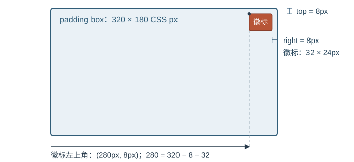

# 定位如何确定元素位置与前后顺序？

报表卡片里的状态徽标要贴住卡片右上角，弹窗要位于视口中央，工具条则要在滚动时贴顶，直到所属区域离开。`position` 决定盒子怎样参与布局、相对什么参照移动；containing block（包含块）提供定位坐标；stacking context（堆叠上下文）决定绘制时一组盒子如何整体排前后。`display` 决定元素生成什么盒子、使用哪类布局，它回答的是另一类问题。

> [!info] 先把四个问题分开
> normal flow（普通流）中，盒子按块级或行内等布局规则排布；本例的绝对定位徽标脱离普通流，后续内容不会为它留位置。
>
> inset properties（偏移属性）包括物理方向的 `top`、`right`、`bottom`、`left`，也包括逻辑方向的 `inset-block-start`、`inset-inline-end` 等。padding edge（内边距边缘）是 padding box（内边距盒）的外缘。
>
> | 属性或概念 | 要回答的问题 | 常见结果 |
> | --- | --- | --- |
> | `display` | 生成什么盒子，内部如何排布？ | `block`、`flex`、`grid` 选择盒子的类型和布局；`none` 不生成元素及其后代的盒子 |
> | `position` | 盒子是否保留流中位置，偏移怎样解释？ | `relative` 保留原位置再视觉偏移；`absolute` 脱离普通流 |
> | 包含块 | 定位坐标相对哪个矩形计算？ | 绝对定位常用最近建立包含块的祖先 padding edge |
> | 堆叠上下文 | 哪些盒子作为一个组参与前后绘制？ | 子组先在组内排序，再由父级比较整个组 |
>
## position（定位方式）值分别保留什么？

| `position` | 普通流中的位置 | 偏移参照 | 常见滚动表现 |
| --- | --- | --- | --- |
| `static`（静态） | 保留 | 普通流；`top` 等偏移不生效 | 随文档移动 |
| `relative`（相对定位） | 保留原位置 | 元素原来的流位置 | 随文档移动；可为绝对定位后代建立包含块 |
| `absolute`（绝对定位） | 不占原流位置 | 最近建立绝对定位包含块的祖先；若不存在则用初始包含块 | 随该包含块移动 |
| `fixed`（固定定位） | 不占原流位置 | 最近建立固定定位包含块的祖先；通常是视口 | 参照该包含块固定；若祖先建立了固定定位包含块，就不一定贴着视口 |
| `sticky`（粘性定位） | 保留原位置 | 最近滚动容器的滚动视口，并受自身包含块约束 | 在某轴至少一个 inset 不是 `auto` 时，滚动期间才会沿该轴贴近边缘 |

`absolute` 和 `fixed` 会把盒子的外部 `display` 类型块化（blockify），例如内联盒会变成块级定位盒；这只改变盒子的布局类型，不会因此选定包含块或创建堆叠上下文。

所有非 `static` 的 `position` 值都会为后代建立绝对定位包含块。普通块级祖先建立的包含块通常以 padding edge 为边界；`position: relative` 是常见做法。更一般地说，应查找最近建立绝对定位包含块的祖先，而不是默认把父元素当作参照。`transform` 或 `perspective` 非 `none`、`filter` 非 `none`（但对当前浏览上下文的根元素有例外），以及 `contain: layout` 或 `contain: paint` 也会建立绝对与固定定位后代的包含块；因此这类祖先会让 `fixed` 后代改为相对祖先定位。这些属性还各自有创建堆叠上下文的规则；`contain: paint` 会裁切后代绘制。Grid 容器等布局有专门的包含块规则。于是 `position: relative` 单独可以提供坐标参照，但配合 `z-index: auto` 时本身不会新建堆叠上下文。

## 把徽标放到卡片右上角

下面是一个明确的定位案例：卡片的 `320 × 180px` 没有 padding 或 border，所以其 padding box 与内容盒同尺寸；徽标为 `32 × 24px`，距上、右边缘各 `8px`。

~~~css
.report-card {
  position: relative;
  width: 320px;
  height: 180px;
}

.report-card__badge {
  position: absolute;
  top: 8px;
  right: 8px;
  width: 32px;
  height: 24px;
}
~~~

卡片建立绝对定位包含块，徽标的右、上偏移从这个 padding box 计算。左坐标为 `320 − 8 − 32 = 280px`，上坐标为 `8px`，所以徽标左上角是 `(280, 8)`。它脱离普通流，标题仍按自己的流位置排版。

## 让未知尺寸的弹窗居中

遮罩层可覆盖固定定位包含块，再用 Grid（网格布局）对齐弹窗。视口为 `1120 × 700px`、弹窗为 `320 × 160px` 时，视口中心是 `(560, 350)`；弹窗左上角因此是 `(560 − 160, 350 − 80) = (400, 270)`。

~~~css
.dialog-backdrop {
  position: fixed;
  inset: 0;
  display: grid;
  place-items: center;
}

.dialog {
  width: 320px;
  height: 160px;
}
~~~

另一种方案不使用 Grid：让遮罩建立绝对定位包含块，再将弹窗左上角定位到包含块中心，最后平移自身宽高的一半。此例中遮罩没有 padding 或 border，仍以 `1120 × 700px` 视口为 `fixed` 包含块：

~~~css
.dialog-backdrop {
  position: fixed;
  inset: 0;
  display: block;
}

.dialog {
  position: absolute;
  top: 50%;
  left: 50%;
  width: 320px;
  height: 160px;
  transform: translate(-50%, -50%);
}
~~~

这里 `top` 与 `left` 以遮罩的 padding box 为参照；`translate` 再将弹窗自身左上角向左、向上移动宽高的一半，结果也是 `(400, 270)`。这和前一段的 Grid 流内子项居中是两套独立方案：在上面的显式 inset 方案中，是遮罩的 `position: fixed` 建立绝对定位包含块；弹窗靠偏移和平移居中。使用 `fixed` 时，应检查祖先是否建立了固定定位包含块；否则参照物通常是视口。

## sticky 为什么没有贴住？

`sticky` 在要粘住的轴上至少需要一个非 `auto` inset，例如 `top: 0`。它相对最近滚动容器的滚动视口移动，并且受自身包含块限制。假设文档顶部有一个 `300px` 高的包裹层，里面的工具条高 `32px`、设 `top: 0`：窗口滚动 `100px` 后，工具条顶边能贴在视口 `y=0`；滚动到 `290px` 时，包裹层底边已到 `y=10`，工具条只能移到 `y=10−32=−22px`，再随包裹层离开。若包裹层只有 `32px` 高，滚动 `100px` 后工具条已在 `y=−100px`，没有剩余空间可粘住。

祖先的 `overflow` 可能改变最近滚动容器，即使那个祖先当前没有可见滚动条；因此应沿祖先链确认实际滚动容器和 sticky 可移动的空间。

## z-index 为什么仍然在下面？

先看最小结构：`.shell` 与 `.other` 是同一 `.stage` 下的重叠兄弟，`.dialog` 则是 `.shell` 的子项。它们覆盖相同的演示区域，因而能观察到谁画在上面：

~~~html

  

弹窗

  
其他内容

~~~

`z-index` 的数值只在相同堆叠上下文中比较。新建的堆叠上下文会作为一个整体放进父上下文，因此内部子项的数值不能越过祖先组，与组外元素直接比较：

~~~css
.stage { position: relative; width: 240px; height: 120px; }
.shell, .other { position: absolute; inset: 0; }
.shell  { z-index: 1; }
.shell .dialog {
  position: absolute; inset: 20px; width: auto; height: auto;
  z-index: 9999; background: #ded3f4;
}
.other { z-index: 2; background: #cfe2fa; }
~~~

`.dialog` 仍在 `.shell` 这一绘制组中；组外 `.other` 的层级高于 `.shell` 时，子项的 `9999` 不会改变这两个组的顺序。蓝色的 `.other` 此时覆盖紫色弹窗；仅把 `.shell` 改为 `z-index: 3`，紫色弹窗才出现在蓝色区域上面。应调整实际参与比较的祖先层级，或把弹窗放入能与目标组同层比较的结构。

上面的比较限定于普通文档层叠。调用原生 `<dialog>` 的 `showModal()` 会把该对话框放入 top layer（顶层）；顶层内容作为根元素的同级整体绘制，普通文档中的任意 `z-index` 都不能把它盖住。

| 观察到的问题 | 先检查 |
| --- | --- |
| 兄弟节点被推开或覆盖 | 普通流位置、绝对定位包含块 |
| 高 `z-index` 元素仍被遮住 | 实际参与比较的祖先堆叠上下文及其层级 |
| 浮动没有计入父元素高度 | [BFC 与流式布局边界](./bfc-and-flow-containment.md) |

> [!info] 常见堆叠上下文创建条件
> 定位盒配合非 `auto` 的 `z-index`、`fixed` 或 `sticky`（即使 `z-index: auto`）、非 `none` 的 `transform`、`perspective` 或 `filter`、小于 `1` 的 `opacity`、`isolation: isolate`、`contain: layout` 或 `contain: paint` 都会创建堆叠上下文。Flex/Grid 子项配合非 `auto` 的 `z-index` 也会创建。`will-change` 只有在它指向的属性本来会带来对应效果时，才会提前建立包含块或堆叠上下文；不要把所有创建条件都当成同时建立包含块。

> [!info]- 来源
> - `position`、包含块、偏移、sticky 滚动视口和定位盒层叠：W3C CSS Positioned Layout Level 3，Working Draft，2025-10-07，§§2、2.1、2.2、3.4，[规范](https://www.w3.org/TR/css-position-3/)。
> - 顶层绘制顺序：W3C CSS Positioned Layout Level 4，Working Draft，2025-10-07，§§3.1、4，[规范](https://www.w3.org/TR/css-position-4/)。
> - `display:none`、blockification：W3C CSS Display Module Level 3，Candidate Recommendation Draft，2026-06-05，§§2.5、2.7，[规范](https://www.w3.org/TR/css-display-3/)。
> - Flex/Grid 子项的 `z-index` 和绝对定位边界：W3C CSS Flexible Box Layout Module Level 1，Candidate Recommendation Draft，2025-10-14，§§4.1、4.3，[规范](https://www.w3.org/TR/css-flexbox-1/)；CSS Grid Layout Module Level 1，Candidate Recommendation Draft，2025-03-26，§§6.5、9.1、9.2，[规范](https://www.w3.org/TR/css-grid-1/)。
> - `transform` 建立后代定位包含块和堆叠上下文：W3C CSS Transforms Module Level 1，Candidate Recommendation，2019-02-14，§3，[规范](https://www.w3.org/TR/css-transforms-1/)；`perspective` 非 `none` 的包含块和堆叠效果：W3C CSS Transforms Module Level 2，Working Draft，2021-11-09，§8，[规范](https://www.w3.org/TR/css-transforms-2/)；`contain: layout` 与 `contain: paint` 的包含块、堆叠及裁切：W3C CSS Containment Module Level 2，Working Draft，2022-09-17，§§3.2、3.4，[规范](https://www.w3.org/TR/css-contain-2/)。
> - `filter` 的包含块与堆叠效果：W3C Filter Effects Module Level 1，Working Draft，2018-12-18，§5，[规范](https://www.w3.org/TR/filter-effects-1/)；`will-change` 的提前效果：W3C CSS Will Change Module Level 1，Candidate Recommendation Draft，2022-05-05，§2，[规范](https://www.w3.org/TR/css-will-change-1/)；整体透明度：W3C CSS Color Module Level 4，Candidate Recommendation Draft，2026-11-03，§3.3，[规范](https://www.w3.org/TR/css-color-4/)；`isolation`：W3C Compositing and Blending Level 1，Candidate Recommendation Draft，2024-03-21，§3.4.2，[规范](https://www.w3.org/TR/compositing-1/)。
> - 原生模态对话框进入 top layer：WHATWG HTML Living Standard，更新于 2026-11-11，§4.11.4，[`showModal()` 与模态显示算法](https://html.spec.whatwg.org/multipage/interactive-elements.html#dom-dialog-showmodal)。
> - 相关布局边界另见 [BFC 与流式布局边界](./bfc-and-flow-containment.md)；隐藏状态见[隐藏与可访问性](./css-visibility-and-accessibility.md)，运动见[CSS 过渡与动画](./css-transitions-and-animations.md)，布局绘制路径见[渲染流水线与强制布局](./rendering-pipeline-and-forced-layout.md)。
