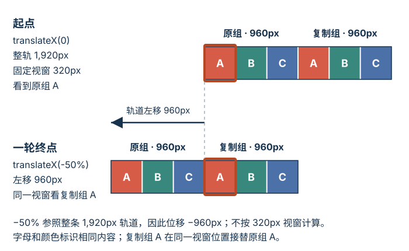

# 何时使用过渡，何时使用关键帧动画？

以一个报表页面为例：筛选按钮在悬停时改变颜色、卡片从正面翻到背面，都是在两个状态之间平滑切换；面板出现时先略过终点再回落，装饰用的图片条带则要不停循环。CSS 为此提供两种机制：transition（过渡）在某个样式值改变时，在旧值与新值之间插值；keyframe animation（关键帧动画）用 `@keyframes` 规定若干时间点上的样式。

> [!info] 先按状态模型选机制
> 只有一个起点和一个终点，并由悬停、获得焦点或 class 变化触发时，通常用 transition。需要规定多个时间点的状态，或需要自动开始、循环、控制播放方向和暂停时，用 keyframes。如果只是想让值略过目标再回来，用一条输出超出 `[0,1]` 的 easing（缓动函数）即可；要安排几个明确的中间状态，则用关键帧。无论哪种，都要考虑运动对阅读和操作的影响（见文末“减少动态效果”）。

## 状态变化用 transition

~~~css
.filter-button {
  background-color: #17324d;
  transition: background-color 180ms ease-out;
}

.filter-button:hover,
.filter-button:focus-visible {
  background-color: #24547d;
}
~~~

| 属性 | 作用 |
| --- | --- |
| `transition-property` | 指定参与过渡的属性，如 `opacity`、`transform` |
| `transition-duration` | 插值持续时间 |
| `transition-timing-function` | 把时间进度映射为插值进度的曲线，如 `ease-out`、`cubic-bezier(...)` |
| `transition-delay` | 开始前等待的时间 |

下例的各属性列表等长，按逗号位置一一对应：

~~~css
.result-card {
  transition-property: transform, opacity;
  transition-duration: 300ms, 200ms;
  transition-timing-function: ease-out, linear;
  transition-delay: 0ms, 100ms;
}
~~~

把过渡声明放在基础状态上，进入和离开状态都会应用。只把声明写在 `:hover` 规则中，离开 hover 时基础状态没有过渡声明，返回过程可能直接跳变。

状态规则只决定目标值；过渡进行中，屏幕上显示的是当前的插值。如果目标在过渡途中改变，浏览器会从当前值出发转向新目标。以筛选按钮为例：鼠标移入后颜色变到一半又移出，目标回到原来的颜色，浏览器会启动一段缩短的返回过渡，而不是把原过渡倒放。缩短比例取决于目标改变那一刻原过渡的缓动输出进度，即值已经走过的比例，而不是已经过去的毫秒数占总时长的比例。

上文提到的“略过目标再回来”可以用缓动实现，例如 `cubic-bezier(.34, 1.56, .64, 1)` 的输出会超过 `1`。但只有当属性能取到超出端点的值时，画面才会真的越过终点：`transform: translateY(0) → translateY(100px)` 可以越过 `100px` 再回落，而 `opacity: 0 → 1` 的计算值被限制在 `[0,1]`，不会出现过冲。

## 多个时间点用 @keyframes

~~~css
@keyframes panel-enter {
  0%   { transform: translateY(8px); opacity: 0; }
  55%  { transform: translateY(-2px); opacity: 1; }
  100% { transform: translateY(0); opacity: 1; }
}

.report-panel {
  transform: none;
  opacity: 1;
}

.report-panel.is-entering {
  animation: panel-enter 240ms ease-out both;
}
~~~

给面板加上 `.is-entering` 就会启动动画：面板从下方 `8px` 处淡入上移，在 `55%` 时越过终点 `2px`，最后回到原位。如果只要简单的过冲，也可以用上一节的过冲缓动；这里写出 `55%` 关键帧，是为了精确控制越过终点发生在什么时候。

| 属性 | 作用 |
| --- | --- |
| `animation-name` | 选择 `@keyframes` 规则 |
| `animation-duration` | 一轮持续时间 |
| `animation-timing-function` | 在相邻定义了该属性的关键帧之间映射时间进度；可在关键帧中为接下来的一段另设缓动 |
| `animation-delay` | 第一轮开始前等待时间 |
| `animation-iteration-count` | 轮数或 `infinite` |
| `animation-direction` | 正向、反向或交替播放 |
| `animation-fill-mode` | 动画区间外是否应用播放边界时的效果值 |
| `animation-play-state` | `running` 或 `paused` |

示例中的 `both` 是 fill mode（填充模式），决定动画开始前和结束后元素显示什么。本例只播放一轮、正向、没有延迟，播放的起点和终点就是 `0%` 与 `100%` 关键帧。`animation-fill-mode: both` 让元素在延迟期间显示起点的样式，结束后保留终点的样式。起点和终点不一定是 `0%` 与 `100%`：反向或交替播放、小数轮数都会改变动画在哪个进度开始和结束，这时边界样式可能是两个关键帧之间的插值。

填充值只在动画声明仍适用于元素时有效，不会写成永久状态：移除 `.is-entering` 后，面板回到基础样式 `opacity: 1; transform: none`。另外，`animation-play-state: paused` 让动画停在当前位置，改回 `running` 时从那里继续。

## 用两面翻牌理解 3D transform

开头提到的卡片翻面是一个两状态过渡，但要用到三维 transform（变换）。transform 可以平移、旋转或缩放元素的绘制结果。下面用一个类名切换卡片的角度。这只是视觉演示：真正可交互的翻牌卡片还需要按钮状态、焦点行为和内容语义；CSS 隐藏背面只影响绘制，不影响辅助技术读到什么。

~~~html

  

    
正面

    
背面

  

~~~

~~~css
.flip-demo {
  width: 200px;
  height: 120px;
  perspective: 800px;
}

.flip-demo__inner {
  position: relative;
  width: 100%;
  height: 100%;
  transform-style: preserve-3d;
  transition: transform 600ms ease;
}

.flip-demo.is-flipped .flip-demo__inner { transform: rotateY(180deg); }

.flip-demo__face {
  position: absolute;
  inset: 0;
  display: grid;
  place-items: center;
  backface-visibility: hidden;
  color: white;
}

.flip-demo__front { background: #24547d; }
.flip-demo__back { background: #8c3d16; transform: rotateY(180deg); }
~~~

外层 `perspective` 提供近大远小的透视效果；内层 `preserve-3d` 保留两个面的三维位置；背面先旋转 `180deg`，这样父级翻转后它才转到朝向读者的一侧。未加 `.is-flipped` 时，蓝色正面朝向读者；加入该类后，内层转过 `180deg`，正面背向读者，橙色背面转到前方。示例整体 `aria-hidden="true"`，文字只用于演示，不承载页面内容。

`translate`（平移）移动，`rotate`（旋转）改变朝向，`scale`（缩放）改变绘制尺寸。`transform-origin`（变换原点）默认在盒子中心；旋转或缩放时改变它，会改变视觉效果所绕的参照点。多种变换函数组合时顺序会影响结果，交换平移和旋转的顺序可能得到不同位置。`transform` 不重新安排周围普通流项目，但可能扩展可滚动溢出区域，并为后代建立 containing block（包含块）与 stacking context（堆叠上下文）。

## 无限滚动图片条带怎样无缝循环？

开头的最后一个需求是连续循环的装饰条带，需要用 `infinite` 的关键帧动画。思路是把同一组图片复制一份接在后面，动画移动正好一组的距离后重新开始。下面是一个纯装饰的例子，按理想 CSS 尺寸演算：条带水平、从左到右排列；视窗宽 `320px`，原组三张加复制组三张共六张，每张与视窗同宽；整条轨道宽是视窗的 `600%`，移动 `50%` 就是一组三张的宽度。

~~~html

  

    
    
    
    
    
    
  

~~~

~~~css
.strip-window {
  width: 320px;
  overflow: hidden;
  writing-mode: horizontal-tb;
  direction: ltr;
}

.strip-track {
  display: flex;
  flex-direction: row;
  align-items: flex-start;
  width: 600%;
  animation: strip-loop 18s linear infinite;
}

.strip-track img {
  flex: 0 0 calc(100% / 6);
  min-inline-size: 0;
  height: auto;
}

@keyframes strip-loop {
  to { transform: translateX(-50%); }
}
~~~

> [!example] 循环距离
> 轨道宽 `6 × 320 = 1920px`，两组各占 `960px`。`translateX(-50%)` 的百分比相对轨道自身，移动 `1920 × 0.5 = 960px = 3 × 320px`，正好让复制组移到原组的位置。
>
> 每张图的宽度由 `flex-basis: calc(100% / 6)` 决定，但 flex 项目默认的 `min-inline-size: auto` 会让图片不小于其内容尺寸，所以要设为 `0`。例如原图自然宽 `640px` 时，不加这条的 Chrome 实测每张仍宽 `640px`，第四张在移动半条轨道后落在 `x=960px`，接不上。加上 `min-inline-size: 0` 后每张约 `320px`，第四张落在 `x≈0`，实测子像素误差不到 `0.05px`。
>
> 这是按 CSS px 计算的理想值，不能保证所有图片、浏览器和屏幕上都没有接缝。图片宽高比不同不影响横向宽度；若视窗宽度或每组张数改变，要同步调整轨道宽度和每张的比例。

**循环位置示意（按理想 CSS px 比例）**

每轮结束时，位移从 `-960px` 跳回 `0`，视窗中的复制组 A 换成原组 A。由于两组内容、排列和尺寸完全相同，跳回前后的画面一致，用户看不出循环的接点；这就是要复制一整组的原因。

代码中还有两条声明值得说明。`align-items: flex-start` 避免 flex 默认的交叉轴拉伸把每张图拉成同一高度。`height: auto` 会按图像比例确定高度：本例自然尺寸分别为 `640×320`、`640×640`、`640×480` 的三张图缩到约 `320px` 宽后分别高约 `160px`、`320px`、`240px`。高度不同不改变横向组宽或移动距离；若去掉 `align-items: flex-start`，默认拉伸可能改变这些高度。

这个循环没有控制按钮、键盘操作、暂停机制或轮播语义，不能当作内容轮播使用。内容轮播应提供前后切换；若自动播放，还要提供停止/开始按钮，键盘焦点进入时停止、只在用户明确要求时恢复，鼠标悬停时也停止，并遵从 prefers-reduced-motion（减少动态效果偏好）。即使只是装饰，也不能让它承载唯一的信息。

示例上的 `aria-hidden="true"` 只隐藏辅助技术树中的条带，不会暂停屏幕上的运动。若把自动移动的条带放在其他页面内容旁并持续超过五秒，应提供暂停、停止或隐藏机制，除非该运动对活动不可或缺（WCAG 2.2 成功准则 2.2.2）。

## 动画性能与减少动态效果

动画每一帧都可能触发样式计算、布局、绘制、栅格化或合成，具体做哪些工作取决于动画的属性、元素内容和浏览器实现。`transform` 与 `opacity` 通常不影响周围布局，满足浏览器的合成条件时可以跳过逐帧的布局和绘制；但仅凭属性名不能断定动画一定在合成线程或 GPU 上执行。Chrome DevTools 的 Performance 面板中，Animations 轨道会标记未合成的动画，选中后可查看原因。应在目标页面上实际测量，不要假定所有浏览器和元素都走同一条路径。[渲染流水线与强制布局](./rendering-pipeline-and-forced-layout.md)说明写入和几何读取如何影响布局工作。

`will-change`（变化提示）只是预告某个属性将要变化，不是强制创建 GPU 图层的开关。浏览器可以据此提前优化，但做法各不相同；如果被提示的属性本身会创建堆叠上下文或包含块，提示也会提前产生这些效果，并可能占用额外内存。只在测量确认有收益时对少量元素短时间使用，变化结束后移除。同理，`translateZ(0)` 也不是通用的加速开关。

~~~css
@media (prefers-reduced-motion: reduce) {
  .report-panel.is-entering,
  .strip-track { animation: none; }

  .filter-button,
  .result-card,
  .flip-demo__inner { transition: none; }
}
~~~

用户在系统中选择减少动态效果后，`prefers-reduced-motion` 匹配 `reduce`，表示希望减少可能引起不适或分心的非必要运动。上面的规则让面板直接显示基础样式，条带停在第一组的起点；按钮颜色和翻牌状态仍会改变，只是不再有中间过程。之所以能这样关闭，是因为本页的状态都由 class 和属性值表达，而不依赖动画播放完毕；关闭运动后界面仍显示相同的结果。

> [!info]- 来源
> - 隐式过渡与中断、当前插值值、反向缩短：W3C CSS Transitions Level 1，Working Draft（2026-01-08），§§2–4、§3.1，[CSS Transitions](https://www.w3.org/TR/css-transitions-1/)，检查于 2026-11-12。
> - 显式关键帧、移除动画、暂停与填充模式：W3C CSS Animations Level 1，Working Draft（2023-03-02），§§1–2、3.4–3.9、4，[CSS Animations](https://www.w3.org/TR/css-animations-1/)，检查于 2026-11-12。
> - cubic Bézier 的进度映射与 `opacity` 对 `[0,1]` 的计算值限制：W3C CSS Easing Functions Level 2，First Public Working Draft（2024-08-29），§2.3；CSS Color Module Level 4，Candidate Recommendation Draft（2026-11-03），§3.3，[CSS Easing](https://www.w3.org/TR/css-easing-2/) 与 [CSS Color](https://www.w3.org/TR/css-color-4/)，检查于 2026-11-12。
> - flex 项目默认交叉轴拉伸与 `align-items: flex-start`：W3C CSS Flexible Box Layout Module Level 1，Candidate Recommendation Draft（2025-10-14），§8.3；自动最小尺寸与内容最小尺寸：§4.5，[CSS Flexbox](https://www.w3.org/TR/css-flexbox-1/#align-items-property)，检查于 2026-11-12。
> - `min-inline-size` 与书写模式的物理尺寸映射：W3C CSS Logical Properties and Values Level 1，Working Draft（2025-12-04），§4.1，[CSS Logical Properties](https://www.w3.org/TR/css-logical-1/)，检查于 2026-11-12。
> - 变换、绘制溢出、包含块、堆叠上下文、变换原点、函数顺序及平移百分比相对 reference box：W3C CSS Transforms Level 1，Candidate Recommendation（2019-02-14），§§3–6、9.1，[CSS Transforms](https://www.w3.org/TR/css-transforms-1/)，检查于 2026-11-12。
> - 三维变换模型、保留 3D、透视与背面可见性：W3C CSS Transforms Level 2，Working Draft（2021-11-09），§§4.1、7、8、10，[backface-visibility](https://www.w3.org/TR/css-transforms-2/#backface-visibility-property)，检查于 2026-11-12。
> - `will-change` 提示的实现差异、潜在资源消耗与副作用：W3C CSS Will Change Level 1，Candidate Recommendation Draft（2022-05-05），§§1.2、2，[CSS Will Change](https://www.w3.org/TR/css-will-change-1/)，检查于 2026-11-12。
> - 减少非必要运动的用户偏好：W3C Media Queries Level 5，Working Draft（2026-02-19），§12.1，[prefers-reduced-motion](https://www.w3.org/TR/mediaqueries-5/#prefers-reduced-motion)，检查于 2026-11-12。
> - 检查未合成动画和未合成原因：Chrome DevTools [Performance features reference](https://developer.chrome.com/docs/devtools/performance/reference)，View animations 一节，检查于 2026-11-12。
> - 轮播控制、焦点进入后停止与悬停停止：W3C WAI [ARIA APG Carousel Pattern](https://www.w3.org/WAI/ARIA/apg/patterns/carousel/)，About This Pattern，检查于 2026-11-12。
> - 自动移动内容与页面其他内容并列显示时的暂停、停止或隐藏机制：W3C WCAG 2.2 Recommendation（2024-12-12），成功准则 2.2.2，[Pause, Stop, Hide](https://www.w3.org/TR/WCAG22/#pause-stop-hide)，检查于 2026-11-12。
> - `aria-hidden` 对辅助技术树的影响：W3C WAI-ARIA 1.2 Recommendation（2023-06-06），§7.1，[Excluding Elements from the Accessibility Tree](https://www.w3.org/TR/wai-aria-1.2/#aria-hidden)，检查于 2026-11-12。
