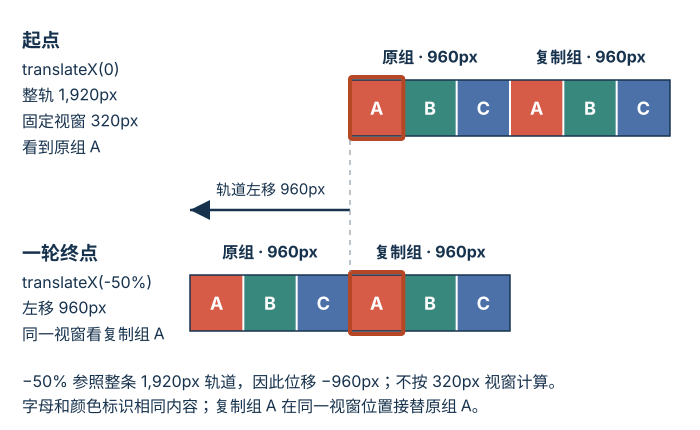

# 何时使用过渡，何时使用关键帧动画？

报表筛选按钮改变颜色、卡片从正面翻到背面，都是两个状态间的视觉过渡；面板进入时先越过终点再回落，装饰图片条带则要连续循环。transition（过渡）在样式值变化时插值；keyframe animation（关键帧动画）用 `@keyframes` 指定时间点上的样式。

> [!info] 先按状态模型选机制
> 一个起点到一个终点，且由 hover、焦点或 class 状态变化触发，通常用 transition。需要按时间点指定多个状态、自动开始、循环、播放方向或暂停时，用 keyframes。若属性沿同一条插值路径略过目标再回来，可用输出进度超出 `[0,1]` 的 easing（缓动函数）；若要安排几个明确的中间状态，则用关键帧。两种方式都要评估对阅读和操作的影响。

## 状态变化用 transition

~~~css
.filter-button {
  background-color: #17324d;
  transition: background-color 180ms ease-out;
}

.filter-button:hover,
.filter-button:focus-visible {
  background-color: #24547d;
}
~~~

| 属性 | 作用 |
| --- | --- |
| `transition-property` | 指定参与过渡的属性，如 `opacity`、`transform` |
| `transition-duration` | 插值持续时间 |
| `transition-timing-function` | 把时间进度映射为插值进度的曲线，如 `ease-out`、`cubic-bezier(...)` |
| `transition-delay` | 开始前等待的时间 |

下例的各属性列表等长，按逗号位置一一对应：

~~~css
.result-card {
  transition-property: transform, opacity;
  transition-duration: 300ms, 200ms;
  transition-timing-function: ease-out, linear;
  transition-delay: 0ms, 100ms;
}
~~~

把过渡声明放在基础状态上，进入和离开状态都会应用。只把声明写在 `:hover` 规则中，离开 hover 时基础状态没有过渡声明，返回过程可能直接跳变。

状态规则决定目标值，过渡中的画面则是当前插值值。若目标在过渡中改变，浏览器从当前画面继续转向新目标；在这个按钮例子里，目标回到原端点时会启动一段缩短的返回过渡，而不是把动画时间轴倒放。在本例的单次回切中，反向缩短因子由旧缓动函数在目标改变时的输出进度决定，也就是沿值区间已走过的比例；不能只用已过毫秒数代替。`cubic-bezier(.34, 1.56, .64, 1)` 的输出可超过 `1`，但只有属性能表示超出端点的值时，画面才会越过终点；例如 `transform: translateY(0) → translateY(100px)` 可以越过 `100px` 后回落，`opacity: 0 → 1` 的计算值则限制在 `[0,1]`。

## 多个时间点用 @keyframes

~~~css
@keyframes panel-enter {
  0%   { transform: translateY(8px); opacity: 0; }
  55%  { transform: translateY(-2px); opacity: 1; }
  100% { transform: translateY(0); opacity: 1; }
}

.report-panel {
  transform: none;
  opacity: 1;
}

.report-panel.is-entering {
  animation: panel-enter 240ms ease-out both;
}
~~~

将 `.is-entering` 加到面板会启动动画。55% 时面板先越过终点 `2px`，最后再回到原位；这个中间关键帧明确指定了越过与回落的时间。如果只要简单越过同一条路径的目标，也可以使用上一节的过冲缓动；这里保留 `55%` 是为了控制中间状态何时发生。

| 属性 | 作用 |
| --- | --- |
| `animation-name` | 选择 `@keyframes` 规则 |
| `animation-duration` | 一轮持续时间 |
| `animation-timing-function` | 在相邻定义了该属性的关键帧之间映射时间进度；可在关键帧中为接下来的一段另设缓动 |
| `animation-delay` | 第一轮开始前等待时间 |
| `animation-iteration-count` | 轮数或 `infinite` |
| `animation-direction` | 正向、反向或交替播放 |
| `animation-fill-mode` | 动画区间外是否应用播放边界时的效果值 |
| `animation-play-state` | `running` 或 `paused` |

本例是一轮默认正向播放且没有延迟，因此实际播放起点和终点的样式分别是 `0%` 与 `100%` 关键帧。若在开始前加延迟，`animation-fill-mode: both` 会应用实际播放起点的效果值；结束后则保留动画实际结束时的效果值。它们不一定总是端点关键帧：播放方向（如反向、交替）和迭代次数（尤其是小数轮数）会决定动画在哪个进度开始与结束，边界处也可能是两个关键帧之间插值出的样式。只要动画声明仍适用于元素，这些填充值就继续参与样式；移除 `.is-entering` 后，面板回到基础样式的 `opacity: 1; transform: none`。fill mode（填充模式）不会把结果写成永久状态。`animation-play-state: paused` 则暂停在当前播放位置；改回 `running` 时从那里继续。

## 用两面翻牌理解 3D transform

transform（变换）可平移、旋转或缩放绘制盒子。下面用类名控制两面卡片的角度；实际交互卡片还需单独提供按钮状态、焦点行为和内容语义，纯 CSS 的背面隐藏只影响绘制，不能代替内容可访问性处理。

~~~html

  

    
正面

    
背面

  

~~~

~~~css
.flip-demo {
  width: 200px;
  height: 120px;
  perspective: 800px;
}

.flip-demo__inner {
  position: relative;
  width: 100%;
  height: 100%;
  transform-style: preserve-3d;
  transition: transform 600ms ease;
}

.flip-demo.is-flipped .flip-demo__inner { transform: rotateY(180deg); }

.flip-demo__face {
  position: absolute;
  inset: 0;
  display: grid;
  place-items: center;
  backface-visibility: hidden;
  color: white;
}

.flip-demo__front { background: #24547d; }
.flip-demo__back { background: #8c3d16; transform: rotateY(180deg); }
~~~

外层 `perspective` 提供近大远小的透视效果；内层 `preserve-3d` 保留两个面的三维位置；背面先旋转 `180deg`，这样父级翻转后它才转到朝向读者的一侧。未加 `.is-flipped` 时，蓝色正面朝向读者；加入该类后，内层转过 `180deg`，正面背向读者，橙色背面转到前方。示例整体 `aria-hidden="true"`，文字只用于演示，不承载页面内容。

`translate`（平移）移动，`rotate`（旋转）改变朝向，`scale`（缩放）改变绘制尺寸。`transform-origin`（变换原点）默认在盒子中心；旋转或缩放时改变它，会改变视觉效果所绕的参照点。多种变换函数组合时顺序会影响结果，交换平移和旋转的顺序可能得到不同位置。`transform` 不重新安排周围普通流项目，但可能扩展可滚动溢出区域，并为后代建立 containing block（包含块）与 stacking context（堆叠上下文）。

## 无限滚动图片条带怎样无缝循环？

以下“双组三图”例子用作纯装饰的 CSS 理想尺寸演算。本例明确采用水平书写、从左到右的条带：视窗宽 `320px`，原图组三张、复制组三张，共六项；整条轨道宽度是视窗的 `600%`，移动 `50%` 对应其中一组三张的理论宽度。

~~~html

  

    
    
    
    
    
    
  

~~~

~~~css
.strip-window {
  width: 320px;
  overflow: hidden;
  writing-mode: horizontal-tb;
  direction: ltr;
}

.strip-track {
  display: flex;
  flex-direction: row;
  align-items: flex-start;
  width: 600%;
  animation: strip-loop 18s linear infinite;
}

.strip-track img {
  flex: 0 0 calc(100% / 6);
  min-inline-size: 0;
  height: auto;
}

@keyframes strip-loop {
  to { transform: translateX(-50%); }
}
~~~

> [!example] 循环距离
> 轨道宽 `6 × 320 = 1920px`；两个等宽图组各占 `960px`。`translateX(-50%)` 移动 `1920 × 0.5 = 960px = 3 × 320px`，在理想尺寸下，下一组占据原组的位置。这里固定的百分比 `flex-basis` 负责每项宽度；`` 的默认 `min-inline-size: auto` 可能按内容尺寸阻止它缩到 `320px`，因此设为 `0`。例如原图自然宽 `640px` 时，不覆写这个最小尺寸的 Chrome 实测每项仍宽 `640px`，第四项在移动半轨道后落到 `x=960px`，无法接上首组三项。加上 `min-inline-size: 0` 后每项约为 `320px`，第四项落在 `x≈0`；实测仍有不到 `0.05px` 的子像素误差。此几何演算是按 CSS px 计算的理想值，不是对所有图片、浏览器和屏幕都无接缝的保证。素材宽高比不同不影响横向组宽；若卡片宽度或组数变化，需同步调整轨道和每项比例。

**循环位置示意（按理想 CSS px 比例）**

下一轮开始时，位移从 `-960px` 重置到 `0`，视窗由复制组 A 切回原组 A。两组内容、排列和尺寸相同，理想几何下重置前后的画面才相同；这就是复制一整组能隐藏循环接点的原因。

这个循环没有控制按钮、键盘浏览、暂停机制或轮播语义，所以不能充当内容轮播。内容轮播应提供前后切换；若自动播放，还要提供停止/开始控制，键盘焦点进入后停止，只有用户显式重启才恢复，并在鼠标悬停时停止。还要处理 prefers-reduced-motion（减少动态效果偏好）。若动画只是装饰，也要确保它不承载唯一信息。

`align-items: flex-start` 还避免 flex 默认的交叉轴拉伸把每张图拉成同一高度。`height: auto` 会按图像比例确定高度：本例自然尺寸分别为 `640×320`、`640×640`、`640×480` 的三张图缩到约 `320px` 宽后分别高约 `160px`、`320px`、`240px`。高度不同不改变横向组宽或移动距离；若去掉 `align-items: flex-start`，默认拉伸可能改变这些高度。

示例上的 `aria-hidden="true"` 只隐藏辅助技术树中的条带，不会暂停屏幕上的运动。若把自动移动的条带放在其他页面内容旁并持续超过五秒，应提供暂停、停止或隐藏机制，除非该运动对活动不可或缺（WCAG 2.2 成功准则 2.2.2）。

## 动画性能与减少动态效果

每帧需要的样式变化可能牵涉样式计算、布局、绘制、栅格化或合成，具体工作由属性、元素内容和浏览器实现共同决定。`transform` 与 `opacity` 通常不改变周围布局，在满足实现的合成条件时可避免逐帧重新布局或绘制；属性名本身不能证明动画一定在合成线程或 GPU 上执行。Chrome Performance 面板的 Animations 轨道会标记未合成动画；选中后可查看未合成原因。应测量目标页面，而不是假定所有浏览器和元素都有同一执行路径。[渲染流水线与强制布局](./rendering-pipeline-and-forced-layout.md)说明写入和几何读取如何影响布局工作。

`will-change`（即将变化提示）只是预告可能发生的变化，不是强制创建 GPU 图层的开关。浏览器可用它提前准备优化，但实现可能不同；若对应属性会创建堆叠上下文或包含块，提前提示也会产生该效果，并可能占用资源。只在测量确认有收益时，对少量元素短时使用，变化结束后移除。`translateZ(0)` 也不是通用加速开关。

~~~css
@media (prefers-reduced-motion: reduce) {
  .report-panel.is-entering,
  .strip-track { animation: none; }

  .filter-button,
  .result-card,
  .flip-demo__inner { transition: none; }
}
~~~

用户选择 `reduce` 表示希望减少可能引起不适或分心的非必要运动。这里面板保持基础可见样式、条带停在第一组的起点；按钮和翻牌状态仍更新，只是不再插值移动。状态由 class 和属性值表达，不由动画是否结束来保存；运动被关闭后，界面仍要显示相同结果，也不能让动画成为唯一信息通道。

> [!info]- 来源
> - 隐式过渡与中断、当前插值值、反向缩短：W3C CSS Transitions Level 1，Working Draft（2026-01-08），§§2–4、§3.1，[CSS Transitions](https://www.w3.org/TR/css-transitions-1/)，检查于 2026-11-12。
> - 显式关键帧、移除动画、暂停与填充模式：W3C CSS Animations Level 1，Working Draft（2023-03-02），§§1–2、3.4–3.9、4，[CSS Animations](https://www.w3.org/TR/css-animations-1/)，检查于 2026-11-12。
> - cubic Bézier 的进度映射与 `opacity` 对 `[0,1]` 的计算值限制：W3C CSS Easing Functions Level 2，First Public Working Draft（2024-08-29），§2.3；CSS Color Module Level 4，Candidate Recommendation Draft（2026-11-03），§3.3，[CSS Easing](https://www.w3.org/TR/css-easing-2/) 与 [CSS Color](https://www.w3.org/TR/css-color-4/)，检查于 2026-11-12。
> - flex 项目默认交叉轴拉伸与 `align-items: flex-start`：W3C CSS Flexible Box Layout Module Level 1，Candidate Recommendation Draft（2025-10-14），§8.3；自动最小尺寸与内容最小尺寸：§4.5，[CSS Flexbox](https://www.w3.org/TR/css-flexbox-1/#align-items-property)，检查于 2026-11-12。
> - `min-inline-size` 与书写模式的物理尺寸映射：W3C CSS Logical Properties and Values Level 1，Working Draft（2025-12-04），§4.1，[CSS Logical Properties](https://www.w3.org/TR/css-logical-1/)，检查于 2026-11-12。
> - 变换、绘制溢出、包含块、堆叠上下文、变换原点、函数顺序及平移百分比相对 reference box：W3C CSS Transforms Level 1，Candidate Recommendation（2019-02-14），§§3–6、9.1，[CSS Transforms](https://www.w3.org/TR/css-transforms-1/)，检查于 2026-11-12。
> - 三维变换模型、保留 3D、透视与背面可见性：W3C CSS Transforms Level 2，Working Draft（2021-11-09），§§4.1、7、8、10，[backface-visibility](https://www.w3.org/TR/css-transforms-2/#backface-visibility-property)，检查于 2026-11-12。
> - `will-change` 提示的实现差异、潜在资源消耗与副作用：W3C CSS Will Change Level 1，Candidate Recommendation Draft（2022-05-05），§§1.2、2，[CSS Will Change](https://www.w3.org/TR/css-will-change-1/)，检查于 2026-11-12。
> - 减少非必要运动的用户偏好：W3C Media Queries Level 5，Working Draft（2026-02-19），§12.1，[prefers-reduced-motion](https://www.w3.org/TR/mediaqueries-5/#prefers-reduced-motion)，检查于 2026-11-12。
> - 检查未合成动画和未合成原因：Chrome DevTools [Performance features reference](https://developer.chrome.com/docs/devtools/performance/reference)，View animations 一节，检查于 2026-11-12。
> - 轮播控制、焦点进入后停止与悬停停止：W3C WAI [ARIA APG Carousel Pattern](https://www.w3.org/WAI/ARIA/apg/patterns/carousel/)，About This Pattern，检查于 2026-11-12。
> - 自动移动内容与页面其他内容并列显示时的暂停、停止或隐藏机制：W3C WCAG 2.2 Recommendation（2024-12-12），成功准则 2.2.2，[Pause, Stop, Hide](https://www.w3.org/TR/WCAG22/#pause-stop-hide)，检查于 2026-11-12。
> - `aria-hidden` 对辅助技术树的影响：W3C WAI-ARIA 1.2 Recommendation（2023-06-06），§7.1，[Excluding Elements from the Accessibility Tree](https://www.w3.org/TR/wai-aria-1.2/#aria-hidden)，检查于 2026-11-12。
