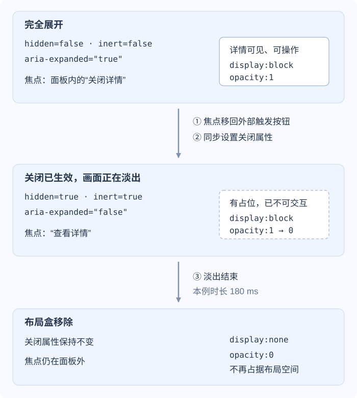

# 隐藏状态会怎样影响焦点与可访问性？

案例背景：报表页面有一个“查看详情”按钮，展开后在原位置显示详情和“关闭详情”按钮。这是普通的 disclosure（展开/折叠控件），页面其余部分仍可操作。用户在面板内点击关闭时，希望内容淡出、焦点回到“查看详情”，随后按 Tab 不再进入已关闭的面板。

一次关闭同时改变两件事：**内容现在是否可用**，以及**屏幕上的内容怎样消失**。后者可以花 180 ms，前者应当在关闭时就完成。理解这两个时点，才能同时处理布局、指针、键盘焦点和 accessibility tree（无障碍树）。

## 几种隐藏方式留下什么？

| 状态 | 布局空间 | 指针命中 | 键盘焦点 | 无障碍树 |
| --- | --- | --- | --- | --- |
| `display: none`（不生成显示盒）或普通 HTML `hidden`（未被作者样式覆盖） | 移除 | 不绘制、不命中 | 隐藏期间不能聚焦 | 通常不暴露 |
| `visibility: hidden`（不可见） | 保留 | hidden 后代不命中；显式设为 `visible` 的后代可命中 | hidden 后代通常不能聚焦；本来可聚焦的 visible 后代可以 | hidden 后代通常不暴露；visible 后代可能暴露 |
| `opacity: 0`（不透明度为零） | 保留 | 仍可能命中 | 仍可能聚焦 | 通常仍暴露 |
| `inert`（惰性子树） | 样式决定 | 普通子树退出用户交互 | 普通子树不可聚焦 | 辅助技术忽略该子树；视觉仍由 CSS 决定 |
| `aria-hidden="true"`（辅助技术隐藏状态） | 样式决定 | 样式决定 | 不会自行禁用焦点 | 从辅助技术呈现中隐藏子树 |

`visibility:hidden` 只对仍保持隐藏值的盒子隐藏绘制和交互；后代显式设为 `visibility:visible` 后会重新绘制、参与指针命中，本来可聚焦的元素也能重新接收焦点。父级 `visibility:hidden` 不等同于禁用整棵子树的 `inert`。

> [!info] HTML `hidden` 的两种状态
> 表中普通 `hidden` 指默认隐藏状态；作者 CSS 可以覆盖它默认的隐藏样式，所以还要检查实际的 `display`。`hidden="until-found"` 则为页内查找和片段导航保留可揭示的内容：元素仍有盒子、边框和间距，找到时浏览器先派发 `beforematch`，再移除 `hidden`。它需要 layout containment（布局包含）；设成 `display: none`、`contents` 或 `inline` 会妨碍页内查找揭示。这不是下面面板示例使用的状态。

`opacity` 不继承；浏览器把元素及其后代作为透明绘制组处理，因此子元素设为 `opacity: 1` 也无法穿透父元素的 `opacity: 0`。`pointer-events` 只影响指针命中，`pointer-events: none` 不会关闭键盘焦点或无障碍呈现。

> [!info] inert 与 aria-hidden 的责任不同
> 对本例的普通面板，`inert` 同时限制用户交互、焦点和辅助技术呈现。`aria-hidden` 只影响辅助技术呈现，不能替代焦点管理；不要用它把仍可聚焦的区域藏起来。`inert` 也不禁止脚本读取 DOM 或调用函数。一个需要单独处理的例外是通过 `showModal()` 打开的 modal dialog（模态对话框）：它可脱离祖先的 inert 状态，除非对话框自身也显式设置了 `inert`。

## 关闭面板时先处理焦点

先沿一次关闭看状态变化。下图假设面板已经完全展开，焦点位于里面的“关闭详情”按钮；CSS 支持稍后使用的离散过渡。图里的 `hidden` 是 HTML 关闭目标，`display` 则是当时计算出的显示值；过渡可以暂时保留盒子，让内容画完淡出。

**先移动焦点，再禁用面板**，否则原来的焦点会留在马上不可用的区域中，接下来落到哪里就不再由这段界面逻辑明确决定。一般的外部状态更新若发现焦点已经在外面，就保持其位置。面板自身的“关闭详情”按钮则明确先调用 `trigger.focus()`：鼠标点击原生按钮是否使其获得焦点取决于浏览器，不能假设点击关闭时焦点必定已经在面板里。

下面的 HTML、CSS 和 JavaScript 组成同一个例子。`aria-controls` 关联触发按钮与面板，`aria-expanded` 报告展开状态；普通 `<button>` 已具备 Enter 和 Space 激活行为。打开时移除 `hidden` 和 `inert`，并把 `aria-expanded` 设为 `true`。从已经聚焦的触发按钮激活时，打开操作保留它的焦点，用户可再通过顺序焦点导航进入面板（通常按 Tab，具体受浏览器和系统键盘设置影响）；代码没有要求鼠标点开时强制聚焦按钮。

~~~html
<button type="button" aria-controls="report-details" aria-expanded="false">
  查看详情
</button>
<section id="report-details" hidden inert>
  <h2>筛选结果详情</h2>
  <button type="button" data-close>关闭详情</button>
</section>
~~~

~~~css
#report-details {
  display: none;
  opacity: 0;
  transition: opacity 180ms ease, display 180ms allow-discrete;
}

#report-details:not([hidden]) {
  display: block;
  opacity: 1;
}

@starting-style {
  #report-details:not([hidden]) { opacity: 0; }
}

@media (prefers-reduced-motion: reduce) {
  #report-details { transition-duration: 0s; }
}
~~~

~~~javascript
const trigger = document.querySelector('[aria-controls="report-details"]');
const panel = document.querySelector("#report-details");
const closeButton = panel.querySelector("[data-close]");

function setDetailsOpen(open) {
  if (!open && panel.contains(document.activeElement)) trigger.focus();
  panel.inert = !open;
  panel.hidden = !open;
  trigger.setAttribute("aria-expanded", String(open));
}

trigger.addEventListener("click", () => setDetailsOpen(panel.hidden));
closeButton.addEventListener("click", () => {
  trigger.focus();
  setDetailsOpen(false);
});
~~~

这里不靠 `transitionend` 更新可用状态：关闭函数当次就完成焦点和三个属性的同步。关闭过渡中再次打开，CSS 会转向新的显示目标；没有旧定时器或旧动画回调随后再把面板藏掉。启用 `prefers-reduced-motion: reduce` 时，过渡时间变为零，这套状态切换仍然成立。

## display 也能参与离散过渡

`opacity` 可以从 1 连续变到 0；`display` 在 `block` 和 `none` 之间没有“半个盒子”的中间值。`allow-discrete` 允许它参与离散过渡，其中 `none` 与可显示值的切换有专门规则：

- **打开**：过渡开始就生成盒子，再让 `opacity` 从 0 变到 1。原来不渲染的元素没有可供过渡使用的普通前一帧样式，`@starting-style` 在这里提供起始的 0。
- **关闭**：过渡期间仍保留盒子，`opacity` 从 1 变到 0；结束时才切成 `display: none`，移除布局占位。

因此，图中淡出时可以同时出现 `hidden=true` 与动画中的 `display:block`。属性表达目标状态，过渡暂时保留盒子以画完退出过程。本例显式 `inert` 让这段时间里的面板不可交互。CSS Display Level 4 也规定：忽略过渡和动画的级联来源后，如果 `display` 仍为 `none`，元素就应处于惰性状态。

在不支持这些过渡特性的浏览器中，显示/隐藏仍由基础样式和属性控制，只是淡入淡出可能直接完成。实际核验本例时，在 Chrome 157.0.8103.51 中观察到关闭当次焦点已移出、面板已退出无障碍树，而动画中的 `display` 仍是 `block`；结束后才变为 `none`。这是浏览器状态检查，并不替代真实屏幕阅读器的操作验证。

> [!info]- 来源
> - 显示盒生成和 <code>display</code>：W3C CSS Display Level 3，Candidate Recommendation Draft（2026-06-05），[CSS Display](https://www.w3.org/TR/css-display-3/)，核对于 2026-11-12。
> - <code>display</code> 离散过渡中生成/移除显示盒的时点与 inert 行为：W3C CSS Display Level 4，§2.9，Working Draft（2025-11-06），[Animating and Interpolating display](https://www.w3.org/TR/css-display-4/#display-animation)，核对于 2026-11-12。
> - `visibility` 的后代覆盖：W3C CSS Display Level 3，§4，Candidate Recommendation Draft（2026-06-05），[visibility](https://www.w3.org/TR/css-display-3/#visibility)，核对于 2026-11-12。
> - `opacity` 的非继承性、整组透明绘制和命中测试：W3C CSS Color Level 4，Candidate Recommendation Draft（2026-11-03），[CSS Color](https://www.w3.org/TR/css-color-4/)，核对于 2026-11-12。
> - `pointer-events` 对指针命中与顺序焦点导航的边界：W3C CSS Basic User Interface Level 4，Working Draft（2026-01-20），[CSS Basic User Interface](https://www.w3.org/TR/css-ui-4/)，核对于 2026-11-12。
> - `inert` 子树与交互：WHATWG HTML Living Standard（2026-11-11 更新），[Inert subtrees](https://html.spec.whatwg.org/multipage/interaction.html#inert-subtrees)，核对于 2026-11-12。
> - 普通 `hidden` 与 `until-found` 状态：WHATWG HTML Living Standard（2026-11-11 更新），[The `hidden` attribute](https://html.spec.whatwg.org/multipage/interaction.html#the-hidden-attribute)，核对于 2026-11-12。
> - `aria-hidden` 和 `aria-expanded` 状态：W3C WAI-ARIA 1.2，Recommendation（2023-06-06），[WAI-ARIA](https://www.w3.org/TR/wai-aria-1.2/)，核对于 2026-11-12。
> - 离散显示过渡：W3C CSS Transitions Level 2，Working Draft（2026-02-04），[transition-behavior](https://www.w3.org/TR/css-transitions-2/#transition-behavior-property)，核对于 2026-11-12。
> - 减少动态效果：W3C Media Queries Level 5，Working Draft（2026-02-19），[prefers-reduced-motion](https://www.w3.org/TR/mediaqueries-5/#prefers-reduced-motion)，核对于 2026-11-12。
> - 键盘操作和焦点管理：W3C WAI [ARIA APG Keyboard Interface](https://www.w3.org/WAI/ARIA/apg/practices/keyboard-interface/)，核对于 2026-11-12。
> - 普通展开控件的按钮、键盘和 `aria-expanded` / `aria-controls` 约定：[WAI-ARIA APG Disclosure Pattern](https://www.w3.org/WAI/ARIA/apg/patterns/disclosure/)，核对于 2026-11-12。
> - 点击可聚焦性由 user agent 决定：[WHATWG HTML Focus](https://html.spec.whatwg.org/multipage/interaction.html#focus)，click focusable 定义；键盘与鼠标不能共用“点击后必然已聚焦”的假设，核对于 2026-11-12。
