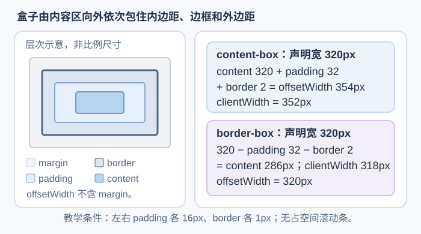
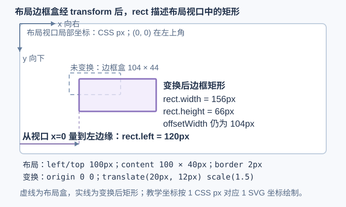

# 哪些网页几何接口能测量哪一种盒子？

Document Object Model（文档对象模型，DOM）的几何 API 读的是不同结果：`offset*` 与 `client*` 测量布局盒的大小或相对偏移，`scroll*` 描述滚动区域和当前位置，`getBoundingClientRect()` 则给出经过 CSS transform（变换）后的视口矩形。先问自己要的是盒子的尺寸、内部可用范围、滚动位置，还是视口坐标；选错 API 时，数值即使没有异常，也可能回答了另一个问题。

## 先按测量目标选择属性

| API | 返回内容 | 不包含或需留意 |
|---|---|---|
| `offsetWidth` / `offsetHeight` | 未变换边框盒片段的整数轴对齐范围；占空间的滚动条计入常见布局尺寸 | 不含 margin；忽略元素和祖先上的 transform |
| `clientWidth` / `clientHeight` | 整数 padding 区尺寸 | 普通 inline 元素或没有布局盒时返回 `0`；不含 border，也不含 padding 边缘与 border 边缘之间占空间的滚动条；标准模式下根元素例外地表示视口尺寸 |
| `scrollWidth` / `scrollHeight` | 整数滚动区域尺寸，可大于可见的客户区 | 不含 border；值大于客户区不保证用户能滚动该元素 |
| `scrollLeft` / `scrollTop` | 当前滚动区域相对滚动框的偏移 | 可写；当前 CSSOM View 接口允许小数，具体浏览器可能量化；零点方向和可用范围取决于滚动方向与布局 |
| `offsetLeft` / `offsetTop` | 第一个边框盒片段相对 `offsetParent` 第一个盒的 padding edge 的偏移 | `body` 或无布局盒时返回 `0`；其他元素若 `offsetParent` 为 `null`，则相对初始包含块原点；这些值忽略 transform |
| `getBoundingClientRect()` | 本次读取时，变换后边框片段的视口包围矩形；坐标和尺寸可为小数 CSS px | 不含 margin；结果是快照，不会跟着之后的滚动或布局变化而更新 |

这些尺寸使用 CSS 像素，不是设备物理像素。占空间的滚动条会减少 `clientWidth` 或 `clientHeight`；覆盖在内容上的滚动条通常不占这部分布局空间。没有布局盒的元素，例如 `display: none` 的元素，部分尺寸属性会返回 `0`。普通 inline 元素即使有文字片段，`clientWidth` / `clientHeight` 仍为 `0`；合成页中的普通 `span` 读到 `clientWidth = 0`、`offsetWidth = 101`，说明这两个属性回答的并非同一问题。

## 用固定数字对照布局尺寸

下面的两个元素都声明 `width: 320px`。第一种宽度只给 content；第二种把 padding 和 border 也算在声明宽度里。假设采用普通横排，且没有占空间的滚动条：

~~~css
.content-box {
  box-sizing: content-box;
  width: 320px;
  padding-inline: 16px;
  border: 1px solid;
}

.border-box {
  box-sizing: border-box;
  width: 320px;
  padding-inline: 16px;
  border: 1px solid;
}
~~~

| `box-sizing` | content 宽度 | `clientWidth` | `offsetWidth` | 计算 |
|---|---:|---:|---:|---|
| `content-box` | 320px | 352px | 354px | content `320` + 左右 padding `16×2` + 左右 border `1×2` |
| `border-box` | 286px | 318px | 320px | 声明总宽 `320` − 左右 padding `16×2` − 左右 border `1×2` |

`offsetWidth` 取边框盒宽度，`clientWidth` 取扣除边框与占空间滚动条后的内部宽度。`margin` 在这两个数值之外；因此它们都不能直接当作元素与相邻元素之间的总间距。

## 读滚动区域与当前偏移

`scrollHeight` / `scrollWidth` 表示滚动区域的尺寸；溢出内容可能使其大于可见的 `clientHeight` / `clientWidth`：

~~~javascript
const hasVerticalOverflow = element.scrollHeight > element.clientHeight;
const currentY = element.scrollTop;
element.scrollTop = 0; // 在普通向下溢出的例子中，回到滚动起点
~~~

这个比较只说明滚动区域比客户区高，并不单独证明用户能滚动它。`overflow: hidden` 会裁剪内容且不允许用户直接滚动，但仍可通过 `scrollTop` 程序滚动；`overflow: visible` 则把溢出内容画在盒外，不建立可滚动的区域，对它写入 `scrollTop` 不起作用。在 Chrome 157 的合成页中，两种盒子的 `scrollHeight` 都是 `200`、`clientHeight` 都是 `80`；写入 `30.5` 后，`hidden` 读回 `31`，`visible` 仍为 `0`。因此，区域尺寸和实际滚动能力要分开检查。`scrollTop` 和 `scrollLeft` 可写；当前 CSSOM View 的接口类型允许小数，但浏览器可能把它量化为整数。反向溢出方向也会改变滚动起点：普通 `direction: rtl` 横向溢出容器从右端的 `scrollLeft = 0` 开始，向左滚动时读数可变为负数。合成页中它的 `scrollWidth = 240`、`clientWidth = 100`，初值为 `0`；设为 `-20.5` 后 Chrome 读回 `-20`，随后设为 `25` 会回到 `0`。

带弹性回弹的浏览器还可能在用户拖过滚动边界时暴露通常范围外的偏移；这是依赖实现的行为。判断“已经到顶”或“已经到底”时，需要结合方向、范围与目标浏览器，不能先假设偏移总是非负整数。

在 standards mode（标准模式）下，根元素 `document.documentElement.scrollHeight` 特别返回视口滚动区域高度与视口高度的较大值；`clientHeight` 则是扣除占空间滚动条后的视口高度。普通元素的 `scrollHeight` 返回它自己的滚动区域高度。若只是想异步知道元素何时与观察区域相交，图片延迟加载的 [IntersectionObserver（相交观察器）示例](../browser-apis/image-lazy-loading.md)通常比反复读取矩形更合适；它会异步报告结果，但不承诺完全不需要布局信息。

## offset 相对哪个父元素？

`offsetLeft` / `offsetTop` 先处理两个返回 `0` 的情况：元素是 `body`，或元素没有布局盒。其他元素若 `offsetParent` 为 `null`，返回第一个盒片段的边框边缘相对初始包含块原点的位置；例如在没有祖先建立固定定位包含块的合成页中，`position: fixed; left: 55px; top: 30px` 的元素得到 `offsetParent === null` 和 `(offsetLeft, offsetTop) = (55, 30)`。此例的初始包含块原点与布局视口左上角重合。若 `offsetParent` 存在，坐标是子元素第一个边框盒片段的边框边缘，减去该父元素第一个盒片段的 padding edge；这里指 padding 区靠边框的一侧边缘，不是 content 与 padding 的分界。`offsetParent` 的规则还会考虑固定定位、表格结构、包含块、缩放和 Shadow DOM（影子 DOM）边界；它不固定等同于最近的 `position` 祖先。

## 读变换后的视口矩形

`getBoundingClientRect()` 先取得元素的 client rect（客户端矩形）列表。对于普通、宽高均非零的盒片段，它返回这些片段的最小轴对齐包围矩形；元素没有布局盒、片段列表为空时，返回位置与尺寸全为 `0` 的矩形。CSS transform 及其祖先的变换会反映在片段上。行内文字跨多行时可以产生多个片段，返回的是它们的联合范围；`DOMRect`（DOM 矩形）是读取时的快照，不会自行更新。这里的坐标以 layout viewport（布局视口）左上角为原点；它不是双指缩放后可见的 visual viewport 坐标原点。

> [!info]- 零宽或零高片段要区分规范算法与实现
> CSSOM View 草案规定：若列表中每个片段都至少有一边为 `0`，返回首片段；否则，对宽或高至少一项非 `0` 的片段求包围范围。这里陈述的是规范算法。Chrome 157.0.8103.51 的合成页中，三个零宽但非零高的片段实际返回末片段；混有普通片段和零宽尾片时，又没有把那些尾片纳入包围范围。依赖这类退化片段时，应按目标浏览器验证，不能把草案分支直接当作跨浏览器保证。下面的数值例子全部使用普通非退化盒子。

下面是一个可复算的布局例子：文档未滚动或缩放，也没有变换祖先；初始包含块左上角与布局视口原点对齐。盒子以 `(100px, 100px)` 起始，content 宽高为 `100px × 40px`，四边 border 各为 `2px`；变换原点设为左上角。`transform` 列表按从左到右的顺序合成矩阵，因此对点的实际作用从右侧函数开始：先绕左上角执行 `scale(1.5)`，再执行 `translate(20px, 12px)`。左上角本身在缩放时仍是原点，所以最终矩形从布局位置 `(100px, 100px)` 平移到视口位置 `(120px, 112px)`。

~~~html

~~~

~~~css
#target {
  position: absolute;
  left: 100px;
  top: 100px;
  box-sizing: content-box;
  width: 100px;
  height: 40px;
  border: 2px solid;
  transform-origin: 0 0;
  transform: translate(20px, 12px) scale(1.5);
}
~~~

布局边框盒宽 `100 + 2×2 = 104px`，高 `40 + 2×2 = 44px`；`offsetWidth` / `offsetHeight` 忽略变换，仍是 `104px × 44px`。变换后矩形从视口坐标 `(120px, 112px)` 开始，宽高为 `104×1.5 = 156px` 与 `44×1.5 = 66px`。因此，`rect.left = 120` 是视口原点到矩形左边缘的水平坐标，不是矩形宽度：

~~~javascript
const target = document.querySelector("#target");
const rect = target.getBoundingClientRect();
// rect.top / bottom：相对视口顶部的上下边缘
// rect.left / right：相对视口左侧的左右边缘
// rect.width / height：变换后边框盒片段的联合范围，单位为 CSS px
~~~

在标准模式中，下面的函数测试元素的变换后矩形是否与 layout viewport（布局视口）有正面积交叠。根元素的 `clientWidth` / `clientHeight` 给出扣除占空间滚动条后的布局视口尺寸；仅在边缘相接不算有面积交叠。

~~~javascript
function overlapsLayoutViewport(element) {
  const rect = element.getBoundingClientRect();
  const root = document.documentElement;
  return root.clientWidth > 0 && root.clientHeight > 0 &&
    rect.width > 0 && rect.height > 0 &&
    rect.bottom > 0 && rect.top < root.clientHeight &&
    rect.right > 0 && rect.left < root.clientWidth;
}
~~~

这个判断只比较矩形与布局视口，不检查祖先滚动容器的裁切、遮挡、透明度或旋转形状内部的空白区域，因此函数名不是“元素已可见”。移动端 pinch-zoom（双指缩放）缩小或平移当前可见区域时，layout viewport（布局视口）也不等于 visual viewport（视觉视口）。若需求要比较当前视觉视口，可把 `window.visualViewport.offsetLeft` / `offsetTop` 作为布局视口内的可见区域左上角，并将 `(offsetLeft, offsetTop, offsetLeft + width, offsetTop + height)` 当作当前视口四边界，按相同的矩形条件比较；这样仍不包含祖先裁切或遮挡。

## 把写入和读取分批

偶尔读取几何属性时，选择与问题相符的盒子和坐标系。若此前的 DOM 或样式写入使布局信息失效，紧接着读几何值可能迫使浏览器先同步完成所需的样式或布局；若布局仍有效，读取可以直接使用现有结果。循环交替写入和读取，在每次写入都影响下一次读取结果时可能反复付出这类成本。关于失效怎样沿渲染工作传播，以及如何批量读、再批量写，见[为什么一次 DOM 改动会增加布局或绘制工作？](./rendering-pipeline-and-forced-layout.md)。

> [!info]- 来源
> - `offsetWidth` / `offsetHeight` 忽略变换并量边框盒片段：[W3C CSSOM View §7，HTMLElement 扩展](https://www.w3.org/TR/cssom-view-1/#extensions-to-the-htmlelement-interface)；`clientWidth` / `clientHeight` 对普通 inline 或无盒元素返回 `0`，并按 §6 定义边框、滚动区域和根元素例外：[Element 扩展](https://www.w3.org/TR/cssom-view-1/#extensions-to-the-element-interface)。几何坐标和尺寸以 CSS px 表示：[§2.1 CSS pixels](https://www.w3.org/TR/cssom-view-1/#css-pixels)。CSSOM View，W3C Working Draft，2025-09-16；核对于 2026-11-12。
> - `offsetParent`、`offsetLeft` / `offsetTop` 的参照关系与例外：`offsetLeft` / `offsetTop` 在元素是 `body` 或没有布局盒时返回 `0`；其他元素的 `offsetParent` 为 `null` 时，坐标取第一个盒片段相对初始包含块原点的位置；非空父元素时以其第一个盒片段的 padding edge 为参照。`getClientRects()` 与 `getBoundingClientRect()` 的片段联合及非实时结果：[W3C CSSOM View §6–7](https://www.w3.org/TR/cssom-view-1/)，核对于 2026-11-12。
> - `scrollTop` / `scrollLeft` 的可写属性、滚动范围与负向坐标规则：[W3C CSSOM View，Editor’s Draft §6](https://drafts.csswg.org/cssom-view/#extensions-to-the-element-interface)，2026-11-05 版本；这是工作草案，当前 IDL 将偏移定义为 `unrestricted double`。本地 Chrome 157 的合成页把 `30.5` 读回 `31`、把 RTL 的 `-20.5` 读回 `-20`，所以文中不把小数支持说成每个浏览器的保证。
> - `overflow: visible` 让溢出内容绘制在盒外；`overflow: hidden` 裁剪内容、不提供用户直接滚动，但仍允许程序滚动。初始滚动位置通常取决于书写模式，并与滚动原点重合；滚动原点默认在 block-start 与 inline-start 的交角，RTL 的 inline-start 位于右侧：[CSS Overflow Module Level 3 §2.3、§3.1](https://drafts.csswg.org/css-overflow-3/)，Editor’s Draft，2026-08-13。
> - 弹性回弹可能暴露超出常规边界的偏移；这是实现差异，不是所有浏览器的保证：[CSSWG issue 4011](https://github.com/w3c/csswg-drafts/issues/4011)、[WebKit issue 198597](https://bugs.webkit.org/show_bug.cgi?id=198597)。2026-11-12 核对时仍未形成统一约定；本章没有声称已实测 Safari 的回弹。
> - content-box 与 border-box 的 `box-sizing` 计算：[W3C CSS Sizing Level 3 §3.3，Box Edges for Sizing](https://www.w3.org/TR/css-sizing-3/#box-sizing)，W3C Working Draft，2026-09-04；核对于 2026-11-12。
> - `getBoundingClientRect()` 对空片段、每个片段都至少有一边为零、其余片段的联合分别执行的返回规则，以及视口矩形；标准模式根元素的视口尺寸、布局视口与视觉视口的嵌套关系、视觉视口偏移和尺寸：[W3C CSSOM View §2、§6、§12](https://www.w3.org/TR/cssom-view-1/)，W3C Working Draft，2025-09-16；核对于 2026-11-12。
> - `transform` 函数从左到右合成变换矩阵；把局部点映射到父坐标系时，右侧的函数先作用：[CSS Transforms Module Level 1 §2，Transform Rendering Model](https://drafts.csswg.org/css-transforms/#transform-rendering)，Editor’s Draft，2025-11-30。
> - IntersectionObserver 的结果异步送达，面向相对根或视口的位置查询；规范明确不以像素级实际显示结果为目标：[W3C Intersection Observer §1](https://www.w3.org/TR/intersection-observer/#introduction)，Working Draft，2023-10-18；核对于 2026-11-12。
> - 几何读取可能同步触发布局的条件是此前样式或 DOM 已使布局失效；Chrome 的实现说明及读写批处理建议：[Chrome for Developers，Forced reflow](https://developer.chrome.com/docs/performance/insights/forced-reflow)，更新于 2025-10-08。本仓库的机制展开见[渲染流水线与强制布局](./rendering-pipeline-and-forced-layout.md)。
