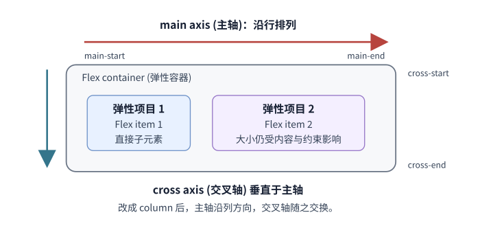

# 固定与流动内容适合哪种 CSS 布局？

报表外框常同时有固定侧栏和可伸缩主栏；操作工具栏沿一个方向排列链接与按钮；卡片列表则要在窄宽度下自动换列。沿用报表页的 `<main>` 作为主栏：先描述项目之间怎样分配空间，再选布局。Flexbox (弹性盒布局) 适合沿一个主轴分配项目；Grid (网格布局) 适合显式组织行列轨道。作为 Cascading Style Sheets (CSS, 层叠样式表) 布局模型，默认情况下两者只改变盒子的视觉布局，不会改写 HyperText Markup Language (HTML, 超文本标记语言) 文档中 Document Object Model (DOM, 文档对象模型) 节点的源顺序。

## 固定侧栏与流动结果区

先把设计输入说清楚：报表外框的内容宽度固定为 1120px，左侧导航固定为 14rem（按根字号 16px，即 224px），中间留 16px。没有内容下限时，主栏剩余宽度为：

> [!example] 报表主栏的轨道宽度
> `1120 - 224 - 16 = 880px`。但主栏若含 `min-content`（最小内容尺寸）为 920px 的不可断内容，`1fr` 的自动最小轨道会取 920px；两轨与间隔合计 `224 + 16 + 920 = 1160px`，超出设定为 1120px 的外框 40px。改成 `minmax(0, 1fr)` 后，主栏轨道仍是 880px；本例中的 920px 内容盒被裁掉 40px，真实内容则要自行换行、裁切或滚动。

下面用一个固定 920px 宽的合成内容，单独展示轨道下限怎样影响结果区。它不是实际统一资源定位符的宽度；真实内容如何保留全文见例子之后。

~~~html

  <nav aria-label="报表分类导航">...</nav>
  <main>
    <h1>月度订单</h1>
    

      合成的 920px 不可断内容
    

  </main>

~~~

~~~css
.report-layout {
  display: grid;
  inline-size: 1120px;
  grid-template-columns: 14rem minmax(0, 1fr);
  gap: 16px;
}
.report-url {
  display: block;
  overflow: hidden;
  white-space: nowrap;
}
.synthetic-token { display: inline-block; inline-size: 920px; }
~~~

在这个单列主栏中，`1fr` 等价于 `minmax(auto, 1fr)`：`auto` 是轨道最小范围，不总是 min-content (最小内容尺寸)；本例的直接 grid item (网格项目) 在默认约束下采用内容下限，因此 920px 内容会撑开它。`minmax(0, 1fr)` 明确把轨道下限设为零，因而能收进剩下的 880px；它不会替长内容选择换行或滚动方式。这里直接网格项目的自动最小尺寸也已是零，所以不必再为同一问题加 `min-inline-size: 0`。

这个合成行内盒会被裁切，只用于看清轨道宽度。若换成真实链接地址并要显示全文，应移除固定宽度和 `white-space: nowrap` / 裁切规则，再为长词设置 `overflow-wrap: anywhere`。若结果是宽数据表，应保留真实 `<table>` 的行列和标题关系，把表放进局部横向滚动容器；该滚动区域应有名称，并确保目标浏览器里键盘用户能到达和滚动它。

下面的 Flex 规则替换上例的 `.report-layout` 布局声明；沿用 1120px 外框、16px 间距和根字号 16px，导航仍为 224px，主栏仍为 880px：

~~~css
.report-layout { display: flex; inline-size: 1120px; gap: 16px; }
.report-layout > nav { flex: 0 0 14rem; }
.report-layout > main { flex: 1 1 0; min-inline-size: 0; }
~~~

flex item (弹性项目) 的主轴自动最小尺寸在默认情况下可能受内容最小宽度限制；长链接地址或大表格因此可能拒绝收缩。`min-inline-size: 0` 明确允许主栏沿行方向缩小，内容随后要自行换行、裁切或在局部滚动。Grid 与 Flex 的细节和适用条件不同：多列关系要按轨道同时对齐时 Grid 更容易表达；只需沿主轴分配一排控件时 Flex 更直接。Flex 可以换行，但每条 flex line (弹性行) 仍各自分配，不会像 Grid 那样把不同项目排成共同列轨道。

## Flexbox 一次处理一个主轴

`display: flex` 或 `inline-flex` 会创建 flex container (弹性容器)，其参与正常流的直接子元素成为 flex item (弹性项目)，非纯空白的直接文本内容会被包进匿名项目；绝对定位的子元素不参与这套空间分配。`flex-direction` 决定 main axis (主轴)，cross axis (交叉轴) 与其垂直。布局先求项目的 flex base size (Flex 基础尺寸)，再把它限制在最小 / 最大尺寸之间，得到 hypothetical main size (假设主尺寸)。算法比较各项外部假设主尺寸（包括外边距）之和与容器内主尺寸，决定本轮使用增长还是收缩；因此 min/max 约束在选择分支之前就会参与判断。随后以基础尺寸为起点分配空间：增长按 `flex-grow` 比例分配 positive free space (正剩余空间)；收缩按 `flex-shrink` 与基础尺寸的乘积，即 scaled flex-shrink factor (缩放后的收缩权重)，分配 negative free space (负剩余空间)。算法依据违反约束的情况冻结部分项目，再把剩余空间分给未冻结的项目。这里先考虑增长因子合计不小于 1 的常见情形；若一行的增长因子合计小于 1，可能只用掉部分正剩余空间。

| 属性 | 负责什么 |
| --- | --- |
| `flex-direction`、`flex-wrap` | 主轴方向、是否产生多条 flex line (弹性行) |
| `justify-content` | 项目尺寸与自动外边距确定后，沿主轴分配剩余空间 |
| `align-items`、`align-self` | 项目在各自 Flex line 的交叉轴上对齐 |
| `align-content` | 在交叉轴上对齐 Flex line；只对允许换行的容器生效，单条 line 也可能移动 |
| `gap` | 项目之间的间距；先从容器可用空间中扣除，再计算可分配空间 |
| `flex-grow`、`flex-shrink`、`flex-basis` | 正剩余空间增长比例、负空间收缩权重、基础尺寸 |
| `order` | 改变 Flex 项目的视觉顺序，不改 DOM 顺序 |

本图以默认 horizontal writing mode (横向书写模式)、`direction: ltr` (left-to-right, 从左向右) 和 `flex-direction: row` 为例：主轴从左向右，交叉轴从上向下。改用 `column` 后，主轴沿列方向，交叉轴随之交换。两轴起点和终点的物理方向随书写模式与 `direction` 变化；`row-reverse` / `column-reverse` 会反转主轴方向。main size (主尺寸) 和 cross size (交叉尺寸) 分别指项目沿主轴和交叉轴的尺寸。

> [!example] 允许换行的容器即使只有一条 line，也能移动它
> 设容器高 100px、唯一项目高 20px，并使用 `flex-wrap: wrap`、`align-content: flex-end` 和 `align-items: flex-start`。在默认行方向下，单条弹性行的起点落在 `y = 80px`。若把容器改成 `flex-wrap: nowrap`，它成为单行 Flex 容器，`align-content` 不生效，项目仍从 `y = 0px` 开始。

> [!example] 负剩余空间遇到最小尺寸时重新分配
> 容器内宽 256px，项目间距 16px，所以两项共有 240px 可用空间。两项的基础尺寸分别为 200px 和 100px，`flex-shrink` 都为 1，合计比可用空间多 60px。初次按 `1 × 200 : 1 × 100` 的缩放收缩权重分配，得到暂定尺寸 160px 和 80px。若第一项的最小行内尺寸为 180px，它触及下限后被冻结；剩下的第二项重新分配余下空间，最终为 60px。最终尺寸 `180 + 60 + 16 = 256px` 正好填满容器。本机 Chromium 探针也测得 180px、60px。

~~~html

  

  

~~~

~~~css
.shrink-demo { display: flex; inline-size: 256px; gap: 16px; }
.first { flex: 0 1 200px; min-inline-size: 180px; }
.second { flex: 0 1 100px; min-inline-size: 0; }
~~~

为从零基准分配剩余空间，可显式写 `flex: 1 1 0`。其中 `flex-grow` 与 `flex-shrink` 都为 1，`flex-basis` 明确为零。CSS Flexbox 规范定义的单数值简写 `flex: 1` 也表示以零基准分配空间；本机 Chromium `157.0.8103.51` 的 `getComputedStyle()` 却将它序列化为 `0%`。在主轴尺寸不确定的列容器中，百分比基准会按内容解析，因而可能与明确的零长度表现不同。下文的探针把 `flex: 1` 与 `flex: 1 1 0` 分开测量；若布局依赖确定的零基准且主轴尺寸可能不确定，应写三值形式。

这个差异在本机无头 Chrome 的小例子里可见：自动高度的列容器有两个项目，文字内容高分别为 40px 和 20px，项目设 `min-height: 0; overflow: hidden`。单值 `flex: 1` 的计算基准为 `0%`，两项按内容得到 40px、20px，容器高 60px；显式写 `flex: 1 1 0px` 时，容器与两项高度都为 0px。该尺寸结果是本机 Chromium 157 的探针观察；它限定了上面的写法建议，不意味着所有主轴或浏览器都会出现相同差异。

`flex: auto` 等价于 `1 1 auto`：先参考明确的主轴尺寸，尺寸为 `auto` 时再依据内容。`flex: none` 等价于 `0 0 auto`，按基础尺寸排布且不增长或收缩。`flex: initial` 等价于 `0 1 auto`：有正剩余时不增长，空间不足时仍可收缩到其最小尺寸。项目的自动最小尺寸可能继续阻止收缩，因此还要看其内容和溢出规则。

## 用 Flex 排列报表工具栏并截断长标题

一排导航、操作按钮和当前报表名只有一条主轴，适合 Flex。工具栏可放在 `<main>` 的标题下方；以下 360px 与 1120px 是单独演算的工具栏宽度，不沿用前面 880px 的主栏约束。为让宽度演算可复现，例子把两个链接固定为 64px，按钮固定为 43px，间隔均为 16px；标题项目从零基准增长，标题本身采用单行省略号。

~~~html
<nav class="report-toolbar" aria-label="当前报表操作">
  <a class="fixed-link" href="/reports">全部报表</a>
  <a class="fixed-link" href="/reports/monthly">月度报表</a>
  
    2026 年 10 月跨地区订单处理与复核情况汇总
  
  <button type="button">导出</button>
</nav>
~~~

~~~css
.report-toolbar {
  display: flex;
  align-items: center;
  gap: 16px;
  inline-size: 360px;
  font-size: 16px;
}
.report-toolbar > * { box-sizing: border-box; }
.fixed-link { flex: 0 0 64px; white-space: nowrap; }
.current-report {
  flex: 1 1 0;
  overflow: hidden;
  white-space: nowrap;
  text-overflow: ellipsis;
}
.report-toolbar > button { flex: 0 0 43px; padding: 0; }
~~~

工具栏内容宽度为 360px 时，固定部分共占 `64 + 64 + 43 + 3 × 16 = 219px`，标题从零基准得到 `360 − 219 = 141px` 的正剩余空间。这不是 `flex-shrink` 把标题压窄；标题按 `flex-grow` 增长到 141px 后，才在盒内显示省略号。这个标题在本机 16px 字号的 Chromium 探针中自然宽度约 316px；实际文字宽度会随字体变化。把 `inline-size` 改为 1120px 时，标题得到 `1120 − 219 = 901px`，足够显示完整文本。`overflow: hidden` 在直接 Flex 项上属于可滚动的溢出值：它不显示滚动条，但内容仍能通过程序滚动；因此该项的自动主轴最小尺寸为零。如果只在内层子元素上裁切，外层 Flex 项通常要另写 `min-inline-size: 0` 允许收缩。

裁切只隐藏视觉部分，文本仍在 DOM 中。若标题需要导航，应使用真实链接并保留完整的可访问名称；同时确保省略容器不会裁掉键盘焦点指示。不要用已截断的字符串替换完整标题。

## Grid 同时定义行与列

`display: grid` 或 `inline-grid` 建立显式或隐式行列轨道。固定尺寸适合不变的导航，`fr` 表示按因子分配可用剩余空间，但每条轨道仍要满足自身的最小和最大尺寸。内容关键时，可用 `min-content`、`max-content`、`auto` 与 `fit-content()` 参与轨道尺寸计算：`min-content` 尽量缩到仍可在合法断点换行的最窄尺寸；`max-content` (最大内容尺寸) 则按不利用软换行机会时的内容宽度计算。最终结果还受容器空间、可换行机会与显式约束影响。

~~~css
.cards {
  display: grid;
  grid-template-columns:
    repeat(auto-fit, minmax(min(100%, 15rem), 1fr));
  gap: 1rem;
}
~~~

这里的 `.cards` 直接子项是卡片；容器宽度明确时，默认自动放置会让每张卡片占一列：

~~~html
<section class="cards" aria-label="月度报表">
  <article><h2>订单总量</h2>
本月订单数量与上月比较。
</article>
  <article><h2>准时交付</h2>
按地区查看订单交付情况。
</article>
  <article><h2>待复核</h2>
需要进一步检查的订单。
</article>
</section>
~~~

根字号为 16px 时，轨道的设计下限是 `15rem = 240px`。沿用 880px 的报表主栏，3 条轨道需 `3 × 240 + 2 × 16 = 752px`，4 条需 `4 × 240 + 3 × 16 = 1008px`，放不下，所以三张及以上卡片排三列，每列约 `(880 − 2 × 16) ÷ 3 = 282.7px`；第四张会进入下一行。若只有两张卡片，`auto-fit` 折叠未放入项目的第三条重复轨道及其相邻间隔，于是每列约 `(880 − 16) ÷ 2 = 432px`。若主栏缩到 220px，`min(100%, 15rem)` 使单列轨道下限缩到 220px。轨道宽度和卡片自身的宽度约束是两件事：若卡片写了 `min-inline-size: 300px`，它仍可撑到 300px 并在 220px 轨道内溢出。本机 Chromium 探针测得 880px 容器中，两张卡片各 432px、三张各约 282.66px，220px 容器中轨道宽 220px。若要在空位保留未使用的轨道槽位，可选择 `auto-fill`；`auto-fit` 则折叠空轨道，让现有项目伸展。

## 居中未知尺寸的内容

如果内容应留在正常流中，让父容器负责二维或单轴对齐。容器必须有多余空间，否则没有可分配的空白：

~~~css
.center-grid {
  display: grid;
  place-items: center;
}

.center-flex {
  display: flex;
  justify-content: center;
  align-items: center;
}
~~~

`place-items: center` 将 Grid 项目在格内水平与垂直对齐；Flex 版分别沿主轴和交叉轴对齐。需要覆盖整个区域时，应让容器从父级布局或轨道取得预期高度，而不是给内容写固定尺寸。

居中浮层离开普通流，需要先确定它的包含块，再用定位和 `transform` 让未知尺寸自身回移；规则见[定位如何确定元素位置与前后顺序？](./css-position-display-and-animations.md)。本节的居中元素仍留在正常流中，浮层位置由定位机制决定。

## 看懂旧布局，不把它当新布局首选

- **float (浮动)。** 让文字绕排浮动盒；还要处理包含浮动与外边距交互，见[block formatting context (BFC, 块级格式上下文) 如何约束浮动和外边距？](./bfc-and-flow-containment.md)。
- **表格布局。** 可维护旧项目；`display: table-cell` 不会创建 HTML 表格的标题、行列等语义。
- **inline-block (行内块)。** 源码空白会形成项目间隙，基线也可能影响对齐。
- **绝对定位。** 可把按钮锚定到卡片角落，但它脱离普通流，不参与父级尺寸计算。
- **Bootstrap Grid。** 是框架约定，不等同于 CSS Grid。新项目先确认实际采用的 Bootstrap 版本，再按对应官方文档选类名与断点。

> [!info]- Bootstrap 3.4.1 与 Bootstrap 4.6 的旧网格示例
> 归档 Bootstrap 3.4.1 示例使用十二列系统：`.container` / `.container-fluid`、`.row`、`.col-xs-*` / `.col-sm-*` / `.col-md-*` / `.col-lg-*`。断点为 `<768px`、`≥768px`、`≥992px`、`≥1200px`。归档截图显示的是 Bootstrap 4.6：它有 `.col-` 与 `.col-xl-`，并包含 `576px` 断点，不能用它推断 Bootstrap 3 的类名和断点。可[打开归档 Bootstrap 4 网格截图](../../archive/front-end/0-1_Learning_Notes/CSS/grid.png) 查看。
>
> Bootstrap 3 插件 JavaScript 需要先加载 jQuery；CSS 网格本身不需要该依赖。Bootstrap 官方文档目前将 Bootstrap 3 与 Bootstrap 4 标为结束支持：3.4.1 的维护于 2019-07-24 结束，4.6.2 于 2023-01-01 结束；它们适合作为旧项目维护资料，不是新项目的默认选择。
>
> 来源：[Bootstrap 3.4 Grid system](https://getbootstrap.com/docs/3.4/css/#grid) 与 [Bootstrap 3.4 JavaScript 插件依赖](https://getbootstrap.com/docs/3.4/javascript/)；[Bootstrap 4.6 Grid system](https://getbootstrap.com/docs/4.6/layout/grid/) 与 [Bootstrap 官方结束支持说明](https://getbootstrap.com/docs/4.6/end-of-life/)，核对日期：2026-11-12。

在未使用显式阅读顺序控制时，HTML 源码顺序仍是文档与键盘顺序的通常依据。Flex `order`、`row-reverse` 和 Grid 指定区域改变视觉位置，不会同步改写源码或默认顺序；不要用它们修补错误的源顺序。

> [!info]- 来源与核验
> - **Flex 项目的轴、尺寸与自动最小尺寸。** W3C [CSS Flexible Box Layout Module Level 1](https://www.w3.org/TR/css-flexbox-1/)，Candidate Recommendation Draft，2025-10-14，§§4.5、6、7.1、8.3–8.4、9；并核对 [CSSWG 编辑草案](https://drafts.csswg.org/css-flexbox/)，2026-05-08。用于单数值 `flex` 简写、基础尺寸、正 / 负剩余空间分配与约束处理。
> - **Grid 轨道和自动重复。** W3C [CSS Grid Layout Module Level 2](https://www.w3.org/TR/css-grid-2/)，Candidate Recommendation Draft，2025-03-26，§§6.6、7.2.3、12；`1fr` 的自动最小范围、`auto-fit` 折叠空轨道与轨道尺寸算法。
> - **Flex/Grid 项目自动最小尺寸与裁切值。** W3C [CSS Overflow Module Level 3](https://www.w3.org/TR/css-overflow-3/)，Working Draft，2025-10-07，§3.1；`hidden`、`clip` 与 `scroll` 的区别，核对日期：2026-11-12。
> - **绘制顺序与格式化模型。** W3C [CSS Display Module Level 3](https://www.w3.org/TR/css-display-3/)，Candidate Recommendation Draft，2026-06-05，§3.1；`order` 改变视觉顺序，不改默认的语音呈现顺序与顺序键盘导航顺序。
> - **键盘焦点顺序。** W3C [Understanding Success Criterion 2.4.3: Focus Order](https://www.w3.org/WAI/WCAG22/Understanding/focus-order.html)；焦点移动顺序需保留内容含义与操作关系。
> - **本地布局探针。** 本轮 headless Chrome `157.0.8103.51`：`1fr` 案例主轨道为 920px、两轨与间距合计 1160px，超出 1120px 外框 40px；`minmax(0, 1fr)` 主轨道为 880px。`auto-fit` 在 880px 容器中排出 3 × 282.66px 或 2 × 432px；220px 容器中的轨道为 220px，另测 `min-inline-size: 300px` 卡片本身为 300px 并溢出轨道。负剩余空间的冻结例最终为 180px、60px。独立 Flex 探针中，`flex: 1` 的计算 `flex-basis` 为 `0%`，`flex: 1 1 0` 为 `0px`；自动高度列容器、两项内容高 40px / 20px 时，前者尺寸为 40px / 20px、容器高 60px，后者项目和容器都为 0px。工具栏代码本身使用 `flex: 1 1 0`，不是此处的单值简写探针。这些数字是本机对固定输入的核验，不是跨浏览器性能或兼容性保证。
