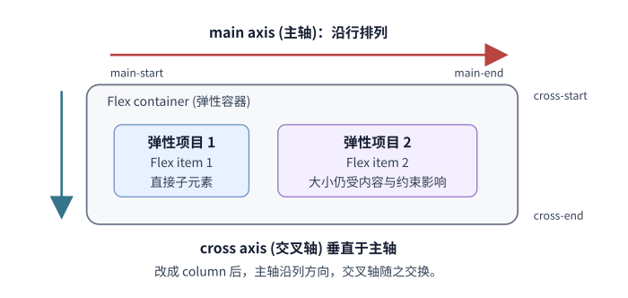
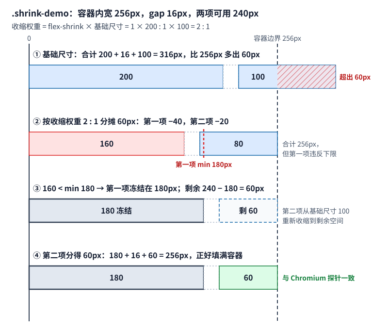

# Flex 和 Grid 怎样把空间分给每个项目？

[上一章](./box-model-and-normal-flow.md)的块在普通流里只会从上到下堆叠。报表页（沿用主线一的 `/reports/42`）还需要三种排法：外框由固定宽度的侧栏和可伸缩的主栏 `<main>` 组成；主栏标题下的工具栏在一行里排链接、报表名和导出按钮；摘要区的卡片在变窄时自动减少列数。本章回答 Flexbox (弹性盒布局) 和 Grid (网格布局) 怎样把容器的空间分给每个项目，为什么项目有时拒绝收缩，以及怎样在流内居中。例子里的宽度都是为手算设定的；实测值注明浏览器版本。

## 一条轴还是共同的列

选型先看项目之间要怎样对齐：

- **Flex** 沿一条 main axis (主轴) 排列项目，按比例分配剩余空间或分摊不足。工具栏只有一排控件，适合 Flex。Flex 也能换行，但每条 flex line (弹性行) 各自分配空间，不同行的项目不会对成共同的列。
- **Grid** 同时定义行和列轨道，项目落进格子。摘要卡要对齐成列，适合 Grid。

外框的“固定侧栏 + 伸缩主栏”两种都能写，后文给出两种写法。Flex 和 Grid 都只改变盒子在屏幕上的位置：`order`、`row-reverse` 和 Grid 的区域放置不改 DOM 里的源码顺序，Tab 键和屏幕阅读器仍按源码前进，所以不要用它们修补错误的源码顺序（规则与代价见[焦点顺序跟随源码](./semantic-structure-and-accessibility.md#焦点顺序跟随源码)）。

## Flex 怎样在一条主轴上分配空间

`display: flex` 或 `inline-flex` 创建 flex container (弹性容器)，它的直接子元素成为 flex item (弹性项目)。直接写在容器里的非空白文本会被包进匿名项目；绝对定位的子元素不参与空间分配。

`flex-direction` 决定主轴方向，cross axis (交叉轴) 与之垂直。下图是默认横向书写、`direction: ltr`、`flex-direction: row` 的情形：主轴从左向右，交叉轴从上向下。改成 `column` 后两轴交换；两轴起止的物理方向随书写模式和 `direction` 变化，`row-reverse` / `column-reverse` 反转主轴。main size (主尺寸) 和 cross size (交叉尺寸) 指项目沿两轴的尺寸。

| 属性 | 负责什么 |
| --- | --- |
| `flex-direction`、`flex-wrap` | 主轴方向；是否允许产生多条弹性行 |
| `flex-basis` | 项目的基础尺寸 |
| `flex-grow` | 有正剩余空间时的增长比例 |
| `flex-shrink` | 空间不足时的收缩权重 |
| `gap` | 项目间距，先从容器可用空间里扣除 |
| `order` | 改变视觉顺序，不改 DOM 顺序 |

对齐属性（`justify-content`、`align-*`）在尺寸确定之后才起作用，放在[对齐与流内居中](#对齐与流内居中)一节。

### 三步算出每个项目的主尺寸

在一条弹性行上：

1. **求假设主尺寸。** 每个项目先得到 flex base size (基础尺寸)，再限制到自己的最小/最大尺寸之间，得到 hypothetical main size (假设主尺寸)。
2. **决定增长还是收缩。** 把各项的假设主尺寸、外边距和间距加起来，和容器的主轴内尺寸比较：总和较小就增长，否则收缩。因为第 1 步已经应用了 min/max，这些约束在选方向之前就参与了判断。
3. **从基础尺寸出发分配差额。** 增长时按 `flex-grow` 的比例分 positive free space (正剩余空间)；收缩时按 `flex-shrink × 基础尺寸`，即 scaled flex-shrink factor (缩放后的收缩权重)，分摊 negative free space (负剩余空间)。某个项目分完后违反了自己的最小或最大尺寸，就把它固定在边界上，称为 freeze (冻结)，再把剩下的差额分给其余项目，直到全部确定。

收缩按“权重 × 基础尺寸”分摊，是为了让大项目多缩、小项目少缩，避免小项目先被压到零。增长则只看 `flex-grow`。一行的 `flex-grow` 合计小于 1 时，项目只分走相应比例的正剩余空间，其余留空。

下面的 `.shrink-demo` 把第 3 步走一遍：容器内宽 `256px`、间距 `16px`，两项基础尺寸 `200px` 和 `100px`，`flex-shrink` 都为 1，第一项最小行内尺寸 `180px`。图中每一行是分配过程的一个中间状态，竖虚线是容器边界：

图中第 ① 行用的是上文第 1 步的假设主尺寸：第一项限制到 min 之后仍是 `200px`（不低于 180），所以合计 316px 时第 2 步选的是收缩。最终 `180px`、`60px` 是手算结果，Chromium 探针也测得同样的值。

~~~html

  

  

~~~

~~~css
.shrink-demo { display: flex; inline-size: 256px; gap: 16px; }
.first { flex: 0 1 200px; min-inline-size: 180px; }
.second { flex: 0 1 100px; min-inline-size: 0; }
~~~

### flex 简写各代表什么

`flex` 按 `flex-grow flex-shrink flex-basis` 的顺序一次设三项：

| 写法 | 等价于 | 含义 |
| --- | --- | --- |
| `flex: 1 1 0` | 同左 | 从零出发，按比例分配全部空间。本章的主栏和报表名都用它 |
| `flex: 1` | 规范中为 `1 1 0` | 单值正数表示零基准；浏览器的计算值可能是 `0%`，见下方实例 |
| `flex: auto` | `1 1 auto` | 先用明确的主轴尺寸，没有时按内容，再增长或收缩 |
| `flex: none` | `0 0 auto` | 按基础尺寸排布，不增长也不收缩 |
| `flex: initial` | `0 1 auto` | 有剩余时不增长，空间不足时可收缩到最小尺寸 |

能缩到多小还要看项目的自动最小尺寸，见[自动最小尺寸让项目拒绝收缩](#自动最小尺寸让项目拒绝收缩)。

> [!info] 实例：Chromium 157 中 `flex: 1` 与 `flex: 1 1 0` 的差异
> 本机 headless Chrome `157.0.8103.51` 的 `getComputedStyle()` 把 `flex: 1` 的基础尺寸报告为 `0%`，`flex: 1 1 0` 为 `0px`。在主轴尺寸不确定的列容器里，百分比基准按内容解析，两者表现不同：自动高度的列容器里有两个项目，文字内容高 `40px` 和 `20px`，项目设 `min-height: 0; overflow: hidden`。写 `flex: 1` 时两项按内容得到 `40px`、`20px`，容器高 `60px`；写 `flex: 1 1 0px` 时容器和两项都是 `0px`。这是本机对这组输入的观察。布局依赖确定的零基准、且主轴尺寸可能不确定时，写三值形式。

## Grid 轨道怎样定尺寸

`display: grid` 或 `inline-grid` 让容器按行列 track (轨道) 排布子项。轨道可以用 `grid-template-columns` / `grid-template-rows` 显式定义，也会在放置项目时隐式生成。轨道尺寸的写法：

- 固定长度，如 `14rem`：适合不变的导航。
- `fr`：按比例分配剩余空间，但每条轨道仍要满足自己的最小和最大尺寸。
- 由内容决定：`min-content` (最小内容尺寸) 是在所有合法断点都换行时的最窄宽度；`max-content` (最大内容尺寸) 是不利用软换行机会时的宽度；`auto` 和 `fit-content()` 介于其间，结果还受容器空间和显式约束影响。
- `minmax(最小, 最大)`：分别给轨道定下限和上限。

关键的一条：单独写的 `1fr` 等价于 `minmax(auto, 1fr)`，下限是 `auto`，不是零。下一节的问题就从这里来。

## 自动最小尺寸让项目拒绝收缩

Flex 项目和 Grid 项目的 `min-width` / `min-height` 初始值是 `auto`。这个 `auto` 在不同条件下解析成不同的值：

| 项目 | 自动最小尺寸取内容下限的条件 | 否则 |
| --- | --- | --- |
| Flex 项目（主轴方向） | 项目不是滚动容器 | `0` |
| Grid 项目 | 项目不是滚动容器，且跨越的轨道中有最小尺寸函数为 `auto` 的（跨多条时其中不能有 `fr` 轨道） | `0` |

内容下限大致是项目内容的 `min-content`；若项目另写了确定的尺寸，则不超过那个尺寸。于是一个不能断行的长链接、一张宽表格，会让项目宁可溢出容器也不缩小。

是否是滚动容器由 `overflow` 的计算值决定：`hidden`、`auto`、`scroll` 让盒子成为滚动容器，自动最小尺寸就变成零；`visible` 和 `clip` 不是，内容下限仍然有效。`overflow: clip` 只裁切，不能替代 `hidden` 来解除下限。滚动容器的完整含义见[哪些声明会建立 BFC](./box-model-and-normal-flow.md#哪些声明会建立%20BFC，各带什么副作用)。

解除下限的办法有两种：在项目上写 `min-inline-size: 0`（Flex 和 Grid 都适用）；在 Grid 里把轨道写成 `minmax(0, 1fr)`，轨道下限不再是 `auto`，项目的自动最小尺寸也随之为零。两种办法都只是允许项目变窄，内容是换行、裁切还是滚动，要另外决定。

### 外框：1fr 主栏被长内容撑开

外框内容宽 `1120px`，侧栏 `14rem`（根字号 `16px` 时为 `224px`），间距 `16px`。主栏里有一段不能断行的长链接地址，下例用一个人为设定为 `920px` 宽的行内块模拟它：

~~~html

  <nav aria-label="报表分类导航">...</nav>
  <main>
    <h1>月度订单</h1>
    

      合成的 920px 不可断内容
    

  </main>

~~~

~~~css
.report-layout {
  display: grid;
  inline-size: 1120px;
  grid-template-columns: 14rem minmax(0, 1fr);
  gap: 16px;
}
.report-url {
  display: block;
  overflow: hidden;
  white-space: nowrap;
}
.synthetic-token { display: inline-block; inline-size: 920px; }
~~~

> [!example] 主栏轨道宽度
> 没有内容下限时，主栏应得 `1120 − 224 − 16 = 880px`。
>
> 写成 `14rem 1fr` 时，`1fr` 的下限是 `auto`，主栏 `<main>` 这个 grid item (网格项目) 的自动最小尺寸取内容下限 `920px`，轨道被撑到 `920px`。两轨加间距 `224 + 16 + 920 = 1160px`，超出外框 `40px`。
>
> 写成 `14rem minmax(0, 1fr)` 时，轨道下限为零，主栏回到 `880px`。`920px` 的行内块在 `.report-url` 里被裁掉 `40px`。
>
> headless Chrome `157.0.8103.51` 实测：`1fr` 时主轨道 `920px`，`minmax(0, 1fr)` 时 `880px`。

裁切只是为了看清轨道宽度。真实页面里，要显示完整链接地址，就去掉固定宽度、`white-space: nowrap` 和裁切，改给长词设 `overflow-wrap: anywhere`。如果主栏里是宽数据表，保留真实 `<table>` 的行列和标题关系，把表放进局部横向滚动容器；这个滚动区域要有名称，并确认键盘用户在目标浏览器里能到达和滚动它。

同一外框用 Flex 写，沿用 `1120px`、`16px` 间距和 `14rem` 侧栏：

~~~css
.report-layout { display: flex; inline-size: 1120px; gap: 16px; }
.report-layout > nav { flex: 0 0 14rem; }
.report-layout > main { flex: 1 1 0; min-inline-size: 0; }
~~~

主栏从零基准增长到 `880px`。这里的 `min-inline-size: 0` 不能省：没有它，主栏的自动最小尺寸是 `920px`，项目拒绝缩到 `880px`。两种写法宽度相同；之后若要让多块内容按共同的列对齐，Grid 更容易扩展。

### 工具栏：报表名增长后截断

工具栏在一行里排两个导航链接、当前报表名和导出按钮。为了能手算，两个链接固定 `64px`，按钮固定 `43px`，间距 `16px`；报表名从零基准增长，放不下时显示单行省略号。宽度分别取 `360px` 和 `1120px` 演算，与上面 `880px` 的主栏无关。

~~~html
<nav class="report-toolbar" aria-label="当前报表操作">
  <a class="fixed-link" href="/reports">全部报表</a>
  <a class="fixed-link" href="/reports/monthly">月度报表</a>
  
    2026 年 10 月跨地区订单处理与复核情况汇总
  
  <button type="button">导出</button>
</nav>
~~~

~~~css
.report-toolbar {
  display: flex;
  align-items: center;
  gap: 16px;
  inline-size: 360px;
  font-size: 16px;
}
.report-toolbar > * { box-sizing: border-box; }
.fixed-link { flex: 0 0 64px; white-space: nowrap; }
.current-report {
  flex: 1 1 0;
  overflow: hidden;
  white-space: nowrap;
  text-overflow: ellipsis;
}
.report-toolbar > button { flex: 0 0 43px; padding: 0; }
~~~

固定部分共占 `64 + 64 + 43 + 3 × 16 = 219px`。工具栏 `360px` 时，报表名从零基准得到 `360 − 219 = 141px` 的正剩余空间。这不是 `flex-shrink` 把它压窄，而是它按 `flex-grow` 只长到 `141px`，再在盒内显示省略号。本机 Chromium 中这行标题在 `16px` 字号下的完整宽度约 `316px`，随字体而变。工具栏改为 `1120px` 时，报表名得到 `1120 − 219 = 901px`，足以完整显示。

报表名不需要 `min-inline-size: 0`，因为它自己写了 `overflow: hidden`，已是滚动容器，自动最小尺寸为零。

如果报表名外面多包了一层，只在内层链接上裁切，外层 Flex 项目就不是滚动容器，仍会按内容下限拒绝收缩。这时在直接项目上解除下限，在内层文本元素上裁切：

~~~html

  

    <a href="/reports/42">2026 年 10 月跨地区订单处理与复核情况汇总</a>
  

  <button type="button">筛选</button>

~~~

~~~css
.toolbar { display: flex; inline-size: 360px; gap: 16px; }
.toolbar > .report-name {
  flex: 1 1 0;
  min-inline-size: 0;
}
.toolbar > .report-name > a {
  display: block;
  overflow: hidden;
  white-space: nowrap;
  text-overflow: ellipsis;
}
~~~

省略号只隐藏视觉部分，文本仍在 DOM 中。报表名若要可点击，就用真实链接并保留完整的可访问名称，不要用截断后的字符串替换完整标题；还要确认裁切容器没有裁掉键盘焦点指示。单行省略的三个前提和多行裁切见[文字放不下时](./responsive-units-and-layout.md#文字放不下时怎样省略和裁切)。

## auto-fit 与 auto-fill 按宽度决定列数

摘要区的卡片要在宽度变窄时自动减列，而列数不应依赖卡片文字有多宽。Grid 的自动重复轨道按容器可用宽度和每列最小宽度算出列数：

~~~css
.cards {
  display: grid;
  grid-template-columns:
    repeat(auto-fit, minmax(min(100%, 15rem), 1fr));
  gap: 1rem;
}
~~~

~~~html
<section class="cards" aria-label="月度报表摘要">
  <article><h2>订单总量</h2>
本月订单数量与上月比较。
</article>
  <article><h2>准时交付</h2>
按地区查看订单交付情况。
</article>
  <article><h2>待复核</h2>
需要进一步检查的订单。
</article>
</section>
~~~

`repeat(auto-fit, ...)` 在不溢出的前提下放尽可能多条列轨道，每条至少 `min(100%, 15rem)`，多余空间由 `1fr` 均分。卡片是 `.cards` 的直接子项，默认自动放置让每张依次占一格。`min(100%, 15rem)` 保证容器比 `15rem` 还窄时，单列下限缩到容器宽度，而不是溢出。

> [!example] 880px 主栏里的列数
> 根字号 `16px`，轨道下限 `15rem = 240px`，间距 `16px`。
>
> - 3 列需要 `3 × 240 + 2 × 16 = 752px`，放得下；4 列需要 `4 × 240 + 3 × 16 = 1008px`，放不下。所以最多 3 列。
> - 三张卡片：每列 `(880 − 2 × 16) ÷ 3 ≈ 282.67px`。第四张会进入下一行。
> - 两张卡片：仍能容纳 3 条重复轨道，但 `auto-fit` 折叠没有项目的第三条轨道及其相邻间距，两列各 `(880 − 16) ÷ 2 = 432px`。
> - 主栏缩到 `220px`：`min(100%, 15rem)` 取 `220px`，单列轨道宽 `220px`。
>
> headless Chrome `157.0.8103.51` 实测：三张各约 `282.66px`，两张各 `432px`，`220px` 容器中轨道 `220px`。

轨道宽度和卡片自身的尺寸约束是两回事：卡片若写了 `min-inline-size: 300px`，在 `220px` 轨道里仍会撑到 `300px` 并溢出轨道（同一探针实测）。

`auto-fill` 和 `auto-fit` 算出的重复次数相同，区别只在空轨道：`auto-fill` 保留空轨道的位置，两张卡片后留出一个空槽，卡片不被拉宽；`auto-fit` 折叠空轨道，让现有卡片伸展。

## 对齐与流内居中

项目尺寸确定后，容器里还剩的空间由对齐属性分配：

| 属性 | 负责什么 |
| --- | --- |
| `justify-content` | 项目尺寸和自动外边距确定后，沿主轴（Grid 中沿行内轴）分配剩余空间 |
| `align-items`、`align-self` | 项目在所在弹性行或网格区域里沿交叉轴（Grid 中沿块轴）对齐 |
| `align-content` | Flex 中沿交叉轴对齐各条弹性行，只对允许换行的容器生效；Grid 中沿块轴对齐整组行轨道 |
| `justify-items`、`place-items` | Grid 项目在格内沿行内轴对齐；`place-items` 同时设 `align-items` 和 `justify-items` |

> [!example] 允许换行的容器只有一条行也能移动它
> 容器高 `100px`，唯一项目高 `20px`，设 `flex-wrap: wrap`、`align-content: flex-end`、`align-items: flex-start`。这是多行容器，唯一一条弹性行高 `20px`，被推到底部，项目从 `y = 80px` 开始。改成 `flex-wrap: nowrap` 后，它是单行容器，那条行占满 `100px` 高，`align-content` 不生效，项目按 `align-items: flex-start` 从 `y = 0px` 开始。

居中未知尺寸的内容，最简单的办法就是让父容器负责对齐。内容留在普通流里，可以两个方向都居中，也可以只居中一个方向：

~~~css
.center-grid {
  display: grid;
  place-items: center;
}

.center-flex {
  display: flex;
  justify-content: center;
  align-items: center;
}
~~~

Grid 版把项目在格内两个方向对齐；Flex 版分别沿主轴和交叉轴对齐。前提是容器比内容大，否则没有剩余空间可分。需要覆盖整个区域时，让容器从父级布局或轨道取得预期高度，不要给内容写固定尺寸。弹窗这类要脱离普通流的浮层，居中方式不同，见[未知尺寸浮层居中](./positioning-and-stacking.md#让未知尺寸的浮层居中)。

## 读懂旧布局手段

维护旧代码时会遇到这些写法，它们各有用途，但不是新布局的首选：

- **float (浮动)：** 本意是让文字绕排。父级怎样包住浮动、margin 怎样折叠，见[盒子和浮动怎样在流里排开](./box-model-and-normal-flow.md)。
- **表格布局：** `display: table-cell` 只借用表格的排版，不产生 HTML 表格的标题、行列语义。
- **inline-block (行内块)：** 源码里的空白会形成项目间隙，基线也会影响对齐。
- **绝对定位：** 适合把按钮锚定到卡片角落，但它脱离普通流，不参与父级尺寸计算，见[定位元素参照谁](./positioning-and-stacking.md)。
- **Bootstrap Grid：** 是框架的类名约定，不等同于 CSS Grid。先确认项目实际用的 Bootstrap 版本，再按对应官方文档选类名和断点。

> [!info]- 归档：Bootstrap 3.4.1 与 4.6 的网格（核对日期 2026-11-12）
> Bootstrap 3.4.1 用十二列系统：`.container` / `.container-fluid`、`.row`、`.col-xs-*` / `.col-sm-*` / `.col-md-*` / `.col-lg-*`，断点为 `<768px`、`≥768px`、`≥992px`、`≥1200px`。它的插件 JavaScript 需要先加载 jQuery，CSS 网格本身不需要。
>
> 归档截图展示的是 Bootstrap 4.6：它有 `.col-` 与 `.col-xl-`，并多了 `576px` 断点，不能用它推断 Bootstrap 3 的类名和断点。[打开归档 Bootstrap 4 网格截图](../../archive/front-end/0-1_Learning_Notes/CSS/grid.png)。
>
> 官方文档把两者都标为结束支持：3.4.1 的维护于 2019-07-24 结束，4.6.2 于 2023-01-01 结束。它们适合维护旧项目，不是新项目的默认选择。

## 下一步：脱离流的盒子参照谁

到这里，给定容器宽度和项目的尺寸声明，可以算出每个 Flex 项目和 Grid 轨道的宽度，判断项目为什么拒绝收缩，并在流内居中内容。这些项目都留在流里，彼此推开。徽标贴卡片角、弹窗盖在页面上、工具栏滚动时贴顶，则要让盒子脱离或部分脱离流，下一章[定位元素参照谁，为什么大 z-index 还会被盖住](./positioning-and-stacking.md)接着回答。

> [!info]- 来源
> - **Flex 容器与项目、两轴、三步尺寸算法、冻结、`flex` 简写、自动最小尺寸**（“Flex 怎样在一条主轴上分配空间”“flex 简写各代表什么”“自动最小尺寸让项目拒绝收缩”）：W3C CSS Flexible Box Layout Module Level 1，Candidate Recommendation Draft 2025-10-14，§§4.1、4.5、6、7.1、8.3–8.4、9，<https://www.w3.org/TR/css-flexbox-1/>；并核对 CSSWG 编辑草案 2026-05-08，<https://drafts.csswg.org/css-flexbox/>。
> - **Grid 轨道尺寸、`1fr` 的自动下限、Grid 项目自动最小尺寸、`auto-fit` 折叠空轨道**（“Grid 轨道怎样定尺寸”“自动最小尺寸让项目拒绝收缩”“auto-fit 与 auto-fill 按宽度决定列数”）：W3C CSS Grid Layout Module Level 2，Candidate Recommendation Draft 2025-03-26，§§6.6、7.2.3、12，<https://www.w3.org/TR/css-grid-2/>。
> - **`hidden`/`auto`/`scroll` 是滚动容器、`clip` 不是**（“自动最小尺寸让项目拒绝收缩”）：W3C CSS Overflow Module Level 3，Working Draft 2025-10-07，§3.1，<https://www.w3.org/TR/css-overflow-3/>。核对日期 2026-11-12。
> - **`order` 与重排只改视觉顺序**（“一条轴还是共同的列”）：W3C CSS Display Module Level 3，Candidate Recommendation Draft 2026-06-05，§3.1，<https://www.w3.org/TR/css-display-3/>。
> - **焦点顺序需保留含义与操作关系**（同上）：W3C Understanding Success Criterion 2.4.3: Focus Order，<https://www.w3.org/WAI/WCAG22/Understanding/focus-order.html>。
> - **Bootstrap 网格与结束支持**（“读懂旧布局手段”归档 callout）：Bootstrap 3.4 Grid system，<https://getbootstrap.com/docs/3.4/css/#grid>；Bootstrap 3.4 JavaScript 插件依赖，<https://getbootstrap.com/docs/3.4/javascript/>；Bootstrap 4.6 Grid system，<https://getbootstrap.com/docs/4.6/layout/grid/>；官方结束支持说明，<https://getbootstrap.com/docs/4.6/end-of-life/>。核对日期 2026-11-12。
> - **本地布局探针**（各 `[!example]` 与 Chromium 实例）：headless Chrome `157.0.8103.51`。外框 `1fr` 主轨道 `920px`、合计 `1160px`，`minmax(0, 1fr)` 主轨道 `880px`；`auto-fit` 在 `880px` 容器中排出 3 × `282.66px` 或 2 × `432px`，`220px` 容器轨道 `220px`，`min-inline-size: 300px` 卡片为 `300px` 并溢出；冻结例 `180px`、`60px`；`flex: 1` 计算基础尺寸 `0%`、`flex: 1 1 0` 为 `0px`，列容器两项 `40px`/`20px`、容器 `60px` 对比全为 `0px`；工具栏标题完整宽约 `316px`。这些是对固定输入的核验，不是跨浏览器兼容性保证。
