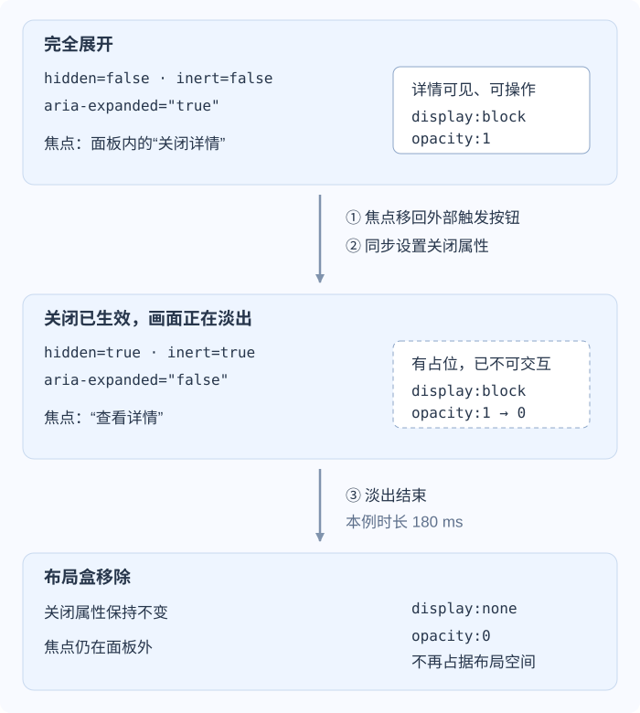

# 隐藏内容时，布局、指针、焦点和读屏各受什么影响？

“把它藏起来”在 CSS 和 HTML 里有好几种写法，它们各自只关掉一部分能力：有的还占位，有的还能被点到，有的还能用 Tab 聚焦，有的还会被屏幕阅读器读出来。本章先把五种隐藏方式按这四个维度对照清楚，再用一个可淡出的详情面板说明关闭时焦点和隐藏状态的先后顺序。读者已经知道焦点顺序跟随源码顺序（见[页面结构怎样让所有人都能读懂和操作？](semantic-structure-and-accessibility.md)）。

## 关闭一个面板，要回答哪四个问题

沿用[主线一的报表页](../browser/from-url-to-interactive-page.md)。本章在它上面加一个普通的 disclosure (展开/折叠控件)：“查看详情”按钮（`Show details`）控制下方的 `#report-details` 面板，面板里有一个“关闭详情”按钮（`Close details`），页面其余部分始终可操作。用户在面板里点“关闭详情”时，期望三件事：内容淡出；焦点回到“查看详情”；之后按 Tab 不再进入已关闭的面板。

关闭其实改变了两件事，而且时点不同：

- **内容还能不能用**：应在关闭的那一刻就结束。
- **内容在屏幕上怎样消失**：可以花 180 ms 慢慢淡出。

要把这两个时点分开，得先知道每种隐藏方式影响哪几项：

1. **布局空间**：元素还占不占位置，周围内容会不会移动。
2. **指针命中**：鼠标或触摸还能不能点中它。
3. **键盘焦点**：Tab 还能不能落到它里面的控件上。
4. **accessibility tree (无障碍树)**：浏览器交给辅助技术的那棵树里还有没有它；屏幕阅读器按这棵树朗读和导航。

## 五种隐藏方式各关掉了什么

| 隐藏方式 | 布局空间 | 指针命中 | 键盘焦点 | 无障碍树 |
| --- | --- | --- | --- | --- |
| `display: none`，或未被作者样式覆盖的 HTML `hidden` | 移除 | 不绘制，不命中 | 隐藏期间不能聚焦 | 通常不暴露 |
| `visibility: hidden` | 保留 | 保持 hidden 的后代不命中；显式设为 `visible` 的后代可命中 | hidden 后代通常不能聚焦；设回 `visible` 的可聚焦后代可以 | hidden 后代通常不暴露；`visible` 后代可能暴露 |
| `opacity: 0` | 保留 | 仍可能命中 | 仍可能聚焦 | 通常仍暴露 |
| `inert` | 由样式决定 | 子树退出用户交互 | 子树不可聚焦 | 辅助技术忽略该子树 |
| `aria-hidden="true"` | 由样式决定 | 由样式决定 | 不影响 | 从辅助技术呈现中隐藏子树 |

前三行是 CSS 渲染属性，它们决定“画不画、占不占位”，焦点和读屏的变化只是附带结果。后两行是 HTML/ARIA 状态，它们不改变外观，只改变交互或辅助技术呈现。几个容易误判的细节：

- **HTML `hidden` 的效果来自默认样式。** 普通 `hidden` 靠浏览器默认的 `display: none` 生效；作者 CSS 如果给这个元素写了别的 `display`，它就又显示出来了。判断时要看计算后的 `display`，不能只看属性。
- **`visibility: hidden` 可以被后代推翻。** 它会继承，但后代显式写 `visibility: visible` 后会重新绘制、参与命中，原本可聚焦的控件也能再次获得焦点。所以父级 `visibility: hidden` 不等于把整棵子树禁用。
- **`opacity` 不继承，而是整组透明。** 浏览器把元素连同后代当作一个整体按该不透明度绘制，子元素写 `opacity: 1` 也穿不透父元素的 `opacity: 0`。但它只管“看不看得见”：透明的按钮仍可能被点中、被 Tab 到、被读出来。
- **`pointer-events: none` 只关指针。** 它让指针命中穿过元素，但不关闭键盘焦点，也不影响无障碍树，所以不是隐藏方式。
- **`inert` 与 `aria-hidden` 的职责不同。** `inert` 让子树同时退出用户交互、焦点和辅助技术呈现，外观仍由 CSS 决定，也不阻止脚本读取 DOM 或调用函数。`aria-hidden` 只对辅助技术隐藏，不管焦点；把仍可聚焦的区域标成 `aria-hidden`，键盘用户会 Tab 进一块读屏“看不见”的区域，所以不要用它代替焦点管理。

> [!warning] 模态对话框是 inert 的例外
> 用 `showModal()` 打开的 modal dialog (模态对话框)可以脱离祖先的 inert 状态，除非对话框自身也显式设置了 `inert`。不要假设给外层容器加 `inert` 就能连带关掉其中的模态对话框。

## until-found：可以被页内查找揭示的隐藏

HTML `hidden` 还有第二种状态 `hidden="until-found"`，用于折叠起来但仍应能被页内查找（Ctrl/Cmd+F）或片段导航找到的内容，例如长文档里收起的章节。它和普通 `hidden` 的区别：

- 元素仍有盒子、边框和间距，只是内容不显示。
- 页内查找或片段导航命中其中内容时，浏览器先在元素上派发 `beforematch` 事件，再移除 `hidden` 属性。页面可以在 `beforematch` 里同步自己的展开状态，例如更新触发按钮的 `aria-expanded`。
- 它依赖 layout containment (布局包含)。作者样式若把元素设成 `display: none`、`contents` 或 `inline`，查找就无法揭示它。

报表页的详情面板关闭后不需要被查找到，所以下面用普通 `hidden`。

## 关闭面板：先移焦点，再停交互，最后移除盒子

按上表的分工，关闭时组合三样东西：

- HTML `hidden` 表达“已关闭”的目标状态，最终移除布局盒。
- `inert` 立即停止交互、焦点和读屏。
- `opacity` 负责淡出。

下图沿一次关闭画出状态变化。起点是面板完全展开、焦点在面板里的“关闭详情”上，并假设浏览器支持下一节的 `display` 离散过渡。图中 `hidden` 是属性值，表示关闭目标；`display` 是各时刻实际计算出的值，淡出期间盒子暂时保留，好让淡出画完。

**顺序是先移焦点，再禁用面板。** 反过来做，焦点会停在一块刚变得不可用的区域里，下一次 Tab 落到哪里由浏览器决定，而不是由界面逻辑决定。

下面的 HTML、CSS 和 JavaScript 是同一个例子：

~~~html
<button type="button" aria-controls="report-details" aria-expanded="false">
  Show details
</button>
<section id="report-details" hidden inert>
  <h2>Report details</h2>
  <button type="button" data-close>Close details</button>
</section>
~~~

~~~css
#report-details {
  display: none;
  opacity: 0;
  transition: opacity 180ms ease, display 180ms allow-discrete;
}

#report-details:not([hidden]) {
  display: block;
  opacity: 1;
}

@starting-style {
  #report-details:not([hidden]) { opacity: 0; }
}

@media (prefers-reduced-motion: reduce) {
  #report-details { transition-duration: 0s; }
}
~~~

~~~javascript
const trigger = document.querySelector('[aria-controls="report-details"]');
const panel = document.querySelector("#report-details");
const closeButton = panel.querySelector("[data-close]");

function setDetailsOpen(open) {
  if (!open && panel.contains(document.activeElement)) trigger.focus();
  panel.inert = !open;
  panel.hidden = !open;
  trigger.setAttribute("aria-expanded", String(open));
}

trigger.addEventListener("click", () => setDetailsOpen(panel.hidden));
closeButton.addEventListener("click", () => {
  trigger.focus();
  setDetailsOpen(false);
});
~~~

逐项说明这段代码的选择：

- **触发按钮的语义。** `aria-controls` 关联按钮与面板，`aria-expanded` 报告展开状态；原生 `<button>` 本身支持 Enter 和 Space 激活，不需要额外键盘处理。
- **打开时不抢焦点。** 打开只移除 `hidden` 和 `inert` 并把 `aria-expanded` 设为 `true`，焦点留在触发按钮上，用户按 Tab 进入面板。
- **关闭时只在必要时移焦点。** `setDetailsOpen(false)` 只在焦点确实在面板内时才把它移回触发按钮；关闭若由别处发起、焦点本来就在面板外，就不去动它。
- **“关闭详情”无条件先聚焦触发按钮。** 用鼠标点击原生按钮时，按钮会不会获得焦点由浏览器决定，所以不能假设此刻焦点一定在面板里，也就不能只依赖上面的 `contains` 判断。
- **不等 `transitionend`。** 焦点、`inert`、`hidden`、`aria-expanded` 在调用当下同步更新，可用状态不依赖动画是否播完。淡出途中再次打开时，CSS 直接转向新的目标值，也没有遗留的定时器或动画回调随后把面板又藏起来。
- **减少动态效果时照样成立。** 用户开启 `prefers-reduced-motion: reduce` 时过渡时长为零，状态切换不变，只是没有淡出过程。

## display 怎样参与离散过渡

上面的 CSS 让 `display` 也参与过渡，这需要单独解释。`opacity` 可以从 1 连续变到 0，`display` 却没有介于 `block` 与 `none` 之间的“半个盒子”。`transition` 里的 `allow-discrete`（即 `transition-behavior: allow-discrete`）允许这类离散属性参与过渡；`none` 与可显示值之间的切换有专门规则：

- **打开**：过渡一开始就生成盒子，然后 `opacity` 从 0 变到 1。原本不渲染的元素没有“上一帧样式”可作起点，`@starting-style` 为它提供起始的 `opacity: 0`；没有这条规则，面板会直接以 `opacity: 1` 出现。
- **关闭**：过渡期间保留盒子，`opacity` 从 1 变到 0，结束时才切成 `display: none`，移除布局占位。

所以图中淡出阶段会同时出现 `hidden=true` 和计算值 `display: block`：属性表达目标，过渡只是暂时保留盒子来画完退出。这段时间面板仍有盒子，本例靠显式的 `inert` 让它不可交互。CSS Display Level 4 草案对此也有规定：不计过渡和动画时 `display` 为 `none` 的元素应处于惰性状态；显式写 `inert` 让例子不依赖浏览器是否已实现这条规定。

不支持这些特性的浏览器仍按基础样式和属性显示或隐藏，只是没有淡入淡出。

> [!info] Chrome 157 中的观察（Chrome 157.0.8103.51，核对于 2026-11-12）
> 关闭当下焦点已移出面板、面板已退出无障碍树，而过渡中的计算值 `display` 仍是 `block`，结束后才变为 `none`。这是对浏览器状态的检查，不能代替用真实屏幕阅读器操作验证。

## 隐藏状态归属性，运动归 CSS

本章的结论可以概括成一条分工：能不能用由 `hidden`、`inert`、`aria-expanded` 这些属性在操作当下决定，屏幕上的消失过程交给 CSS 过渡，两者互不等待。淡出只是最简单的一种运动。按钮颜色怎样平滑变化、面板怎样带过冲地进入、自动循环的装饰怎样做才不伤可访问性，接着在[过渡和关键帧动画怎样选，怎样不伤性能和可访问性？](transitions-and-animations.md)里讨论。

> [!info]- 来源
> - 五种方式对照表中 `display` 与显示盒生成：W3C CSS Display Level 3，Candidate Recommendation Draft（2026-06-05），[CSS Display](https://www.w3.org/TR/css-display-3/)，核对于 2026-11-12。
> - `visibility` 的继承与后代覆盖：W3C CSS Display Level 3，§4，[visibility](https://www.w3.org/TR/css-display-3/#visibility)，核对于 2026-11-12。
> - `opacity` 不继承、整组透明绘制与命中测试：W3C CSS Color Level 4，Candidate Recommendation Draft（2026-11-03），[CSS Color](https://www.w3.org/TR/css-color-4/)，核对于 2026-11-12。
> - `pointer-events` 只影响指针命中、不影响顺序焦点导航：W3C CSS Basic User Interface Level 4，Working Draft（2026-01-20），[CSS Basic User Interface](https://www.w3.org/TR/css-ui-4/)，核对于 2026-11-12。
> - `inert` 子树的交互、焦点与辅助技术行为，以及 modal dialog 例外：WHATWG HTML Living Standard（2026-11-11 更新），[Inert subtrees](https://html.spec.whatwg.org/multipage/interaction.html#inert-subtrees)，核对于 2026-11-12。
> - 普通 `hidden` 与 `hidden="until-found"`、`beforematch` 与布局包含要求：WHATWG HTML Living Standard（2026-11-11 更新），[The `hidden` attribute](https://html.spec.whatwg.org/multipage/interaction.html#the-hidden-attribute)，核对于 2026-11-12。
> - `aria-hidden` 与 `aria-expanded` 状态：W3C WAI-ARIA 1.2，Recommendation（2023-06-06），[WAI-ARIA](https://www.w3.org/TR/wai-aria-1.2/)，核对于 2026-11-12。
> - 关闭时先移焦点、键盘操作与焦点管理：W3C WAI [ARIA APG Keyboard Interface](https://www.w3.org/WAI/ARIA/apg/practices/keyboard-interface/)，核对于 2026-11-12。
> - 展开控件的按钮、键盘与 `aria-expanded` / `aria-controls` 约定：W3C WAI [ARIA APG Disclosure Pattern](https://www.w3.org/WAI/ARIA/apg/patterns/disclosure/)，核对于 2026-11-12。
> - 鼠标点击按钮后是否获得焦点由 user agent 决定：WHATWG HTML，[Focus](https://html.spec.whatwg.org/multipage/interaction.html#focus)，click focusable 定义，核对于 2026-11-12。
> - `allow-discrete` 离散过渡：W3C CSS Transitions Level 2，Working Draft（2026-02-04），[transition-behavior](https://www.w3.org/TR/css-transitions-2/#transition-behavior-property)，核对于 2026-11-12。
> - `display` 过渡中生成/移除显示盒的时点，以及 `display: none` 元素的惰性规定：W3C CSS Display Level 4，§2.9，Working Draft（2025-11-06），[Animating and Interpolating display](https://www.w3.org/TR/css-display-4/#display-animation)，核对于 2026-11-12。
> - 减少动态效果偏好：W3C Media Queries Level 5，Working Draft（2026-02-19），[prefers-reduced-motion](https://www.w3.org/TR/mediaqueries-5/#prefers-reduced-motion)，核对于 2026-11-12。
