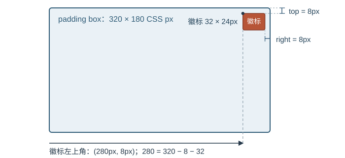
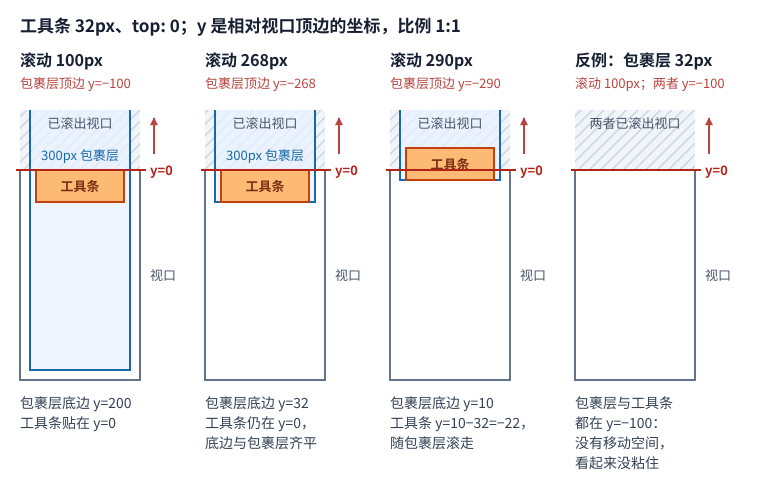
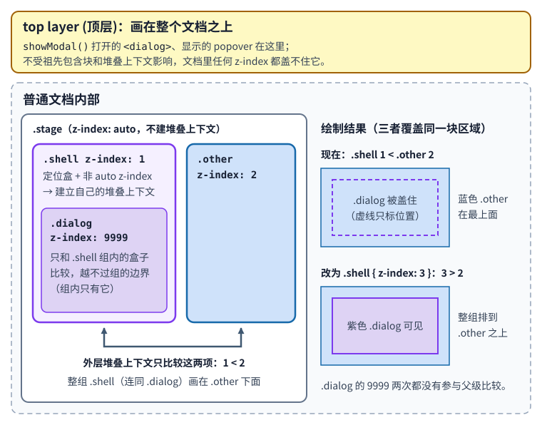

# 定位元素参照谁，为什么大 z-index 还会被盖住？

[上一章](./flex-and-grid-layout.md)的项目都留在流里，互相推开。报表页（沿用主线一的 `/reports/42`）还有三个需求要让盒子脱离或部分脱离流：卡片的状态徽标贴住卡片右上角；弹窗位于视口中央；工具条在滚动时贴住顶部，直到它所在的区域滚出视口。本章回答定位盒的坐标参照哪个矩形，以及重叠时谁画在上面。

## 先分清四个问题

| 属性或概念 | 回答的问题 | 例子 |
| --- | --- | --- |
| `display` | 生成什么盒子，内部怎样排布？ | `block`、`flex`、`grid` 选择盒子类型和内部布局；`none` 不为元素及其后代生成盒子 |
| `position` | 盒子是否保留流中位置，偏移怎样解释？ | `relative` 保留原位置再视觉偏移；`absolute` 脱离普通流 |
| containing block (包含块) | 定位坐标相对哪个矩形计算？ | 绝对定位常用最近建立包含块的祖先的 padding edge (内边距边缘) |
| stacking context (堆叠上下文) | 哪些盒子作为一组参与前后绘制？ | 组内先排序，再由父级把整个组和别人比较 |

偏移用 inset properties (偏移属性) 表达：物理方向的 `top`、`right`、`bottom`、`left`，或逻辑方向的 `inset-block-start`、`inset-inline-end` 等；`inset` 是四边的简写。padding edge 是 padding box 的外缘。`display: none` 怎样影响布局、焦点和读屏，见[隐藏内容时各受什么影响](./hiding-content-and-focus.md)。

## position 的五个值

| `position` | 普通流中的位置 | 偏移参照 | 滚动表现 |
| --- | --- | --- | --- |
| `static` (静态) | 保留 | 偏移属性不生效 | 随文档移动 |
| `relative` (相对) | 保留原位置 | 自己原来的流位置 | 随文档移动 |
| `absolute` (绝对) | 不占原位置 | 最近建立绝对定位包含块的祖先；没有则用初始包含块 | 随该包含块移动 |
| `fixed` (固定) | 不占原位置 | 最近建立固定定位包含块的祖先；通常是视口 | 相对该包含块固定；若某个祖先建立了这种包含块，就不再贴着视口 |
| `sticky` (粘性) | 保留原位置 | 最近滚动容器的可视区域，并受自身包含块约束 | 某轴至少一个偏移不是 `auto` 时，滚动中才沿该轴贴边 |

`absolute` 和 `fixed` 会把盒子的外部 `display` 类型 blockify (块化)，例如 `display: inline` 的元素变成块级盒。这只改盒子类型，与包含块和堆叠上下文无关。

## 包含块：绝对定位和固定定位参照谁

所有非 `static` 的 `position` 值都会为绝对定位后代建立包含块，边界通常是这个祖先的 padding edge。最常见的写法是给父级加 `position: relative`。找绝对定位的参照时，要沿祖先链向上找最近一个建立了包含块的祖先，而不是默认用父元素。

除了 `position`，下面这些属性也会为绝对定位**和固定定位**后代建立包含块：

- `transform` 或 `perspective` 不为 `none`；
- `filter` 不为 `none`（根元素除外）；
- `contain: layout` 或 `contain: paint`。

所以祖先上一个 `transform`，就能让 `fixed` 后代不再相对视口定位，而是相对这个祖先：做动画时给外层加了 `transform`，里面的全屏遮罩突然只盖住外层，就是这个原因。这些属性同时还会创建堆叠上下文，`contain: paint` 还会裁切后代的绘制。反过来，`position: relative` 配默认的 `z-index: auto` 只提供坐标参照，不新建堆叠上下文。若建立包含块的祖先是 Grid 容器，绝对定位子项可以用 `grid-area` 等放置属性把包含块缩小到某个网格区域。

### 把徽标放到卡片右上角

卡片 `320 × 180px`，没有 padding 和 border，所以 padding box 就是内容盒。徽标 `32 × 24px`，距卡片上边和右边各 `8px`：

~~~css
.report-card {
  position: relative;
  width: 320px;
  height: 180px;
}

.report-card__badge {
  position: absolute;
  top: 8px;
  right: 8px;
  width: 32px;
  height: 24px;
}
~~~

卡片的 `position: relative` 建立了包含块，徽标的 `top`、`right` 从卡片 padding box 的边缘算起。左坐标 `320 − 8 − 32 = 280px`，上坐标 `8px`，徽标左上角在 `(280, 8)`。徽标脱离普通流，卡片标题仍按自己的流位置排版，不会为徽标让位。

## 让未知尺寸的浮层居中

弹窗要盖在页面上，不能留在流里，所以不能直接用[流内居中](./flex-and-grid-layout.md#对齐与流内居中)。两种做法都先让遮罩层用 `position: fixed; inset: 0` 铺满视口。设视口 `1120 × 700px`、弹窗 `320 × 160px`，视口中心在 `(560, 350)`，弹窗左上角应在 `(560 − 160, 350 − 80) = (400, 270)`。

**遮罩法：** 遮罩本身是 Grid 容器，弹窗作为普通网格项目由对齐属性居中。

~~~css
.dialog-backdrop {
  position: fixed;
  inset: 0;
  display: grid;
  place-items: center;
}

.dialog {
  width: 320px;
  height: 160px;
}
~~~

**translate 法：** 遮罩是 `fixed` 盒，同时为弹窗建立绝对定位包含块。弹窗先把左上角放到包含块中心，再向左上平移自身宽高的一半。

~~~css
.dialog-backdrop {
  position: fixed;
  inset: 0;
  display: block;
}

.dialog {
  position: absolute;
  top: 50%;
  left: 50%;
  width: 320px;
  height: 160px;
  transform: translate(-50%, -50%);
}
~~~

遮罩没有 padding 和 border，尺寸就是 `1120 × 700px`。`top: 50%`、`left: 50%` 相对遮罩的 padding box，把弹窗左上角放到 `(560, 350)`；`translate(-50%, -50%)` 的百分比相对弹窗自身，向左、向上各移 `160px`、`80px`，结果同样是 `(400, 270)`。弹窗尺寸未知时，这一步照样成立，因为平移量由浏览器按弹窗的实际尺寸算。

两种做法都依赖遮罩铺满视口。若某个祖先为 `fixed` 后代建立了包含块（见上一节），遮罩就只铺满那个祖先。原生 `<dialog>` 用 `showModal()` 打开时进入 top layer，不受这个问题影响，见[z-index 为什么还在下面](#z-index%20为什么还在下面)。

## sticky 为什么没有贴住

`sticky` 在要粘住的轴上至少需要一个非 `auto` 的偏移，例如 `top: 0`。它相对最近滚动容器的可视区域贴边，但不能移出自身包含块（通常是父元素）的范围。没贴住，通常是下面两个原因之一。

### 包含块里没有移动空间

文档顶部有一个 `300px` 高的包裹层，工具条是它的第一个子元素，高 `32px`，设 `top: 0`，窗口是滚动容器。下图按三个滚动量画出工具条和包裹层相对视口的位置，最后一格是包裹层与工具条同高的反例：

工具条贴边的条件是包裹层底边仍在 `y ≥ 32`：滚动超过 `300 − 32 = 268px` 后，它不能越出包裹层，只能跟着包裹层底边滚走。反例的包裹层没有多余高度，工具条从一开始就没有移动空间，看起来完全没粘住。

### 最近的滚动容器不是你以为的那个

`overflow` 为 `hidden`、`auto` 或 `scroll` 的祖先会成为滚动容器（见[哪些声明会建立 BFC](./box-model-and-normal-flow.md#哪些声明会建立%20BFC，各带什么副作用)）。即使它没有可见滚动条，工具条也会相对它而不是视口贴边；如果这个祖先自己并不滚动，工具条就永远不会动。排查时沿祖先链找出实际的滚动容器，再看 sticky 元素在包含块里还有多少移动空间。

## z-index 为什么还在下面

位置确定后，还要决定重叠时谁画在上面。常见的困惑是：弹窗设了很大的 `z-index`，仍被别的内容盖住。最小结构如下：`.shell` 和 `.other` 是 `.stage` 下的兄弟，`.dialog` 是 `.shell` 的子元素，三者覆盖同一块区域。

~~~html

  

弹窗

  
其他内容

~~~

~~~css
.stage { position: relative; width: 240px; height: 120px; }
.shell, .other { position: absolute; inset: 0; }
.shell  { z-index: 1; }
.shell .dialog {
  position: absolute; inset: 20px; width: auto; height: auto;
  z-index: 9999; background: #ded3f4;
}
.other { z-index: 2; background: #cfe2fa; }
~~~

`z-index` 的数值只在同一个堆叠上下文里比较。`.shell` 是定位盒且 `z-index: 1`，它建立了自己的堆叠上下文，`.dialog` 在这个组里；`.stage` 的 `z-index` 是 `auto`，不建堆叠上下文，`.shell` 和 `.other` 在外层（本例是根元素）的上下文里比较。下图左侧画出参与比较的层级，右侧是对应的绘制结果，顶部是下文的 top layer：

修复方法是调整实际参与比较的那一层祖先，或把弹窗移到能与目标同层比较的结构里。

> [!info] 常见的堆叠上下文创建条件
> 定位盒配非 `auto` 的 `z-index`；`fixed` 或 `sticky`（即使 `z-index: auto`）；Flex/Grid 项目配非 `auto` 的 `z-index`；非 `none` 的 `transform`、`perspective` 或 `filter`；小于 `1` 的 `opacity`；`isolation: isolate`；`contain: layout` 或 `contain: paint`。`will-change` 只有在它指向的属性本来就会产生这些效果时，才提前建立包含块或堆叠上下文。这些条件不都会建立包含块：例如 `opacity` 只建堆叠上下文。

以上比较都发生在普通文档内部。原生 `<dialog>` 调用 `showModal()` 后进入图顶部的 top layer (顶层)，显示的 popover 也进入 top layer。顶层内容不受祖先包含块和堆叠上下文影响，文档里任何 `z-index` 都盖不住它们。做模态弹窗时，这通常比和 `z-index` 较劲更可靠。

## 排查位置与重叠问题先看哪一层

| 观察到的问题 | 先检查 |
| --- | --- |
| 兄弟节点被推开或覆盖 | 普通流位置；绝对定位的包含块 |
| `fixed` 遮罩没铺满视口 | 祖先上的 `transform`、`perspective`、`filter`、`contain` |
| sticky 不贴边 | 偏移是否非 `auto`；最近滚动容器；包含块剩余空间 |
| 高 `z-index` 元素仍被遮住 | 实际参与比较的祖先堆叠上下文及其层级 |
| 浮动没有计入父元素高度 | [BFC 与浮动](./box-model-and-normal-flow.md#父级为什么包不住浮动的徽标) |

## 下一步：尺寸不再固定时

本章给出了定位盒的坐标怎样从包含块算出、sticky 的移动范围，以及堆叠上下文和 top layer 怎样决定前后。例子里的视口、卡片和工具栏宽度都是固定值。真实页面上，视口会变、同一组件会放进宽窄不同的容器、用户会调大字号。规则该随谁切换、长度单位参照什么，见下一章[页面怎样响应视口、容器和用户设置](./responsive-units-and-layout.md)。定位元素的显示与隐藏、进出动画，分别见[隐藏内容时各受什么影响](./hiding-content-and-focus.md)和[过渡和关键帧动画怎样选](./transitions-and-animations.md)；`transform` 动画在渲染流水线里走哪一段，见[DOM 改动后浏览器重做了什么](../browser/rendering-pipeline-and-forced-layout.md)。

> [!info]- 来源
> - **`position` 五值、包含块、偏移、sticky 滚动视口与定位盒层叠**（“position 的五个值”“包含块”“sticky 为什么没有贴住”“z-index 为什么还在下面”）：W3C CSS Positioned Layout Level 3，Working Draft 2025-10-07，§§2、2.1、2.2、3.4，<https://www.w3.org/TR/css-position-3/>。
> - **top layer 绘制顺序**（“z-index 为什么还在下面”）：W3C CSS Positioned Layout Level 4，Working Draft 2025-10-07，§§3.1、4，<https://www.w3.org/TR/css-position-4/>。
> - **`display: none`、blockification**（“先分清四个问题”“position 的五个值”）：W3C CSS Display Module Level 3，Candidate Recommendation Draft 2026-06-05，§§2.5、2.7，<https://www.w3.org/TR/css-display-3/>。
> - **Flex/Grid 项目的 `z-index` 与绝对定位、Grid 容器作包含块**（堆叠条件 callout、“包含块”）：W3C CSS Flexible Box Layout Module Level 1，Candidate Recommendation Draft 2025-10-14，§§4.1、4.3，<https://www.w3.org/TR/css-flexbox-1/>；CSS Grid Layout Module Level 1，Candidate Recommendation Draft 2025-03-26，§§6.5、9.1、9.2，<https://www.w3.org/TR/css-grid-1/>。
> - **`transform`、`perspective`、`contain` 建立包含块与堆叠上下文**（“包含块”与堆叠条件 callout）：W3C CSS Transforms Module Level 1，Candidate Recommendation 2019-02-14，§3，<https://www.w3.org/TR/css-transforms-1/>；CSS Transforms Module Level 2，Working Draft 2021-11-09，§8，<https://www.w3.org/TR/css-transforms-2/>；CSS Containment Module Level 2，Working Draft 2022-09-17，§§3.2、3.4，<https://www.w3.org/TR/css-contain-2/>。
> - **`filter`、`will-change`、`opacity`、`isolation`**（同上）：W3C Filter Effects Module Level 1，Working Draft 2018-12-18，§5，<https://www.w3.org/TR/filter-effects-1/>；CSS Will Change Module Level 1，Candidate Recommendation Draft 2022-05-05，§2，<https://www.w3.org/TR/css-will-change-1/>；CSS Color Module Level 4，Candidate Recommendation Draft 2026-11-03，§3.3，<https://www.w3.org/TR/css-color-4/>；Compositing and Blending Level 1，Candidate Recommendation Draft 2024-03-21，§3.4.2，<https://www.w3.org/TR/compositing-1/>。
> - **`showModal()` 与 popover 进入 top layer**（“z-index 为什么还在下面”“让未知尺寸的浮层居中”）：WHATWG HTML Living Standard，更新于 2026-11-11，§4.11.4，<https://html.spec.whatwg.org/multipage/interactive-elements.html#dom-dialog-showmodal>；The popover attribute，<https://html.spec.whatwg.org/multipage/popover.html#the-popover-attribute>。
