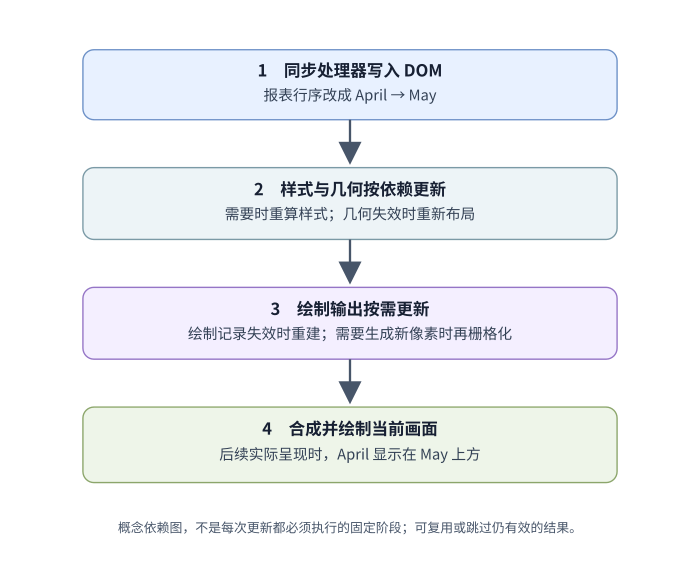
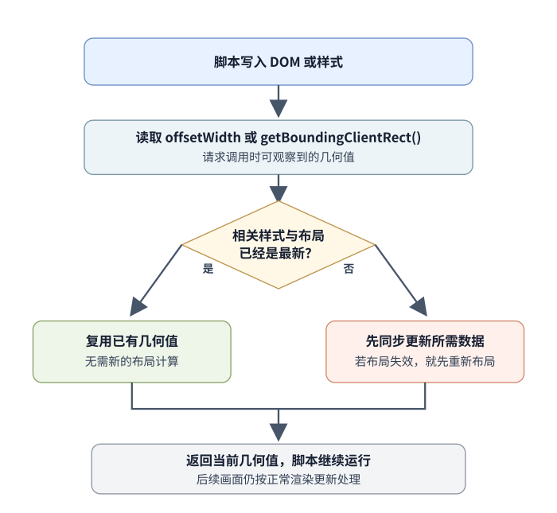

# 为什么一次 DOM 改动会增加布局或绘制工作？

案例背景：用户打开 `https://example.test/reports?sort=recent#summary`，看到 May、April 两行报表；点击“最早优先”后，页面把地址中的 `sort` 参数改为 `oldest`，并把 Document Object Model (DOM, 文档对象模型) 中的行顺序换成 April → May。[DOM 更新与事件章节](../browser-apis/dom-manipulation-and-events.md)解释了点击处理器怎样改动节点；本章从“新 DOM 已经写入”开始，解释浏览器怎样让后续画面与新状态一致，以及脚本何时可能为了读取当前几何而等浏览器先更新布局。

## 浏览器需要让哪些信息重新一致？

HyperText Markup Language (HTML, 超文本标记语言) 标准定义浏览器何时有机会更新窗口渲染，但没有规定每个浏览器都使用同一套内部阶段、线程或绘图技术。把报表变成画面的过程可先分成几层：Cascading Style Sheets (CSS, 层叠样式表) 规则针对当前 DOM 计算 computed style (计算样式)；layout (布局) 为盒子求出尺寸与位置；paint (绘制) 生成描述可见内容的绘制操作；需要生成新像素时再做 rasterization (栅格化)；compositing (合成) 把已有与更新后的绘制表面组合，再交给显示过程。

图是用来说明依赖关系的概念模型，不表示每次改动都要顺序重做每一层。浏览器可以延后并合并工作、复用仍有效的结果，也可以跳过没有失效的阶段。渲染机会与 JavaScript 任务的边界见[浏览器 JavaScript 何时运行，画面何时更新？](../runtime/event-loop.md)：处理器返回后 DOM 已是新顺序，但浏览器不保证每个任务后都立即显示一帧；请求或异步业务结果是否完成，也不会由 DOM 写入自动保证。对通常按 DOM 顺序从上到下排布的报表，April 会从第二行移到第一行，May 移到第二行；相关几何与绘制输出更新后，下一次实际呈现的画面才会显示 April 在上。几何读取可以让脚本拿到计算后的值，但不会因此立即把一帧画到屏幕上。

| 对这张报表做什么 | 浏览器可能要更新什么 | 仅凭操作名称不能推出什么 |
| --- | --- | --- |
| 把两行从 May → April 调成 April → May | 更新受影响的样式、几何或绘制结果 | 失效范围取决于选择器依赖、布局关系与引擎优化 |
| 只把按钮文字颜色改成强调色 | 重算适用样式并更新相应绘制结果 | 若尺寸与换行不变，原有几何可能仍可复用 |
| 改宽度、字体或会占空间的内容 | 重新计算受影响盒子的尺寸与后续位置，再更新绘制 | 重排范围不一定只限于被改的节点 |
| 改变 `transform` 或 `opacity` | 某些实现路径可不重新布局，甚至复用绘制结果 | 不能仅凭属性名保证提升图层、只走合成或使用 GPU |
| DOM / 样式写入后读取几何 | 若所需样式或布局已失效，读取前可能同步更新 | 同一几何读取接口并非每次调用都触发布局 |

reflow (重排) 和 repaint (重绘) 是常见工程用语，不是跨浏览器可比较的性能分数。一个节点改变尺寸后，后续流式内容的位置可能一起改变；反过来，属性改了但布局几何未失效时，也可能不需要重做布局。`transform` 和 `opacity` 常被选作动画候选，是因为它们在某些渲染路径中可以绕过布局或复用绘制内容；目标页面是否真的走这条路，应看目标浏览器的性能录制。

## 为什么读几何会让脚本停下来？

浏览器可以把样式或布局结果标为待更新，继续运行 JavaScript，并把工作留到下一次渲染更新。可测量几何的 application programming interface (API, 应用程序接口) 必须返回调用时可观察到的当前值：`offsetWidth` 在普通单盒案例中返回未应用变换的整数边框盒宽度；`getBoundingClientRect()` 返回相对视口的包围矩形，并把变换计入。如果前面的 DOM / CSS 写入使返回值依赖的数据失效，实现就可能在返回前同步重算样式或布局。若数据仍然是最新的，读取可以复用结果，不必新做一次布局。

同步刷新会让脚本等所需计算完成后才继续；其中同步执行布局的情况，Chrome 文档称为 forced reflow (强制重排)。被等待的工作不一定是 API 本身的固定成本：它取决于此前哪些数据失效、布局影响范围多大，以及实现是否能复用结果。图示的是“读取当前值”这一契约带来的实现压力，不意味着每次读取都会刷新。

下面是一个独立的宽度例子，不是前面的报表行。它从同一组已有元素开始：两个没有最小 / 最大宽度约束、没有变换的普通块级元素，边框盒宽度分别为 100px 和 160px。`box-sizing: border-box` 使声明的宽度指定边框盒宽度，因此将当前值加 10 后，目标宽度分别为 110px 和 170px。

~~~html

  

  

~~~

~~~css
#width-demo .item {
  box-sizing: border-box;
  padding: 4px;
  border: 1px solid;
}
~~~

`querySelectorAll()` 返回的 `NodeList` 没有 `Array.prototype.map()`，所以先用 `Array.from()` 转成数组：

~~~javascript
const items = Array.from(
  document.querySelectorAll("#width-demo .item")
);
~~~

下面两段是从上述相同起始宽度分别运行的写法，不是先后执行。第一段每次写完宽度就读取同一元素的新宽度；若该写入使布局数据失效，后读会迫使浏览器先把当前尺寸算出来：

~~~javascript
const widthsAfterEachWrite = [];
for (const item of items) {
  item.style.width = (item.offsetWidth + 10) + "px";
  widthsAfterEachWrite.push(item.offsetWidth);
}
~~~

如果每个新值只依赖它自己的原宽度，而且不必观察前一项写入后的中间几何，就不必在每次写入后立即读回。先读取所有原值，再统一写入；若仍需要验证最终几何，可在最后集中读取：

~~~javascript
const nextWidths = items.map(item => item.offsetWidth + 10);
items.forEach((item, index) => {
  item.style.width = nextWidths[index] + "px";
});
const widthsAfterBatch = items.map(item => item.offsetWidth);
~~~

探针在记录前先读取两个 `offsetWidth`，确保初始几何已就绪。在同一版 headless Chrome (无头 Chrome) 的可重复探针中，两种写法都得到 110px、170px：逐项版本第一次读取原值 100px，写入 110px 后立即读取时，浏览器更新当前几何；随后第二项从原值 160px 写成 170px 并再次读取，又需要更新几何。批量版本先读到 `[100, 160]`，再写入两个新值；末尾第一次读取处理两项变更，第二次读取复用刚更新的结果。用 Chrome DevTools Protocol (CDP, Chrome 开发者工具协议) 记录这一段脚本时，逐项写后读观察到 2 次布局事件，批量读写并在末尾读回观察到 1 次。若开始时的布局本来已失效，批量代码开头的读取也可能先触发更新；这次计数只说明这个小例子的读写次序，不证明任何批量操作在所有页面都更快。应先在性能录制里确认同步布局，再定位让数据失效的写入和紧跟其后的读取。

几何读取接口返回的盒子与坐标系不同：例如，变换会影响 `getBoundingClientRect()` 的结果，却不影响 `offsetWidth`。按问题选择测量方式，见[哪个 DOM 几何 API 能回答哪种测量问题？](./dom-properties.md)。

## 引擎怎样实现这些步骤？

Web 平台规定 DOM、CSS 和几何 API 的可观察结果，不要求各浏览器共享一个内部管线。以 Chromium 的 RenderingNG 为例，渲染器会处理样式、布局、预绘制和绘制记录；后续把绘制内容分块栅格化，再提交 compositor frame (合成帧)，由 Chromium 的 Viz 组件聚合可见表面并绘制。Chromium 文档展示的 graphics processing unit (GPU, 图形处理器) 纹理 tile (图块) 是这一实现中的数据结构；实际设备可能使用不同的栅格后端或回退路径，其他引擎的组件名称和阶段安排也会不同。因此，浏览器通用解释要落在“输入状态、失效数据与画面结果”，性能判断则要看目标引擎的录制。

如果报表增长到许多行，先区分网络传输、服务端查询、客户端数据计算和已挂载节点的样式与布局成本。虚拟滚动主要减少同时挂载的 DOM；不会自动缩小已下载数据或消除对全量数据的计算。窗口计算、可变行高、焦点与辅助技术边界见[长报表列表何时适合虚拟滚动？](../performance/rendering-and-computation-optimization.md)；性能录制怎样区分处理时长、布局与绘制成本，见[如何测量并诊断网页性能问题？](../performance/performance-metrics-and-analysis.md)。

> [!info]- 来源与核验
> - **渲染机会与更新渲染。** [WHATWG HTML §8.1.7 Event loops / update the rendering](https://html.spec.whatwg.org/multipage/webappapis.html#update-the-rendering)，Living Standard，更新于 2026-11-11，核对于 2026-11-12。规范定义渲染机会与更新渲染中的样式、布局等步骤；图示的绘制、栅格化和合成阶段是概念说明，不是 HTML 要求的跨浏览器固定管线。
> - **盒子生成与布局模型。** [CSS Display Module Level 3](https://www.w3.org/TR/css-display-3/)，W3C Candidate Recommendation Draft，2026-06-05；用于解释元素生成的盒与格式化模型。
> - **几何读取的返回值。** [CSSOM View Module Level 1](https://drafts.csswg.org/cssom-view/)，Editor’s Draft，2026-11-05，`offsetWidth` 与 `getBoundingClientRect()` 算法；[CSS Sizing Module Level 3](https://www.w3.org/TR/css-sizing-3/#box-sizing)，`box-sizing` 的尺寸解释。CSSOM View 当前页面标明是讨论中的编辑草案，核对于 2026-11-12。
> - **强制重排诊断。** [Chrome Performance Insights: Forced reflow](https://developer.chrome.com/docs/performance/insights/forced-reflow)，Chrome DevTools 官方文档，更新于 2025-10-08；其强制重排描述和诊断范围针对 Chrome 实现。
> - **Chromium 实现路径。** [RenderingNG architecture](https://developer.chrome.com/docs/chromium/renderingng-architecture) 与 [Key data structures in RenderingNG](https://developer.chrome.com/docs/chromium/renderingng-data-structures)，Chromium 官方架构文档；核对于 2026-11-12。文中的 Viz、tile (图块) 和 compositor frame (合成帧) 仅描述 Chromium。
> - **本地探针。** 本轮 headless Chrome `157.0.8103.51` 使用 CDP 记录布局：记录前显式读取两个元素的 `offsetWidth` 使初始几何就绪；逐项写后读出现 2 个 `Layout` 完成事件，批量写入并在末尾读回出现 1 个；两种结果均为 `[110, 170]`。这是本机配置和该 DOM/CSS 的可重复观察，不作跨版本性能承诺。
