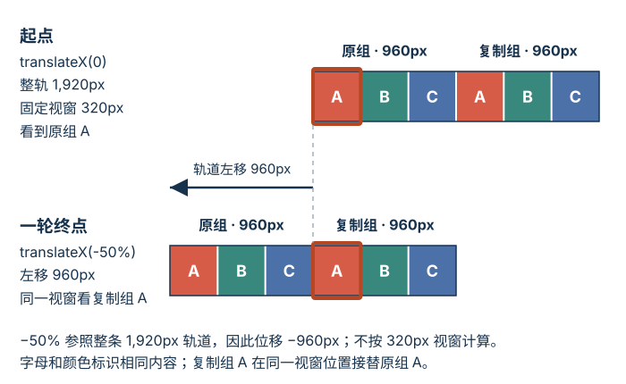

# 过渡和关键帧动画怎样选，怎样不伤性能和可访问性？

CSS 有两种让样式随时间变化的机制：transition (过渡) 在某个样式值改变时，在旧值与新值之间插值；keyframe animation (关键帧动画) 用 `@keyframes` 规定若干时间点上的样式。本章先给出选择规则，再分别讲两者的行为边界，最后讲自动运动的可访问性义务和性能上的常见误解。上一章已经用 `opacity` 过渡做过面板淡出，并说明了 `display` 怎样参与离散过渡（见[隐藏内容时，布局、指针、焦点和读屏各受什么影响？](hiding-content-and-focus.md#display%20怎样参与离散过渡)），这里不再重复。

沿用[主线一的报表页](../browser/from-url-to-interactive-page.md)：排序按钮 `button[data-sort]`（“最近优先”与“最早优先”）在悬停和获得焦点时变色；本章新增两个类名，报表面板 `.report-panel` 出现时先略过终点再回落，报表卡片 `.report-card` 用来演示多属性过渡。翻牌卡片和图片条带在报表页里没有自然位置，用两个独立小例子说明。

## 先按状态模型选机制

- **只有起点和终点，由状态变化触发**（悬停、获得焦点、class 或属性改变）：用 transition。
- **需要规定多个时间点的状态，或需要自动开始、循环、控制方向和暂停**：用 `@keyframes`。
- **只想让值略过目标再回来**：用一条输出超出 `[0, 1]` 的 easing (缓动函数) 即可，仍是 transition；要精确安排中间状态出现的时刻，才写关键帧。

无论哪种，界面状态都应由 class 和属性表达，动画只画过程。这条约定让后面的“减少动态效果”可以直接关掉运动而不改变结果。

## transition：在两个状态之间插值

~~~css
button[data-sort] {
  background-color: #17324d;
  transition: background-color 180ms ease-out;
}

button[data-sort]:hover,
button[data-sort]:focus-visible {
  background-color: #24547d;
}
~~~

`transition` 是四个子属性的简写：

| 属性 | 作用 |
| --- | --- |
| `transition-property` | 参与过渡的属性，如 `opacity`、`transform` |
| `transition-duration` | 插值持续时间 |
| `transition-timing-function` | 把时间进度映射为值进度的曲线，如 `ease-out`、`cubic-bezier(...)` |
| `transition-delay` | 开始前等待的时间 |

每个子属性都可以写逗号列表，按位置一一对应。下例中 `transform` 用 300 ms、`ease-out`、无延迟，`opacity` 用 200 ms、`linear`、延迟 100 ms：

~~~css
.report-card {
  transition-property: transform, opacity;
  transition-duration: 300ms, 200ms;
  transition-timing-function: ease-out, linear;
  transition-delay: 0ms, 100ms;
}
~~~

**过渡声明写在基础状态上。** 浏览器在值改变时，看的是改变后那份样式里的过渡声明。写在 `button[data-sort]` 上，进入和离开悬停都有过渡；只写在 `:hover` 规则里，离开悬停时基础状态没有过渡声明，颜色会直接跳回。

## 过渡途中改目标：从当前值出发，返回会缩短

状态规则只决定目标值；过渡进行中，屏幕上显示的是当前插值。目标在途中改变时，浏览器从当前值出发转向新目标，而不是先跳到终点。

最常见的情形是返回原值：鼠标移入排序按钮，颜色变到一半又移出。这时浏览器不会把原过渡倒放，也不会用完整的 180 ms 走回去，而是启动一段**缩短的**返回过渡。缩短比例取决于目标改变那一刻原过渡的**缓动输出进度**，也就是值已经走过的比例，而不是已经过去的时间占总时长的比例。

> [!example] 半程移出时，返回过渡多长
> `ease-out` 等价于 `cubic-bezier(0, 0, 0.58, 1)`。鼠标在第 90 ms（时间进度 0.5）移出时，先在曲线上找横坐标为 0.5 的点：参数 `s ≈ 0.626`，此时纵坐标（值进度）约为 0.685。也就是说时间才过一半，颜色已经走了约 68.5%。
>
> 返回过渡的时长按值进度缩短：`180 ms × 0.685 ≈ 123 ms`，而不是按时间比例算出的 90 ms。

**过冲要靠属性能取到越界值。** 例如 `cubic-bezier(.34, 1.56, .64, 1)` 的输出会超过 1，`transform: translateY(0)` 到 `translateY(100px)` 就会先越过 `100px` 再回落。`opacity` 从 0 到 1 则看不到过冲：越界的插值会被限制在 `[0, 1]`。

## @keyframes：规定多个时间点

~~~css
@keyframes panel-enter {
  0%   { transform: translateY(8px); opacity: 0; }
  55%  { transform: translateY(-2px); opacity: 1; }
  100% { transform: translateY(0); opacity: 1; }
}

.report-panel {
  transform: none;
  opacity: 1;
}

.report-panel.is-entering {
  animation: panel-enter 240ms ease-out both;
}
~~~

给面板加上 `.is-entering` 就启动动画：面板从下方 `8px` 处淡入上移，在 55% 处越过终点 `2px`，最后回到原位。只要简单过冲的话，上一节的过冲缓动也能做到；写出 55% 关键帧是为了精确控制越界发生的时刻。

`animation` 简写包含这些子属性：

| 属性 | 作用 |
| --- | --- |
| `animation-name` | 选择 `@keyframes` 规则 |
| `animation-duration` | 一轮的时长 |
| `animation-timing-function` | 在相邻的、定义了该属性的关键帧之间映射时间进度；也可以在某个关键帧里为下一段另设缓动 |
| `animation-delay` | 第一轮开始前的等待 |
| `animation-iteration-count` | 轮数或 `infinite` |
| `animation-direction` | 正向、反向或交替播放 |
| `animation-fill-mode` | 动画区间外是否应用边界时刻的值 |
| `animation-play-state` | `running` 或 `paused`；暂停后停在当前位置，恢复后从那里继续 |

## fill-mode 决定动画区间外显示什么

动画只在“延迟结束到最后一轮结束”这段区间里生效。区间外元素显示什么，由 fill mode (填充模式) 决定：`backwards` 让延迟期间显示起点值，`forwards` 让结束后保留终点值，`both` 两者都要。

上例只播一轮、正向、无延迟，起点和终点就是 0% 与 100% 关键帧，`both` 保证结束后停在 100% 的样式。但起点和终点不一定是 0% 和 100%：反向或交替播放会交换方向，小数轮数（如 `1.5`）会让动画停在一轮中间，这时边界值可能是两个关键帧之间的插值。

**填充值不是永久状态。** 它只在动画声明仍然作用于元素时有效。移除 `.is-entering` 后，面板回到基础样式 `opacity: 1; transform: none`。这也是本例在基础样式里写好终态的原因：终态由 class 和样式表达，不依赖动画留下的填充值。

## 小例子：用两面翻牌理解 3D transform

翻牌是一个两状态过渡，但要用到三维 transform (变换)。下例只是视觉演示：真正可交互的翻牌卡片还需要按钮状态、焦点行为和内容语义；CSS 隐藏背面只影响绘制，不影响辅助技术读到什么，所以整块标了 `aria-hidden="true"`，文字不承载页面内容。

~~~html

  

    
正面

    
背面

  

~~~

~~~css
.flip-demo {
  width: 200px;
  height: 120px;
  perspective: 800px;
}

.flip-demo__inner {
  position: relative;
  width: 100%;
  height: 100%;
  transform-style: preserve-3d;
  transition: transform 600ms ease;
}

.flip-demo.is-flipped .flip-demo__inner { transform: rotateY(180deg); }

.flip-demo__face {
  position: absolute;
  inset: 0;
  display: grid;
  place-items: center;
  backface-visibility: hidden;
  color: white;
}

.flip-demo__front { background: #24547d; }
.flip-demo__back { background: #8c3d16; transform: rotateY(180deg); }
~~~

这个配方由四个部件组成：

1. 外层 `perspective` 提供近大远小的透视。
2. 内层 `transform-style: preserve-3d` 让两个面保留各自的三维位置，而不是被压平到内层平面上。
3. 两个面都设 `backface-visibility: hidden`，背向读者时不绘制。
4. 背面预先旋转 `180deg`。未加 `.is-flipped` 时蓝色正面朝前、背面背向读者；加上后内层转过 `180deg`，正面转到背后，背面的 `180deg` 与内层的 `180deg` 相加正好朝前，橙色背面出现。

transform 只改变绘制结果：`translate` 移动，`rotate` 改变朝向，`scale` 改变绘制尺寸。`transform-origin` 默认在盒子中心，旋转和缩放都绕它进行。多个变换函数按书写顺序组合，交换平移和旋转的顺序可能得到不同位置。transform 不会让周围的普通流内容重新排列，但可能扩大可滚动溢出区域；它还会为后代建立 containing block (包含块) 和 stacking context (堆叠上下文)，影响见[定位元素参照谁，为什么大 z-index 还会被盖住？](positioning-and-stacking.md)。

## 小例子：无缝循环的图片条带

装饰用的图片条带需要不停循环，要用 `infinite` 关键帧动画。思路是把同一组图片复制一份接在后面，动画移动正好一组的距离后重新开始。下面的例子按理想 CSS px 演算：条带水平、从左到右；视窗宽 `320px`；原组三张加复制组三张共六张，每张与视窗同宽。

~~~html

  

    
    
    
    
    
    
  

~~~

~~~css
.strip-window {
  width: 320px;
  overflow: hidden;
  writing-mode: horizontal-tb;
  direction: ltr;
}

.strip-track {
  display: flex;
  flex-direction: row;
  align-items: flex-start;
  width: 600%;
  animation: strip-loop 18s linear infinite;
}

.strip-track img {
  flex: 0 0 calc(100% / 6);
  min-inline-size: 0;
  height: auto;
}

@keyframes strip-loop {
  to { transform: translateX(-50%); }
}
~~~

> [!example] 循环距离
> 轨道宽 `600% × 320px = 1920px`，原组和复制组各占 `960px`。`translateX(-50%)` 的百分比相对轨道自身而不是视窗，所以位移是 `1920 × 0.5 = 960px = 3 × 320px`，正好让复制组移到原组原来的位置。

每轮结束时，位移从 `-960px` 跳回 `0`，视窗里的复制组 A 换成原组 A。两组内容、顺序和尺寸完全相同，跳回前后画面一致，用户看不出接点；这就是要复制一整组的原因。视窗宽度或每组张数改变时，要同步调整轨道宽度和每张的比例。

代码里另外三条声明各管一件事：

- **`min-inline-size: 0`**：每张图的宽度应由 `flex-basis: calc(100% / 6)` 决定，但 flex 项目默认的自动最小尺寸不让图片窄于内容宽度（机制见[Flex 和 Grid 怎样把空间分给每个项目？](flex-and-grid-layout.md)）。原图自然宽 `640px` 时，不加这条，Chrome 中每张仍宽 `640px`，移动半条轨道后第四张落在 `x = 960px`，接不上；加上后每张约 `320px`，第四张落在 `x ≈ 0`，实测子像素误差不到 `0.05px`。这是理想 CSS px 下的演算，不能保证所有图片、浏览器和屏幕上都没有接缝。
- **`align-items: flex-start`**：避免 flex 默认的交叉轴拉伸把每张图拉成同一高度。
- **`height: auto`**：按图片比例确定高度。自然尺寸 `640×320`、`640×640`、`640×480` 的三张图缩到 `320px` 宽后，分别高 `160px`、`320px`、`240px`。高度不同不影响横向组宽和移动距离。

## 自动运动要能停下来

条带是自动开始、无限循环的运动，这带来三项要求。

**第一，它不能冒充内容轮播。** 上面的条带没有控制按钮、键盘操作或轮播语义，也不能承载唯一的信息。真正的内容轮播要提供前后切换；若自动播放，还要提供停止/开始按钮，键盘焦点进入时停止、只在用户明确要求时恢复，鼠标悬停时也停止。

**第二，自动运动要能暂停。** `aria-hidden="true"` 只把条带从无障碍树中隐藏，不会停下屏幕上的运动。自动移动的内容与页面其他内容并列显示且持续超过 5 秒时，WCAG 2.2 成功准则 2.2.2 要求提供暂停、停止或隐藏机制，除非这种运动对活动不可或缺。

**第三，尊重减少动态效果偏好。** 用户在系统中选择减少动态效果后，媒体查询 `prefers-reduced-motion` 匹配 `reduce`，表示希望减少可能引起不适或分心的非必要运动：

~~~css
@media (prefers-reduced-motion: reduce) {
  .report-panel.is-entering,
  .strip-track { animation: none; }

  button[data-sort],
  .report-card,
  .flip-demo__inner { transition: none; }
}
~~~

这条规则生效后，面板直接显示基础样式，条带停在第一组的起点；按钮颜色和翻牌状态照样改变，只是没有中间过程。之所以能这样一刀切，是因为本章所有状态都由 class 和属性表达，不依赖动画播放完毕。

## 合成与 will-change：属性名保证不了性能

动画的每一帧都可能触发样式计算、布局、绘制、栅格化或合成，具体做哪些取决于动画的属性、元素内容和浏览器实现（管线各阶段见[DOM 改动后浏览器重做了什么，读几何值为什么会卡住脚本？](../browser/rendering-pipeline-and-forced-layout.md)）。`transform` 和 `opacity` 通常不影响周围布局，满足浏览器的合成条件时可以跳过逐帧的布局和绘制；但只凭属性名不能断定动画一定在合成线程或 GPU 上执行，要在目标页面上测量。

`will-change` 只是预告某个属性将要变化，不是强制创建 GPU 图层的开关。浏览器可以据此提前优化，做法各不相同。如果被提示的属性本身会建立堆叠上下文或包含块，提示会提前产生这些效果，还可能占用额外内存。只在测量确认有收益时，对少量元素短时间使用，变化结束后移除。`translateZ(0)` 同理，也不是通用的加速开关。

> [!info] 在 Chrome DevTools 里检查未合成的动画（核对于 2026-11-12）
> Performance 面板的 Animations 轨道会标出未合成的动画，选中后可以查看未合成的原因。

## 主线二到此：结构、外观和可用性都由状态驱动

主线二从文档结构、表单、层叠和布局一路走到隐藏与动画，得到的共同约定是：页面的状态写在 HTML 属性和 class 上，CSS 根据这些状态决定外观和运动，可访问性跟着属性一起成立。谁来在点击、请求返回时改这些属性？这是 JavaScript 的工作。主线三从[JavaScript 的值有哪些类型，“相等”又有几种？](../javascript/values-types-and-equality.md)开始，讲清 JavaScript 与 TypeScript 的值、对象、函数和异步按什么规则工作。

> [!info]- 来源
> - 隐式过渡的触发、过渡声明取自变化后的样式、中断时从当前值出发、返回过渡的缩短因子（按缓动输出计算）：W3C CSS Transitions Level 1，Working Draft（2026-01-08），§§2–4、§3.1，[CSS Transitions](https://www.w3.org/TR/css-transitions-1/)，检查于 2026-11-12。
> - 关键帧、动画子属性、移除动画、暂停与填充模式：W3C CSS Animations Level 1，Working Draft（2023-03-02），§§1–2、3.4–3.9、4，[CSS Animations](https://www.w3.org/TR/css-animations-1/)，检查于 2026-11-12。
> - `ease-out` 的控制点、cubic Bézier 的进度映射（“半程移出”算例的依据）：W3C CSS Easing Functions Level 2，First Public Working Draft（2024-08-29），§2.3，[CSS Easing](https://www.w3.org/TR/css-easing-2/)，检查于 2026-11-12。
> - `opacity` 越界值限制在 `[0,1]`：W3C CSS Color Module Level 4，Candidate Recommendation Draft（2026-11-03），§3.3，[CSS Color](https://www.w3.org/TR/css-color-4/)，检查于 2026-11-12。
> - flex 项目默认交叉轴拉伸与 `align-items: flex-start`：W3C CSS Flexible Box Layout Module Level 1，Candidate Recommendation Draft（2025-10-14），§8.3；自动最小尺寸：§4.5，[CSS Flexbox](https://www.w3.org/TR/css-flexbox-1/#align-items-property)，检查于 2026-11-12。
> - `min-inline-size` 在水平书写模式下对应宽度：W3C CSS Logical Properties and Values Level 1，Working Draft（2025-12-04），§4.1，[CSS Logical Properties](https://www.w3.org/TR/css-logical-1/)，检查于 2026-11-12。
> - 变换函数顺序、变换原点、平移百分比相对 reference box、可滚动溢出、包含块与堆叠上下文：W3C CSS Transforms Level 1，Candidate Recommendation（2019-02-14），§§3–6、9.1，[CSS Transforms](https://www.w3.org/TR/css-transforms-1/)，检查于 2026-11-12。
> - 三维变换、`preserve-3d`、透视与背面可见性：W3C CSS Transforms Level 2，Working Draft（2021-11-09），§§4.1、7、8、10，[backface-visibility](https://www.w3.org/TR/css-transforms-2/#backface-visibility-property)，检查于 2026-11-12。
> - 轮播控制、焦点进入时停止、悬停停止：W3C WAI [ARIA APG Carousel Pattern](https://www.w3.org/WAI/ARIA/apg/patterns/carousel/)，About This Pattern，检查于 2026-11-12。
> - 自动移动内容超过 5 秒的暂停、停止或隐藏机制：W3C WCAG 2.2 Recommendation（2024-12-12），成功准则 2.2.2，[Pause, Stop, Hide](https://www.w3.org/TR/WCAG22/#pause-stop-hide)，检查于 2026-11-12。
> - `aria-hidden` 只影响无障碍树：W3C WAI-ARIA 1.2 Recommendation（2023-06-06），§7.1，[Excluding Elements from the Accessibility Tree](https://www.w3.org/TR/wai-aria-1.2/#aria-hidden)，检查于 2026-11-12。
> - 减少非必要运动的用户偏好：W3C Media Queries Level 5，Working Draft（2026-02-19），§12.1，[prefers-reduced-motion](https://www.w3.org/TR/mediaqueries-5/#prefers-reduced-motion)，检查于 2026-11-12。
> - `will-change` 的实现差异、资源消耗与副作用：W3C CSS Will Change Level 1，Candidate Recommendation Draft（2022-05-05），§§1.2、2，[CSS Will Change](https://www.w3.org/TR/css-will-change-1/)，检查于 2026-11-12。
> - 检查未合成动画及原因：Chrome DevTools [Performance features reference](https://developer.chrome.com/docs/devtools/performance/reference)，View animations 一节，检查于 2026-11-12。
