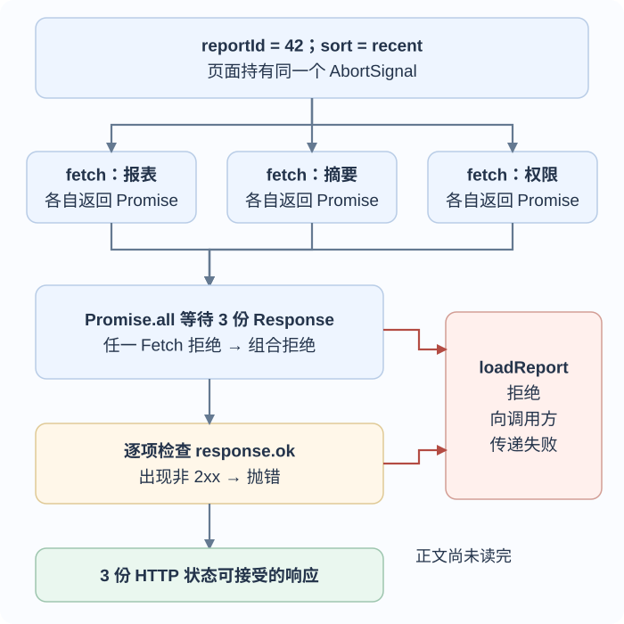
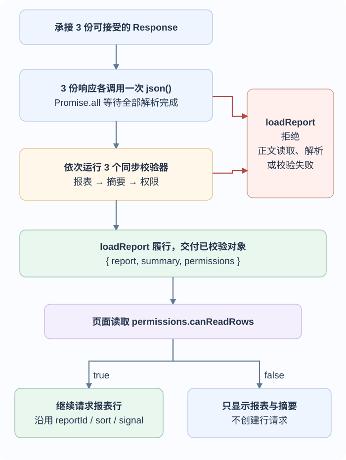

# 回调、Promise 与 async 函数怎样组合异步工作？

## 案例背景

用户打开 `reportId="42"` 的报表，再把排序切到 `recent`。页面通过 Fetch API 经 HTTP（超文本传输协议）分别请求报表、摘要和访问权限；三项彼此独立，可以同时发出。本例接口以 JSON 返回数据；Fetch 先给出 `Response` 响应对象，正文还需另行读取。三份响应都成功、正文都能解析，并通过各自的运行时校验后，界面才收到一组可信数据。只有权限允许查看明细时，页面才继续读取行。用户离开页面时，页面持有的 `AbortController`（中止控制器）可以通过 `AbortSignal`（中止信号）通知支持取消的工作停止。

这条过程有几个不同边界：callback（回调）描述“之后要调用的函数”；Promise 表示将来成功值或失败原因；异步函数与等待运算符（`async`/`await`）写出等待与错误传播；宿主决定异步回调何时有机会运行；取消则由具体 API 的中止信号等机制处理。把 Promise 放进组合器不会自动启动限额调度或停止其他工作。

三次 `fetch()` 调用先启动三项请求。`Promise.all` 等待三份 `Response`，代码随后才检查 HTTP 状态；某项较早返回 404，也要等另外两份响应到达，才会在这份实现中被检查出来。

上图的成功出口只是三份 HTTP 状态可接受的响应，正文还没有被代码读完。接下来同时读取三份 JSON，再等待它们全部解析完成，最后运行同步校验器。只有这两道等待及校验都通过，`loadReport` 才交付数据；任一阶段失败都会拒绝它返回的 Promise。组合器本身不会取消其他已启动的工作。

第二张图沿用同一 `reportId`、`sort` 和页面 signal。若权限允许且行页码已知，下一步可交给[并发池按上限启动任务](./bounded-async-concurrency.md)；如果下一页要等前页给出 cursor（游标），就按页顺序推进，见[报表行怎样按页异步读取？](./iterators-and-generators.md#报表行怎样按页异步读取？)。Promise 只传递结果和失败，不会替页面完成结构校验、权限判断、限流或取消。

## 回调如何表示延后的工作？

callback（回调）是作为参数交给另一段代码、由那段代码决定何时调用的函数。回调不一定异步：`array.map(fn)` 会在当前调用中同步调用 `fn`，Fetch 的完成处理器则稍后运行。若每一步要等上一步的值，嵌套回调会把成功路径、失败路径和后续动作散落在多层函数中：

~~~javascript
readUser(userId, (error, user) => {
  if (error) return handle(error);
  readOrders(user.id, (error, orders) => {
    if (error) return handle(error);
    renderOrders(orders);
  });
});
~~~

Promise 把“未来的一个值或失败原因”作为可传递的对象。它从待定（`pending`）转为履行（`fulfilled`）或拒绝（`rejected`）之一；状态只改变一次。Promise 不持有一条通用的取消命令，也不意味着底层工作在另一个线程运行。

`new Promise(executor)` 会在构造时同步调用执行器；执行器若同步抛错，构造所得 Promise 会以该异常拒绝。`resolve` 与 `reject` 用来报告结果，但后续 `.then()` 注册的处理器不会在注册它的那段同步代码中内联运行。下面先输出“执行器”、再输出“构造完成”；计时器调用 `resolve` 后，Promise 处理器才有机会输出结果：

~~~javascript
const response = new Promise(resolve => {
  console.log("执行器");
  setTimeout(() => resolve("报表响应已到"), 20);
});

console.log("构造完成");
response.then(value => console.log(value));
~~~

这段程序先输出 `执行器`、`构造完成`。计时器的 20 毫秒是最早等待时间，不保证回调恰在该时刻运行；计时器属于宿主 API。在浏览器中，Promise 处理器（reaction）和 `await` 的续段会作为microtask（微任务）排队；当前 JavaScript 调用栈清空后，浏览器执行微任务检查点，把队列中的微任务逐个跑完，再继续事件循环的后续步骤。于是 `await` 先让出当前同步片段，而续段会在后续微任务中继续。绘制机会与其他任务（task）的交错由宿主决定，见[浏览器 JavaScript 何时运行，画面何时更新？](../runtime/event-loop.md)和 [Node.js 事件循环阶段与微任务队列如何交互？](../../engineering-foundations/backend/node-event-loop-and-microtasks.md)。

## Promise 链怎样传递值和失败？

每次调用 `.then()` 都返回一个新 Promise。成功处理器返回普通值时，新 Promise 以该值履行；它抛出异常时，新 Promise 以该异常拒绝；若它返回 Promise，新 Promise 会采用该 Promise；若返回普通对象且它的 `then` 属性是函数（thenable），新 Promise 会调用这个 `then`，根据它调用的解析或拒绝回调决定结果。内建 Promise 同样有 `then` 方法，但 `Promise.resolve(p)` 遇到确为 Promise 且读到 `p.constructor === Promise` 的 `p` 时会直接返回它；普通 thenable 的getter（取值器）和采用作业不应套用到这条捷径上。`.catch(handler)` 等价于只提供拒绝处理器的 `.then(undefined, handler)`：处理器返回普通值或最终履行的 Promise/thenable，后续链才恢复成功。

~~~javascript
function parseReport(response) {
  if (!response.ok) throw new Error("报表响应 HTTP " + response.status);
  return response.json();
}

fetch("/api/reports/42?sort=recent")
  .then(parseReport)
  .then(validateReport)
  .then(renderReport)
  .catch(showRequestFailure);
~~~

若 `parseReport`、`validateReport` 或 `renderReport` 同步抛错，或 `response.json()` 返回的 Promise 拒绝，拒绝会沿后续链传播，直到某一层接手。处理器返回错误提示文案会把链恢复为成功；若界面层需要保留“请求失败”状态，就应返回或抛出符合该状态契约的结果。哪个层拥有足够上下文来恢复或上报，见[JavaScript 错误应在哪一层恢复、传播或上报？](./error-handling.md)。

`.finally(cleanup)` 在履行或拒绝时都会运行，不接收原来的值或原因。回调返回的普通成功值会被忽略；清理成功则原值或原拒绝继续传递。若清理抛错或返回最终拒绝的 Promise / thenable，清理失败取代原结果。可让 `finally` 等待异步清理，但不要用其返回值改写业务结果。

异步函数（`async function`）调用时立即执行函数体，直到遇到第一个等待运算符（`await`）或结束；即使被等待的值已经可用，续行也不会在当前语句段内同步接着执行。调用总会返回 Promise。`await` 会让当前异步函数暂停并把控制权还给调用者，等被等待的值履行后再继续；若它拒绝，拒绝会像该处抛错一样进入 `try/catch` 或向外传播。`try` 的 `finally` 会在正常返回或抛错时运行；其中新的 `return` 或 `throw` 可以替换原先的完成结果。

~~~javascript
async function loadUserAndOrders(userId) {
  const user = await getUser(userId);
  const orders = await getOrders(user.id);
  return { user, orders };
}

loadUserAndOrders("u-42")
  .then(({ orders }) => renderOrders(orders))
  .catch(showRequestFailure);
~~~

这里第二个请求要用第一个请求给出的 `user.id`，所以顺序 `await` 是数据依赖；如果两个请求互不依赖，顺序 `await` 会白白等前一个完成，应先启动两项工作再组合。

## TypeScript 的 Promise 类型能保证什么？

`Promise<T>` 只能在编译期约束 TypeScript 代码中的类型，注解编译后不会检查服务端 JSON。把外部值先当作未知类型（`unknown`），读取正文后执行真正的运行时校验：

~~~typescript
async function parseReport(response: Response): Promise<Report> {
  if (!response.ok) {
    throw new Error("报表请求失败，HTTP " + response.status);
  }

  const value: unknown = await response.json();
  return validateReport(value);
}
~~~

`validateReport` 必须检查接口实际约束，并在数据不符时拒绝；只写 `Promise<Report>` 不会增加校验。

## 报表请求何时并发、何时顺序等待？

Fetch API（Fetch 应用程序接口）的调用会启动请求，然后返回一个 Promise。把已经启动的 Promise 交给 `Promise.all` 是等待它们的结果，不是把它们排进一个稍后启动的队列。独立请求可以先同时发出：

~~~javascript
async function loadReport(reportId, sort, signal) {
  const paths = [
    "/api/reports/" + encodeURIComponent(reportId) +
      "?sort=" + encodeURIComponent(sort),
    "/api/reports/" + encodeURIComponent(reportId) + "/summary",
    "/api/reports/" + encodeURIComponent(reportId) + "/permissions",
  ];

  const responses = await Promise.all(
    paths.map(path => fetch(path, { signal }))
  );

  const failed = responses.find(response => !response.ok);
  if (failed) throw new Error("HTTP " + failed.status);

  const [rawReport, rawSummary, rawPermissions] = await Promise.all(
    responses.map(response => response.json())
  );

  // 这三个校验器同步返回已校验值；无效数据时同步抛错。
  return {
    report: validateReport(rawReport),
    summary: validateSummary(rawSummary),
    permissions: validatePermissions(rawPermissions),
  };
}
~~~

`fetch()` 的 Promise 在可用的 `Response` 到达时履行；HTTP `404` 或 `500` 仍是一个响应，不会仅因状态码而拒绝。`response.ok` 只在 HTTP 状态码为 `200–299` 时为真，因此仍需显式检查。响应体由 `json()` 另行读取和解析，这一步仍可能等待，也可能因中止或无效 JSON 而拒绝。校验器再把未知的 JSON 形状变成应用接受的数据。

第一轮 `Promise.all` 等三项 Fetch Promise 全部履行才继续检查状态；任一 Fetch Promise 拒绝时，它会尽早以该原因拒绝，但不会取消其他已启动请求。三项 Response 都到达后，代码按输入顺序检查 HTTP 状态；有一项不是成功状态时立即抛错，因此不会开始读取任何正文。三项状态都成功后，第二轮才同时调用三个 `json()`，并等待三个解析 Promise 全部履行；其中一项解析拒绝时，后续同步校验都不会运行。最后三个校验器依次同步返回已校验值，或同步抛错。若把校验器改成 `async` 函数，返回对象里的字段会是 Promise；外层 `async` 函数不会递归等待普通对象的属性。

主例使用教学权限值 `{ canReadRows: true }`；校验器返回这个布尔字段后，页面在 `await loadReport` 的下一行分支。页面持有控制器，离开时发出中止信号：

~~~javascript
const controller = new AbortController();
window.addEventListener("pagehide", () => controller.abort(), { once: true });

const data = await loadReport("42", "recent", controller.signal);
if (data.permissions.canReadRows) {
  console.log("权限允许：继续读取报表行");
} else {
  console.log("权限不允许：只显示报表和摘要");
}
~~~

这里的 `canReadRows` 是合成教学字段；真实接口应按其实际权限契约定义和校验该值。前端分支只决定是否继续请求，明细 API 仍须独立验证调用者的读取权限。若它为 `true`，行读取会从这个分支开始；若为 `false`，主例停在报表与摘要。行页码已知时可把每页请求交给[并发池按上限启动任务](./bounded-async-concurrency.md)；下一页必须等前页给出游标（cursor）时按页顺序推进，见[报表行怎样按页异步读取？](./iterators-and-generators.md#报表行怎样按页异步读取？)。页面离开时的 `abort()` 会通知 Fetch 及其他主动监听同一中止信号的 API；它不会强行终止任意 Promise，也不能撤销服务器已执行的副作用。

页面可把同一个 `AbortSignal` 传给三项 Fetch；控制器发出 abort 后，Fetch 按自己的中止协议响应。Promise 组合器不会代替页面调用 `abort()`，也不会撤回服务器已经执行的副作用。若 Promise 被超时竞速淘汰，工作也不会因此自动停止，后文会区分“停止等待”和“取消操作”。

多项异步工作的组合条件可按结果需求选择：

| 方法 | 组合 Promise 何时结束 | 报表场景中的含义 |
| --- | --- | --- |
| `Promise.all` | 全部履行才履行；任一拒绝就拒绝 | 报表、摘要和权限都必需；结果数组按输入顺序排列 |
| `Promise.allSettled` | 所有输入都结束后履行每项状态和值或原因 | 需要展示每个独立小部件的成功或失败 |
| `Promise.any` | 首个履行就履行；全部拒绝才以聚合错误（`AggregateError`）拒绝 | 多个镜像或备选端点中任一成功即可 |
| `Promise.race` | 首个履行或拒绝决定结果 | 观察任务与计时器谁先结束；组合结果不会取消没赢的工作 |

这些方法都消费同步 iterable（可迭代对象）。对空可迭代对象，`all([])` 与 `allSettled([])` 履行 `[]`；`any([])` 以空 `errors` 的聚合错误（`AggregateError`）拒绝；`race([])` 永远待定（pending）。若调用时输入是已启动的请求，任何组合器都不能限流。若需要在有槽位时才调用请求，必须把任务工厂交给[异步并发池](./bounded-async-concurrency.md)。

### 两个 Promise 结果怎样相加？

> [!example] 完成顺序不改结果位置
> 假设请求 A 在 20 ms 后履行 `2`，请求 B 在 60 ms 后履行 `5`。A 先完成，但 `Promise.all([A, B])` 最终给出 `[2, 5]`，再相加得到 `7`。
>
> 如果 A 在 50 ms 后履行 `10`，B 在 30 ms 后履行 `-12`，结果仍是 `[10, -12]`，相加为 `-2`。若任一项拒绝，`Promise.all` 拒绝；另一项仍可能继续并产生副作用。

### 组合器如何保留输入顺序？

先看 `Promise.resolve` 怎样采用普通 thenable。读取 `then` getter 是同步步骤；调用取得的 `then` 函数则安排为后续 Promise 作业，因此这两个动作不在同一时刻发生：

~~~javascript
const events = [];
const thenable = {
  get then() {
    events.push("读取 then");
    return resolve => {
      events.push("调用 then");
      resolve("摘要已到");
    };
  },
};

Promise.resolve(thenable).then(value => events.push(value));
events.push("当前同步代码结束");
// 立即：["读取 then", "当前同步代码结束"]
// 随后：再依次追加 "调用 then"、"摘要已到"
~~~

原生组合方法接收可迭代值，并对每项执行 Promise 解析与结果登记。即使第二项先结束，它的处理器也写入第二个位置；所以数组顺序取决于输入，不取决于完成先后。下面的折叠实现用于观察这套最小机制，不是可替代原生 Promise 的兼容性填充（polyfill）：它假设普通内建 `Promise`，不模拟子类构造器、`Symbol.species` 或所有恶意 thenable 的防护。

> [!example]- 完整教学实现：四个 Promise 组合器
>
> ~~~javascript
> function allTeaching(iterable) {
>   return new Promise((resolve, reject) => {
>     const values = [];
>     let remaining = 1; // 哨兵：同步遍历还没有结束
>     let index = 0;
>
>     for (const item of iterable) {
>       const current = index++;
>       remaining++;
>       Promise.resolve(item).then(value => {
>         values[current] = value;
>         if (--remaining === 0) resolve(values);
>       }, reject);
>     }
>
>     if (--remaining === 0) resolve(values);
>   });
> }
>
> function allSettledTeaching(iterable) {
>   return new Promise(resolve => {
>     const results = [];
>     let remaining = 1;
>     let index = 0;
>
>     for (const item of iterable) {
>       const current = index++;
>       remaining++;
>       Promise.resolve(item).then(
>         value => {
>           results[current] = { status: "fulfilled", value };
>           if (--remaining === 0) resolve(results);
>         },
>         reason => {
>           results[current] = { status: "rejected", reason };
>           if (--remaining === 0) resolve(results);
>         }
>       );
>     }
>
>     if (--remaining === 0) resolve(results);
>   });
> }
>
> function anyTeaching(iterable) {
>   return new Promise((resolve, reject) => {
>     const errors = [];
>     let remaining = 1;
>     let index = 0;
>
>     for (const item of iterable) {
>       const current = index++;
>       remaining++;
>       Promise.resolve(item).then(
>         resolve,
>         reason => {
>           errors[current] = reason;
>           if (--remaining === 0) {
>             reject(new AggregateError(errors, "没有输入履行"));
>           }
>         }
>       );
>     }
>
>     if (--remaining === 0) {
>       reject(new AggregateError(errors, "没有输入履行"));
>     }
>   });
> }
>
> function raceTeaching(iterable) {
>   return new Promise((resolve, reject) => {
>     for (const item of iterable) {
>       Promise.resolve(item).then(resolve, reject);
>     }
>     // 空输入没有可决定胜负的项，输出保持 pending。
>   });
> }
> ~~~
>
> `remaining` 从 `1` 开始，把“同步遍历还在进行”也计作一个未完成项。以两项 `all` 为例，计数经历 `1 → 2 → 3`；遍历完先减掉哨兵成为 `2`；两个处理器再各减一次，归零时履行。空输入则 `1 → 0`，此时组合 Promise 已履行 `[]`，但后来附加的 `.then()` 仍会稍后运行。`any` 用同一哨兵等待所有拒绝，并按输入位置登记原因。
>
> 同步遍历可能执行输入对象上的代码。如果已经成功取出一项值，但处理这一项时发生同步异常，例如已有 Promise 的 `constructor` getter（取值器）抛错，组合 Promise 会拒绝，并尝试通过尚未结束的迭代器所提供的可选 `return()` 方法进行关闭。普通 thenable 对象需要被采用时，`Promise.resolve(thenable)` 会在当前调用读取它的 `then` 取值器；取值器抛错会变成该项的拒绝 Promise，所以组合器仍继续读取后续项。取出的 `then` 函数稍后通过 Promise 作业调用，之后的异步拒绝同样不会中止同步遍历。内建 Promise 也有 `then`，但 `Promise.resolve(p)` 对确为 Promise 且读到 `p.constructor === Promise` 的 `p` 有直接返回的捷径；组合器随后仍会在同步遍历中读取并调用输入的 `p.then`。若 `iterator.next()` 自己抛错，或读取迭代结果的 `done` / `value` 时抛错，规范会将迭代记录标记为完成；组合 Promise 拒绝，但不再调用该迭代器的 `return()`。

## 定时器和超时究竟能取消什么？

Promise 没有通用取消操作。`Promise.race` 只决定调用方先观察到哪个结果：超时先拒绝时，底层工作仍可能继续。定时器延迟到期只是回调获得运行机会的门槛；当前 JavaScript 不会被它打断，回调也可能更晚运行。

### 怎样把定时器延迟包装成 Promise？

~~~javascript
function sleep(millis) {
  return new Promise(resolve => setTimeout(resolve, millis));
}

const start = Date.now();
sleep(100).then(() => console.log(Date.now() - start)); // 约 100 ms 或更久
~~~

这段 `sleep` 只等待一个宿主计时器，不会阻塞当前线程。浏览器与 Node.js 的定时器接口由各自宿主定义；零延时或短延时都不承诺实时执行。浏览器的 `setTimeout` / `setInterval` 返回数值 ID，Node.js 返回 `Timeout` 对象；TypeScript 中对应的声明取决于项目选择的宿主类型。

### 怎样让异步操作与计时器竞速？

~~~javascript
function timeLimit(fn, millis) {
  // 在 ES module 或 strict mode 中定义，调用时的 this 才原样传递。
  return function (...args) {
    let timerId;
    const timeout = new Promise((_, reject) => {
      timerId = setTimeout(
        () => reject(new Error("Time Limit Exceeded")),
        millis
      );
    });

    let work;
    try {
      work = Promise.resolve(fn.apply(this, args));
    } catch (error) {
      work = Promise.reject(error);
    }

    return Promise.race([work, timeout])
      .finally(() => clearTimeout(timerId));
  };
}
~~~

包装器用普通函数保留调用时的 `this`，并把 `fn` 同步抛出的异常转成拒绝。工作先结束时，`finally` 清除仍待运行的计时器。只有超时回调实际得到调度时，竞速才会以超时拒绝包装 Promise；`fn` 仍可能完成。计时器到期不能抢占当前 JavaScript，包装器也不会停止工作。

> [!info] TypeScript 的 this 参数不改变运行时调用
> 可以用显式 this 参数保留包装函数的调用类型；它会在编译时擦除，不是实际传入的第一个参数。运行时仍要用普通 function 接住调用上下文，并像本例一样以 fn.apply(this, args) 调用原函数；箭头函数捕获外层 this，不适合此处。
>
> ~~~typescript
> type TimedFunction<This, Args extends unknown[], Result> =
>   (this: This, ...args: Args) => Promise<Result>;
> ~~~

> [!example] 50 ms 的等待上限不等于 50 ms 后强行中断
> 假设请求要 100 ms 才完成，`timeLimit(request, 50)` 会在超时回调得到调度后拒绝调用方，底层请求仍可能继续。若限制改为 150 ms，工作可以先成功返回。若函数等待 120 ms 后返回两参数之和，`timeLimit(fn, 150)(5, 10)` 在理想调度下得到 `15`；若函数同步抛错，拒绝直接传播且清除计时器，无须等满预算。
>
> 若 `fn` 同步占用 80 ms 后才返回一个已履行的 Promise，计时器无法在这段同步工作中抢占 JavaScript。同步代码让出后，Promise reaction 可先于到期的计时器任务运行，故这个运行可能成功；50 ms 不是硬实时截止线。

若操作支持取消，应使用它公开的取消契约。例如 Fetch 接收 `AbortSignal`，页面在不再需要请求时可调用对应控制器的 `abort()`。这个 signal 让 Fetch 及其他主动监听它的 API 有机会停止工作；任意 Promise 和任意同步函数不会因此强制终止。它也不能撤销服务端已经收到并执行的写入。

### 取消一次或重复定时器时，哪些调用还会发生？

一次性计时器可把它的 ID 暴露给取消函数：

~~~javascript
function cancellable(fn, args, millis) {
  const timerId = setTimeout(() => fn(...args), millis);
  return () => clearTimeout(timerId);
}
~~~

| 输入 | 预期调用 | 原因 |
| --- | --- | --- |
| `fn(x)=x*5`，`args=[2]`，`t=20`，`cancelT=50` | 约 20 ms 调用一次，结果为 `10` | 回调先开始，后续取消不能撤回它 |
| `fn(x)=x²`，`args=[2]`，`t=100`，`cancelT=50` | 不调用 | 取消时回调仍在等待 |
| `fn(x,y)=x*y`，`args=[2,4]`，`t=30`，`cancelT=100` | 约 30 ms 调用一次，结果为 `8` | 回调在取消前已完成 |

这些毫秒是题目输入，不是精确计时保证。取消只能清掉仍待执行的回调；它不打断已开始运行的函数，也不把函数结果交给 `cancellable` 的调用者。若 `fn` 依赖 `this`，需显式传接收者（receiver）或先绑定。

原练习要求重复计时器立即调用一次，再按给定间隔安排后续调用：

~~~javascript
function cancellableInterval(fn, args, millis) {
  fn(...args); // 第一次同步调用
  const intervalId = setInterval(() => fn(...args), millis);
  return () => clearInterval(intervalId);
}
~~~

| 输入 | 理想化调用时刻 | 每次函数结果 |
| --- | --- | --- |
| `fn(x)=2*x`，`args=[4]`，`t=35`，`cancelT=190` | `0, 35, 70, 105, 140, 175 ms` | 每次 `8` |
| `fn(x,y)=x*y`，`args=[2,5]`，`t=30`，`cancelT=165` | `0, 30, 60, 90, 120, 150 ms` | 每次 `10` |
| `fn(x,y,z)=x+y+z`，`args=[5,1,3]`，`t=50`，`cancelT=180` | `0, 50, 100, 150 ms` | 每次 `9` |

`setInterval` 不等待 Promise 返回值。若 `fn` 是异步函数、一次执行比间隔更长，下一次调用仍可开始，多个调用可能重叠；`clearInterval` 只阻止后续计时器回调，不会取消已经启动的 Promise 工作。错误恢复和重叠策略必须由调用方另行定义。

## Promise 处理器为什么会交错？

要推导顺序，先区分“注册处理器”与“把处理器作业入队”。同步代码给已履行 Promise 调用 `.then` 时，规范会立即为处理器入队；给待定 Promise 调用 `.then` 时，先保存 reaction（反应记录），等 Promise 状态改变才入队。作业运行后若履行下游 Promise，也会把已保存的下游 reaction 排入队列尾部。浏览器将 Promise 处理器作业（Promise reaction job）放入微任务队列，在微任务检查点按入队顺序逐个处理；Node.js 另有宿主调度边界。以下第一组的两个源 Promise 已履行，所以同步代码先排好 `0` 和 `2`；执行 `0` 才使下游处理器 `1` 入队，队列中已有 `2`，因此输出为 `0, 2, 1, 3`。

~~~javascript
Promise.resolve().then(() => console.log(0)).then(() => console.log(1));
Promise.resolve().then(() => console.log(2)).then(() => console.log(3));
// Node.js v26.13.0 的 CommonJS 模块格式：0, 2, 1, 3
~~~

原归档练习还保留了三条链的交错以及处理器返回已履行 Promise 时的附加采用作业。先追踪第一段的关键作业，队列左侧是下一项：

| 步骤 | 动作 | 队列 |
| --- | --- | --- |
| 起始 | 两条链的首个处理器已注册在已履行 Promise 上 | `[输出 0, 输出 1]` |
| 1 | 输出 0 的处理器返回 `Promise.resolve(4)`，Promise 解析流程安排采用作业 | `[输出 1, 采用]` |
| 2 | 输出 1 的处理器运行，并使它的下游处理器入队 | `[采用, 输出 2]` |
| 3 | 采用作业调用所返回 Promise 的 `then`；该 Promise 已以 `4` 履行，于是转发值的作业入队 | `[输出 2, 转发 4]` |
| 4 | 输出 2 的处理器运行，并把输出 3 排到队尾 | `[转发 4, 输出 3]` |
| 5 | 转发作业履行第一条链的下游 Promise，输出 4 才入队 | `[输出 3, 输出 4]` |

这说明处理器运行会触发新的 Promise 状态转换和后续入队；不能只按 `.then` 的源代码注册位置排序。下列输出在 Node.js `v26.13.0` CommonJS 中逐段重放；它们展示当前例子的入队关系，不是跨宿主固定的“第几个 tick”公式。

~~~javascript
Promise.resolve().then(() => {
  console.log(0);
  return Promise.resolve(4);
}).then(value => console.log(value));

Promise.resolve().then(() => console.log(1))
  .then(() => console.log(2))
  .then(() => console.log(3))
  .then(() => console.log(5))
  .then(() => console.log(6));
// 0, 1, 2, 3, 4, 5, 6
~~~

~~~javascript
Promise.resolve().then(() => console.log(0))
  .then(() => console.log(1)).then(() => console.log(2));
Promise.resolve().then(() => console.log(3))
  .then(() => console.log(4)).then(() => console.log(5));
Promise.resolve().then(() => console.log(6))
  .then(() => console.log(7)).then(() => console.log(8));
// 0, 3, 6, 1, 4, 7, 2, 5, 8
~~~

~~~javascript
Promise.resolve().then(() => {
  console.log(0);
  return Promise.resolve(1);
}).then(() => console.log(2)).then(() => console.log(3));

Promise.resolve().then(() => {
  console.log(4);
  return Promise.resolve(5);
}).then(() => console.log(6)).then(() => console.log(7));
// 0, 4, 2, 6, 3, 7
~~~

几个旧 Promise reaction 顺序练习现已合并在本节；题目原页仍可从[归档入口](../../archive/front-end/Deprecated_Interview_Notes/promise-reaction-order-exercises.md)查找。浏览器事件循环、Node.js 定时器和微任务队列分别遵循各自宿主调度；不要把某个 Node 输出顺序直接推成浏览器计时器、绘制和 Promise 的固定先后。

> [!info]- 来源
> - **Promise 状态、链式传值、thenable 采用、组合器与 `async` 函数。** [ECMAScript 2027 草案（2026-11-08）](https://tc39.es/ecma262/)，核对日期：2026-11-12；异步函数在 §15.8，迭代抽象操作在 §7.4、迭代器对象在 §27.1，Promise 在 §27.5。对应 [Promise 对象](https://tc39.es/ecma262/#sec-promise-objects)、[`Promise.resolve`](https://tc39.es/ecma262/#sec-promise.resolve)、[thenable 采用作业](https://tc39.es/ecma262/#sec-newpromiseresolvethenablejob)、[`Promise.all`](https://tc39.es/ecma262/#sec-promise.all)、[`allSettled`](https://tc39.es/ecma262/#sec-promise.allsettled)、[`any`](https://tc39.es/ecma262/#sec-promise.any)、[`race`](https://tc39.es/ecma262/#sec-promise.race)、[`finally`](https://tc39.es/ecma262/#sec-promise.prototype.finally)、[PerformPromiseThen](https://tc39.es/ecma262/#sec-performpromisethen)、[TriggerPromiseReactions](https://tc39.es/ecma262/#sec-triggerpromisereactions)、[NewPromiseReactionJob](https://tc39.es/ecma262/#sec-newpromisereactionjob)、[IteratorStepValue](https://tc39.es/ecma262/#sec-iteratorstepvalue)、[IteratorClose](https://tc39.es/ecma262/#sec-iteratorclose) 与 [async function definitions](https://tc39.es/ecma262/#sec-async-function-definitions)。
> - **Promise 作业怎样进入宿主队列。** 浏览器把 Promise 作业放入微任务队列，并在微任务检查点运行它们，见 [WHATWG HTML §8.1.6.6.4 HostEnqueuePromiseJob](https://html.spec.whatwg.org/multipage/webappapis.html#hostenqueuepromisejob)、[§8.1.7 Event loops](https://html.spec.whatwg.org/multipage/webappapis.html#event-loops)、[§8.8 Microtask queuing](https://html.spec.whatwg.org/multipage/timers-and-user-prompts.html#microtask-queuing) 与 [Perform a microtask checkpoint](https://html.spec.whatwg.org/multipage/webappapis.html#perform-a-microtask-checkpoint)，Living Standard 更新时间：2026-11-11；Node.js v26.13.0 的 `process.nextTick()`、`queueMicrotask()` 与 Promise 微任务队列边界见 [Process 文档](https://nodejs.org/download/release/v26.13.0/docs/api/process.html#when-to-use-queuemicrotask-vs-processnexttick)。这些宿主规则不把某次 Node 输出推广成浏览器 task 与绘制之间的固定优先级。
> - **HTTP 响应、状态与正文读取。** [WHATWG Fetch Standard §2.2.6 Responses 与 §5.3 Body mixin](https://fetch.spec.whatwg.org/#responses)，Living Standard，核对日期：2026-11-12；[Response.ok](https://fetch.spec.whatwg.org/#dom-response-ok) 对应 200–299 状态，[Body.json()](https://fetch.spec.whatwg.org/#dom-body-json) 执行正文读取与解析。
> - **定时器。** [WHATWG HTML §8.7 Timers](https://html.spec.whatwg.org/multipage/timers-and-user-prompts.html#timers)，Living Standard，更新时间 2026-11-11，说明计时器回调的调度及不精确延迟；Node.js 定时器行为以[Node.js v26.13.0 Timers](https://nodejs.org/download/release/v26.13.0/docs/api/timers.html)为宿主边界。
> - **取消。** [WHATWG DOM §3 Aborting ongoing activities](https://dom.spec.whatwg.org/#aborting-ongoing-activities)，Living Standard，更新时间 2026-11-11；[WHATWG Fetch §5.5 Abort a fetch](https://fetch.spec.whatwg.org/#abort-fetch)，Living Standard，更新时间 2026-10-19。DOM 说明 Promise 本身没有内建中止机制，API 可选择接受并观察 `AbortSignal`。
> - **TypeScript 擦除。** [TypeScript Handbook：Erased Types](https://www.typescriptlang.org/docs/handbook/2/basic-types.html#erased-types)，访问日期：2026-11-12。
> - **包装函数的显式 `this` 类型。** [TypeScript Handbook：Declaring this in a Function](https://www.typescriptlang.org/docs/handbook/2/functions.html#declaring-this-in-a-function)，类型参数在编译时擦除；运行时调用仍由普通函数及 `apply` 保留接收者。
