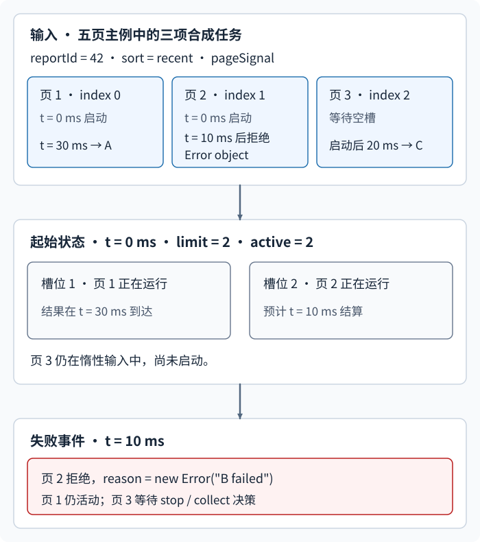
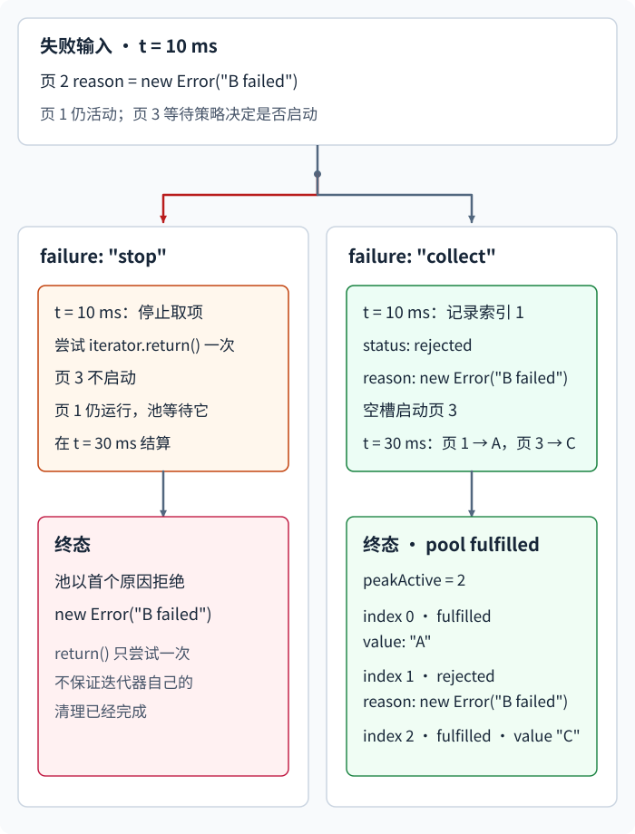

# 怎样限制异步任务的并发并收尾失败？

上一章的报表案例已经收到 `reportId="42"`、`sort="recent"` 的三项基础数据并通过运行时校验；权限结果 `canReadRows === true`，所以页面现在可以读取明细。五个页码事先已知，页面还持有生命周期使用的 `AbortSignal` (中止信号)。本章把上一章控制器的 `controller.signal` 简称为 `pageSignal`；页面离开时仍由 `controller.abort()` 发出信号。本例把任务池同时追踪的活动任务数限为两个。`2` 是这个案例给出的资源限制，不代表所有服务的通用最佳值。

## 先把任务保持为惰性，再填满空槽位

调用 Fetch API 的 `fetch(url)` 时，请求就开始，并返回一个 Promise。若先创建五个 Fetch Promise 再交给 `Promise.all`，五个请求已经全部启动；组合器只会等它们的结果。

要控制启动时间，把每项工作写成task factory (任务工厂)：函数被调用时才创建请求。下面 `map` 只生成五个异步函数（`async` 函数），尚未请求任何一页：

~~~javascript
function createPageTasks(reportId, sort) {
  return [1, 2, 3, 4, 5].map(page => async ({ signal }) => {
    const query = new URLSearchParams({
      page: String(page),
      sort,
    });
    const url =
      "/api/reports/" + encodeURIComponent(reportId) + "/rows?" + query;
    const response = await fetch(url, { signal });
    if (!response.ok) throw new Error("页 " + page + " 请求失败");
    return response.json();
  });
}
~~~

任务池消费同步 iterable (可迭代对象)，其中每项都必须是函数。同时最多等待两个工厂调用，并把 `{ signal, index }` 作为参数传给每个被调用的工厂；代码用 `runTask` 的 Promise 等待调用返回值结算。若工厂启动额外工作却先返回，池会释放槽位，而那项工作仍可能继续；工厂若自行启动多项并发工作，池也不会分别限流。

Fetch 收到 HTTP 非成功状态时仍会履行并给出响应对象（`Response`）；本例检查 `response.ok`，并在收到响应后立即把非 2xx 状态转换为任务拒绝，没有读取或取消那条响应正文流。于是该工厂 Promise 已结算、槽位已释放，正文流却可能仍打开。成功状态下，`response.json()` 会继续读取并解析正文，工厂 Promise 要等这一步结算才释放槽位。因此 `limit` 限制池仍在等待的任务数，不限制物理 HTTP 请求、连接或响应体流的数量。并发池接收每个工厂的最终成功值或失败原因，不负责解释 HTTP 或 JSON 契约。

下图和后面的时间线使用从五页主例缩小出的三页合成输入：页 1、2 先占槽，页 2 随后失败，页 3 等待补位。

图一先把输入、起始状态和失败时刻固定下来：工厂 `index` 从 0 开始；页 1 用 30 ms 得到 A，页 2 用 10 ms 以 `new Error("B failed")` 失败，页 3 启动后用 20 ms 得到 C。接着看这个 Error 如何走向两种终态：

页码从 1 开始，工厂索引从 0 开始；因此页 2 对应 `results[1]`。`collect` 的履行值和拒绝原因分别保存在 `value` 与 `reason` 字段，结果按输入位置排列。

调度器用 `nextIndex` 记下一个输入位置，用 `active` 集合占住运行中的槽位，并用 `peakActive` 记实际活动数的峰值。它有空槽位时持续取项并启动任务；槽位填满后，用竞速组合器（`Promise.race`）等待一项任务结算或停止通知先到。任务结算会腾出槽位，调度器再填所有可用空位。每项结果写入 `results[index]`，所以完成先后不会改变输出位置。

## 用同一条时间线推算成功、失败和继续收集

为了逐步看清失败策略，下面沿用图中的三项惰性任务工厂，`limit` 为 2。页 1 在启动 30 ms 后履行并给出 `"A"`；页 2 在 10 ms 后以 `new Error("B failed")` 拒绝；页 3 在启动 20 ms 后履行并给出 `"C"`。这些延迟是合成输入，不是网络测量。

| 时刻 | 活动状态 | `failure: "stop"` | `failure: "collect"` |
| --- | --- | --- | --- |
| `0 ms` | 页 1、页 2 启动，活动数 `2` | `peakActive = 2` | `peakActive = 2` |
| `10 ms` | 页 2 拒绝，页 1 仍在运行 | 记录首次失败、停止取项，尝试调用 `return()` 一次；页 3 不启动 | 在结果位置 `1` 记录拒绝，腾出的槽位启动页 3 |
| `30 ms` | 页 1 完成；`collect` 中页 3 也已完成 | 排空后以 `new Error("B failed")` 拒绝池调用 | 按输入位置履行 A、Error 和 C 的三项状态记录，峰值仍是 `2` |

`stop`（停止）是默认策略：首个被池观察到的任务失败后，不再调用新任务工厂；池停止取项，并尝试对尚未耗尽的输入迭代器调用一次可选的 `return()`，然后等待已经启动的任务全部结算，再以第一个停止原因拒绝。一次 `return()` 调用不保证迭代器自己的清理已经完成。排空只表示池不再等待活动任务；它不会回滚已完成的写入，也不会把忽略 signal 的工作杀掉。

`collect`（收集）把每个实际启动任务的履行值或拒绝原因保存为状态记录，并继续填充空槽位，直到输入耗尽且活动任务排空。履行（`fulfilled`）表示任务成功，拒绝（`rejected`）表示任务失败；对应字段分别是 `value` 和 `reason`。未启动的任务没有结果记录。工厂索引从 0 开始，Fetch 的 `page` 参数从 1 开始；例如页 2 对应 `results[1]`。

## Abort 会停止调度，不会强行终止任意 Promise

中止信号收到 `abort` 事件时，池停止再取输入，尝试对未耗尽的同步迭代器调用一次可选的 `return()`，并唤醒正在等待活动任务结算的调度器。池把同一个中止信号传给在途工厂；Fetch 会按 Fetch 的取消协议响应它，普通 Promise 本身没有强制终止能力。若在途任务忽略该信号或永不结算，池就继续等待，调用不会提前结束。

| 时刻 | 池和输入 | 已启动任务 |
| --- | --- | --- |
| `0 ms` | 从页 1、页 2 开始，活动数为 `2` | 两个工厂都收到同一个 `pageSignal` |
| `5 ms`：页面调用 `controller.abort()` | 停止取项，尝试调用迭代器 `return()` 一次，不启动页 3，并立即唤醒调度器 | 支持中止的 Fetch 收到信号；忽略它的工作仍运行 |
| 已启动任务全部结算后 | 用选定的首个停止原因拒绝池调用 | 不会再启动任务；一次 `return()` 不保证迭代器清理已完成 |

停止原因按首先调用 `stop(reason)` 的事件确定。比如 stop 策略下若页 2 的失败先被池观察到，后来到达的外部 abort 不会替换这个失败；若 abort 先被观察到，随后到达的任务失败也不会替换中止原因。`collect` 不会因单项任务失败调用 `stop`，但外部 abort 仍会停止整池并拒绝。

页面取消与“任一任务失败就取消兄弟请求”是两项独立策略。本例只把页面生命周期已有的中止信号传给任务，任务失败不会自动调用控制器的 `abort()`。若调用方要求失败时中止仍在途的 Fetch，应定义相应控制器和失败策略。即使 Fetch 中止，也不能撤回服务器已经收到并执行的写操作。

在该报表案例中，`pageSignal` 是 `controller.signal`；页面离开处理器调用同一个 `controller.abort()`。调用方只在权限校验通过后创建任务：

~~~javascript
const pageSignal = controller.signal;
const pageTasks = createPageTasks("42", "recent");
const { results, peakActive } = await runBounded(pageTasks, 2, {
  failure: "collect",
  signal: pageSignal,
});

for (const [index, result] of results.entries()) {
  if (result.status === "fulfilled") {
    console.log(index, result.value);
  } else {
    console.error(index, result.reason);
  }
}
~~~

若外部 abort、输入迭代器错误或非法任务项使池整体拒绝，`await runBounded(...)` 会抛出原因，不会返回这份 `results`。

如果上游没有预先得到五个页码，而是每次要等上一页返回 `nextCursor` 才能确定下一项，就不适合提前构造这组任务；应从已知输入开始顺序读取，[报表行怎样按页异步读取？](./iterators-and-generators.md#报表行怎样按页异步读取？)解释了这种依赖。

## 可折叠查看：有限范围的教学实现

- `limit` 必须是大于 0 的安全整数；`failure` 只能是 `"stop"` 或 `"collect"`。
- 输入是同步可迭代对象，逐项产出的值必须是函数；池只在有槽位时调用它，并以 `{ signal, index }` 调用。
- 池仍在等待的活动任务数不会超过 `limit`；它等待工厂调用返回值的结算，不限制工厂启动但未纳入返回值的底层工作。成功时履行 `{ results, peakActive }`；`stop` 时以首次停止原因拒绝；`collect` 时履行已运行项目的状态和值或原因。
- 外部 abort、同步输入错误和非法任务项都会拒绝整个池，即使 `failure` 是 `"collect"`。输入中尚未取到的项目不会被检查。
- 停止或 abort 后停止取项，并尝试对未耗尽迭代器（iterator）调用一次可选的 `return()`；一次调用不保证迭代器完成自己的清理。清理异常不会覆盖已确定的首个停止原因。池会等待已启动任务的返回值结算。
- 只支持同步可迭代对象；不提供重试、异步迭代、持久配额或持久化。它限制调用工厂的并发，不限制工厂内部额外发起的工作。

同步 `iterator.next()` 可以在池调用期间触发用户代码。本例只说明 `next()` 函数体内同步触发 abort、并返回普通数据属性步骤的情况：若返回 `{ done: true }`，池记录输入耗尽，不再尝试 `return()`；若返回 `{ done: false, value: task }`，池尝试调用一次 `return()`，再次确认停止状态后不启动刚取到的任务。带自定义 `done` 或 `value` getter 的迭代步骤会在属性读取期间执行其他代码，不属于这项说明覆盖的重入路径。

> [!example]- 完整代码：runBounded
>
> ~~~javascript
> async function runBounded(tasks, limit, { failure = "stop", signal } = {}) {
>   if (!Number.isSafeInteger(limit) || limit < 1) {
>     throw new RangeError("limit 必须是正整数");
>   }
>   if (failure !== "stop" && failure !== "collect") {
>     throw new TypeError('failure 必须是 "stop" 或 "collect"');
>   }
>   if (tasks == null || typeof tasks[Symbol.iterator] !== "function") {
>     throw new TypeError("tasks 必须是同步 iterable");
>   }
>
>   const iterator = tasks[Symbol.iterator]();
>   if (iterator == null || typeof iterator.next !== "function") {
>     throw new TypeError("tasks 必须产生 iterator");
>   }
>
>   const results = [];
>   const active = new Set();
>   let nextIndex = 0;
>   let activeCount = 0;
>   let peakActive = 0;
>   let exhausted = false;
>   let pulling = false;
>   let returnAfterNext = false;
>   let iteratorReturnAttempted = false;
>   let stopped = false;
>   let stopReason;
>   let wakeStop;
>   const stopSignal = new Promise(resolve => {
>     wakeStop = resolve;
>   });
>
>   function attemptIteratorReturn() {
>     if (iteratorReturnAttempted || exhausted) return;
>     iteratorReturnAttempted = true;
>     const returnMethod = iterator.return;
>     if (returnMethod == null) return;
>     if (typeof returnMethod !== "function") {
>       throw new TypeError("iterator.return 必须是函数");
>     }
>     const result = returnMethod.call(iterator);
>     if (result === null ||
>         (typeof result !== "object" && typeof result !== "function")) {
>       throw new TypeError("iterator.return 必须返回对象");
>     }
>   }
>
>   function attemptIteratorReturnSafely() {
>     try {
>       attemptIteratorReturn();
>     } catch {
>       // 清理错误不覆盖原先确定的失败或 abort reason。
>     }
>   }
>
>   function stop(reason) {
>     if (!stopped) {
>       stopped = true;
>       stopReason = reason;
>     }
>     if (pulling) returnAfterNext = true;
>     else attemptIteratorReturnSafely();
>     wakeStop();
>   }
>
>   const onAbort = () => stop(signal.reason);
>   if (signal) {
>     if (signal.aborted) onAbort();
>     else signal.addEventListener("abort", onAbort, { once: true });
>   }
>
>   async function runTask(task, index) {
>     activeCount++;
>     peakActive = Math.max(peakActive, activeCount);
>     try {
>       const value = await task({ signal, index });
>       results[index] = failure === "collect"
>         ? { status: "fulfilled", value }
>         : value;
>     } catch (reason) {
>       if (failure === "collect") {
>         results[index] = { status: "rejected", reason };
>       } else {
>         stop(reason);
>       }
>     } finally {
>       activeCount--;
>     }
>   }
>
>   try {
>     while (!stopped && !exhausted) {
>       while (!stopped && !exhausted && active.size < limit) {
>         if (signal?.aborted) {
>           stop(signal.reason);
>           break;
>         }
>
>         pulling = true;
>         let step;
>         try {
>           step = iterator.next();
>         } finally {
>           pulling = false;
>         }
>
>         if (step === null ||
>             (typeof step !== "object" && typeof step !== "function")) {
>           throw new TypeError("iterator.next 必须返回对象");
>         }
>         if (step.done) {
>           exhausted = true;
>           returnAfterNext = false;
>           break;
>         }
>         if (returnAfterNext) {
>           returnAfterNext = false;
>           attemptIteratorReturnSafely();
>         }
>         if (stopped || signal?.aborted) {
>           if (!stopped) stop(signal.reason);
>           break;
>         }
>
>         const task = step.value;
>         if (stopped || signal?.aborted) {
>           if (!stopped) stop(signal.reason);
>           break;
>         }
>         if (typeof task !== "function") {
>           throw new TypeError("第 " + nextIndex + " 项不是任务函数");
>         }
>
>         const index = nextIndex++;
>         let tracked;
>         tracked = runTask(task, index).finally(() => active.delete(tracked));
>         active.add(tracked);
>       }
>
>       if (!stopped && active.size > 0) {
>         await Promise.race([...active, stopSignal]);
>       }
>     }
>   } catch (error) {
>     stop(error);
>   }
>
>   if (stopped && !exhausted) attemptIteratorReturnSafely();
>   await Promise.all(active);
>   if (signal) signal.removeEventListener("abort", onAbort);
>   if (stopped) throw stopReason;
>   return { results, peakActive };
> }
> ~~~

`runTask` 在每项任务内部接住抛出或拒绝，所以活动任务完成时池能统一等待。`stop` 把首次停止原因留在 `stopReason`；`collect` 则把项的状态写回 `results[index]`。`Promise.race([...active, stopSignal])` 只用于“任一活动任务结算”与“池已停止”之间唤醒调度器；它本身不取消输掉的 Promise。最后的 `Promise.all(active)` 负责排空已启动任务。

首个停止原因优先、尝试调用未耗尽迭代器的 `return()`、以及 abort 后等待活动任务 Promise，是这份 `runBounded` 的应用层契约；ECMAScript 规定同步迭代步骤怎样读取和调用迭代器的 `return()`，DOM/Fetch 规定哪些活动能响应 AbortSignal，但这些标准并没有定义这个教学池的 stop/collect 策略。

> [!info]- 来源
> - **同步迭代器步骤与关闭。** [ECMAScript 2027 草案（2026-11-08）§7.4.4、§7.4.10–7.4.11、§27.8.1.3](https://tc39.es/ecma262/#sec-iteratorclose)，核对日期：2026-11-12。`GetIterator`、`IteratorStepValue`、`IteratorClose` 和生成器的 `return()` 支持同步输入与关闭方法语义；一次生成器 `return()` 可以返回 `done: false`，因此池的单次尝试不保证生成器清理完毕。
> - **Promise 竞速。** [ECMAScript 2027 草案 §27.5.4.5 `Promise.race`](https://tc39.es/ecma262/#sec-promise.race)，核对日期：2026-11-12。它按首个结算输入决定组合 Promise；此处只拿它唤醒调度器，不把它当作活动任务取消机制。
> - **Fetch 响应与正文。** [WHATWG Fetch §2.2.3 Statuses、§5.3 Body mixin、§5.5 Response](https://fetch.spec.whatwg.org/)，Living Standard 更新时间：2026-10-19。`ok` 对应 200–299 状态；`json()` 消费并解析正文，解析可拒绝；Fetch 只有遇到网络错误等失败时才拒绝，HTTP 非成功状态仍可产生 Response。
> - **AbortSignal。** [WHATWG DOM §3 Aborting ongoing activities](https://dom.spec.whatwg.org/#aborting-ongoing-activities)，Living Standard 更新时间：2026-11-11；Promise 本身没有内建 abort，API 可以选择接受、响应或忽略 `AbortSignal`。
> - **Fetch 中止。** [WHATWG Fetch §5.6 Fetch methods — Abort a fetch](https://fetch.spec.whatwg.org/#abort-fetch)，Living Standard 更新时间：2026-10-19。Fetch 可响应 signal 并中止 Fetch/响应体处理；这不能撤销远端已发生的副作用。
> - **隔离执行范围。** 使用 Node.js `v26.13.0` / V8 `14.6.202.34-node.40` 实测顺序、`stop` / `collect`、abort、iterator `return()` 和本地 loopback HTTP 响应体场景。图和时间表的 10/20/30 ms 是合成延迟，只表达完成先后，不是网络测量或其他宿主的时间保证。
