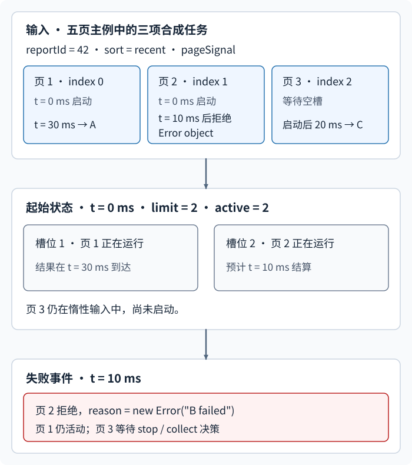
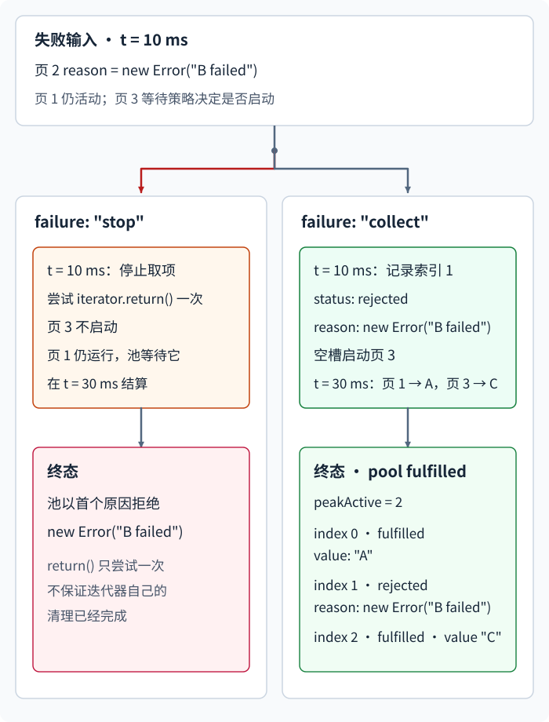
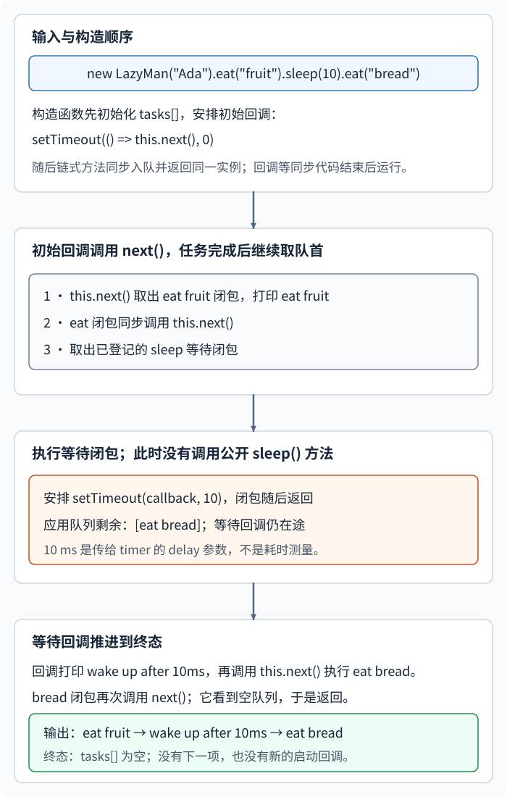

# 取消、超时和并发上限各自停得住什么？

本章区分三种常被混为一谈的“停”：超时停止等待、`AbortSignal` 请求取消、并发上限推迟启动，并说明每一种停不住什么。读者手上有[上一章的 `loadReport`](./promises-and-async-functions.md#三项请求一起等：loadReport)：它同时发出三个 Fetch，把页面的 `signal` 传给每一个，并且知道 Promise 组合器不会取消没被等到的工作。本章沿用主线一的报表页，新增五页已知页码的明细行，用它演示有界并发；最后用一个独立的 LazyMan 小例子看串行任务队列。

## 三种“停”分别停住什么

Promise 没有通用的取消操作。拿到一个 Promise，只能决定还等不等它，不能让产生它的工作停下。前端常用的三种手段作用在不同对象上：

| 手段 | 真正停住什么 | 停不住什么 |
| --- | --- | --- |
| 超时竞速（`Promise.race` 与计时器） | 调用方不再等待：先到的拒绝决定结果 | 底层工作仍可能继续，并在之后完成或产生副作用 |
| `AbortSignal`（中止信号） | 接受并监听这个 signal 的 API 按自己的规则停止，例如 Fetch 中止请求和正文读取 | 忽略 signal 的代码、普通 Promise、同步函数；服务端已经收到并执行的写入 |
| 并发上限（任务池的 `limit`） | 还没启动的任务暂时不启动 | 已经启动的任务；任务内部另外发起、却没纳入返回值的工作 |

`AbortSignal` 是 cooperative cancellation (协作式取消)：发出信号的一方只是请求停止，接收方要自己检查 `signal.aborted`、监听 `abort` 事件，或把 signal 继续传给支持它的 API。它也只作用在本地：请求已经到达服务器、写入已经执行，客户端中止只是不再等结果。结果不明的写入怎样对账，见[外部写入与对账](../../ai-engineering/runs/external-writes-and-reconciliation.md)。

## AbortSignal 怎样传到工作里

`AbortController`（中止控制器）由拥有这项工作生命周期的一方持有，例如页面；它的 `controller.signal` 交给工作方。调用 `controller.abort(reason)` 后，`signal.aborted` 变为 `true`，`signal.reason` 记下原因（不传时是名为 `AbortError` 的 `DOMException`），并派发一次 `abort` 事件。

Fetch 收到中止后落在哪一步，取决于它进行到哪里：`Response` 交出之前中止，Fetch Promise 以 `signal.reason` 拒绝；正文还在读取时中止，`json()` 拒绝；`json()` 已经履行后中止，不会撤回结果。完整的步骤表在[上一章“fetch 履行不等于请求成功”](./promises-and-async-functions.md#fetch%20履行不等于请求成功)。

应用自己写的异步代码要在边界处主动检查信号：开始一步之前看 `signal.aborted`，一步做完、准备要下一项之前再看一次。[游标分页的消费循环](./iterators-and-generators.md#游标分页的异步生成器)就在每行追加前后各查一次。

## 用计时器等待：sleep

~~~javascript
function sleep(millis) {
  return new Promise(resolve => setTimeout(resolve, millis));
}

const start = Date.now();
sleep(100).then(() => console.log(Date.now() - start)); // 约 100 ms 或更久
~~~

`sleep` 只等一个宿主计时器，不阻塞当前线程。计时器的延迟到期，只表示回调从此可以被调度：它不会打断正在运行的 JavaScript，负载重时回调还会更晚运行。计时器怎样排进事件循环，见[事件循环怎样安排任务、微任务和渲染？](../browser/event-loop-tasks-and-rendering.md)。浏览器的 `setTimeout` / `setInterval` 返回数值 ID，Node.js 返回 `Timeout` 对象；TypeScript 里对应哪种类型，取决于项目选择的宿主类型声明。

## 超时包装只停止等待

下面的 `timeLimit` 让一次调用与计时器竞速，先结束的一方决定调用方看到的结果：

~~~javascript
function timeLimit(fn, millis) {
  // 在 ES module 或严格模式中定义，调用时的 this 才原样传递。
  return function (...args) {
    let timerId;
    const timeout = new Promise((_, reject) => {
      timerId = setTimeout(
        () => reject(new Error("Time Limit Exceeded")),
        millis
      );
    });

    let work;
    try {
      work = Promise.resolve(fn.apply(this, args));
    } catch (error) {
      work = Promise.reject(error);
    }

    return Promise.race([work, timeout])
      .finally(() => clearTimeout(timerId));
  };
}
~~~

包装器返回普通函数而不是箭头函数，以便用 `fn.apply(this, args)` 转发调用时的 `this`；转发参数和 `this` 的通则见[怎样包装一个函数而不弄丢参数、this 和结果？](./wrapping-functions.md)。`try/catch` 把 `fn` 的同步抛错转成拒绝，工作先结束时 `finally` 清掉还没触发的计时器。只有超时回调真正运行了，结果才是超时拒绝；即便如此，`fn` 的工作仍会继续。

> [!example] 50 ms 的等待上限不是 50 ms 后强行中断
> - 请求要 100 ms 才完成，`timeLimit(request, 50)` 在超时回调得到调度后拒绝调用方，底层请求还在继续。
> - 函数等待 120 ms 后返回两参数之和，`timeLimit(fn, 150)(5, 10)` 在正常调度下得到 `15`。
> - 函数同步抛错时，拒绝立刻传播，计时器被清除，不必等满预算。
> - 函数同步占用 80 ms，再返回一个已履行的 Promise。80 ms 里计时器无法抢占 JavaScript；同步代码让出后，`work` 的处理器是微任务，先于已到期的计时器任务运行，所以这次调用成功。50 ms 不是硬实时截止线。

要让超时真正停止支持取消的工作，超时触发时应调用控制器的 `abort()`，或者直接把 DOM 标准提供的 `AbortSignal.timeout(ms)` 交给 Fetch：它到时自动中止，`reason` 是名为 `TimeoutError` 的 `DOMException`。

> [!info] TypeScript 的 this 参数不改变运行时调用
> 可以用显式 this 参数写出包装函数的调用类型；它在编译时擦除，不是实际传入的第一个参数。运行时仍要用普通 function 接住调用上下文，再用 `fn.apply(this, args)` 调用原函数。
>
> ~~~typescript
> type TimedFunction<This, Args extends unknown[], Result> =
>   (this: This, ...args: Args) => Promise<Result>;
> ~~~

## 取消计时器：哪些调用还会发生

一次性计时器可以把 ID 封进取消函数。下面的输入来自常见的计时器练习：给定 `fn`、参数 `args` 和延迟 `t`（毫秒，即代码里的 `millis`），在 `cancelT` 毫秒时调用返回的取消函数：

~~~javascript
function cancellable(fn, args, millis) {
  const timerId = setTimeout(() => fn(...args), millis);
  return () => clearTimeout(timerId);
}
~~~

| 输入 | 预期调用 | 原因 |
| --- | --- | --- |
| `fn(x)=x*5`，`args=[2]`，`t=20`，`cancelT=50` | 约 20 ms 调用一次，结果 `10` | 回调先运行，之后的取消撤不回它 |
| `fn(x)=x²`，`args=[2]`，`t=100`，`cancelT=50` | 不调用 | 取消时回调仍在等待 |
| `fn(x,y)=x*y`，`args=[2,4]`，`t=30`，`cancelT=100` | 约 30 ms 调用一次，结果 `8` | 回调在取消前已完成 |

`clearTimeout` 只能清掉还没执行的回调，不打断已开始运行的函数，也不把函数结果交给 `cancellable` 的调用者。`fn` 依赖 `this` 时，要显式传接收者或先绑定。

重复计时器版本要求先立即调用一次，再按间隔安排后续调用：

~~~javascript
function cancellableInterval(fn, args, millis) {
  fn(...args); // 第一次同步调用
  const intervalId = setInterval(() => fn(...args), millis);
  return () => clearInterval(intervalId);
}
~~~

| 输入 | 理想化调用时刻 | 每次结果 |
| --- | --- | --- |
| `fn(x)=2*x`，`args=[4]`，`t=35`，`cancelT=190` | `0, 35, 70, 105, 140, 175 ms` | `8` |
| `fn(x,y)=x*y`，`args=[2,5]`，`t=30`，`cancelT=165` | `0, 30, 60, 90, 120, 150 ms` | `10` |
| `fn(x,y,z)=x+y+z`，`args=[5,1,3]`，`t=50`，`cancelT=180` | `0, 50, 100, 150 ms` | `9` |

表里的毫秒是题目输入，不是计时保证。`setInterval` 不等待回调返回的 Promise：`fn` 是异步函数且一次执行比间隔长时，下一次调用照样开始，多次调用会重叠。`clearInterval` 只阻止以后的回调，不取消已经启动的 Promise 工作；重叠和失败策略要由调用方另外规定，例如改用“上一次结束后再 `setTimeout` 下一次”。

## 把任务写成工厂，才能控制何时启动

`fetch(url)` 一调用就发出请求。如果先创建五个 Fetch Promise 再交给 `Promise.all`，五个请求在创建时就已全部发出，组合器只能等结果，无从控制启动时机。

报表 42 在 `canReadRows === true` 之后要读取明细行，共五页，页码事先已知。要控制何时启动，就把每页写成 task factory (任务工厂)：一个被调用时才发起请求的函数。下面的 `map` 只生成五个函数，此时一页也没请求：

~~~javascript
function createPageTasks(reportId, sort) {
  return [1, 2, 3, 4, 5].map(page => async ({ signal }) => {
    const query = new URLSearchParams({ page: String(page), sort });
    const url =
      "/api/reports/" + encodeURIComponent(reportId) + "/rows?" + query;
    const response = await fetch(url, { signal });
    if (!response.ok) throw new Error("页 " + page + " 请求失败");
    return response.json();
  });
}
~~~

任务池只能看到工厂返回的 Promise，并在它结算后释放槽位。工厂启动了别的工作却提前返回，池会释放槽位，那项工作仍在继续；工厂内部再并发发起多项工作，池也无法分别限流。

本例的工厂就有这种情况。状态不是 2xx 时，工厂检查 `response.ok` 后立即抛错，但没有读取或取消这条响应的正文流：工厂的 Promise 已经结算、槽位已经释放，正文流却可能还开着。状态成功时，工厂要等 `response.json()` 读完并解析才结算。所以 `limit` 限制的是池正在等待的任务数，不是 HTTP 请求、连接或响应体流的数量。

## 有界并发池：五页明细，同时最多两页

本例要求同时进行的任务不超过两个。`2` 是案例给定的资源限制，不是通用最佳值。任务池 `runBounded(tasks, limit, options)` 接收一个同步 iterable，其中每项都是任务工厂；它最多同时运行 `limit` 个工厂调用，调用时传入 `{ signal, index }`。

调度过程如下：

1. `nextIndex` 记录下一个输入位置，`active` 集合保存正在运行的任务，`peakActive` 记录同时运行任务数的峰值。
2. 有空槽时，不断取出下一项并启动。
3. 槽位填满后，用 `Promise.race` 等“某个任务结算”与“池收到停止通知”中先发生的一个。
4. 任务结算腾出槽位，回到第 2 步。每项结果写入 `results[index]`，完成先后不改变结果位置。

关键问题是某个任务失败后怎么办。池支持两种 failure policy (失败策略)：`stop` 遇到失败就停止，`collect` 收集每项结果后继续。为看清过程，下图把五页缩成三页合成输入：页 1 用 30 ms 得到 `"A"`；页 2 用 10 ms 以 `new Error("B failed")` 拒绝；页 3 启动后用 20 ms 得到 `"C"`。这些延迟是合成值，只表达完成先后。

页码从 1 开始，工厂的 `index` 从 0 开始，所以页 2 对应 `results[1]`。同一个错误在两种策略下的结局：

| 时刻 | 活动状态 | `failure: "stop"` | `failure: "collect"` |
| --- | --- | --- | --- |
| `0 ms` | 页 1、页 2 启动，活动数 `2` | `peakActive = 2` | `peakActive = 2` |
| `10 ms` | 页 2 拒绝，页 1 仍在运行 | 记下首个失败，停止取项，尝试调用一次迭代器的 `return()`；页 3 不启动 | 在 `results[1]` 记下拒绝，腾出的槽位启动页 3 |
| `30 ms` | 页 1 完成；`collect` 下页 3 也在此刻完成（10 + 20） | 排空后以 `new Error("B failed")` 拒绝 | 履行三条按位置排列的记录：A、错误、C；峰值仍是 `2` |

`stop` 是默认策略。它停止取项后，对还没取完的输入迭代器调用一次可选的 `return()`，通知它提前结束（例如让生成器执行 `finally`），然后等已启动的任务全部结算，这一步叫 drain (排空)，最后以首个停止原因拒绝。一次 `return()` 不保证迭代器完成了自己的清理；排空也只表示池不再等任何任务，不回滚已完成的写入，不强行终止忽略 signal 的工作。

`collect` 为每个实际启动的任务保存一条记录：`{ status: "fulfilled", value }` 或 `{ status: "rejected", reason }`。它在失败后继续填充空槽，直到输入取完、活动任务全部结算。没有启动的任务没有记录。

## 页面离开时：abort 停止调度，不终止任务

用户离开页面时，页面调用 `controller.abort()`；池把这个 `pageSignal` 同时用作自己的停止信号，并传给每个工厂。收到 `abort` 后，池停止取项，尝试一次 `return()`，并立即唤醒等待中的调度器。Fetch 按自己的规则中止；如果某个任务忽略信号或永远不结算，池就一直等下去。

| 时刻 | 池和输入 | 已启动的任务 |
| --- | --- | --- |
| `0 ms` | 页 1、页 2 启动，活动数 `2` | 两个工厂收到同一个 `pageSignal` |
| `5 ms`，页面调用 `abort()` | 停止取项，尝试 `return()` 一次，不启动页 3，唤醒调度器 | 支持中止的 Fetch 收到信号；忽略它的工作继续运行 |
| 已启动任务全部结算后 | 以首个停止原因拒绝池调用 | 不再启动新任务 |

任务失败和 abort 都走池内部的 `stop(reason)`，停止原因以最先的那次为准：`stop` 策略下页 2 的失败先到，后来的 abort 不会替换它；abort 先到，随后的任务失败也不替换中止原因。`collect` 不因单项失败停止，但外部 abort 仍会停止整池并拒绝。

“页面离开就取消”和“任一任务失败就取消兄弟请求”是两项独立策略。本例只把页面的信号传给任务，任务失败不会调用 `abort()`；需要失败时中止在途请求，要另建控制器并写明策略。

调用方在权限校验通过后创建任务，选用 `collect`，让单页失败不影响其他页：

~~~javascript
const pageSignal = controller.signal;
const pageTasks = createPageTasks("42", "recent");
const { results, peakActive } = await runBounded(pageTasks, 2, {
  failure: "collect",
  signal: pageSignal,
});

for (const [index, result] of results.entries()) {
  if (result.status === "fulfilled") console.log(index, result.value);
  else console.error(index, result.reason);
}
~~~

外部 abort、输入迭代器出错或非法任务项会让整个池拒绝，此时 `await runBounded(...)` 抛出原因，拿不到 `results`。

如果事先不知道页码，每一页要等上一页返回 `nextCursor` 才能确定，就无法提前构造这组任务，只能顺序读取，见[游标分页的异步生成器](./iterators-and-generators.md#游标分页的异步生成器)。

## 教学实现：runBounded

这份实现的契约：

- `limit` 必须是大于 0 的安全整数；`failure` 只能是 `"stop"` 或 `"collect"`。
- 输入是同步可迭代对象，逐项产出的值必须是函数；池只在有空槽时以 `{ signal, index }` 调用它。输入中尚未取到的项不检查。
- 池仍在等待的任务数不超过 `limit`。成功时履行 `{ results, peakActive }`；`stop` 时以首个停止原因拒绝；`collect` 时履行已运行项的状态记录。
- 外部 abort、同步输入错误和非法任务项都会拒绝整个池，即使 `failure` 是 `"collect"`。
- 停止或 abort 后不再取项，并尝试对未耗尽的迭代器调用一次可选的 `return()`；清理异常不覆盖首个停止原因。池会等已启动任务的返回值结算。
- 不提供重试、异步迭代输入、持久配额或持久化。

还有一种重入边界：池调用 `iterator.next()` 时会运行输入方的代码，这段代码可能同步触发 abort。本实现只处理 `next()` 函数体内同步触发 abort、且返回普通数据属性结果的情况：返回 `{ done: true }` 时，池记下输入已取完，不再调用 `return()`；返回 `{ done: false, value: task }` 时，池调用一次 `return()`，不启动刚取到的任务。结果对象的 `done` 或 `value` 若是自定义取值器，读取时还会运行别的代码，这种情况不在本实现范围内。

> [!example]- 完整代码：runBounded
>
> ~~~javascript
> async function runBounded(tasks, limit, { failure = "stop", signal } = {}) {
>   if (!Number.isSafeInteger(limit) || limit < 1) {
>     throw new RangeError("limit 必须是正整数");
>   }
>   if (failure !== "stop" && failure !== "collect") {
>     throw new TypeError('failure 必须是 "stop" 或 "collect"');
>   }
>   if (tasks == null || typeof tasks[Symbol.iterator] !== "function") {
>     throw new TypeError("tasks 必须是同步 iterable");
>   }
>
>   const iterator = tasks[Symbol.iterator]();
>   if (iterator == null || typeof iterator.next !== "function") {
>     throw new TypeError("tasks 必须产生 iterator");
>   }
>
>   const results = [];
>   const active = new Set();
>   let nextIndex = 0;
>   let activeCount = 0;
>   let peakActive = 0;
>   let exhausted = false;
>   let pulling = false;
>   let returnAfterNext = false;
>   let iteratorReturnAttempted = false;
>   let stopped = false;
>   let stopReason;
>   let wakeStop;
>   const stopSignal = new Promise(resolve => {
>     wakeStop = resolve;
>   });
>
>   function attemptIteratorReturn() {
>     if (iteratorReturnAttempted || exhausted) return;
>     iteratorReturnAttempted = true;
>     const returnMethod = iterator.return;
>     if (returnMethod == null) return;
>     if (typeof returnMethod !== "function") {
>       throw new TypeError("iterator.return 必须是函数");
>     }
>     const result = returnMethod.call(iterator);
>     if (result === null ||
>         (typeof result !== "object" && typeof result !== "function")) {
>       throw new TypeError("iterator.return 必须返回对象");
>     }
>   }
>
>   function attemptIteratorReturnSafely() {
>     try {
>       attemptIteratorReturn();
>     } catch {
>       // 清理错误不覆盖原先确定的失败或 abort reason。
>     }
>   }
>
>   function stop(reason) {
>     if (!stopped) {
>       stopped = true;
>       stopReason = reason;
>     }
>     if (pulling) returnAfterNext = true;
>     else attemptIteratorReturnSafely();
>     wakeStop();
>   }
>
>   const onAbort = () => stop(signal.reason);
>   if (signal) {
>     if (signal.aborted) onAbort();
>     else signal.addEventListener("abort", onAbort, { once: true });
>   }
>
>   async function runTask(task, index) {
>     activeCount++;
>     peakActive = Math.max(peakActive, activeCount);
>     try {
>       const value = await task({ signal, index });
>       results[index] = failure === "collect"
>         ? { status: "fulfilled", value }
>         : value;
>     } catch (reason) {
>       if (failure === "collect") {
>         results[index] = { status: "rejected", reason };
>       } else {
>         stop(reason);
>       }
>     } finally {
>       activeCount--;
>     }
>   }
>
>   try {
>     while (!stopped && !exhausted) {
>       while (!stopped && !exhausted && active.size < limit) {
>         if (signal?.aborted) {
>           stop(signal.reason);
>           break;
>         }
>
>         pulling = true;
>         let step;
>         try {
>           step = iterator.next();
>         } finally {
>           pulling = false;
>         }
>
>         if (step === null ||
>             (typeof step !== "object" && typeof step !== "function")) {
>           throw new TypeError("iterator.next 必须返回对象");
>         }
>         if (step.done) {
>           exhausted = true;
>           returnAfterNext = false;
>           break;
>         }
>         if (returnAfterNext) {
>           returnAfterNext = false;
>           attemptIteratorReturnSafely();
>         }
>         if (stopped || signal?.aborted) {
>           if (!stopped) stop(signal.reason);
>           break;
>         }
>
>         const task = step.value;
>         if (stopped || signal?.aborted) {
>           if (!stopped) stop(signal.reason);
>           break;
>         }
>         if (typeof task !== "function") {
>           throw new TypeError("第 " + nextIndex + " 项不是任务函数");
>         }
>
>         const index = nextIndex++;
>         let tracked;
>         tracked = runTask(task, index).finally(() => active.delete(tracked));
>         active.add(tracked);
>       }
>
>       if (!stopped && active.size > 0) {
>         await Promise.race([...active, stopSignal]);
>       }
>     }
>   } catch (error) {
>     stop(error);
>   }
>
>   if (stopped && !exhausted) attemptIteratorReturnSafely();
>   await Promise.all(active);
>   if (signal) signal.removeEventListener("abort", onAbort);
>   if (stopped) throw stopReason;
>   return { results, peakActive };
> }
> ~~~

`runTask` 在每项任务内部捕获抛错和拒绝，所以 `active` 里的 Promise 都不会拒绝，池可以统一等待。`Promise.race([...active, stopSignal])` 只用来在“任一任务结算”和“池已停止”之间唤醒调度器，不取消输掉的 Promise；最后的 `Promise.all(active)` 负责排空。

首个停止原因优先、尝试一次 `return()`、abort 后仍等待活动任务，都是这个教学池的应用层契约。ECMAScript 只规定迭代步骤怎样读取和调用 `return()`，DOM 和 Fetch 只规定哪些活动响应 `AbortSignal`；stop / collect 策略不来自任何标准。

## 小例子：LazyMan 链式任务队列

并发池管“同时最多几个”；有时需要的是“严格一个接一个”，且每项何时完成由任务自己说了算。报表页里没有自然的场景，所以换一个独立的合成例子 LazyMan：调用者一口气写完三条命令，希望之后依次看到吃水果、等待后醒来、吃面包。

~~~javascript
new LazyMan("Ada").eat("fruit").sleep(10).eat("bread");
~~~

整条链在当前同步代码里执行完，三项任务只是被放进实例自己的 `tasks` 数组；这个数组是应用维护的函数队列，不是宿主事件循环的任务队列。`"Ada"` 只是实例名，输出为突出顺序不打印名字。

~~~javascript
class LazyMan {
  constructor(name) {
    this.name = name;
    this.tasks = [];
    setTimeout(() => this.next(), 0);
  }

  eat(food) {
    this.tasks.push(() => {
      console.log("eat " + food);
      this.next();
    });
    return this;
  }

  sleep(ms) {
    this.tasks.push(() => {
      setTimeout(() => {
        console.log("wake up after " + ms + "ms");
        this.next();
      }, ms);
    });
    return this;
  }

  next() {
    const task = this.tasks.shift();
    if (task) task();
  }
}
~~~

三处设计各管一件事：

- **构造函数延后第一项。** 如果构造时直接调用 `next()`，`tasks` 还是空的，后面的 `.eat()`、`.sleep()` 都还没执行。改用 `setTimeout` 安排回调，JavaScript 不会在同步代码执行到一半时切去运行它，于是整条链先登记完。
- **登记方法只入队并返回 `this`。** closure (闭包) 记住入队时的 `food` 或 `ms`；箭头函数没有自己的 `this`，回调里的 `this` 仍是这个实例，见[函数里的变量和 this 从哪来？](./scope-closures-and-this.md)。
- **`next()` 是类自己的普通方法**，不是任何宿主或 Promise 接口。第一次由构造函数的计时器回调调用，之后由每项任务在自己的工作完成时调用一次：`eat` 打印后立刻推进；`sleep` 轮到自己时才安排计时器并返回，等回调打印醒来消息后再推进。

| 阶段 | 队列剩余（左边先执行） | 正在执行的工作 | 谁触发下一步 |
| --- | --- | --- | --- |
| 链式调用结束 | `eat fruit → sleep 10 → eat bread` | 尚未启动 | 构造函数安排的计时器回调，等同步代码结束后运行 |
| 初始 `next()` | `sleep 10 → eat bread` | 打印 `eat fruit`，同步调用 `next()` | 当前调用 |
| 取出等待闭包 | `eat bread` | 安排延迟参数为 10 ms 的计时器后返回，队列暂停 | 稍后运行的计时器回调 |
| 等待回调运行 | `eat bread` | 打印醒来消息，调用 `next()` | 当前回调 |
| 最后一项 | 空 | 打印 `eat bread`，调用 `next()`；`shift()` 得到 `undefined`，结束 | 无 |

> [!example] Ada 的三条命令
> `sleep` 任务入队时并不等待；轮到它时才启动 10 ms 计时器，回调运行后队列才推进到面包任务。输出：
>
> ~~~text
> eat fruit
> wake up after 10ms
> eat bread
> ~~~
>
> 10 ms 是传给计时器的延迟参数，醒来日志只是复述它，不是实测时间。本例只依赖一个先后关系：等待回调运行后，队列才推进。

外部代码保存实例后再追加任务，结果取决于队列是否还在推进。在 `sleep` 等待期间调用 `.eat("cake")`，新闭包排在 `eat bread` 之后执行。链以 `.sleep(10)` 结尾时，等待闭包出队后 `tasks.length` 暂时为 0，但回调还没运行，此时追加的任务仍会在回调推进后执行。只有最后一项完成、`next()` 看到空队列返回之后，再追加的任务才不会自动运行：登记方法只入队，不会安排新的启动回调。

这个队列靠一条约定运转：调用者只登记任务，每个出队任务在完成时恰好调用一次 `next()`。由此可以列出它的失效方式：

- 漏调 `next()`，队列停住；
- 提前或重复调用，后续任务在当前工作完成前启动；调用者直接调用 `next()` 也会跳过尚未结束的等待；
- 任务抛错没有恢复策略；
- 等待中的计时器没有保存 ID，无法取消；
- 连续的同步任务经 `next()` 层层递归推进，任务很多时可能耗尽调用栈。

所以它只演示链式登记、闭包保存参数和显式推进。任务需要返回值、组合或把失败交给调用者时，应改用 Promise 链或 `async` 函数。

## 停下来之后：失败交给谁处理？

本章交出三条结论：超时竞速只停止等待；`AbortSignal` 只让接受它的 API 停下，且不撤销服务端副作用；并发上限只推迟未启动的任务工厂，`stop` / `collect` 决定失败后还启不启动新任务。无论用哪种手段，调用方最终收到的仍是一个履行或拒绝的 Promise。下一章[一次失败该由哪一层处理？](./error-handling-across-layers.md)接手这个拒绝：它在哪一层恢复，哪一层只记录，取消原因又怎样与真正的错误分开。

> [!info]- 来源
> - **“三种停”与“AbortSignal 怎样传到工作里”：协作式取消、`reason`、`abort` 事件、`AbortSignal.timeout()`。** [WHATWG DOM §3 Aborting ongoing activities](https://dom.spec.whatwg.org/#aborting-ongoing-activities)，Living Standard 更新时间 2026-11-11。Promise 本身没有内建中止；API 可以选择接受、响应或忽略 `AbortSignal`。
> - **Fetch 中止的时点与响应体。** [WHATWG Fetch §5.5 Abort a fetch](https://fetch.spec.whatwg.org/#abort-fetch)、[§2.2.3 Statuses、§5.3 Body mixin](https://fetch.spec.whatwg.org/)，Living Standard 更新时间 2026-10-19。Fetch 可响应 signal 中止请求和正文处理，不能撤销远端已发生的副作用；`ok` 对应 200–299，HTTP 非成功状态仍产生 Response。
> - **“用计时器等待”与“取消计时器”：计时器调度与不精确延迟。** [WHATWG HTML §8.7 Timers](https://html.spec.whatwg.org/multipage/timers-and-user-prompts.html#timers)、[§8.1.7 Event loops](https://html.spec.whatwg.org/multipage/webappapis.html#event-loops)，Living Standard 更新时间 2026-11-11。Node.js 计时器返回 `Timeout` 对象，不保证精确时刻和回调顺序，小于 1 ms 的延迟按 1 ms 处理：[Node.js v26.13.0 Timers](https://nodejs.org/download/release/v26.13.0/docs/api/timers.html)。
> - **“超时包装只停止等待”：`Promise.race` 与 `finally`。** [ECMAScript 2027 草案（2026-11-08）§27.5 `Promise.race`](https://tc39.es/ecma262/#sec-promise.race)、[`Promise.prototype.finally`](https://tc39.es/ecma262/#sec-promise.prototype.finally)，核对日期 2026-11-12。显式 this 参数在编译时擦除：[TypeScript Handbook：Declaring this in a Function](https://www.typescriptlang.org/docs/handbook/2/functions.html#declaring-this-in-a-function)。
> - **“有界并发池”与“教学实现”：同步迭代步骤与关闭。** [ECMAScript 2027 草案 §7.4.4、§7.4.10–7.4.11、§27.8.1.3](https://tc39.es/ecma262/#sec-iteratorclose)，核对日期 2026-11-12。`GetIterator`、`IteratorStepValue`、`IteratorClose` 和生成器 `return()` 支持同步输入与关闭语义；一次生成器 `return()` 可以返回 `done: false`，所以池的单次尝试不保证生成器清理完毕。
> - **LazyMan 中的闭包与箭头函数 this。** [ECMAScript 2027 草案 §10.2 ECMAScript Function Objects、§15.3 Arrow Function Definitions](https://tc39.es/ecma262/)，核对日期 2026-11-12。
> - **运行核对。** 原稿在 Node.js v26.13.0 / V8 14.6.202.34-node.40 实测 `stop` / `collect`、abort、iterator `return()` 与本地 loopback 响应体场景。本次在 Node.js v26.13.1 重跑 `runBounded` 的三项合成输入（stop 约 30 ms 以 `B failed` 拒绝；collect 履行 A、错误、C，`peakActive = 2`；5 ms abort 后等忽略信号的任务到约 30 ms 才拒绝；生成器输入在 stop 与 abort 时都进入 `finally`）以及 `timeLimit` 的 150 ms / 50 ms / 同步 80 ms 三例，结果与正文一致。图表中的 10/20/30 ms 是合成延迟。
