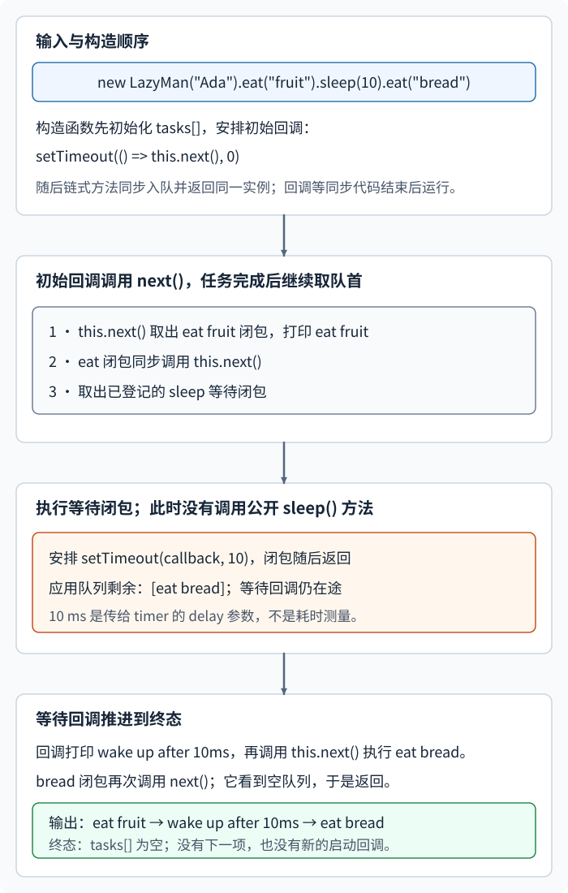

# 链式接口如何先排队、再依次执行延后任务？

## 案例背景

用一个合成的 LazyMan 案例说明方法链如何变成按序执行的闭包队列。调用者希望先写完三项命令，再依次看到吃水果、等待后醒来、吃面包：

~~~javascript
new LazyMan("Ada").eat("fruit").sleep(10).eat("bread");
~~~

这里的 `Ada` 是这条链的示例身份；精简输出只打印食物和等待，不打印名字。链式调用在当前同步代码里把三项任务放进实例的 `tasks` 数组；构造函数安排的初始定时器回调稍后才启动第一项。队列不是宿主事件循环的任务队列，里面保存的是应用自己的函数。

## 为什么构造时要延后第一项？

如果构造函数立刻调用 `next()`，当时 `tasks` 还是空数组；`shift()` 会取到 `undefined`，而后续 `.eat()` 与 `.sleep()` 尚未执行。构造函数改用 `setTimeout` 安排一个稍后的回调，让当前同步链先把三项工作登记好。JavaScript 不会在这段同步代码中途切去执行另一个普通定时器回调；具体回调何时获得调度由宿主决定。

下面是本例的完整教学队列。`name` 记录实例身份；任务输出为聚焦顺序而省略名字。

~~~javascript
class LazyMan {
  constructor(name) {
    this.name = name;
    this.tasks = [];
    setTimeout(() => this.next(), 0);
  }

  eat(food) {
    this.tasks.push(() => {
      console.log("eat " + food);
      this.next();
    });
    return this;
  }

  sleep(ms) {
    this.tasks.push(() => {
      setTimeout(() => {
        console.log("wake up after " + ms + "ms");
        this.next();
      }, ms);
    });
    return this;
  }

  next() {
    const task = this.tasks.shift();
    if (task) task();
  }
}
~~~

`.eat(food)` 和 `.sleep(ms)` 当场只把函数压入队列，并返回同一个 `this`，所以调用者可以继续链式调用。closure（闭包）保留入队时的 `food` 或 `ms`；箭头函数也在回调中继续使用同一个实例的 `this`。等 `next()` 取出函数时，工作才真正发生。

`next()` 取出并执行队首任务；若队列为空，它就返回。构造函数安排的定时器回调负责第一次调用 `next()`，之后由各项任务在自己的工作完成时调用一次。普通 `eat` 任务打印后立刻推进；轮到已登记的 `sleep` 闭包时，它才安排定时器并返回，等回调打印醒来消息后再推进。调用者按本例约定只使用 `.eat()`、`.sleep()` 这类登记方法，不直接调用 `next()`。

`next()` 是这个类自己定义的普通方法，不是浏览器、Node.js、定时器或 Promise 内建的队列推进接口。

## 队列怎样推进到最终输出？

继续跟踪同一条合成输入。`tasks` 中从左到右是下一项先执行；`next()` 取走队首后，任务可能同步推进，也可能把推进交给稍后的宿主回调。

| 阶段 | 应用队列剩余项 | 正在执行的工作 | 谁触发下一步 |
| --- | --- | --- | --- |
| 链式调用结束 | `eat fruit → sleep 10 → eat bread` | 尚未启动 | 构造函数安排的初始定时器回调；当前同步代码结束后才有机会运行 |
| 初始 `next()` 取出第一项 | `sleep 10 → eat bread` | `eat fruit` 打印，然后同步调用 `next()` | 当前 JavaScript 调用 |
| `next()` 取出已登记的等待闭包 | `eat bread` | 执行等待闭包，安排延时参数为 10 ms 的定时器，然后返回；队列暂不继续 | 宿主稍后调度的定时器回调 |
| 等待回调运行 | `eat bread` | 打印醒来消息，再调用 `next()` | 当前定时器回调中的 JavaScript |
| 最后一项完成 | 空 | `eat bread` 打印，再调用 `next()`；`shift()` 得到 `undefined`，调用结束 | 无下一项 |

输出顺序是：

> [!example] Ada 的三个排队命令
> 输入为 `eat("fruit")`、`sleep(10)`、`eat("bread")`。`sleep` 任务未在入队时等待；它直到轮到自己时才启动 10 ms 定时器。定时器回调运行后才推进到面包任务。
>
> ~~~text
> eat fruit
> wake up after 10ms
> eat bread
> ~~~

这里的 10 ms 是传给定时器的延时参数，醒来日志复用同一参数，不表示测得的经过时间。浏览器标准说明定时器会在指定延时后安排回调，但负载或其他任务可让实际执行变晚；Node.js v26.13.0 也明确不保证精确时刻或回调间的固定顺序。本例只依赖“等待回调推进队列”这一先后关系。

在原例中，若外部代码在 `sleep` 等待期间调用 `.eat("cake")`，新闭包追加到 `tasks` 尾部；回调推进后，原有 `eat bread` 先于 `eat cake` 执行。另一个变体以 `.sleep(10)` 作为最后一项：等待闭包已出队，所以 `tasks.length` 暂时为 0，但等待回调仍在途；此时追加的 `eat cake` 会在回调推进后运行。只有最后一项完成并调用 `next()`、而 `next()` 看到空队列返回之后，后续单纯追加任务才不会自动重启队列，因为登记方法只入队，不安排新的启动回调。

这个串行队列依赖一个明确约定：调用者只登记任务；每个出队任务只在自身工作完成时调用一次 `next()`。若漏调，队列就停住；若任务提前或重复调用，后续任务可能在当前工作完成前启动。调用者直接调用 `next()` 也可能绕过尚未完成的等待。任务抛错时本实现没有恢复策略；等待中的定时器没有保存句柄，不能由实例取消。连续的同步任务会通过 `next()` 递归推进，很多项可能耗尽调用栈。它只演示链式登记、闭包保存参数和显式推进，不是具备错误恢复或取消能力的生产队列。

若任务需要返回值、并发组合或把失败交给调用者处理，可以用 Promise 链或 `async function` (异步函数)；[回调、Promise 与 async 函数怎样组合异步工作？](./asynchronous-javascript.md)解释这些结果怎样传播。本页只回答链式命令如何排队并按序推进。

> [!info]- 来源
> - **浏览器定时器与事件循环。** [WHATWG HTML §8.7 Timers](https://html.spec.whatwg.org/multipage/timers-and-user-prompts.html#timers)、[§8.1.7 Event loops](https://html.spec.whatwg.org/multipage/webappapis.html#event-loops)，Living Standard 更新时间：2026-11-11。定时器初始化会创建稍后进入 timer task source（定时器任务源）的任务；事件循环先执行当前选中的任务步骤，之后再选择可运行任务。标准明确不保证定时器按精确延时准点运行。
> - **Node.js 计时器范围。** [Node.js v26.13.0 Timers](https://nodejs.org/download/release/v26.13.0/docs/api/timers.html)。Node 定时器采用不同的内部实现；文档说明实际时刻及回调顺序不作精确保证，且小于 1 ms（含 0）的延迟参数（`delay`）会设为 1 ms。本例不把浏览器定时器的延时规则外推到 Node。
> - **闭包与箭头函数。** [ECMAScript 2027 草案（2026-11-08）§10.2 ECMAScript Function Objects、§15.3 Arrow Function Definitions](https://tc39.es/ecma262/)，核对日期：2026-11-12。函数对象保存它闭合的词法环境；箭头函数不创建自己的 `this` 绑定。本例入队的函数稍后仍能读取 `food`、`ms` 参数，并通过外层方法的 `this` 调用 `next()`。
