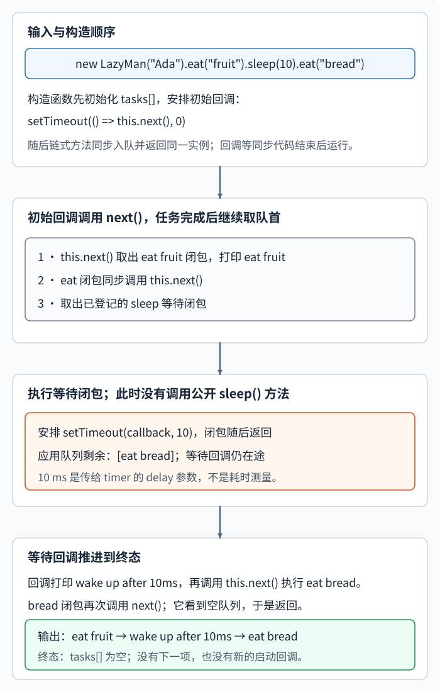

# 链式接口如何先排队、再依次执行延后任务？

## 案例背景

本章用一个合成的 LazyMan 案例，说明一条方法链怎样变成按顺序执行的闭包队列。调用者一口气写完三项命令，希望之后依次看到：吃水果、等待一段时间后醒来、吃面包。

~~~javascript
new LazyMan("Ada").eat("fruit").sleep(10).eat("bread");
~~~

`"Ada"` 只是这个实例的名字；为了突出顺序，输出只打印食物和等待，不打印名字。整条链在当前同步代码里执行完，三项任务只是被放进实例的 `tasks` 数组；第一项要等构造函数安排的定时器回调稍后运行时才启动。注意 `tasks` 是应用自己维护的函数数组，不是宿主事件循环的任务队列。

## 为什么构造时要延后第一项？

如果构造函数立刻调用 `next()`，当时 `tasks` 还是空数组；`shift()` 会取到 `undefined`，而后续 `.eat()` 与 `.sleep()` 尚未执行。所以构造函数改用 `setTimeout` 安排一个稍后的回调，让当前这条同步链先把三项工作登记好。JavaScript 不会在同步代码执行到一半时切去运行定时器回调；至于回调具体何时被调度，由宿主决定。

下面是本例的完整教学队列。`name` 记录实例身份；任务输出为聚焦顺序而省略名字。

~~~javascript
class LazyMan {
  constructor(name) {
    this.name = name;
    this.tasks = [];
    setTimeout(() => this.next(), 0);
  }

  eat(food) {
    this.tasks.push(() => {
      console.log("eat " + food);
      this.next();
    });
    return this;
  }

  sleep(ms) {
    this.tasks.push(() => {
      setTimeout(() => {
        console.log("wake up after " + ms + "ms");
        this.next();
      }, ms);
    });
    return this;
  }

  next() {
    const task = this.tasks.shift();
    if (task) task();
  }
}
~~~

`.eat(food)` 和 `.sleep(ms)` 被调用时只把一个函数压入队列，然后返回同一个 `this`，调用者因此可以继续往下链。closure（闭包）记住了入队时的 `food` 或 `ms`；箭头函数没有自己的 `this`，所以回调里的 `this` 仍是这个实例。真正的工作要等 `next()` 取出函数时才发生。

`next()` 是这个类自己定义的普通方法，不是浏览器、Node.js、定时器或 Promise 内建的接口。它取出并执行队首任务；队列为空时直接返回。第一次 `next()` 由构造函数安排的定时器回调发起，之后由每项任务在自己的工作完成时调用一次：`eat` 任务打印后立刻推进；`sleep` 任务轮到自己时才安排定时器并返回，等回调打印醒来消息后再推进。按本例约定，调用者只使用 `.eat()`、`.sleep()` 这类登记方法，不直接调用 `next()`。

## 队列怎样推进到最终输出？

继续跟踪同一条链。下表中 `tasks` 从左到右排列，最左边的先执行；`next()` 取走队首后，这项任务可能同步推进，也可能把推进交给稍后运行的宿主回调。

| 阶段 | 应用队列剩余项 | 正在执行的工作 | 谁触发下一步 |
| --- | --- | --- | --- |
| 链式调用结束 | `eat fruit → sleep 10 → eat bread` | 尚未启动 | 构造函数安排的初始定时器回调；当前同步代码结束后才有机会运行 |
| 初始 `next()` 取出第一项 | `sleep 10 → eat bread` | `eat fruit` 打印，然后同步调用 `next()` | 当前 JavaScript 调用 |
| `next()` 取出已登记的等待闭包 | `eat bread` | 执行等待闭包，安排延时参数为 10 ms 的定时器，然后返回；队列暂不继续 | 宿主稍后调度的定时器回调 |
| 等待回调运行 | `eat bread` | 打印醒来消息，再调用 `next()` | 当前定时器回调中的 JavaScript |
| 最后一项完成 | 空 | `eat bread` 打印，再调用 `next()`；`shift()` 得到 `undefined`，调用结束 | 无下一项 |

> [!example] Ada 的三个排队命令
> 输入为 `eat("fruit")`、`sleep(10)`、`eat("bread")`。`sleep` 任务入队时并不等待；轮到它时才启动 10 ms 定时器，定时器回调运行后队列才推进到面包任务。输出顺序是：
>
> ~~~text
> eat fruit
> wake up after 10ms
> eat bread
> ~~~

这里的 10 ms 是传给定时器的延时参数，醒来日志只是复述这个参数，不是实测的经过时间。浏览器标准规定定时器至少等到指定延时后才安排回调，负载或其他任务可能让实际执行更晚；Node.js v26.13.0 的文档同样不保证精确时刻或回调间的固定顺序。本例只依赖一个先后关系：等待回调运行后队列才推进。

如果外部代码保存了这个实例，并在 `sleep` 等待期间调用 `.eat("cake")`，新闭包会追加到 `tasks` 尾部；回调推进后，原有的 `eat bread` 先于 `eat cake` 执行。再看一个变体：链以 `.sleep(10)` 结尾。等待闭包出队后 `tasks.length` 暂时为 0，但等待回调还没运行；此时追加的 `eat cake` 仍会在回调推进后执行。只有当最后一项完成、`next()` 发现队列为空并返回之后，再追加的任务才不会自动运行，因为登记方法只负责入队，不会安排新的启动回调。

这个串行队列依赖一个约定：调用者只登记任务，每个出队任务在自己的工作完成时恰好调用一次 `next()`。漏调会让队列停住；提前或重复调用会让后续任务在当前工作完成前启动；调用者直接调用 `next()` 也可能跳过尚未结束的等待。此外，任务抛错时本实现没有恢复策略；等待中的定时器没有保存句柄，实例无法取消它；连续的同步任务通过 `next()` 层层递归推进，任务很多时可能耗尽调用栈。所以它只用来演示链式登记、闭包保存参数和显式推进，不是能恢复错误或取消任务的生产队列。

若任务需要返回值、并发组合，或要把失败交给调用者处理，可以改用 Promise 链或 `async function`（异步函数）；[回调、Promise 与 async 函数怎样组合异步工作？](./asynchronous-javascript.md)解释这些结果怎样传播。本页只回答链式命令如何排队并按序推进。

> [!info]- 来源
> - **浏览器定时器与事件循环。** [WHATWG HTML §8.7 Timers](https://html.spec.whatwg.org/multipage/timers-and-user-prompts.html#timers)、[§8.1.7 Event loops](https://html.spec.whatwg.org/multipage/webappapis.html#event-loops)，Living Standard 更新时间：2026-11-11。定时器初始化会创建稍后进入 timer task source（定时器任务源）的任务；事件循环先执行当前选中的任务步骤，之后再选择可运行任务。标准明确不保证定时器按精确延时准点运行。
> - **Node.js 计时器范围。** [Node.js v26.13.0 Timers](https://nodejs.org/download/release/v26.13.0/docs/api/timers.html)。Node 定时器采用不同的内部实现；文档说明实际时刻及回调顺序不作精确保证，且小于 1 ms（含 0）的延迟参数（`delay`）会设为 1 ms。本例不把浏览器定时器的延时规则外推到 Node。
> - **闭包与箭头函数。** [ECMAScript 2027 草案（2026-11-08）§10.2 ECMAScript Function Objects、§15.3 Arrow Function Definitions](https://tc39.es/ecma262/)，核对日期：2026-11-12。函数对象保存它闭合的词法环境；箭头函数不创建自己的 `this` 绑定。本例入队的函数稍后仍能读取 `food`、`ms` 参数，并通过外层方法的 `this` 调用 `next()`。
