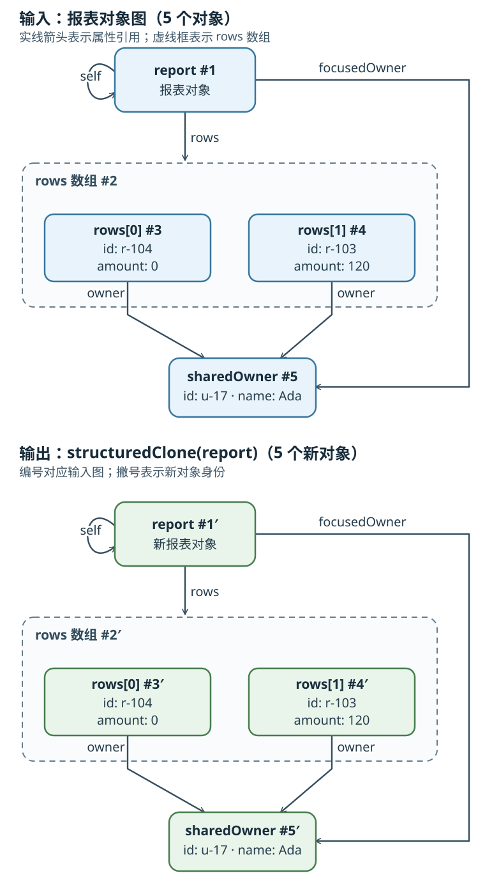

# 复制一个对象到底复制了什么？

本章回答：浅复制、JSON 往返、`structuredClone` 和手写深拷贝各自新建了哪些对象，哪些引用仍与原数据共享，循环、原型、getter 和二进制缓冲区又怎样处理。读者手上有前几章的行数据，以及一份要在编辑前保存的报表快照；读完应能按数据契约选出复制方式，并说清它丢掉或拒绝了什么。

## 案例：编辑前先存一份快照

沿用主线一的报表页。用户打开编辑抽屉前，页面要存一份当前报表数据的快照，让编辑过程不影响列表，取消时还能恢复。这份数据是一张 object graph (对象图)：对象是节点，属性引用是边。下面让 May 行 `r-104` 和 April 行 `r-103` 共用同一个负责人对象，页面还用 `focusedOwner` 记着当前查看的负责人，并让根对象的 `self` 指回自己，构成一个循环：

~~~javascript
const sharedOwner = { id: "u-17", name: "Ada" };
const report = {
  rows: [
    { id: "r-104", amount: 0, owner: sharedOwner },
    { id: "r-103", amount: 120, owner: sharedOwner },
  ],
  focusedOwner: sharedOwner,
};
report.self = report;
~~~

这张图有 5 个对象：根 `report`、`rows` 数组、两条行记录和 `sharedOwner`。`sharedOwner` 被三处引用。

“复制”要回答的不止“嵌套对象有没有复制”，而是五个问题：

1. 哪些节点得到新身份，哪些仍与原图共享？
2. 原图里多处指向同一节点的 shared reference (共享引用)，副本里是否仍指向同一个节点？
3. cyclic reference (循环引用)怎样处理？
4. 原型、属性描述符、getter、`Map` 条目这类内部状态保留多少？
5. 二进制缓冲区这类底层资源是复制、共享还是转移？

| 方式 | 新建哪些节点 | 共享引用与循环 | 原型与特殊对象 |
|---|---|---|---|
| 浅复制（展开、`slice`、`Object.assign`） | 只有最外层 | 内层全部与原图共享 | 外层是普通对象或数组；`Object.assign` 写入已有目标 |
| JSON 往返 | 全部（只要能序列化） | 共享被拆成多份；循环抛错 | 只留 JSON 能表示的值，原型丢失 |
| `structuredClone` | 全部 | 保留共享与循环 | 标准类型按各自规则复制；类原型丢失；函数等抛错 |
| 手写深拷贝 | 由契约决定 | 用记忆表可以保留 | 由契约决定 |

不存在脱离数据契约的“通用深拷贝”。下面逐行展开。

## 浅复制只新建最外层

浅复制新建最外层的数组或对象，里面装的仍是原来的引用。这是上一章那几个结果的共同原因：`toSorted`、`filter` 返回的新数组里，行对象仍和原数组共享。

数组的浅复制方法对空位处理不同。用前两章的 `rows = [first, , retry]` 对比：

| 写法 | 新数组的索引 1 | 现存记录及其 `owner` |
|---|---|---|
| `rows.slice()`、`rows.concat()` | 仍是空位 | 共享 |
| `[...rows]`、`Array.from(rows)` | 显式 `undefined`（走迭代器） | 共享 |
| `structuredClone(rows)` | 仍是空位 | 新对象 |
| `JSON.parse(JSON.stringify(rows))` | `null` | 新对象 |

~~~javascript
const slicedRows = rows.slice();
const spreadRows = [...rows];

Object.hasOwn(slicedRows, 1);          // false：slice 保留空位
Object.hasOwn(spreadRows, 1);          // true：展开写入显式 undefined
slicedRows[0] === rows[0];             // true：同一条记录
spreadRows[0].owner === rows[0].owner; // true：嵌套对象也共享
spreadRows[0].owner.name = "Grace";
rows[0].owner.name;                    // "Grace"：原数组也看到了修改
~~~

`concat` 也返回浅复制的新数组，但它按 `Symbol.isConcatSpreadable` 决定是否展开参数，与数组展开并不总是等价：展开要求输入可迭代；`concat` 能展开设置了这个符号的类数组对象，即使它不可迭代。

~~~javascript
const concatOnly = { 0: "x", length: 1, [Symbol.isConcatSpreadable]: true };
[1].concat(concatOnly); // [1, "x"]
// [...concatOnly];     // TypeError：没有迭代器
~~~

对象的浅复制用展开 `{ ...source }` 或 `Object.assign`：二者都复制自有可枚举属性，`Object.assign` 写入已有目标并可能触发 setter，展开在新对象上直接定义属性，细节见[读写一个属性时，JavaScript 沿什么规则查找、落在哪里？](objects-properties-and-prototypes.md#列举与复制属性：keys、entries、assign%20与展开)。

浅复制够用的条件很明确：只改最外层，或者内层对象本来就不会被修改。不可变更新（每层改动都新建该层对象，未改的层沿用旧引用）就是有意利用这一点：它只复制改动路径上的节点，其余节点共享。

## JSON 往返：只保留 JSON 能表示的部分

`JSON.parse(JSON.stringify(value))` 先把值写成 JSON 文本，再解析出新值。文本不记录对象身份：两个属性指向同一对象时，文本里写出两份内容，解析后变成两个对象；循环结构根本无法表示，`stringify` 直接抛 `TypeError`。

~~~javascript
const jsonShared = { id: "u-17", name: "Ada" };
const jsonSource = { first: jsonShared, second: jsonShared };
const jsonCopy = JSON.parse(JSON.stringify(jsonSource));
jsonCopy.first !== jsonCopy.second; // true：共享引用被拆成两个对象

JSON.stringify([, undefined, NaN]);     // "[null,null,null]"
JSON.stringify({ notFinite: Infinity }); // '{"notFinite":null}'
~~~

在没有自定义 `toJSON` 或 `replacer` 时，各类值的去向是：

- **`Date`**：经 `Date.prototype.toJSON()` 变成 ISO 时间字符串，解析回来仍是字符串，不是 `Date`。
- **`Map`、`Set`**：条目存在内部槽里，不是自有可枚举属性，所以（没有额外自有可枚举属性时）变成 `{}`。
- **对象属性**：值为 `undefined`、函数或 `Symbol` 的属性被省略；Symbol 键属性不参与。
- **数组元素**：按 `length` 逐个索引读取；值为 `undefined`、函数或 `Symbol` 的元素，以及原型链上也没有值的空位，都变成 `null`。原型链若为空位提供了值，写出的就是那个值。
- **数值**：`NaN`、`Infinity`、`-Infinity` 变成 `null`，`-0` 变成 `0`。
- **`BigInt` 和循环引用**：抛 `TypeError`。

~~~javascript
const inheritedArrayPrototype = Object.create(Array.prototype);
inheritedArrayPrototype[0] = "inherited";
const inheritedHole = [];
Object.setPrototypeOf(inheritedHole, inheritedArrayPrototype);
inheritedHole.length = 1;
JSON.stringify(inheritedHole); // '["inherited"]'：原型链提供了索引 0

function stringifyErrorName(value) {
  try {
    JSON.stringify(value);
    return "serialized";
  } catch (error) {
    return error.name;
  }
}
stringifyErrorName({ amount: 1n }); // "TypeError"
stringifyErrorName(report);         // "TypeError"：report.self 构成循环
~~~

自定义 `toJSON` 或 `replacer` 能改变部分结果，但那是在按 JSON 契约转换数据，不再是对象图复制。所以 JSON 往返只在数据契约本来就是 JSON 值、且共享引用、原型和特殊数值的上述变化都能接受时才合适。案例的 `report` 有循环，不满足这个条件。

## structuredClone：复制对象图，保留图内关系

`structuredClone(value)` 是宿主 API：WHATWG HTML 标准规定它执行 structured clone (结构化克隆)，ECMAScript 本身不提供这个全局函数，Node.js 等运行时也实现了它。算法先把输入序列化成与 realm (执行环境，每个 realm 有自己一套全局对象和内建对象)无关的记录，再在调用方所在的 realm 中反序列化。序列化过程维护一张记忆表：第一次遇到某个对象时登记它，再次遇到同一对象时直接复用登记项。因此循环引用回指克隆出的对象，原本指向同一子对象的多处引用，在副本里也仍指向同一个克隆对象。

把案例的 `report` 交给它：

~~~javascript
const snapshot = structuredClone(report);
snapshot !== report;                                // true：根对象是新的
snapshot.self === snapshot;                         // true：循环回到副本根
snapshot.rows[0].owner === snapshot.rows[1].owner;  // true：共享关系保留
snapshot.focusedOwner === snapshot.rows[0].owner;   // true
snapshot.rows[0].owner !== sharedOwner;             // true：与原图分离
~~~

*图：上半是输入的 5 个对象，实线箭头是属性引用，虚线框是 `rows` 数组；下半是克隆结果。相同编号表示对应位置，带撇号表示新身份：5 个对象都是新的，`self` 回到新根 #1′，三条 `owner`/`focusedOwner` 引用都指向同一个 #5′。*

克隆不是绕过代码直接复制对象内部。对普通对象和数组，它只读取自有、可枚举的字符串键：getter 会被执行，读到的值在副本中成为普通数据属性；Symbol 键和不可枚举属性被跳过。

~~~javascript
const metadataKey = Symbol("metadata");
let getterReads = 0;
const propertyInput = {};
Object.defineProperty(propertyInput, "label", {
  enumerable: true,
  get() {
    getterReads += 1;
    return "May report";
  },
});
Object.defineProperty(propertyInput, "internal", {
  enumerable: false,
  value: () => "hidden",
});
propertyInput[metadataKey] = Symbol("not visited");

const propertyCopy = structuredClone(propertyInput);
getterReads;                // 1：克隆时执行了 getter
Object.keys(propertyCopy);  // ["label"]
Object.getOwnPropertyDescriptor(propertyCopy, "label");
// { value: "May report", writable: true, enumerable: true, configurable: true }
propertyCopy[metadataKey];  // undefined
~~~

不可枚举的 `internal` 虽然是函数，却因为被跳过而没有导致报错。其他类型按各自的规则处理：

- **有序列化步骤的标准对象**：`Date`、`RegExp`、`Map`、`Set`、`ArrayBuffer`、typed array (类型化数组)、`Error` 等，内部槽里的数据按类型复制；额外挂在对象上的属性不一定参与，例如 `Map` 的条目会复制，自己加的 `note` 属性不会。平台对象能否克隆，取决于该接口是否定义了序列化步骤。
- **用户自定义类的实例**：当作普通对象处理，自有可枚举数据会复制，但类原型、原型方法和访问器都不随之复制。
- **拒绝的值**：函数、`WeakMap`、`Symbol` 值、`Proxy` 和普通 DOM `Node` 不能序列化；对象图中任何待复制的位置出现它们，调用就抛 `DataCloneError`。
- **`BigInt`**：与 JSON 不同，可以克隆。

~~~javascript
structuredClone(9007199254740993n); // 9007199254740993n

const mapWithExpando = new Map([["r-104", 120]]);
mapWithExpando.note = "visible only on the input";
const clonedMap = structuredClone(mapWithExpando);
clonedMap.get("r-104"); // 120：条目保留
clonedMap.note;         // undefined：扩展属性没有复制

class ReportRow {
  constructor() { this.id = "r-104"; }
  label() { return this.id; }
}
const classCopy = structuredClone(new ReportRow());
Object.getPrototypeOf(classCopy) === Object.prototype; // true
classCopy.label;                                       // undefined：方法没有复制

function cloneErrorName(value) {
  try {
    structuredClone(value);
    return "cloned";
  } catch (error) {
    return error.name;
  }
}
cloneErrorName(() => {});                    // "DataCloneError"
cloneErrorName(new WeakMap());               // "DataCloneError"
cloneErrorName(Symbol("value"));             // "DataCloneError"
cloneErrorName({ format: () => "r-104" });   // "DataCloneError"：嵌套的函数也算
~~~

所以案例的快照能用 `structuredClone`：`report` 只含普通对象、数组和原始值，循环和共享都会保留。若行对象换成带方法的类实例，副本会丢掉方法；若数据里存了回调函数，克隆直接失败。

## 转移与共享：transfer 和 SharedArrayBuffer

上面讨论的都是复制。`structuredClone` 的 `transfer` (转移)选项则把可转移资源的所有权交给结果，而不是再复制一份。对 `ArrayBuffer`，结果接管原缓冲区的字节，原 `ArrayBuffer` 变为 detached (已分离)状态：对象还在，长度变为 0，不能再读写内容。只有确实要交出所有权时才转移，普通快照不要带 `transfer`。

~~~javascript
const buffer = new ArrayBuffer(8);
const transferred = structuredClone({ buffer }, { transfer: [buffer] });
transferred.buffer.byteLength; // 8
buffer.byteLength;             // 0：原 buffer 已分离
~~~

反过来，得到新的包装对象也不代表底层数据独立了。`SharedArrayBuffer` (共享数组缓冲区)被结构化克隆时，得到一个新的包装对象，但两者仍共享同一块字节；在浏览器中，克隆它还要求页面处于 cross-origin isolated (跨源隔离)状态。要得到独立快照，就把内容复制到普通 `ArrayBuffer`：

~~~javascript
const sharedBuffer = new SharedArrayBuffer(1);
const sharedCopy = structuredClone(sharedBuffer);
const sourceByte = new Uint8Array(sharedBuffer);
const copiedByte = new Uint8Array(sharedCopy);

sharedCopy !== sharedBuffer; // true：包装对象不同
sourceByte[0] = 42;
copiedByte[0];               // 42：底层字节仍共享

const independentByte = new Uint8Array(new ArrayBuffer(sharedBuffer.byteLength));
independentByte.set(sourceByte);
sourceByte[0] = 7;
copiedByte[0];               // 7：共享缓冲区继续变化
independentByte[0];          // 42：复制出的快照不随之变化
~~~

若其他线程在复制期间仍在写，复制结果不保证对应同一时刻，读写双方要另行协调。`TypedArray.prototype.set()` 在两端元素类型相同时按字节复制，不同时（但同为 Number 类或同为 BigInt 类）逐元素读取并转换，两种都不提供跨元素的一致快照；Number 类与 BigInt 类数组互相复制会抛 `TypeError`。

## 手写深拷贝：先写类型范围

JSON 会丢掉共享关系和多种类型，`structuredClone` 会丢掉原型并拒绝函数。只有当应用处理一小组稳定的类型、又确实需要自定义规则时，才值得维护手写复制器。写之前先定契约。下面的实现支持：同一 realm 中的基础 `Date`、`RegExp`、`Map`、`Set`、数组，以及原型为当前 realm 的 `Object.prototype` 或 `null` 的普通对象；普通对象分支遇到其他原型就抛 `TypeError`。

它的核心是记忆表 `seen`，一次复制共用一个 `WeakMap`（键是输入对象，弱引用不延长它们的寿命，见[对象什么时候能被回收，弱引用能帮什么、不能帮什么？](memory-reachability-and-weak-references.md)）。每个对象在递归处理子项之前，先登记“输入对象 → 副本”；再次遇到同一对象时直接返回登记的副本。所以循环不会无限递归，图内共享关系也得以保留，作用与结构化克隆的记忆表相同。原始值直接返回；函数和 `Symbol` 值也原样返回，结果中的函数与输入共享同一身份。

> [!example]- 有限范围的递归复制器
>
> ~~~javascript
> function deepCopy(value, seen = new WeakMap()) {
>   if (value === null || typeof value !== "object") return value;
>   if (seen.has(value)) return seen.get(value);
>
>   let copy;
>   if (value instanceof Date) {
>     copy = new Date(value.getTime());
>   } else if (value instanceof RegExp) {
>     copy = new RegExp(value.source, value.flags);
>     copy.lastIndex = value.lastIndex;
>   } else if (value instanceof Map) {
>     copy = new Map();
>     seen.set(value, copy);
>     for (const [key, item] of value) {
>       copy.set(deepCopy(key, seen), deepCopy(item, seen));
>     }
>     return copy;
>   } else if (value instanceof Set) {
>     copy = new Set();
>     seen.set(value, copy);
>     for (const item of value) copy.add(deepCopy(item, seen));
>     return copy;
>   } else if (Array.isArray(value)) {
>     copy = new Array(value.length);
>   } else {
>     const prototype = Object.getPrototypeOf(value);
>     if (prototype !== Object.prototype && prototype !== null) {
>       throw new TypeError("Unsupported object type");
>     }
>     copy = Object.create(prototype);
>   }
>
>   seen.set(value, copy);
>   if (value instanceof Date || value instanceof RegExp) return copy;
>
>   for (const key of Object.keys(value)) {
>     Object.defineProperty(copy, key, {
>       value: deepCopy(value[key], seen),
>       enumerable: true,
>       writable: true,
>       configurable: true,
>     });
>   }
>   return copy;
> }
> ~~~

对案例的 `report`，结果与 `structuredClone` 相同：`self` 回到副本根，两条行的 `owner` 和 `focusedOwner` 指向同一个 owner 副本，所有新对象都与原图分离。`Map`、`Set` 里的循环也能复制：

~~~javascript
const manualSnapshot = deepCopy(report);
manualSnapshot.self === manualSnapshot;                         // true
manualSnapshot.rows[0].owner === manualSnapshot.rows[1].owner;  // true
manualSnapshot.focusedOwner === manualSnapshot.rows[0].owner;   // true
manualSnapshot.rows[0].owner !== sharedOwner;                   // true

const cyclicMap = new Map();
cyclicMap.set(cyclicMap, cyclicMap);
const cyclicMapCopy = deepCopy(cyclicMap);
cyclicMapCopy.get(cyclicMapCopy) === cyclicMapCopy; // true：键和值都回指副本
~~~

普通对象和数组部分只复制自有、可枚举的字符串键。数组先按原 `length` 新建，所以原型链也没有值的空位会保留；数组上的可枚举扩展属性也会复制。Symbol 键、不可枚举属性被忽略；getter 在读取 `value[key]` 时执行，结果写成可写、可枚举、可配置的数据属性。

~~~javascript
const trailingHoles = deepCopy([1, , ,]);
[trailingHoles.length, 0 in trailingHoles, 1 in trailingHoles]; // [3, true, false]
Object.keys(deepCopy(new Array(3)));                            // []
deepCopy(Object.assign([, 1], { note: "extra" })).note;          // "extra"

class CustomMap extends Map {}
class CustomArray extends Array {}
deepCopy(new CustomMap([["r-104", 120]])) instanceof CustomMap;  // false：降为 Map
Object.getPrototypeOf(deepCopy(new CustomArray(1, 2))) === Array.prototype; // true
deepCopy(new ReportRow());                                       // TypeError
~~~

下面这些是调用方必须满足的输入契约，代码不会全部检查：

- 不传 `Proxy`、跨 realm 对象、未知宿主对象，或覆写了这段代码会读取的内建方法、属性和迭代器的实例。
- 分支顺序会让 `Date`、`RegExp`、`Map`、`Set` 的子类降为对应基础类型；数组子类和跨 realm 数组进入数组分支，成为当前 realm 的普通数组。
- `Date`、`RegExp`、`Map`、`Set` 上的自有扩展属性被忽略；`RegExp` 的 `lastIndex` 原值赋给副本，要求它是普通的数字位置。
- 递归要求对象图深度受控；执行中调用的 getter 或迭代器抛出的错误会向外传播。

输入不能可靠满足这些条件时，应缩窄数据契约，或换用明确支持目标类型的机制，而不是把结果称作完整副本。

## Lodash 实例：_.merge 与 _.set 原地修改

> [!info] 版本
> 本节以 Lodash 4.18.1 为准，示例在 npm 安装的 4.18.1 上复跑于 2026-11-26。

前面的复制方式都返回新值。Lodash 的 `_.merge(target, ...sources)` 不同：它递归合并，直接修改第一个参数并返回它；数组按索引逐项合并，不拼接；来源中值为 `undefined` 的属性在目标已有值时被跳过。假设页面缓存了一份报表数据，要把一个补丁合进去：

~~~javascript
const cached = {
  reports: [
    { id: "r-104", label: "May report", owner: { team: "Ops" } },
    { id: "r-103", label: "April report" },
  ],
};
const patch = { reports: [{ owner: { reviewed: true } }] };

const changed = _.merge(cached, patch);
changed === cached;               // true：返回的就是被改过的目标
cached.reports[0].owner.reviewed; // true
cached.reports.length;            // 2：patch 的第 0 项合进了原第 0 项
~~~

把这个被改过的同一引用再交给 React 的 state setter，React 用 `Object.is` 比较新旧值，可能认为没有变化而跳过渲染，见[React 怎样把一次用户操作变成界面更新？](../ui-state/react-update-model.md)。`cached` 若还被请求缓存、其他组件或测试共享，它们也会一起看到被改的值。要建立新值，就把新对象作为目标：

~~~javascript
const next = _.merge({}, cached, { reports: [{ owner: { reviewed: false } }] });
next !== cached;                                  // true
next.reports !== cached.reports;                  // true：reports 数组重新建立
next.reports[0].owner !== cached.reports[0].owner; // true：嵌套 owner 也重新建立
next.reports[0].id;                               // "r-104"：仍按索引合并
next.reports[0].owner.reviewed;                   // false
cached.reports[0].owner.reviewed;                 // true：原对象没被这次合并改写
~~~

以 `{}` 为目标时，来源里的普通对象和数组会被递归合并进新建的节点，所以 `reports` 和嵌套 `owner` 都是新对象。但合并仍按索引进行，不会按 `id` 匹配。按索引合并还有一个隐患：同一个 `patch.reports[0]` 会随当前排序落到不同的报表上。

| 合并时的顺序 | 第 0 行 | 补丁落到 |
|---|---|---|
| `sort=recent`：May、April | `r-104` | May 的 `owner.reviewed` |
| `sort=oldest`：April、May | `r-103` | April 的 `owner.reviewed` |

补丁实际针对某个 `id` 时，先按 `id` 找到那一行再更新，不要把“第 0 行”当成报表身份。纯列表补项应显式拼接，例如 `[...cached.reports, newReport]`。`_.assign` 同样修改目标，只做浅层赋值。

`_.set` 写入嵌套路径，也原地修改目标；路径中缺失的索引段会建出数组，其他段建出对象：

~~~javascript
const draft = {};
const result = _.set(draft, "owner.team", "Ops");
result === draft;  // true
draft.owner.team;  // "Ops"

_.set(draft, "rows[0].amount", 0);
Array.isArray(draft.rows); // true
~~~

用库方法前，先看它返回哪个对象、是否改变输入。

## 复制之后：从数据转向函数

本章给案例的快照选了 `structuredClone`：报表数据只含普通对象、数组和原始值，它能新建全部 5 个节点，同时保留三处共享的 `owner` 和 `self` 循环。浅复制只新建最外层；JSON 往返拆散共享、拒绝循环；手写复制器只在类型范围写清后才可靠；`_.merge`、`_.set` 原地修改目标，按索引合并还会让补丁随排序落到不同的行上。

到这里，主线三的“值与对象”一组讲完了：值怎样比较，属性怎样查找，集合怎样选，复制复制了什么。下一组转向函数与异步，先问：函数里用到的变量和 `this` 从哪里来？见[函数里的变量和 this 从哪来？](scope-closures-and-this.md)。

> [!info]- 来源
> - 数组浅复制、`concat` 与 `Symbol.isConcatSpreadable`、展开走迭代器（“浅复制只新建最外层”）：[ECMAScript 2026 §23.1.3.2 Array.prototype.concat](https://tc39.es/ecma262/2026/multipage/indexed-collections.html#sec-array.prototype.concat)、[§23.1.3.38 Array.prototype.values](https://tc39.es/ecma262/2026/multipage/indexed-collections.html#sec-array.prototype.values)、[§23.1.2.1 Array.from](https://tc39.es/ecma262/2026/multipage/indexed-collections.html#sec-array.from)；对象展开与 `Object.assign`：[§20.1.2.1 Object.assign](https://tc39.es/ecma262/2026/multipage/fundamental-objects.html#sec-object.assign)。
> - JSON 序列化的属性选择、对象中未表示的值、数组中的 `null` 替代、`BigInt` 与循环结构错误（“JSON 往返”）：[ECMAScript 2026 §25.5.4 JSON.stringify](https://tc39.es/ecma262/2026/multipage/structured-data.html#sec-json.stringify)，尤其 §25.5.4.2 SerializeJSONProperty、§25.5.4.5–§25.5.4.6 对象与数组序列化；日期的 JSON 表示：[§21.4.4.37 Date.prototype.toJSON](https://tc39.es/ecma262/2026/multipage/numbers-and-dates.html#sec-date.prototype.tojson)。
> - 结构化克隆的宿主 API、复制与转移的区别、不可序列化时的错误、反序列化到 `structuredClone` 接收者的 relevant realm（“structuredClone”“转移与共享”）：[WHATWG HTML Living Standard §2.7.11 Structured cloning API](https://html.spec.whatwg.org/multipage/structured-data.html#structured-cloning-api)，更新于 2026-11-11。
> - 记忆表对循环和重复身份的处理，Symbol、函数、`WeakMap`、`Proxy`、`Error` 及其他内部槽对象的克隆规则，普通对象只读自有可枚举键并反序列化为数据属性：[WHATWG HTML §2.7.4 StructuredSerializeInternal](https://html.spec.whatwg.org/multipage/structured-data.html#structuredserializeinternal)、[§2.7.7 StructuredDeserialize](https://html.spec.whatwg.org/multipage/structured-data.html#structureddeserialize)。
> - `ArrayBuffer` 复制字节、`SharedArrayBuffer` 的跨源隔离检查与共享底层数据、转移后分离（“转移与共享”）：[WHATWG HTML §2.7.4、§2.7.8 StructuredSerializeWithTransfer](https://html.spec.whatwg.org/multipage/structured-data.html#structuredserializewithtransfer)；DOM `Node` 未定义序列化步骤：[DOM Standard §4.4 Interface Node](https://dom.spec.whatwg.org/#interface-node)。
> - `TypedArray.prototype.set()` 的同类别要求、按字节或逐元素复制、无跨元素一致快照：[ECMAScript 2026 SetTypedArrayFromTypedArray](https://tc39.es/ecma262/2026/multipage/indexed-collections.html#sec-settypedarrayfromtypedarray)。
> - 手写复制器用到的语言操作（“手写深拷贝”）：[ECMAScript 2026 §20.1.2.2 Object.create、§20.1.2.4 Object.defineProperty、§20.1.2.12 Object.getPrototypeOf、§20.1.2.19 Object.keys](https://tc39.es/ecma262/2026/multipage/fundamental-objects.html#sec-object.create)、[§23.1.2.3 Array.isArray](https://tc39.es/ecma262/2026/multipage/indexed-collections.html#sec-array.isarray)、[§21.4.4.10 Date.prototype.getTime](https://tc39.es/ecma262/2026/multipage/numbers-and-dates.html#sec-date.prototype.gettime)、[RegExp 的 flags、source 与 lastIndex](https://tc39.es/ecma262/2026/multipage/text-processing.html#sec-get-regexp.prototype.flags)、[§24.1–24.3 Map、Set、WeakMap](https://tc39.es/ecma262/2026/multipage/keyed-collections.html)。
> - Node.js 中的 `structuredClone` 入口：[Node.js Global objects — structuredClone](https://nodejs.org/api/globals.html#structuredclonevalue-options)（原稿核对 v26.13.1 文档）。
> - Lodash `_.merge`（修改目标、数组按索引合并、跳过 `undefined` 来源值）、`_.set`（缺失索引段建数组）、`_.assign`（“Lodash 实例”）：[Lodash 4.18.1 API 文档](https://github.com/lodash/lodash/blob/4.18.1/doc/README.md)，原稿核验 2026-11-12；本轮复跑 2026-11-26。React 用 `Object.is` 比较 state：[React 文档 useState — Caveats](https://react.dev/reference/react/useState)。
> - 本章示例在 Node.js v26.13.1 / V8 14.6.202.34-node.40 复跑，2026-11-26；原稿核对环境为 Node.js v26.13.0，2026-11-12。
