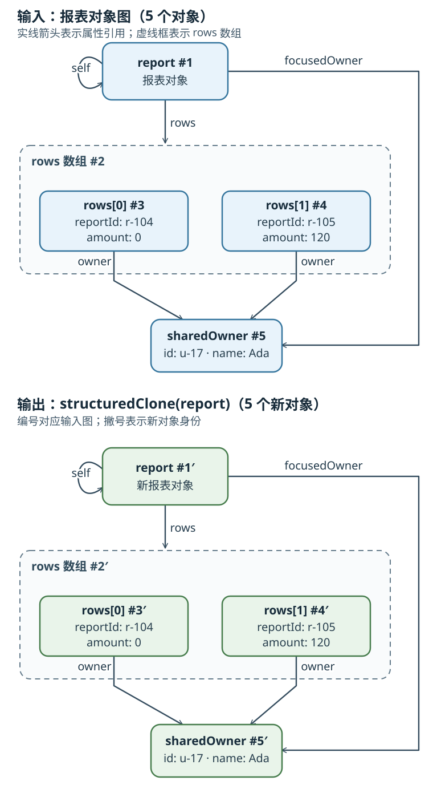

# 如何安全地深拷贝 JavaScript 值？

假设报表编辑器要保存一份快照，让用户修改快照时不影响当前界面。shallow copy（浅复制）只新建外层数组或对象；嵌套的 `owner` 仍指向原对象。deep copy（深拷贝）要回答的不只是“嵌套对象是否复制”，还包括 object graph（对象图）中的 cyclic reference（循环引用）、多个字段是否继续共享同一个子对象（shared reference，共享引用），以及哪些 property descriptor（属性描述符）和 prototype（原型）行为要保留；底层资源还要决定是复制、共享还是转移。

没有脱离数据契约的通用深拷贝。若输入本来就是 JSON 形状，JSON 往返可能够用；若要保留受支持对象图中的循环和共享关系，可用宿主提供的 `structuredClone`（结构化克隆）；只有当输入范围与属性规则都受控时，才值得维护手写复制器。

复制对象与比较两个值是否结构相等是不同操作。若只需在受限纯数据范围内比较，见[JavaScript 如何按约定比较对象与数组？](./javascript-types.md#结构比较要把输入范围写成契约)。

## JSON 往返只适合 JSON 形状的数据

`JSON.parse(JSON.stringify(value))` 先把值序列化为 JSON 文本，再从文本创建新值。这个过程不保存对象身份和引用边：两个属性指向同一个对象时，文本里会有两份相同内容，解析后成为两个不同对象；循环结构则无法表示。

~~~javascript
const jsonShared = { ownerId: "u-17", name: "Ada" };
const jsonSource = { first: jsonShared, second: jsonShared };
const jsonCopy = JSON.parse(JSON.stringify(jsonSource));

jsonCopy.first !== jsonCopy.second; // true：共享引用被拆成两个对象
JSON.stringify([, undefined, NaN]); // "[null,null,null]"
JSON.stringify({ notFinite: Infinity }); // '{"notFinite":null}'

const inheritedArrayPrototype = Object.create(Array.prototype);
inheritedArrayPrototype[0] = "inherited";
const inheritedHole = [];
Object.setPrototypeOf(inheritedHole, inheritedArrayPrototype);
inheritedHole.length = 1;
JSON.stringify(inheritedHole); // '["inherited"]'：原型链提供了索引 0 的值
~~~

在未覆写 `toJSON`、未提供 `replacer` 时，`Date` 会通过 `Date.prototype.toJSON()` 转换；有效 `Date` 变为 ISO 时间字符串。普通 `Map`、`Set` 的条目存放在内部槽中，不是 JSON 遍历的自有可枚举属性，因此没有额外自有可枚举属性时会变成 `{}`。对象中值为 `undefined`、函数或 `Symbol` 的字符串键属性会被省略，`Symbol` 键属性也不参与默认序列化。数组按 `length` 逐项读取：值为 `undefined`、函数、`Symbol`，以及原型链也没有该索引值的空位会变成 `null`；若原型链提供了值，该值会被序列化。对象属性和数组元素里的 `NaN`、`Infinity`、`-Infinity` 都会变成 `null`。

默认序列化遇到 BigInt 会抛 `TypeError`，遇到循环引用也会抛 `TypeError`。自定义 `toJSON` 或 `replacer` 可以改变部分结果，但那是在按 JSON 契约转换数据，不再是通用对象图复制。

~~~javascript
function stringifyErrorName(value) {
  try {
    JSON.stringify(value);
    return "serialized";
  } catch (error) {
    return error.name;
  }
}

stringifyErrorName({ amount: 1n }); // "TypeError"
const cyclicValue = {};
cyclicValue.self = cyclicValue;
stringifyErrorName(cyclicValue); // "TypeError"
~~~

若数据契约本来就只包含 JSON 值，且共享引用、原型、属性描述符和特殊数值的变化都可以接受，JSON 往返才是合适的简化方案。

## structuredClone 复制对象图并保留图内关系

`structuredClone(value)` 是宿主 API；WHATWG HTML 标准规定它怎样执行结构化克隆，ECMAScript 本身不提供这个全局函数。算法把输入序列化成与 realm（执行环境）无关的记录，再在调用目标 realm 中反序列化；普通全局调用时，目标 realm 就是当前环境。过程中有一张记忆表：对象第一次遇到时登记其序列化结果，后面再次遇到同一对象就复用登记项。因此循环能回指克隆对象，多处原本指向同一子对象的引用仍指向同一个克隆对象。

这里沿用[数组篇的报表案例](./arrays.md#复制数组只复制一层)，但故意让两条记录共用同一个 `owner`，以便观察共享关系；数组篇的 `first` / `retry` 各有一个内容相同但身份不同的 `owner`；本节改成共享同一个 `owner`，其他记录字段仍可不同。图中实线箭头表示属性引用，数组框包含两个记录对象；相同编号表示输入与克隆中的对应位置，撇号表示新对象身份。

~~~javascript
const sharedOwner = { id: "u-17", name: "Ada" };
const report = {
  rows: [
    { reportId: "r-104", amount: 0, owner: sharedOwner },
    { reportId: "r-105", amount: 120, owner: sharedOwner },
  ],
  focusedOwner: sharedOwner,
};
report.self = report;

const snapshot = structuredClone(report);
snapshot !== report; // true：根对象不同
snapshot.self === snapshot; // true：循环关系保留
snapshot.self !== snapshot.rows[0].owner; // true：self 回到根，不是 owner
snapshot.rows[0].owner === snapshot.rows[1].owner; // true：共享子对象关系保留
snapshot.focusedOwner === snapshot.rows[0].owner; // true
snapshot.rows[0].owner !== sharedOwner; // true：克隆节点与原节点分离
~~~

结构化克隆会读取普通对象和数组的自有、可枚举字符串键。属性值若由 getter（读取器）提供，getter 会执行，得到的值会成为克隆中的普通数据属性；Symbol 键和非枚举属性不参与这一步。由此可见，克隆不是绕过代码去复制“隐藏状态”：被读取的 getter 可能有副作用，而被过滤的属性不会进入结果。

~~~javascript
const metadataKey = Symbol("metadata");
let getterReads = 0;
const propertyInput = {};
Object.defineProperty(propertyInput, "label", {
  enumerable: true,
  get() {
    getterReads += 1;
    return "quarterly report";
  },
});
Object.defineProperty(propertyInput, "internal", {
  enumerable: false,
  value: () => "hidden",
});
propertyInput[metadataKey] = Symbol("not visited");

const propertyCopy = structuredClone(propertyInput);
getterReads; // 1
Object.keys(propertyCopy); // ["label"]
Object.getOwnPropertyDescriptor(propertyCopy, "label");
// { value: "quarterly report", writable: true, enumerable: true, configurable: true }
propertyCopy[metadataKey]; // undefined
~~~

`Date`、`RegExp`、`Map`、`Set`、`ArrayBuffer` 和 typed array（类型化数组）等标准对象有各自的序列化步骤：internal slot（内部槽）中的数据会按类型复制，但对象上临时挂的扩展属性不一定参与。例如 `Map` 的条目会复制，自加的 `note` 属性不会。其他平台对象能否克隆，也要看该接口是否定义了序列化步骤。可克隆不等于所有对象行为都保留。普通用户类实例的自有可枚举数据会按普通对象属性处理，但类原型、原型方法和访问器描述符不会随对象图复制。函数、`WeakMap`（弱映射）、`Symbol` 值、`Proxy`（代理）和普通 DOM `Node` 不能序列化；若不可克隆值出现在对象图任一待复制位置，调用会抛 `DataCloneError`。

~~~javascript
structuredClone(9007199254740993n); // 9007199254740993n：结构化克隆支持 BigInt
~~~

~~~javascript
const mapWithExpando = new Map([["r-104", 120]]);
mapWithExpando.note = "visible only on the input";
const clonedMap = structuredClone(mapWithExpando);

clonedMap.get("r-104"); // 120：Map 条目保留
clonedMap.note; // undefined：自定义扩展属性未复制
~~~

~~~javascript
class ReportRow {
  constructor() {
    this.reportId = "r-104";
  }
  label() {
    return this.reportId;
  }
}

const classCopy = structuredClone(new ReportRow());
Object.getPrototypeOf(classCopy) === Object.prototype; // true
classCopy.label; // undefined：实例方法没有复制

function cloneErrorName(value) {
  try {
    structuredClone(value);
    return "cloned";
  } catch (error) {
    return error.name;
  }
}

cloneErrorName(() => {}); // "DataCloneError"
cloneErrorName(new WeakMap()); // "DataCloneError"
cloneErrorName(Symbol("value")); // "DataCloneError"
cloneErrorName({ format: () => "r-104" }); // "DataCloneError"：嵌套函数也会失败
~~~

`structuredClone` 的 `transfer`（转移）选项把可转移资源的所有权交给结果，而不是另外复制一份。对 `ArrayBuffer` 来说，结果接管原缓冲区的字节，原 `ArrayBuffer` 被分离；它仍是原对象，但不能再读写缓冲区内容。只有确实要交出所有权时才转移；普通快照应使用不带 `transfer` 的克隆。

~~~javascript
const buffer = new ArrayBuffer(8);
const transferred = structuredClone({ buffer }, { transfer: [buffer] });

transferred.buffer.byteLength; // 8
buffer.byteLength; // 0：原 buffer 已分离
~~~

新建包装对象也不一定代表底层数据独立。在允许使用 `SharedArrayBuffer`（共享数组缓冲区）的环境中，结构化克隆会新建包装对象，但两者继续共享字节；浏览器环境还要求满足 cross-origin isolated（跨源隔离）条件。下面的例子在支持 `SharedArrayBuffer` 的运行时观察共享效果。复制到普通 `ArrayBuffer` 后，结果不会随源的后续写入改变；若还要求复制期间读到同一时刻的一致内容，读写双方需另行协调。本例两端都是 `Uint8Array`，`TypedArray.prototype.set()` 按字节复制，但不保证跨字节的原子快照；若两端都存 Number 或都存 BigInt，但元素类型不同，复制时会逐元素读取并转换，同样不保证多个元素来自同一时刻。Number 与 BigInt 混拷会抛 `TypeError`。

~~~javascript
const sharedBuffer = new SharedArrayBuffer(1);
const sharedCopy = structuredClone(sharedBuffer);
const sourceByte = new Uint8Array(sharedBuffer);
const copiedByte = new Uint8Array(sharedCopy);

sharedCopy !== sharedBuffer; // true：包装对象不同
sourceByte[0] = 42;
copiedByte[0]; // 42：底层字节仍共享

const independentBuffer = new ArrayBuffer(sharedBuffer.byteLength);
const independentByte = new Uint8Array(independentBuffer);
independentByte.set(sourceByte);
sourceByte[0] = 7;
copiedByte[0]; // 7：共享缓冲区继续变化
independentByte[0]; // 42：复制出的快照不随之变化
~~~

## 何时 JSON 与 structuredClone 都不符合契约

若应用只处理一组很小且稳定的类型，并且确实需要自定义属性复制规则，可以写范围受限的复制器。下面实现支持同一 realm（执行环境）的基础 `Date`、`RegExp`、`Map`、`Set`、数组，以及原型为当前 realm `Object.prototype` 或 `null` 的普通对象。在普通对象分支，原型不符合这一范围时，代码会显式抛 `TypeError`。这不是拒绝所有范围外输入的校验器；被调用的 getter、迭代器或递归子项也可能抛错，并向外传播。

`seen` 是本次递归使用的 `WeakMap`（弱映射）。每个对象在递归子项前就登记“输入对象 → 副本”：再次遇到同一对象时直接返回登记的副本，所以不会因循环而无限递归，也能保留图内共享关系。原始值直接返回；函数和 `Symbol` 值也原样返回，因此它们若出现在结果中仍与输入共享同一身份或值，并没有被隔离。

> [!example]- 一个有限范围的递归复制器实现
>
> ~~~javascript
> function deepCopy(value, seen = new WeakMap()) {
>   if (value === null || typeof value !== "object") return value;
>   if (seen.has(value)) return seen.get(value);
>
>   let copy;
>   if (value instanceof Date) {
>     copy = new Date(value.getTime());
>   } else if (value instanceof RegExp) {
>     copy = new RegExp(value.source, value.flags);
>     copy.lastIndex = value.lastIndex;
>   } else if (value instanceof Map) {
>     copy = new Map();
>     seen.set(value, copy);
>     for (const [key, item] of value) {
>       copy.set(deepCopy(key, seen), deepCopy(item, seen));
>     }
>     return copy;
>   } else if (value instanceof Set) {
>     copy = new Set();
>     seen.set(value, copy);
>     for (const item of value) copy.add(deepCopy(item, seen));
>     return copy;
>   } else if (Array.isArray(value)) {
>     copy = new Array(value.length);
>   } else {
>     const prototype = Object.getPrototypeOf(value);
>     if (prototype !== Object.prototype && prototype !== null) {
>       throw new TypeError("Unsupported object type");
>     }
>     copy = Object.create(prototype);
>   }
>
>   seen.set(value, copy);
>   if (value instanceof Date || value instanceof RegExp) return copy;
>
>   for (const key of Object.keys(value)) {
>     Object.defineProperty(copy, key, {
>       value: deepCopy(value[key], seen),
>       enumerable: true,
>       writable: true,
>       configurable: true,
>     });
>   }
>   return copy;
> }
> ~~~

把同一个 `report` 对象图交给这个复制器时，`self` 回到副本根对象；`rows[0].owner`、`rows[1].owner` 和 `focusedOwner` 则指向同一个 owner 副本。所有这些新对象都与原图中的对应对象分离。该实现的普通对象与数组部分只复制自有、可枚举字符串键。数组长度先复制，因此原型链也没有值的空位会保留；数组上的可枚举字符串扩展属性也会复制。Symbol 键、非枚举属性被忽略；getter 会在读取 `value[key]` 时执行，结果被写成可写、可枚举、可配置的数据属性，原属性描述符不保留。

~~~javascript
const manualSnapshot = deepCopy(report);
manualSnapshot !== report; // true
manualSnapshot.self === manualSnapshot; // true
manualSnapshot.self !== manualSnapshot.rows[0].owner; // true：self 回到根，不是 owner
manualSnapshot.rows[0].owner === manualSnapshot.rows[1].owner; // true
manualSnapshot.focusedOwner === manualSnapshot.rows[0].owner; // true
manualSnapshot.rows[0].owner !== sharedOwner; // true

const cyclicMapExample = new Map();
cyclicMapExample.set(cyclicMapExample, cyclicMapExample);
const cyclicMapCopy = deepCopy(cyclicMapExample);
cyclicMapCopy.get(cyclicMapCopy) === cyclicMapCopy; // true：键和值都回指副本

const cyclicSetExample = new Set();
cyclicSetExample.add(cyclicSetExample);
const cyclicSetCopy = deepCopy(cyclicSetExample);
cyclicSetCopy.has(cyclicSetCopy); // true：成员回指副本

const trailingHoles = deepCopy([1, , ,]);
trailingHoles.length === 3; // true
0 in trailingHoles; // true
1 in trailingHoles; // false
2 in trailingHoles; // false

const emptySparse = deepCopy(new Array(3));
emptySparse.length === 3; // true
Object.keys(emptySparse); // []

const extendedArray = Object.assign([, 1], { note: "extra" });
deepCopy(extendedArray).note; // "extra"

class CustomMap extends Map {}
class CustomArray extends Array {}
const copiedMapSubclass = deepCopy(new CustomMap([["r-104", 120]]));
const copiedArraySubclass = deepCopy(new CustomArray(1, 2));
console.log(copiedMapSubclass instanceof CustomMap, copiedMapSubclass instanceof Map);
// false true：保留 Map 条目，原型降为 Map.prototype
console.log(copiedArraySubclass instanceof CustomArray,
  Object.getPrototypeOf(copiedArraySubclass) === Array.prototype);
// false true：数组子类降为普通 Array
~~~

这段实现的边界属于调用者必须满足的输入契约，不是统一的拒绝行为：不要传入 `Proxy`、跨 realm 对象、未知宿主对象，或覆写这段代码会读取的内建方法、属性和迭代器的实例。分支顺序会让 `Date`、`RegExp`、`Map`、`Set` 子类降为对应基础类型；数组子类和跨 realm 数组也会进入数组分支，成为当前 realm 的普通数组。调用者仍须排除不支持的输入。`Date`、`RegExp`、`Map`、`Set` 上的自有扩展属性会被忽略；数组的可枚举字符串扩展属性则会复制。`RegExp.lastIndex` 按原值赋给副本，故这里要求它是普通数字位置。递归实现也要求对象图深度受控。若输入不能可靠地满足这些条件，应缩窄数据契约或使用明确支持目标类型的机制，而不是把得到的结果称作完整副本。

> [!info]- 来源
> - JSON 序列化属性选择、对象中的未表示值、数组中的 `null` 替代、BigInt 默认错误及循环结构错误：[ECMAScript 2026 §25.5.4 JSON.stringify](https://tc39.es/ecma262/2026/multipage/structured-data.html#sec-json.stringify)，尤其是 §25.5.4.2 `SerializeJSONProperty`、§25.5.4.5–.6 对象和数组序列化；日期默认 JSON 表示：[ECMAScript 2026 §21.4.4.37 `Date.prototype.toJSON`](https://tc39.es/ecma262/2026/multipage/numbers-and-dates.html#sec-date.prototype.tojson)。
> - 结构化克隆的宿主 API、复制与转移的区别、不可序列化时的错误，以及反序列化到该 `structuredClone` 方法接收者的 relevant realm：[WHATWG HTML Living Standard §2.7.11](https://html.spec.whatwg.org/multipage/structured-data.html#structured-cloning-api)，更新时间 2026-11-11。
> - 循环和重复对象身份的记忆表、Symbol/函数/弱映射/Proxy/其他内部槽对象的克隆边界、对象自有可枚举键读取与反序列化为数据属性：[WHATWG HTML Living Standard §2.7.4](https://html.spec.whatwg.org/multipage/structured-data.html#structuredserializeinternal) 与 [§2.7.7](https://html.spec.whatwg.org/multipage/structured-data.html#structureddeserialize)。
> - ArrayBuffer 复制字节、SharedArrayBuffer 的跨源隔离检查与共享底层数据、转移后的分离行为：[WHATWG HTML Living Standard §2.7.4、§2.7.8](https://html.spec.whatwg.org/multipage/structured-data.html#structuredserializewithtransfer)。
> - DOM `Node` 接口未定义可序列化步骤：[DOM Standard §4.4 Interface `Node`](https://dom.spec.whatwg.org/#interface-node)。
> - 手写子集用到的语言操作：`Object.create`、`Object.defineProperty`、`Object.getPrototypeOf`、`Object.keys` 的属性规则，`Array.isArray`，`Date.prototype.getTime`，`RegExp.prototype.flags`、`source` 与 `lastIndex`，以及 `Map`、`Set`、`WeakMap` 的实例行为：[ECMAScript 2026 Fundamental Objects](https://tc39.es/ecma262/2026/multipage/fundamental-objects.html#sec-object.create)（§20.1.2.2、.4、.12、.19）、[Indexed Collections](https://tc39.es/ecma262/2026/multipage/indexed-collections.html#sec-array.isarray)（§23.1.2.3）、[Numbers and Dates](https://tc39.es/ecma262/2026/multipage/numbers-and-dates.html#sec-date.prototype.gettime)（§21.4.4.10）、[Text Processing](https://tc39.es/ecma262/2026/multipage/text-processing.html#sec-get-regexp.prototype.flags)（§22.2.6.4、.13 与 §22.2.8.1）、[Keyed Collections](https://tc39.es/ecma262/2026/multipage/keyed-collections.html)（§§24.1–24.3）。
> - `TypedArray.prototype.set()` 要求两端的 Number/BigInt 内容类别相同；元素类型相同时逐字节复制，不同时逐元素读取并转换；两者都不提供共享内存的跨元素一致快照：[ECMAScript 2026 §23.2.3.26.2 `SetTypedArrayFromTypedArray`](https://tc39.es/ecma262/2026/multipage/indexed-collections.html#sec-settypedarrayfromtypedarray)。
> - `structuredClone` 在 Node.js 中的宿主 API 入口：[Node.js v26.13.1 Global objects](https://nodejs.org/api/globals.html#structuredclonevalue-options)。本章代码核对环境为 Node.js v26.13.0 / V8 14.6.202.34-node.40，2026-11-12。
