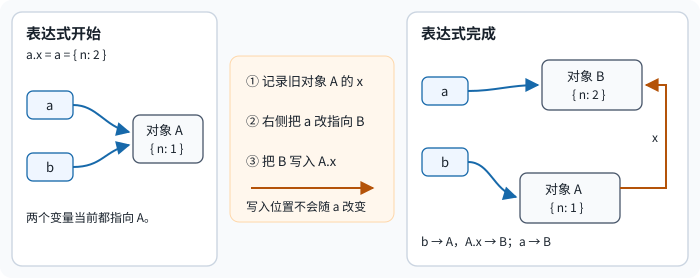

# JavaScript 值如何转换、比较，并成为属性键？

**案例背景：**2026 年 10 月的报表导入中，`first` 与 `retry` 的 `reportId` 相同但金额不同，`rows` 还保留了一个缺失位置。导入代码需要保住合法的零金额、识别缺行，并决定按业务键还是对象身份查记录。本章用这组输入说明值转换、相等比较、对象图比较和属性键转换；后续章节沿用同一组输入：

~~~javascript
const owner = { id: "u-17", name: "Ada" };
const first = { reportId: "r-104", amount: 0, owner };
const retry = {
  reportId: "r-104",
  amount: 120,
  owner: { id: "u-17", name: "Ada" },
};
const rows = [first, , retry]; // 第二个位置是空位；第三项是重试记录
~~~

业务字段 `reportId` 相同，表示两条输入记录描述同一业务实体；`first` 与 `retry` 仍是两个对象。它们的 `owner` 字段也指向内容相同、身份不同的对象。

## 值的类型决定哪些转换有意义

JavaScript 有七种 primitive types（原始值类型）：`undefined`（未定义值）、`null`（空值）、`Boolean`（布尔值）、`Number`（数值）、`BigInt`（大整数）、`String`（字符串）和 `Symbol`（符号）。`Symbol()` 每次调用都会产生新值；`Symbol.for(key)` 则会从全局注册表取回同一注册符号。其他值都是 `object`（对象），函数也属于对象。对象赋值复制的是对象引用值，两个变量可以指向同一个对象；这是一条语言行为规则，不意味着对象一定物理存放在某个特定内存区域。

| 类型 | 本章会用到的行为 |
|---|---|
| `undefined` | 缺少属性或越界读取的常见结果；也可显式存入属性 |
| `null` | 显式表示“当前没有对象”；历史兼容使 `typeof null` 返回 `"object"` |
| `Boolean` | 只有 `false` 为假值 |
| `Number` | `binary64`（二进制 64 位浮点）数值；包含 `NaN`、正负无穷和带符号的零 |
| `BigInt` | 任意精度整数；不能直接与 `Number` 混做算术 |
| `String` | 不可变的 UTF-16 `code unit` 序列 |
| `Symbol` | 唯一的原始值，可作为属性键 |

值的运行时存储位置和布局由引擎决定；reference type（引用类型）可用来简称对象按身份传递的语义，但不能据此推断栈、堆或指针布局。

## 真值转换不是数值转换

`0` 是假值，但空数组和空对象是真值；非空字符串 `"false"` 也是真值。`Number` 转换遵循另一套规则，因此输入含义重要时应显式转换。

`Boolean(value)` 与 `!!value` 都执行真值转换；在历史浏览器对象 `document.all` 上，二者也都返回 `false`，因为标准为它保留了特殊例外。

~~~javascript
Boolean("false");  // true
Boolean([]);       // true
Boolean({});       // true

Number("");        // 0
Number(null);      // 0
Number(undefined); // NaN

Number.isNaN(NaN);  // true
Number.isNaN("x");  // false：不做隐式转换
~~~

浏览器里的历史对象 `document.all` 带有标准附录定义的特殊行为，此外 `typeof document.all` 为 `"undefined"`，且 `document.all == null` 为 `true`。普通对象的真值规则不受影响，业务代码不应依赖这个例外。

逻辑运算也不会自动把结果变成 `Boolean`。逻辑与 `&&` 返回某个操作数，因此 React 条件渲染中，`0 && <ItemList />` 的结果是 `0`，可能直接显示数字零；条件需要表达“条数大于零”时就写出比较条件。

~~~jsx
0 && <ItemList />; // 结果为 0

function ReportPanel({ validCount, rows }) {
  return validCount > 0 ? <ItemList items={rows} /> : null;
}
~~~

## 比较运算回答的是不同问题

strict equality（严格相等，`===`）不做跨类型强制转换；loose equality（宽松相等，`==`）遵循多条转换规则，包括 `null == undefined` 这一特殊情况。除非特意使用转换规则，通常优先用 `===`。对一般输入，`value == null` 是一种有意同时判断 `null` 与 `undefined` 的写法。

对象比较关注的是 identity（身份）：两个对象字段相同，也不会因此变成同一对象。

~~~javascript
first.reportId === retry.reportId; // true：业务字段相等
first === retry;                    // false：对象身份不同
first.owner === retry.owner;        // false：嵌套对象身份不同

5 == "5";              // true：字符串转换为数值后比较
5 === "5";             // false
null == undefined;     // true
~~~

几个常见比较规则的差别集中在 NaN、有符号零和对象上：

| 操作 | NaN 与自身 | +0 与 -0 | 对象 |
|---|---|---|---|
| === | 不相等 | 相等 | 按身份 |
| `Object.is`（SameValue，同值） | 相等 | 不同 | 按身份 |
| `Map`（映射） / `Set`（集合，SameValueZero，同值零） | 相等 | 相等 | 按身份 |

~~~javascript
NaN === NaN;                    // false
Object.is(NaN, NaN);            // true
Object.is(+0, -0);              // false
new Set([NaN, NaN, -0, +0]).size; // 2
~~~

`Map` 和 `Set` 使用 SameValueZero（同值零），所以它们既能识别重复 `NaN`，也会把 `+0` 和 `-0` 视为同一个键或成员。集合章节把这个规则用于报表索引和去重，见[何时使用 Map、Set 或普通对象？](./map-and-set.md)。

`Number` 采用 IEEE 754 `binary64`（二进制 64 位浮点）；`0.1` 和 `0.2` 这样的十进制小数通常没有精确的有限二进制表示。比较结果是否可接受需要由金额精度、容差和舍入规则共同决定，不能把某个固定 `epsilon`（误差容限）当作所有领域的通用答案。

~~~javascript
0.1 + 0.2 === 0.3; // false
Math.abs((0.1 + 0.2) - 0.3) < 1e-12; // 对这个量级的例子成立
~~~

金额可在币种规则允许时用最小单位整数表示，或使用明确舍入规则的十进制运算。

## 结构比较要把输入范围写成契约

`===` 对对象只比较身份；业务判断有时还需要问两份输入是否有相同的数据结构。这不是 JavaScript 内建的统一规则，比较结果取决于应用选择的输入契约。这里比较筛选条件和接口纯数据：普通对象键的插入顺序不重要，数组顺序重要，键缺失与显式 `undefined` 不同。

本例只讨论有限、无环的数据对象图；不同属性可以共享同一个子对象。容器限于当前 realm（执行环境）的普通数组、普通对象或 null 原型对象；叶子是 `null`、`undefined`、布尔值、字符串或数字；容器的数据属性为自有、可枚举的字符串键。数组的 `length` 是不可枚举的自有属性，因此代码会单独比较它，再比较可枚举键。Symbol 或其他不可枚举属性、访问器、代理、函数、BigInt、Symbol 值及 Date、Map 等带内部状态的对象都在契约之外；代码不负责检测循环，调用方必须保证输入无环。普通对象可继承标准 `Object.prototype` 成员，但继承属性不参与比较。调用方应先保证输入符合契约；这段递归代码不是验证不可信对象的通用入口。

~~~javascript
function isPlainObject(value) {
  const prototype = Object.getPrototypeOf(value);
  return prototype === Object.prototype || prototype === null;
}

function deepEqual(left, right) {
  const leftIsObject = left !== null && typeof left === "object";
  const rightIsObject = right !== null && typeof right === "object";
  if (!leftIsObject || !rightIsObject) {
    return !leftIsObject && !rightIsObject && Object.is(left, right);
  }

  const leftIsArray = Array.isArray(left);
  const rightIsArray = Array.isArray(right);
  if (leftIsArray !== rightIsArray) return false;

  if (leftIsArray) {
    if (Object.getPrototypeOf(left) !== Array.prototype ||
        Object.getPrototypeOf(right) !== Array.prototype) {
      throw new TypeError("只支持当前 realm 的普通数组");
    }
    if (left.length !== right.length) return false;
  } else {
    if (!isPlainObject(left) || !isPlainObject(right)) {
      throw new TypeError("只支持普通对象或 null 原型对象");
    }
    if (Object.getPrototypeOf(left) !== Object.getPrototypeOf(right)) {
      return false;
    }
  }

  if (Object.is(left, right)) return true;

  const leftKeys = Object.keys(left);
  const rightKeys = Object.keys(right);
  if (leftKeys.length !== rightKeys.length) return false;

  for (const key of leftKeys) {
    if (!Object.hasOwn(right, key)) return false;

    const leftDescriptor = Object.getOwnPropertyDescriptor(left, key);
    const rightDescriptor = Object.getOwnPropertyDescriptor(right, key);
    if (!Object.hasOwn(leftDescriptor, "value") ||
        !Object.hasOwn(rightDescriptor, "value")) {
      throw new TypeError("只支持数据属性");
    }
    if (!deepEqual(leftDescriptor.value, rightDescriptor.value)) {
      return false;
    }
  }
  return true;
}
~~~

递归步骤可以按四件事复算：先区分叶子与容器，叶子用 `Object.is`；再确认两边同为数组或对象；对象原型类别不同就不相等，数组先比不可枚举的 `length`；最后比较可枚举自有键集合，并对每个键的值递归。对象键次序因此不影响结果；数组索引是否存在仍影响结果，因为空位不在 `Object.keys` 里。使用属性描述符读取数据值，不会调用输入 getter；当比较走到一个可枚举访问器属性时会抛 `TypeError`。若两边是同一对象引用，容器类别检查后就会由 `Object.is` 短路，因此本函数不能用作输入验证器。

| 输入 | 差异 | 结果 |
| --- | --- | --- |
| `{ a: 1, b: 2 }` 与 `{ b: 2, a: 1 }` | 只有键插入顺序不同 | `true` |
| `{ amount: undefined }` 与 `{}` | 自有键缺失 | `false` |
| `[]` 与 `[,]` | 数组 `length` 分别为 0 与 1 | `false` |
| `[,]` 与 `[undefined]` | 前者索引 0 是空位，后者有自有元素 | `false` |
| `[1, 2]` 与 `[2, 1]` | 数组值的索引顺序不同 | `false` |
| `{ value: NaN }` 与 `{ value: NaN }` | `Object.is(NaN, NaN)` | `true` |
| `{ value: -0 }` 与 `{ value: +0 }` | `Object.is(-0, +0)` | `false` |
| `{}` 与 `Object.create(null)` | 自有键相同，原型类别不同 | `false` |
| 左侧两个属性共享同一子对象，右侧各自保存等值副本 | 比较值，不维护两边的共享身份关系 | `true` |
| 两个不同的 `new Date(0)` | Date 有本契约之外的内部状态 | 抛 `TypeError` |

同一批报表行能把身份比较和结构比较区分开：两个 `owner` 的引用不同，但按本契约内容相等；两条记录的金额不同，因此结构不相等。

例如，两个记录可以分别共享一个等值子对象，比较器会按值递归，不要求两侧的共享关系一致。普通对象和 null 原型对象都可装载键值，但本契约把它们的原型类别也纳入结果：

~~~javascript
deepEqual({}, Object.create(null)); // false
deepEqual({ value: NaN }, { value: NaN }); // true
deepEqual({ value: -0 }, { value: +0 });   // false
deepEqual(first.owner, retry.owner); // true：引用不同，数据相同
deepEqual(first, retry); // false：amount 不同
~~~

单看可见原型不能证明一个对象确实是纯数据：把 Date 的原型手动改成 `Object.prototype` 会越过这项检查。因此，输入边界必须保证对象来自可信的纯数据构造流程；对任意对象、Proxy 或带隐藏内部状态的值，先用适合其来源的解析和校验。递归深度仍受 JavaScript 调用栈限制；无环是本例前提，代码不负责检测环。

用 `JSON.stringify` 直接比较字符串也不是结构相等：属性插入顺序可能改变输出，显式 `undefined` 属性会被省略，数值 `-0` 会序列化成 `0`。

~~~javascript
JSON.stringify({ a: 1, b: 2 }) === JSON.stringify({ b: 2, a: 1 }); // false
JSON.stringify({ amount: undefined }) === JSON.stringify({});    // true
JSON.stringify({ amount: -0 }) === JSON.stringify({ amount: 0 }); // true
~~~

若这些差异会影响业务判断，应比较经过约束的数据结构；对象隔离或保留共享身份关系则是复制问题，见[如何安全地深拷贝 JavaScript 值？](./deep-copy-and-structured-clone.md)。

## 变量保存对象身份，不会自动复制对象

把对象赋给新变量后，两个绑定仍指向同一个对象。属性赋值会先求出并记录左侧的基对象，再求右侧；右侧即使重新绑定变量，也不会改变已记录的基对象。

~~~javascript
let a = { n: 1 };
const b = a;
a.x = a = { n: 2 };

a.x; // undefined
b.x; // { n: 2 }：写入落在先前记录的旧对象上
~~~

求值顺序可拆成三步：赋值左侧先记下旧对象 `A` 的 `x` 属性位置，右侧再把 `a` 改指向新对象 `B`，最后把 `B` 写进已记下的 `A.x`。

*图：左侧求值时固定写入位置；整个表达式求值完成后，`a` 与 `b` 分别指向新旧对象。*

函数实参按值传递：形参拿到实参值的副本。实参若是原始值，修改形参不改调用方的绑定；若是对象，副本仍指向同一对象，所以属性变更可见，但重新给形参赋另一个对象不会重绑调用方变量。

~~~javascript
function update(count, profile) {
  count += 1;
  profile.name = "Grace";
  profile = { name: "Replacement" };
}

let count = 1;
const profile = { name: "Ada" };
update(count, profile);
count;        // 1
profile.name; // "Grace"
~~~

这也解释了浅拷贝为何会共享嵌套对象：新数组或新记录只复制了里面的对象引用。数组变异、复制和空位规则见[数组操作怎样处理空位与复制？](./arrays.md)；需要隔离整张对象图时见[如何安全地深拷贝 JavaScript 值？](./deep-copy-and-structured-clone.md)。

## 类型检查能回答什么，不能证明什么

- `typeof` 适合检查原始值和函数，但 `typeof null` 的历史结果是 "object"。
- `Array.isArray` 检查数组，也能识别来自另一个 realm（执行环境）的数组。
- `instanceof` 通常检查构造函数的 `prototype` 是否出现在对象原型链上。不同 realm 的构造函数拥有不同 prototype，因此本地 Array 检查另一个窗口创建的数组可能为 false；`Symbol.hasInstance` 还可以定制检查。
- `Object.prototype.toString.call(value)` 给出内建标签，但 `Symbol.toStringTag` 可以改变显示结果，标签不是类型证明。

~~~javascript
typeof null; // "object"
Array.isArray([]); // true

const misleading = { [Symbol.toStringTag]: "Array" };
Object.prototype.toString.call(misleading); // "[object Array]"，但它不是数组
~~~

应检查程序真正需要的形状或行为，而不是只依赖通用标签。

## 普通对象属性键会先转换

普通对象的属性键只能是字符串或 `Symbol`。方括号里传入其他值时，JavaScript 会执行 `ToPropertyKey`（转成属性键）；对象可以通过 `Symbol.toPrimitive` 等钩子影响转换结果，因此不能简单概括为“总是调用 `toString`”。

转换分两步：`ToPropertyKey` 先用字符串提示（string hint）调用 `ToPrimitive`（转成原始值）；对象若提供可调用的 `Symbol.toPrimitive` 就以该提示调用它，若提供了非 `null`/`undefined` 的不可调用值则报错。没有这个方法时，普通转换依次试 `toString`、`valueOf`，取第一个原始值。得到 `Symbol` 时原样保留，其他原始值再转成字符串；`Symbol.toPrimitive` 若返回对象会抛出 `TypeError`，普通转换若两个方法都未返回原始值也会抛错。

| 键输入 | `ToPrimitive` 的结果 | 最终属性键 |
|---|---|---|
| `123` | 数值 `123` | 字符串 `"123"` |
| `accountKey` | 字符串 `"account"` | 字符串 `"account"` |
| `symbolKey` | `Symbol("account")` | 同一个 Symbol |
| `first`、`retry` | 各自都得到字符串 `"[object Object]"` | 同一个字符串键；后写值覆盖先写值 |

`first` 和 `retry` 都没有自定义转换钩子；它们继承的 `Object.prototype.toString` 先返回相同的 `"[object Object]"`，于是普通对象转换在 `toString` 这一步就结束了。

~~~javascript
const dictionary = {};
dictionary[123] = "number key";
dictionary["123"]; // "number key"

const accountKey = {
  [Symbol.toPrimitive](hint) {
    console.log(hint); // "string"
    return "account";
  },
};
dictionary[accountKey] = "Ada";
dictionary.account; // "Ada"

const symbol = Symbol("account");
const symbolKey = {
  [Symbol.toPrimitive](hint) {
    console.log(hint); // "string"
    return symbol;
  },
};
dictionary[symbolKey] = "symbol key";
dictionary[symbol]; // "symbol key"：Symbol 被保留为属性键

dictionary[first] = "first object";
dictionary[retry] = "retry object";
dictionary["[object Object]"]; // "retry object"：默认转换相同，后写覆盖先写
~~~

如果键需要保持对象身份、数字与字符串必须区分，或需要任意类型的键，使用 `Map`。若普通对象确实是字典，可用 `Object.create(null)` 去掉继承原型行为，并用 `Object.hasOwn` 检查自有属性。键值集合的选择见[何时使用 Map、Set 或普通对象？](./map-and-set.md)。

## 枚举与复制属性时，先看 API 选中了什么

`Object.keys`、`Object.values` 和 `Object.entries` 选择同一类属性：自有、可枚举、字符串键；`Symbol` 键不在结果中。`keys` 只列键；`values` 和 `entries` 会读取相应的值，因此可能调用 getter。普通对象的数组索引键先按数值升序排列，其他字符串键按创建顺序排列；`Proxy` 和特殊对象可能有不同的键顺序。`for...in` 还会遍历可枚举的继承字符串键，因此对象数据和数组索引应选不同的遍历方式。

~~~javascript
const record = { name: "Ada", age: 36 };
Object.keys(record);   // ["name", "age"]
Object.values(record); // ["Ada", 36]
Object.entries(record); // [["name", "Ada"], ["age", 36]]

const keyOrder = {};
keyOrder["4294967296"] = "large integer, not an array index";
keyOrder["4294967295"] = "one past the maximum array index";
keyOrder["2"] = "array index";
Object.keys(keyOrder);
// ["2", "4294967296", "4294967295"]

for (const [key, value] of Object.entries(record)) {
  console.log(key, value);
}
~~~

`Object.assign(target, ...sources)` 把来源对象的自有可枚举字符串键和 `Symbol` 键浅复制到已有 target，修改并返回 target，后面的来源覆盖前面的属性。读取来源可能触发 getter，写入 target 可能触发 setter。对象展开也浅复制，但会在新对象上创建数据属性，不会写入传入的已有 target。

~~~javascript
const target = { a: 1, b: 2 };
Object.assign(target, { b: 3, c: 4 });
// target 是 { a: 1, b: 3, c: 4 }

const defaults = { retries: 2 };
const overrides = { retries: 4 };
const merged = { ...defaults, ...overrides };
// merged 是新对象；retries 为 4，defaults 不变
~~~

这些方法适合检查或组装属性记录，不会深拷贝嵌套对象。数组的复制、迭代输入与空位结果见[数组操作怎样处理空位与复制？](./arrays.md)；复杂对象图的隔离见[如何安全地深拷贝 JavaScript 值？](./deep-copy-and-structured-clone.md)。

## 缺失属性默认值与解构

读取嵌套字段时，optional chaining（可选链）运算符 `?.` 只在它检查的值为 `null` 或 `undefined` 时短路，不把 `0`、`false` 或空字符串当成缺失。根变量本身若未声明，使用 `?.` 仍会抛 `ReferenceError`；用括号结束一段链后，括号外的普通属性读取也不再受短路保护。

~~~javascript
const report = { profile: null, rows };
report.profile?.name; // undefined
// report?.profile.name; // TypeError：report 存在，但后续普通访问 .name 遇到 null
report.rows[0]?.amount; // 0：合法的零值
report.rows[1]?.amount; // undefined：读取空位

const count = 0;
count?.toFixed(0); // "0"：零既非 null 也非 undefined

const key = "value";
({ value: 1 })?.[key]; // 1
const maybeCall = undefined;
maybeCall?.(); // undefined

const user = null;
user?.profile?.name; // undefined
// (user?.profile).name; // TypeError：括号结束了短路链
// undeclaredUser?.name; // ReferenceError：根标识符不存在
~~~

若只有缺省值应触发回退，使用 nullish coalescing（空值合并）运算符 `??`；`||` 会把所有假值都替换。它们在此沿用同一个报表值，因此金额 `0` 仍保留，而空位读取产生的 `undefined` 会触发默认值。`??` 与 `||` 或 `&&` 不能不加括号混用。

~~~javascript
report.rows[0].amount ?? 100; // 0
report.rows[0].amount || 100; // 100
report.rows[1]?.amount ?? 100; // 100
~~~

destructuring（解构）把属性或可迭代值绑定到局部变量。默认初始化仅在读到 `undefined` 时运行，所以不会覆盖合法零值、`false`、空字符串或 `null`。对象剩余项收集来源对象余下的自有可枚举属性，但只复制一层；数组解构按迭代器取值，省略绑定仍会向前消费一个值。

~~~javascript
const { amount: firstAmount = 100, owner: firstOwner, ...rowFields } = first;
// firstAmount 是 0；firstOwner 仍是 first.owner；rowFields 只创建浅层新对象

const { profile = { name: "Guest" } } = report;
profile; // null：默认值只处理 undefined

const [firstRow, , ...tail] = rows;
firstRow === first; // true
tail[0] === retry; // true：rest 收集剩余项，形成新数组
Object.hasOwn(rows, 1); // false：索引 1 没有自有属性
1 in rows; // false：本例的原型链上也没有索引 1
rowFields; // { reportId: "r-104" }：只剩下 first 的其他自有可枚举字段
~~~

数组解构和数组展开同样消费迭代器；本例原型链没有索引 1，所以空位被读成 `undefined`。`Object.hasOwn` 可区分自有索引与空位，`in` 还会检查原型链：继承索引可让 `Object.hasOwn(rows, 1)` 为假而 `1 in rows` 为真。数组空位的其他读取结果见[数组空位如何改变遍历结果？](./arrays.md#空位怎样改变遍历结果)；同一个属性是否缺失或显式为 `undefined`，也不能只靠读取结果区分。

## 模板标签收到值，但不会自动净化它

模板字面量（template literal）会把表达式插入文本。tagged template（带标签模板）调用函数时，会把固定文本片段和各个表达式值分开传入；标签函数可以做格式化或领域处理，但插入用户输入不会因此自动安全。

~~~javascript
function capture(strings, ...values) {
  return { strings: [...strings], values };
}

const untrusted = "<b>user text</b>";
capture`label: ${untrusted}`;
// strings 是 ["label: ", ""]；values 是 ["<b>user text</b>"]
~~~

标签函数需要按实际输出上下文选择转义或净化规则，不能把“使用了 tagged template”当作安全保证。报表文本进入 DOM 时的上下文边界见[报表标题进入 DOM 时如何避免 XSS？](../../engineering-foundations/security/web-browser-security-boundaries.md)。

> [!info]- 来源
> - 值类型、原始值与对象行为：[ECMAScript 2026 §6.1–6.2](https://tc39.es/ecma262/2026/multipage/ecmascript-data-types-and-values.html)。
> - 严格相等、SameValue、SameValueZero 和宽松相等：[ECMAScript 2026 §7.2.9、§7.2.10、§7.2.13、§7.2.14](https://tc39.es/ecma262/2026/multipage/abstract-operations.html)，访问于 2026-11-12。
> - 属性键转换先执行 `ToPrimitive`（含 string hint 下的 `OrdinaryToPrimitive`），再按 Symbol 保留或转成字符串：[ECMAScript 2026 §7.1.1、§7.1.1.1、§7.1.19](https://tc39.es/ecma262/2026/multipage/abstract-operations.html)，访问于 2026-11-12。
> - 本章教学 `deepEqual` 的属性描述符与数组检查：[ECMAScript 2026 — OrdinaryGetOwnProperty](https://tc39.es/ecma262/2026/multipage/ordinary-and-exotic-objects-behaviours.html#sec-ordinarygetownproperty)、[Array Exotic Objects](https://tc39.es/ecma262/2026/multipage/ordinary-and-exotic-objects-behaviours.html#sec-array-exotic-objects)、[Object.hasOwn](https://tc39.es/ecma262/2026/multipage/fundamental-objects.html#sec-object.hasown)、[数组实例的 length](https://tc39.es/ecma262/2026/multipage/indexed-collections.html#sec-properties-of-array-instances-length)，访问于 2026-11-12。比较契约、不支持类型及“输入必须无环”由本章示例定义。
> - 赋值先求得左侧引用，再求右侧值并写回：[ECMAScript 2026 §13.15.2 Assignment Operators — Runtime Semantics](https://tc39.es/ecma262/2026/multipage/ecmascript-language-expressions.html#sec-assignment-operators-runtime-semantics-evaluation)，访问于 2026-11-12。
> - `JSON.stringify` 对不可表示的对象值、`undefined` 属性、数字与属性枚举顺序的处理：[ECMAScript 2026 §25.5.4.2、§25.5.4.5、§10.1.11.1](https://tc39.es/ecma262/2026/)，访问于 2026-11-12。
> - `document.all` 的历史例外：[ECMAScript 2026 Annex B IsHTMLDDA internal slot](https://tc39.es/ecma262/2026/multipage/additional-ecmascript-features-for-web-browsers.html#sec-IsHTMLDDA-internal-slot)。
> - `instanceof` 与 `Object.prototype.toString` 的检查行为：[ECMAScript 2026 §13.10.2 InstanceofOperator](https://tc39.es/ecma262/2026/multipage/ecmascript-language-expressions.html#sec-instanceofoperator)、[§20.1.3.6 Object.prototype.toString](https://tc39.es/ecma262/2026/multipage/fundamental-objects.html#sec-object.prototype.tostring)。
> - Object.keys / values / entries 与 Object.assign 的属性范围：[ECMAScript 2026 §20.1.2](https://tc39.es/ecma262/2026/multipage/fundamental-objects.html)；普通对象的键顺序：[§10.1.11.1 OrdinaryOwnPropertyKeys](https://tc39.es/ecma262/2026/multipage/ordinary-and-exotic-objects-behaviours.html#sec-ordinaryownpropertykeys)。
> - 可选链与空值合并的短路条件、运算优先级：[ECMAScript 2026 §13.3.9 Optional Chains](https://tc39.es/ecma262/2026/multipage/ecmascript-language-expressions.html#sec-optional-chains) 与 [§13.13 Binary Logical Operators](https://tc39.es/ecma262/2026/multipage/ecmascript-language-expressions.html#sec-binary-logical-operators)。
> - 对象与数组解构默认值、剩余项和迭代读取：[ECMAScript 2026 §14.3.3 Destructuring Binding Patterns](https://tc39.es/ecma262/2026/multipage/ecmascript-language-statements-and-declarations.html#sec-destructuring-binding-patterns)；数组迭代器及空位的属性读取：[ECMAScript 2026 §23.1.3.38 Array.prototype.values](https://tc39.es/ecma262/2026/multipage/indexed-collections.html#sec-array.prototype.values)；自有性测试：[§20.1.2.14 Object.hasOwn](https://tc39.es/ecma262/2026/multipage/fundamental-objects.html#sec-object.hasown)，访问于 2026-11-12。
> - 带标签模板调用参数的组成：[ECMAScript 2026 §13.3.11 Tagged Templates](https://tc39.es/ecma262/2026/multipage/ecmascript-language-expressions.html#sec-tagged-templates)。
> - React 条件渲染中 0 会作为结果呈现：[React 文档 Conditional Rendering](https://react.dev/learn/conditional-rendering)，访问于 2026-11-06。
> - 本章值转换和相等示例在 Node.js v26.13.0 / V8 14.6.202.34-node.40 执行，2026-11-12；`deepEqual` 边界用例同版本执行，原始复演日期 2026-11-09。
