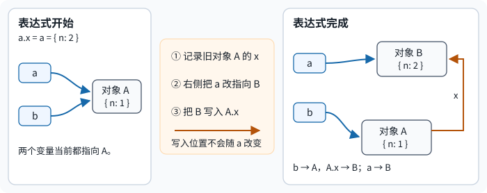

# JavaScript 值如何转换、比较，并成为属性键？

**案例背景：**一次 2026 年 10 月的报表导入读到两条记录：首条记录 `first` 和重试记录 `retry` 的 `reportId` 相同，金额却不同；行数组 `rows` 中间还缺了一行。导入代码要做三件事：保住合法的零金额、识别缺行，并决定按业务键还是按对象身份查找记录。本章用这组输入依次说明值转换、相等比较、对象结构比较和属性键转换，后续集合章节也沿用它：

~~~javascript
const owner = { id: "u-17", name: "Ada" };
const first = { reportId: "r-104", amount: 0, owner };
const retry = {
  reportId: "r-104",
  amount: 120,
  owner: { id: "u-17", name: "Ada" },
};
const rows = [first, , retry]; // 第二个位置是空位；第三项是重试记录
~~~

`reportId` 相同，说明两条记录描述同一个业务实体；但 `first` 与 `retry` 仍是两个不同的对象。它们的 `owner` 字段也一样：内容相同，却是两个对象。

## 值的类型决定哪些转换有意义

JavaScript 有七种 primitive types（原始值类型）：`undefined`（未定义值）、`null`（空值）、`Boolean`（布尔值）、`Number`（数值）、`BigInt`（大整数）、`String`（字符串）和 `Symbol`（符号）。`Symbol()` 每次调用都会产生新值；`Symbol.for(key)` 则会从全局注册表取回同一注册符号。除此之外的值都是 `object`（对象），函数也是对象。把对象赋给另一个变量时，复制的是指向该对象的引用，于是两个变量可以指向同一个对象。这是语言层面的行为规则，并不说明对象在内存中放在哪里。

| 类型 | 本章会用到的行为 |
|---|---|
| `undefined` | 缺少属性或越界读取的常见结果；也可显式存入属性 |
| `null` | 显式表示“当前没有对象”；历史兼容使 `typeof null` 返回 `"object"` |
| `Boolean` | 两个布尔值中只有 `false` 为假值 |
| `Number` | `binary64`（二进制 64 位浮点）数值；包含 `NaN`、正负无穷和带符号的零 |
| `BigInt` | 任意精度整数；不能直接与 `Number` 混做算术 |
| `String` | 不可变的 UTF-16 code unit（码元）序列 |
| `Symbol` | 唯一的原始值，可作为属性键 |

值在运行时存放在哪里、如何布局，由引擎决定。常说的 reference type（引用类型）只是“对象按身份传递”这一语义的简称，不能据此推断栈、堆或指针布局。

## 真值转换不是数值转换

真值转换只问一个值在条件判断中算真还是算假：`0` 是假值，但空数组和空对象是真值，非空字符串 `"false"` 也是真值。`Boolean(value)` 与 `!!value` 都执行这种转换。转成数字则遵循另一套规则，例如空字符串转成 `0`。输入的含义重要时，应显式写出想要的转换。

~~~javascript
Boolean("false");  // true
Boolean([]);       // true
Boolean({});       // true

Number("");        // 0
Number(null);      // 0
Number(undefined); // NaN

Number.isNaN(NaN);  // true
Number.isNaN("x");  // false：不做隐式转换
~~~

对象转布尔值都为 `true`，唯一的例外是浏览器历史对象 `document.all`：标准附录为兼容旧网页规定它转布尔值为 `false`、`typeof document.all` 为 `"undefined"`、`document.all == null` 为 `true`。普通对象不受影响，业务代码也不应依赖这个例外。

逻辑运算的结果也不一定是布尔值：逻辑与 `&&` 返回其中一个操作数。所以在 React 条件渲染中，`0 && <ItemList />` 的结果是 `0`，页面上会直接显示数字零。想表达“条数大于零”时，应写出比较条件。

~~~jsx
0 && <ItemList />; // 结果为 0

function ReportPanel({ validCount, rows }) {
  return validCount > 0 ? <ItemList items={rows} /> : null;
}
~~~

## 比较运算回答的是不同问题

strict equality（严格相等，`===`）不做跨类型强制转换；loose equality（宽松相等，`==`）遵循多条转换规则，包括 `null == undefined` 这一特殊情况。除非特意使用转换规则，通常优先用 `===`。`value == null` 是少数常见的有意用法：它同时匹配 `null` 与 `undefined`，而不匹配其他值（历史对象 `document.all` 除外）。

两个运算符比较对象时都只看 identity（身份）：字段完全相同的两个对象，仍然不是同一个对象。

~~~javascript
first.reportId === retry.reportId; // true：业务字段相等
first === retry;                    // false：对象身份不同
first.owner === retry.owner;        // false：嵌套对象身份不同

5 == "5";              // true：字符串转换为数值后比较
5 === "5";             // false
null == undefined;     // true
~~~

除 `===` 外，语言里还有两种相等规则，它们的差别集中在 `NaN` 和带符号的零上：

| 操作 | NaN 与自身 | +0 与 -0 | 对象 |
|---|---|---|---|
| === | 不相等 | 相等 | 按身份 |
| `Object.is`（SameValue，同值） | 相等 | 不同 | 按身份 |
| `Map`（映射） / `Set`（集合，SameValueZero，同值零） | 相等 | 相等 | 按身份 |

~~~javascript
NaN === NaN;                    // false
Object.is(NaN, NaN);            // true
Object.is(+0, -0);              // false
new Set([NaN, NaN, -0, +0]).size; // 2
~~~

`Map` 和 `Set` 使用 SameValueZero（同值零），所以它们既能识别重复 `NaN`，也会把 `+0` 和 `-0` 视为同一个键或成员。集合章节把这个规则用于报表索引和去重，见[何时使用 Map、Set 或普通对象？](./map-and-set.md)。

数值比较还有另一个陷阱：`Number` 采用 IEEE 754 `binary64`，`0.1`、`0.2` 这类十进制小数大多无法用有限位二进制精确表示。误差多大可以接受，要由金额精度、容差和舍入规则共同决定，不存在适用于所有领域的固定 epsilon（误差容限）。

~~~javascript
0.1 + 0.2 === 0.3; // false
Math.abs((0.1 + 0.2) - 0.3) < 1e-12; // 对这个量级的例子成立
~~~

金额可在币种规则允许时用最小单位整数表示，或使用明确舍入规则的十进制运算。

## 结构比较要把输入范围写成契约

`===` 对对象只比较身份，但业务判断有时要问的是：两份输入的数据结构是否相同。JavaScript 没有内建的统一规则来回答这个问题，结果取决于应用为输入定下的契约。本节的契约面向筛选条件、接口返回值这类纯数据：普通对象的键插入顺序不重要，数组顺序重要，键缺失与键存在但值为 `undefined` 不同。

契约的具体范围如下：

- **整体形状**：有限、无环的对象图；不同属性可以共享同一个子对象。代码不检测循环，由调用方保证无环。
- **容器**：当前 realm（执行环境，例如一个窗口或 iframe 各有一个）的普通数组、普通对象或 null 原型对象。只比较自有、可枚举、字符串键的数据属性；继承自 `Object.prototype` 的成员不参与比较。数组的 `length` 是不可枚举的自有属性，所以代码单独比较它。
- **叶子**：`null`、`undefined`、布尔值、字符串或数字。
- **契约之外**：Symbol 键或其他不可枚举属性、访问器、Proxy、函数、BigInt 和 Symbol 值，以及 Date、Map 等带内部状态的对象。

调用方要先保证输入符合契约；这段递归代码不是校验不可信对象的通用入口。

~~~javascript
function isPlainObject(value) {
  const prototype = Object.getPrototypeOf(value);
  return prototype === Object.prototype || prototype === null;
}

function deepEqual(left, right) {
  const leftIsObject = left !== null && typeof left === "object";
  const rightIsObject = right !== null && typeof right === "object";
  if (!leftIsObject || !rightIsObject) {
    return !leftIsObject && !rightIsObject && Object.is(left, right);
  }

  const leftIsArray = Array.isArray(left);
  const rightIsArray = Array.isArray(right);
  if (leftIsArray !== rightIsArray) return false;

  if (leftIsArray) {
    if (Object.getPrototypeOf(left) !== Array.prototype ||
        Object.getPrototypeOf(right) !== Array.prototype) {
      throw new TypeError("只支持当前 realm 的普通数组");
    }
    if (left.length !== right.length) return false;
  } else {
    if (!isPlainObject(left) || !isPlainObject(right)) {
      throw new TypeError("只支持普通对象或 null 原型对象");
    }
    if (Object.getPrototypeOf(left) !== Object.getPrototypeOf(right)) {
      return false;
    }
  }

  if (Object.is(left, right)) return true;

  const leftKeys = Object.keys(left);
  const rightKeys = Object.keys(right);
  if (leftKeys.length !== rightKeys.length) return false;

  for (const key of leftKeys) {
    if (!Object.hasOwn(right, key)) return false;

    const leftDescriptor = Object.getOwnPropertyDescriptor(left, key);
    const rightDescriptor = Object.getOwnPropertyDescriptor(right, key);
    if (!Object.hasOwn(leftDescriptor, "value") ||
        !Object.hasOwn(rightDescriptor, "value")) {
      throw new TypeError("只支持数据属性");
    }
    if (!deepEqual(leftDescriptor.value, rightDescriptor.value)) {
      return false;
    }
  }
  return true;
}
~~~

递归分四步：先区分叶子与容器，叶子直接用 `Object.is` 比较；再确认两边同为数组或同为对象；然后对象比较原型类别，数组比较不可枚举的 `length`；最后比较可枚举自有键的集合，并对每个键的值递归。因为比较的是键集合，对象键的顺序不影响结果；但数组某个索引是否存在会影响结果，因为空位不出现在 `Object.keys` 里。代码通过属性描述符读取数据值，不会调用输入里的 getter；遇到可枚举的访问器属性就抛 `TypeError`。注意，若两边是同一个对象引用，通过类别检查后就会被 `Object.is` 直接判为相等，不再检查内部内容，这也是它不能充当输入校验器的原因。

| 输入 | 差异 | 结果 |
| --- | --- | --- |
| `{ a: 1, b: 2 }` 与 `{ b: 2, a: 1 }` | 只有键插入顺序不同 | `true` |
| `{ amount: undefined }` 与 `{}` | 自有键缺失 | `false` |
| `[]` 与 `[,]` | 数组 `length` 分别为 0 与 1 | `false` |
| `[,]` 与 `[undefined]` | 前者索引 0 是空位，后者有自有元素 | `false` |
| `[1, 2]` 与 `[2, 1]` | 数组值的索引顺序不同 | `false` |
| `{ value: NaN }` 与 `{ value: NaN }` | `Object.is(NaN, NaN)` | `true` |
| `{ value: -0 }` 与 `{ value: +0 }` | `Object.is(-0, +0)` | `false` |
| `{}` 与 `Object.create(null)` | 自有键相同，原型类别不同 | `false` |
| 左侧两个属性共享同一子对象，右侧各自保存等值副本 | 比较值，不维护两边的共享身份关系 | `true` |
| 两个不同的 `new Date(0)` | Date 有本契约之外的内部状态 | 抛 `TypeError` |

回到报表记录：两个 `owner` 引用不同，但按本契约内容相等；`first` 与 `retry` 金额不同，所以结构不相等。普通对象和 null 原型对象虽然都能存放键值，本契约仍把原型类别算进结果：

~~~javascript
deepEqual({}, Object.create(null)); // false
deepEqual({ value: NaN }, { value: NaN }); // true
deepEqual({ value: -0 }, { value: +0 });   // false
deepEqual(first.owner, retry.owner); // true：引用不同，数据相同
deepEqual(first, retry); // false：amount 不同
~~~

原型检查也不能证明对象确实是纯数据：把一个 Date 的原型手动改成 `Object.prototype`，它就能通过检查。因此，输入必须来自可信的纯数据构造流程，例如刚解析出的 JSON；对任意对象、Proxy 或带隐藏内部状态的值，要先按其来源做解析和校验。此外，递归深度受调用栈限制，过深的对象图会导致栈溢出。

有人会用 `JSON.stringify` 的结果字符串代替结构比较，但两者不等价：属性插入顺序会改变输出，值为 `undefined` 的属性会被省略，`-0` 会序列化成 `0`。

~~~javascript
JSON.stringify({ a: 1, b: 2 }) === JSON.stringify({ b: 2, a: 1 }); // false
JSON.stringify({ amount: undefined }) === JSON.stringify({});    // true
JSON.stringify({ amount: -0 }) === JSON.stringify({ amount: 0 }); // true
~~~

若这些差异会影响业务判断，应比较经过约束的数据结构；对象隔离或保留共享身份关系则是复制问题，见[如何安全地深拷贝 JavaScript 值？](./deep-copy-and-structured-clone.md)。

## 变量保存对象身份，不会自动复制对象

前面的比较都建立在“变量保存的是对象引用”之上。把对象赋给新变量后，两个变量指向同一个对象。属性赋值还有一个求值顺序的细节：先确定左侧要写入哪个对象的哪个属性，再求右侧；即使右侧把变量改指别处，已确定的写入对象也不变。

~~~javascript
let a = { n: 1 };
const b = a;
a.x = a = { n: 2 };

a.x; // undefined
b.x; // { n: 2 }：写入落在先前记录的旧对象上
~~~

设原对象为 `A`，新对象为 `B`，求值分三步：先记下写入位置 `A.x`，再执行右侧的 `a = { n: 2 }`，让 `a` 改指向 `B`，最后把 `B` 写进已记下的 `A.x`。

*图：左侧求值时固定写入位置；整个表达式求值完成后，`a` 与 `b` 分别指向新旧对象。*

函数传参同理，JavaScript 按值传递：形参拿到的是实参值的副本。实参是原始值时，修改形参不影响调用方的变量；实参是对象时，副本是同一个引用，所以修改属性对调用方可见，但给形参重新赋一个对象，不会让调用方的变量改指。

~~~javascript
function update(count, profile) {
  count += 1;
  profile.name = "Grace";
  profile = { name: "Replacement" };
}

let count = 1;
const profile = { name: "Ada" };
update(count, profile);
count;        // 1
profile.name; // "Grace"
~~~

这也解释了浅拷贝为什么会共享嵌套对象：新数组或新记录只复制了其中的对象引用。数组变异、复制和空位规则见[数组操作怎样处理空位与复制？](./arrays.md)；需要隔离整张对象图时见[如何安全地深拷贝 JavaScript 值？](./deep-copy-and-structured-clone.md)。

## 类型检查能回答什么，不能证明什么

- `typeof` 适合检查原始值和函数，但 `typeof null` 的历史结果是 "object"。
- `Array.isArray` 检查数组，也能识别来自另一个 realm（例如 iframe）的数组。
- `instanceof` 默认检查构造函数的 `prototype` 是否出现在对象的原型链上。不同 realm 的 `Array` 各有自己的 `prototype`，所以用本页的 `Array` 检查另一个窗口创建的数组会得到 `false`；`Symbol.hasInstance` 还可以改写这项检查。
- `Object.prototype.toString.call(value)` 给出内建标签，但 `Symbol.toStringTag` 可以改变显示结果，标签不是类型证明。

~~~javascript
typeof null; // "object"
Array.isArray([]); // true

const misleading = { [Symbol.toStringTag]: "Array" };
Object.prototype.toString.call(misleading); // "[object Array]"，但它不是数组
~~~

因此，应检查程序真正需要的形状或行为，而不是依赖通用标签。

## 普通对象属性键会先转换

导入代码若想用普通对象按记录建索引，就会碰到属性键转换。普通对象的属性键只能是字符串或 `Symbol`；方括号里传入其他值时，JavaScript 会执行规范中的 `ToPropertyKey` 操作把它转成属性键。对象可以通过 `Symbol.toPrimitive` 等钩子影响转换结果，所以不能简单说成“总是调用 `toString`”。

转换分两步。第一步，`ToPropertyKey` 以 string hint（字符串提示）调用 `ToPrimitive`，把值转成原始值：对象若定义了可调用的 `Symbol.toPrimitive`，就以 `"string"` 为参数调用它，返回对象则抛 `TypeError`；若该属性是 `null`/`undefined` 以外的不可调用值，也抛 `TypeError`。没有定义这个方法时，依次尝试 `toString`、`valueOf`，取第一个返回的原始值；两者都不返回原始值则抛 `TypeError`。第二步，若得到的是 `Symbol` 就原样作为键，其他原始值转成字符串。

| 键输入 | `ToPrimitive` 的结果 | 最终属性键 |
|---|---|---|
| `123` | 数值 `123` | 字符串 `"123"` |
| `accountKey` | 字符串 `"account"` | 字符串 `"account"` |
| `symbolKey` | `Symbol("account")` | 同一个 Symbol |
| `first`、`retry` | 各自都得到字符串 `"[object Object]"` | 同一个字符串键；后写值覆盖先写值 |

`first` 和 `retry` 都没有自定义转换钩子，继承来的 `Object.prototype.toString` 对两者都返回 `"[object Object]"`，转换在这一步就结束了。于是两条记录写进同一个键，后写的覆盖先写的。

~~~javascript
const dictionary = {};
dictionary[123] = "number key";
dictionary["123"]; // "number key"

const accountKey = {
  [Symbol.toPrimitive](hint) {
    console.log(hint); // "string"
    return "account";
  },
};
dictionary[accountKey] = "Ada";
dictionary.account; // "Ada"

const symbol = Symbol("account");
const symbolKey = {
  [Symbol.toPrimitive](hint) {
    console.log(hint); // "string"
    return symbol;
  },
};
dictionary[symbolKey] = "symbol key";
dictionary[symbol]; // "symbol key"：Symbol 被保留为属性键

dictionary[first] = "first object";
dictionary[retry] = "retry object";
dictionary["[object Object]"]; // "retry object"：默认转换相同，后写覆盖先写
~~~

如果键需要保持对象身份、要区分数字与字符串，或需要任意类型的键，应使用 `Map`。若确实要用普通对象当字典，可用 `Object.create(null)` 创建没有继承属性的对象，并用 `Object.hasOwn` 检查自有属性。键值集合的选择见[何时使用 Map、Set 或普通对象？](./map-and-set.md)。

## 枚举与复制属性时，先看 API 选中了什么

键转换决定属性叫什么；枚举和复制则要看 API 选中哪些属性。`Object.keys`、`Object.values` 和 `Object.entries` 选择同一类属性：自有、可枚举、字符串键，不含 `Symbol` 键。`keys` 只列键；`values` 和 `entries` 要读取值，因此可能触发 getter。普通对象先按数值升序列出数组索引键（`0` 到 2³²−2 的整数字符串），再按创建顺序列出其他字符串键；`Proxy` 和特殊对象的键顺序可能不同。`for...in` 还会遍历继承来的可枚举字符串键，所以不宜用它遍历对象数据或数组索引。

~~~javascript
const record = { name: "Ada", age: 36 };
Object.keys(record);   // ["name", "age"]
Object.values(record); // ["Ada", 36]
Object.entries(record); // [["name", "Ada"], ["age", 36]]

const keyOrder = {};
keyOrder["4294967296"] = "large integer, not an array index";
keyOrder["4294967295"] = "one past the maximum array index";
keyOrder["2"] = "array index";
Object.keys(keyOrder);
// ["2", "4294967296", "4294967295"]

for (const [key, value] of Object.entries(record)) {
  console.log(key, value);
}
~~~

`Object.assign(target, ...sources)` 把各来源对象的自有可枚举属性（字符串键和 `Symbol` 键都包括）浅复制到已有的 `target` 上，修改并返回 `target`；后面的来源覆盖前面的同名属性。读取来源可能触发 getter，写入 `target` 可能触发 setter。对象展开 `{ ...source }` 同样是浅复制，但它在新对象上直接创建数据属性，不会写入已有对象，也不会触发 setter。

~~~javascript
const target = { a: 1, b: 2 };
Object.assign(target, { b: 3, c: 4 });
// target 是 { a: 1, b: 3, c: 4 }

const defaults = { retries: 2 };
const overrides = { retries: 4 };
const merged = { ...defaults, ...overrides };
// merged 是新对象；retries 为 4，defaults 不变
~~~

这些方法适合检查或组装属性记录，不会深拷贝嵌套对象。数组的复制、迭代输入与空位结果见[数组操作怎样处理空位与复制？](./arrays.md)；复杂对象图的隔离见[如何安全地深拷贝 JavaScript 值？](./deep-copy-and-structured-clone.md)。

## 缺失属性默认值与解构

回到导入案例的缺行与零金额。读取可能缺失的嵌套字段时，optional chaining（可选链）运算符 `?.` 只在它左侧的值为 `null` 或 `undefined` 时短路，不把 `0`、`false` 或空字符串当成缺失。它有两个边界：根变量若根本未声明，仍会抛 `ReferenceError`；用括号把一段链括起来后，括号外的普通属性读取不再受短路保护。

~~~javascript
const report = { profile: null, rows };
report.profile?.name; // undefined
// report?.profile.name; // TypeError：report 存在，但后续普通访问 .name 遇到 null
report.rows[0]?.amount; // 0：合法的零值
report.rows[1]?.amount; // undefined：读取空位

const count = 0;
count?.toFixed(0); // "0"：零既非 null 也非 undefined

const key = "value";
({ value: 1 })?.[key]; // 1
const maybeCall = undefined;
maybeCall?.(); // undefined

const user = null;
user?.profile?.name; // undefined
// (user?.profile).name; // TypeError：括号结束了短路链
// undeclaredUser?.name; // ReferenceError：根标识符不存在
~~~

若只想在值缺失时使用默认值，用 nullish coalescing（空值合并）运算符 `??`；`||` 会替换所有假值。下面用同一份报表对比：`??` 保留了金额 `0`，而读取空位得到的 `undefined` 触发了默认值。另外，`??` 与 `||` 或 `&&` 混用时必须加括号，否则是语法错误。

~~~javascript
report.rows[0].amount ?? 100; // 0
report.rows[0].amount || 100; // 100
report.rows[1]?.amount ?? 100; // 100
~~~

destructuring（解构）把对象属性或可迭代对象产出的值绑定到局部变量。默认值只在读到 `undefined` 时生效，所以不会覆盖合法的 `0`、`false`、空字符串或 `null`。对象的剩余项 `...rest` 收集来源对象余下的自有可枚举属性，但只复制一层。数组解构按迭代器逐个取值，模式中留空的位置也会消耗一个值。

~~~javascript
const { amount: firstAmount = 100, owner: firstOwner, ...rowFields } = first;
// firstAmount 是 0；firstOwner 仍是 first.owner；rowFields 只创建浅层新对象

const { profile = { name: "Guest" } } = report;
profile; // null：默认值只处理 undefined

const [firstRow, , ...tail] = rows;
firstRow === first; // true
tail[0] === retry; // true：rest 收集剩余项，形成新数组
Object.hasOwn(rows, 1); // false：索引 1 没有自有属性
1 in rows; // false：本例的原型链上也没有索引 1
rowFields; // { reportId: "r-104" }：只剩下 first 的其他自有可枚举字段
~~~

数组解构和数组展开都通过迭代器读取，空位因此被读成 `undefined`（前提是原型链上也没有索引 1）。要区分“空位”和“存了 `undefined` 的元素”，不能只看读取结果：`Object.hasOwn` 只检查自有索引，`in` 还会检查原型链，若原型上有继承的索引 1，就会出现 `Object.hasOwn(rows, 1)` 为假而 `1 in rows` 为真。数组空位在其他 API 中的表现见[数组空位如何改变遍历结果？](./arrays.md#空位怎样改变遍历结果)。

## 模板标签收到值，但不会自动净化它

报表数据最后常被拼进文本。template literal（模板字面量）把表达式的值插入字符串；tagged template（带标签模板）则调用一个标签函数，把固定文本片段和各个表达式的值分开传给它。标签函数可以做格式化或领域处理，但使用标签并不会让插入的用户输入自动变安全。

~~~javascript
function capture(strings, ...values) {
  return { strings: [...strings], values };
}

const untrusted = "<b>user text</b>";
capture`label: ${untrusted}`;
// strings 是 ["label: ", ""]；values 是 ["<b>user text</b>"]
~~~

标签函数需要按实际输出上下文选择转义或净化规则，不能把“使用了 tagged template”当作安全保证。报表文本进入 DOM 时的上下文边界见[报表标题进入 DOM 时如何避免 XSS？](../../engineering-foundations/security/web-browser-security-boundaries.md)。

> [!info]- 来源
> - 值类型、原始值与对象行为：[ECMAScript 2026 §6.1–6.2](https://tc39.es/ecma262/2026/multipage/ecmascript-data-types-and-values.html)。
> - 严格相等、SameValue、SameValueZero 和宽松相等：[ECMAScript 2026 §7.2.9、§7.2.10、§7.2.13、§7.2.14](https://tc39.es/ecma262/2026/multipage/abstract-operations.html)，访问于 2026-11-12。
> - 属性键转换先执行 `ToPrimitive`（含 string hint 下的 `OrdinaryToPrimitive`），再按 Symbol 保留或转成字符串：[ECMAScript 2026 §7.1.1、§7.1.1.1、§7.1.19](https://tc39.es/ecma262/2026/multipage/abstract-operations.html)，访问于 2026-11-12。
> - 本章教学 `deepEqual` 的属性描述符与数组检查：[ECMAScript 2026 — OrdinaryGetOwnProperty](https://tc39.es/ecma262/2026/multipage/ordinary-and-exotic-objects-behaviours.html#sec-ordinarygetownproperty)、[Array Exotic Objects](https://tc39.es/ecma262/2026/multipage/ordinary-and-exotic-objects-behaviours.html#sec-array-exotic-objects)、[Object.hasOwn](https://tc39.es/ecma262/2026/multipage/fundamental-objects.html#sec-object.hasown)、[数组实例的 length](https://tc39.es/ecma262/2026/multipage/indexed-collections.html#sec-properties-of-array-instances-length)，访问于 2026-11-12。比较契约、不支持类型及“输入必须无环”由本章示例定义。
> - 赋值先求得左侧引用，再求右侧值并写回：[ECMAScript 2026 §13.15.2 Assignment Operators — Runtime Semantics](https://tc39.es/ecma262/2026/multipage/ecmascript-language-expressions.html#sec-assignment-operators-runtime-semantics-evaluation)，访问于 2026-11-12。
> - `JSON.stringify` 对不可表示的对象值、`undefined` 属性、数字与属性枚举顺序的处理：[ECMAScript 2026 §25.5.4.2、§25.5.4.5、§10.1.11.1](https://tc39.es/ecma262/2026/)，访问于 2026-11-12。
> - `document.all` 的历史例外：[ECMAScript 2026 Annex B IsHTMLDDA internal slot](https://tc39.es/ecma262/2026/multipage/additional-ecmascript-features-for-web-browsers.html#sec-IsHTMLDDA-internal-slot)。
> - `instanceof` 与 `Object.prototype.toString` 的检查行为：[ECMAScript 2026 §13.10.2 InstanceofOperator](https://tc39.es/ecma262/2026/multipage/ecmascript-language-expressions.html#sec-instanceofoperator)、[§20.1.3.6 Object.prototype.toString](https://tc39.es/ecma262/2026/multipage/fundamental-objects.html#sec-object.prototype.tostring)。
> - Object.keys / values / entries 与 Object.assign 的属性范围：[ECMAScript 2026 §20.1.2](https://tc39.es/ecma262/2026/multipage/fundamental-objects.html)；普通对象的键顺序：[§10.1.11.1 OrdinaryOwnPropertyKeys](https://tc39.es/ecma262/2026/multipage/ordinary-and-exotic-objects-behaviours.html#sec-ordinaryownpropertykeys)。
> - 可选链与空值合并的短路条件、运算优先级：[ECMAScript 2026 §13.3.9 Optional Chains](https://tc39.es/ecma262/2026/multipage/ecmascript-language-expressions.html#sec-optional-chains) 与 [§13.13 Binary Logical Operators](https://tc39.es/ecma262/2026/multipage/ecmascript-language-expressions.html#sec-binary-logical-operators)。
> - 对象与数组解构默认值、剩余项和迭代读取：[ECMAScript 2026 §14.3.3 Destructuring Binding Patterns](https://tc39.es/ecma262/2026/multipage/ecmascript-language-statements-and-declarations.html#sec-destructuring-binding-patterns)；数组迭代器及空位的属性读取：[ECMAScript 2026 §23.1.3.38 Array.prototype.values](https://tc39.es/ecma262/2026/multipage/indexed-collections.html#sec-array.prototype.values)；自有性测试：[§20.1.2.14 Object.hasOwn](https://tc39.es/ecma262/2026/multipage/fundamental-objects.html#sec-object.hasown)，访问于 2026-11-12。
> - 带标签模板调用参数的组成：[ECMAScript 2026 §13.3.11 Tagged Templates](https://tc39.es/ecma262/2026/multipage/ecmascript-language-expressions.html#sec-tagged-templates)。
> - React 条件渲染中 0 会作为结果呈现：[React 文档 Conditional Rendering](https://react.dev/learn/conditional-rendering)，访问于 2026-11-06。
> - 本章值转换和相等示例在 Node.js v26.13.0 / V8 14.6.202.34-node.40 执行，2026-11-12；`deepEqual` 边界用例同版本执行，原始复演日期 2026-11-09。
