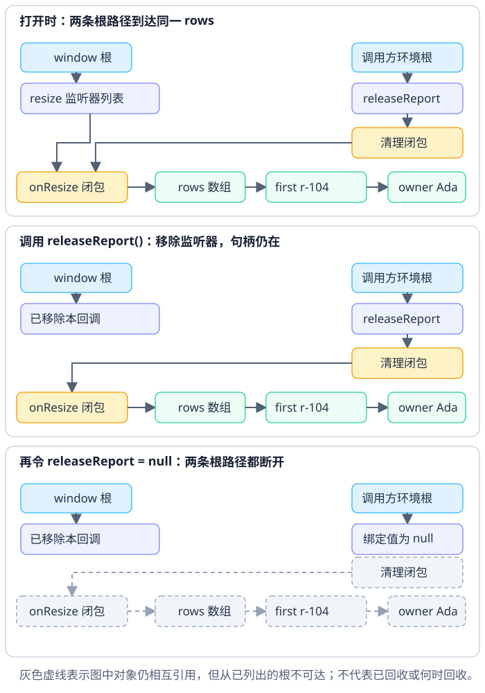

# 对象什么时候能被回收，弱引用能帮什么、不能帮什么？

报表关闭后，行对象不再显示，却可能还留在内存里。垃圾回收器不知道“这一行在业务上已经过期”，它只看程序是否还能沿强引用到达这个对象。本章先用可达性解释对象为什么被留下，再用堆快照找出具体的保留者，最后说明 `WeakMap`、`WeakSet`、`WeakRef` 和 `FinalizationRegistry` 各自保证什么。

沿用主线一的报表页。本章关心的是行数据 r-104 在内存里的对象 `first`：`{ id: "r-104", amount: 0, owner: { id: "u-17", name: "Ada" } }`。读者需要知道闭包会保留它捕获的绑定，以及事件监听器怎样注册和移除。

## 回收看的是从根能否到达

ECMAScript 不规定垃圾回收算法，也不承诺一个不可达对象何时被回收。理解保留问题，用 tracing GC（追踪式垃圾回收）作模型就够了：从 GC root（垃圾回收根）出发，例如全局对象和正在执行的函数里的变量，沿强引用标记能到达的对象；标记不到的对象才具备回收条件。

这个模型有两个直接推论：

- 循环引用本身不阻止回收。两个对象互相引用，只要从根到不了它们，它们就都可以回收。
- “业务上没用了”不等于“不可达”。只要还有一条从根出发的强引用路径，对象就必须保留。

所以排查内存问题，要找的是**保留路径**，而不是“有没有环”。V8 的 Orinoco 回收器（分代布局，加上并行、增量、并发标记）是一个实现例子，它的算法和时机由引擎决定，不是 ECMAScript 对所有运行时的承诺。

## 报表关闭后，谁还保留着 r-104？

报表打开时，`rows` 数组保存 `first`；`onResize` 闭包读取 `rows`；`window` 的事件监听器列表保存 `onResize`。`openReport` 返回的清理函数也捕获了同一个 `onResize`，调用方把它存在 `releaseReport` 里，这就形成了第二条路径。

```javascript
function openReport(target) {
  const owner = { id: "u-17", name: "Ada" };
  const first = { id: "r-104", amount: 0, owner };
  const rows = [first];

  function render(currentRows) {
    console.log(currentRows.map(row => `${row.id}:${row.owner.name}`).join(", "));
  }

  function onResize() {
    render(rows);
  }

  target.addEventListener("resize", onResize);
  return () => target.removeEventListener("resize", onResize);
}

let releaseReport = openReport(window);
// 关闭报表：先移除监听器，再放弃保存清理函数的绑定。
releaseReport();
releaseReport = null;
```



图中三个阶段对应三行代码：

1. **报表打开时。** `window` 的监听器列表和调用方的 `releaseReport` 各有一条路径到达 `onResize` 闭包，闭包再保留 `rows`、`first` 和嵌套的 `owner`。
2. **调用 `releaseReport()` 后。** 监听器列表里的回调被移除，第一条路径断开。但清理函数仍在 `releaseReport` 里，它捕获的 `onResize` 仍然可达，`rows` 和 `first` 也就仍然可达。
3. **再令 `releaseReport = null` 后。** 第二条路径也断开。图中这几个对象之间的引用还在，但从列出的根已经到不了它们。

第三步之后，如果没有别的所有者，这些对象就具备了回收条件。至于何时真的回收，程序观察不到，也不应依赖。

## 常见的保留路径和该由谁断开

除了上面的事件监听器，常见的保留路径还有：

- `setTimeout`、`setInterval`、订阅或没有结束的任务仍持有回调，回调闭包保留旧报表。
- 应用级 `Map` 缓存没有删除条目，强持有键和值。`Map` 的键语义见[数组、Map、Set 和普通对象怎样选，空位和去重有哪些坑？](./arrays-maps-and-sets.md)。
- 已经从文档上移除、但仍能从根到达的 DOM 节点。只有节点和它自己的监听器之间相互引用，不足以证明泄漏。
- 调试器控制台、断点或堆分析工具本身暂时保留对象。

这些只是排查线索。必须沿实际对象的保留链确认，不能凭“用了闭包”或“数组很大”就断定泄漏。

找到路径后，由**拥有这份资源的生命周期**负责断开：注册监听器的报表在关闭时调用 `removeEventListener`（注销的写法见[一次点击怎样传播到处理器，处理器该怎样注册和清理？](../browser/dom-events.md)）；缓存的所有者删除条目；创建计时器的生命周期调用 `clearInterval` 或 `clearTimeout`。清理点要和真实的所有权一致，不要把后文的 `FinalizationRegistry` 当成释放按钮。

## 怎样用堆快照找到保留者？

怀疑“打开再关闭报表会留下对象”时，用两份 heap snapshot（堆快照）对比：

1. 打开报表，切到固定的筛选条件，正常关闭。等页面回到关闭且稳定的状态，取第一份快照作基线。
2. 按完全相同的顺序重复“打开、切筛选、关闭”数次，再回到同样的关闭状态，取第二份快照。
3. 两份快照处于相同的页面和应用状态，第二份里新增的对象才算残留候选。

> [!info] 实例：Chrome DevTools 与 Node.js 的快照工具
> Chrome DevTools 的 Memory 面板在取快照前会先执行一次 GC。在 Comparison（比较）视图里展开新增的对象，看属性 `id` 是否为 `"r-104"`，也可以从名字有辨识度的 `onResize` 回调查起。选中对象后看 Retainers（保留者）面板和到根的路径：本例应沿监听器列表、闭包捕获的 `rows`，或调用方仍持有的清理函数找到所有者。控制台输出和断点会暂时保留对象，取快照前要清空控制台、停用断点。
>
> Node.js 服务可以用 `v8.writeHeapSnapshot()` 生成 V8 堆快照。它会同步阻塞事件循环，采集时大约需要堆大小两倍的内存，在线上实例使用前要评估余量。这些工具属于运行时，不是 ECMAScript 语义。

## WeakMap：按对象身份附加数据，但不拥有键

报表界面要给某一行附加“已选中”这样的状态，又不想因为这份附加数据让行对象一直留在内存里。`WeakMap`（弱映射）就是为这个场景设计的：条目按键的身份查找，而这条关联本身不会让键继续存活。

再沿用[JavaScript 的值有哪些类型，“相等”又有几种？](./values-types-and-equality.md)里的 `retry`：重试请求返回的同一行，业务 id 也是 `r-104`、金额 120，但它是另一个对象。

```javascript
const first = { id: "r-104", amount: 0, owner: { id: "u-17", name: "Ada" } };
const retry = { id: "r-104", amount: 120, owner: { id: "u-17", name: "Ada" } };

const rowMetadata = new WeakMap();
rowMetadata.set(first, { selected: true, row: first });

console.log(rowMetadata.get(first).selected);     // true
console.log(rowMetadata.get(first).row === first); // true
console.log(rowMetadata.has(retry));              // false：业务 id 相同，对象身份不同
```

`WeakMap` 的规则可以归成三条：

- **只要别处还持有键，就能读到值。** 键一旦没有其他强引用，这个条目不会让它继续存活。
- **值对键的反向引用不会互相保活。** 上例的值通过 `row` 引用了 `first`。外部强引用全部断开后，这条反向引用不会让键和值彼此保住。但代码若把 `rowMetadata.get(first)` 的返回值存进普通变量，就能沿 `row` 回到键，这又是一条强引用。
- **它不替你断开其他路径。** 上一节忘记移除的监听器仍会让 `first` 存活，`WeakMap` 对此无能为力。

`WeakMap` 没有 `size`、键枚举和 `forEach`。回收时机不确定，如果允许枚举，程序就能观察到键何时被回收，而这正是语言刻意不暴露的。

所以它适合给别的代码拥有的对象（DOM 节点、类实例、行对象）附加私有元数据，对象的生命周期由外部所有者决定。如果需要列出、计数或集中清理缓存项，就用普通 `Map`，由它的所有者强持有对象并显式删除条目。

## 哪些值能作弱键？

对象是最常见的弱键。从 ECMAScript 2023 起，非注册的 `Symbol`（符号）也可以作弱键；用 `Symbol.for` 得到的注册 `Symbol` 不行。

区别在于身份能否被重新取得。每次调用 `Symbol("row metadata")` 都创建一个新符号，描述相同也是不同的身份；而 `Symbol.for("shared")` 总是从全局注册表取回同一个符号，它永远可以被重新拿到，弱持有它没有意义。

```javascript
const localSymbol = Symbol("row metadata");
rowMetadata.set(localSymbol, { source: "non-registered symbol" }); // 可以

const sharedSymbol = Symbol.for("shared");
console.log(rowMetadata.has(sharedSymbol)); // false
try {
  rowMetadata.set(sharedSymbol, {});
} catch (error) {
  console.log(error.name); // TypeError：注册 Symbol 不能作弱键
}
```

这条资格规则对 `WeakSet`、`WeakRef` 的目标和 `FinalizationRegistry` 的目标都适用。

## WeakSet：只标记成员身份

`WeakSet`（弱集合）按身份弱持有对象或非注册 `Symbol`，只有 `add`、`has`、`delete`，没有遍历和 `size`。它适合标记“别处拥有的这个对象已经处理过”：

```javascript
const processedRows = new WeakSet();

function processOnce(row) {
  if (processedRows.has(row)) return;
  processedRows.add(row);
  // 对这个对象身份执行一次处理
}

processOnce(first);
console.log(processedRows.has(first)); // true
console.log(processedRows.has(retry)); // false：仍按对象身份区分
```

这里 `first` 和 `retry` 被当成两行，因为区分依据是对象身份，不是 `id`。若要按业务 id 去重，应改用普通 `Map` 或 `Set`，以选定的值作键。

## WeakRef.deref 拿到的目标能活多久？

`WeakMap` 和 `WeakSet` 只能拿已有的键去查。`WeakRef`（弱引用）直接持有一个对目标的弱引用，目标可以是对象或非注册 `Symbol`。`deref()` 在目标还存活时返回它，否则返回 `undefined`。

返回了目标以后，它还能保证存活多久？规范维护一张临时保活列表（kept objects）：构造 `WeakRef` 时和 `deref()` 返回目标时，都把目标加进这张列表。浏览器在微任务检查点结束时清空它，而不是一遇到 `await` 就清空。因此可以依赖的窗口是：**当前这段同步执行期间，目标不会被回收**。宿主也许保留得更久，但代码不能依赖。

这个窗口带来两条用法：

- 先 `deref()`，检查结果不是 `undefined`，再在同一段同步代码里使用它。
- 如果跨 `await` 之后还要用目标，就把 `deref()` 的结果存进普通局部变量，让这条强引用跨过等待。

```javascript
const weakRow = new WeakRef(first);
const row = weakRow.deref();
if (row !== undefined) {
  rowMetadata.set(row, { selected: true });
  console.log(row.id); // r-104
}

function makePendingRowRef() {
  const pendingRow = { id: "r-105" };
  return new WeakRef(pendingRow);
}

async function readAfterRefresh(ref) {
  const row = ref.deref();
  if (row === undefined) return undefined;
  await new Promise(resolve => setTimeout(resolve, 0));
  return row.id; // row 是局部强引用，跨过了等待
}

readAfterRefresh(makePendingRowRef()).then(id => {
  console.log("after await =", id); // r-105
});
```

`makePendingRowRef()` 返回后，局部变量 `pendingRow` 已经离开作用域，但 `readAfterRefresh` 的首次 `deref()` 和 `new WeakRef(pendingRow)` 处在同一段同步执行里，目标仍在保活列表中，一定能拿到。如果传进来的是早已跨过任务边界的引用，首次读取就可能得到 `undefined`。函数把目标存进 `row` 后再等待计时器，所以等待之后仍能读到 `r-105`；如果只保留 `ref`、等待后再 `deref()`，结果可能是 `undefined`。

## FinalizationRegistry 能承诺什么？

`FinalizationRegistry`（最终化注册表）让程序在目标被回收之后**可能**收到一次回调。`register(target, heldValue, token)` 的三个参数受到不同的对待：

| 参数 | 注册表怎样持有 | 作用 |
| --- | --- | --- |
| `target` | 弱持有 | 被观察的对象或非注册 `Symbol` |
| `heldValue`（暂存值） | 注册有效期间强持有 | 回调运行时收到的唯一参数 |
| `token`（可选取消令牌） | 弱持有，须为对象或非注册 `Symbol` | 传给 `unregister(token)` 以提前取消 |

两条约束都来自“`heldValue` 被强持有”：

- `heldValue` 不能和 `target` 是同一个值，否则抛 `TypeError`。
- 如果 `heldValue` 的某个属性引用了 `target`，注册合法，但这条强引用会让目标一直存活，回调永远不会因为目标不可达而运行。

令牌被弱持有，调用方可以自己保存它用于取消，而不会通过注册表让目标保持存活。

```javascript
const registry = new FinalizationRegistry(heldValue => {
  console.log("eventual cleanup hint:", heldValue);
});

let temporaryRow = { id: "temporary" };
const unregisterToken = {};
registry.register(temporaryRow, "temporary row", unregisterToken);

try {
  registry.register(temporaryRow, temporaryRow);
} catch (error) {
  console.log(error.name); // TypeError：heldValue 不能与 target 相同
}
// registry.register(temporaryRow, { row: temporaryRow }); // 合法，但会保住目标

temporaryRow = null;
console.log(registry.unregister(unregisterToken)); // true：取消了这条注册
```

即使全部写对，对象何时回收、回调何时运行都没有保证：回调可能很久以后才运行，程序退出前也可能根本不运行。

## 什么时候不该用弱引用？

弱引用 API 只适合“没有它也不影响正确性”的工作：缓存提示、附加元数据、顺手的清理。

它们不适合关闭文件或网络连接、释放锁、写计费记录、更新 UI 状态，以及任何必须及时发生的动作。需要确定的结束时机时，由明确的所有者调用 `dispose`、`removeEventListener`、`clearInterval` 或对应的清理函数。回到报表的例子：`WeakMap` 能让“已选中”元数据不保住 r-104，但让 r-104 真正可回收的，是报表关闭时移除监听器、放弃清理句柄这两步。

## 从对象的生命周期到对象的形状

本章回答了“对象留多久”：可回收与否取决于从根出发的强引用路径；排查时用堆快照找保留者，由资源的所有者断开路径；弱集合和弱引用只保证自己不添加强路径，不负责清理，也不给出回收时机。

一直以来我们都假设 `first` 的字段就是代码里写的那样。数据实际来自网络或浏览器存储时，TypeScript 的类型能替我们保证这一点吗？下一章[TypeScript 能保证什么，外部数据又该怎样验证？](./typescript-guarantees-and-runtime-validation.md)回答这个问题。

> [!info]- 来源
> - **追踪式 GC 与 V8 实现例子**（“回收看的是从根能否到达”）：V8 博客 “Trash talk: the Orinoco garbage collector”，2019-01-03，[Marking](https://v8.dev/blog/trash-talk#marking)（沿 root set 标记可达对象）、[Generational layout](https://v8.dev/blog/trash-talk#generational-layout) 与 [Orinoco](https://v8.dev/blog/trash-talk#orinoco)；后两节是 V8 的实现，不代表 ECMAScript 规定的算法。
> - **ECMAScript 不保证回收与最终化时机**（“回收看的是从根能否到达”“FinalizationRegistry 能承诺什么”）：ECMAScript 2026 §9.9 [Processing Model of WeakRef and FinalizationRegistry Targets](https://tc39.es/ecma262/2026/multipage/executable-code-and-execution-contexts.html#sec-weakref-processing-model)（含 §9.9.1 Objectives）。
> - **监听器列表与移除**（“报表关闭后，谁还保留着 r-104”）：WHATWG DOM Living Standard §2.7 [EventTarget](https://dom.spec.whatwg.org/#interface-eventtarget)：回调加入 event listener list，`removeEventListener` 按 type / callback / capture 移除。核验于 2026-11-12。
> - **堆快照方法**（“怎样用堆快照找到保留者”）：Chrome DevTools [Record heap snapshots](https://developer.chrome.com/docs/devtools/memory-problems/heap-snapshots) 的 Take a snapshot（取快照前执行 GC）、Comparison view、Retainers；[Memory terminology](https://developer.chrome.com/docs/devtools/memory-problems/get-started)（控制台与断点会保留对象，建议清空后再取快照）。访问于 2026-11-12。Node.js v26.13.1 [`v8.writeHeapSnapshot()`](https://nodejs.org/api/v8.html#v8writeheapsnapshotfilenameoptions)：同步阻塞、约两倍堆内存开销，读取于 2026-11-12。
> - **WeakMap / WeakSet 的弱键关系、无枚举、弱键资格**（“WeakMap”“哪些值能作弱键”“WeakSet”）：ECMAScript 2026 §24.3–24.4 [Keyed Collections](https://tc39.es/ecma262/2026/multipage/keyed-collections.html)、[`CanBeHeldWeakly`](https://tc39.es/ecma262/2026/multipage/executable-code-and-execution-contexts.html#sec-canbeheldweakly)；非注册 Symbol 的资格在 [ECMAScript 2023 §9.14](https://tc39.es/ecma262/2023/multipage/executable-code-and-execution-contexts.html#sec-canbeheldweakly) 已纳入。`Symbol()` 每次构造新身份、`Symbol.for` 查共享注册表：ECMAScript 2026 §20.4.1.1、§20.4.2.2 [Symbol](https://tc39.es/ecma262/2026/multipage/fundamental-objects.html#sec-symbol.for)。
> - **WeakRef 与临时保活列表**（“WeakRef.deref 拿到的目标能活多久”）：ECMAScript 2026 §26.1.1.1 [WeakRef target](https://tc39.es/ecma262/2026/multipage/managing-memory.html#sec-weak-ref-target)、§26.1.3.2 [`deref`](https://tc39.es/ecma262/2026/multipage/managing-memory.html#sec-weak-ref.prototype.deref)、§9.10 [`ClearKeptObjects`](https://tc39.es/ecma262/2026/multipage/executable-code-and-execution-contexts.html#sec-clearkeptobjects)、§9.11 [`AddToKeptObjects`](https://tc39.es/ecma262/2026/multipage/executable-code-and-execution-contexts.html#sec-addtokeptobjects)；浏览器在微任务检查点末清空 kept objects：WHATWG HTML §8.1.7.3 [perform a microtask checkpoint](https://html.spec.whatwg.org/multipage/webappapis.html#perform-a-microtask-checkpoint)，核验于 2026-11-12。
> - **FinalizationRegistry 的参数与取消**（“FinalizationRegistry 能承诺什么”）：ECMAScript 2026 §26.2.3.2–3 [register / unregister](https://tc39.es/ecma262/2026/multipage/managing-memory.html#sec-finalization-registry.prototype.register)、§9.12 [`CleanupFinalizationRegistry`](https://tc39.es/ecma262/2026/multipage/executable-code-and-execution-contexts.html#sec-cleanup-finalization-registry)。
> - **本地重放**：原稿在 Node.js v26.13.0 / V8 14.6.202.34-node.40（2026-11-12）运行弱键资格、同值 `heldValue` 异常和跨 `await` 局部强引用示例；本章示例在 Node.js v26.13.1 上重新运行，输出一致。这些运行不触发 GC，也不推断最终化时序。
