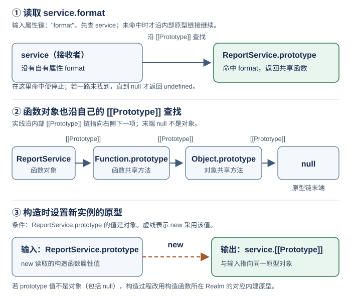

# JavaScript 对象如何查找属性并组织成员？

**案例背景。** 一个报表页面创建多个服务实例：每个实例有自己的区域前缀和调用次数，但共享格式化方法。读取 `service.prefix` 可以在实例自身找到值，读取 `service.format` 却要去它的原型上找。下面沿这次属性查找，解释成员放在哪里、getter/setter 怎样参与读写，以及为什么改一个共享方法会影响多个实例。

property key（属性键）可以是字符串或 `Symbol`（符号）。点号语法 `object.key` 使用字符串键 `"key"`；方括号语法 `object[symbolKey]` 可以用 Symbol 值，之后的查找和赋值规则相同。

instance（实例）状态与共享 method（方法）分别存在哪里，取决于对象之间的关系。这里先分开两个名字相近的概念：对象的 `[[Prototype]]` 内部链接负责查找，组成 prototype chain（原型链）；对本页普通 constructor function（构造函数）的直接 `new C()`，构造函数上的 `prototype` 属性提供新建接收者的初始原型，前提是它的值为对象。若值不是对象，构造过程会按函数所在 Realm（执行域）回退到对应的内建原型。下文的报表服务实例 `service` 从 `ReportService.prototype` 共享 `format`；图分别展示读取 `service.format`、函数对象自身的继承链，以及 `new` 的原型传递。

图中第一行输入的是属性键 `format`：从 `service` 沿 `[[Prototype]]` 找到共享函数并返回；若某个键一路未找到，到达 `null` 后结果才是 `undefined`。第二行实线表示沿函数对象的 `[[Prototype]]` 链前进；最后的 `null` 是链末端，并非一个对象。第三行虚线只表示 `new` 读取构造函数的 `prototype` 属性值并把该对象用作新实例的 `[[Prototype]]`；若属性值不是对象，则会改用构造函数所在执行域相应的内建原型。

## 属性查找沿原型链进行

ordinary object（普通对象）用 property descriptor（属性描述符）记录属性的值或访问器。读取 `object.key` 时先检查 own property（自有属性）；没有匹配的描述符，就沿 `[[Prototype]]` 链继续查找，直到命中或到达 `null`。命中 data descriptor（数据描述符）时返回 `value`，它也可以是函数。命中 accessor descriptor（访问器描述符）时，若有 getter（读取器），就以原始接收者 `object` 为 `this` 调用它；若没有 getter，读取结果为 `undefined`。沿链始终没有找到属性，也会得到 `undefined`。

getter 的 `this` 不因属性位于原型上而改变，也不是额外的位置实参。继承不是拷贝：实例保留自己的属性，需要共享成员时通过查找取得。setter（设置器）怎样处理赋值，稍后用同一个接收者继续说明。

~~~javascript
const base = { kind: "report" };
const record = Object.create(base);
record.title = "Q4";
const marker = Symbol("reviewed");
record[marker] = true;

Object.hasOwn(record, "title"); // true：title 是 record 的自有属性
Object.hasOwn(record, "kind");  // false：kind 不在 record 自身
"kind" in record;               // true：in 会继续检查原型链
record.kind;                    // "report"
record.missing;                 // undefined：查找到原型链末端仍未找到
Object.hasOwn(record, marker); // true：Symbol 也是有效属性键
Object.getOwnPropertySymbols(record); // [marker]
Object.getPrototypeOf(record) === base; // true
~~~

`Object.hasOwn(object, key)` 只问属性是否定义在这个对象自身；`key in object` 也会报告继承属性。因而当值可能是 `undefined` 时，用属性是否存在来判断不能只看 `object[key]` 的结果。

数据描述符保存 `value`；访问器描述符保存 `get` 与 `set`。本例的 `name` 访问器定义在 `guestProfile` 的原型 `profile` 上；读取或写入这个继承属性时，语言仍以原始接收者 `guestProfile` 为 `this` 调用 getter 或 setter，所以它可以读取或改变实例自己的状态：

~~~javascript
const profile = { _name: "John" };
Object.defineProperty(profile, "name", {
  get() { return this._name; },
  set(value) { this._name = value; },
  enumerable: true,
  configurable: true,
});

const guestProfile = Object.create(profile);
// 先在 profile 找到 getter；getter 的 this 是 guestProfile。
guestProfile.name; // "John"
// this._name 在 guestProfile 上不存在，于是从 profile 读取 "John"。

// 再在 profile 找到 setter；setter 的 this 仍是 guestProfile。
guestProfile.name = "Jo";
// setter 内的赋值找到 profile 上可写的 _name 数据属性，
// 随后在 guestProfile 上新建 _name，留下 profile._name 不变。
[profile.name, guestProfile.name,
  Object.hasOwn(guestProfile, "name"),
  Object.hasOwn(guestProfile, "_name")];
// ["John", "Jo", false, true]
~~~

getter 是会执行的代码：读取属性可能产生副作用或抛错。访问器对外看起来像属性读取或赋值，但其行为由 getter/setter 决定；只有 getter 而没有 setter 的属性不能通过普通赋值改变。

## 报表服务把实例状态与共享行为分开

案例背景：报表页面为每个服务实例保存不同的区域前缀和处理器，所有实例共享同一个格式化算法。工厂函数用 closure（闭包）分别保存处理器的标签与调用次数。调用 `service.onReport(...)` 先执行实例自己的处理器；处理器再读取 `this.format` 并从原型取得共享函数，最后由这个函数通过 `this.prefix` 读取实例前缀。

~~~javascript
function makeReportHandler(tag) {
  let calls = 0;
  return function onReport(report) {
    "use strict";
    calls += 1;
    return this.format(report, tag, calls);
  };
}

function ReportService(prefix) {
  this.prefix = prefix;                        // 每个实例各自持有
  this.onReport = makeReportHandler("daily"); // 每个实例各自持有闭包状态
}

ReportService.prototype.format = function (report, tag, sequence) {
  return this.prefix + "/" + tag + ": " + report.title + " #" + sequence;
};

const service = new ReportService("Sales");
service.onReport({ title: "Q4" }); // "Sales/daily: Q4 #1"
service.onReport({ title: "Q4" }); // "Sales/daily: Q4 #2"
Object.hasOwn(service, "format"); // false
Object.hasOwn(ReportService.prototype, "format"); // true
Object.getPrototypeOf(service) === ReportService.prototype; // true
~~~

`prefix` 和 `onReport` 是构造器运行时写入实例的自有属性，处理器闭包各自保留 `tag` 与 `calls`。每次 `service.onReport(...)` 都先调用该处理器；它读取 `this.format` 时沿 `service.[[Prototype]]` 找到 `ReportService.prototype.format`，再以 `service` 为 `this` 调用这个共享函数。`format` 函数体执行到 `this.prefix` 时，才读取实例自己的 `"Sales"`。构造器、实例、函数调用的关系分别属于原型与 `this` 的机制；[函数的 `this` 值由什么决定？](./this-and-function-binding.md) 继续解释调用形式怎样提供接收者。

## `[[Prototype]]` 与函数的 `prototype` 是两种关系

函数本身也是对象，因此它也有内部 `[[Prototype]]` 链，通常从 `Function.prototype` 继续到 `Object.prototype`。可构造的普通函数通常还有一个自有的数据属性 `prototype`，其值是供实例查找共享成员的对象。对本页这样的普通基础构造函数调用 `new C()` 时，构造过程读取当时的 `C.prototype` 值，初始化新建接收者的 `[[Prototype]]`；实例不是通过函数对象自身的 `[[Prototype]]` 找到成员。构造器若显式返回另一个对象，`new` 的最终结果会改为那个对象，具体返回规则见后面的构造章节。

~~~javascript
function ReportService() {}

// 函数对象自身的原型
Object.getPrototypeOf(ReportService) === Function.prototype; // true
Object.getPrototypeOf(ReportService.prototype) ===
  Object.prototype; // true
Object.hasOwn(ReportService, "prototype"); // true：构造函数上的普通属性

const firstService = new ReportService();
const firstPrototype = ReportService.prototype;
ReportService.prototype = { format() { return "new"; } };
const laterService = new ReportService();

// 已有实例不被迁移
Object.getPrototypeOf(firstService) === firstPrototype; // true
// 新实例采用新值
Object.getPrototypeOf(laterService) === ReportService.prototype; // true
~~~

上例替换的是函数上的 `prototype` 属性。已创建实例仍连着旧原型对象；新实例采用新对象。若只是给当前原型对象添加或修改方法，属性查找能到达该对象的实例会看到变化；若实例有同名自有属性，查找在实例处就停止，共享方法仍被遮蔽。

`prototype` 属性的值只需是对象，不要求它一定是专为该构造函数创建的原型对象；函数本身也是对象，可以成为另一个构造函数实例的原型。反过来，若普通构造函数的 `prototype` 被改成 `null` 或其他原始值，`new` 会回退到该构造函数所属执行域的 `Object.prototype`：

~~~javascript
function Parent() {}
function Child() {}
Child.prototype = Parent; // Parent 是函数对象，因此可以作为原型
Object.getPrototypeOf(new Child()) === Parent; // true

function FallbackDemo() {}
FallbackDemo.prototype = null;
// 同一执行域内，回退结果为 Object.prototype。
Object.getPrototypeOf(new FallbackDemo()) === Object.prototype; // true
~~~

`class`（类）语法也利用这套对象关系，而不是另建一类公开成员存储。公开实例字段初始化为每个新实例创建自有属性；公开非静态方法和访问器放在类的原型对象上；公开 `static`（静态）成员是构造函数本身的属性。

~~~javascript
class User {
  label = "member";
  get displayLabel() { return this.label; }
  greet() { return "Hi"; }
  static category = "account";
}

const user = new User();
Object.hasOwn(user, "label"); // true：实例字段
Object.hasOwn(user, "greet"); // false：方法在原型上
Object.hasOwn(Object.getPrototypeOf(user), "displayLabel"); // true
Object.hasOwn(User, "category"); // true：静态属性属于构造函数
~~~

箭头函数和上例 `greet()` 这样的普通简洁方法默认没有自有的 `prototype` 属性，也不能用 `new` 构造；生成器简洁方法与异步生成器简洁方法则有自有的 `prototype` 属性，但同样不能用 `new`。这些函数仍是对象，有自己的 `[[Prototype]]`。其构造能力边界会在[JavaScript 的 `new` 如何构造对象？](./construction-and-new.md)中继续说明。

## 属性描述符决定读写是否执行代码

data descriptor（数据描述符）的 `value` 存值，`writable`（可写）控制能否通过赋值改值；accessor descriptor（访问器描述符）的 `get` 和 `set` 控制读取与写入时执行什么代码。两类都有 `enumerable`（可枚举）与 `configurable`（可配置）标记。对象字面量的普通数据属性通常三个标记都为真；`Object.defineProperty` 新建属性时未提供的标记都为假。

| 字段 | 作用 |
|---|---|
| `value`、`writable` | 数据属性保存的值，以及普通赋值能否更新它 |
| `get`、`set` | 读取或写入时调用的函数；未提供的读取器/设置器相当于 `undefined` |
| `enumerable` | `Object.keys` 只列自有、可枚举的字符串键；`for...in` 还会沿原型链枚举可枚举的字符串键；这两种枚举都不列 Symbol 键 |
| `configurable` | 是否通常可以删除、改标记，或在数据属性与访问器属性之间切换 |

~~~javascript
const descriptorDemo = {};
Object.defineProperty(descriptorDemo, "item", {
  value: 1, writable: true, enumerable: true, configurable: true,
});

Object.defineProperty(descriptorDemo, "item", { value: 2 });
const sameType = Object.getOwnPropertyDescriptor(descriptorDemo, "item");
[sameType.value, sameType.writable,
  sameType.enumerable, sameType.configurable];
// [2, true, true, true]：同类描述符只更新给出的 value

Object.defineProperty(descriptorDemo, "item", { get() { return 3; } });
const switchedToAccessor =
  Object.getOwnPropertyDescriptor(descriptorDemo, "item");
[descriptorDemo.item, switchedToAccessor.set,
  switchedToAccessor.enumerable, switchedToAccessor.configurable];
// [3, undefined, true, true]：writable/value 不再属于访问器描述符

Object.defineProperty(descriptorDemo, "item", { value: 4 });
const switchedToData =
  Object.getOwnPropertyDescriptor(descriptorDemo, "item");
[switchedToData.value, switchedToData.writable,
  switchedToData.enumerable, switchedToData.configurable];
// [4, false, true, true]：新类型专有的 writable 缺省为 false

Object.defineProperty(descriptorDemo, "fresh", { value: 1 });
const fresh = Object.getOwnPropertyDescriptor(descriptorDemo, "fresh");
[fresh.writable, fresh.enumerable, fresh.configurable];
// [false, false, false]
~~~

更新已有属性时，未给出的同类字段保持原值。切换数据/访问器类型要求属性可配置；旧类型专有字段会去掉，新类型专有字段按默认值补齐，而未提供的共同字段 `enumerable`、`configurable` 继续保留。这个区别解释了上例：切换回数据属性后，`writable` 是 `false`，但可枚举、可配置仍是 `true`。不可配置属性不能任意删除或重新定义；给不可写属性或无 setter 的属性赋值时，strict mode（严格模式）中的普通赋值会抛出 `TypeError`，非严格代码则可能静默失败。

## 继承属性的赋值会调用 setter 或建立自有属性

读取与赋值都沿原型关系查找，但找到后执行的规则不同。若继承位置有 setter，setter 会以最初接收者作为 `this` 执行。沿链未找到同名属性，或找到可写的继承数据属性时，可扩展的接收者可以建立自有属性；若继承位置是不可写数据属性，普通赋值不能覆盖它。

~~~javascript
const defaults = { mode: "shared" };
const localSettings = Object.create(defaults);
localSettings.mode = "local";

[defaults.mode, localSettings.mode,
  Object.hasOwn(localSettings, "mode")];
// ["shared", "local", true]

const lockedDefaults = {};
Object.defineProperty(lockedDefaults, "mode", { value: "fixed" });
const lockedSettings = Object.create(lockedDefaults);
Reflect.set(lockedSettings, "mode", "changed"); // false：写入被拒绝
lockedSettings.mode; // "fixed"
~~~

`Object.defineProperty` 创建的 `lockedDefaults.mode` 默认不可写，所以赋值没有在实例建出同名属性。使用普通赋值时，严格代码对这种拒绝会抛出 `TypeError`；`Reflect.set` 则把写入是否成功作为布尔结果交还调用者。访问器 setter 仍可自行决定要改哪个状态，因此属性赋值不总等于写入同名字段。

自有属性会遮住原型上的同名属性；删除自有属性后，查找才会重新落到原型上。给构造函数添加静态属性，只会修改函数对象本身。下面的实例沿 `Example.prototype` 查找，不经过函数对象 `Example`，所以读不到它的静态属性；前面 `Child.prototype = Parent` 那种特意把函数对象放进原型链的配置则不同。

~~~javascript
function Example() {
  Example.value = function () { return 1; };
  this.value = function () { return 2; };
}
Example.prototype.value = function () { return 3; };
Example.value = function () { return 4; };

Example.value(); // 4
const instance = new Example();
instance.value(); // 2：实例自有属性遮住原型方法
delete instance.value;
instance.value(); // 3：删除遮蔽属性后，查找回到原型方法
Example.value(); // 1：构造函数体改写函数对象自己的静态属性
~~~

## 没有原型的对象与引擎优化

`Object.create(null)` 建立的字典对象没有原型，因此不会继承 `Object.prototype` 上的 `toString` 等属性：

~~~javascript
const dictionary = Object.create(null);
dictionary.toString; // undefined
"toString" in dictionary; // false
~~~

这适合确实需要没有继承键的字典；也意味着这些对象不能直接调用常规对象方法，使用前要明确要用哪些操作。

V8 可用 hidden class（隐藏类）和属性布局转换优化属性访问，但这是引擎实现选择，不是 ECMAScript 对象语义的保证。只有性能测量定位到属性访问瓶颈时，才值得为形状稳定性调整布局。

**相关机制：** [函数 `this` 与绑定](./this-and-function-binding.md)解释方法调用和继承 getter 怎样接收 `this`；[使用 `new` 构造对象](./construction-and-new.md)跟进实例的初始原型、构造器与返回值；[Proxy 代理对象](./proxy.md)说明被拦截的读取、写入和属性描述符约束。

> [!info]- 来源
> - 属性读取沿原型链查找、并把原接收者传给 getter：[ECMAScript 2026 OrdinaryGet](https://tc39.es/ecma262/2026/multipage/ordinary-and-exotic-objects-behaviours.html#sec-ordinaryget)（§10.1.8.1）。
> - 属性写入沿链判断数据属性或调用 setter：[ECMAScript 2026 OrdinarySet](https://tc39.es/ecma262/2026/multipage/ordinary-and-exotic-objects-behaviours.html#sec-ordinaryset)（§10.1.9.1）和 [OrdinarySetWithOwnDescriptor](https://tc39.es/ecma262/2026/multipage/ordinary-and-exotic-objects-behaviours.html#sec-ordinarysetwithowndescriptor)（§10.1.9.2）。
> - `Object.defineProperty`、描述符默认值与可枚举键：[ECMAScript 2026 Object.defineProperty](https://tc39.es/ecma262/2026/multipage/fundamental-objects.html#sec-object.defineproperty)（§20.1.2.4）、[Object.keys](https://tc39.es/ecma262/2026/multipage/fundamental-objects.html#sec-object.keys)（§20.1.2.19）和 [Object.hasOwn](https://tc39.es/ecma262/2026/multipage/fundamental-objects.html#sec-object.hasown)（§20.1.2.14）。
> - 属性键是字符串或 Symbol，字符串与 Symbol 的自有键枚举：[ECMAScript 2026 ToPropertyKey](https://tc39.es/ecma262/2026/multipage/abstract-operations.html#sec-topropertykey)（§7.1.19）、[Object.getOwnPropertySymbols](https://tc39.es/ecma262/2026/multipage/fundamental-objects.html#sec-object.getownpropertysymbols)（§20.1.2.11）。
> - 普通构造器依 `prototype` 属性选择新实例原型，并在属性不是对象时回退到构造器所在执行域的内建原型：[ECMAScript 2026 GetPrototypeFromConstructor](https://tc39.es/ecma262/2026/multipage/ordinary-and-exotic-objects-behaviours.html#sec-getprototypefromconstructor)（§10.1.14）。[Class Definitions](https://tc39.es/ecma262/2026/multipage/ecmascript-language-functions-and-classes.html#sec-class-definitions)（§15.7）规定类字段和方法的创建位置。
> - `Object.prototype.__proto__` 是规范标为可选实现且遗留的特性；读写原型优先用 `Object.getPrototypeOf` 与 `Object.setPrototypeOf`：[ECMAScript 2026 Object.prototype.__proto__](https://tc39.es/ecma262/2026/multipage/fundamental-objects.html#sec-object.prototype.__proto__)（§20.1.3.8）。
> - V8 的隐藏类和属性访问优化：[V8 Fast Properties](https://v8.dev/blog/fast-properties)。
