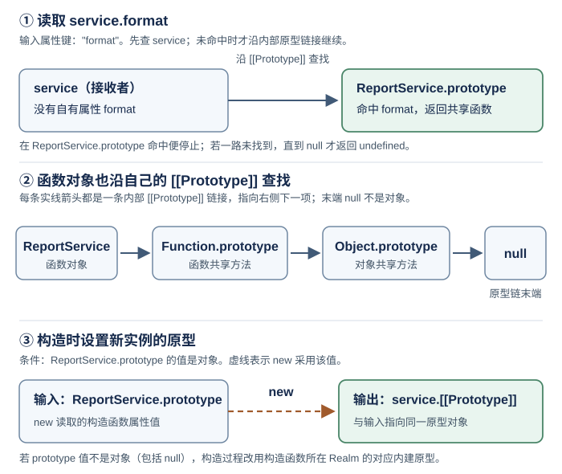

# 读写一个属性时，JavaScript 沿什么规则查找、落在哪里？

本章回答：写下 `object.key` 或 `object.key = value` 时，键先被转成什么，读取沿哪些对象查找，找到后是直接取值还是执行代码，赋值又落在哪个对象上。读者手上有上一章的行数据 `first`、`retry`，以及一个格式化行标题的报表服务；读完应能说清共享方法为什么放在原型上、属性缺失时默认值怎样生效，以及批量复制属性时哪些会被带走。

## 案例：行数据与报表服务

沿用主线一的报表页，并接着用[上一章](values-types-and-equality.md)的两份 `r-104` 行数据。为了观察“读不到”的情况，本章把它们按位置放进 `rows`，中间故意留一个空位（索引 1 上没有元素，空位的完整规则在下一章）：

~~~javascript
const owner = { id: "u-17", name: "Ada" };
const first = { id: "r-104", amount: 0, owner };
const retry = { id: "r-104", amount: 120, owner: { id: "u-17", name: "Ada" } };
const rows = [first, , retry];
const report = { profile: null, rows };
~~~

页面还用一个报表服务 `ReportService` 生成行标题。每个服务实例有自己的区域前缀，所有实例共用一个格式化方法。读 `service.prefix` 在实例自身就能找到；读 `service.format` 却要到别的对象上找。本章从键开始，沿着这两次读取走一遍。

## 属性键只有字符串和 Symbol

property key（属性键）只能是字符串或 `Symbol`。点号写法 `object.key` 用字符串 `"key"`；方括号写法 `object[expr]` 先求出 `expr`，再用规范操作 `ToPropertyKey` 把它转成键，分两步：

1. 以 string hint（字符串提示）调用 `ToPrimitive`，把值转成原始值。对象若定义了可调用的 `Symbol.toPrimitive`，就以 `"string"` 为参数调用它，返回对象则抛 `TypeError`；若该属性是 `null`/`undefined` 以外的不可调用值，也抛 `TypeError`。没有定义时依次尝试 `toString`、`valueOf`，取第一个返回的原始值；都不返回原始值则抛 `TypeError`。
2. 得到 `Symbol` 就原样作为键，其他原始值转成字符串。

所以“对象作键时调用 `toString`”只是默认情况，钩子可以改变结果。

| 键表达式 | `ToPrimitive` 的结果 | 最终属性键 |
|---|---|---|
| `123` | 数值 `123` | 字符串 `"123"` |
| `accountKey`（钩子返回 `"account"`） | 字符串 `"account"` | 字符串 `"account"` |
| `symbolKey`（钩子返回一个 Symbol） | `Symbol("account")` | 同一个 Symbol |
| `first`、`retry` | 都是继承来的 `toString` 给出的 `"[object Object]"` | 同一个字符串键，后写覆盖先写 |
| `Object.create(null)` | 没有 `toString`、`valueOf` 可用 | 抛 `TypeError` |

~~~javascript
const dictionary = {};
dictionary[123] = "number key";
dictionary["123"]; // "number key"

const accountKey = {
  [Symbol.toPrimitive](hint) {
    console.log(hint); // "string"
    return "account";
  },
};
dictionary[accountKey] = "Ada";
dictionary.account; // "Ada"

const symbol = Symbol("account");
const symbolKey = {
  [Symbol.toPrimitive](hint) {
    return symbol;
  },
};
dictionary[symbolKey] = "symbol key";
dictionary[symbol]; // "symbol key"：Symbol 被保留为键

dictionary[first] = "first object";
dictionary[retry] = "retry object";
dictionary["[object Object]"]; // "retry object"：两条记录撞在同一个键上
~~~

最后两行是用普通对象按记录建索引时的典型错误。键要保持对象身份、要区分数字 `7` 和字符串 `"7"`，或者需要任意类型的键时，应改用 `Map`，见[数组、Map、Set 和普通对象怎样选，空位和去重有哪些坑？](arrays-maps-and-sets.md)。

## 读取：先查自有属性，再沿原型链

每个对象都有一个内部链接 `[[Prototype]]`，指向它的原型对象（或 `null`）。一串这样的链接组成 prototype chain（原型链）。读取 `object.key` 时：

1. 先在 `object` 自身找这个键的 property descriptor（属性描述符）。
2. 没有找到，就沿 `[[Prototype]]` 到下一个对象继续找，直到命中或到达 `null`。
3. 命中 data descriptor（数据描述符）时返回它的 `value`，值也可以是函数；命中 accessor descriptor（访问器描述符）时，调用它的 getter（读取器），没有 getter 就得到 `undefined`。
4. 到达 `null` 仍未找到，结果是 `undefined`。

继承不是拷贝：对象只保存自己的属性，继承来的成员每次读取都要重新查找。

~~~javascript
const base = { kind: "report" };
const record = Object.create(base); // record.[[Prototype]] 是 base
record.title = "May report";
const marker = Symbol("reviewed");
record[marker] = true;

Object.hasOwn(record, "title");          // true：自有属性
Object.hasOwn(record, "kind");           // false：kind 在 base 上
"kind" in record;                        // true：in 会沿原型链查
record.kind;                             // "report"
record.missing;                          // undefined：查到链末端也没有
Object.hasOwn(record, marker);           // true：Symbol 也是键
Object.getPrototypeOf(record) === base;  // true
~~~

`Object.hasOwn(object, key)` 只问键是否在对象自身；`key in object` 还会报告继承属性。属性的值本身也可以是 `undefined`，所以判断“有没有这个属性”不能只看 `object[key] === undefined`。读写原型用 `Object.getPrototypeOf` 和 `Object.setPrototypeOf`；`__proto__` 访问器是规范标为遗留的可选特性。

## 访问器以最初的接收者为 this

getter 定义在原型上时，调用它的 `this` 仍是最初被读取的那个对象（接收者），而不是原型。setter（设置器）同理。所以原型上的访问器能读写每个实例自己的状态：

~~~javascript
const profile = { _name: "John" };
Object.defineProperty(profile, "name", {
  get() { return this._name; },
  set(value) { this._name = value; },
  enumerable: true,
  configurable: true,
});

const guestProfile = Object.create(profile);

guestProfile.name;
// "John"：在 profile 上找到 getter，this 是 guestProfile；
// guestProfile 自身没有 _name，于是沿链读到 profile._name。

guestProfile.name = "Jo";
// 在 profile 上找到 setter，this 仍是 guestProfile；
// setter 里的 this._name = value 在 guestProfile 上新建 _name。

[profile.name, guestProfile.name,
  Object.hasOwn(guestProfile, "name"),
  Object.hasOwn(guestProfile, "_name")];
// ["John", "Jo", false, true]
~~~

setter 里那次 `this._name = value` 为什么新建了属性而没有改 `profile._name`，是下面“赋值的三种结局”里的第二种。访问器是会执行的代码：读取可能有副作用或抛错；只有 getter、没有 setter 的属性不能用普通赋值改变。`this` 怎样由调用形式决定，见[函数里的变量和 this 从哪来？](scope-closures-and-this.md)。

## 实例状态放实例，共享方法放原型

有了查找规则，就能回到报表服务。每个实例的前缀和处理器放在实例上；格式化函数只有一份，放在 `ReportService.prototype` 上。工厂函数 `makeReportHandler` 用 closure（闭包）给每个处理器保存标签和调用次数：

~~~javascript
function makeReportHandler(tag) {
  let calls = 0;
  return function onReport(row) {
    "use strict";
    calls += 1;
    return this.format(row, tag, calls);
  };
}

function ReportService(prefix) {
  this.prefix = prefix;                       // 每个实例各自持有
  this.onReport = makeReportHandler("daily"); // 每个实例各自一个闭包
}

ReportService.prototype.format = function (row, tag, sequence) {
  return this.prefix + "/" + tag + ": " + row.label + " #" + sequence;
};

const service = new ReportService("Sales");
service.onReport({ label: "May report" }); // "Sales/daily: May report #1"
service.onReport({ label: "May report" }); // "Sales/daily: May report #2"
Object.hasOwn(service, "format");                           // false
Object.hasOwn(ReportService.prototype, "format");           // true
Object.getPrototypeOf(service) === ReportService.prototype; // true
~~~

调用 `service.onReport(...)` 时，先在实例上找到自己的处理器；处理器读 `this.format`，在 `service` 上没找到，沿 `[[Prototype]]` 在 `ReportService.prototype` 上命中；共享函数再以 `service` 为 `this` 读 `this.prefix`，取到实例自己的 `"Sales"`。

这里同时出现了两种名字相近的“原型”：

- 对象的内部链接 `[[Prototype]]`：属性查找沿它进行。函数本身也是对象，它自己的链通常是 `Function.prototype` → `Object.prototype` → `null`。
- 函数对象上的普通属性 `prototype`：`new C()` 时，构造过程读取此刻 `C.prototype` 的值，把它设为新实例的 `[[Prototype]]`。实例查找成员时经过的是 `C.prototype`，不是函数 `C` 自己的链。

*图：第一行，读取 `service.format` 从实例查到 `ReportService.prototype` 并停止；一路未找到才在 `null` 处返回 `undefined`。第二行，函数对象 `ReportService` 沿自己的 `[[Prototype]]` 走到 `null`，`null` 是链末端而非对象。第三行虚线表示 `new` 读取 `ReportService.prototype` 的值并用作新实例的 `[[Prototype]]`；该值不是对象时，改用构造函数所在 realm 的 `Object.prototype`。*

两种关系分开后，修改原型的后果就能推出来：

- **在原型对象上增改方法**：所有能沿链查到它的实例立刻看到变化；实例若有同名自有属性，查找在实例处停下，原型方法被遮蔽。
- **把函数的 `prototype` 换成另一个对象**：已创建的实例仍连着旧原型，只有之后 `new` 出的实例用新对象。新对象若是字面量，还会丢掉原来的 `constructor` 属性。

~~~javascript
function Service() {}
const before = new Service();
const oldPrototype = Service.prototype;
Service.prototype = { format() { return "new"; } };
const after = new Service();

Object.getPrototypeOf(before) === oldPrototype;      // true：旧实例不迁移
Object.getPrototypeOf(after) === Service.prototype;  // true
before.constructor === Service;                      // true
after.constructor === Service;                       // false：新原型没有 constructor
~~~

`prototype` 的值只要是对象即可，函数也可以充当原型；若被设成 `null` 或其他原始值，`new` 改用构造函数所在 realm 的 `Object.prototype`：

~~~javascript
function Parent() {}
function Child() {}
Child.prototype = Parent;                      // 函数也是对象
Object.getPrototypeOf(new Child()) === Parent; // true

function FallbackDemo() {}
FallbackDemo.prototype = null;
Object.getPrototypeOf(new FallbackDemo()) === Object.prototype; // true
~~~

`class` 语法沿用同一套布局：公开实例字段在每个新实例上创建自有属性；公开的非静态方法和访问器放在类的 `prototype` 上；`static` 成员是构造函数自身的属性。

~~~javascript
class User {
  label = "member";
  get displayLabel() { return this.label; }
  greet() { return "Hi"; }
  static category = "account";
}

const user = new User();
Object.hasOwn(user, "label");                               // true：实例字段
Object.hasOwn(user, "greet");                               // false：方法在原型上
Object.hasOwn(Object.getPrototypeOf(user), "displayLabel"); // true
Object.hasOwn(User, "category");                            // true：静态属性
~~~

不是所有函数都有 `prototype` 属性。箭头函数和 `greet()` 这样的方法简写没有，也不能 `new`；生成器方法和异步生成器方法有 `prototype`，但同样不能 `new`。`new` 的完整步骤、构造函数显式返回对象时的结果，见[new 一个对象时发生了什么？](construction-and-new.md)。

## 描述符的字段、默认值与切换

查找只决定找到哪个属性；找到后直接取值还是执行代码，由描述符决定。

| 字段 | 属于 | 作用 |
|---|---|---|
| `value`、`writable` | 数据描述符 | 保存的值；普通赋值能否改它 |
| `get`、`set` | 访问器描述符 | 读取、写入时调用的函数；未提供的相当于 `undefined` |
| `enumerable` | 两类共有 | 是否出现在 `Object.keys`、`for...in` 等枚举里 |
| `configurable` | 两类共有 | 能否删除、改标记、在数据与访问器之间切换 |

默认值取决于创建方式：对象字面量和普通赋值创建的数据属性，三个标记（`writable`、`enumerable`、`configurable`）都是 `true`；用 `Object.defineProperty` 新建属性时，没给出的标记都是 `false`。

更新已有属性时，没给出的同类字段保持原值。在数据属性和访问器属性之间切换要求属性可配置；切换时旧类型专有的字段被去掉，新类型专有的字段按默认值补齐，共有的 `enumerable`、`configurable` 没给出就保持原值：

~~~javascript
const demo = {};
Object.defineProperty(demo, "item", {
  value: 1, writable: true, enumerable: true, configurable: true,
});

Object.defineProperty(demo, "item", { value: 2 });
// { value: 2, writable: true, enumerable: true, configurable: true }：只改了 value

Object.defineProperty(demo, "item", { get() { return 3; } });
// { get, set: undefined, enumerable: true, configurable: true }：value、writable 被去掉

Object.defineProperty(demo, "item", { value: 4 });
// { value: 4, writable: false, enumerable: true, configurable: true }：
// 切回数据属性，新补的 writable 取默认值 false

Object.defineProperty(demo, "fresh", { value: 1 });
// { value: 1, writable: false, enumerable: false, configurable: false }
~~~

不可配置的属性不能删除或任意重定义。给不可写属性或没有 setter 的访问器赋值时，strict mode（严格模式）下普通赋值抛 `TypeError`，非严格代码静默失败。

## 赋值的三种结局

赋值 `object.key = value` 和读取一样沿原型链找同名属性，但找到之后的处理不同：

1. **找到 setter**：以最初被赋值的对象为 `this` 调用它。setter 自己决定改哪份状态，所以“给属性赋值”不一定等于“写同名字段”。
2. **没找到，或找到的是可写的数据属性**：在被赋值的对象自身新建（或更新）一个数据属性，原型上的同名属性不变。对象不可扩展时，新建会失败。
3. **找到不可写的数据属性（自有或继承）**：赋值被拒绝，不会新建自有属性。

~~~javascript
const defaults = { mode: "shared" };
const localSettings = Object.create(defaults);
localSettings.mode = "local"; // 结局 2

[defaults.mode, localSettings.mode, Object.hasOwn(localSettings, "mode")];
// ["shared", "local", true]

const lockedDefaults = {};
Object.defineProperty(lockedDefaults, "mode", { value: "fixed" }); // 默认不可写
const lockedSettings = Object.create(lockedDefaults);
Reflect.set(lockedSettings, "mode", "changed"); // false：结局 3
lockedSettings.mode;                            // "fixed"
~~~

严格模式下，对 `lockedSettings.mode` 的普通赋值会因这次拒绝抛 `TypeError`；`Reflect.set` 则用布尔值报告写入是否成功。

结局 2 产生的自有属性会遮住原型上的同名属性；删除它后，查找重新落回原型。构造函数上的静态属性是函数对象自己的属性，实例的查找链不经过函数对象，所以读不到（前面 `Child.prototype = Parent` 那种特意把函数放进链里的写法除外）：

~~~javascript
function Example() {
  Example.value = function () { return 1; };
  this.value = function () { return 2; };
}
Example.prototype.value = function () { return 3; };
Example.value = function () { return 4; };

Example.value();   // 4
const instance = new Example();
instance.value();  // 2：实例自有属性遮住原型方法
delete instance.value;
instance.value();  // 3：遮蔽属性删掉后，查找回到原型
Example.value();   // 1：构造函数体改写了函数对象自己的静态属性
~~~

## 列举与复制属性：keys、entries、assign 与展开

上面都是按单个键读写。批量处理属性时，先看 API 选中哪些属性：

- `Object.keys`、`Object.values`、`Object.entries` 选同一批属性：自有、可枚举、字符串键，不含 Symbol 键。`keys` 只列键；`values`、`entries` 要读值，可能触发 getter。
- `for...in` 还会遍历继承来的可枚举字符串键，不适合遍历对象数据或数组。
- 要 Symbol 键用 `Object.getOwnPropertySymbols`，要全部自有键用 `Reflect.ownKeys`。

普通对象的键顺序是：先按数值升序列出 array index（数组索引，`0` 到 2³² − 2 的规范整数字符串），再按创建顺序列出其他字符串键。`Proxy` 和特殊对象的顺序可能不同。

~~~javascript
const record = { name: "Ada", age: 36 };
Object.entries(record); // [["name", "Ada"], ["age", 36]]

const keyOrder = {};
keyOrder.z = "created first";
keyOrder["4294967296"] = "2^32，不是数组索引";
keyOrder["4294967295"] = "2^32 − 1，比最大数组索引大 1";
keyOrder["10"] = "index";
keyOrder["2"] = "index";
Object.keys(keyOrder);
// ["2", "10", "z", "4294967296", "4294967295"]
~~~

`"2"` 和 `"10"` 是数组索引，按数值排在最前；其余三个键按创建顺序排列，`"4294967296"` 和 `"4294967295"` 虽然像数字，却超出了数组索引范围。

复制属性有两种常用写法，都只复制一层：

- `Object.assign(target, ...sources)` 把各来源的自有可枚举属性（字符串键和 Symbol 键）赋值到已有的 `target` 上，修改并返回 `target`；后面的来源覆盖前面的。读取来源可能触发 getter，写入 `target` 走普通赋值，可能触发 setter。
- 对象展开 `{ ...source }` 选同样的属性，但在新对象上直接定义数据属性，不写已有对象，也不触发 setter。

~~~javascript
const target = { a: 1, b: 2 };
Object.assign(target, { b: 3, c: 4 }); // target 变为 { a: 1, b: 3, c: 4 }

const withSetter = { set retries(value) { console.log("setter", value); } };
Object.assign(withSetter, { retries: 4 }); // 打印 "setter 4"
const spread = { ...{ retries: 2 }, ...{ retries: 4 } };
// spread 是新对象，retries 是值为 4 的数据属性
~~~

嵌套对象仍然共享：`{ ...first }.owner === first.owner` 为 `true`。数组的复制方式和对象图的隔离，见[复制一个对象到底复制了什么？](copying-and-object-graphs.md)。

## 缺失属性：可选链、空值合并与解构默认值

回到案例的零金额和空位。optional chaining（可选链）`?.` 只在左侧为 `null` 或 `undefined` 时短路，返回 `undefined`；`0`、`false`、空字符串不算缺失。它有两个边界：根变量未声明仍抛 `ReferenceError`；用括号截断链后，括号外的普通访问不受保护。

~~~javascript
report.profile?.name;   // undefined
// report?.profile.name // TypeError：report 存在，后面的 .name 遇到 null 没有保护
report.rows[0]?.amount; // 0：合法的零值
report.rows[1]?.amount; // undefined：空位

(0)?.toFixed(0);        // "0"：0 不是 null/undefined
const key = "amount";
first?.[key];           // 0
const maybeCall = undefined;
maybeCall?.();          // undefined

const user = null;
user?.profile?.name;    // undefined
// (user?.profile).name // TypeError：括号结束了短路
// undeclaredUser?.name // ReferenceError：根标识符不存在
~~~

只在值缺失时取默认值，用 nullish coalescing（空值合并）`??`；`||` 会把所有假值都换掉。`??` 与 `||` 或 `&&` 混用时必须加括号，否则是语法错误。

~~~javascript
report.rows[0].amount ?? 100;  // 0：保留零金额
report.rows[0].amount || 100;  // 100：零被当成缺失
report.rows[1]?.amount ?? 100; // 100：空位读出 undefined
~~~

destructuring（解构）的默认值只在读到 `undefined` 时生效，不会覆盖 `0`、`false`、空字符串或 `null`。对象的剩余项 `...rest` 收集余下的自有可枚举属性，只复制一层。数组解构按迭代器逐个取值，模式里留空的位置也会消耗一个值。

~~~javascript
const { amount: firstAmount = 100, owner: firstOwner, ...rowFields } = first;
firstAmount;                 // 0
firstOwner === first.owner;  // true
rowFields;                   // { id: "r-104" }：浅层新对象

const { profile = { name: "Guest" } } = report;
profile;                     // null：默认值只处理 undefined

const [firstRow, , ...tail] = rows;
firstRow === first;          // true
tail[0] === retry;           // true：rest 收集剩余项，形成新数组
Object.hasOwn(rows, 1);      // false：索引 1 没有自有属性
1 in rows;                   // false：本例原型链上也没有索引 1
~~~

要区分“空位”和“存了 `undefined` 的元素”，不能只看读取结果：`Object.hasOwn` 只看自有索引，`in` 还会查原型链。空位在各数组方法里的表现，见[数组、Map、Set 和普通对象怎样选，空位和去重有哪些坑？](arrays-maps-and-sets.md#空位：没有元素、存了%20undefined%20与读出%20undefined)。

> [!info] Lodash 实例：`_.get` 的默认值只对 `undefined` 生效（Lodash 4.18.1，2026-11-26 复跑）
> `_.get(object, path, defaultValue)` 按路径读取深层属性，路径结果为 `undefined` 时才用默认值；接口明确返回的 `null` 会原样保留。这和解构默认值的规则一致，而与 `??` 不同：
>
> ~~~javascript
> const missingOwner = { owner: {} };
> const emptyOwner = { owner: { name: null } };
>
> _.get(missingOwner, "owner.name", "Unknown"); // "Unknown"
> _.get(emptyOwner, "owner.name", "Unknown");   // null
> emptyOwner.owner?.name ?? "Unknown";          // "Unknown"：null 也触发回退
> ~~~
>
> 当“负责人字段没返回”和“明确没有负责人”要显示不同文案时，这个差异就有意义。路径固定时，原生可选链加显式回退通常更直接；只有业务也把 `null` 当缺失，才用 `??` 统一回退。

## 没有原型的字典与对象形状

`Object.create(null)` 创建没有原型的对象，不继承 `Object.prototype` 上的 `toString`、`hasOwnProperty` 等属性，适合确实不想要继承键的字典：

~~~javascript
const bag = Object.create(null);
bag.toString;        // undefined
"toString" in bag;   // false
~~~

代价是不能直接调用这些常用方法，需要时用 `Object.hasOwn` 这类静态函数。去掉原型不改变键转换规则：`bag[123]` 和 `bag["123"]` 仍是同一个属性。

> [!info] V8 实例：hidden class
> V8 用 hidden class（隐藏类）记录对象的属性布局，并沿属性添加顺序做布局转换，以加快属性访问。这是引擎的实现选择，不是 ECMAScript 语义。只有性能测量确认瓶颈在属性访问时，才值得为了保持对象形状稳定而调整代码。

## 属性值拼进文本：带标签模板不会净化

行数据最后常被拼进文本。template literal（模板字面量）把表达式的值插进字符串；tagged template（带标签模板）调用一个标签函数，把固定文本片段和各个表达式的值分开传给它：

~~~javascript
function capture(strings, ...values) {
  return { strings: [...strings], values };
}

const untrusted = "<b>user text</b>";
capture`label: ${untrusted}`;
// { strings: ["label: ", ""], values: ["<b>user text</b>"] }
~~~

标签函数可以做格式化或转义，但“用了标签”本身不让插入的用户输入变安全；转义规则要按输出上下文（HTML 文本、属性、URL）选择。报表文本进入 DOM 时的上下文边界见[浏览器安全控制分别保护什么信任边界？](../../engineering-foundations/services/sessions-and-browser-boundaries.md)。

## 属性规则定下后：集合该怎样选

本章给出了属性读写的完整路径：键先转成字符串或 Symbol；读取先查自有属性、再沿 `[[Prototype]]` 链，命中访问器时以原接收者为 `this` 调用；赋值有调用 setter、在接收者上建属性、被拒绝三种结局。报表服务据此把前缀放在实例上、把 `format` 放在原型上；缺失的金额用 `??` 或解构默认值处理，而不是 `||`。

普通对象当索引时，`first` 和 `retry` 会撞在 `"[object Object]"` 上，`rows` 里的空位也在各处读出 `undefined`。下一章接着问：一组记录该放进数组、`Map`、`Set` 还是普通对象，空位和去重又怎样处理？见[数组、Map、Set 和普通对象怎样选，空位和去重有哪些坑？](arrays-maps-and-sets.md)。

> [!info]- 来源
> - 属性键只能是字符串或 Symbol，`ToPropertyKey` 先以 string hint 执行 `ToPrimitive`（含 `OrdinaryToPrimitive`）再保留 Symbol 或转字符串（“属性键只有字符串和 Symbol”）：[ECMAScript 2026 §7.1.1 ToPrimitive、§7.1.1.1 OrdinaryToPrimitive、§7.1.19 ToPropertyKey](https://tc39.es/ecma262/2026/multipage/abstract-operations.html#sec-topropertykey)，访问于 2026-11-12。
> - 读取沿原型链查找并把原接收者传给 getter（“读取”“访问器以最初的接收者为 this”）：[ECMAScript 2026 §10.1.8.1 OrdinaryGet](https://tc39.es/ecma262/2026/multipage/ordinary-and-exotic-objects-behaviours.html#sec-ordinaryget)；Symbol 自有键：[§20.1.2.11 Object.getOwnPropertySymbols](https://tc39.es/ecma262/2026/multipage/fundamental-objects.html#sec-object.getownpropertysymbols)；`__proto__` 为遗留可选特性：[§20.1.3.8 Object.prototype.\_\_proto\_\_](https://tc39.es/ecma262/2026/multipage/fundamental-objects.html#sec-object.prototype.__proto__)。
> - 普通构造器按 `prototype` 属性选择新实例原型、非对象时回退到构造器所在 realm 的内建原型（“实例状态放实例”）：[ECMAScript 2026 §10.1.14 GetPrototypeFromConstructor](https://tc39.es/ecma262/2026/multipage/ordinary-and-exotic-objects-behaviours.html#sec-getprototypefromconstructor)；类字段、方法与静态成员的创建位置：[§15.7 Class Definitions](https://tc39.es/ecma262/2026/multipage/ecmascript-language-functions-and-classes.html#sec-class-definitions)。
> - 描述符字段、`Object.defineProperty` 的默认值与切换规则（“描述符的字段、默认值与切换”）：[ECMAScript 2026 §20.1.2.4 Object.defineProperty](https://tc39.es/ecma262/2026/multipage/fundamental-objects.html#sec-object.defineproperty)、[§10.1.6.3 ValidateAndApplyPropertyDescriptor](https://tc39.es/ecma262/2026/multipage/ordinary-and-exotic-objects-behaviours.html#sec-validateandapplypropertydescriptor)。
> - 赋值沿链判断 setter、可写数据属性或拒绝（“赋值的三种结局”）：[ECMAScript 2026 §10.1.9.1 OrdinarySet](https://tc39.es/ecma262/2026/multipage/ordinary-and-exotic-objects-behaviours.html#sec-ordinaryset)、[§10.1.9.2 OrdinarySetWithOwnDescriptor](https://tc39.es/ecma262/2026/multipage/ordinary-and-exotic-objects-behaviours.html#sec-ordinarysetwithowndescriptor)。
> - `Object.keys`/`values`/`entries`、`Object.assign`、`Object.hasOwn` 的属性范围与普通对象键顺序（“列举与复制属性”）：[ECMAScript 2026 §20.1.2 Properties of the Object Constructor](https://tc39.es/ecma262/2026/multipage/fundamental-objects.html)（含 §20.1.2.14 Object.hasOwn、§20.1.2.19 Object.keys）、[§10.1.11.1 OrdinaryOwnPropertyKeys](https://tc39.es/ecma262/2026/multipage/ordinary-and-exotic-objects-behaviours.html#sec-ordinaryownpropertykeys)。
> - 可选链与空值合并的短路条件和优先级（“缺失属性”）：[ECMAScript 2026 §13.3.9 Optional Chains](https://tc39.es/ecma262/2026/multipage/ecmascript-language-expressions.html#sec-optional-chains)、[§13.13 Binary Logical Operators](https://tc39.es/ecma262/2026/multipage/ecmascript-language-expressions.html#sec-binary-logical-operators)；解构默认值、剩余项与迭代读取：[§14.3.3 Destructuring Binding Patterns](https://tc39.es/ecma262/2026/multipage/ecmascript-language-statements-and-declarations.html#sec-destructuring-binding-patterns)、[§23.1.3.38 Array.prototype.values](https://tc39.es/ecma262/2026/multipage/indexed-collections.html#sec-array.prototype.values)，访问于 2026-11-12。
> - Lodash `_.get` 只在结果为 `undefined` 时采用默认值（Lodash 实例 callout）：[Lodash 4.18.1 API 文档 `_.get`](https://github.com/lodash/lodash/blob/4.18.1/doc/README.md)，原稿核验 2026-11-12；本轮用 npm 上的 lodash 4.18.1 复跑，2026-11-26。
> - V8 hidden class 与属性访问优化（V8 实例 callout）：[V8 blog — Fast properties in V8](https://v8.dev/blog/fast-properties)。
> - 带标签模板调用参数的组成（“带标签模板不会净化”）：[ECMAScript 2026 §13.3.11 Tagged Templates](https://tc39.es/ecma262/2026/multipage/ecmascript-language-expressions.html#sec-tagged-templates)。
> - 本章示例在 Node.js v26.13.1 / V8 14.6.202.34-node.40 复跑，2026-11-26；原稿在 Node.js v26.13.0 下核对于 2026-11-12。
