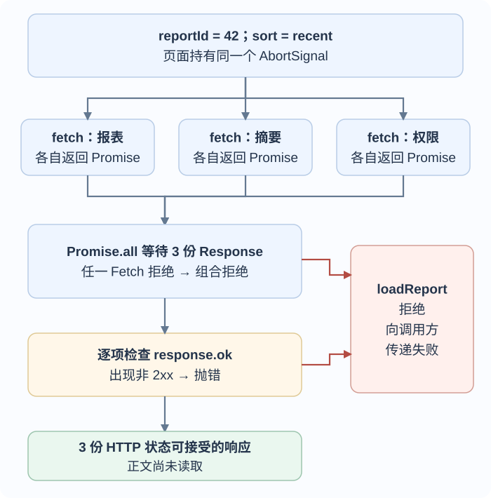
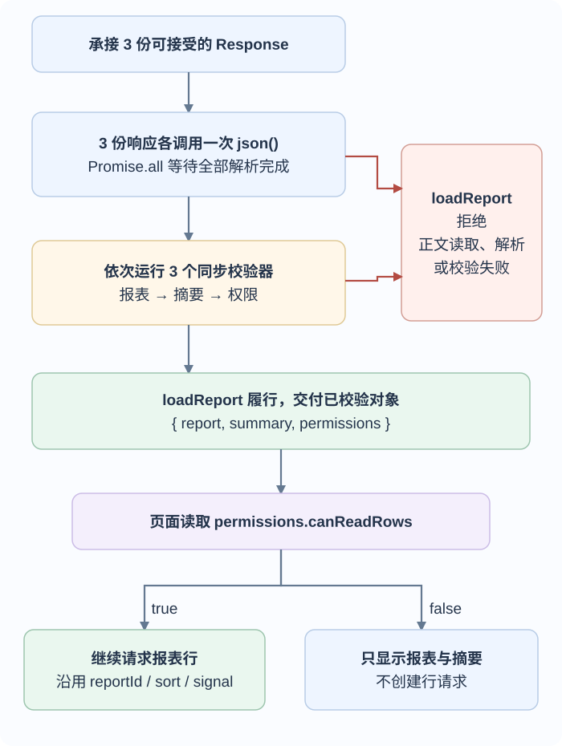

# Promise 和 async 函数怎样传递值和失败？

本章讲异步结果怎样表示成 Promise，怎样沿 `then` 链和 `await` 往下传，又怎样被组合器汇总。本章沿用[主线一的报表页](../browser/from-url-to-interactive-page.md)：用户打开 `/reports/42?sort=recent`，页面要拿到报表、摘要和权限三份可信数据。读者需要知道浏览器有任务和微任务两种队列；Promise 处理器什么时候跑，由[事件循环的微任务检查点](../browser/event-loop-tasks-and-rendering.md)决定。

## 本章要写的请求：报表、摘要和权限

三项数据互相独立，可以同时请求。Fetch API 先交回的是 `Response`（响应对象），正文要另外读取和解析。只有三份响应状态都成功、正文都能解析、内容都通过校验，页面才算拿到一组可信数据。权限结果里的 `canReadRows` 再决定要不要继续读取报表行。

本章最后写出的 `loadReport(reportId, sort, signal)` 要么履行为三份已校验的数据，要么以失败原因拒绝。传进去的 `AbortSignal` 能停住什么，留给[下一章](./cancellation-timeouts-and-concurrency.md)；失败交给哪一层处理，见[错误处理一章](./error-handling-across-layers.md)。

## 回调把后续步骤交给别人调用

callback (回调) 是作为参数交给另一段代码、由那段代码决定何时调用的函数。回调不一定异步：`array.map(fn)` 在当前调用里同步调用 `fn`，Fetch 的完成处理器则稍后才运行。

如果每一步都要等上一步的值，嵌套回调会把成功路径、失败路径和后续动作拆散在好几层函数里：

~~~javascript
readUser(userId, (error, user) => {
  if (error) return handle(error);
  readOrders(user.id, (error, orders) => {
    if (error) return handle(error);
    renderOrders(orders);
  });
});
~~~

Promise 把“将来才有的值或失败原因”变成一个可以传递的对象。后续步骤挂在这个对象上，不必一层层嵌套，失败也能沿同一条链传下去。

## Promise 的状态与执行器时机

Promise 从 pending (待定) 变为 fulfilled (履行) 或 rejected (拒绝) 之一，状态只改变一次；履行或拒绝统称 settled (已结算)。Promise 不带通用的取消命令，也不意味着底层工作在另一个线程运行。

`new Promise(executor)` 在构造时同步调用 executor (执行器)；执行器同步抛错时，这个 Promise 以该异常拒绝。执行器用 `resolve` 和 `reject` 报告结果。通过 `.then()` 注册的处理器总是稍后才运行，不会在注册它的那段同步代码里执行：

~~~javascript
const response = new Promise(resolve => {
  console.log("执行器");
  setTimeout(() => resolve("报表响应已到"), 20);
});

console.log("构造完成");
response.then(value => console.log(value));
// 执行器
// 构造完成
// （约 20 ms 或更久之后）报表响应已到
~~~

20 毫秒只是计时器的最短等待，计时器由宿主提供，不属于语言本身。在浏览器里，Promise 处理器和 `await` 之后的代码作为 microtask (微任务) 排队：当前调用栈清空后，浏览器在微任务检查点把队列逐个跑完。微任务何时插进事件循环、和绘制怎样交错，见[事件循环怎样安排任务、微任务和渲染？](../browser/event-loop-tasks-and-rendering.md)；Node.js 的调度边界不同，见 [Node.js 事件循环阶段与微任务队列如何交互？](../../engineering-foundations/runtime/node-event-loop-and-microtasks.md)。

## then 链怎样决定下一个 Promise

每次调用 `.then()` 都返回一个新 Promise，它的结局由处理器决定：

- 处理器返回普通值，新 Promise 以该值履行；
- 处理器抛出异常，新 Promise 以该异常拒绝；
- 处理器返回 Promise，新 Promise 跟随它的最终结局，这一步叫“采用”；
- 处理器返回 thenable（带 `then` 方法的对象），新 Promise 会调用这个 `then`，看它回调解析函数还是拒绝函数来决定结局。

内建 Promise 也有 `then` 方法，但有一条捷径：`Promise.resolve(p)` 遇到真正的 Promise、且读到 `p.constructor === Promise` 时直接返回 `p`，不经过采用。普通 thenable 没有这条捷径，[组合器一节](#组合器怎样保持输入顺序)会看到它的处理步骤。

`.catch(handler)` 等价于 `.then(undefined, handler)`。拒绝会沿链一路传播，直到遇到拒绝处理器：

~~~javascript
function parseReport(response) {
  if (!response.ok) throw new Error("报表响应 HTTP " + response.status);
  return response.json();
}

fetch("/api/reports/42?sort=recent")
  .then(parseReport)
  .then(validateReport)
  .then(renderReport)
  .catch(showRequestFailure);
~~~

`parseReport`、`validateReport` 或 `renderReport` 抛错，或 `response.json()` 返回的 Promise 拒绝，都会跳过中间步骤到达 `showRequestFailure`。要注意拒绝处理器的返回值：它返回普通值，或返回最终履行的 Promise / thenable，后续链就恢复为成功。所以 `showRequestFailure` 如果返回一段提示文字，调用方会以为请求成功；后续代码若需要知道失败，处理器应重新抛错，或返回调用方约定的失败状态。

`.finally(cleanup)` 无论履行还是拒绝都会运行，回调不接收原来的值或原因。回调返回的普通值被忽略；返回 Promise 或 thenable 时，链会等它结算。清理成功后，原来的值或拒绝原因原样继续传递。只有清理抛错，或返回最终拒绝的 Promise / thenable，清理错误才会取代原结果。`finally` 可以等待异步清理，但不能用返回值改写业务结果：

~~~javascript
Promise.resolve("报表值")
  .finally(() => Promise.resolve("清理结果"))
  .then(console.log); // 报表值

Promise.resolve("报表值")
  .finally(() => { throw new Error("清理失败"); })
  .catch(error => console.log(error.message)); // 清理失败
~~~

## async 函数在哪里暂停

`async function` 把 `then` 链写成顺序代码。调用它时，函数体立即同步执行，直到遇到第一个 `await` 或函数结束；调用总是返回 Promise，即使函数体在第一个 `await` 之前就抛错，调用方拿到的也是一个拒绝的 Promise，而不是同步异常。

`await` 让当前函数暂停，把控制权还给调用者，等被等待的值履行后再继续。即使这个值已经可用，后续代码也要等到之后的某个微任务才继续。被等待的值拒绝时，效果等于在 `await` 处抛错：可以被包围它的 `try/catch` 捕获，否则使函数返回的 Promise 拒绝。

~~~javascript
async function loadUserAndOrders(userId) {
  const user = await getUser(userId);
  const orders = await getOrders(user.id);
  return { user, orders };
}

loadUserAndOrders("u-42")
  .then(({ orders }) => renderOrders(orders))
  .catch(showRequestFailure);
~~~

第二个请求要用第一个请求给出的 `user.id`，所以顺序 `await` 是数据依赖决定的。两个请求互不依赖时，顺序 `await` 会白白等前一个完成，应先启动两项工作再组合，见下面的 `loadReport`。语句级 `finally` 会替换结果、`return p` 与 `return await p` 的差别，属于“谁接住失败”的问题，放在[错误处理一章的 try 语句一节](./error-handling-across-layers.md#try%20语句覆盖哪段控制流)。

## fetch 履行不等于请求成功

Fetch 把一次 HTTP 请求拆成几步，每一步各有自己的“成功”和“失败”。只看 `fetch()` 的 Promise 是否履行，会把 404 当成成功。

| 步骤 | 履行时得到什么 | 什么情况下拒绝 | 调用方还要做什么 |
| --- | --- | --- | --- |
| `fetch(url, { signal })` | 响应头到达后的 `Response`；HTTP 404、500 也照样履行 | 网络错误（包括 CORS 检查失败）；`Response` 交出之前被中止，原因为 `signal.reason` | 检查 `response.ok`，或按接口契约检查 `status` |
| `response.ok` | 状态码在 200–299 时为 `true` | —— | 不是 `true` 时由应用自己抛错 |
| `response.json()` | 读完正文并按 JSON 解析出的值 | 正文读取失败；读取期间被中止；正文不是有效 JSON | 把解析结果当作未知数据 |
| 运行时校验 | 应用接受的数据 | 由应用代码在数据不符时抛错 | 只交出校验后的值 |

中止的时点决定它落在哪一步。`fetch()` 还没履行时中止，Fetch Promise 拒绝；`fetch()` 已经履行、`json()` 还在读正文时中止，`json()` 拒绝；`json()` 已经履行后再中止，不会撤回已解析的值。

最后一步不能交给类型系统。TypeScript 的 `Promise<Report>` 只在编译期约束代码，编译后被擦除，不会检查服务端返回的 JSON；外部数据应先当作 `unknown`，再用运行时校验收窄，见 [TypeScript 能保证什么，外部数据又该怎样验证？](./typescript-guarantees-and-runtime-validation.md)。

## 三项请求一起等：loadReport

调用 `fetch()` 会立即启动请求并返回 Promise。把已经启动的 Promise 交给 `Promise.all`，只是等待它们的结果，不会把请求排进稍后才启动的队列。下图是第一轮等待：三次 `fetch()` 立即发出，`Promise.all` 等三份 `Response` 都到达，代码才检查 HTTP 状态。

走到成功出口时，只得到三份状态可接受的响应，正文还没读。第二轮同时读取三份 JSON，全部解析完成后再运行同步校验器，然后由页面根据权限分支：

~~~javascript
async function loadReport(reportId, sort, signal) {
  const base = "/api/reports/" + encodeURIComponent(reportId);
  const paths = [
    base + "?sort=" + encodeURIComponent(sort),
    base + "/summary",
    base + "/permissions",
  ];

  const responses = await Promise.all(
    paths.map(path => fetch(path, { signal }))
  );

  const failed = responses.find(response => !response.ok);
  if (failed) throw new Error("HTTP " + failed.status);

  const [rawReport, rawSummary, rawPermissions] = await Promise.all(
    responses.map(response => response.json())
  );

  // 三个校验器同步返回已校验值；数据不符时同步抛错。
  return {
    report: validateReport(rawReport),
    summary: validateSummary(rawSummary),
    permissions: validatePermissions(rawPermissions),
  };
}
~~~

按时间顺序看这段代码：

1. 第一轮 `Promise.all` 等三个 Fetch Promise 全部履行。任一项拒绝时，它尽早以该原因拒绝，但不会取消另外两项已经发出的请求。
2. 三份 `Response` 都到达后，代码按输入顺序检查状态。所以即使报表的 404 最先到达，也要等另外两份响应到齐才被发现。有一项不成功就抛错，三份正文都不会读取。
3. 状态都成功后，第二轮同时调用三个 `json()`。任一项解析拒绝，后面的校验都不运行。
4. 三个校验器依次同步返回，或同步抛错。如果把校验器改成 `async` 函数，返回对象里的字段会变成 Promise：外层 `async` 函数不会递归等待普通对象的属性。

本例假设权限接口返回 `{ canReadRows: true }`，这是教学用的合成字段。页面持有中止控制器，在 `await loadReport(...)` 之后按权限分支：

~~~javascript
const controller = new AbortController();
window.addEventListener("pagehide", () => controller.abort(), { once: true });

const data = await loadReport("42", "recent", controller.signal);
if (data.permissions.canReadRows) {
  // 继续读取报表行，见迭代器与生成器一章
} else {
  // 只显示报表和摘要
}
~~~

前端分支只决定要不要继续请求；明细 API 仍须在服务端独立验证调用者的读取权限。三项 Fetch 共用同一个 signal，页面离开时调用 `abort()`，Fetch 按自己的中止规则停止；Promise 组合器不会替页面调用 `abort()`。

## 组合器各在什么时候结束

`Promise.all` 适合“全部必需”。其他需求选其他 combinator (组合器)：

| 方法 | 组合 Promise 何时结束 | 空输入 | 报表页中的用途 |
| --- | --- | --- | --- |
| `Promise.all` | 全部履行才履行，结果数组按输入顺序；任一拒绝就拒绝 | 履行为 `[]` | 报表、摘要和权限都必需 |
| `Promise.allSettled` | 所有输入都结算后履行，每项给出 `status` 和 `value` 或 `reason` | 履行为 `[]` | 每个独立小部件分别显示成功或失败 |
| `Promise.any` | 首个履行就履行；全部拒绝才以 `AggregateError` 拒绝 | 以 `errors` 为空的 `AggregateError` 拒绝 | 多个镜像端点任一成功即可 |
| `Promise.race` | 首个结算的输入决定结果 | 永远 pending | 观察任务和计时器谁先结束 |

四个方法都接收同步 iterable (可迭代对象)，都只决定组合 Promise 何时结算：没赢的、没被等到的输入仍在继续，可能还会产生副作用。传入的若是已经启动的请求，任何组合器都无法限流；要做到“有空槽才发起”，得把任务写成工厂交给[有界并发池](./cancellation-timeouts-and-concurrency.md#有界并发池：五页明细，同时最多两页)。

> [!example] 完成顺序不改变结果位置
> 请求 A 在 20 ms 后履行 `2`，请求 B 在 60 ms 后履行 `5`。A 先完成，但 `Promise.all([A, B])` 给出 `[2, 5]`，相加得 `7`。
>
> 换成 A 在 50 ms 后履行 `10`、B 在 30 ms 后履行 `-12`：这次 B 先完成，结果仍是 `[10, -12]`，相加得 `-2`。任一项拒绝时 `Promise.all` 拒绝，另一项照样继续运行。

## 组合器怎样保持输入顺序

原生组合器同步遍历输入，对每一项调用 `Promise.resolve`，再注册一个记得自己位置的处理器。第二项先结算，它的处理器也只写入第二个位置，所以结果顺序取决于输入顺序，与完成先后无关。

`Promise.resolve` 采用普通 thenable 时分两步：读取 `then` 属性是同步的，调用取到的 `then` 函数则排成一个稍后的 Promise 作业：

~~~javascript
const events = [];
const thenable = {
  get then() {
    events.push("读取 then");
    return resolve => {
      events.push("调用 then");
      resolve("摘要已到");
    };
  },
};

Promise.resolve(thenable).then(value => events.push(value));
events.push("当前同步代码结束");
// 立即：["读取 then", "当前同步代码结束"]
// 随后再依次追加 "调用 then"、"摘要已到"
~~~

下面折叠的实现只用来观察这套最小机制，不能当 polyfill 用：它假设普通内建 `Promise`，不模拟子类构造器、`Symbol.species`，也不防御恶意 thenable。

> [!example]- 教学实现：四个 Promise 组合器
>
> ~~~javascript
> function allTeaching(iterable) {
>   return new Promise((resolve, reject) => {
>     const values = [];
>     let remaining = 1; // 哨兵：同步遍历还没结束
>     let index = 0;
>
>     for (const item of iterable) {
>       const current = index++;
>       remaining++;
>       Promise.resolve(item).then(value => {
>         values[current] = value;
>         if (--remaining === 0) resolve(values);
>       }, reject);
>     }
>
>     if (--remaining === 0) resolve(values);
>   });
> }
>
> function allSettledTeaching(iterable) {
>   return new Promise(resolve => {
>     const results = [];
>     let remaining = 1;
>     let index = 0;
>
>     for (const item of iterable) {
>       const current = index++;
>       remaining++;
>       Promise.resolve(item).then(
>         value => {
>           results[current] = { status: "fulfilled", value };
>           if (--remaining === 0) resolve(results);
>         },
>         reason => {
>           results[current] = { status: "rejected", reason };
>           if (--remaining === 0) resolve(results);
>         }
>       );
>     }
>
>     if (--remaining === 0) resolve(results);
>   });
> }
>
> function anyTeaching(iterable) {
>   return new Promise((resolve, reject) => {
>     const errors = [];
>     let remaining = 1;
>     let index = 0;
>
>     for (const item of iterable) {
>       const current = index++;
>       remaining++;
>       Promise.resolve(item).then(resolve, reason => {
>         errors[current] = reason;
>         if (--remaining === 0) {
>           reject(new AggregateError(errors, "没有输入履行"));
>         }
>       });
>     }
>
>     if (--remaining === 0) {
>       reject(new AggregateError(errors, "没有输入履行"));
>     }
>   });
> }
>
> function raceTeaching(iterable) {
>   return new Promise((resolve, reject) => {
>     for (const item of iterable) {
>       Promise.resolve(item).then(resolve, reject);
>     }
>     // 空输入没有能决定胜负的项，结果保持 pending。
>   });
> }
> ~~~
>
> `remaining` 从 `1` 开始，把“同步遍历还在进行”也算作一个未完成项，防止遍历途中就提前履行。两项 `all` 的计数经历 `1 → 2 → 3`，遍历结束减掉哨兵成为 `2`，两个处理器各减一次，归零时履行。空输入是 `1 → 0`，组合 Promise 当场履行 `[]`，但之后附加的 `.then()` 仍要稍后才运行。`any` 用同一个哨兵等待全部拒绝，并按输入位置登记原因。
>
> 规范里的同步遍历还有几条边界。读取普通 thenable 的 `then` 取值器时抛错，该项变成一个拒绝的 Promise，组合器继续读取后续项。已经取出一项、但处理它时同步抛错（例如已有 Promise 的 `constructor` 取值器抛错），组合 Promise 拒绝，并调用尚未耗尽的迭代器的可选 `return()` 关闭它。内建 Promise 走 `Promise.resolve` 捷径后，组合器仍会在同步遍历中读取并调用它的 `then`。如果是 `iterator.next()` 自己抛错，或读取结果的 `done` / `value` 时抛错，规范把迭代记录标为已完成，组合 Promise 拒绝，但不再调用 `return()`。

## 进阶：多条 Promise 链的处理器怎样交错

推导顺序时，要分清“注册处理器”和“把处理器作业放进队列”：

- 对已履行的 Promise 调用 `.then`，处理器作业立即入队；
- 对待定的 Promise 调用 `.then`，只保存一条 reaction (反应记录)，等它结算才入队；
- 一个作业运行后若使下游 Promise 履行，下游已保存的 reaction 排到队尾。

第一组代码里，两个源 Promise 都已履行，同步代码先把处理器 `0` 和 `2` 排进队列。`0` 运行后，它的下游处理器 `1` 才入队，排在 `2` 后面：

~~~javascript
Promise.resolve().then(() => console.log(0)).then(() => console.log(1));
Promise.resolve().then(() => console.log(2)).then(() => console.log(3));
// 0, 2, 1, 3
~~~

处理器返回 Promise 时，“采用”它要多出两个作业。看这段代码：

~~~javascript
Promise.resolve().then(() => {
  console.log(0);
  return Promise.resolve(4);
}).then(value => console.log(value));

Promise.resolve().then(() => console.log(1))
  .then(() => console.log(2))
  .then(() => console.log(3))
  .then(() => console.log(5))
  .then(() => console.log(6));
// 0, 1, 2, 3, 4, 5, 6
~~~

下表追踪它的微任务队列，最左侧是下一个要运行的作业：

| 步骤 | 动作 | 队列 |
| --- | --- | --- |
| 起始 | 两条链的首个处理器注册在已履行的 Promise 上 | `[输出 0, 输出 1]` |
| 1 | 输出 0 的处理器返回 `Promise.resolve(4)`，解析流程安排采用作业 | `[输出 1, 采用]` |
| 2 | 输出 1 运行，下游处理器入队 | `[采用, 输出 2]` |
| 3 | 采用作业调用所返回 Promise 的 `then`；它已以 `4` 履行，转发作业入队 | `[输出 2, 转发 4]` |
| 4 | 输出 2 运行，输出 3 排到队尾 | `[转发 4, 输出 3]` |
| 5 | 转发作业履行第一条链的下游 Promise，输出 4 才入队 | `[输出 3, 输出 4]` |

所以 `4` 排在 `3` 之后。下面两段再看多条链怎样交错。本节三段代码的输出都在 Node.js v26.13.1（CommonJS）逐段运行得到，原稿在 v26.13.0 得到相同顺序；它们展示的是这些例子里的入队关系，不是跨宿主通用的“第几个 tick”公式：

~~~javascript
Promise.resolve().then(() => console.log(0))
  .then(() => console.log(1)).then(() => console.log(2));
Promise.resolve().then(() => console.log(3))
  .then(() => console.log(4)).then(() => console.log(5));
Promise.resolve().then(() => console.log(6))
  .then(() => console.log(7)).then(() => console.log(8));
// 0, 3, 6, 1, 4, 7, 2, 5, 8
~~~

~~~javascript
Promise.resolve().then(() => {
  console.log(0);
  return Promise.resolve(1);
}).then(() => console.log(2)).then(() => console.log(3));

Promise.resolve().then(() => {
  console.log(4);
  return Promise.resolve(5);
}).then(() => console.log(6)).then(() => console.log(7));
// 0, 4, 2, 6, 3, 7
~~~

最后一段里，两条链各自的“采用”和“转发”交替进行，于是 `2` 和 `6` 都要等两个额外作业。旧的 Promise reaction 顺序练习原页仍在[归档入口](../../archive/front-end/Deprecated_Interview_Notes/promise-reaction-order-exercises.md)。这些顺序只涉及微任务之间；不要把它推成浏览器计时器、绘制和 Promise 之间的固定先后。

## 拿到结果之后：不再需要的请求怎样停下？

本章交出的 `loadReport` 契约是：三项数据全部成功、解析并通过校验才履行；任一步失败就拒绝，但已经启动的其他请求不会因此停下。Promise 只负责传递结果和失败，限流、超时和取消都要另外实现。下一章[取消、超时和并发上限各自停得住什么？](./cancellation-timeouts-and-concurrency.md)从这里接手：`signal` 能让哪些工作停下，`Promise.race` 超时又为什么只是停止等待。`canReadRows` 为真之后怎样逐页读取行，见[迭代器和生成器一章](./iterators-and-generators.md)。

> [!info]- 来源
> - **Promise 状态、执行器、then 链、thenable 采用、`finally`、组合器与 async 函数（全章）。** [ECMAScript 2027 草案（2026-11-08）](https://tc39.es/ecma262/)，核对日期：2026-11-12。异步函数 §15.8，迭代抽象操作 §7.4，Promise §27.5；对应 [Promise 对象](https://tc39.es/ecma262/#sec-promise-objects)、[`Promise.resolve`](https://tc39.es/ecma262/#sec-promise.resolve)、[thenable 采用作业](https://tc39.es/ecma262/#sec-newpromiseresolvethenablejob)、[`Promise.all`](https://tc39.es/ecma262/#sec-promise.all)、[`allSettled`](https://tc39.es/ecma262/#sec-promise.allsettled)、[`any`](https://tc39.es/ecma262/#sec-promise.any)、[`race`](https://tc39.es/ecma262/#sec-promise.race)、[`finally`](https://tc39.es/ecma262/#sec-promise.prototype.finally)、[PerformPromiseThen](https://tc39.es/ecma262/#sec-performpromisethen)、[TriggerPromiseReactions](https://tc39.es/ecma262/#sec-triggerpromisereactions)、[NewPromiseReactionJob](https://tc39.es/ecma262/#sec-newpromisereactionjob)、[IteratorStepValue](https://tc39.es/ecma262/#sec-iteratorstepvalue)、[IteratorClose](https://tc39.es/ecma262/#sec-iteratorclose)、[async function definitions](https://tc39.es/ecma262/#sec-async-function-definitions)。
> - **“Promise 的状态与执行器时机”中的宿主队列。** 浏览器把 Promise 作业放进微任务队列并在检查点运行：[WHATWG HTML §8.1.6.6.4 HostEnqueuePromiseJob](https://html.spec.whatwg.org/multipage/webappapis.html#hostenqueuepromisejob)、[§8.1.7 Event loops](https://html.spec.whatwg.org/multipage/webappapis.html#event-loops)、[Perform a microtask checkpoint](https://html.spec.whatwg.org/multipage/webappapis.html#perform-a-microtask-checkpoint)，Living Standard 更新时间 2026-11-11。计时器最短延迟见 [HTML §8.7 Timers](https://html.spec.whatwg.org/multipage/timers-and-user-prompts.html#timers)。Node.js 的 `process.nextTick()`、`queueMicrotask()` 与 Promise 微任务边界见 [Node.js v26.13.0 Process](https://nodejs.org/download/release/v26.13.0/docs/api/process.html#when-to-use-queuemicrotask-vs-processnexttick)。
> - **“fetch 履行不等于请求成功”表。** [WHATWG Fetch §2.2.6 Responses](https://fetch.spec.whatwg.org/#responses)、[Response.ok](https://fetch.spec.whatwg.org/#dom-response-ok)（200–299）、[§5.3 Body mixin 与 `json()`](https://fetch.spec.whatwg.org/#dom-body-json)、[Main fetch](https://fetch.spec.whatwg.org/#main-fetch)、[§5.5 Abort a fetch](https://fetch.spec.whatwg.org/#abort-fetch)，Living Standard 更新时间 2026-10-19，核对日期 2026-11-12。HTTP 非成功状态仍产生 Response；网络错误与中止使 Fetch Promise 拒绝；中止会使仍在读取的正文出错。
> - **“loadReport”中的页面中止。** [WHATWG DOM §3 Aborting ongoing activities](https://dom.spec.whatwg.org/#aborting-ongoing-activities)，Living Standard 更新时间 2026-11-11：Promise 本身没有内建中止，API 自行选择是否接受 `AbortSignal`。
> - **TypeScript 类型擦除一句。** [TypeScript Handbook：Erased Types](https://www.typescriptlang.org/docs/handbook/2/basic-types.html#erased-types)，访问日期 2026-11-12。
> - **“进阶：多条 Promise 链的处理器怎样交错”输出与本章其他示例输出。** 原稿在 Node.js v26.13.0 运行；本次在 Node.js v26.13.1（ESM 与 CommonJS 顺序一致）重跑四段交错代码、thenable 取值时序、`finally` 结果传递和空输入组合器，结果相同。
