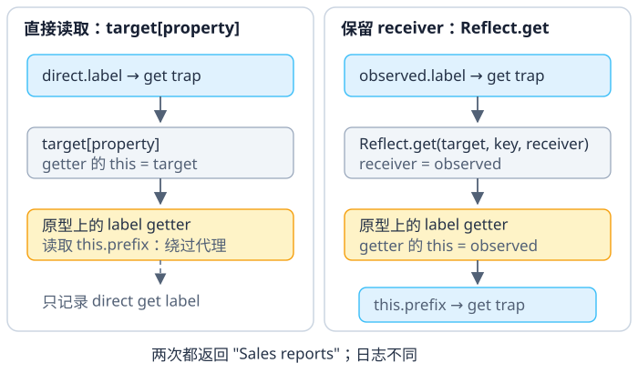

# Proxy 能拦截什么，又在哪里拦不住？

`new Proxy(target, handler)` 创建一个 Proxy（代理对象），让你在读、写、删、枚举、调用、构造这些对象操作上插入自己的逻辑：记录、校验、改写或拒绝。本章先说明 Proxy 拦的是哪一层的操作，再用报表服务的例子看 receiver（接收者）怎样决定 getter 的 `this` 和写入落点，最后列出它拦不住的地方：内部槽、私有字段、trap 结果的不变量、绕过代理的原始引用。读者需要先知道属性沿原型链查找、getter/setter 以接收者为 `this`（见[读写一个属性时，JavaScript 沿什么规则查找、落在哪里？](./objects-properties-and-prototypes.md)）。

## Proxy 把内部方法交给 trap

JavaScript 的读取、赋值、删除等操作，在规范里都落到对象的 internal method（内部方法）上，例如读属性对应 `[[Get]]`。Proxy 执行某个内部方法时，会在 handler 上查找规范规定的同名方法，这类方法叫 trap（拦截方法）：

- 找到可调用的 trap：调用它，由它观察、改写或拒绝这次操作；
- 该属性是 `undefined` 或 `null`：把同一个内部操作原样转发给 target；
- 该属性是 `0` 之类不可调用的其他值：抛 `TypeError`。

规范给 Proxy 定义了 13 个内部方法，一一对应 13 个 trap：

| 常见操作 | trap |
| --- | --- |
| `Object.getPrototypeOf(obj)` / `Object.setPrototypeOf(obj, proto)` | `getPrototypeOf` / `setPrototypeOf` |
| `Object.isExtensible(obj)` / `Object.preventExtensions(obj)` | `isExtensible` / `preventExtensions` |
| `Object.getOwnPropertyDescriptor(obj, key)` / `Object.defineProperty(obj, key, desc)` | `getOwnPropertyDescriptor` / `defineProperty` |
| `key in obj` / `obj[key]` / `obj[key] = value` / `delete obj[key]` | `has` / `get` / `set` / `deleteProperty` |
| `Reflect.ownKeys(obj)` | `ownKeys` |
| `fn()` / `new fn()` | `apply` / `construct` |

日常 API 常组合多个内部方法：`Object.keys()` 先取全部键（`ownKeys`），再逐个查描述符（`getOwnPropertyDescriptor`）；`Object.freeze()` 也组合了多步。所以只在一个 trap 里记录或校验，不能断定整个高层操作都经过了检查。

## Reflect：按内部方法原样转发

Reflect（反射 API）有 13 个函数，名字和参数与 13 个 trap 一一对应，例如 `Reflect.get(target, key, receiver)` 就是对 `target` 执行 `[[Get]]`。trap 里通常用它把操作转发给 target，只在需要的地方加逻辑。`Reflect.set`、`Reflect.defineProperty` 返回布尔值表示成功与否，而不是抛错，正好对上 trap 的返回约定。

读写属性的 trap 和 Reflect 函数都带一个 `receiver` 参数，它决定 getter/setter 里的 `this`，以及赋值最终落在哪个对象上。`Reflect.get` / `Reflect.set` 省略它时默认用 target，不会自动猜出原来的代理。下一节的差别全部来自这一点。

## receiver 决定 getter 的 this 和写入落点

沿用主线一的报表页。报表服务实例 `service` 有自有属性 `prefix = "Sales"`，原型上的 `label` 访问器读写 `this.prefix`：getter 返回 `this.prefix + " reports"`，setter 执行 `this.prefix = value`。我们想记录外部对它的读写，也想看到 getter 内部又读了什么。为此用两个 Proxy 包装同一个实例，`get` trap 都先打印属性名，区别只在转发方式：

- `direct` 直接求值 `target[property]`，写入用 `Reflect.set(target, property, value)`，都不传 receiver；
- `observed` 用 `Reflect.get(target, property, receiver)` 和 `Reflect.set(target, property, value, receiver)`。

### 读取：getter 的 this 跟着 receiver 走

从 `observed.label` 到 getter 经过这几步：

1. 普通属性表达式 `obj[key]` 对 `obj` 调用 `obj.[[Get]](key, obj)`，`obj` 就是这次的 receiver。
2. `obj` 是 Proxy，`observed.[[Get]]("label", observed)` 找到 `handler.get`，传入 target、键和 receiver。没有 trap 时，Proxy 执行 `target.[[Get]]("label", observed)`，同样把 receiver 传下去。
3. trap 调用 `Reflect.get(target, "label", observed)`。target 没有自有 `label`，沿原型找到 getter，并以 receiver `observed` 为 getter 的 `this`。
4. getter 里的 `this.prefix` 是一次新读取。`this` 是 `observed`，所以又经过代理，记录 `get prefix`。

`direct.label` 同样以 `direct` 为 receiver 进入 trap，但 trap 里的 `target[property]` 是一次从 target 开始的全新读取，receiver 和 getter 的 `this` 都成了 target，所以只记录 `direct get label`。两者都返回 `"Sales reports"`，区别在日志和后续读取路径。

### 写入：值落在 receiver 上

赋值有对称的路径：`obj[key] = value` 从 `obj.[[Set]](key, value, obj)` 开始，`set` trap 收到 target、键、值和 receiver。沿原型找到 setter 时，setter 的 `this` 是 receiver；找到可写数据属性时，赋值在 **receiver** 上更新或新建自有属性（前提是 receiver 已有的描述符和可扩展性允许）。所以 trap 收到的 `target` 参数不能说明值最终写到哪个对象。

按顺序做三次写入：

1. **`observed.prefix = "Ops"`。** receiver 是代理本身。`Reflect.set` 在 target 上找到可写的 `prefix`，接着查询 receiver 的自有描述符、在 receiver 上定义属性；handler 没有 `getOwnPropertyDescriptor` 和 `defineProperty` trap，这两步又被转发给 `service`，所以最终改的是 `service.prefix`。
2. **`observedChild.label = "Branch"`，其中 `observedChild = Object.create(observed)`。** 子对象自己没有 `label`，赋值沿原型进入代理，receiver 是子对象。`Reflect.set` 转发后，继承来的 setter 以子对象为 `this`；setter 里的 `this.prefix = value` 也沿原型经过代理，最终由 `Reflect.set` 在子对象上新建自有 `prefix`，target 仍是 `"Ops"`。之后读子对象的 `label`，getter 的 `this` 仍是子对象，但 `this.prefix` 命中它自己的键，不再经过代理。
3. **`directChild.label = "West"`，其中 `directChild = Object.create(direct)`。** `direct` 的 `set` trap 省略了 receiver，默认用 target：setter 把 target 的 `prefix` 改成 `"West"`，子对象没有新建这个键。

| 按顺序操作 | 子对象有自己的 `prefix` 吗 | 此时 `service.prefix` | 读子对象的 `label` |
|---|---|---|---|
| `observedChild.label = "Branch"` | 有，`"Branch"` | `"Ops"` | `"Branch reports"` |
| `directChild.label = "West"` | 没有 | `"West"` | `"West reports"` |

### 方法调用，以及绕过代理的引用

服务实例上的 `onReport` 由工厂函数创建：每次调用先把闭包里的计数加一，再调用 `this.format` 拼出结果。`observed.onReport(...)` 是方法调用：`get` trap 取出处理器后，调用以 `observed` 为 `this`；处理器读 `this.format` 记录 `get format`，`format` 读 `this.prefix` 记录 `get prefix`。即使 trap 改用 `target[property]` 取出方法，调用表达式仍以 `observed` 为 `this`。

三条边界：

- 代码若保留了原始 `service` 引用，经它进行的操作完全绕过代理。代理有独立身份，`observed !== service`。
- 从对象代理取出的是原函数本身；`apply` trap 只在被调用的函数**本身**是 Proxy 时介入（trap 内用 `Reflect.apply(target, thisArg, args)` 转发）。
- Proxy 是运行时特性，TypeScript 的类型系统看不到这些拦截。

> [!example]- 完整代码：对照属性读取、子对象写入和方法日志
> 从 `Sales` 开始：先调用报表方法得到 `Sales/daily: May #1`，改成 `Ops` 后再调用得到 `Ops/daily: May #2`，最后依次做上表两次子对象写入。全部代码共用同一个实例，按顺序运行。
>
> ~~~javascript
> function makeReportHandler(tag) {
>   let calls = 0;
>   return function onReport(report) {
>     "use strict";
>     calls += 1;
>     return this.format(report, tag, calls);
>   };
> }
>
> function ReportService(prefix) {
>   this.prefix = prefix;
>   this.onReport = makeReportHandler("daily");
> }
>
> ReportService.prototype.format = function (report, tag, sequence) {
>   return this.prefix + "/" + tag + ": " + report.title + " #" + sequence;
> };
>
> Object.defineProperty(ReportService.prototype, "label", {
>   configurable: true,
>   get() {
>     return this.prefix + " reports";
>   },
>   set(value) {
>     this.prefix = value;
>   },
> });
>
> const service = new ReportService("Sales");
> const direct = new Proxy(service, {
>   get(target, property) {
>     console.log("direct get", String(property));
>     return target[property];
>   },
>   set(target, property, value) {
>     console.log("direct set", String(property));
>     return Reflect.set(target, property, value);
>   },
> });
>
> const observed = new Proxy(service, {
>   get(target, property, receiver) {
>     console.log("get", String(property));
>     return Reflect.get(target, property, receiver);
>   },
>   set(target, property, value, receiver) {
>     console.log("set", String(property));
>     if (property === "prefix" && typeof value !== "string") {
>       throw new TypeError("prefix must be a string");
>     }
>     return Reflect.set(target, property, value, receiver);
>   },
> });
>
> console.log("direct.label =", direct.label);
> // 记录 direct get label；输出 "Sales reports"，getter 的 this 是 target
>
> console.log("observed.label =", observed.label);
> // 记录 get label、get prefix；输出 "Sales reports"，getter 的 this 是 observed
>
> console.log("report =", observed.onReport({ title: "May" }));
> // 记录 get onReport、get format、get prefix；输出 "Sales/daily: May #1"
>
> observed.prefix = "Ops"; // 记录 set prefix
> console.log("observed.prefix =", observed.prefix); // 记录 get prefix；输出 "Ops"
> console.log("report =", observed.onReport({ title: "May" })); // "Ops/daily: May #2"
> console.log("separate identity =", observed !== service); // true
>
> const observedChild = Object.create(observed);
> observedChild.label = "Branch"; // 记录 set label、set prefix
> console.log("observed child =", observedChild.label,
>   Object.hasOwn(observedChild, "prefix"), service.prefix);
> // 记录 get label；结果为 "Branch reports"、true、"Ops"
>
> const directChild = Object.create(direct);
> directChild.label = "West"; // 记录 direct set label
> console.log("direct child =", directChild.label,
>   Object.hasOwn(directChild, "prefix"), service.prefix);
> // 记录 direct get label；结果为 "West reports"、false、"West"
> console.log("Reflect.get default receiver =", Reflect.get(service, "label"));
> // receiver 省略时用 target，输出 "West reports"
> ~~~

## 内部槽和私有字段拦不住

上面的方法以代理为 `this` 能正常工作，是因为方法内部只做普通属性读取。依赖只有原对象才有的内部状态的方法则会失败。

`Map.prototype.get` 要求 `this` 带有 `[[MapData]]` internal slot（内部槽）。包住 Map 的 Proxy 没有 target 的内部槽，所以即使 `Reflect.get` 正确取到了方法，方法以 Proxy 为 `this` 执行时仍抛 `TypeError`：

~~~javascript
const originalMap = new Map([["May", 5]]);
const proxiedMap = new Proxy(originalMap, {
  get(target, property, receiver) {
    return Reflect.get(target, property, receiver);
  },
});

originalMap.get("May"); // 5
try {
  proxiedMap.get("May");
} catch (error) {
  error.name; // "TypeError"：代理没有 [[MapData]]
}
~~~

class private field（私有字段）类似。它不是字符串或 Symbol 键属性，`this.#id` 不触发 `get` trap，而是直接在 `this` 指向的对象上查私有元素；Proxy 没有原实例的私有元素，于是抛 `TypeError`：

~~~javascript
class PrivateReport {
  #id = 7;
  readId() { return this.#id; }
}

const rawReport = new PrivateReport();
const proxyReport = new Proxy(rawReport, {
  get(target, property, receiver) {
    console.log("get", String(property));
    return Reflect.get(target, property, receiver);
  },
});

rawReport.readId(); // 7
try {
  proxyReport.readId();
} catch (error) {
  error.name; // 记录 get readId 后抛 "TypeError"；没有 get #id
}
~~~

把所有方法绑定到 target 不是通用修复：绑定改变了方法的 `this`，方法里的普通读写也因此绕开代理。被代理的内建对象行为是否不变，要按具体 API 的 `this` 语义逐个设计。

## trap 的结果受不变量约束

trap 可以自己决定结果，但规范会检查这个结果。

`set` 的返回值被转成布尔值，`false` 表示赋值失败：非严格模式下静默失败，严格模式下抛 `TypeError`。`true` 只表示 trap **报告**成功，不证明它真的写了：

~~~javascript
const rejected = new Proxy({ prefix: "Sales" }, {
  set() { return false; },
});
Reflect.set(rejected, "prefix", "Ops"); // false
rejected.prefix;                        // "Sales"
(function () {
  "use strict";
  try {
    rejected.prefix = "Ops";
  } catch (error) {
    error.name; // "TypeError"：严格赋值不接受 false
  }
})();

const reportedTarget = { label: "Sales" };
const reportedOnly = new Proxy(reportedTarget, {
  set() { return true; },
});
Reflect.set(reportedOnly, "label", "Ops"); // true
reportedTarget.label;                      // "Sales"：trap 没有写入
~~~

后一种“报告成功却没写”之所以被接受，是因为 `label` 可配置。Proxy invariant（代理不变量）禁止 trap 对 target 上已经固定的**自有**属性报告矛盾的结果，违反就抛 `TypeError`：

| trap | 约束 |
|---|---|
| `get` | 不可配置且不可写的自有数据属性，只能返回它的固定值；不可配置且没有 getter 的访问器，只能返回 `undefined` |
| `set` | 对不可配置且不可写的数据属性报告 `true` 时，写入值必须与固定值满足 `SameValue`；不可配置且没有 setter 的访问器，不能报告成功 |
| `ownKeys` | target 不可扩展时，必须给出完全相同的一组自有键（包括可配置的键），顺序可以不同 |

`SameValue` 是规范里三种相等规则之一，见[JavaScript 的值有哪些类型，“相等”又有几种？](./values-types-and-equality.md)。

~~~javascript
const fixed = Object.freeze({ id: 7 });
const inconsistent = new Proxy(fixed, {
  get(target, property, receiver) {
    if (property === "id") return 8;
    return Reflect.get(target, property, receiver);
  },
});
try { inconsistent.id; } catch (error) { error.name; } // "TypeError"：不能用 8 代替 7

const reportsSet = new Proxy(Object.freeze({ id: 7 }), { set() { return true; } });
Reflect.set(reportsSet, "id", 7); // true：与固定值相同
try { Reflect.set(reportsSet, "id", 8); } catch (error) { error.name; } // "TypeError"

const noSetter = Object.defineProperty({}, "id", {
  get() { return 7; }, configurable: false,
});
const reportsNoSetter = new Proxy(noSetter, { set() { return true; } });
try { Reflect.set(reportsNoSetter, "id", 8); } catch (error) { error.name; } // "TypeError"

const closedTarget = Object.preventExtensions({ id: 7, note: 8 });
const missingKey = new Proxy(closedTarget, { ownKeys() { return ["id"]; } });
try { Reflect.ownKeys(missingKey); } catch (error) { error.name; } // "TypeError"：漏掉 note
~~~

## 一次高层操作可能经过多个 trap

`array.push(value)` 会读方法、读当前长度，再写索引、更新 `length`：

~~~javascript
const events = [];
const values = new Proxy([], {
  get(target, property, receiver) {
    events.push(`get ${String(property)}`);
    return Reflect.get(target, property, receiver);
  },
  set(target, property, value, receiver) {
    events.push(`set ${String(property)}=${value}`);
    return Reflect.set(target, property, value, receiver);
  },
});

values.push("new");
events.join(" | "); // "get push | get length | set 0=new | set length=1"
~~~

所以用 Proxy 做校验，要先问这条校验覆盖了哪些写入入口。下面的产品价格从 `10` 改为 `12`，负值在转发前被拒绝；但 `Object.defineProperty` 走 `[[DefineOwnProperty]]`，没有 `defineProperty` trap 时直接转发给 target，不经过 `set`：

~~~javascript
const product = new Proxy({ price: 10 }, {
  get(target, property, receiver) {
    console.log("read", String(property));
    return Reflect.get(target, property, receiver);
  },
  set(target, property, value, receiver) {
    console.log("write", String(property));
    if (property === "price" && (!Number.isFinite(value) || value < 0)) {
      throw new RangeError("price must be a non-negative finite number");
    }
    return Reflect.set(target, property, value, receiver);
  },
});

product.price = 12; // 记录 write price
product.price;      // 记录 read price；12
try {
  product.price = -1;
} catch (error) {
  console.log(error.name, product.price); // "RangeError" 12：无效值未写入
}

Object.defineProperty(product, "price", { value: -1 });
product.price; // -1：校验只覆盖了赋值路径
~~~

要完整守住一个属性，`set`、`defineProperty`（必要时还有 `deleteProperty`）都要拦，而且不能把原始 target 引用交给别人。

## 函数代理保留调用与构造能力

Proxy 的 target 和 handler 只要求是对象，所以函数也能被代理：target 可调用，代理就可调用；target 可构造，代理就可构造，`construct` trap 必须返回对象。`new` 的完整步骤见[new 一个对象时发生了什么？](./construction-and-new.md)；这里要点是 trap 必须把 `newTarget` 一起转发。

~~~javascript
function ReportFactory(prefix) {
  this.prefix = prefix;
}

const tracedFactory = new Proxy(ReportFactory, {
  construct(target, args, newTarget) {
    console.log("construct", args[0]);
    return Reflect.construct(target, args, newTarget);
  },
});

class RegionalReport extends tracedFactory {}
const created = new RegionalReport("Finance"); // 记录 construct Finance
created instanceof RegionalReport; // true
created instanceof ReportFactory;  // true

const arrowProxy = new Proxy(() => {}, {
  construct() { return {}; },
});
try {
  new arrowProxy();
} catch (error) {
  error.name; // "TypeError"：Proxy 不会让箭头函数变成构造器
}
~~~

转发了 `newTarget`，`ReportFactory` 里的 `new.target` 就是 `RegionalReport`，实例从 `RegionalReport.prototype` 创建，所以同时属于两个类。若 trap 写成 `Reflect.construct(target, args)` 漏传 `newTarget`，对象仍是 `ReportFactory` 的实例，却不再是 `RegionalReport` 的实例。Proxy 只保留 target 原有的能力：给箭头函数写 `construct` trap 也不能让它可构造。

## 实例：Vue 2 与 Vue 3 的响应式

> [!info] 版本
> Vue 2 已于 2023 年底停止维护，仍见于旧项目；Vue 3 按官方文档。

Vue 的响应式实现可以用“操作是否经过拦截路径”来理解：

- **Vue 2** 在初始化时为已有属性安装 getter/setter。之后直接给对象新增属性（例如给筛选条件对象加一个新键），不经过任何 setter，也就不被追踪，需要用 `Vue.set` 之类的 API 添加响应式属性。
- **Vue 3** 的 `reactive()` 改用 Proxy：读取时经 `get` 等 trap 记录依赖；经代理且值确实变化的写入触发相关依赖，新键赋值也经过 trap。但绕过代理直接改原对象时，数据变了，这次更新却不会被触发——正是上文“原始引用绕过代理”的边界。`ref.value` 仍通过 getter/setter 工作。

这是框架选择的操作路径，不是所有应用都要照搬。

## 访问器还是 Proxy

本章的结论：Proxy 拦的是 13 个内部方法，`Reflect` 按同样的签名原样转发；带上 receiver 转发，getter 的 `this` 和写入落点才跟着调用者走。它拦不住内部槽和私有字段，trap 的结果受不变量约束，一次高层操作可能经过多个 trap，而保留下来的原始 target 引用完全绕过它。

所以选择时：属性集合固定、读写契约稳定，用访问器就够；需要拦截事先不知道的键或整类操作（例如校验后来新增的键、记录一组属性访问）时再用 Proxy，并确认所有写入入口都经过代理。Proxy 只在运行时起作用，TypeScript 看不到它；类型能保证什么、运行时数据又该怎样验证，见[TypeScript 能保证什么，外部数据又该怎样验证？](./typescript-guarantees-and-runtime-validation.md)。

> [!info]- 来源
> - trap 分发、receiver 转发、13 个内部方法与 `set` / `get` / `ownKeys` 不变量（“Proxy 把内部方法交给 trap”“trap 的结果受不变量约束”）：[ECMAScript 2026 Proxy Object Internal Methods and Internal Slots](https://tc39.es/ecma262/2026/multipage/ordinary-and-exotic-objects-behaviours.html#sec-proxy-object-internal-methods-and-internal-slots)（§10.5）；内部方法的一般约束：[Invariants of the Essential Internal Methods](https://tc39.es/ecma262/2026/multipage/ecmascript-data-types-and-values.html#sec-invariants-of-the-essential-internal-methods)（§6.1.7.3）。
> - 属性读写进入内部方法、receiver 沿原型传递（“receiver 决定 getter 的 this 和写入落点”）：[ECMAScript 2026 GetValue](https://tc39.es/ecma262/2026/multipage/ecmascript-data-types-and-values.html#sec-getvalue)（§6.2.5.5）、[PutValue](https://tc39.es/ecma262/2026/multipage/ecmascript-data-types-and-values.html#sec-putvalue)（§6.2.5.6）、[OrdinaryGet](https://tc39.es/ecma262/2026/multipage/ordinary-and-exotic-objects-behaviours.html#sec-ordinaryget)（§10.1.8.1）、[OrdinarySetWithOwnDescriptor](https://tc39.es/ecma262/2026/multipage/ordinary-and-exotic-objects-behaviours.html#sec-ordinarysetwithowndescriptor)（§10.1.9.2）。
> - Reflect 的 receiver 默认值与构造转发（“Reflect：按内部方法原样转发”“函数代理保留调用与构造能力”）：[ECMAScript 2026 Reflect](https://tc39.es/ecma262/2026/multipage/reflection.html#sec-reflection)（§28.1，含 `Reflect.get`、`Reflect.set`、`Reflect.construct`）。
> - Map 内部槽与私有元素访问（“内部槽和私有字段拦不住”）：[ECMAScript 2026 Map.prototype.get](https://tc39.es/ecma262/2026/multipage/keyed-collections.html#sec-map.prototype.get)（§24.1.3.6）、[PrivateGet](https://tc39.es/ecma262/2026/multipage/abstract-operations.html#sec-privateget)（§7.3.30）。
> - Vue 实例（“实例：Vue 2 与 Vue 3 的响应式”）：Vue 2 新增属性限制 [Change Detection Caveats](https://v2.vuejs.org/v2/guide/reactivity.html#Change-Detection-Caveats)；Vue 3 代理读写与原对象边界 [Reactivity in Depth](https://vuejs.org/guide/extras/reactivity-in-depth.html#how-reactivity-works-in-vue)、[Reactive Proxy vs. Original](https://vuejs.org/guide/essentials/reactivity-fundamentals.html#reactive-proxy-vs-original)。
> - 本章各代码块的日志与结果在 Node.js 26.13.1 上复跑核对。
