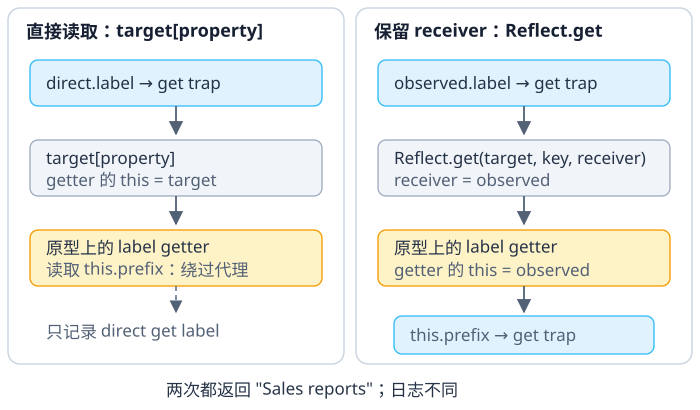

# JavaScript 的 `Proxy` 如何拦截对象操作？

Proxy（代理对象）把 target（目标对象）与 handler（处理器）配对。对象内部方法（internal method）执行读取、赋值等操作；只有规范指定名称的 handler 方法（例如 `get`、`set`）才是相应 trap（拦截方法）。有 trap 时它可以观察或改变操作，没有时代理把同一内部操作交给 target。Reflect（反射 API）可显式转发内部操作；需要保留 receiver（接收者）时必须传入它，省略时默认用 target。Trap 的结果还受代理不变量约束。查到对应 handler 属性为 `undefined` 或 `null` 时才走默认转发；若它是 `0` 之类不可调用的其他值，则抛出 `TypeError`。

常用操作与 trap 的对应关系如下：

| 操作 | handler trap |
| --- | --- |
| `Object.getPrototypeOf(obj)` / `Object.setPrototypeOf(obj, proto)` | `getPrototypeOf` / `setPrototypeOf` |
| `Object.isExtensible(obj)` / `Object.preventExtensions(obj)` | `isExtensible` / `preventExtensions` |
| `Object.getOwnPropertyDescriptor(obj, key)` / `Object.defineProperty(obj, key, descriptor)` | `getOwnPropertyDescriptor` / `defineProperty` |
| `key in obj` / `obj[key]` / `obj[key] = value` / `delete obj[key]` | `has` / `get` / `set` / `deleteProperty` |
| `Reflect.ownKeys(obj)` | `ownKeys` |
| `fn()` / `new fn()` | `apply` / `construct` |

这些 trap 对应规范列出的 13 种代理内部方法；未提供相应 trap 时，操作转发给 target。`Object.keys()` 会先取键再查询属性描述符，`Object.freeze()` 也会组合多个操作，因此不能只记录一个 trap 就断定高层操作全部经过检查。

## 报表处理器只观察经过代理的操作

案例背景：一个合成报表服务实例 `service` 保存 `prefix = "Sales"`，原型上的 `label` getter 返回 `this.prefix + " reports"`。我们希望记录外部读取，同时看见 getter 内部又读了什么。为此，用 `direct` 和 `observed` 两个 Proxy 包装同一个实例：二者先记下属性名，`direct` 再通过 `target[property]` 读取，`observed` 则用 `Reflect.get(target, property, receiver)` 转发。先只比较最初的 `label` 读取，实例尚未发生写入。

从 `observed.label` 到 getter 有几层不同的操作：

1. 求值普通属性表达式 `obj[key]` 时，语言对这个 base 对象调用 `obj.[[Get]](key, obj)`；这里的 `[[Get]]` 是对象内部方法，`obj` 是这次调用的 receiver。
2. 因为 base 是 Proxy，`observed.[[Get]]("label", observed)` 会查找规范指定的 `handler.get`。有 trap 时它收到 `target`、键和 receiver；没有 trap 时，Proxy 内部方法执行 `target.[[Get]]("label", observed)`，仍把同一个 receiver 传下去。
3. 本例的 `get` trap 调用 `Reflect.get(target, property, receiver)`，明确将 receiver 传给 target 的 `[[Get]]`。普通 target 查不到自有 `label` 描述符，就沿原型继续查找，并把 receiver 保持为 `observed`；找到 getter 后以 receiver 作为 getter 的 `this`。
4. getter 中的 `this.prefix` 是一次新的属性读取。此时 `this` 为 `observed`，所以新的 `[[Get]]` 又经过代理，记录 `get prefix`。

普通表达式 `direct.label` 先以 `direct` 为 receiver 进入 Proxy；trap 内直接求值 `target[property]` 才从 target 开始一笔新读取，因此这次读取的 receiver 与 getter 的 `this` 都是 target，只记录 `direct get label`。在这个例子里 `observed.label` 和 `direct.label` 都返回 `Sales reports`，区别是日志和后续读取路径。`Reflect.get(target, property)` 若省略第三个参数，receiver 默认为 target；它不会自动猜测原来的代理。

赋值也有对称的接收者通路：`obj[key] = value` 开始于 `obj.[[Set]](key, value, obj)`；Proxy 的 `set` trap 收到 `target`、键、值和 receiver。没有 trap 时代理将同一个 receiver 交给 target 的 `[[Set]]`，而 `Reflect.set(target, key, value, receiver)` 也会显式传递它。若沿原型找到 setter，setter 的 `this` 是 receiver；若找到可写数据属性，普通赋值会在 receiver 上更新或新建自有属性（还要满足接收者描述符和可扩展性约束）。所以看到 trap 的 `target` 参数，不能据此判断最终写入位置。省略 `Reflect.set` 的第四个参数时 receiver 默认是 target。

继续这个实例，先经 `observed.prefix = "Ops"` 改变前缀。这里 receiver 是代理：`Reflect.set` 找到 target 上可写的 `prefix` 数据属性后，会查询 receiver 的自有描述符，并在 receiver 上执行属性定义。本例没有 `getOwnPropertyDescriptor` 或 `defineProperty` trap，这两步又默认转发给 `service`，所以最终改变的是 `service.prefix`。后面换成普通子对象作为 receiver 时，定义才留在子对象本身。

`label` 还有一个 setter，执行 `this.prefix = value`。创建 `observedChild = Object.create(observed)` 后，子对象最初没有自己的 `prefix`；给它的 `label` 赋值 `"Branch"` 时，代理收到子对象作为 receiver。Reflect 转发后，继承 setter 的 `this` 是子对象，setter 的 `this.prefix` 写入又经过代理，Reflect.set 在子对象上创建自有 `prefix`，target 保持 `"Ops"`。再读子对象的 getter 时 `this` 仍是子对象，但 `this.prefix` 命中它自己的键，所以这次内部读取不再经过代理。

相对地，另建 `directChild = Object.create(direct)` 并给它的 `label` 赋值 `"West"`。这里 `direct` 的 set trap 用 `Reflect.set(target, key, value)`，省略 receiver，默认接收者就是 target：setter 将 target 的 `prefix` 改成 `"West"`，`directChild` 没有新建该键。

| 按上述顺序操作 | 子对象有自己的 `prefix` 吗？ | 此时 `service.prefix` | 读子对象 `label` |
|---|---|---|---|
| `observedChild.label = "Branch"` | 有，值为 `"Branch"` | `"Ops"` | `"Branch reports"` |
| `directChild.label = "West"` | 没有 | `"West"` | `"West reports"` |

方法调用又是另一条路径。服务的 `onReport` 方法会递增闭包计数，再调用 `this.format`，用前缀、`daily` 标签、报表标题和次数拼出结果。`observed.onReport(...)` 是方法调用，返回的处理器以 `observed` 为 `this`；它读取 `this.format` 时触发 `get format`，`format` 再读取 `this.prefix` 时触发 `get prefix`。即使 `observed` 的 trap 改用直接的 `target[property]` 返回这个方法，调用表达式仍会把 `observed` 作为 `this`。若代码保留原始 `service` 引用，就能绕过代理。代理也有独立身份：`observed !== service`。这里从对象代理取出的是原函数；`apply` trap 只有在被调用的函数本身也是 Proxy 时才介入，可用 `Reflect.apply(target, thisArg, args)` 转发调用。Proxy 是 JavaScript 运行时对象特性，不是 TypeScript 类型特性。

> [!example]- 完整报表服务：对照属性读取、子对象写入和方法日志
> 完整代码从 `Sales` 开始；先调用报表方法得到 `Sales/daily: Q4 #1`，改成 `Ops` 后再次调用得到 `Ops/daily: Q4 #2`，最后依次执行上表两个子对象写入。下面的全部代码共用同一个实例；按这个顺序运行，输出与前面的各阶段对应。
>
> ~~~javascript
> function makeReportHandler(tag) {
>   let calls = 0;
>   return function onReport(report) {
>     "use strict";
>     calls += 1;
>     return this.format(report, tag, calls);
>   };
> }
>
> function ReportService(prefix) {
>   this.prefix = prefix;
>   this.onReport = makeReportHandler("daily");
> }
>
> ReportService.prototype.format = function (report, tag, sequence) {
>   return this.prefix + "/" + tag + ": " + report.title + " #" + sequence;
> };
>
> Object.defineProperty(ReportService.prototype, "label", {
>   configurable: true,
>   get() {
>     return this.prefix + " reports";
>   },
>   set(value) {
>     this.prefix = value;
>   },
> });
>
> const service = new ReportService("Sales");
> const direct = new Proxy(service, {
>   get(target, property) {
>     console.log("direct get", String(property));
>     return target[property];
>   },
>   set(target, property, value) {
>     console.log("direct set", String(property));
>     return Reflect.set(target, property, value);
>   },
> });
>
> const observed = new Proxy(service, {
>   get(target, property, receiver) {
>     console.log("get", String(property));
>     return Reflect.get(target, property, receiver);
>   },
>   set(target, property, value, receiver) {
>     console.log("set", String(property));
>     if (property === "prefix" && typeof value !== "string") {
>       throw new TypeError("prefix must be a string");
>     }
>     return Reflect.set(target, property, value, receiver);
>   },
> });
>
> console.log("direct.label =", direct.label);
> // 记录 direct get label；输出 "Sales reports"，getter 的 this 是 target
>
> console.log("observed.label =", observed.label);
> // 记录 get label、get prefix；输出 "Sales reports"，getter 的 this 是 observed
>
> console.log("report =", observed.onReport({ title: "Q4" }));
> // 记录 get onReport、get format、get prefix；输出 "Sales/daily: Q4 #1"
>
> observed.prefix = "Ops"; // 记录 set prefix
> console.log("observed.prefix =", observed.prefix); // 再记录 get prefix；输出 "Ops"
> console.log("report =", observed.onReport({ title: "Q4" })); // "Ops/daily: Q4 #2"
> console.log("separate identity =", observed !== service); // true
>
> const observedChild = Object.create(observed);
> observedChild.label = "Branch";
> console.log("observed child =", observedChild.label,
>   Object.hasOwn(observedChild, "prefix"), service.prefix);
> // setter 的 this 是子对象；结果为 "Branch reports"、true、"Ops"
>
> const directChild = Object.create(direct);
> directChild.label = "West";
> console.log("direct child =", directChild.label,
>   Object.hasOwn(directChild, "prefix"), service.prefix);
> // direct set 忽略 receiver，结果为 "West reports"、false、"West"
> console.log("Reflect.get default receiver =", Reflect.get(service, "label"));
> // receiver 省略时使用 target，getter 返回 "West reports"
> ~~~

Map 与 class private field（私有字段）会以两种机制表现出相同的 receiver 陷阱。`Map.prototype.get` 检查调用时的 `this` 是否带有 `[[MapData]]` 内部槽；包住 Map 的 Proxy 没有 target 的内部槽，所以即使 Reflect 正确转发普通方法读取，方法以 Proxy 为 `this` 时仍会抛 `TypeError`：

~~~javascript
const originalMap = new Map([["Q4", 4]]);
const proxiedMap = new Proxy(originalMap, {
  get(target, property, receiver) {
    return Reflect.get(target, property, receiver);
  },
});

console.log(originalMap.get("Q4")); // 4
try {
  proxiedMap.get("Q4");
} catch (error) {
  console.log(error.name); // TypeError：代理没有 Map 的 [[MapData]] 内部槽
}
~~~

这类内建对象不能仅凭普通属性转发就假定行为透明；是否把方法绑定到 target 需要按 API 的 `this` 语义单独设计。

私有字段不是字符串属性，也不会触发 `get` trap。读取 `this.#id` 会按当前对象查找私有元素；Proxy 没有原实例的私有元素。把所有方法绑定到 target 也不是通用修复：绑定会改变方法的 `this`，方法里的普通读写可能因此绕开代理。

~~~javascript
class PrivateReport {
  #id = 7;
  readId() { return this.#id; }
}

const rawReport = new PrivateReport();
const proxyReport = new Proxy(rawReport, {
  get(target, property, receiver) {
    console.log("get", String(property));
    return Reflect.get(target, property, receiver);
  },
});

console.log("raw private field =", rawReport.readId()); // 7
try {
  proxyReport.readId();
} catch (error) {
  console.log("proxy private field =", error.name); // get readId 后抛 TypeError；没有 get #id
}
~~~

## trap 的返回值受到哪些约束，校验又能覆盖哪些入口？

`set` trap 的返回值会先转成布尔值；`false` 表示这次赋值失败，非严格赋值可能静默失败，严格赋值会抛出 `TypeError`。`true` 只表示 trap 报告成功，并不证明它实际写入了值；只要不违反目标对象的不变量，引擎就可以接受这个报告。

~~~javascript
const rejected = new Proxy({ prefix: "Sales" }, {
  set() { return false; },
});

console.log(Reflect.set(rejected, "prefix", "Ops")); // false
console.log(rejected.prefix); // "Sales"
(function () {
  "use strict";
  try {
    rejected.prefix = "Ops";
  } catch (error) {
    console.log(error.name); // TypeError：严格赋值不接受 false
  }
})();
~~~

另一个 trap 可以报告成功而不动目标。因为 `label` 是可配置属性，这个成功报告不违反 Proxy 不变量：

~~~javascript
const reportedTarget = { label: "Sales" };
const reportedOnly = new Proxy(reportedTarget, {
  set() { return true; },
});

console.log(Reflect.set(reportedOnly, "label", "Ops")); // true
console.log(reportedTarget.label); // "Sales"：trap 没有写入
~~~

Proxy invariant（代理不变量）禁止 trap 对 `target` 的某些**自有**属性报告矛盾结果。例如，`get` trap 不能为不可配置且不可写的自有数据属性返回其他值；对应的不可配置访问器若没有 getter，则必须返回 `undefined`。对不可配置且不可写的数据属性，`set` trap 报告 `true` 时，写入值必须与固定值满足规范的 `SameValue`（相同值）比较；若不可配置访问器没有 setter，则不能报告写入成功。违反约束会抛出 `TypeError`。

~~~javascript
const fixed = Object.freeze({ id: 7 });
const inconsistent = new Proxy(fixed, {
  get(target, property, receiver) {
    if (property === "id") return 8;
    return Reflect.get(target, property, receiver);
  },
});

try {
  inconsistent.id;
} catch (error) {
  console.log(error.name); // TypeError：不能用 8 代替固定值 7
}
~~~

~~~javascript
const fixedId = Object.freeze({ id: 7 });
const reportsSet = new Proxy(fixedId, { set() { return true; } });

console.log(Reflect.set(reportsSet, "id", 7)); // true：满足 SameValue 不变量
try {
  Reflect.set(reportsSet, "id", 8);
} catch (error) {
  console.log(error.name); // TypeError：不能报告不同固定值写入成功
}

const noSetter = Object.defineProperty({}, "id", {
  get() { return 7; }, configurable: false,
});
const reportsNoSetter = new Proxy(noSetter, { set() { return true; } });
try {
  Reflect.set(reportsNoSetter, "id", 8);
} catch (error) {
  console.log(error.name); // TypeError：目标访问器没有 setter
}
~~~

不可扩展目标对象还约束 `ownKeys`：trap 必须给出完全相同的一组自有键，包括仍可配置的键；返回顺序可以不同。

~~~javascript
const closedTarget = Object.preventExtensions({ id: 7, note: 8 });
const missingKey = new Proxy(closedTarget, {
  ownKeys() { return ["id"]; },
});

try {
  Reflect.ownKeys(missingKey);
} catch (error) {
  console.log(error.name); // TypeError：漏掉 note
}
~~~

一个高层操作可能触发多个 trap。例如 `array.push(value)` 会读取方法和当前长度，再写入数组索引、更新 `length`。校验或记录写入时，应覆盖需要观察的每个操作。

~~~javascript
const events = [];
const values = new Proxy([], {
  get(target, property, receiver) {
    events.push(`get ${String(property)}`);
    return Reflect.get(target, property, receiver);
  },
  set(target, property, value, receiver) {
    events.push(`set ${String(property)}=${value}`);
    return Reflect.set(target, property, value, receiver);
  },
});

values.push("new");
console.log(events.join(" | "));
// get push | get length | set 0=new | set length=1
~~~

再换一个小型校验例子：产品价格从 `10` 改为 `12`，读取和写入都会被记录，赋值为负数时在转发前抛错。关键问题是，这条校验覆盖了哪些写入入口？

~~~javascript
const product = new Proxy({ price: 10 }, {
  get(target, property, receiver) {
    console.log("read", String(property));
    return Reflect.get(target, property, receiver);
  },
  set(target, property, value, receiver) {
    console.log("write", String(property));
    if (property === "price" && (!Number.isFinite(value) || value < 0)) {
      throw new RangeError("price must be a non-negative finite number");
    }
    return Reflect.set(target, property, value, receiver);
  },
});

product.price = 12; // 记录 write price 并更新目标对象
product.price;      // 12；触发 get trap
try {
  product.price = -1;
} catch (error) {
  console.log(error.name, product.price); // RangeError 12；无效值未写入
}

Object.defineProperty(product, "price", { value: -1 }); // 经 [[DefineOwnProperty]]；没有 defineProperty trap 时转发给 target，不经过 set
console.log(product.price); // -1：应用校验只覆盖赋值路径
~~~

## 可调用和可构造 target 保留相应能力

Proxy 的 `target` 和 `handler` 都必须是对象。若 `target` 可调用或可构造，代理也具有相应能力；`construct` trap 必须返回对象。`Reflect.construct` 会连同参数一起转发 `newTarget`。

~~~javascript
function ReportFactory(prefix) {
  this.prefix = prefix;
}

const tracedFactory = new Proxy(ReportFactory, {
  construct(target, args, newTarget) {
    console.log("construct", args[0]);
    return Reflect.construct(target, args, newTarget);
  },
});

class RegionalReport extends tracedFactory {}
const created = new RegionalReport("Finance"); // 记录 construct Finance
console.log(created instanceof RegionalReport); // true
console.log(created instanceof ReportFactory); // true

const arrowProxy = new Proxy(() => {}, {
  construct() { return {}; },
});
try {
  new arrowProxy();
} catch (error) {
  console.log(error.name); // TypeError：Proxy 不会让箭头函数变成构造器
}
~~~

保留 `newTarget` 后，`ReportFactory` 内的 `new.target` 是 `RegionalReport`；本例据此选用 `RegionalReport.prototype` 创建实例，所以对象同时属于 `RegionalReport` 和 `ReportFactory`。若 trap 调用 `Reflect.construct(target, args)` 而漏传 `newTarget`，对象仍是 `ReportFactory` 的实例，但不再是 `RegionalReport` 的实例。Proxy 保留 target 原有的可构造能力；给箭头函数写 `construct` trap 也不能让它变成构造器。

## 响应式系统为什么关心操作是否经过代理？

Vue 的响应式实现也能用“经过哪条操作路径”来理解。维护 Vue 2 旧应用时，它在初始化时为已有属性安装 getter/setter，后来给嵌套对象直接增加新筛选键，不会自动安装观察器；需用 `Vue.set` 等 API 添加响应式属性。Vue 3 的 `reactive()` 通过 Proxy 在读取时跟踪依赖，经代理且值确实发生变化的写入会触发相关依赖，新键赋值也会经过这些代理操作；通过原对象直接改值虽会改变数据，却不会触发这次响应式更新。Vue 3 的 `ref.value` 仍通过 getter/setter 工作。这些是框架采用的操作路径，不代表所有应用都必须照搬。

已知属性有稳定读写契约时使用访问器；需要拦截对象上的操作时再用 Proxy，例如校验之后新增的键或记录一组属性访问。Proxy 无法观察通过另行保留的 `target` 引用执行的操作。

**相关机制：** [对象与原型](./objects-functions-and-prototypes.md) 解释属性描述符和 getter；[Map 与 Set](./map-and-set.md) 介绍这里提到的 Map 集合；[使用 `new` 构造对象](./construction-and-new.md) 说明代理构造和 `construct` 的边界。

> [!info]- 来源
> - 属性读写的内部方法入口：[ECMAScript GetValue](https://tc39.es/ecma262/2026/multipage/ecmascript-data-types-and-values.html#sec-getvalue)（§6.2.5.5）与 [PutValue](https://tc39.es/ecma262/2026/multipage/ecmascript-data-types-and-values.html#sec-putvalue)（§6.2.5.6）；receiver 沿原型传递见 [OrdinaryGet](https://tc39.es/ecma262/2026/multipage/ordinary-and-exotic-objects-behaviours.html#sec-ordinaryget)（§10.1.8.1）和 [OrdinarySetWithOwnDescriptor](https://tc39.es/ecma262/2026/multipage/ordinary-and-exotic-objects-behaviours.html#sec-ordinarysetwithowndescriptor)（§10.1.9.2）。
> - Proxy 的 trap 分发、receiver 转发和 ownKeys/set 不变量：[ECMAScript Proxy Object Internal Methods](https://tc39.es/ecma262/2026/multipage/ordinary-and-exotic-objects-behaviours.html#sec-proxy-object-internal-methods-and-internal-slots)（§10.5）；对象内部方法的一般约束见 [Invariants of the Essential Internal Methods](https://tc39.es/ecma262/2026/multipage/ecmascript-data-types-and-values.html#sec-invariants-of-the-essential-internal-methods)（§6.1.7.3）。
> - receiver 默认值及构造转发：[ECMAScript Reflect.get](https://tc39.es/ecma262/2026/multipage/reflection.html#sec-reflect.get)、[Reflect.set](https://tc39.es/ecma262/2026/multipage/reflection.html#sec-reflect.set)、[Reflect.construct](https://tc39.es/ecma262/2026/multipage/reflection.html#sec-reflect.construct)（§28）。
> - Map 内部槽与私有元素访问：[Map.prototype.get](https://tc39.es/ecma262/2026/multipage/keyed-collections.html#sec-map.prototype.get)（§24.1.3.6）、[PrivateGet](https://tc39.es/ecma262/2026/multipage/abstract-operations.html#sec-privateget)（§7.3.30）。
> - Vue 2 新增属性限制：[Change Detection Caveats](https://v2.vuejs.org/v2/guide/reactivity.html#Change-Detection-Caveats)；Vue 3 的代理读取/写入和原对象边界：[Reactivity in Depth](https://vuejs.org/guide/extras/reactivity-in-depth.html#how-reactivity-works-in-vue)、[Reactive Proxy vs. Original](https://vuejs.org/guide/essentials/reactivity-fundamentals.html#reactive-proxy-vs-original)。
