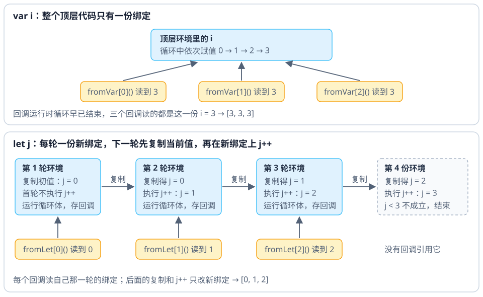

# 函数里的变量和 this 从哪来？

沿用主线一的报表页。本章看它的两段代码：给排序按钮注册点击日志的 `attachLogger(elementId, label)`，以及把一行报表格式化成文本的处理器 `service.onReport(report)`。注册函数早已返回，点击时回调为什么还读得到 `label`？同一个处理器作为方法调用正常，取出来单独调用却抛 `TypeError`，变的又是什么？

答案分两半。函数体里的变量按函数**定义**处的环境查找，closure (闭包)让这些绑定在外层调用返回后仍可访问；普通函数的 `this` 由每次**调用**的形式提供，闭包不保留它。本章先讲变量，再讲 `this`。

以下代码块彼此独立，注释给出求值结果。标为 HTML 的代码要在浏览器里运行；含非严格函数的代码块要作为 classic script (经典脚本)运行，因为模块代码总是严格模式。

## 名称沿函数定义处的环境链查找

读取一个标识符时，JavaScript 先在当前 lexical environment (词法环境)里找对应的 binding (绑定，即名称与值的关联)；找不到才去外层环境，逐层向外。“外层”指函数**定义**时所在的环境，不是调用它的地方。

下面的代码里有三个 `label`。按执行顺序走一遍：

1. 调用 `outer` 时，函数体执行前先做声明实例化：建立 `inner` 的绑定并创建函数对象。函数对象的内部槽 `[[Environment]]` 记下这次 `outer` 调用的环境。
2. 函数体执行，初始化 `label = "outer"`，返回 `inner`。`outer` 调用结束了，但返回的函数仍引用那份环境，所以环境不会被回收。
3. `callFromElsewhere` 调用这个返回值时，才为 `inner` 新建本次调用的环境，它的外层指向第 1 步记下的环境。

~~~javascript
const label = "global";

function outer() {
  const read = inner;
  const label = "outer";
  function inner() {
    const detail = "inner";
    return [label, detail];
  }
  return read;
}

function callFromElsewhere() {
  const label = "caller";
  const read = outer();
  return read();
}

callFromElsewhere(); // ["outer", "inner"]
~~~

`inner` 的环境里有 `detail`，没有 `label`，于是查找沿函数对象保存的外层环境继续，在 `outer` 那次调用里命中：

~~~mermaid
flowchart TB
  Q["inner 读取 label"] -->|先查当前环境| I["inner 的环境 有 detail；没有 label"]
  I -->|沿定义时的外层环境| O["outer 本次调用的环境 label = outer；命中并停止"]
~~~

调用者 `callFromElsewhere` 的环境（其中也有 `label`）不在这条链上。调用者能影响的只有实参，以及普通函数的 `this`。

图里的环境节点是规范描述名称查找用的抽象，引擎不必按这个形状分配对象。规范还用 execution context (执行上下文)描述正在执行的代码及其状态，用 environment record (环境记录)保存绑定。调用栈回答“哪些调用还没返回”，词法链回答“名称按什么顺序解析”：上例调用 `inner` 时，调用栈里有 `callFromElsewhere`，词法链里没有。

## 声明方式决定绑定建在哪里、何时可读

上一节假设绑定已经存在且有值。绑定建在哪个环境、何时初始化，取决于声明方式：

| 声明 | 绑定范围 | 初始化时机 | 重复声明与重新赋值 |
| --- | --- | --- | --- |
| `var` | 所在函数；在脚本或模块顶层时属于各自的顶层 | 进入作用域时就初始化为 `undefined`（与形参同名时沿用形参值）；`= 值` 要执行到这一行才运行 | 兼容的 `var` 可重复声明；可重新赋值 |
| `let` | 所在代码块，或脚本、模块顶层 | 进入作用域时建立未初始化的绑定，执行到声明才初始化；中间这段是 temporal dead zone (暂时性死区，TDZ) | 同一作用域不能重复声明；可重新赋值 |
| `const` | 同 `let` | 同 `let`；必须写初始化式（`for...in` / `for...of` 头部除外） | 同一作用域不能重复声明；不能重新赋值 |

~~~javascript
function readBeforeAssignment() {
  const before = status; // undefined
  if (true) {
    var status = "ready";
  }
  return [before, status];
}

let count = 0;
let tdzError;
{
  try {
    count;
  } catch (error) {
    tdzError = error.name;
  }
  let count = 1;
}

const options = { theme: "light" };
options.theme = "dark";
let reassignmentError;
try {
  options = {};
} catch (error) {
  reassignmentError = error.name;
}

[readBeforeAssignment(), tdzError, count, options.theme, reassignmentError];
// [[undefined, "ready"], "ReferenceError", 0, "dark", "TypeError"]
~~~

逐项看结果：

- `if` 块不为 `var` 新建绑定，函数开头读到的就是已初始化为 `undefined` 的同一个 `status`。
- 块里的 `let count` 从块开头起就遮蔽了外层 `count`。查找遇到这个尚未初始化的内层绑定就抛 `ReferenceError`，不会跳过它去读外层的 `0`；离开块后外层 `count` 仍是 `0`。
- `const` 只禁止给名称重新赋值，不冻结它指向的对象，所以 `options.theme` 能改成 `"dark"`。

兼容的 `var` 不能与同一作用域里冲突的 `let` / `const` 混用。新代码在绑定不需要重新赋值时用 `const`，需要时用 `let`；只有维护依赖函数作用域的旧代码才需要 `var`。

## 各宿主的“顶层”不同

上表说的“脚本或模块顶层”，在不同宿主里外层环境不同，top-level `this`（顶层 `this`）也不总是全局对象。要在所有环境里拿到当前 Realm (执行域，一套独立的全局对象和内建对象)的全局对象，标准写法是 `globalThis`。

| 运行方式 | 顶层声明 | 顶层 `this` | 全局对象入口 |
| --- | --- | --- | --- |
| 浏览器 classic script（`
~~~

模块怎样被找到、链接和执行，以及 CJS 包装函数的细节，见[import 写下后，谁负责找到、链接和执行文件？](./modules-and-host-boundaries.md)。

## 闭包保留的是绑定，不是快照

有了名称查找和初始化规则，就能准确地说闭包保留了什么：函数以后仍能访问它定义处可见的**绑定**，而绑定的值可以继续变化。

每次调用 `makeCounter(start)` 都建立一份独立的 `value`。`value++` 先读旧值，把加一后的值写回原绑定，再以旧值作表达式结果。所以第一次调用把 `value` 从 `10` 写成 `11` 并返回 `10`；第二次从 `11` 开始。

~~~javascript
function makeCounter(start) {
  let value = start;
  return () => value++;
}

const first = makeCounter(10);
const second = makeCounter(-2);
[[first(), first(), first()], [second(), second(), second()]];
// [[10, 11, 12], [-2, -1, 0]]
~~~

同一次调用也可以返回多个共享状态的函数。`increment`、`decrement`、`reset` 都访问同一份 `current`；`reset` 把它改回初值，不会新建计数器。

~~~javascript
function createCounter(init) {
  let current = init;
  return {
    increment() { return ++current; },
    decrement() { return --current; },
    reset() { return current = init; },
  };
}

const counter = createCounter(5);
[counter.increment(), counter.reset(), counter.decrement()]; // [6, 5, 4]
~~~

## 循环里的回调各读哪份绑定

闭包保留绑定，所以在循环里保存回调、稍后再调用时，关键是这些回调读同一份绑定还是每轮各一份。

`var` 循环变量在整个函数（顶层则是整个脚本或模块）只有一份绑定，每轮只是重新赋值；带 `let` 的 `for` 循环每轮提供新绑定。下面的代码各存三个回调，循环结束后再调用：

~~~javascript
const fromVar = [];
for (var i = 0; i < 3; i++) fromVar.push(() => i);

const fromLet = [];
for (let j = 0; j < 3; j++) fromLet.push(() => j);

[fromVar.map(fn => fn()), fromLet.map(fn => fn())];
// [[3, 3, 3], [0, 1, 2]]
~~~

下图画出两种循环里各有几份绑定、每个回调指向哪一份。`let` 循环的关键在相邻两轮之间：下一轮的新绑定先复制上一轮的当前值，`j++` 才在新绑定上执行，所以旧回调记住的那份绑定不会再被改写。

没有 `let` 的旧代码常用 Immediately Invoked Function Expression (IIFE，立即调用函数表达式)：每轮调用一次函数，借形参为每轮新建一份绑定。

~~~javascript
const callbacks = [];
for (var index = 0; index < 3; index++) {
  (function (capturedIndex) {
    callbacks.push(() => capturedIndex);
  })(index);
}
callbacks.map(fn => fn()); // [0, 1, 2]
~~~

## 工厂函数和延后执行的回调

工厂函数把一次调用的参数绑定留在闭包里，返回一个更专用的函数。`add(5)` 返回后 `x` 仍可读；它之后没有被赋值，看起来像“捕获了值 5”，其实只是没人改它。

~~~javascript
function add(x) {
  return function (y) {
    return x + y;
  };
}

const addFive = add(5);
addFive(3); // 8
~~~

同一机制回答了开头的问题。`attachLogger` 注册监听器后就返回了；之后点击时，箭头回调读的是那次 `attachLogger` 调用的 `label` 参数绑定。下例在页面 `<body>` 存在后运行，用 `dispatchEvent` 模拟点击：它同步派发事件，监听器在 `dispatchEvent` 返回前运行。

~~~javascript
function attachLogger(elementId, label) {
  document.getElementById(elementId).addEventListener("click", () => {
    console.log("Clicked: " + label);
  });
}

const sortButton = document.createElement("button");
sortButton.id = "sort-toggle";
document.body.append(sortButton);
attachLogger("sort-toggle", "sort");
sortButton.dispatchEvent(new MouseEvent("click"));
// 控制台输出："Clicked: sort"
~~~

`requestAnimationFrame` 的回调也是延后执行。每次调用 `animate` 都建立 `element`、`from`、`to`、`duration`、`start` 这几份绑定，之后不再赋值；每一帧的 `update` 都读同一次 `animate` 调用的这些绑定，算出当前位置，再决定是否请求下一帧。`performance.now()` 返回毫秒时间戳，所以 `duration` 也以毫秒计，且必须大于 `0`。

~~~javascript
function animate(element, from, to, duration) {
  const start = performance.now();

  function update() {
    const elapsed = performance.now() - start;
    const progress = Math.min(elapsed / duration, 1);
    element.style.left = from + (to - from) * progress + "px";
    if (progress < 1) requestAnimationFrame(update);
  }

  requestAnimationFrame(update);
}

const banner = document.createElement("div");
banner.textContent = "报表已更新";
banner.style.position = "relative"; // 静态定位元素上 left 不起作用
document.body.append(banner);
animate(banner, 0, 100, 1000);
~~~

进度到 `1` 时 `left` 停在 `100px`，不再请求下一帧。`position: relative` 只移动绘制位置，元素在正常流中占的空间不变。rAF 回调在事件循环里的位置见[事件循环怎样安排任务、微任务和渲染？](../browser/event-loop-tasks-and-rendering.md)。

闭包保留绑定，会不会造成内存泄漏？语言只保证返回的函数仍能读到它用到的绑定；引擎通常只保留闭包实际可能用到的部分。数据能否回收取决于可达性：长期挂着的监听器让它的闭包和闭包引用的数据一直可达，所以控件销毁时要移除监听器。循环引用本身不等于泄漏。可达性与保留路径见[对象什么时候能被回收，弱引用能帮什么、不能帮什么？](./memory-reachability-and-weak-references.md)。

## 普通函数的 this 由调用形式提供

现在看开头的第二个问题。报表服务用工厂函数 `makeReportHandler(tag)` 创建处理器：返回的普通函数通过闭包访问 `tag` 和计数器 `calls`，但闭包不会顺带保留 `this`。

~~~javascript
function makeReportHandler(tag) {
  let calls = 0;
  return function onReport(report) {
    "use strict";
    calls += 1;
    return this.format(report, tag, calls);
  };
}

const service = {
  prefix: "Sales",
  format(report, tag, sequence) {
    return `${this.prefix}/${tag}: ${report.title} #${sequence}`;
  },
  onReport: makeReportHandler("daily"),
};

const firstReport = service.onReport({ title: "May" });
const detached = service.onReport;
let detachedError;
try {
  detached({ title: "May" });
} catch (error) {
  detachedError = error.name;
}
const thirdReport = service.onReport({ title: "May" });
[firstReport, detachedError, thirdReport];
// ["Sales/daily: May #1", "TypeError", "Sales/daily: May #3"]
~~~

`service.onReport(...)` 是方法调用：属性访问 `service.onReport` 的基底 `service` 成为这次调用的 `this`；函数体里的 `this.format(...)` 又是方法调用，所以 `format` 里的 `this` 也是 `service`。存进变量 `detached` 再调用时，调用表达式里没有基底，严格函数的 `this` 是 `undefined`，读 `this.format` 抛 `TypeError`。失败发生在 `calls += 1` 之后，所以第三次调用返回 `#3`：`tag`、`calls` 来自定义处的环境，`this` 每次由调用形式重新提供。

普通函数的 `this` 分两步确定：

1. **调用表达式给出初值**，即 receiver (接收者)。`obj.m()` 或 `obj[key]()` 把属性访问的基底作为接收者，基底也可以是原始值，如 `"May".toString()`；变量裸调 `fn()` 给出 `undefined`。唯一的例外是非严格代码的 `with` 块，它可以为裸调提供对象接收者。
2. **被调函数的模式决定怎样用这个初值**，下一节展开。

## 严格模式改变 this 的第二步

strict mode (严格模式)把一些历史上静默出错的写法变成异常，也改变普通函数使用 `this` 初值的方式。经典脚本或函数体开头写 `"use strict"` 启用它；ES 模块和 class 内的代码自动严格。

strict function (严格函数)原样使用初值。sloppy function (非严格函数)把 `null` 或 `undefined` 换成函数所属 Realm 的全局 `this`，并把数字、字符串、布尔值、BigInt、Symbol 接收者装箱成对象：

| 被调函数模式 | 裸调 `fn()` | `fn.call(null)` | `fn.call(7)` |
| --- | --- | --- | --- |
| 严格函数 | `undefined` | `null` | 原始数字 `7` |
| 非严格函数 | 所属 Realm 的全局 `this` | 所属 Realm 的全局 `this` | `Number` 包装对象 |

起作用的是**被调函数**的模式，不是调用处的：

~~~javascript
function sloppyTarget() {
  return this;
}

function strictCaller() {
  "use strict";
  return sloppyTarget();
}
strictCaller() === globalThis; // true：被调函数仍按非严格规则替换 undefined

function writeUndeclaredName() {
  "use strict";
  undeclaredName = 1;
}
try {
  writeUndeclaredName();
} catch (error) {
  error.name; // "ReferenceError"：不会悄悄创建全局变量
}
~~~

严格代码还会在给不可写属性赋值时抛 `TypeError`，并禁止 `with`、旧式八进制字面量和重复形参。严格模式不是安全沙箱，也不会让 `eval` 变安全。

## call、apply 与 bind 显式指定接收者

除了调用形式，还可以用函数自带的 `call`、`apply`、`bind` 指定接收者。三者的第一个参数都是 `thisArg`，原样交给目标，再由目标按上一节的模式规则处理；区别在何时执行、实参从哪来：

| 方法 | 目标何时执行 | 实参来源 |
| --- | --- | --- |
| `call` | 立即 | 后续分开的参数 |
| `apply` | 立即 | 省略或传 `null` / `undefined` 时为空列表；否则必须是对象，按它的 `length` 和数字索引读取，不遍历迭代器 |
| `bind` | 调用返回的新函数时 | 保存的前置参数，加上调用时的参数 |

目标若是箭头函数或 bound function (绑定函数)，会忽略传入的 `thisArg`。

~~~javascript
function describe(prefix, report, punctuation) {
  "use strict";
  const message = this.prefix + ": " + prefix + " " + report.title;
  return message + (punctuation === undefined ? "" : punctuation);
}

const salesContext = { prefix: "Sales" };
const report = { title: "May" };
const boundDescribe = describe.bind(salesContext, "Ready");
const reboundDescribe = boundDescribe.bind({ prefix: "Ignored" }, report, "!");

[
  describe.call(salesContext, "Ready", report),
  describe.apply(salesContext, ["Ready", report]),
  describe.apply(salesContext, { 0: "Ready", 1: report, length: 2 }),
  boundDescribe(report),
  reboundDescribe(),
];
// 前四项都是 "Sales: Ready May"，最后一项是 "Sales: Ready May!"

function countArgs() {
  return arguments.length;
}
let primitiveListError;
try {
  countArgs.apply(salesContext, "May");
} catch (error) {
  primitiveListError = error.name;
}
[
  countArgs.apply(salesContext),
  countArgs.apply(salesContext, null),
  countArgs.apply(salesContext, { 0: "one", length: 1 }),
  countArgs.apply(salesContext, new Set(["one"])),
  primitiveListError,
];
// [0, 0, 1, 0, "TypeError"]
~~~

- 对绑定函数再 `bind`，不替换最初保存的接收者，但新的前置参数追加在原有前置参数之后，所以 `reboundDescribe()` 仍用 `Sales`，并多了 `"!"`。
- `Set` 实例没有 `length`，`apply` 又不读迭代器，于是得到空实参列表；原始字符串不是对象，作实参列表会抛 `TypeError`。
- 用 `new` 调用可构造的绑定函数时，已保存的接收者被忽略，前置参数保留，见[new 一个对象时发生了什么？](./construction-and-new.md#绑定函数构造时丢弃保存的%20this)。自己写包装函数模拟 `bind` 得不到这种构造行为，也得不到相同的 `name`、`length`。

## 箭头函数读外层的 this

arrow function (箭头函数)没有自己的 `this`、`arguments`、`super` 和 `new.target`，读的是定义处外层的 lexical `this`（词法 `this`）。`call`、`apply`、`bind` 能传参或预填参数，但换不掉这个 `this`。箭头函数也不能用 `new` 构造，且没有自有的 `prototype` 属性。

~~~javascript
function makePanel(title) {
  return {
    title,
    read() { return this.title; },
    readArrow: label => this.title + ":" + label,
  };
}

const panel = makePanel.call({ title: "Outer" }, "May");
const arrowReader = panel.readArrow;
let arrowConstructError;
try {
  new arrowReader();
} catch (error) {
  arrowConstructError = error.name;
}
[
  panel.read(),
  panel.readArrow("direct"),
  panel.readArrow.call({ title: "Call" }, "call"),
  panel.readArrow.apply({ title: "Apply" }, ["apply"]),
  panel.readArrow.bind({ title: "Bind" }, "bind")(),
  Object.hasOwn(arrowReader, "prototype"),
  arrowConstructError,
];
// ["May", "Outer:direct", "Outer:call", "Outer:apply", "Outer:bind", false, "TypeError"]
~~~

`makePanel` 这次调用经 `call` 收到 `{ title: "Outer" }` 作 `this`。`readArrow` 调用时访问的就是这次调用的 `this`，所以总是 `"Outer"`，后面三种显式指定都无效，但实参照常传入。`panel.read()` 是普通方法，才以 `panel` 为接收者。需要对象作接收者时用普通方法；需要沿用外层 `this` 时才用箭头函数。

宿主 API 调用回调时也会提供接收者。普通函数作 DOM 事件监听器时，`this` 是注册监听器的那个对象（`event.currentTarget`），箭头函数则仍是外层 `this`，详见[一次点击怎样传播到处理器，处理器该怎样注册和清理？](../browser/dom-events.md)。

> [!example]- 练习：借方法调用实现一个范围受限的 call 与 apply
>
> 既然方法调用以基底为 `this`，就能借它模拟 `call`：把函数放到接收者的一个临时 Symbol 键上，以 `receiver[key](...)` 调用，再删掉这个键。唯一的 Symbol 避免与已有字符串键冲突；`finally` 保证目标抛错时也尝试删除。
>
> ~~~javascript
> function callWithObjectReceiver(fn, receiver, ...args) {
>   if (receiver === null ||
>       (typeof receiver !== "object" && typeof receiver !== "function")) {
>     throw new TypeError("This exercise requires an object receiver");
>   }
>   const key = Symbol("temporary call");
>   Object.defineProperty(receiver, key, { value: fn, configurable: true });
>   try {
>     return receiver[key](...args);
>   } finally {
>     delete receiver[key];
>   }
> }
>
> function applyWithObjectReceiver(fn, receiver, args) {
>   const list = args === null || args === undefined
>     ? []
>     : Array.prototype.slice.call(args); // 复制类数组实参
>   return callWithObjectReceiver(fn, receiver, ...list);
> }
>
> const receiver = { base: 10 };
> function addToBase(a, b) { "use strict"; return this.base + a + b; }
> function countArgs() { return arguments.length; }
> function failAfterReceivingThis() {
>   "use strict";
>   if (this !== receiver) throw new TypeError("receiver was lost");
>   throw new Error("target failed");
> }
> let failureName;
> try {
>   callWithObjectReceiver(failAfterReceivingThis, receiver);
> } catch (error) {
>   failureName = error.name;
> }
> [
>   callWithObjectReceiver(addToBase, receiver, 1, 2),
>   applyWithObjectReceiver(countArgs, receiver, null),
>   applyWithObjectReceiver(addToBase, receiver, [3, 4]),
>   failureName,
>   Object.getOwnPropertySymbols(receiver).length,
> ];
> // [13, 0, 17, "Error", 0]
> ~~~
>
> 这个练习只覆盖有限契约：
>
> - 只接受对象或函数接收者。原生 `call` / `apply` 把任何值交给目标，再由目标按自身模式决定是否转换。
> - 箭头函数和绑定函数会忽略这个方法接收者。
> - 不可扩展对象、Proxy 和宿主对象可能让定义、读取或删除属性失败或产生额外行为。目标若把临时键改成不可配置，非严格模式下删除返回 `false`，键会留下；严格模式下删除抛 `TypeError`，并可能覆盖目标原先抛出的异常。
> - 不完全复现原生 `apply` 对非对象实参列表的检查。
>
> 练习常写成 `Function.prototype.myCall`；那会修改共享内置对象，应用代码应直接用内置方法。

## 包装函数要同时保住这两个来源

本章得出两条规则：变量来自函数定义处的环境链，闭包让这些绑定活得比外层调用更久；普通函数的 `this` 来自每次调用的形式，再经严格模式处理，箭头函数则沿用外层的 `this`。

下一章把两条规则用在包装函数上：包装器用闭包保存计时器、缓存这类跨调用的状态，又必须把调用者的 `this` 和全部实参转给原函数。见[怎样包装一个函数而不弄丢参数、this 和结果？](./wrapping-functions.md)。

> [!info]- 来源
> - 名称查找沿词法环境链（“名称沿函数定义处的环境链查找”）：[ECMAScript 2026 Execution Contexts](https://tc39.es/ecma262/2026/multipage/executable-code-and-execution-contexts.html#sec-execution-contexts)、[Environment Records](https://tc39.es/ecma262/2026/multipage/executable-code-and-execution-contexts.html#sec-environment-records)、[GetIdentifierReference](https://tc39.es/ecma262/2026/multipage/executable-code-and-execution-contexts.html#sec-getidentifierreference)、[NewFunctionEnvironment](https://tc39.es/ecma262/2026/multipage/executable-code-and-execution-contexts.html#sec-newfunctionenvironment)；函数对象的 `[[Environment]]`：[ECMAScript Function Objects](https://tc39.es/ecma262/2026/multipage/ordinary-and-exotic-objects-behaviours.html#sec-ecmascript-function-objects)（§10.2）。
> - `var` / `let` / `const` 的绑定建立、初始化与声明限制（“声明方式决定绑定建在哪里、何时可读”）：[ECMAScript 2026 FunctionDeclarationInstantiation](https://tc39.es/ecma262/2026/multipage/ordinary-and-exotic-objects-behaviours.html#sec-functiondeclarationinstantiation)、[Source Text Module Record InitializeEnvironment](https://tc39.es/ecma262/2026/multipage/ecmascript-language-scripts-and-modules.html#sec-source-text-module-record-initialize-environment)、[Let and Const Declarations](https://tc39.es/ecma262/2026/multipage/ecmascript-language-statements-and-declarations.html#sec-let-and-const-declarations)、[Variable Statement](https://tc39.es/ecma262/2026/multipage/ecmascript-language-statements-and-declarations.html#sec-variable-statement)。
> - 各宿主的顶层与全局（“各宿主的‘顶层’不同”）：[WHATWG HTML The `script` element](https://html.spec.whatwg.org/multipage/scripting.html#the-script-element)、[Workers: The global scope](https://html.spec.whatwg.org/multipage/workers.html#the-global-scope)（Living Standard，核对日期 2026-11-12）；Node.js [CommonJS module wrapper](https://nodejs.org/api/modules.html#the-module-wrapper) 与 [ECMAScript modules](https://nodejs.org/api/esm.html)（官方文档 26.13.1，实际回放 Node.js 26.13.0）。
> - `for (let ...)` 每轮复制绑定再更新（“循环里的回调各读哪份绑定”）：[ECMAScript 2026 ForBodyEvaluation](https://tc39.es/ecma262/2026/multipage/ecmascript-language-statements-and-declarations.html#sec-forbodyevaluation)、[CreatePerIterationEnvironment](https://tc39.es/ecma262/2026/multipage/ecmascript-language-statements-and-declarations.html#sec-createperiterationenvironment)。
> - 延后回调示例的宿主 API（“工厂函数和延后执行的回调”）：[Document.body](https://html.spec.whatwg.org/multipage/dom.html#dom-document-body)、[WHATWG DOM `dispatchEvent`](https://dom.spec.whatwg.org/#dom-eventtarget-dispatchevent)、[`addEventListener`](https://dom.spec.whatwg.org/#dom-eventtarget-addeventlistener)、[WHATWG HTML `requestAnimationFrame`](https://html.spec.whatwg.org/multipage/imagebitmap-and-animations.html#dom-animationframeprovider-requestanimationframe)（Living Standard，核对日期 2026-11-12）；[W3C High Resolution Time `performance.now()`](https://www.w3.org/TR/hr-time-3/#dom-performance-now)（Level 3）；[CSS Positioned Layout Level 3 `position: relative`](https://drafts.csswg.org/css-position-3/#valdef-position-relative)（Editor’s Draft，2026-05-14）。
> - 调用形式提供接收者、严格与非严格函数的 `this` 转换（“普通函数的 this 由调用形式提供”“严格模式改变 this 的第二步”）：[ECMAScript 2026 Function Calls](https://tc39.es/ecma262/2026/multipage/ecmascript-language-expressions.html#sec-function-calls)、[EvaluateCall](https://tc39.es/ecma262/2026/multipage/ecmascript-language-expressions.html#sec-evaluatecall)、[OrdinaryCallBindThis](https://tc39.es/ecma262/2026/multipage/ordinary-and-exotic-objects-behaviours.html#sec-ordinarycallbindthis)（§10.2.1.2）、[Strict Mode Code](https://tc39.es/ecma262/2026/multipage/ecmascript-language-source-code.html#sec-strict-mode-code)。
> - 显式接收者与绑定函数（“call、apply 与 bind 显式指定接收者”）：[ECMAScript 2026 Function.prototype.call](https://tc39.es/ecma262/2026/multipage/fundamental-objects.html#sec-function.prototype.call)、[Function.prototype.apply](https://tc39.es/ecma262/2026/multipage/fundamental-objects.html#sec-function.prototype.apply)、[Function.prototype.bind](https://tc39.es/ecma262/2026/multipage/fundamental-objects.html#sec-function.prototype.bind)。
> - 箭头函数没有自己的 `this` 等绑定（“箭头函数读外层的 this”）：[ECMAScript 2026 Arrow Function Definitions](https://tc39.es/ecma262/2026/multipage/ecmascript-language-functions-and-classes.html#sec-arrow-function-definitions)；普通函数监听器以 `currentTarget` 为 `this`：[WHATWG DOM Event Listener Invocation](https://dom.spec.whatwg.org/#concept-event-listener-invoke)。
